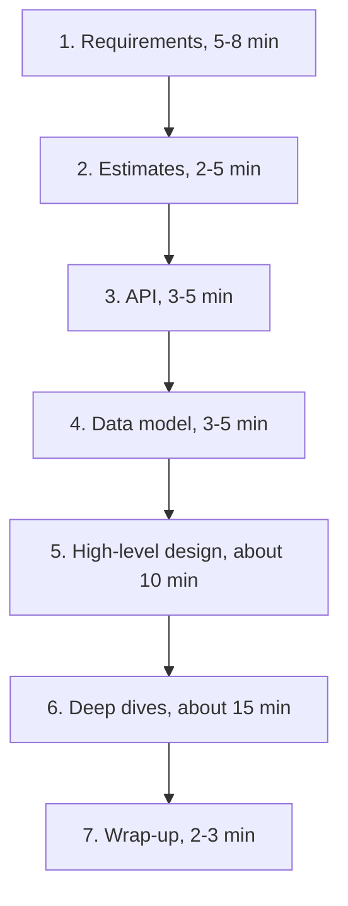
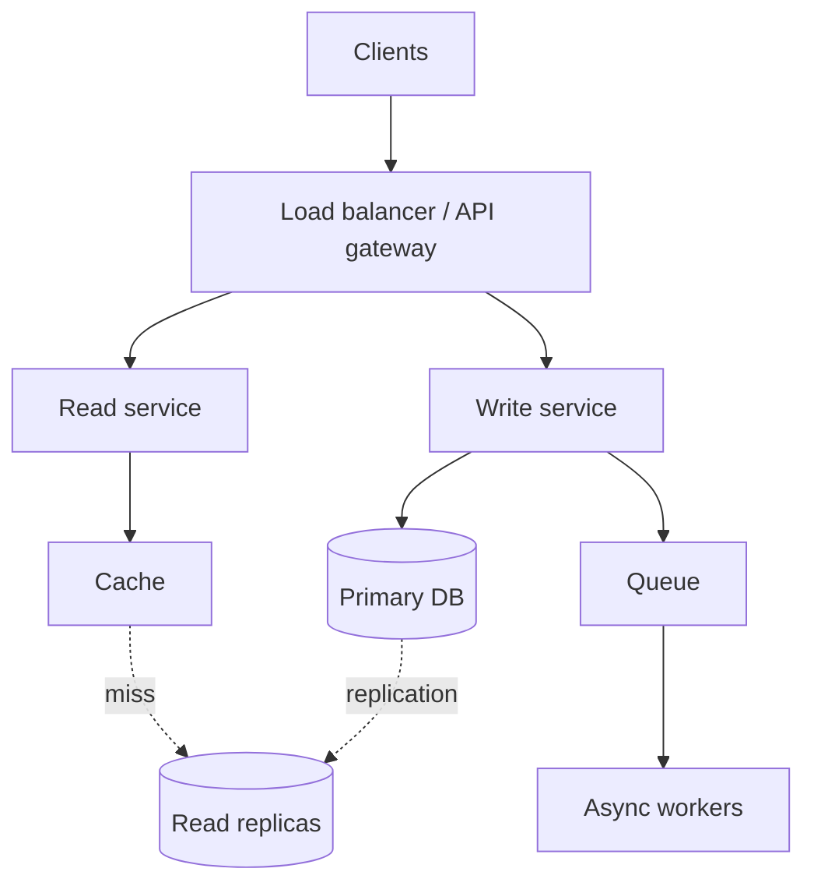

# The System Design Interview Framework

[⬅ Back to index](../README.md)

Covers: how the round is scored, a step-by-step 45-minute framework, requirements, API and data model, high-level design, deep dives, trade-offs, what changes by level, common mistakes and how to practise.

---

### 1. What is a system design interview actually testing?

<details>
<summary>Answer</summary>

**In short:** It tests how you think through an open-ended engineering problem, not whether you know one "correct" architecture (there isn't one). Interviewers score problem navigation, solution design, technical depth, and communication of trade-offs.

#### Why the round exists

On the job, senior engineers rarely get a precise spec. They get "we need X, it must handle Y, and it has to ship this quarter." The system design round simulates that: a vague prompt, limited time, and a colleague (the interviewer) you can question. The company wants to see whether you can turn ambiguity into a design that works and explain why you chose it.

#### The four things most rubrics score

| Dimension | What the interviewer looks for | Red flag |
|---|---|---|
| **Problem navigation** | You clarify the prompt, agree on scope, and spend time on what matters most | Drawing boxes in minute one |
| **Solution design** | A working end-to-end design whose parts fit together and meet the requirements | Components that don't connect, or a design that ignores a stated requirement |
| **Technical depth** | Going deep on 1–3 hard parts (data model, hot path, consistency) and backing choices with numbers | Staying shallow everywhere |
| **Communication and trade-offs** | You explain *why*, compare options, take hints, and adapt when pushed | Buzzwords without reasons; arguing with hints |

Exact wording varies by company, but nearly every public rubric (and every interviewer debrief) reduces to some version of these.

#### What "good" looks like

A candidate who draws a simple design and explains every trade-off clearly usually beats one who lists Kafka, Cassandra and Kubernetes without saying what problem each solves. The interviewer is effectively asking: "Would I trust this person to lead the design review for a new service on my team?"

Think of it like a doctor's diagnosis: the examiner cares less about the final prescription than about whether you asked the right questions, ruled things out for good reasons, and noticed the risks.

**Common pitfalls**
- Treating it as a trivia test and reciting a memorised design for "Twitter".
- Optimising for completeness instead of depth; covering 12 components shallowly scores worse than 6 components with two solid deep dives.
- Going quiet while thinking; silent reasoning can't be scored.

**Likely follow-ups**
- *"Is there a right answer?"* No; there are designs that do or don't meet the agreed requirements, and the reasoning is what's scored.
- *"Does the interviewer want me to drive?"* Yes, especially at senior levels; drive the agenda but check in regularly.

</details>

### 2. What's a good step-by-step framework for a 45–60 minute round?

<details>
<summary>Answer</summary>

**In short:** Requirements → estimates → API → data model → high-level design → deep dives → wrap-up. Spend roughly the first 15 minutes setting up, 10 on the high-level design, 15+ on deep dives, and keep a couple of minutes to summarise.



#### Why a framework helps

Forty-five minutes disappears fast. Without structure, candidates either over-spend on requirements or rush into a diagram and then discover halfway through that they misunderstood the problem. A fixed sequence gives you a checklist you can follow under pressure and lets the interviewer see you're methodical.

#### Each step, and what it produces

1. **Requirements (5–8 min)**: list 3–5 core features and agree on scope. Then the non-functional needs that shape the architecture: scale, latency, availability vs consistency, durability. *Output:* a short written list you'll refer back to.
2. **Estimates (2–5 min)**: only the numbers that drive decisions: read and write QPS, storage per year, peak bandwidth. *Output:* "read-heavy, ~50K peak read QPS, ~30 TB over 5 years."
3. **API (3–5 min)**: the main endpoints or RPCs with request and response shapes. *Output:* the contract every later box must serve.
4. **Data model (3–5 min)**: entities, key fields, access patterns, and which store fits, including the partition key.
5. **High-level design (~10 min)**: clients, load balancer, services, databases, caches, queues. Walk one read and one write end to end through it.
6. **Deep dives (~15 min)**: the 2–3 hardest parts, chosen by you or the interviewer: hot keys, fan-out, consistency, sharding, failure handling.
7. **Wrap-up (2–3 min)**: summarise the design against the requirements, name remaining bottlenecks, and say what you'd add with more time (monitoring, security, cost, multi-region).

#### Adapting it

- In a 60-minute round, give the extra time to deep dives, not to requirements.
- Some interviewers want to skip estimates or the API; follow their lead. The framework is a default, not a script.
- If the interviewer jumps straight to "how would you scale the feed?", answer it; you can backfill requirements briefly.

Keep talking throughout and check in at the transitions: "Does this scope work for you?" "Should I go deeper on the feed or on storage?"

**Common pitfalls**
- Spending 15 minutes on requirements and estimates, leaving no time for depth.
- Skipping the end-to-end walkthrough, so the design is never shown to actually work.
- No wrap-up; the interviewer's last impression is an unfinished tangent.

**Likely follow-ups**
- *"Can I skip estimates?"* If they won't change a decision, say so in one sentence and move on.
- *"What if the interviewer interrupts?"* Follow them; their interruptions point at what they want to score.

</details>

### 3. How do you gather requirements well?

<details>
<summary>Answer</summary>

**In short:** Split requirements into functional (what the system does) and non-functional (how well: scale, latency, consistency, durability). Ask targeted questions, write the answers down, state assumptions where the interviewer doesn't care, and keep it under about 8 minutes.

#### Why it matters

Requirements decide the architecture. "Design a chat app" for 1,000 users in one office and for 2 billion users worldwide are completely different systems. Asking the right questions up front also proves you won't build the wrong thing at work.

#### Functional requirements

Ask: "Who are the users, and what are the top three things they do?" For a news feed, that might be: post, follow, view feed. Then explicitly mark **out of scope** items ("no DMs, no ads ranking, no search"). Writing out-of-scope items down protects your time later.

#### Non-functional requirements (the ones that change the design)

| Requirement | Question to ask | How it changes the design |
|---|---|---|
| **Scale** | DAU/MAU? Data size? Growth? | One DB vs sharding; one region vs many |
| **Read/write ratio** | Mostly reads or writes? | Read-heavy: caches, replicas, precomputation. Write-heavy: partitioning, queues, LSM-tree stores |
| **Latency** | p99 target for the hot path? | Caching, edge serving, async work off the request path |
| **Availability vs consistency** | Can users see stale data briefly? | Feed likes: eventual is fine. Bank balance, seat booking: needs strong consistency |
| **Durability** | Can we ever lose data? | Replication, write-ahead logs, sync vs async replication |
| **Geography** | One region or global? Data residency? | Multi-region replication, geo-routing, per-region data |
| **Special constraints** | Real-time? Offline? Cost? Privacy? | WebSockets, client sync, cheaper storage tiers, encryption |

#### Example exchange

> "Before I design, a few questions. Is this for a global audience? Roughly how many daily users, 10M or 500M? Is it OK if a new post takes a few seconds to show up in followers' feeds? And should I include media uploads, or just text?"

Then summarise: "So: 200M DAU, global, read-heavy, feed staleness of a few seconds is fine, text and images, no DMs."

#### Making assumptions

Some interviewers answer "you decide." Then pick a reasonable number and say it out loud ("I'll assume 100M DAU"). A stated assumption is fine; an unstated one is invisible to the grader.

**Common pitfalls**
- Asking 20 questions, or questions that don't affect the design ("what colour is the button?").
- Forgetting non-functional requirements entirely.
- Not writing requirements down, then contradicting them later.

**Likely follow-ups**
- *"Which non-functional requirement matters most here?"* Name one and tie it to a design decision (e.g. "low read latency, so the feed is precomputed").
- *"What would you cut if time were short?"* The features most decoupled from the core flow.

</details>

### 4. How should you design the API in the interview?

<details>
<summary>Answer</summary>

**In short:** Write 3–6 endpoints that cover the functional requirements, with their key parameters and responses. Pick the API style and justify it, and mention cursor pagination, idempotency keys for unsafe writes, auth from the token, rate limiting and versioning.

#### Why define the API early

The API is the contract between clients and your system. Writing it forces you to make the functional requirements concrete ("what exactly does 'post' take?") and gives every later component a clear job: something has to serve each endpoint.

#### Example: a few endpoints from common prompts

```
POST /v1/urls                     { longUrl, customAlias?, expiresAt? } -> 201 { shortUrl }
GET  /{code}                      -> 301/302 redirect to longUrl
POST /v1/posts                    { text, mediaIds[] }  (header Idempotency-Key) -> 201 { postId }
GET  /v1/feed?cursor=abc&limit=20 -> { items[], nextCursor }
```

Notice what's *not* there: no `userId` in the body. The authenticated user comes from the token, so a client can't post as someone else.

#### Choosing a style

| Style | Good for | Trade-off |
|---|---|---|
| **REST over HTTP** | Public and mobile APIs; simple, cacheable by HTTP semantics | Can over- or under-fetch; many round trips for complex screens |
| **gRPC** | Internal service-to-service calls; low latency, typed contracts, streaming | Not natively browser-friendly; harder to debug by hand |
| **GraphQL** | Many clients needing different shapes of the same data | Harder caching, risk of expensive queries without limits |
| **WebSocket / SSE** | Server push: chat, live scores, notifications | Stateful connections to manage and scale |

A common, sensible answer: "REST for clients, gRPC between internal services, WebSocket for real-time delivery."

#### Details that score well

- **Cursor pagination** for feeds and lists. Offset pagination (`?page=500`) gets slow on large tables and shows duplicates or gaps when new items are inserted. A cursor (e.g. the last item's timestamp + id) is stable and indexable.
- **Idempotency keys** on writes that must not double-apply (payments, orders, posts). The client generates a key; the server stores it with the result and returns the same result on a retry.
- **Rate limits** per user/API key, returning `429` with `Retry-After`.
- **Versioning** (`/v1`) so you can evolve the contract without breaking old app versions.
- **Correct status codes and redirects**, e.g. 301 (cacheable, fewer hits but loses analytics) vs 302 (every hit reaches you) for a URL shortener.

**Common pitfalls**
- Spending 10 minutes listing every CRUD endpoint; only the core ones matter.
- Passing `userId` as a parameter for "my" resources.
- Offset pagination for an infinite feed.

**Likely follow-ups**
- *"How do you make POST /payments safe to retry?"* Idempotency key stored with a unique constraint; return the stored response on duplicates.
- *"Why cursor over offset?"* Stable under inserts and uses an index seek instead of scanning skipped rows.

</details>

### 5. How do you choose a data model and database in the interview?

<details>
<summary>Answer</summary>

**In short:** Start from entities and access patterns, not from a favourite database. List the queries the system must serve, pick the store that serves them efficiently (relational is a good default), and say how it scales: indexes, replicas, and the partition key.

#### Step by step

1. **List entities and key fields.** For a Twitter-like app: `User(id, name)`, `Tweet(id, author_id, text, created_at)`, `Follow(follower_id, followee_id)`.
2. **List the access patterns.** "Get a user's tweets sorted by time", "get who a user follows", "count likes on a tweet", "get a URL by short code". These drive everything.
3. **Pick the store that serves those patterns.**
4. **Say how it scales**: which indexes, read replicas, and above all the **partition (shard) key**.

#### Store cheat sheet

| Store type | Examples | Choose when |
|---|---|---|
| **Relational** | PostgreSQL, MySQL | Relationships, transactions, flexible queries, moderate scale. A strong default. |
| **Key-value / wide-column** | DynamoDB, Cassandra | Huge scale, lookups by key, high write throughput, predictable access patterns |
| **Document** | MongoDB | Flexible, nested records read as a whole |
| **Search index** | Elasticsearch, OpenSearch | Full-text and faceted search (usually fed from the primary DB) |
| **Blob / object storage** | Amazon S3, GCS | Images, video, files; keep only metadata and the object key in the DB |
| **Graph** | Neo4j | Deep multi-hop relationship traversals |
| **Time series** | InfluxDB, TimescaleDB | Metrics and events queried by time range |

#### Example: designing for the access pattern

```sql
-- Access pattern: "latest 20 tweets by a user"
CREATE TABLE tweets (
  tweet_id    BIGINT PRIMARY KEY,      -- e.g. Snowflake-style, time-sortable
  author_id   BIGINT NOT NULL,
  text        VARCHAR(280),
  created_at  TIMESTAMP NOT NULL
);
CREATE INDEX idx_author_time ON tweets (author_id, created_at DESC);
-- Shard by author_id so one user's tweets live on one shard.
```

The partition key decides which queries are cheap. Sharding tweets by `author_id` makes "a user's tweets" a single-shard query, but "all tweets with hashtag X" becomes a scatter-gather across every shard, which is why search goes to a separate index.

#### What to say

"Postgres, sharded by `user_id`, with read replicas for the read-heavy profile path, because we need transactions for follows and our largest table is a few TB" beats naming five databases. Polyglot persistence (one store per need) is normal, but each store must earn its place.

**Common pitfalls**
- Choosing NoSQL "because it scales" without naming the access pattern it serves.
- Forgetting the partition key, or picking one that creates hot spots (e.g. sharding by date so today's shard takes all writes).
- Storing large blobs in the database.

**Likely follow-ups**
- *"SQL or NoSQL here?"* Answer from the access patterns, consistency needs and scale, not preference.
- *"What happens with a celebrity user on your shard?"* Hot partition: cache, split the key, or handle that user specially.

</details>

### 6. How do you present the high-level design?

<details>
<summary>Answer</summary>

**In short:** Draw the minimum set of components that meets the requirements, then walk one write and one read through it end to end. Start simple and evolve the design as numbers or requirements force you to, explaining each change.



#### Start simple, then evolve

Begin with something almost naive: client → service → database. Then let the requirements push you: "At 50K writes/s a single primary won't keep up, so I'll partition by user. Reads are 20× writes, so I'll add a cache in front of replicas. Thumbnail generation is slow, so it goes to a queue and async workers." Each addition has a reason, which shows reasoning rather than a memorised diagram.

#### Walk a request through

Narrate a concrete path, for example a post:

1. The client sends `POST /v1/posts` to the load balancer, which routes to a write service instance.
2. The write service authenticates, validates, writes the post to the primary DB, and publishes a `PostCreated` event to the queue.
3. Workers consume the event: fan out to followers' feed caches, generate thumbnails, update search.
4. A follower's `GET /v1/feed` hits the read service, which reads the precomputed feed from cache and falls back to replicas on a miss.

This walkthrough is where gaps show up ("wait, where do media files go?"), which is far better found by you than by the interviewer.

#### Presentation tips

- **Separate read and write paths** when the ratio is skewed; they scale differently.
- **Label arrows** with what they carry: sync HTTP/gRPC vs async event.
- **Label stores** with their type and partition key.
- **Keep it legible**; detail belongs in the deep dives, not in the first diagram.

**Common pitfalls**
- Starting with 15 microservices and a service mesh for a problem one service can handle.
- Boxes with no arrows, or arrows with no meaning.
- Never connecting the diagram back to the API and requirements.

**Likely follow-ups**
- *"Why a queue there?"* To take slow or failure-prone work off the request path and absorb spikes.
- *"What's the single point of failure?"* Point at it honestly (often the primary DB) and say how you'd make it redundant.

</details>

### 7. What should you cover in deep dives?

<details>
<summary>Answer</summary>

**In short:** Go deep on the 2–3 parts where the system would actually break: the hot path at scale, data consistency, and failure handling, backing each with numbers. If the interviewer steers you to a specific problem, that is the deep dive they want.

#### Why deep dives matter most

The high-level design shows you know the building blocks; the deep dive shows you can engineer. It's usually where the hire / no-hire decision for senior candidates is made.

#### Typical deep-dive areas

| Area | Questions to answer | Typical tools |
|---|---|---|
| **Scaling the hot path** | What breaks at peak QPS? Hot keys? Celebrity fan-out? | Caching, sharding strategy, precomputation, hybrid fan-out |
| **Data consistency** | Concurrent writes? Double submits? Partial failures across services? | Transactions, optimistic locking, idempotency keys, sagas, outbox pattern |
| **Failure handling** | Node, DB, or whole region down? | Replication, failover, retries with backoff and jitter, circuit breakers, graceful degradation |
| **Bottleneck numbers** | Does each component fit its limits? | "One Postgres primary handles ~5–10K writes/s; we need 50K, so we partition by user_id into ~16 shards" |
| **Special features** | Ranking, search, real-time delivery, geo queries | Search index, WebSockets, geohash or quadtree |

#### How to run a deep dive

1. **State the problem precisely**: "A celebrity with 100M followers posts. With fan-out on write that's 100M cache inserts."
2. **Offer two or three options** with their costs.
3. **Choose one and tie it to requirements**: "Hybrid: fan out on write for normal users, pull celebrity posts at read time and merge."
4. **Check failure and edge cases**: "If the fan-out worker crashes mid-way, the event stays in the queue and is retried; inserts are idempotent by post_id."

#### Choosing what to dive into

If the interviewer doesn't steer, pick what is unique to this problem: for a URL shortener, key generation and the read cache; for chat, message delivery and ordering; for a payment system, idempotency and consistency. Ask: "I think the interesting parts are X and Y; which would you like first?"

Often the interviewer steers you ("what if a celebrity with 100M followers posts?"). Treat that as the point of the round, not an interruption.

**Common pitfalls**
- Deep-diving into something generic (load balancer algorithms) while ignoring the problem-specific bottleneck.
- Claiming something "scales horizontally" without saying how data is partitioned.
- Ignoring what happens when things fail halfway.

**Likely follow-ups**
- *"What if this component goes down?"* Explain detection, failover, and what users see meanwhile.
- *"How would you know it's broken in production?"* Metrics, alerts on SLOs, tracing.

</details>

### 8. How do you discuss trade-offs convincingly?

<details>
<summary>Answer</summary>

**In short:** Use the pattern "Option A vs B → what we gain → what we pay → why it fits our requirements." Always tie the choice back to a requirement you stated earlier, and acknowledge the downside instead of hiding it.

#### Why trade-offs are the core of the round

Every design choice gives up something. Interviewers want evidence that you see both sides and choose deliberately. "I'd use Cassandra" is a statement; "I'd use Cassandra because we need 100K writes/s and only key lookups, accepting that we lose joins and ad-hoc queries" is engineering.

#### The pattern in practice

> "We could fan out on write so feeds are precomputed: reads become one cache lookup, but a celebrity post means 100M writes. Fan-out on read avoids that but makes every feed load expensive. Since reads are 100× writes, I'll fan out on write for normal users and merge celebrity posts at read time."

That answer names both options, the gain and the cost of each, and anchors the decision in a stated number (the read:write ratio).

#### Common trade-off axes

| Axis | Example decision |
|---|---|
| **Consistency vs availability** | Shopping cart stays writable during a partition (AP) vs bank ledger rejects writes (CP) |
| **Latency vs throughput** | Batch writes to Kafka for throughput, adding a few ms of latency |
| **Read cost vs write cost** | Precompute (denormalise) to make reads cheap at the cost of more writes and storage |
| **Simplicity vs flexibility** | Monolith first vs microservices |
| **Cost vs performance** | Keep everything in RAM vs tier cold data to cheaper storage |
| **Build vs buy** | Managed queue service vs running your own Kafka cluster |
| **Freshness vs load** | Longer cache TTLs reduce DB load but serve staler data |

#### Making it convincing

- **Quantify** where possible: "this adds ~50 ms per request" or "this doubles storage."
- **Say what would change your mind**: "If we needed strong consistency for likes, I'd switch to..."
- **Be willing to revise.** If the interviewer points out a cost you missed, accept it and adjust; that scores well.

**Common pitfalls**
- Presenting only the upside of your choice.
- Generic trade-offs not tied to this system's requirements.
- Saying "it depends" without then saying what it depends on and deciding.

**Likely follow-ups**
- *"What's the biggest weakness of your design?"* Name it honestly and say how you'd mitigate it.
- *"When would you choose the other option?"* Describe the requirement change that would flip the decision.

</details>

### 9. How does the expectation change from mid-level to senior to staff?

<details>
<summary>Answer</summary>

**In short:** The same prompt is used across levels; what changes is depth and ownership. Mid-level candidates should reach a working design with some help; seniors drive the whole conversation and go deep proactively; staff candidates also design for evolution, operations, cost and organisational impact.

| Level | Expected |
|---|---|
| **Mid (L4/E4)** | A working, reasonable design with some prompting. Knows the building blocks (cache, LB, DB, queue) and basic trade-offs. |
| **Senior (L5/E5)** | Drives the interview. Clear requirements, sensible numbers, solid data model, goes deep on 2–3 areas, proactively raises failure modes and bottlenecks. |
| **Staff+ (L6+)** | Designs for evolution and operations: multi-region, migrations, cost, team boundaries, observability, rollout. Spots the subtle problems (hot partitions, consistency anomalies) before being asked and weighs organisational trade-offs. |

(Level names like L4/E4 are Google- and Meta-style labels; other companies map roughly similarly.)

#### What that looks like for "design a news feed"

- **Mid-level**: posts table, follow table, a feed service that queries followees' posts, a cache. With hints, discusses fan-out on write vs read.
- **Senior**: sets requirements and numbers unprompted, chooses hybrid fan-out with reasoning, picks shard keys, handles the celebrity problem, covers failure of the fan-out workers and cache.
- **Staff**: all of the above plus: how to migrate from the current pull-based feed without downtime, multi-region consistency of the feed, cost of storing precomputed feeds for inactive users, which team owns ranking vs storage, how to roll out and measure the change.

#### How to signal your level

- Drive: propose the agenda and the deep dives instead of waiting.
- Raise problems before you're asked: "One thing that will bite us here is..."
- Talk about operating the system: monitoring, alerting, deploys, backfills.
- For staff: talk about the wider context (migration paths, cross-team APIs, cost, risk).

**Common pitfalls**
- Senior candidates waiting to be asked about failures.
- Staff candidates staying purely technical and never discussing evolution or operations.
- Over-reaching: jumping to multi-region active-active before the single-region design works.

**Likely follow-ups**
- *"How would you roll this out?"* Feature flags, shadow traffic, dual writes and backfill, gradual rollout with metrics.
- *"How would you migrate the old system?"* Dual-write, backfill, verify, switch reads, then retire the old path.

</details>

### 10. What are the most common mistakes candidates make?

<details>
<summary>Answer</summary>

**In short:** Jumping into boxes without requirements, over-engineering, naming technologies without reasons, wasting time on estimates, ignoring the data model and failures, going silent, and fighting the interviewer's hints. Most are time-management or communication failures, not knowledge gaps.

| Mistake | Why it hurts | Do this instead |
|---|---|---|
| Jumping into boxes without clarifying | You may design the wrong system; scores poorly on problem navigation | Spend 5–8 minutes on requirements and write them down |
| Over-engineering from the start (microservices, Kafka and five databases for 1,000 users) | Shows you don't size solutions to problems | Start simple and add components when a number demands it |
| Naming technologies without saying why ("use Cassandra") | Sounds memorised; no evidence of reasoning | Name the property you need, then the tool: "a high-write, key-lookup store like Cassandra" |
| 15 minutes on estimates, or maths that never influences a decision | Burns time for no signal | Estimate only what changes a choice, 2–5 minutes |
| Ignoring the data model and partition key | Scaling claims become hand-waving | Write the entities, access patterns, and shard key |
| Never discussing failures, consistency or bottlenecks | Misses the depth dimension entirely | Ask yourself "what breaks first?" for each component |
| Going silent | The interviewer can only score what they hear | Think aloud, even when unsure |
| Defending a choice stubbornly when the interviewer hints at a problem | Signals poor collaboration | Treat hints as gifts: "Good point, that would create a hot shard; let me change..." |
| Running out of time before any deep dive | Depth is never shown | Watch the clock; move on from setup by ~15 minutes |

#### The pattern behind most mistakes

Nearly all of these come from treating the round as a test of knowledge rather than of judgement and collaboration. A practical fix: rehearse the framework until the timing is automatic, so your attention is free for the problem itself.

**Likely follow-ups**
- *"What if I realise mid-way that my design is wrong?"* Say so and fix it; self-correction is a positive signal.
- *"Is it bad to ask the interviewer for direction?"* No, as long as you propose options rather than asking them to decide everything.

</details>

### 11. What if you don't know a technology the interviewer mentions?

<details>
<summary>Answer</summary>

**In short:** Say honestly that you haven't used it, ask or state what properties it has, and reason from those properties. Interviewers care far more about reasoning on consistency, latency, throughput and failure behaviour than about knowledge of a specific product.

#### Why honesty works

Bluffing is easy to detect, and one confident wrong claim undermines everything else you've said. Admitting a gap and then reasoning well is a strong signal, because that's exactly what good engineers do in real design reviews.

#### How to answer

1. **Acknowledge**: "I haven't used Spanner directly."
2. **State or ask about the properties**: "My understanding is it offers externally consistent transactions across regions. Is that right?"
3. **Reason about the impact on your design**: "If so, it removes the need for my saga here, at the cost of higher write latency because commits coordinate across regions."

> "I haven't used Spanner directly, but if it gives externally consistent transactions across regions, that removes the need for my saga here at the cost of write latency."

#### Describing components by properties

You can always describe what you need instead of naming a product:

| Instead of | Say |
|---|---|
| "Kafka" | "a durable, partitioned, replayable log" |
| "Redis" | "an in-memory key-value store with TTLs and atomic counters" |
| "Cassandra" | "a wide-column store optimised for high write throughput and key lookups" |
| "S3" | "durable object storage for large blobs" |

Interviewers accept this; many even prefer it, because it shows you understand *why* a component fits.

**Common pitfalls**
- Pretending to know and getting details wrong.
- Freezing up instead of reasoning aloud.
- Dismissing the suggested technology without understanding what it offers.

**Likely follow-ups**
- *"How would you evaluate whether to adopt it?"* Check its consistency model, failure behaviour, operational cost, and team familiarity against the requirements.

</details>

### 12. How do you handle a prompt that's too big ("Design YouTube")?

<details>
<summary>Answer</summary>

**In short:** Narrow it immediately and explicitly: list the major subsystems, propose the two or three you'll design properly, treat the rest as black boxes, and get the interviewer's agreement. Design that core well and mention the rest in the wrap-up.

#### Why scoping is part of the test

Real products like YouTube are built by thousands of engineers over many years. No one expects that in 45 minutes. Interviewers use broad prompts partly to see whether you can prioritise. Trying to cover everything shallowly scores worse than designing a well-chosen core in depth.

#### How to do it

1. **Enumerate the subsystems** quickly to show you see the whole picture.
2. **Propose a focus** based on what's core and technically interesting.
3. **Confirm** with the interviewer.
4. **Black-box the rest** with a clear interface (e.g. "recommendations returns a list of video IDs for a user").

> "YouTube has upload, transcoding, streaming, search, recommendations, comments and ads. In 45 minutes I'd like to focus on **upload + processing + playback** and treat search and recommendations as black boxes. Does that work?"

#### Example scoping for other big prompts

| Prompt | Possible core focus | Black-boxed |
|---|---|---|
| Design Uber | Driver location updates, matching a rider to nearby drivers | Payments, pricing, ratings |
| Design Instagram | Photo upload and storage, feed generation | Search, stories, DMs, ads |
| Design WhatsApp | 1:1 messaging, delivery and read receipts, offline delivery | Calls, status, payments |
| Design Amazon | Product catalogue browsing, cart and checkout | Recommendations, reviews, logistics |

If the interviewer has a different focus in mind, they'll tell you; that's useful information, not a failure.

**Common pitfalls**
- Not scoping at all and drawing 20 boxes.
- Scoping to something trivial and avoiding the hard part (e.g. designing only the comments service for YouTube).
- Forgetting to mention the excluded parts in the wrap-up.

**Likely follow-ups**
- *"Now, how would recommendations plug in?"* Describe its interface and data flow at a high level; you don't need to design the ML.

</details>

### 13. How should you use the whiteboard or drawing tool?

<details>
<summary>Answer</summary>

**In short:** Keep separate regions for requirements, estimates, API, data model and the diagram so you can point back to them. Draw in request order, label arrows and stores, update the diagram instead of redrawing, and practise with the virtual tool beforehand.

#### Why it matters

The board is your shared memory with the interviewer. A tidy board makes your reasoning easy to follow and to score; a messy one makes even a good design look confused. It also helps you: when you're deep in a dive, the requirements list in the corner reminds you what you agreed.

#### Practical layout

- **Top or left strip**: requirements (functional, non-functional, out of scope) and key numbers.
- **Next**: the API and data model, a few lines each.
- **Largest area**: the architecture diagram.
- **Spare space**: for deep-dive sketches (e.g. a shard layout, a sequence of messages).

#### Drawing conventions

- Draw top to bottom (or left to right) in request order: client → edge (CDN, load balancer) → services → caches and queues → storage.
- **Label arrows**: sync (HTTP, gRPC) vs async (event, queue), and direction.
- **Label stores**: type and partition key, e.g. "Postgres, sharded by user_id".
- Use a consistent shape for each kind of thing (cylinders for databases, for example).
- When you change the design, **edit the diagram** so the board always shows the current version.

#### Virtual interviews

Tools like Excalidraw, Miro or a built-in drawing pad are common. Practise with them beforehand: creating boxes, connecting arrows, and adding text quickly. Fumbling with the tool can easily cost several minutes. If drawing is slow, a simple text list of components and flows is acceptable; say that's what you're doing.

**Common pitfalls**
- Writing requirements, then erasing them to make room.
- Unlabelled arrows that leave the interviewer guessing about sync vs async.
- Spending time on neatness (perfect alignment, colours) instead of content.

**Likely follow-ups**
- *"Can you show the flow for X?"* Trace it on the existing diagram with numbered steps rather than drawing a new one.

</details>

### 14. What's the difference between high-level design (HLD) and low-level design (LLD) rounds?

<details>
<summary>Answer</summary>

**In short:** HLD (system design) is about distributed architecture: services, storage, scaling, consistency and failure. LLD (object-oriented design / machine coding) is about classes, interfaces, patterns and often working code for a contained problem. Some companies also run product/API design or mobile system design variants, so ask the recruiter which one you'll get.

#### The variants side by side

| Round | Focus | Typical prompt | What you produce |
|---|---|---|---|
| **HLD / system design** | Distributed architecture: services, storage, scaling, consistency, failure | "Design Twitter" | Requirements, estimates, boxes-and-arrows diagram, deep dives |
| **LLD / object-oriented design / machine coding** | Classes, interfaces, design patterns, SOLID, often runnable code | "Design a parking lot", "implement an LRU cache or rate limiter class" | Class diagram and code with clean abstractions and tests |
| **Product / API design** (e.g. Meta's "product architecture") | APIs, data models, client-server interaction rather than infrastructure | "Design the API for a comments feature" | Endpoints, schemas, pagination, real-time updates |
| **Mobile system design** | Client architecture plus its contract with the backend | "Design the Instagram app" | Layers, caching, offline sync, networking, API |

#### How preparation differs

- **HLD**: building blocks (caches, queues, databases, sharding, replication), estimation, classic designs.
- **LLD**: OOP principles, common patterns (strategy, observer, factory, state), concurrency basics, and writing clean code under time pressure.
- **Product/API**: REST/GraphQL design, pagination, idempotency, data modelling, client needs.
- **Mobile**: app architecture, offline-first, caching, background work, battery and network constraints.

The same problem can appear in different rounds. "Rate limiter" in an HLD round means a distributed limiter with Redis across many servers; in an LLD round it means a well-designed class implementing a token bucket.

Ask the recruiter which variant you'll get. This repo covers all four: see [Low-Level Design](21-low-level-design.md) and [Mobile System Design](19-mobile-system-design.md).

**Common pitfalls**
- Preparing only for HLD and getting a machine-coding round.
- In LLD, drawing infrastructure boxes instead of classes; in HLD, writing class hierarchies.

**Likely follow-ups**
- *"How would your LLD rate limiter change if it ran on 100 servers?"* Move state to a shared store like Redis with atomic operations, which turns it into an HLD question.

</details>

### 15. How should you practise for system design interviews?

<details>
<summary>Answer</summary>

**In short:** Learn the building blocks first, then practise classic designs out loud and timed at 45 minutes, write down trade-offs and "what if" follow-ups for each, do mock interviews with a peer, and read real engineering blogs to see how systems actually evolved.

#### A practical plan

1. **Learn the building blocks first** (topics 02–15 of this repo): estimation, scaling, caching, databases, sharding, replication, queues, consistency. You can't reason about trade-offs between tools you don't understand.
2. **Work through the classic designs** (topics 16–18) **out loud, timed at 45 minutes**, drawing as you go. Speaking forces clarity; timing teaches you where your minutes go.
3. **For each design, write the trade-offs and follow-ups** explicitly: "what if traffic grows 10×?", "what if a region fails?", "what if one user is 1,000× more popular?"
4. **Do mock interviews with a peer**, swapping roles. Being interrupted and redirected is a skill, and playing interviewer shows you what's easy and hard to follow.
5. **Read real engineering blogs** (Netflix, Uber, Discord, Stripe, Meta, Pinterest) to see how real systems evolved, and which trade-offs real teams made.
6. **Revise the [scenario questions](20-scenario-based.md)**, which many companies use as follow-ups.

#### Making practice effective

- **Review afterwards**: after each mock, note where time went and which question you couldn't answer, then study that gap.
- **Repeat designs**: doing the same problem twice a week apart shows whether the reasoning stuck.
- **Vary the prompt**: change one requirement (global instead of one region, strong instead of eventual consistency) and see what changes.
- **Build a personal number sheet**: latency numbers, per-node capacities, conversions (see [Back-of-the-Envelope Estimation](02-estimation.md)).

#### A rough schedule

For most working engineers, a few weeks of steady practice works better than cramming: building blocks in the first part, then one or two full timed designs per week alongside mocks.

**Common pitfalls**
- Only reading solutions, never practising out loud.
- Memorising one "correct" diagram per problem instead of the reasoning.
- Never timing yourself.

**Likely follow-ups**
- *"How many designs should I practise?"* Enough to cover the common patterns (feed, chat, storage, search, rate limiting, payments, location) rather than a fixed number.

</details>

---

[⬅ Back to index](../README.md) · [Next: Back-of-the-Envelope Estimation ➡](02-estimation.md)
