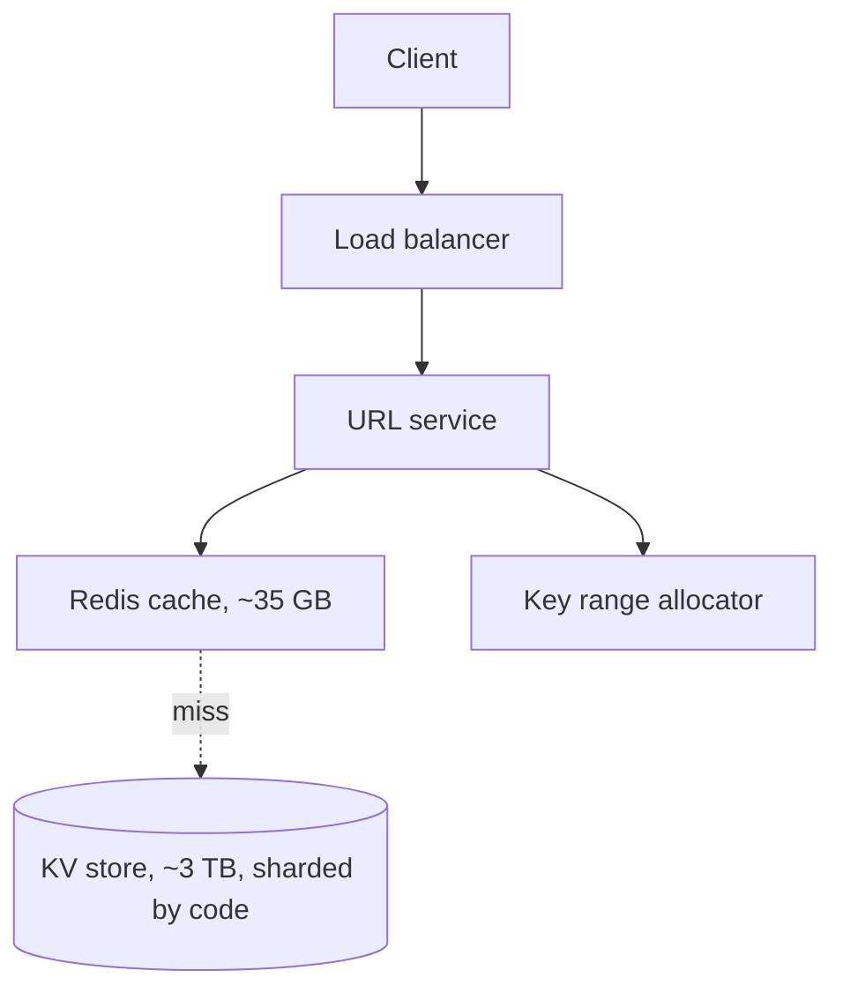
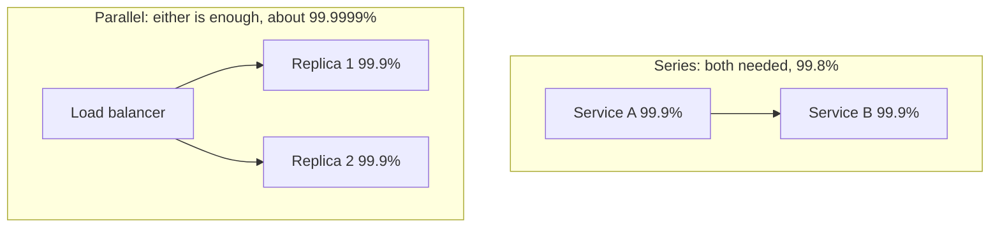
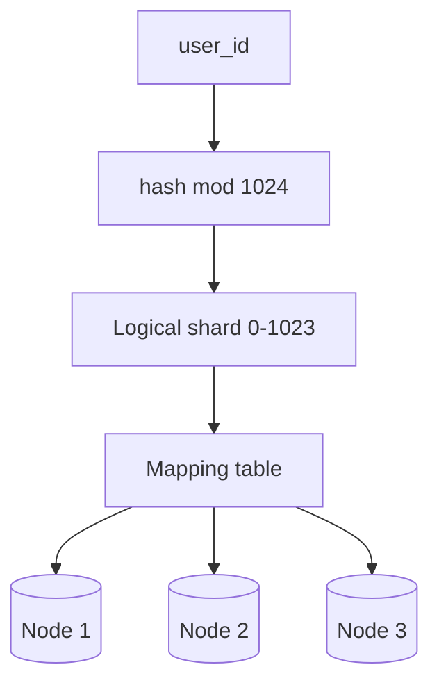

# Back-of-the-Envelope Estimation

[⬅ Back to index](../README.md)

Covers: why estimate, latency numbers every engineer should know, powers of two, QPS, storage, bandwidth, cache and server sizing, and worked examples.

---

### 1. Why do back-of-the-envelope estimates matter in a design interview?

<details>
<summary>Answer</summary>

**In short:** Numbers turn opinions into decisions. A two-minute estimate tells you whether one database is enough, whether the working set fits in cache, whether you need a CDN, and whether writes need a queue. Round aggressively, state assumptions, and only estimate what changes the design.

#### The problem it solves

Without numbers, every design choice is a guess. "Should we shard?" has no answer until you know you need 80K writes/s and a single primary handles roughly 5–10K. Estimation is how you justify adding complexity (or avoiding it). It also shows interviewers you think like an engineer who has run real systems.

#### What estimates typically decide

| Estimate | Decision it drives |
|---|---|
| Write QPS | One primary DB vs sharding; whether writes go through a queue |
| Read QPS and read:write ratio | Caching, read replicas, precomputation |
| Total storage over retention | Single node vs partitioned store; object storage vs DB |
| Working-set size | Whether the hot data fits in RAM (cache) |
| Egress bandwidth | Whether a CDN is required |
| Peak concurrent connections | How many WebSocket gateway servers |

#### The rules

1. **Round aggressively**: use powers of 10 and say "~23K", not "23,148".
2. **State assumptions out loud**: "I'll assume 100M DAU and 10 reads per user per day."
3. **Only estimate what affects the design.** If a number doesn't change any decision, skip it.
4. **Draw a conclusion** from every number: "~1K writes/s, so a single Postgres primary is fine."
5. **Keep it short**: two to five minutes in a 45-minute round.

#### Example of a useful vs useless estimate

- Useful: "Fan-out on write means 240K feed inserts/s, too much for one DB, so feeds go into a sharded in-memory store."
- Useless: computing the exact bytes of a user profile when the total is a few GB either way.

**Common pitfalls**
- Spending 10+ minutes on arithmetic.
- Producing numbers and never using them.
- Forgetting peak traffic and designing for the average.

**Likely follow-ups**
- *"What if your assumption is off by 10×?"* Say which component would break first and how the design would change.
- *"Do you need estimates for an internal tool with 500 users?"* Briefly, to show you don't need to scale; then move on.

</details>

### 2. What latency numbers should every engineer know?

<details>
<summary>Answer</summary>

**In short:** Memory is around 100 ns, SSD random reads around 100 µs, a round trip inside a data centre around 0.5 ms, an HDD seek around 10 ms, and a cross-continent round trip around 100 ms. So: cache in memory, avoid cross-region calls on the hot path, and batch requests.

These are approximate orders of magnitude (popularised by Jeff Dean and Peter Norvig and updated over time); exact values depend on hardware, but the ratios are what matter.

| Operation | Time |
|---|---|
| L1 cache reference | ~1 ns |
| Main memory reference | ~100 ns |
| Compress 1 KB (fast codec) | ~2 µs |
| Read 1 MB sequentially from memory | ~10 µs |
| Random read from SSD | ~100 µs |
| Round trip within a data centre | ~0.5 ms |
| Read 1 MB sequentially from SSD | ~0.5–1 ms |
| Round trip same region / cross-AZ | ~1–2 ms |
| Disk (HDD) seek | ~10 ms |
| Read 1 MB sequentially from HDD | ~5–20 ms |
| Round trip US East ↔ West | ~60–70 ms |
| Round trip US ↔ Europe | ~80–150 ms |

#### What the numbers tell you

- **Memory is ~1,000× faster than an SSD random read.** That's why caches like Redis (data in RAM) can serve hot reads in well under a millisecond while a database query that touches disk is slower.
- **A network hop inside a data centre (~0.5 ms) costs more than thousands of memory reads.** A request that makes 20 sequential service calls spends ~10 ms just on hops, so prefer parallel calls, batching, and fewer layers on the hot path.
- **Cross-region round trips (~100 ms) dominate everything else.** A synchronous write that must commit in two continents adds that latency to every write. That's why multi-region systems usually replicate asynchronously or serve users from the nearest region.
- **Sequential beats random.** Disks and SSDs read sequential data much faster than scattered data, which is why log-structured storage (Kafka, LSM trees) appends sequentially.
- **The speed of light sets a floor.** Light in fibre travels roughly 200 km per ms, so no protocol trick makes New York to London much faster than ~60–70 ms round trip; only moving data closer (CDN, edge, regional replicas) helps.

#### Using them in the interview

> "A feed load fans out to 5 services in parallel, each with a cache hit of ~1 ms plus a network hop, so we're at a few ms server-side. The big cost for a user in Europe is the ~100 ms round trip to a US region, so we'll serve reads from a European replica."

**Common pitfalls**
- Treating network calls as free inside a data centre.
- Putting a cross-region synchronous call on a user-facing path.
- Quoting numbers to false precision; orders of magnitude are the point.

**Likely follow-ups**
- *"Why is a cache faster than a DB with the same data in its buffer pool?"* Mostly fewer layers (no query parsing/planning, simpler data structures), though both are fast if data is in memory.
- *"How would you cut p99 latency?"* Parallelise calls, cache, reduce hops, and serve from regions close to users.

</details>

### 3. What powers of two and unit conversions are handy?

<details>
<summary>Answer</summary>

**In short:** 2^10 ≈ a thousand (KB), 2^20 ≈ a million (MB), 2^30 ≈ a billion (GB), 2^40 ≈ a trillion (TB). A day is ~86,400 s ≈ 10^5 s, so 1 million requests/day ≈ 12 requests/s. Peak is usually 2–3× average.

#### Data sizes

| Power | Approx | Name |
|---|---|---|
| 2^10 | 1 thousand | KB |
| 2^20 | 1 million | MB |
| 2^30 | 1 billion | GB |
| 2^40 | 1 trillion | TB |
| 2^50 | 1 quadrillion | PB |

Strictly, 2^10 = 1,024 (a KiB), but in estimates the ~2.4% difference doesn't matter; treat KB as 10^3 bytes.

**Typical object sizes** worth remembering: a character is 1 byte in ASCII (up to 4 in UTF-8); a 64-bit ID or timestamp is 8 bytes; a short text post with metadata is ~1 KB; a compressed photo is ~100 KB–2 MB; a minute of HD video is tens of MB.

#### Time

- **1 day ≈ 86,400 s ≈ 10^5 s** (dividing by 10^5 instead of 86,400 understates QPS by ~15%, which is fine for an estimate).
- 1 month ≈ 2.5 × 10^6 s.
- 1 year ≈ 3 × 10^7 s.

#### Handy shortcuts

| Per day | Per second (average) |
|---|---|
| 1 million | ~12 |
| 10 million | ~120 |
| 100 million | ~1,200 |
| 1 billion | ~12,000 |

- **Peak traffic ≈ 2–3× the average** for most consumer products; more for spiky ones (live events, flash sales, New Year's Eve messages).
- **Network units are bits**: 1 Gbps ≈ 125 MB/s.

#### Quick mental maths

```python
daily_requests = 500_000_000        # 500M/day
avg_qps  = daily_requests / 86_400  # ~5,800 -> say "~6K"
peak_qps = avg_qps * 3              # ~17K -> say "~20K at peak"
```

Work in powers of ten: 5 × 10^8 ÷ 10^5 = 5 × 10^3, so ~5K QPS. Close enough.

**Common pitfalls**
- Mixing bits and bytes.
- Forgetting the 2–3× peak multiplier.
- Being precise where nobody needs it (1,024 vs 1,000).

**Likely follow-ups**
- *"How many seconds in a year?"* About 3 × 10^7 (π × 10^7 is a handy memory trick).

</details>

### 4. How do you estimate QPS?

<details>
<summary>Answer</summary>

**In short:** QPS = DAU × actions per user per day ÷ 86,400, then multiply by a peak factor (2–3×). Do it separately for reads and writes, and also estimate derived load like fan-out, which is often the number that really drives the design.

#### The formula

`QPS = DAU × actions per user per day ÷ 86,400`, then × peak factor.

#### Worked example: a Twitter-like app

- 200M DAU, each views the timeline 10 times/day → 2 × 10^9 reads/day → **~23K read QPS**, peak ~50K.
- Each posts 0.5 tweets/day → 10^8 writes/day → **~1.2K write QPS**, peak ~3K.
- Read:write ≈ 20:1 → read-heavy, so caches and precomputed timelines.

#### Derived load: fan-out

User-visible actions often cause many internal operations. If the average user has 200 followers and you fan out on write (push each new tweet into every follower's timeline):

`1.2K tweets/s × 200 followers = 240K timeline inserts/s`

That number drives the design far more than the 1.2K writes/s: it rules out a single relational DB for timelines and points to a sharded in-memory store (e.g. Redis) plus a queue and workers. It also exposes the celebrity problem: one account with 100M followers creates 100M inserts for a single post, which is why real designs use hybrid fan-out.

```python
dau = 200e6
reads_per_user, writes_per_user = 10, 0.5
avg_followers, peak_factor = 200, 2.5

read_qps  = dau * reads_per_user  / 86_400   # ~23K
write_qps = dau * writes_per_user / 86_400   # ~1.2K
fanout    = write_qps * avg_followers        # ~240K inserts/s
print(read_qps * peak_factor, write_qps * peak_factor, fanout)
```

#### Other sources of QPS to remember

- **Background/client polling**: an app that refreshes every 30 s while open generates QPS even with no user action.
- **Per-page API calls**: one screen may make 5–10 API calls.
- **Internal amplification**: one request may hit several services and caches.

**Common pitfalls**
- Using MAU instead of DAU, or forgetting that not every user does every action.
- Designing for the average and falling over at peak.
- Missing the fan-out or internal amplification number.

**Likely follow-ups**
- *"What's the peak factor for a live event?"* Can be 10× or more; plan with autoscaling, pre-warming, and load shedding.
- *"How would 10× growth change things?"* Identify the first component to hit its limit (usually the write path or the fan-out store).

</details>

### 5. How do you estimate storage?

<details>
<summary>Answer</summary>

**In short:** Storage per day = new items per day × size per item; multiply by retention and by the replication factor (typically 3×, or ~1.5× with erasure coding). Separate large blobs from small metadata, since they go to different stores.

#### The formula

`total = items/day × bytes/item × days retained × replication factor`

#### Worked example: photo-sharing app

- 10M photos uploaded/day, average 2 MB after compression → **20 TB/day**.
- 5 years ≈ 1,800 days → **~36 PB**, × 3 replicas ≈ **~100 PB** (or ~1.5× with erasure coding, ~55 PB).
- Metadata: 10M × 1 KB = **10 GB/day** → ~18 TB over 5 years; small enough for a sharded database.

#### Conclusions you'd draw

- Blobs go to **object storage** (e.g. S3), not the database. The database stores only the object key and metadata.
- Use **storage tiering**: recent photos on hot storage; old, rarely viewed ones on cheaper cold tiers.
- **Thumbnails** are generated in several sizes, adding a fraction of the original size each; include them (e.g. +20%).
- Metadata is tiny in comparison, so the database choice is driven by query patterns, not size.

#### What to include

| Factor | Typical value |
|---|---|
| Replication | 3× for replicated stores; ~1.4–1.5× with erasure coding in object stores |
| Indexes | Often adds tens of percent to a database's size |
| Derived copies | Thumbnails, transcoded video renditions, search index |
| Growth | Users and usage per user both grow; add a growth assumption |
| Deletes / TTL | Some data expires (stories, logs), capping storage |

#### Text example for contrast

200M tweets/day × ~300 bytes (text plus metadata) ≈ 60 GB/day ≈ ~22 TB/year before replication. Text is cheap; media dominates storage for almost every social product.

**Common pitfalls**
- Forgetting replication and indexes.
- Storing blobs in the database.
- Unit slips that produce absurd results (sanity-check: does the answer match intuition?).

**Likely follow-ups**
- *"How would you cut storage cost?"* Compression, deduplication (content hashing), tiering to cold storage, erasure coding, deleting unused renditions.
- *"Where does the metadata live?"* A sharded relational or wide-column store, keyed by photo or user ID.

</details>

### 6. How do you estimate bandwidth?

<details>
<summary>Answer</summary>

**In short:** Bandwidth = QPS × average response size (or concurrent streams × bitrate for media). Convert to bits per second for network capacity. If the result is in terabits, a CDN is mandatory; if it's a few Gbps, a handful of servers can handle it.

#### The formula

`bandwidth = QPS × average response size` (for request/response APIs)

`bandwidth = concurrent viewers × bitrate` (for streaming)

Remember network capacity is quoted in **bits** per second: multiply bytes by 8.

#### Example: video streaming

1M concurrent viewers × 5 Mbps (1080p) = **5 Tbps** egress.

No single data centre serves that economically, which is why a **CDN with edge caches** (and ISP-embedded caches like Netflix Open Connect) is mandatory. Edge caches serve popular content close to viewers, so origin bandwidth is only a small fraction of total egress.

#### Example: an API

50K QPS × 10 KB = 500 MB/s ≈ **4 Gbps** → spread across a handful of servers' NICs (commonly 10–25 Gbps each); fine.

#### Ingress vs egress

| Direction | What drives it | Example |
|---|---|---|
| **Ingress (uploads)** | Upload QPS × upload size | 10M photos/day × 2 MB = 20 TB/day ≈ 230 MB/s ≈ ~2 Gbps average |
| **Egress (downloads)** | Read QPS × response size | Usually much higher for read-heavy products |

Egress also tends to be what cloud providers charge for, so it's a cost question as well as a capacity one.

#### What the number decides

- **Terabits** → CDN, edge caching, adaptive bitrate streaming.
- **Tens of Gbps** → multiple load-balanced servers, compression, maybe a CDN for static assets.
- **A few Gbps or less** → not a design driver; mention it and move on.

**Common pitfalls**
- Mixing bits and bytes (off by 8×).
- Using average instead of peak (evening streaming peaks are much higher than the daily average).
- Ignoring that a CDN's hit rate determines origin load.

**Likely follow-ups**
- *"How do you reduce egress cost?"* Higher CDN hit rate, better compression and codecs, adaptive bitrate, caching at ISPs.
- *"What about mobile users on slow networks?"* Smaller payloads, pagination, image resizing, adaptive bitrate.

</details>

### 7. How do you estimate cache size?

<details>
<summary>Answer</summary>

**In short:** Use the 80/20 rule: about 20% of items get about 80% of traffic, so size the cache for the hot 20% of a day's distinct items × item size. Then check throughput separately (one Redis node does roughly 100K+ simple ops/s) and add nodes for availability.

#### Why the 80/20 rule works

Access patterns on most products are heavily skewed: a small set of popular URLs, posts, or products get most of the traffic. Caching that hot subset gives a high hit rate with far less memory than caching everything. The 80/20 split is a rough rule of thumb; real distributions are often even more skewed.

#### Worked example: URL shortener

- 100M redirects/day; assume the hot 20% → 20M URLs.
- 20M × 500 bytes (short code, long URL, metadata, overhead) ≈ **10 GB**.
- That fits in RAM on one Redis node. Use a small cluster (primary + replica, or a few shards) for availability and throughput.

#### Two checks: memory and throughput

```python
daily_reads    = 100e6
hot_fraction   = 0.2
item_bytes     = 500
memory_gb      = daily_reads * hot_fraction * item_bytes / 1e9   # ~10 GB

peak_read_qps  = 50_000
ops_per_node   = 100_000          # rough, simple GET/SET
nodes_for_qps  = peak_read_qps / ops_per_node                     # < 1 node
```

Memory says one node; throughput says one node. Then add replicas for failover. If either number were larger, you'd shard the cache.

#### Factors to add

| Factor | Why |
|---|---|
| Per-key overhead | Redis keys and data structures carry extra bytes beyond the raw value |
| Replication | A replica per shard doubles memory |
| Headroom | Keep memory usage well below the limit to avoid evictions and fragmentation issues |
| TTL and eviction policy | LRU or LFU decides what stays; TTLs bound staleness |

#### What a hit rate means for the DB

With a 90% hit rate on 50K read QPS, the database sees only 5K QPS. That's often the real point of the estimate: the cache shrinks the database you need.

**Common pitfalls**
- Using total items ever stored rather than the daily hot set.
- Checking memory but not throughput (or vice versa).
- Forgetting a cold cache after a restart can overwhelm the DB (cache stampede).

**Likely follow-ups**
- *"What if one key is extremely hot?"* Replicate it, add a local in-process cache, or split the key.
- *"What happens on a cache node failure?"* Replica promotion; consistent hashing limits how many keys move.

</details>

### 8. How many servers do you need?

<details>
<summary>Answer</summary>

**In short:** Servers = peak QPS ÷ per-server capacity, then add ~30–50% headroom and N+1 redundancy spread across availability zones. Use rough per-node capacities and say they're workload-dependent.

#### Rough per-node capacities

These vary hugely with hardware and workload; state that, and use them as starting points:

| Component | Rough capacity per node |
|---|---|
| Stateless app server (simple JSON API) | ~1K–10K requests/s |
| Relational DB primary | ~5–10K writes/s; tens of thousands of simple indexed reads/s |
| Redis | ~100K+ ops/s |
| Kafka broker | Hundreds of MB/s |
| WebSocket gateway | Tens to hundreds of thousands of mostly idle connections, memory-bound |

#### The calculation

`servers = peak QPS ÷ per-server capacity × (1 + headroom)`, then round up for redundancy.

Example: 50K peak QPS ÷ 5K per server = 10 servers → add headroom and N+1 → run **~15 across 3 availability zones** (5 per zone), so losing a whole zone leaves 10, which still handles peak.

```python
import math
peak_qps, per_server, headroom, zones = 50_000, 5_000, 0.3, 3
needed = math.ceil(peak_qps / per_server * (1 + headroom))   # 13
per_zone = math.ceil(needed / (zones - 1))  # 7: two zones must carry the load if one fails
total = per_zone * zones                                      # 21 for full zone tolerance
```

The quick answer (~15) and the more careful zone-failure answer (~20) differ; say which failure you're designing for.

#### Why headroom

- Traffic spikes beyond the expected peak.
- Deploys take instances out of rotation.
- Running servers near 100% CPU increases latency sharply (queueing), so aim for well under it.

#### What usually limits first

For stateless app servers you simply add more behind a load balancer. The harder limit is usually **stateful** components: the database primary, a hot partition, or the cache. So the server count matters less than spotting where state concentrates.

**Common pitfalls**
- Sizing for the average rather than the peak.
- No redundancy, so one failure causes an outage.
- Presenting per-node capacities as precise facts.

**Likely follow-ups**
- *"How would you find the real per-server capacity?"* Load test a single instance until latency SLOs break, then use a fraction of that.
- *"Autoscaling or fixed?"* Autoscale stateless tiers on CPU or QPS, with a minimum floor for sudden spikes.

</details>

### 9. Walk through a full estimate for a URL shortener.

<details>
<summary>Answer</summary>

**In short:** With 100M new URLs/month and a 100:1 read:write ratio: ~40 writes/s, ~4K reads/s, 6 billion URLs over 5 years, 7-character base62 keys, ~3 TB of storage and a ~35 GB cache. Reads dominate, so the design is cache-first; writes are tiny, so no queue is needed.

#### Assumptions (state them)

- 100M new URLs per month.
- Read:write = 100:1.
- Keep URLs for 5 years.
- ~500 bytes per record (short code, long URL, created time, owner, expiry).

#### The numbers

| Quantity | Calculation | Result |
|---|---|---|
| **Writes** | 100M ÷ (30 × 86,400 s) | **~40/s**, peak ~100/s |
| **Reads** | 40 × 100 | **~4K/s**, peak ~10K/s |
| **Total URLs** | 100M × 12 × 5 | **6 billion** |
| **Key length** | base62: 62^7 ≈ 3.5 trillion ≫ 6B | **7 characters** |
| **Storage** | 6B × 500 bytes | **~3 TB** |
| **Cache** | 20% of daily reads ≈ 70M × 500 B | **~35 GB** |

Cache detail: 4K reads/s × 86,400 ≈ 350M reads/day; 20% ≈ 70M. (This sizes by daily reads, an upper bound; distinct hot URLs are fewer, so the real need is likely smaller.)

```python
writes_per_s = 100e6 / (30 * 86_400)          # ~39
reads_per_s  = writes_per_s * 100             # ~3.9K
total_urls   = 100e6 * 12 * 5                 # 6e9
keyspace_7   = 62 ** 7                        # ~3.5e12, about 580x total_urls
storage_tb   = total_urls * 500 / 1e12        # 3 TB
cache_gb     = reads_per_s * 86_400 * 0.2 * 500 / 1e9   # ~34 GB
```

Why 7 characters? 62^6 ≈ 57 billion would also cover 6B, but leaves less room for growth and makes random codes collide more often; 7 gives ample space.

#### Design consequences

- **Reads dominate** → put a cache (Redis) in front of the store; also consider 301 redirects cacheable by browsers (at the cost of analytics), or 302 if every click must be counted.
- **Writes are tiny** (~40/s) → a single primary handles them; no queue needed.
- **3 TB** → fits a small sharded key-value store or a sharded relational DB; partition by short code.
- **Key generation** → base62 of a unique counter (e.g. ranges handed out per server) or random codes with a uniqueness check.



**Common pitfalls**
- Forgetting the 5-year total when choosing key length.
- Over-designing writes (queues, sharding for 40 writes/s).
- Ignoring analytics when choosing 301 vs 302.

**Likely follow-ups**
- *"What if read traffic is 100× higher?"* More cache replicas, CDN/edge redirects for the hottest codes.
- *"How do you avoid key collisions across servers?"* Pre-allocated counter ranges per server, or random codes with a conditional insert.

</details>

### 10. What estimation mistakes should you avoid?

<details>
<summary>Answer</summary>

**In short:** Too much precision, forgetting peak or replication, mixing bits and bytes, doing maths that never affects a decision, and not sanity-checking results. Each estimate should be quick, rounded, and lead straight to a design choice.

| Mistake | Example | Fix |
|---|---|---|
| **Too much precision** | Computing 23,148 QPS | Say "~23K" and move on |
| **Forgetting peak** | Sizing for 23K average when evenings hit 60K | Multiply by 2–3× (more for spiky events) |
| **Forgetting replication** | "3 TB of storage" when 3 replicas make it 9 TB | Multiply by replication factor, plus indexes |
| **Bits vs bytes** | Treating 1 Gbps as 1 GB/s | Network is in bits/s: 1 Gbps ≈ 125 MB/s |
| **Maths that changes nothing** | Exact profile size when the total is a few GB anyway | Skip it, or say "small, not a concern" |
| **No sanity check** | "10 PB of text tweets per day" | Compare with intuition; recheck units |
| **Hidden assumptions** | Silently assuming 1B DAU | State every assumption aloud |
| **Wrong base metric** | Using MAU for daily traffic | Use DAU and actions per active user |

#### How to sanity-check

- **Compare with known scale**: a large social network might have hundreds of millions to a few billion DAU; if your number implies more users than people online, something is off.
- **Check units at every step**: write units next to numbers (MB/day, req/s).
- **Order of magnitude**: if text storage comes out in petabytes per day, you've probably used MB where you meant KB.

#### Example of catching an error

> "200M tweets/day × 300 KB = 60 PB/day... that's far too high for text. Tweets are ~300 *bytes*, so 60 GB/day. Much better."

Catching and correcting yourself like this is a positive signal, not a negative one.

**Common pitfalls**
- Not saying the numbers out loud, so the interviewer can't follow or correct you.
- Spending so long on maths that the design suffers.

**Likely follow-ups**
- *"How confident are you in that number?"* Within an order of magnitude; say which assumption it's most sensitive to.

</details>

### 11. What are availability "nines" in time?

<details>
<summary>Answer</summary>

**In short:** 99.9% ≈ 8.8 hours of downtime a year (~43 minutes a month); 99.99% ≈ 53 minutes a year; 99.999% ≈ 5 minutes a year. Dependencies in series multiply availability (it goes down); redundant components in parallel raise it, if failures are independent.

| Availability | Downtime/year | Downtime/month |
|---|---|---|
| 99% (two nines) | ~3.65 days | ~7.2 hours |
| 99.9% | ~8.8 hours | ~43 minutes |
| 99.99% | ~53 minutes | ~4.3 minutes |
| 99.999% | ~5.3 minutes | ~26 seconds |

#### How to compute it

`downtime = (1 − availability) × period`. For 99.9% over a year: 0.001 × 8,760 hours ≈ 8.8 hours.

#### Series vs parallel

**In series** (every component must work): multiply availabilities. Two 99.9% services both required → 0.999 × 0.999 ≈ **99.8%**. Ten 99.9% dependencies → ~99.0%. Every hard dependency on the request path lowers your ceiling.

**In parallel** (any one of the redundant copies is enough): availability = 1 − (probability all fail). Two 99.9% replicas → 1 − (0.001 × 0.001) = **99.9999%**, if failures are independent.



The independence assumption is the catch: replicas in the same rack, zone or running the same buggy deploy fail together. That's why redundancy is spread across availability zones and regions, and why deploys are staged.

#### Why it matters in design

- Critical paths keep **few hard dependencies**; non-critical ones (recommendations, analytics) are called with timeouts and fallbacks so their failure doesn't take down the page.
- An SLO of 99.99% leaves ~4 minutes a month: manual failover by a human paged at 3 a.m. can't meet that, so failover must be automated.
- Each extra nine typically costs significantly more (multi-zone, multi-region, more engineering).

**Common pitfalls**
- Assuming redundant components fail independently when they share infrastructure.
- Promising five nines while depending on several services with three nines each.
- Confusing SLA (contract with penalties) with SLO (internal target) and SLI (the measured metric).

**Likely follow-ups**
- *"How do you get 99.99% on top of a 99.9% dependency?"* Make it non-critical (cache, fallback, async), or add redundancy across independent providers or zones.
- *"What's an error budget?"* The allowed downtime (1 − SLO); when it's spent, teams slow risky releases.

</details>

### 12. How do you estimate the number of shards or partitions?

<details>
<summary>Answer</summary>

**In short:** Compute shards needed by storage (total data ÷ comfortable size per node) and by throughput (peak writes ÷ writes per node), take the larger, then add headroom for growth. Many systems create many logical shards (e.g. 1,024) mapped onto fewer physical nodes so they can rebalance later without re-hashing everything.

#### The two limits

- **By storage:** total data ÷ comfortable size per node. Example: 30 TB ÷ 1 TB = **30 shards**.
- **By throughput:** peak writes ÷ writes per node. Example: 100K writes/s ÷ 5K/s = **20 shards**.

Take the larger: **30**. Then add growth headroom, e.g. planning for 2–3 years of growth, and round up, often to a power of two: **64**.

"Comfortable size per node" is less than the disk size: you need room for indexes, compaction, backups and for rebuilding a replica in reasonable time. Smaller shards recover and rebalance faster.

#### Logical vs physical shards

Rather than sharding directly onto physical machines, create a fixed, larger number of **logical (virtual) shards** and map them to nodes:

```python
NUM_LOGICAL_SHARDS = 1024                    # fixed forever

def logical_shard(user_id: int) -> int:
    return hash(user_id) % NUM_LOGICAL_SHARDS  # stable: never changes

shard_to_node = {0: "db-1", 1: "db-1", 2: "db-2"}  # mapping kept in config or a coordination service
```

When you add a node, you **move some logical shards** to it and update the mapping. Keys never need re-hashing, because `hash % 1024` doesn't change. With naive `hash % N_nodes`, changing N moves almost every key. Consistent hashing with virtual nodes solves the same problem a different way.



#### Also check

- **Read throughput**: replicas per shard can absorb reads, so reads affect replica count more than shard count.
- **Hot keys**: even shard counts don't help if one key (a celebrity) gets most traffic; that needs key splitting or caching.
- **Replication**: each shard typically has 2–3 replicas, so physical nodes = shards × replication factor (unless shards share nodes).

**Common pitfalls**
- Sizing only by storage and ignoring write throughput (or vice versa).
- Using `hash % number_of_nodes`, which forces mass data movement when scaling.
- Ignoring skew from a poor partition key.

**Likely follow-ups**
- *"How do you reshard a live system?"* Move logical shards one at a time: copy data, catch up via replication or dual writes, then flip the mapping.
- *"Why not just use 1 million logical shards?"* Each one has overhead (metadata, connections, files); thousands is a common middle ground.

</details>

---

[⬅ Previous: The Interview Framework](01-interview-framework.md) · [⬅ Back to index](../README.md) · [Next: Scalability Fundamentals ➡](03-scalability-fundamentals.md)
