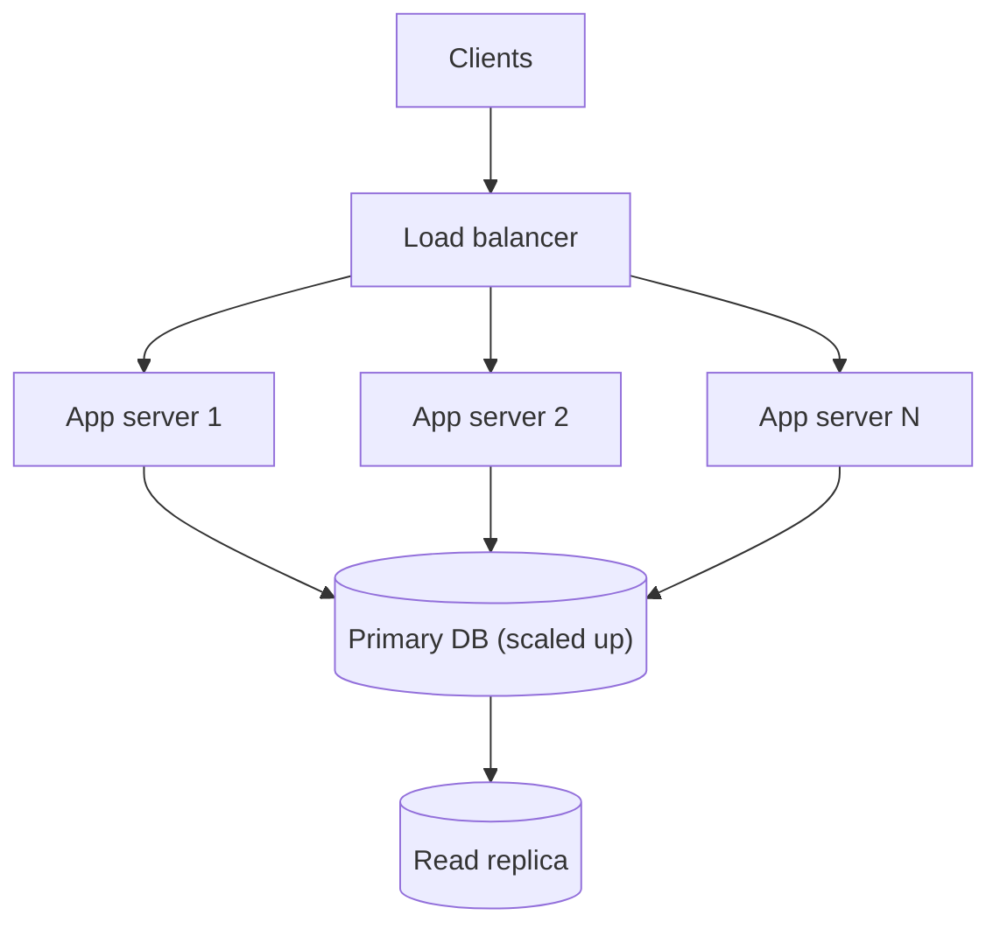
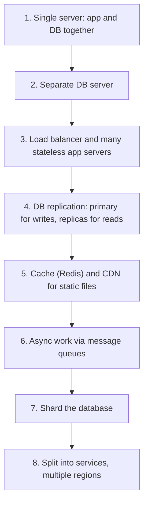
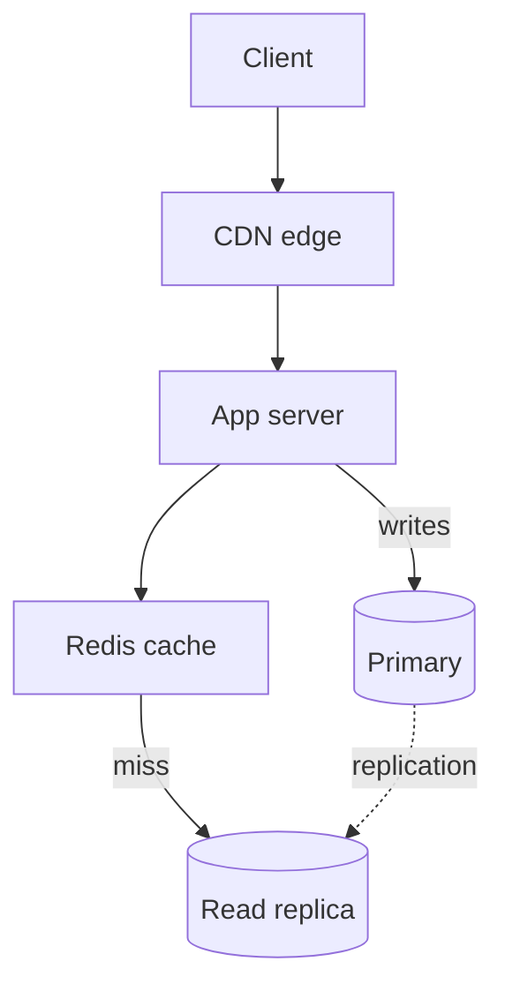
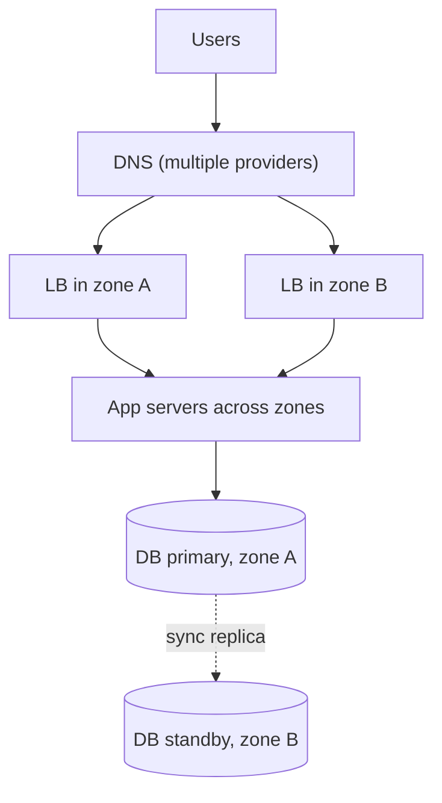
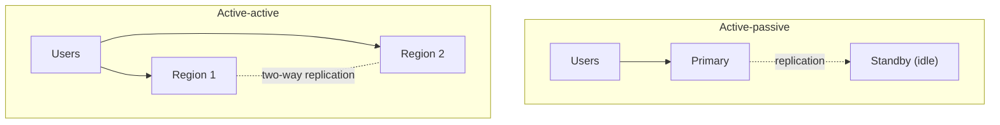
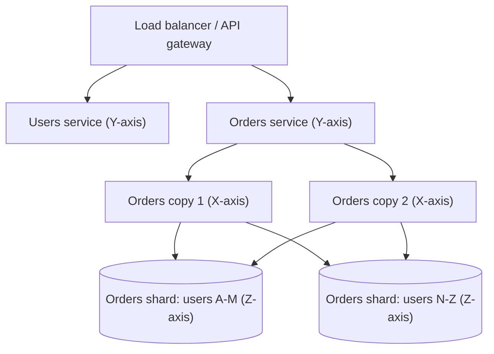

# Scalability Fundamentals

[⬅ Back to index](../README.md)

Covers: vertical vs horizontal scaling, stateless services, latency vs throughput, availability, SLA/SLO/SLI, read vs write scaling, the evolution from one server to millions of users, bottlenecks and cost.

---

### 1. What is scalability?

<details>
<summary>Answer</summary>

**In short:** A system is **scalable** if it can handle more load (users, data, requests) by adding resources, **without a redesign** and with roughly proportional cost. Scalability is not the same as performance: a system can be fast for one user but collapse at 10K users.

#### Describing load precisely

"More load" is vague, so describe it with **load parameters** that fit your system:

- **Requests per second** (peak, not just average)
- **Read/write ratio** (a 100:1 read-heavy system scales very differently from a write-heavy one)
- **Concurrent users / open connections** (matters for chat, live streaming)
- **Data size** and growth rate (GB/day)
- **Fan-out** (one tweet delivered to 10M followers is very different from one delivered to 10)

Once you know which parameter grows, you know what has to scale. Twitter's well-known timeline problem was not "too many tweets" but "fan-out to followers".

#### Performance vs scalability

| | Performance | Scalability |
|---|---|---|
| Question | How fast is one request? | What happens when load grows 10x? |
| Problem looks like | Slow even with one user | Fine at low load, degrades as load grows |
| Typical fix | Better algorithm, index, cache | Add machines, partition, remove shared bottlenecks |

A good scalable system has **linear-ish scaling**: doubling machines roughly doubles capacity. Things that break linearity are shared resources (one database, one lock, one coordinator) and coordination overhead between nodes.

#### Related dimensions

- **Elasticity**: scaling up *and down* automatically with load (cloud autoscaling).
- **Data scalability**: can storage and queries keep up as data grows to TBs/PBs?
- **Organisational scalability**: can many teams work on it independently (a reason for microservices)?

**Likely follow-ups:**
- *How do you know a system is not scaling?* Latency percentiles rise and throughput plateaus as load increases, while some resource saturates.
- *Is it ever right to not design for scale?* Yes; early on, a simple monolith on one big machine is cheaper and faster to build. Design for ~10x current load, not 1000x.

</details>

### 2. Vertical vs horizontal scaling?

<details>
<summary>Answer</summary>

**In short:** **Vertical scaling** means a bigger machine; **horizontal scaling** means more machines. Scale stateless app servers horizontally, and scale databases vertically first (it's simpler), adding replicas and shards only when you must.

| | Vertical (scale up) | Horizontal (scale out) |
|---|---|---|
| How | Bigger machine (CPU, RAM, disk) | More machines |
| Pros | Simple, no code changes, no distribution problems | Near-unlimited, fault tolerant, can use cheap hardware |
| Cons | Hard ceiling, expensive at the top, single point of failure | Needs load balancing, stateless design, data partitioning, deals with network failures |

#### Why vertical is underrated

Modern big machines have hundreds of cores and terabytes of RAM. A single well-tuned PostgreSQL or MySQL server on such hardware can handle a lot of traffic. Vertical scaling keeps everything in one process: transactions, joins and consistency stay trivial. The costs:

- **Price grows faster than capacity** at the high end (the biggest instances cost disproportionately more).
- **Hard ceiling**: eventually there is no bigger machine.
- **Downtime to resize** in many setups, and the box is still a single point of failure.

#### Why horizontal is the end state

Adding machines has no hard ceiling and gives redundancy for free (lose one of 20 servers, lose 5% of capacity). But it introduces distributed-systems problems:

- You need a **load balancer** to spread traffic.
- Servers must be **stateless**, or state must be partitioned.
- Data must be **replicated or sharded**, which brings consistency questions.
- Network calls can fail, time out or be duplicated.



The diagram shows the typical middle ground: app tier scaled out, database scaled up with replicas.

**Pitfalls:**
- Sharding prematurely: it makes every query, migration and transaction harder. Exhaust indexing, caching, replicas and bigger hardware first.
- Scaling out app servers that hold in-memory session state, so users get logged out when routed to another box.

**Likely follow-ups:**
- *When do you finally shard?* When write throughput or data size exceeds what one primary can handle even after vertical scaling and offloading reads.
- *Can you scale a database horizontally without sharding?* Only reads, via replicas; writes still go to one primary.

</details>

### 3. Why should services be stateless?

<details>
<summary>Answer</summary>

**In short:** A **stateless** server keeps no client data between requests; session and state live in a shared store (Redis, a database) or in the client's token (JWT). That means any server can handle any request, so you can load balance freely, autoscale, and lose a server without losing anything.

#### The problem with stateful servers

Imagine a server that keeps a user's shopping cart in local memory. Now:

- The load balancer must send that user to the **same server** every time (sticky sessions), so load spreads unevenly.
- If that server crashes or is scaled down, the cart is **gone**.
- Deploying means draining users carefully off each box.

#### Where state goes instead

State doesn't disappear; it moves to systems built for it, which are scaled and made durable separately.

| State | Typical home |
|---|---|
| Session / login | Redis, or a signed token (JWT) carried by the client |
| User data | Database |
| Files / uploads | Object storage (S3) |
| Short-lived computation results | Distributed cache |
| In-progress jobs | Message queue |

```python
sessions = {}

def handle_stateful(req):
    # Bad for scaling: the cart lives in this process's memory
    cart = sessions.setdefault(req.session_id, [])
    cart.append(req.item)

def handle_stateless(req):
    # Any instance can serve the request: state lives in Redis
    cart = redis.lrange(f"cart:{req.user_id}", 0, -1)
    redis.rpush(f"cart:{req.user_id}", req.item)
```

#### Benefits

- **Simple load balancing**: round-robin or least-connections works; no sticky sessions.
- **Elastic scaling**: add or remove instances any time.
- **Fault tolerance**: a crashed instance loses nothing; retries go to another.
- **Easy deploys**: rolling and blue-green deployments just swap instances.

**Pitfalls:**
- Local caches are fine as long as they are only an optimisation (losing them is harmless).
- JWTs make the server stateless but revocation is harder: you need short expiry plus refresh tokens, or a denylist.
- WebSocket servers are inherently stateful (they hold connections); handle with a connection registry and pub/sub.

**Likely follow-ups:**
- *Are sticky sessions ever OK?* As an optimisation (cache locality), yes, but the system must still work if the session moves.
- *Doesn't the shared session store become a bottleneck?* It can; Redis is very fast and can be clustered, and tokens avoid the lookup entirely.

</details>

### 4. Latency vs throughput?

<details>
<summary>Answer</summary>

**In short:** **Latency** is how long one request takes; **throughput** is how many requests the system handles per second. Measure latency as percentiles (p50, p95, p99), not averages, and remember that as utilisation approaches 100%, queues build and latency explodes.

#### Definitions

- **Latency** – time for one request, in ms. Usually measured end to end and per hop.
- **Throughput** – requests (or bytes) per second the system completes.

Analogy: a highway. Latency is how long one car takes to drive from A to B; throughput is how many cars pass per hour. Adding lanes raises throughput without making any car faster.

#### Why percentiles, not averages

An average hides the slow tail. If p50 = 50 ms but p99 = 2 s, then 1 in 100 requests is terrible, and your heaviest users (more requests, more data) are the ones most likely to hit it.

**Tail latency amplification:** if a page fans out to 100 backend calls and waits for all of them, the chance that at least one hits its p99 is `1 − 0.99^100 ≈ 63%`. So the backend's p99 becomes the page's typical latency. Techniques: hedged requests (send a duplicate after a short delay), timeouts, and reducing fan-out.

#### How they interact

Throughput rises with load until a resource saturates. Near saturation, requests queue, and queueing theory says wait time grows sharply as utilisation approaches 100% (for a simple queue, roughly proportional to `1 / (1 − utilisation)`). That's why you keep headroom, e.g. run at 60–70% CPU at peak.

| Technique | Effect on throughput | Effect on latency |
|---|---|---|
| Batching | Up (less per-item overhead) | Up (items wait for the batch) |
| Caching | Up | Down |
| Parallelism | Up | Down for parallelisable work |
| More instances | Up | Down only if you were queueing |
| Compression | Up (less bandwidth) | Can go either way (CPU cost vs fewer bytes) |

#### Latency numbers worth knowing (order of magnitude)

- Memory reference: ~100 ns
- SSD random read: ~100 µs
- Round trip within a data centre: ~0.5 ms
- Round trip across a continent: ~50–150 ms

**Pitfalls:**
- Reporting averages in an interview; always say p99.
- Measuring only server time; the user also pays DNS, TLS, network and rendering.

**Likely follow-ups:**
- *What is Little's law?* Concurrency = throughput × latency; e.g. 1,000 req/s at 200 ms means ~200 requests in flight.
- *How do you reduce p99?* Remove queueing (headroom), timeouts and hedging, avoid GC pauses and lock contention, cut fan-out.

</details>

### 5. What are SLA, SLO and SLI?

<details>
<summary>Answer</summary>

**In short:** An **SLI** is a measured metric (e.g. % of requests succeeding in under 300 ms), an **SLO** is the internal target for it (99.9% over 30 days), and an **SLA** is a contract with customers that carries penalties if missed. The gap between 100% and the SLO is the **error budget**, which decides how fast you can ship.

#### The three terms

- **SLI (Service Level Indicator)** – what you measure. Good SLIs reflect user experience: availability (successful requests / total), latency (fraction under a threshold), freshness, durability.
- **SLO (Service Level Objective)** – the target for an SLI over a window: "99.9% of requests succeed in < 300 ms over 30 days".
- **SLA (Service Level Agreement)** – a business contract, usually with service credits if breached. Usually **looser than the SLO**, so you get warning before you owe money.

#### Error budgets

Error budget = 100% − SLO.

| SLO | Allowed downtime per 30 days (approx.) |
|---|---|
| 99% | 7.2 hours |
| 99.9% | 43 minutes |
| 99.99% | 4.3 minutes |
| 99.999% | 26 seconds |

How teams use it (a core SRE practice):
- **Budget left** → ship features, run experiments, take some risk.
- **Budget spent** → freeze risky releases, focus on reliability work.

This turns "dev wants speed, ops wants stability" into a shared, numeric agreement.

#### Choosing SLOs

- 100% is the wrong target: it's impossible and infinitely expensive, and users can't tell 99.99% from 100% because their own network is less reliable.
- Each extra nine costs roughly 10x more effort (redundancy, multi-region, on-call).
- Dependencies cap you: if you call three services each at 99.9% serially, you can't exceed about 99.7%.

**Pitfalls:**
- Measuring SLIs at the server only; errors at the load balancer or client can be invisible. Measure as close to the user as practical.
- Too many SLOs; pick a few that represent real user journeys.

**Likely follow-ups:**
- *How do you alert on SLOs?* On **burn rate**: alert when the budget is being consumed much faster than normal (e.g. at a rate that would exhaust a month's budget in hours).
- *What's a good SLI for a batch pipeline?* Freshness (data less than N minutes old) and correctness, not request latency.

</details>

### 6. Availability vs reliability vs durability?

<details>
<summary>Answer</summary>

**In short:** **Availability** is whether the system is up and answering; **reliability** is whether it works correctly over time; **durability** is whether acknowledged data survives. They are independent: a system can be available but return wrong answers, or have perfectly safe data while the service is down.

#### Definitions

- **Availability** – the fraction of time (or of requests) the system serves successfully. Expressed in nines: 99.9% ≈ 43 minutes down per month.
- **Reliability** – the system performs its function correctly over a period: correct results, no data corruption, no silent failures. Often measured as mean time between failures (MTBF).
- **Durability** – once a write is acknowledged, it is not lost. S3 advertises 11 nines (99.999999999%) of durability for objects.

| Scenario | Available? | Reliable? | Durable? |
|---|---|---|---|
| API up but returns stale/wrong balances | Yes | No | Maybe |
| Database down, but data on replicated disks | No | – | Yes |
| Cache-only store that loses data on restart | Yes | Yes, until restart | No |

#### How to improve each

- **Availability**: redundancy (no single points of failure), health checks, automatic failover, multi-AZ/multi-region, graceful degradation, load shedding.
- **Reliability**: testing, validation, idempotency, correct handling of retries and partial failures, monitoring for correctness (not just "is it up").
- **Durability**: replication to multiple machines/zones before acknowledging, backups (and restore drills), checksums to detect corruption, write-ahead logs.

#### Availability math

- **Serial dependencies multiply:** two components at 99.9% in series → 99.9% × 99.9% ≈ 99.8%.
- **Parallel redundancy helps:** two independent replicas each at 99% → 1 − 0.01² = 99.99%.

That's why redundancy is the main tool for availability, and why long chains of synchronous calls hurt it.

**Pitfalls:**
- Untested backups are not durability. Teams discover broken backups during the incident.
- Assuming replicas are independent when they share a power supply, rack, region or a bad config push.

**Likely follow-ups:**
- *What are MTTR and MTBF?* Mean time to recovery and between failures; availability ≈ MTBF / (MTBF + MTTR), so faster recovery raises availability as much as fewer failures.
- *Does replication give durability against bugs?* No; a bad delete replicates too. You need backups or point-in-time recovery.

</details>

### 7. How does a system evolve from one server to millions of users?

<details>
<summary>Answer</summary>

**In short:** Start with one server, then add pieces only when a measured bottleneck demands it: separate the database, put stateless app servers behind a load balancer, add read replicas, caches and a CDN, move slow work to queues, shard the database, and finally split into services across regions. This "start simple, then evolve" story is exactly what interviewers want to hear.



#### Each step and why

1. **Single server.** App, database and files on one box. Cheap, simple, fine for thousands of users. Problem: everything competes for the same CPU/RAM, and it's a single point of failure.
2. **Separate the database.** DB and app can now be sized independently (DB wants RAM and fast disks, app wants CPU). Still a SPOF on each.
3. **Load balancer + stateless app servers.** Move sessions to Redis or tokens, then run N app servers. Gains capacity and redundancy for the app tier. Now the database is the bottleneck.
4. **Read replicas.** Most apps are read-heavy, so route reads to replicas and writes to the primary. Introduces replication lag; read-your-own-writes from the primary where needed. Add automatic failover so the primary is no longer a SPOF.
5. **Cache + CDN.** Cache hot data (user profiles, feed pages) in Redis to cut DB load dramatically; serve images, JS and CSS from a CDN close to users. New problem: cache invalidation.
6. **Message queues.** Move slow or non-urgent work (emails, thumbnails, notifications, analytics) off the request path to workers. Smooths spikes and decouples components.
7. **Shard the database.** When writes or data volume exceed one primary, partition by a key (user ID). Cross-shard queries and transactions become hard; choose the key carefully.
8. **Services and multiple regions.** Split by domain so teams and components scale independently; go multi-region for latency and disaster recovery. Adds the full distributed-systems toolbox: service discovery, tracing, data replication across regions.

#### Cross-cutting additions along the way

- **Monitoring, logging and alerting** from step 1; you can't find bottlenecks you don't measure.
- **Automation**: CI/CD, infrastructure as code, autoscaling.
- **Search index** (Elasticsearch) when queries outgrow the database.

**Pitfalls:**
- Jumping to microservices and sharding on day one ("resume-driven design"). Each step adds operational cost.
- Adding a cache before indexes; often a missing index is the real problem.

**Likely follow-ups:**
- *Which step gives the biggest win usually?* Caching and read replicas, since most workloads are read-heavy.
- *What breaks first in step 3?* Usually the database connection count and query load.

</details>

### 8. How do you scale reads?

<details>
<summary>Answer</summary>

**In short:** Avoid hitting the primary database: cache at every layer (client, CDN, Redis), route reads to replicas, precompute expensive results (denormalisation, materialised views), make sure indexes match query patterns, and push complex queries to a search index. Reads are the easier side to scale because data can be copied freely.

#### The toolbox

- **Caching at every layer.** Client cache, CDN, application cache (Redis/Memcached), DB buffer pool. A 95% cache hit rate means the DB sees only 1/20th of read traffic.
- **Read replicas.** Route reads to followers. Trade-off: replication lag, so a user may not see their own just-written data. Fix with read-your-writes (read from the primary for a short window after a write, or for that user's own data).
- **Denormalisation and precomputation.** Store data in the shape it's read: precomputed feeds, counters, materialised views. Moves work from read time to write time.
- **Indexes** that match the query patterns (including composite and covering indexes). Often the cheapest win of all.
- **CDN** for static and cacheable dynamic content (public pages, API responses with `Cache-Control`).
- **Search indexes** (Elasticsearch/OpenSearch) for full-text, faceted or complex filter queries instead of hitting the primary DB.



#### Cache-aside example

```python
def get_user(user_id):
    key = f"user:{user_id}"
    cached = redis.get(key)
    if cached:
        return deserialize(cached)
    user = replica_db.query("SELECT * FROM users WHERE id = %s", user_id)
    redis.set(key, serialize(user), ex=300)   # TTL bounds staleness
    return user
```

**Pitfalls:**
- **Cache stampede**: a hot key expires and thousands of requests hit the DB at once. Use request coalescing, locks or early refresh.
- **Stale reads** after writes because of replica lag or a cache not invalidated.
- **Hot keys** (a celebrity profile) overloading one cache node; replicate hot keys or add a local in-process cache.

**Likely follow-ups:**
- *How many replicas can you add?* Many, but each adds replication load on the primary; use cascading replication if needed.
- *How do you invalidate caches on write?* Delete the key on write (cache-aside), or update via change-data-capture events; keep TTLs as a safety net.

</details>

### 9. How do you scale writes?

<details>
<summary>Answer</summary>

**In short:** Writes are harder because each write must land on the single owner of that data and usually be replicated. You scale them by **sharding** (spreading ownership across nodes), **queuing and batching** (smoothing and grouping writes), using **write-optimised storage** (LSM trees), reducing **write amplification** and **hot rows**, and separating write and read models (**CQRS**).

#### Why writes are harder than reads

Reads can be served from any copy. A write must go to the node that owns the data, often be made durable (fsync, replication) before acknowledging, and keep indexes and constraints consistent. Adding read replicas doesn't help at all: every replica must also apply every write.

#### The toolbox

- **Sharding/partitioning** – split data by a key (user ID, tenant ID) so each shard owns a subset and takes a fraction of the writes. Choose a key with even distribution and that keeps related data together.
- **Async writes via queues** – accept the request, enqueue it, return `202 Accepted`, and let workers write at a sustainable rate. Absorbs spikes; trades immediacy for stability.
- **Batching** – group many small writes into one (multi-row insert, bulk API). Amortises round trips and fsyncs.
- **Write-optimised storage** – LSM-tree databases (Cassandra, RocksDB, ScyllaDB) append to memory and sequential logs instead of updating B-tree pages in place, turning random writes into sequential ones.
- **Reduce write amplification** – every index is an extra write; drop unused indexes. Avoid updating large rows for small changes.
- **Avoid hot rows** – one counter row updated by everyone serialises on a lock. Use **sharded counters** (N sub-counters summed on read) or aggregate in memory and flush periodically.
- **CQRS** – the write model stays small and normalised; read models are updated asynchronously from events.

```sql
-- Hot row: every like serialises on one row lock
UPDATE posts SET like_count = like_count + 1 WHERE id = 42;

-- Sharded counter: spread across 16 rows, sum on read
UPDATE post_like_shards SET cnt = cnt + 1
WHERE post_id = 42 AND shard = floor(random() * 16);
SELECT sum(cnt) FROM post_like_shards WHERE post_id = 42;
```

**Pitfalls:**
- A bad shard key (e.g. timestamp) sends all current writes to one shard.
- Async writes mean the client can't immediately read what it wrote; design the UX for it.
- Queues need idempotent consumers, since messages can be delivered more than once.

**Likely follow-ups:**
- *How do you handle a write spike, like a flash sale?* Queue and rate-limit, pre-scale, and protect the database with load shedding.
- *What about multi-leader writes?* Possible for geo-distribution, but you must resolve conflicts; often you partition by home region instead.

</details>

### 10. What is a single point of failure (SPOF) and how do you remove it?

<details>
<summary>Answer</summary>

**In short:** A SPOF is any component whose failure takes the whole system down. You remove it with **redundancy** (N+1 copies, active-active or active-passive), **health checks with automatic failover**, spreading copies across failure domains (availability zones, regions), and regularly **testing** that failover actually works.

#### Spotting SPOFs

Walk the request path and ask "what if this disappears?" for each box. Common ones:

- A single load balancer, or a single database primary without failover
- One availability zone or one region
- One DNS provider, one certificate, one third-party API
- A shared config service or secrets store everything depends on at startup
- Non-technical: one engineer with the deploy keys, one undocumented cron job

#### Removing them

| Technique | What it means |
|---|---|
| N+1 redundancy | Run at least one more instance than needed for peak load |
| Active-passive | Standby takes over when the primary fails |
| Active-active | All copies serve traffic; failure just removes capacity |
| Health checks + failover | Detect failure automatically and reroute (LB health checks, DB failover managers) |
| Failure-domain spread | Copies in different AZs/regions so one outage can't take all |
| Graceful degradation | If a non-critical dependency fails, serve a reduced experience instead of erroring |



#### Test it

Failover that's never exercised often fails when needed (expired credentials on the standby, missing capacity, a DNS TTL that's too long). Practices: game days, chaos engineering (randomly killing instances, as Netflix's Chaos Monkey publicly popularised), and regular DR drills.

**Pitfalls:**
- Hidden shared dependencies: two "redundant" services both depending on the same database or auth service.
- Correlated failures: a bad config or deploy pushed to all replicas at once. Use staged rollouts.

**Likely follow-ups:**
- *Is redundancy enough?* No; you also need detection and fast automatic switchover, or recovery still waits for a human.
- *How do you avoid split-brain in failover?* Use consensus/leases or fencing so only one node can act as primary.

</details>

### 11. What is the difference between active-active and active-passive?

<details>
<summary>Answer</summary>

**In short:** In **active-passive**, one node or region serves traffic and a standby takes over on failure; it's simpler with no write conflicts but wastes the standby and failover takes time. In **active-active**, all nodes or regions serve traffic; it gives better utilisation, lower latency and near-instant failover, but concurrent writes in different places need conflict handling.

#### Comparison

| | Active-passive | Active-active |
|---|---|---|
| Traffic | Only the primary serves | All serve |
| Utilisation | Standby mostly idle (cost) | All capacity used |
| Failover | Promote standby: seconds to minutes | Just stop routing to the failed one |
| Data loss on failover | Possible if replication is async | Depends on replication/conflict model |
| Write conflicts | None (single writer) | Must be handled |
| Complexity | Lower | Higher |
| Latency | Users far from primary pay distance | Users hit the nearest node |



#### Handling writes in active-active

For stateless app servers, active-active is trivial. The hard part is data. Options:

- **Partition by home region**: each user's data has one home region that accepts their writes; others serve reads or forward writes. No conflicts, still local for most users.
- **Conflict resolution**: last-write-wins (simple, can lose updates), or **CRDTs** (data types that merge automatically, e.g. counters, sets).
- **Globally consistent database** (e.g. Spanner, CockroachDB): consensus across regions, at the cost of higher write latency.

#### Warm vs hot standby

Active-passive has variants: **cold** (restore from backup, hours), **warm** (running but scaled down), **hot** (fully running, continuously replicated). Choose based on the recovery time objective (RTO) and recovery point objective (RPO).

**Pitfalls:**
- In active-active, each region must have enough spare capacity to absorb a failed region's traffic, or failover causes a cascading overload.
- Split-brain in active-passive: both nodes think they're primary. Needs fencing or a consensus-based leader election.

**Likely follow-ups:**
- *What are RTO and RPO?* RTO is how long recovery may take; RPO is how much recent data you may lose.
- *Which would you choose for a payments DB?* Often active-passive (or consensus-based) with synchronous replication, because correctness beats latency.

</details>

### 12. What is autoscaling and what are its pitfalls?

<details>
<summary>Answer</summary>

**In short:** **Autoscaling** automatically adds or removes instances based on metrics (CPU, request rate, queue depth) or schedules. Its main pitfalls are that new instances take time to become useful, scaling the app tier can just move the bottleneck to the database, it can thrash, and it only works if you scale on the right metric.

#### How it works

1. A metric is collected (average CPU, requests per instance, queue lag).
2. A policy compares it to a target, e.g. "keep CPU at 60%" (target tracking) or "add 2 instances if queue depth > 1,000 for 3 minutes" (step scaling).
3. The orchestrator (cloud autoscaling group, Kubernetes HPA) launches or terminates instances, and the load balancer adds or removes them after health checks pass.

Types:
- **Reactive**: responds to metrics.
- **Scheduled**: scale up before known peaks (9 a.m. traffic, a product launch).
- **Predictive**: uses historical patterns to scale ahead of time.

```yaml
apiVersion: autoscaling/v2   # Kubernetes HPA: keep average CPU near 60%
kind: HorizontalPodAutoscaler
metadata:
  name: api
spec:
  scaleTargetRef: { apiVersion: apps/v1, kind: Deployment, name: api }
  minReplicas: 4
  maxReplicas: 50
  metrics:
    - type: Resource
      resource:
        name: cpu
        target: { type: Utilization, averageUtilization: 60 }
```

#### Pitfalls

- **Scaling lag** – new VMs can take minutes to boot, pull images and pass health checks. Spikes arrive faster. Pre-scale for known events, keep headroom, and use a reasonable minimum.
- **Cold starts** – a new instance has a cold JIT, empty local caches and no warm connection pools, so its first requests are slow.
- **Downstream limits** – app servers scale, but the database doesn't; you just move the bottleneck. 50 new instances each opening 20 DB connections can exhaust the database's connection limit.
- **Thrashing** – scaling up and down repeatedly. Use cooldowns and scale down more slowly than you scale up.
- **Wrong metric** – for queue workers, CPU may stay low while the backlog grows; scale on **queue depth/lag**. For I/O-bound services, scale on request rate or latency.
- **Cost runaway** – a bug or attack can scale you to the max; always set a `maxReplicas` and budget alerts.

**Likely follow-ups:**
- *How do you handle a sudden 10x spike?* Autoscaling alone is too slow; combine headroom, rate limiting, load shedding and queues.
- *What about serverless?* It autoscales per request, but has cold starts and concurrency limits, and can overwhelm downstream databases.

</details>

### 13. What is a bottleneck and how do you find one?

<details>
<summary>Answer</summary>

**In short:** A **bottleneck** is the component that limits overall throughput, the slowest stage in the pipeline. You find it by measuring: look for saturated resources (CPU, memory, disk, network, connection pools, locks), growing queues, and which hop dominates latency in traces. Fix the biggest one, then measure again, because the next one will appear.

#### Analogy

A bottle's neck limits how fast liquid pours, no matter how wide the rest is. Widening any other part does nothing.

#### Where to look

A useful method is **USE**: for every resource check **U**tilisation, **S**aturation (queued work), and **E**rrors.

| Resource | Symptoms of a bottleneck |
|---|---|
| CPU | High utilisation, run-queue length growing |
| Memory | Swapping, frequent GC pauses, OOM kills |
| Disk I/O | High I/O wait, queue depth, slow fsyncs |
| Network | Bandwidth saturation, retransmits |
| Connection / thread pools | Requests waiting for a connection, pool exhausted errors |
| Locks | Lock wait time, contention on a hot row |
| External dependency | One downstream call dominating trace spans |

#### Process

1. Define the symptom with numbers (p99 rose from 200 ms to 2 s at 5K req/s).
2. Look at dashboards per tier for saturation.
3. Use **distributed tracing** to see which span takes the time.
4. **Profile** the hot service (CPU flame graphs, slow-query logs, `EXPLAIN` plans).
5. Fix, then load test again.

#### Amdahl's law

The speedup from improving one part is limited by how much of the total time that part takes. If a request spends 90% of its time in the database, making the app code 10x faster saves under 10%. Always optimise the biggest share first.

**Pitfalls:**
- Optimising by guesswork instead of measurement.
- Averages hiding a saturated single node (one hot shard while overall utilisation looks fine).
- Low CPU doesn't mean no bottleneck: the service may be waiting on locks or I/O.

**Likely follow-ups:**
- *In an interview, where are bottlenecks usually?* The database (writes, hot keys), fan-out, and anything single-instance.
- *How do you prevent them?* Capacity planning, load tests before launches, and alerts on saturation, not just errors.

</details>

### 14. What are the "fallacies of distributed computing"?

<details>
<summary>Answer</summary>

**In short:** They are eight false assumptions that developers new to distributed systems tend to make, collected at Sun Microsystems (attributed to L. Peter Deutsch and others): the network is reliable, latency is zero, bandwidth is infinite, the network is secure, topology doesn't change, there is one administrator, transport cost is zero, and the network is homogeneous. Good designs assume the opposite of each.

#### The eight fallacies and what to do instead

| Fallacy | Reality | Design response |
|---|---|---|
| 1. The network is reliable | Packets drop, connections reset, calls time out | Timeouts, retries with backoff and jitter, idempotency |
| 2. Latency is zero | Each hop adds ms; cross-region adds ~100 ms | Minimise round trips, batch, cache, co-locate |
| 3. Bandwidth is infinite | Links saturate, mobile is slow | Compress, paginate, send deltas |
| 4. The network is secure | Traffic can be sniffed or spoofed | TLS/mTLS, authentication everywhere (zero trust) |
| 5. Topology doesn't change | Instances come and go, IPs change | Service discovery, no hard-coded IPs |
| 6. There is one administrator | Many teams, vendors, clouds | Clear contracts, defensive configs |
| 7. Transport cost is zero | Serialisation CPU and egress fees | Efficient formats, keep chatty services together |
| 8. The network is homogeneous | Different hardware, protocols, clients | Standard protocols, versioned APIs |

#### The core consequence: partial failure

On one machine, a function call either works or the process crashes. Over a network, a third outcome exists: **you don't know**. A timeout could mean the request never arrived, or it was processed and the response was lost. So:

- Retrying can cause **duplicates** → make operations idempotent (idempotency keys).
- Messages can arrive **out of order** → use sequence numbers or versions.
- A slow dependency can exhaust your threads → use **timeouts, circuit breakers and bulkheads**.

```python
resp = payments.charge(order_id, amount)   # naive: assumes a reliable, fast network

resp = retry(                              # defensive: bounded wait, safe retry
    lambda: payments.charge(order_id, amount,
                            idempotency_key=f"order-{order_id}",
                            timeout=2.0),
    attempts=3, backoff="exponential_with_jitter")
```

Mentioning these when you add a network hop in an interview shows maturity.

**Likely follow-ups:**
- *What is exactly-once delivery?* Not achievable at the network level; you get at-least-once plus idempotent processing, which gives exactly-once *effects*.
- *Why add jitter to retries?* Without it, many clients retry in sync and hammer the recovering service (thundering herd).

</details>

### 15. How do cost considerations affect design?

<details>
<summary>Answer</summary>

**In short:** At scale, cost is a real requirement, not an afterthought. The main levers are right-sizing and autoscaling compute, tiering storage, minimising network egress, caching, efficient data formats, and choosing managed vs self-hosted deliberately. Staff-level candidates mention cost unprompted.

#### Where the money goes

Typical big cloud bills are dominated by **compute**, **storage**, **data transfer (egress)** and **managed services**. Each has its own levers.

| Area | Lever | Example |
|---|---|---|
| Compute | Right-size, autoscale, reserved/committed pricing for baseline, spot/preemptible for interruptible batch work | Run baseline on reserved instances, burst on on-demand, ML training on spot |
| Storage | **Tiering** with lifecycle policies | Hot SSD → object storage → archive (Glacier) after 90 days |
| Network | Avoid cross-region and internet **egress**; use CDNs; keep chatty services in the same zone | Cross-AZ traffic between microservices can be a surprising line item |
| Database | Caching to reduce expensive DB capacity; read replicas vs bigger primary | A Redis tier is often cheaper than scaling the DB |
| Data | Compression and efficient formats (Protobuf, Parquet) | Columnar Parquet cuts both storage and query scan costs |
| Retention | Delete or downsample old logs and metrics | Keep raw logs 14 days, aggregates for a year |
| People | Managed vs self-hosted | Managed costs more per unit but saves engineering time |

#### Thinking about cost in an interview

- Do a quick estimate: "1B images × 200 KB = 200 TB; in standard object storage that's a meaningful monthly bill, so we tier old images to cheaper storage."
- Express trade-offs in cost terms: multi-region active-active roughly doubles infrastructure; is the availability gain worth it for this product?
- Mention **unit economics**: cost per user or per request, which should fall as you scale.

**Pitfalls:**
- Optimising cost before product-market fit; engineering time is usually more expensive than servers early on.
- Ignoring hidden costs: egress, per-request API charges, log ingestion, idle standby capacity.
- Spot instances for stateful or latency-critical work; they can be reclaimed at short notice.

**Likely follow-ups:**
- *How do you make cost visible?* Tag resources by team/service and show per-team cost dashboards.
- *Build vs buy?* Buy (managed) for undifferentiated infrastructure; build when it's core to the product or managed pricing doesn't fit at your scale.

</details>

### 16. What are the main ways to partition a system's work?

<details>
<summary>Answer</summary>

**In short:** The **Scale Cube** (from *The Art of Scalability*) gives three axes: **X-axis** clones identical copies behind a load balancer, **Y-axis** splits by function into services, and **Z-axis** partitions data so each server handles a subset (sharding). Large systems use all three at once.

#### The three axes

- **X-axis – cloning (horizontal duplication).** Run N identical copies of the app behind a load balancer. Easiest; works when instances are stateless. Doesn't help with data size or code complexity.
- **Y-axis – functional decomposition.** Split by function or service: users, orders, payments, search. Each scales and deploys independently and can own its own database. Costs: network calls between services, distributed transactions, more operational overhead.
- **Z-axis – data partitioning.** Each server handles a subset of the data, chosen by a key: user ID, tenant, region. Scales data volume and writes, and isolates faults (one shard down affects some users). Costs: routing, rebalancing, cross-shard queries.



#### Comparison

| Axis | Scales | Main cost |
|---|---|---|
| X (clone) | Request throughput | Needs statelessness; data still shared |
| Y (functional) | Teams, codebase, independent scaling per feature | Network calls, distributed data |
| Z (data) | Data size, write throughput, fault isolation | Routing, hot shards, cross-shard queries |

#### Real example

An e-commerce site: many copies of each service (X), separate catalog, cart, order and payment services (Y), and the order database sharded by customer ID (Z). Some systems use Z-axis at the app level too: "cell-based architecture" routes each group of customers to an independent full copy of the stack, limiting blast radius.

**Pitfalls:**
- Starting with Y-axis splits (microservices) before you understand domain boundaries; wrong boundaries cause chatty services.
- Choosing a Z-axis key that creates hot partitions.

**Likely follow-ups:**
- *Which axis first?* X, because it's cheapest; then Z for data growth or Y for organisational growth.
- *How do you route Z-axis requests?* A lookup service, consistent hashing, or a routing layer that maps key → shard.

</details>

---

[⬅ Previous: Back-of-the-Envelope Estimation](02-estimation.md) · [⬅ Back to index](../README.md) · [Next: Networking & Protocols ➡](04-networking-protocols.md)
