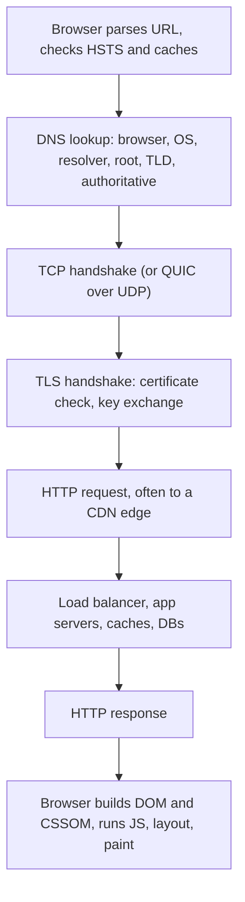
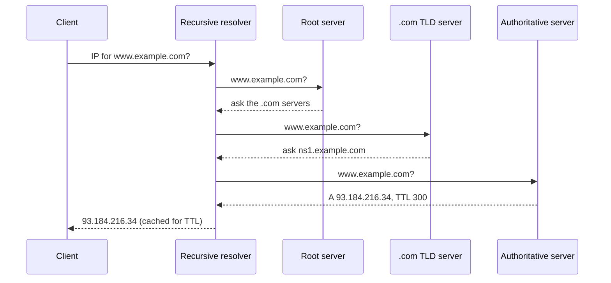
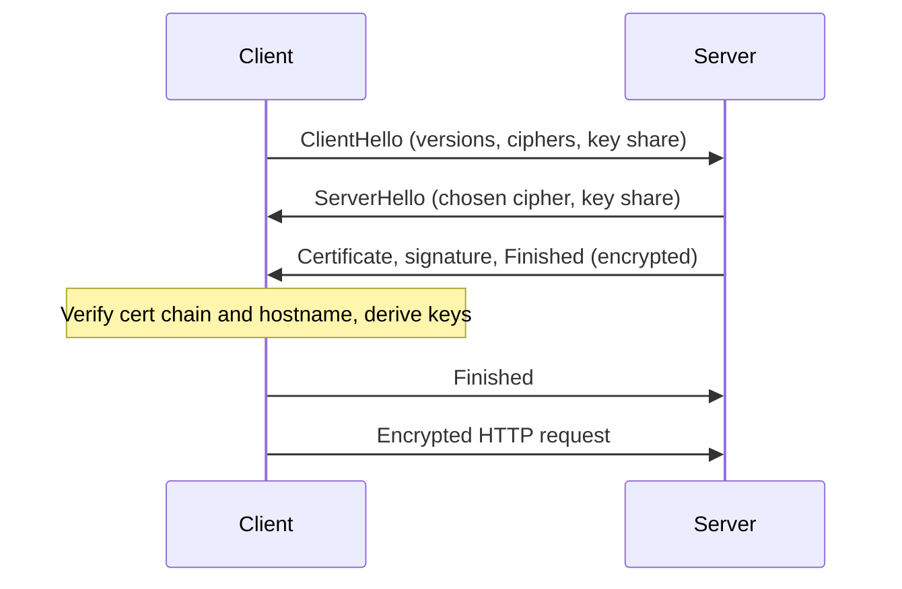
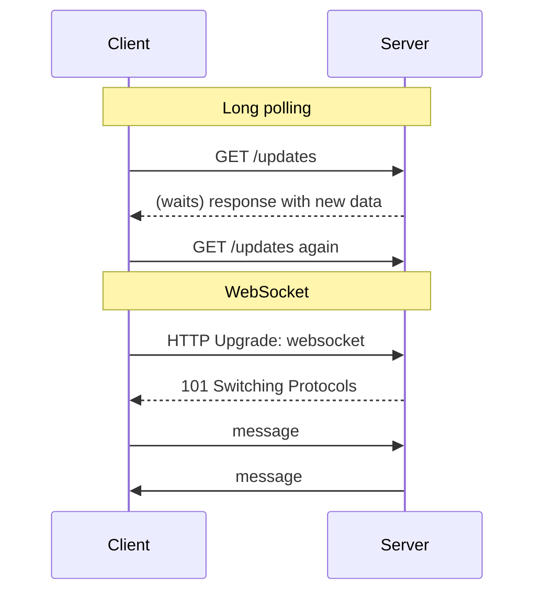
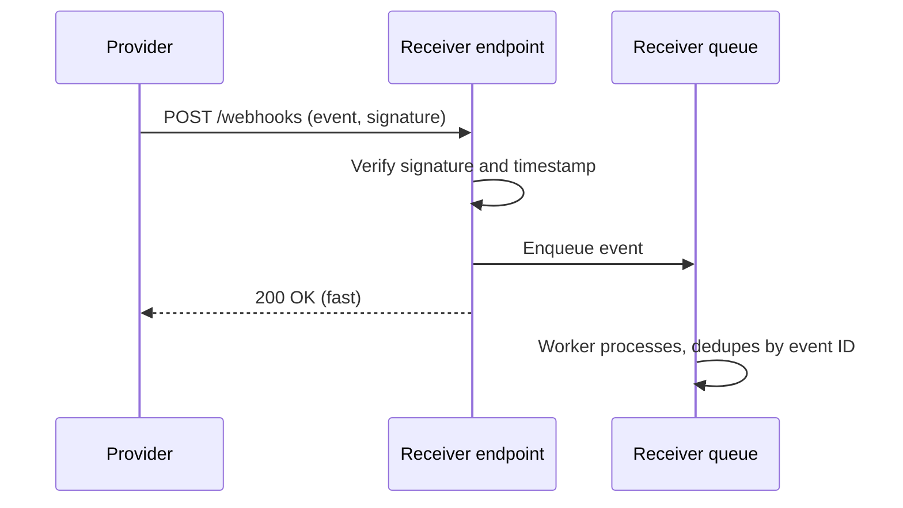
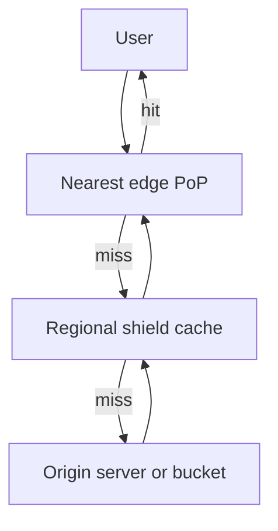
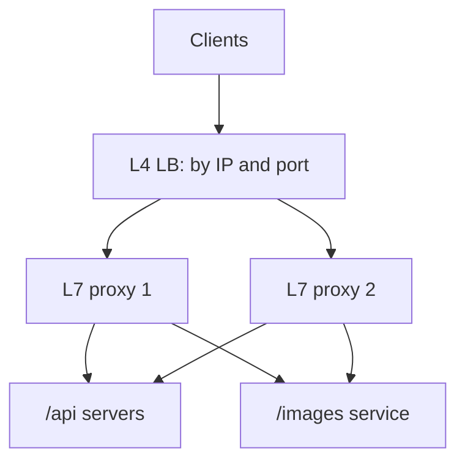
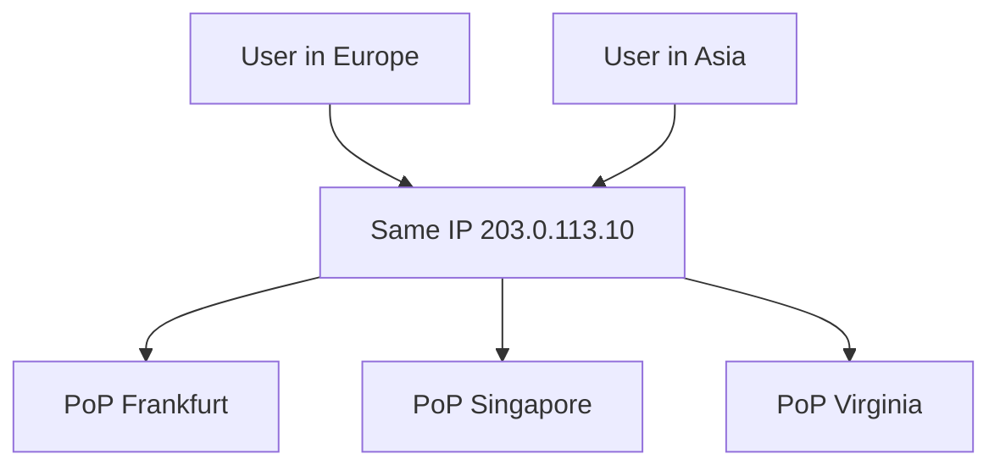
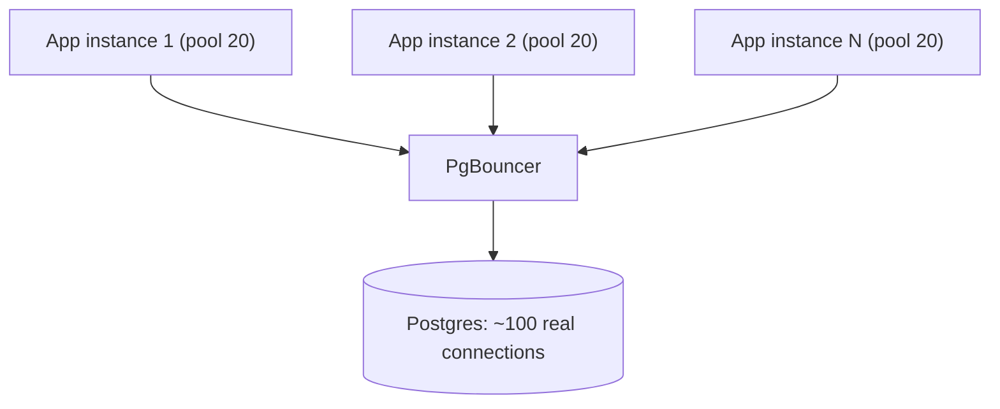
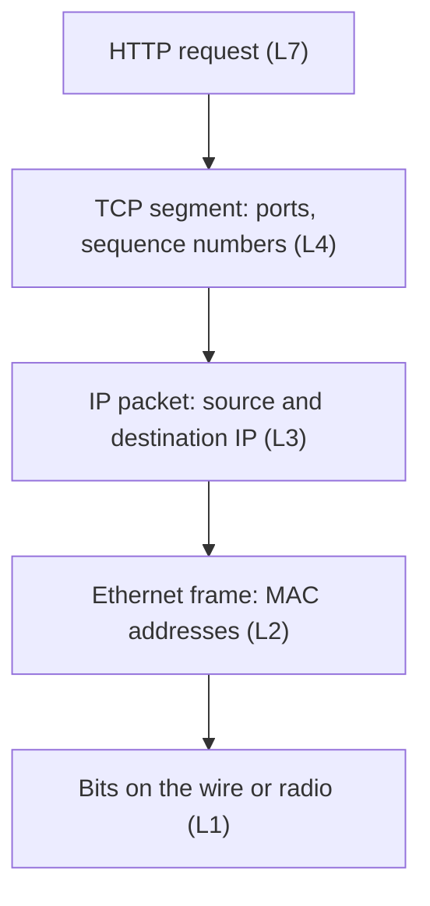

# Networking & Protocols

[⬅ Back to index](../README.md)

Covers: what happens when you type a URL, DNS, TCP vs UDP, HTTP/1.1 vs 2 vs 3, TLS, REST vs GraphQL vs gRPC, WebSockets, SSE, long polling, webhooks, CDNs, API design and pagination.

---

### 1. What happens when you type a URL into the browser and press Enter?

<details>
<summary>Answer</summary>

**In short:** The browser parses the URL, resolves the domain to an IP via DNS, opens a TCP (or QUIC) connection, performs a TLS handshake, and sends an HTTP request, usually to a CDN edge or load balancer that forwards it to app servers, caches and databases. The response comes back and the browser parses HTML, fetches sub-resources, and renders the page. Caches exist at almost every step.



#### Step by step

1. **Parse the URL.** Scheme (`https`), host, port, path, query. If the input isn't a URL, it becomes a search. The browser checks the **HSTS** list: if the site requires HTTPS, `http://` is upgraded before any request is sent.
2. **Check caches.** The browser may serve the page from its HTTP cache or a service worker without touching the network.
3. **DNS resolution.** Browser DNS cache → OS cache (and `/etc/hosts`) → recursive resolver → root → TLD → authoritative server. Result: an IP address (often of a CDN edge).
4. **Connect.** TCP three-way handshake (SYN, SYN-ACK, ACK) = 1 round trip. With HTTP/3, QUIC over UDP combines transport and TLS setup.
5. **TLS handshake.** Server sends its certificate; browser verifies the chain and hostname; keys are agreed via ECDHE. TLS 1.3 takes 1 round trip.
6. **Send the HTTP request.** `GET /path` with headers (Host, cookies, Accept-Encoding). Connection reuse (keep-alive, HTTP/2 multiplexing) avoids repeating steps 4–5 for later requests.
7. **Server side.** CDN edge serves from cache if it can; otherwise: load balancer → reverse proxy → app server → caches and databases → response.
8. **Response.** Status code, headers (`Cache-Control`, `Set-Cookie`, `Content-Encoding`), body. Redirects (301/302) restart parts of the process.
9. **Render.** Parse HTML into the DOM, CSS into the CSSOM, execute JavaScript, compute layout, paint and composite. Additional requests are made for CSS, JS, images and fonts, many in parallel.

#### What interviewers look for

This question tests how far down the stack you can go and whether you know where latency comes from. Good points to mention:

- Each network step costs **round trips**; that's why CDNs (shorter RTT), connection reuse, TLS 1.3 and HTTP/3 matter.
- Caches at each layer: browser, OS DNS, resolver, CDN, application cache, DB buffer pool.
- You can go deeper on any box on request: ARP and routing, TCP slow start, how the load balancer chooses a server.

**Likely follow-ups:**
- *Why is the first visit slower than later ones?* Cold DNS, new TCP/TLS connections, and empty browser cache.
- *What does HSTS protect against?* SSL-stripping attacks that downgrade the first request to plain HTTP.

</details>

### 2. How does DNS work?

<details>
<summary>Answer</summary>

**In short:** DNS translates domain names to IP addresses through a hierarchy: the client asks a **recursive resolver**, which asks a **root** server, then the **TLD** server (`.com`), then the domain's **authoritative** name server, and caches the answer for its **TTL**. In system design, DNS is also a tool for load distribution, geo-routing and failover.

#### Resolution step by step



1. The client (via the OS stub resolver) asks a **recursive resolver**: the ISP's, or a public one like 8.8.8.8 or 1.1.1.1.
2. If not cached, the resolver asks a **root server**, which refers it to the **TLD server** for `.com`.
3. The TLD server refers it to the domain's **authoritative name server**.
4. The authoritative server returns the record. The resolver caches it for the TTL and answers the client.

In practice, the resolver has root and popular TLD answers cached, so most lookups take one hop or are answered from cache.

#### Common record types

| Record | Purpose |
|---|---|
| A / AAAA | Name → IPv4 / IPv6 address |
| CNAME | Alias to another name (e.g. `www` → `myapp.cdn-provider.net`) |
| MX | Mail servers for the domain |
| TXT | Arbitrary text: domain verification, SPF, DKIM |
| NS | Which servers are authoritative for the zone |

#### DNS in system design

- **Load distribution** – multiple A records, returned in rotating order (round-robin). Crude: no health awareness, and clients cache.
- **Geo/latency-based routing** – return the IP of the nearest or fastest region (Route 53, Cloudflare and similar managed DNS offer this).
- **Failover** – health-checked records: stop returning a region's IP when it's unhealthy.
- **Service discovery** – internal DNS names for services (Kubernetes uses this).

**Pitfalls:**
- **TTL caching** makes changes slow to propagate; lower the TTL well before a planned migration.
- Some clients and resolvers ignore TTLs or cache longer, so failover via DNS is never instant.
- DNS is a single point of failure for everything; large outages have come from DNS provider failures. Consider multiple providers.

**Likely follow-ups:**
- *UDP or TCP?* Usually UDP port 53 for small queries; TCP for large responses and zone transfers. Encrypted variants exist (DNS over HTTPS/TLS).
- *Why not use DNS round-robin instead of a load balancer?* No health checks, uneven distribution due to caching, and slow reaction to failures.

</details>

### 3. TCP vs UDP?

<details>
<summary>Answer</summary>

**In short:** **TCP** is connection-oriented and gives reliable, ordered delivery with flow and congestion control, at the cost of handshake latency and head-of-line blocking. **UDP** just sends datagrams with no guarantees, so it's low-overhead and low-latency. Use UDP when timeliness beats completeness, or when you build your own reliability on top (as QUIC does).

| TCP | UDP |
|---|---|
| Connection-oriented (3-way handshake) | Connectionless |
| Reliable, ordered delivery, retransmits | No guarantees: packets can be lost, duplicated, reordered |
| Flow and congestion control | No built-in control |
| Higher latency, head-of-line blocking | Low overhead and latency |
| Byte stream (no message boundaries) | Message (datagram) boundaries preserved |
| HTTP/1.1, HTTP/2, databases, SSH | Video/voice calls, gaming, DNS, QUIC (HTTP/3) |

#### How TCP provides reliability

- **Handshake**: SYN → SYN-ACK → ACK establishes the connection and initial sequence numbers (1 RTT before data).
- **Sequence numbers and ACKs**: the receiver acknowledges bytes; missing ones are retransmitted after a timeout or duplicate ACKs.
- **Ordering**: data is delivered to the app in order, buffering out-of-order segments.
- **Flow control**: the receiver advertises a window so the sender doesn't overwhelm it.
- **Congestion control**: slow start and backoff when loss is detected, so the network isn't overwhelmed.

**Head-of-line (HOL) blocking**: because TCP delivers bytes strictly in order, one lost packet stalls everything behind it until it's retransmitted, even data belonging to unrelated requests.

#### Why UDP for real-time

In a video call, a frame that arrives 300 ms late is useless; retransmitting it just delays newer frames. With UDP, the app decides: skip the lost packet, interpolate, or use forward error correction. Games send the latest position many times per second, so a lost update is replaced by the next.

**QUIC** builds on UDP to get TCP-like reliability *per stream* plus built-in encryption, without kernel changes and without cross-stream HOL blocking.

**Pitfalls:**
- With UDP you must handle loss, ordering, duplicates and congestion yourself (or use a library/protocol that does).
- Some corporate networks block or throttle UDP; clients need a TCP fallback.

**Likely follow-ups:**
- *Why does DNS use UDP?* Queries are tiny and a single request/response; a handshake would double latency.
- *What is TCP slow start and why does it matter?* New connections start with a small sending window and grow it, so short-lived connections never reach full speed; another reason to reuse connections.

</details>

### 4. HTTP/1.1 vs HTTP/2 vs HTTP/3?

<details>
<summary>Answer</summary>

**In short:** **HTTP/1.1** is a text protocol handling one request at a time per connection. **HTTP/2** adds binary framing and **multiplexes many streams over one TCP connection**, but a lost packet still stalls all streams (TCP head-of-line blocking). **HTTP/3** runs over **QUIC on UDP**, with independent streams, faster setup and connection migration, which helps most on mobile and lossy networks.

#### HTTP/1.1

- Text protocol: human-readable headers and requests.
- One outstanding request per connection (pipelining exists in the spec but is effectively unused), so browsers open ~6 connections per host.
- **HTTP-level head-of-line blocking**: a slow response blocks the next one on that connection.
- Workarounds from that era: domain sharding, sprite sheets, bundling many files into one.

#### HTTP/2

- **Binary framing**: messages split into frames tagged with a stream ID.
- **Multiplexing**: many concurrent request/response streams over **one** TCP connection; no more 6-connection limit.
- **Header compression (HPACK)**: repeated headers (cookies, user agent) aren't resent in full.
- Stream prioritisation. (Server push was specified but browsers have largely dropped support.)
- **Still TCP**: one lost packet blocks all streams until retransmitted, so on lossy networks HTTP/2 can do worse than several HTTP/1.1 connections.

#### HTTP/3

- Runs over **QUIC**, a transport on UDP.
- **Independent streams**: loss on one stream doesn't stall others.
- **Faster setup**: transport and TLS 1.3 handshake combined (1 RTT; 0-RTT on resumption).
- **Connection migration**: connections are identified by a connection ID, not the IP/port tuple, so switching from Wi-Fi to mobile data doesn't drop the connection.
- Encryption is mandatory and built in.

| | HTTP/1.1 | HTTP/2 | HTTP/3 |
|---|---|---|---|
| Transport | TCP | TCP | QUIC (UDP) |
| Format | Text | Binary frames | Binary frames |
| Concurrency per connection | 1 request at a time | Many streams | Many independent streams |
| HOL blocking | HTTP and TCP level | TCP level | None across streams |
| Header compression | No | HPACK | QPACK |
| New connection cost (with TLS 1.3) | TCP + TLS: 2 RTT | 2 RTT | 1 RTT (0-RTT resumption) |

gRPC uses HTTP/2. Most CDNs and browsers support HTTP/3 today, with fallback to HTTP/2 when UDP is blocked.

**Pitfalls:**
- 0-RTT data can be replayed by an attacker; only use it for idempotent requests.
- HTTP/1.1-era optimisations (domain sharding, heavy bundling) can hurt under HTTP/2/3.

**Likely follow-ups:**
- *Why build QUIC on UDP instead of fixing TCP?* TCP lives in OS kernels and middleboxes, which are very slow to change; UDP lets QUIC be deployed in user space.
- *Does HTTP/2 matter for service-to-service traffic?* Yes; multiplexing over few long-lived connections is why gRPC uses it.

</details>

### 5. How does HTTPS/TLS work?

<details>
<summary>Answer</summary>

**In short:** TLS gives **confidentiality, integrity and server authentication**. In the handshake, the server proves its identity with a CA-signed **certificate**, both sides agree on session keys using **ephemeral Diffie-Hellman (ECDHE)** for forward secrecy, and all data is then encrypted with fast **symmetric** ciphers. TLS 1.3 does this in **1 round trip** (0-RTT on resumption).

#### The handshake (TLS 1.3, simplified)



1. **ClientHello**: supported TLS versions, cipher suites, and the client's Diffie-Hellman key share (sent optimistically, which is how 1.3 saves a round trip).
2. **ServerHello**: chosen cipher and the server's key share. Both sides now compute the same shared secret.
3. The server sends its **certificate** and a signature proving it owns the matching private key.
4. The client verifies the **certificate chain** up to a trusted root CA, checks the hostname matches and the certificate is valid (not expired or revoked).
5. All further data is encrypted with **symmetric** encryption (AES-GCM, ChaCha20-Poly1305), which is fast. Asymmetric crypto is only used in the handshake.

#### Key concepts

- **Why both asymmetric and symmetric?** Asymmetric crypto solves key exchange and authentication but is slow; symmetric is fast for bulk data.
- **Forward secrecy**: keys come from ephemeral DH values discarded after the session, so a stolen server private key later can't decrypt recorded past traffic.
- **Integrity**: AEAD ciphers detect any tampering.
- **TLS 1.2 vs 1.3**: 1.3 removed weak ciphers and RSA key exchange, mandates forward secrecy, and cuts the handshake from 2 RTT to 1.

#### TLS in architectures

- **Termination at the edge**: CDN or load balancer decrypts, so it can route on HTTP content and cache. Certificates managed in one place.
- **Re-encryption** to backends, or **mTLS** (both sides present certificates) between services in a zero-trust network, often handled by a service mesh.
- **Certificate management**: automated issuance and renewal (ACME/Let's Encrypt or a cloud certificate manager). Expired certificates are a classic cause of outages.

**Pitfalls:**
- 0-RTT early data can be replayed; restrict to idempotent requests.
- Disabling certificate validation in clients "to make it work" defeats the purpose.
- Mobile apps sometimes use **certificate pinning**; it blocks interception but makes certificate rotation risky.

**Likely follow-ups:**
- *What does a CA actually guarantee?* That the certificate's public key belongs to the domain owner, as verified by the CA.
- *What is SNI?* Server Name Indication: the client sends the hostname in the ClientHello so one IP can serve certificates for many domains.

</details>

### 6. REST vs GraphQL vs gRPC?

<details>
<summary>Answer</summary>

**In short:** **REST** models resources with HTTP verbs and is simple, universal and cacheable; **GraphQL** exposes one endpoint where clients ask for exactly the fields they need, ideal for varied UIs; **gRPC** uses Protobuf contracts over HTTP/2 for fast, strongly-typed, streaming RPC, ideal between services. A common combination: gRPC between microservices, REST or GraphQL at the edge.

| | REST | GraphQL | gRPC |
|---|---|---|---|
| Model | Resources + HTTP verbs | One endpoint, client-specified query | RPC methods from a `.proto` contract |
| Format | Usually JSON | JSON | Protobuf (binary) over HTTP/2 |
| Strengths | Simple, cacheable (HTTP caching, CDN), universal | No over/under-fetching, one round trip for nested data, typed schema | Fast, small payloads, streaming, codegen, strict contracts |
| Weaknesses | Over/under-fetching, many round trips | Caching is harder, complex queries can be expensive (needs depth/cost limits), N+1 on resolvers | Not browser-native (needs gRPC-Web), less human-readable |
| Typical use | Public APIs | Client-facing APIs with many UIs (mobile + web) | Internal service-to-service |

#### The same request three ways

```http
GET /users/42
GET /users/42/posts?limit=3
```

```graphql
query {
  user(id: 42) {
    name
    posts(limit: 3) { title likeCount }
  }
}
```

```protobuf
service UserService {
  rpc GetUser (GetUserRequest) returns (User);
  rpc StreamPosts (StreamPostsRequest) returns (stream Post);  // server streaming
}
message GetUserRequest { int64 id = 1; }
```

#### When to pick which

- **REST**: public APIs, simple CRUD, when HTTP caching and CDN-friendliness matter, and for broad tooling support.
- **GraphQL**: a product with mobile and web clients needing different shapes of the same data; aggregating many backend services behind one schema; fast UI iteration without new endpoints.
- **gRPC**: internal calls where latency, payload size and strict contracts matter; streaming (bidirectional) between services; polyglot services with generated clients.

#### Problems specific to each

- **REST over/under-fetching**: `/users/42` returns 40 fields when the screen needs 3 (over-fetching), and the screen needs posts too, so a second call (under-fetching). Mitigate with field selection or a BFF.
- **GraphQL N+1**: resolving `posts` for each of 50 users triggers 50 queries. Fix with batching (DataLoader pattern). Protect against expensive queries with depth/complexity limits and persisted queries.
- **gRPC**: needs HTTP/2 end to end, so some proxies and browsers need gRPC-Web or a gateway; binary payloads are harder to debug.

**Likely follow-ups:**
- *How does GraphQL handle caching?* Mostly client-side normalised caches (keyed by type + ID); HTTP caching works only with persisted queries over GET.
- *How do you version each?* REST: URL or header versions; GraphQL: evolve the schema and deprecate fields; gRPC: add new field numbers, never reuse old ones.

</details>

### 7. What are WebSockets, SSE and long polling? When do you use each?

<details>
<summary>Answer</summary>

**In short:** They are ways for the server to push data to clients. **Long polling** holds an HTTP request open until data arrives; **Server-Sent Events (SSE)** stream events one way, server → client, over a long-lived HTTP response; **WebSockets** give a full-duplex persistent connection. Use SSE for one-way feeds (notifications, LLM token streaming), WebSockets for interactive two-way traffic (chat, multiplayer), and long polling as a universal fallback.

#### The options

- **Short polling** – client asks every N seconds. Simple, wasteful (most responses are empty), and adds up to N seconds of delay.
- **Long polling** – client asks; the server holds the request until data arrives or a timeout (~30 s), then the client immediately asks again. Works everywhere (plain HTTP), but each message costs a full request/response with headers.
- **Server-Sent Events (SSE)** – one long-lived HTTP response with `Content-Type: text/event-stream`, streaming events **server → client**. Built-in browser `EventSource` handles auto-reconnect and resumes with `Last-Event-ID`. Great for notifications, live scores, dashboards, LLM token streaming.
- **WebSocket** – starts as an HTTP request with `Upgrade: websocket`, then becomes a **full-duplex** framed connection. Best for chat, multiplayer games, collaborative editing.



| | Long polling | SSE | WebSocket |
|---|---|---|---|
| Direction | Server → client (per request) | Server → client | Both ways |
| Transport | Plain HTTP | Plain HTTP, streamed | Upgraded TCP connection |
| Reconnect | Manual | Built in, resumable | Manual |
| Data | Any | Text (UTF-8) | Text or binary |
| Proxy/firewall friendliness | Best | Good | Usually fine, occasionally blocked |
| Use case | Fallback, low frequency | Feeds, notifications, streaming responses | Chat, games, collaboration |

#### Scaling persistent connections

Each server holds many open connections (tens to hundreds of thousands with async I/O). New problems:

- **Connection registry**: which server holds user X's connection (e.g. in Redis).
- **Pub/sub backbone** (Redis Pub/Sub, Kafka, NATS): a message for user X is published, and the server holding X's connection delivers it.
- **Load balancers** must support long-lived connections and upgrades, with suitable idle timeouts.
- **Heartbeats** (ping/pong) to detect dead connections through NATs and proxies.
- **Deploys** drop connections; clients need reconnect with backoff and jitter to avoid a reconnect storm.

**Pitfalls:**
- Choosing WebSockets when data only flows one way; SSE is simpler and works with normal HTTP infrastructure.
- Mobile: persistent connections drain battery and die in the background; use push notifications (APNs/FCM) for background delivery.

**Likely follow-ups:**
- *How do you guarantee no missed messages on reconnect?* Give messages sequence IDs and let the client resume from the last one it saw.
- *How many connections can one server hold?* Limited by memory and file descriptors more than CPU; hundreds of thousands are achievable with event-loop servers.

</details>

### 8. What are webhooks?

<details>
<summary>Answer</summary>

**In short:** A webhook is a **server-to-server HTTP callback**: when an event happens (payment succeeded), provider A POSTs a JSON payload to a URL that system B registered. Because delivery is retried, receivers must be **idempotent**; because anyone could call the URL, payloads should be **signed**; and receivers should acknowledge fast and process asynchronously.

#### Why webhooks exist

Without them, B would have to poll A ("any new payments?") constantly. Webhooks invert this: A notifies B when something happens. Payment providers, Git hosts, and messaging platforms all use them.



#### Provider-side design

- **Retries with exponential backoff** when the receiver fails or times out, for hours or days; then a dead-letter state and a way to replay.
- An **event ID** on each delivery so receivers can deduplicate.
- **Signatures**: HMAC of the body with a per-receiver shared secret, plus a timestamp.
- A delivery log and dashboard for debugging.

#### Receiver-side design

```python
def handle_webhook(request):
    sig = request.headers["X-Signature"]
    ts = int(request.headers["X-Timestamp"])
    expected = hmac_sha256(secret, f"{ts}.{request.body}")
    if not constant_time_equals(sig, expected) or abs(now() - ts) > 300:
        return 401                       # forged or replayed
    event = json.loads(request.body)
    if seen_events.add_if_absent(event["id"]):   # dedupe retries
        queue.publish(event)             # process async
    return 200                           # acknowledge quickly
```

- **Verify** the signature (constant-time compare) and reject old timestamps against replay.
- **Be idempotent**: the same event may arrive several times.
- **Acknowledge fast**: providers have short timeouts; do heavy work from a queue.
- **Don't rely on ordering**: use timestamps or versions in the payload, or re-fetch the current state from the provider's API.

**Pitfalls:**
- Doing slow processing inline, timing out, and triggering retries that cause duplicate work.
- Trusting the payload blindly; for critical actions, fetch the object from the provider's API to confirm.
- Receiver endpoints that are down for a long time miss events; providers may give up, so reconcile periodically.

**Likely follow-ups:**
- *Webhooks vs a message queue?* Webhooks cross organisational boundaries over plain HTTP; queues are for internal systems with stronger delivery tooling.
- *How do you protect against SSRF as a provider?* Validate registered URLs and block internal IP ranges, since you're making outbound requests to customer-controlled URLs.

</details>

### 9. What is a CDN and how does it work?

<details>
<summary>Answer</summary>

**In short:** A **Content Delivery Network** is a global network of edge servers (PoPs) that cache content close to users. Users are routed to a nearby edge via DNS geo-routing or **anycast**; on a cache miss the edge fetches from the **origin** and caches the response according to `Cache-Control` headers. It lowers latency, offloads the origin and absorbs traffic spikes and DDoS.

#### How a request flows



1. **Routing to the edge**: DNS returns a nearby PoP's IP, or the CDN uses **anycast** (same IP announced from every PoP, network routes to the nearest).
2. **Cache lookup** using a cache key (usually URL plus selected headers).
3. **Hit**: served directly from the edge, often in a few ms.
4. **Miss**: the edge fetches from a mid-tier **shield** cache or the **origin**, stores it per `Cache-Control` (`max-age`, `s-maxage`), and returns it. The shield means only one request reaches the origin for many PoP misses.

#### Push vs pull

| | Pull CDN | Push CDN |
|---|---|---|
| How content gets there | Edge fetches lazily on the first request | You upload content ahead of time |
| Good for | Websites, most traffic | Large files, predictable releases (game patches, video) |
| Trade-off | First request per PoP is slow | You manage uploads and storage |

#### Benefits

- Lower latency (short RTT for TCP/TLS setup and transfer).
- **Origin offload**: a 95% hit rate means the origin sees 1/20th of the traffic.
- **DDoS absorption** across a huge network capacity; WAF and bot filtering at the edge.
- **TLS termination** at the edge, HTTP/2 and HTTP/3 for clients even if the origin is older.
- **Edge compute** (Cloudflare Workers, Lambda@Edge) for redirects, A/B tests, auth checks or personalisation near users.

#### Invalidation

Prefer **versioned file names** (`app.3f9a.js`) with long cache lifetimes; deploying a new version just references a new URL. Purges work but take time to propagate and are easy to get wrong.

```http
Cache-Control: public, max-age=31536000, immutable
```

**Pitfalls:**
- Caching personalised responses publicly (leaking one user's page to another). Use `Cache-Control: private` or vary the cache key carefully.
- Too many `Vary` headers or query-string variations fragment the cache and kill the hit rate.

**Likely follow-ups:**
- *Can a CDN cache API responses?* Yes, for public or short-lived data (`s-maxage=10`), using `stale-while-revalidate` to hide origin latency.
- *How does video streaming use CDNs?* Video is split into small segments (HLS/DASH), each cached as a normal file at the edge.

</details>

### 10. Offset vs cursor pagination?

<details>
<summary>Answer</summary>

**In short:** **Offset pagination** (`LIMIT 20 OFFSET 40`) is simple and allows jumping to page N, but deep pages are slow and inserts shift results, causing duplicates or skips. **Cursor (keyset) pagination** (`?after=<cursor>`) continues from the last item's sort key using an index, so it's fast at any depth and stable under changes, but can't jump to arbitrary pages. Use cursors for feeds and infinite scroll.

#### Offset pagination

```sql
SELECT * FROM posts ORDER BY created_at DESC LIMIT 20 OFFSET 40;  -- page 3
```

- **Pros**: simple; "page 7 of 120" UIs; total counts are easy.
- **Cons**:
  - The database still reads and discards the skipped rows, so `OFFSET 1000000` is slow.
  - If a new post is inserted while the user is on page 1, everything shifts by one, and page 2 repeats the last item of page 1. Deletes cause skips.

#### Cursor / keyset pagination

The cursor encodes the last item's sort key, e.g. `(created_at, id)`. `id` is a tiebreaker so the order is unique.

```sql
SELECT * FROM posts
WHERE (created_at, id) < ('2026-05-01 10:00:00', 98765)
ORDER BY created_at DESC, id DESC
LIMIT 20;
```

With an index on `(created_at, id)`, the database seeks directly to the position, so page 10,000 costs the same as page 1.

```json
{
  "items": [ ... ],
  "next_cursor": "eyJjcmVhdGVkX2F0IjoiMjAyNi0wNS0wMVQxMDowMDowMFoiLCJpZCI6OTg3NjV9"
}
```

Make the cursor **opaque** (e.g. base64 of JSON) so clients don't build their own, and you can change the format later.

| | Offset | Cursor |
|---|---|---|
| Deep page performance | Degrades linearly | Constant |
| Stable under inserts/deletes | No | Yes |
| Jump to page N | Yes | No |
| Total count / page numbers | Easy | Expensive or approximate |
| Best for | Small admin tables, search result pages | Feeds, timelines, infinite scroll, APIs syncing large data |

**Pitfalls:**
- A cursor on a non-unique column (only `created_at`) skips or repeats items with equal timestamps; always add a unique tiebreaker.
- Changing the sort order must invalidate old cursors.
- `COUNT(*)` on huge tables for "total pages" is itself expensive.

**Likely follow-ups:**
- *How do you paginate in a sharded system?* Each shard returns its next page by the same cursor, and the service merges them; or paginate on a globally sortable ID (e.g. Snowflake IDs).
- *How do you support "previous page" with cursors?* Return both `before` and `after` cursors and flip the comparison and sort order.

</details>

### 11. What makes a good API design?

<details>
<summary>Answer</summary>

**In short:** A good API is predictable and safe to use at scale: resource-oriented URLs with correct verbs and status codes, idempotency for retries, versioning with backward-compatible evolution, paginated list endpoints, consistent error shapes, rate limiting, proper auth, and not being chatty. In an interview, sketch the key endpoints with request/response shapes before designing internals.

#### The checklist

- **Resource-oriented** nouns (`/users/{id}/orders`), correct verbs (GET reads, POST creates, PUT/PATCH update, DELETE removes) and status codes (201, 400, 404, 409, 429, 503).
- **Idempotency**: GET/PUT/DELETE are idempotent by definition; for POSTs that must not repeat (payments, orders), accept an `Idempotency-Key` header and return the stored result for repeats.
- **Versioning** (`/v1`, or a header) and backward-compatible changes: add optional fields, never remove or repurpose them. Clients (especially old mobile app versions) live for years.
- **Pagination, filtering and sorting** on list endpoints; cursor-based for large or changing data.
- **Consistent errors** (`{code, message, details}`) and a request ID returned in every response for tracing.
- **Rate limiting** with `429 Too Many Requests` + `Retry-After`.
- **Auth** with OAuth 2 / tokens, and least-privilege scopes.
- **Avoid chatty APIs**: if a screen needs 10 calls, add a batch endpoint or a **BFF** (backend for frontend) tailored to mobile.

#### Example

```http
POST /v1/orders
Authorization: Bearer <token>
Idempotency-Key: 7d1f2c9e-4b5a-4c0e-9a7b-1f2e3d4c5b6a
Content-Type: application/json

{ "items": [{ "sku": "A12", "qty": 2 }], "address_id": "addr_9" }
```

```http
HTTP/1.1 201 Created
Location: /v1/orders/ord_123
X-Request-Id: req_abc

{ "id": "ord_123", "status": "pending", "total_cents": 4598 }
```

Error response:

```json
{
  "error": {
    "code": "INSUFFICIENT_STOCK",
    "message": "Only 1 unit of A12 is available.",
    "details": { "sku": "A12", "available": 1 },
    "request_id": "req_abc"
  }
}
```

#### Further good practices

- Use **IDs that don't leak** information (opaque strings, not sequential integers that reveal volume or invite enumeration).
- Use **ISO 8601 timestamps** in UTC and explicit units (`total_cents`, not `total`).
- Use **async patterns** for long work: return `202 Accepted` with a status URL, or notify via webhook.
- Document with **OpenAPI** (REST) or the schema itself (GraphQL/Protobuf).

**Pitfalls:**
- Using `200 OK` with an error in the body; clients, proxies and monitoring then can't tell failures apart.
- Breaking changes without a new version; renaming a field breaks every old client.
- Exposing database structure directly as the API, making the schema impossible to change.

**Likely follow-ups:**
- *How do you deprecate an endpoint?* Announce, add a `Deprecation`/`Sunset` header, monitor usage, and remove only when traffic is near zero.
- *How do idempotency keys work server-side?* Store key → result (with a TTL) atomically; a repeat returns the stored result instead of re-executing.

</details>

### 12. What is the difference between L4 and L7 networking?

<details>
<summary>Answer</summary>

**In short:** **Layer 4** (transport) works with TCP/UDP connections, IPs and ports, without looking at content, so it's very fast and protocol-agnostic. **Layer 7** (application) understands HTTP: paths, headers, cookies. An L7 load balancer can route by URL, terminate TLS, authenticate, rewrite, compress and cache, at the cost of more CPU per request.

#### Layer 4

- Sees: source/destination IP and port, protocol (TCP/UDP).
- An **L4 load balancer** picks a backend per connection (by hash of the IP/port tuple, round-robin, or least connections) and forwards packets or proxies the TCP stream.
- Doesn't decrypt TLS, doesn't parse HTTP.
- Very high throughput and low latency; works for any TCP/UDP protocol (databases, MQTT, game servers, raw TLS passthrough).

#### Layer 7

- Sees: HTTP method, path, host, headers, cookies, body.
- An **L7 load balancer / reverse proxy** (e.g. Nginx, Envoy, HAProxy in HTTP mode, cloud application load balancers) can:
  - Route `/api/*` to API servers and `/images/*` to an image service.
  - Route by header (canary: 5% of users with a cookie go to v2).
  - Terminate TLS, add auth checks, rate limit, rewrite headers, compress, cache.
  - Balance **per request**, not per connection, which matters for HTTP/2 and gRPC (many requests over one connection).



A common pattern: L4 in front for raw scale and stable IPs, L7 proxies behind it for smart routing.

| | L4 | L7 |
|---|---|---|
| Sees | IP, port | Full HTTP request |
| Routing granularity | Per connection | Per request |
| TLS | Pass-through | Can terminate |
| Features | Fast forwarding | Path/host routing, auth, caching, retries |
| Cost | Very low CPU | Higher CPU, more latency |

**Likely follow-ups:**
- *Why does gRPC need L7 balancing?* gRPC multiplexes many calls over one long-lived HTTP/2 connection; L4 would pin all of them to one backend.
- *Can L4 do health checks?* Yes, TCP-level (port open); L7 can check an HTTP endpoint's actual response.

See [Load Balancing](05-load-balancing-proxies-gateways.md) for when to use which.

</details>

### 13. What is anycast?

<details>
<summary>Answer</summary>

**In short:** **Anycast** announces the **same IP address from many locations** via BGP, and the internet's routing sends each user to the topologically nearest one. CDNs, public DNS resolvers (1.1.1.1, 8.8.8.8) and DDoS protection use it because traffic spreads naturally and a failed site is removed simply by withdrawing its route.

#### How it works

Normally (**unicast**), one IP address belongs to one location. With anycast, many data centres each advertise the same IP prefix to their upstream networks using **BGP**. Routers pick the "shortest" path by BGP policy (roughly fewest network hops, not strictly geographic distance), so a user in Tokyo reaches the Tokyo PoP and a user in Paris reaches Paris, both connecting to the same IP.



#### Why it's useful

- **Low latency** without the client doing anything special.
- **DDoS resilience**: attack traffic is spread across all PoPs instead of focused on one.
- **Fast failover**: if a PoP fails, it withdraws its BGP route and traffic shifts to the next nearest, with no DNS TTL to wait for.
- **Simple configuration**: one IP worldwide.

#### Anycast vs DNS geo-routing vs unicast

| | Unicast | DNS geo-routing | Anycast |
|---|---|---|---|
| IPs | One IP, one location | Different IP per region | Same IP, many locations |
| Who decides location | Fixed | DNS server, based on resolver location | Network routing (BGP) |
| Failover speed | None | Limited by DNS TTL | Route withdrawal (fast) |
| Precision | – | Can be fooled by a distant resolver | Follows network topology |

**Pitfalls:**
- Route changes mid-connection can send packets of an existing TCP connection to a different PoP, which doesn't know the connection. It works well for short-lived connections (DNS over UDP, HTTP) and with careful engineering for longer ones.
- "Nearest" by BGP isn't always lowest latency.

**Likely follow-ups:**
- *Why is anycast natural for DNS?* DNS queries are single UDP packets, so route changes don't break anything.
- *Can you do anycast yourself?* You need your own IP block and an ASN with BGP peering, or a provider (cloud global load balancers, CDNs) that offers it.

</details>

### 14. What are the main serialisation formats and how do you choose?

<details>
<summary>Answer</summary>

**In short:** **JSON** is human-readable and universal but verbose and slow to parse; **Protocol Buffers** and **Avro** are compact binary formats with schemas and good evolution rules; **Parquet/ORC** are columnar formats for analytics. Use binary + schema for high-volume internal traffic and data pipelines, and JSON for public APIs and debuggability.

#### The formats

- **JSON** – text, self-describing (field names in every message), universal browser and tooling support. Verbose; parsing is CPU-heavy at high volume; no schema unless you add JSON Schema; numbers are ambiguous (large integers lose precision in JavaScript).
- **Protocol Buffers** – binary, schema in `.proto` files, code generation for many languages. Fields are identified by **numbers**, not names, which makes payloads small and evolution safe. Used by gRPC.
- **Avro** – binary, schema defined separately (JSON) and **not tagged per field**; the reader needs the writer's schema, commonly via a **schema registry** with Kafka. Excellent for evolving data pipelines.
- **Thrift** – similar idea to Protobuf, with its own RPC framework.
- **FlatBuffers / Cap'n Proto** – allow **zero-copy** reads (access fields directly from the buffer without parsing); used in games and mobile where parse time matters.
- **MessagePack / CBOR** – "binary JSON": compact, schemaless.
- **Parquet / ORC** – **columnar** storage formats for analytics; compress well and let queries read only the needed columns.

#### Schema evolution with Protobuf

```protobuf
message User {
  int64 id = 1;
  string name = 2;
  // v2: added field. Old readers ignore it; new readers see default if absent.
  string email = 3;
  // Removed field 4: reserve the number so it is never reused.
  reserved 4;
}
```

Rules: never change a field's number or type, never reuse numbers, add new fields as optional. This gives **backward compatibility** (new code reads old data) and **forward compatibility** (old code reads new data).

#### Comparison

| | JSON | Protobuf | Avro | Parquet |
|---|---|---|---|---|
| Encoding | Text | Binary | Binary | Binary, columnar |
| Schema | Optional | Required (.proto) | Required (registry) | Embedded |
| Size | Large | Small | Smallest (no tags) | Very small after compression |
| Human readable | Yes | No | No | No |
| Typical use | Public APIs, configs | RPC, internal APIs, mobile | Kafka, data pipelines | Data lake, analytics |

**Pitfalls:**
- Choosing binary formats for a public API used by third parties; debugging and client support suffer.
- Changing field numbers or types in Protobuf breaks existing clients and stored data silently.

**Likely follow-ups:**
- *Why row vs columnar?* Row formats suit reading/writing whole records (OLTP, messages); columnar suits scanning a few columns across billions of rows (OLAP).
- *Is JSON + gzip good enough?* Often yes for APIs; compression closes much of the size gap, but parse CPU and lack of schema remain.

</details>

### 15. What is a keep-alive connection and why does connection pooling matter?

<details>
<summary>Answer</summary>

**In short:** Setting up a TCP + TLS connection costs 1–3 round trips plus CPU for crypto. **Keep-alive** reuses one connection for many requests, and **connection pools** keep a set of warm connections ready in clients (HTTP clients, database drivers). Without them, high-QPS services waste latency on handshakes, burn CPU, and can exhaust ephemeral ports or the database's connection limit.

#### The cost of a new connection

- TCP handshake: 1 RTT.
- TLS 1.3 handshake: +1 RTT (TLS 1.2: +2).
- TCP **slow start**: a new connection begins with a small congestion window, so early transfers are slow.

Cross-region at 100 ms RTT, a fresh HTTPS connection costs ~200 ms before the first byte of the request. Reusing a connection costs zero.

#### Keep-alive

HTTP/1.1 connections are persistent by default: after a response, the connection stays open for the next request until an idle timeout. HTTP/2 goes further and multiplexes many concurrent requests on one connection.

#### Connection pools

A pool holds N open connections; a request borrows one and returns it.

```kotlin
// Create ONE client and reuse it; it maintains a connection pool internally.
val client = OkHttpClient.Builder()
    .connectionPool(ConnectionPool(20, 5, TimeUnit.MINUTES))
    .build()

// Wrong: a new client per request means a new pool and fresh handshakes every time.
fun fetchBad(url: String) = OkHttpClient().newCall(Request.Builder().url(url).build()).execute()
```

Pool settings that matter:
- **Max size**: too small → requests wait for a connection; too large → overwhelms the server.
- **Idle timeout**: shorter than the server's or load balancer's, or you'll use connections the other side has already closed.
- **Acquire timeout**: fail fast instead of queueing forever.

#### Databases are a special case

Database connections are expensive server-side; PostgreSQL uses a **process per connection**, each consuming memory. With 200 app instances × 20 connections each = 4,000 connections, the database spends resources on connections, not queries. Solutions:

- A **connection pooler** like **PgBouncer** (or a cloud DB proxy) multiplexes many client connections onto a few database connections.
- Size app pools based on the database's capacity, not the app's thread count.



**Pitfalls:**
- **Ephemeral port exhaustion**: opening and closing many outbound connections leaves sockets in `TIME_WAIT`, and you run out of local ports.
- Long-lived connections + L4 load balancing → uneven load after scaling out (new servers get no traffic until connections recycle). Set a max connection lifetime.
- Serverless functions each opening DB connections can overwhelm the database; use a proxy.

**Likely follow-ups:**
- *How do you size a DB pool?* Start small (roughly a few times the DB's CPU cores in total across all clients), then measure wait time and DB load.
- *Does HTTP/2 remove the need for pooling?* It reduces the number of connections needed, but clients still keep and reuse them.

</details>

### 16. Explain the OSI model briefly. Which layers matter in system design?

<details>
<summary>Answer</summary>

**In short:** The OSI model splits networking into seven layers, from physical signals (1) up to application protocols like HTTP (7). Engineers mostly use the simpler four-layer **TCP/IP model**, and in system design **layers 4 and 7** matter most: TCP vs UDP, L4 vs L7 load balancers, and HTTP-level routing, caching and security.

| Layer | Name | Examples |
|---|---|---|
| 7 | Application | HTTP, gRPC, DNS, SMTP, WebSocket |
| 6 | Presentation | Encoding, compression, TLS (often placed here) |
| 5 | Session | Session setup and teardown |
| 4 | Transport | TCP, UDP, QUIC |
| 3 | Network | IP, routing, ICMP |
| 2 | Data link | Ethernet, Wi-Fi, MAC addresses |
| 1 | Physical | Cables, radio |

#### How the layers work together

Each layer wraps the one above it (**encapsulation**): an HTTP request becomes the payload of a TCP segment, which becomes the payload of an IP packet, which becomes the payload of an Ethernet frame. On the receiving side, each layer strips its header and passes the rest up.



#### TCP/IP model mapping

| TCP/IP layer | OSI layers |
|---|---|
| Application | 5, 6, 7 |
| Transport | 4 |
| Internet | 3 |
| Link | 1, 2 |

Layers 5 and 6 don't map cleanly to real protocols; TLS, for example, sits between TCP and HTTP and is variously called layer 5, 6 or "4.5".

#### What matters in system design

- **L7**: HTTP semantics, API gateways, L7 load balancers (path routing, TLS termination), CDNs, WAFs, caching headers.
- **L4**: TCP vs UDP choice, L4 load balancers, connection behaviour (handshakes, keep-alive, HOL blocking).
- **L3**: IP addressing, subnets and VPCs, anycast and BGP, firewall rules and security groups.
- L1/L2 rarely come up except in data-centre networking discussions.

**Likely follow-ups:**
- *Where does QUIC fit?* A transport (L4) protocol implemented in user space on top of UDP, with TLS built in.
- *What layer does a firewall work at?* Traditional firewalls/security groups at L3/L4 (IPs, ports); a WAF at L7 (inspects HTTP requests).

</details>

### 17. What are the HTTP methods, which are idempotent, and PUT vs PATCH vs POST?

<details>
<summary>Answer</summary>

**In short:** GET reads, POST creates or triggers an action, PUT replaces a resource, PATCH partially updates it, and DELETE removes it. **Safe** methods (GET, HEAD, OPTIONS) have no side effects; **idempotent** methods (the safe ones plus PUT and DELETE) have the same effect whether called once or many times. POST is not idempotent, so use an `Idempotency-Key` when retries must not create duplicates.

| Method | Purpose | Safe | Idempotent |
|---|---|---|---|
| GET | Read a resource | Yes | Yes |
| HEAD / OPTIONS | Headers only / capabilities (CORS) | Yes | Yes |
| POST | Create a resource or trigger an action | No | **No** |
| PUT | **Replace** a resource entirely (or create at a known URL) | No | Yes |
| PATCH | **Partially update** a resource | No | Not necessarily |
| DELETE | Remove a resource | No | Yes |

- **Safe** = no side effects (the server state doesn't change).
- **Idempotent** = repeating the request has the same effect as doing it once. This is what makes **retries safe** after a timeout, when you don't know if the first attempt succeeded.

#### PUT vs PATCH vs POST

```http
POST /users                        → creates user 42; repeating creates user 43
{ "name": "Ana", "email": "ana@x.com" }

PUT /users/42                      → user 42 becomes exactly this; repeating changes nothing
{ "name": "Ana", "email": "ana@x.com", "plan": "pro" }

PATCH /users/42                    → only email changes; other fields untouched
{ "email": "ana@new.com" }
```

- **PUT** sends the full representation. Fields you omit may be reset. Idempotent because the end state is the same however many times you send it.
- **PATCH** sends only changes. Idempotent if it sets values (`email = x`); **not** idempotent if it's relative (`{"op": "increment", "path": "/balance", "value": 10}`).
- **POST** is for creating where the server assigns the ID, or for actions that don't fit CRUD (`POST /orders/42/refund`).

#### Making POST safe to retry

```http
POST /v1/payments
Idempotency-Key: 5f1c-...-a9
```

The server stores the key with the result; a retry with the same key returns the original result instead of charging twice.

#### Status codes to know

| Range | Codes |
|---|---|
| 2xx success | 200 OK, 201 Created, 202 Accepted (async processing), 204 No Content |
| 3xx redirect | 301 Moved Permanently, 302 Found, 304 Not Modified (cache revalidation) |
| 4xx client error | 400 Bad Request, 401 Unauthorized (not authenticated), 403 Forbidden (not allowed), 404 Not Found, 409 Conflict, 422 Unprocessable, 429 Too Many Requests |
| 5xx server error | 500 Internal Error, 502 Bad Gateway, 503 Service Unavailable, 504 Gateway Timeout |

**Pitfalls:**
- Using GET for actions with side effects (`GET /deleteUser?id=42`); crawlers, prefetchers and caches will trigger it.
- Confusing 401 and 403: 401 means "who are you?", 403 means "I know who you are, and no".
- Retrying non-idempotent POSTs automatically in clients or proxies without an idempotency key.

**Likely follow-ups:**
- *Which errors should clients retry?* 429 and 503 (respecting `Retry-After`), 502/504 and network errors, with backoff; and only for idempotent requests or ones with an idempotency key. Not 4xx in general.
- *Is DELETE still idempotent if the second call returns 404?* Yes; idempotency is about server state, not the response code.

</details>

---

[⬅ Previous: Scalability Fundamentals](03-scalability-fundamentals.md) · [⬅ Back to index](../README.md) · [Next: Load Balancing, Proxies & API Gateways ➡](05-load-balancing-proxies-gateways.md)
