# Load Balancing, Proxies & API Gateways

[⬅ Back to index](../README.md)

Covers: load balancers, L4 vs L7, balancing algorithms, health checks, sticky sessions, consistent hashing, forward vs reverse proxies, API gateways, service mesh, rate limiting algorithms and global traffic management.

---

### 1. What does a load balancer do?

<details>
<summary>Answer</summary>

**In short:** A load balancer sits in front of a pool of identical servers and spreads incoming requests across them, so no single server is overloaded, unhealthy servers are taken out of rotation automatically, and servers can be added or removed without clients noticing. It gives you horizontal scalability and availability behind one stable address.

#### The problem it solves

One server has a ceiling: CPU, memory, connections, network. Once you need more capacity you add more servers, but clients still want **one address** to talk to. They should not have to know how many servers exist, which ones are healthy, or that you just deployed a new version. The load balancer (LB) is that single front door.

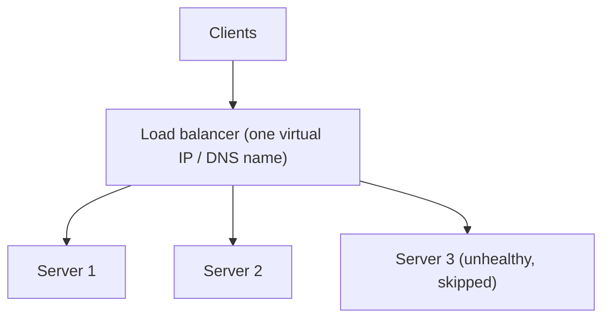

#### Core jobs

| Job | What it means |
|---|---|
| **Distribute load** | Pick a backend per connection or per request using an algorithm (round robin, least connections, ...) |
| **Health checking** | Probe backends and stop sending traffic to failing ones |
| **Elasticity** | Autoscaling adds/removes instances; the LB picks them up via service discovery or target groups |
| **Zero-downtime deploys** | Drain old instances, add new ones, shift traffic gradually |

#### Extras it often handles

- **TLS termination**: decrypt HTTPS once at the edge so backends can speak plain HTTP (or re-encrypt for zero trust).
- **Connection management**: keep a small pool of long-lived connections to backends while accepting many short client connections; HTTP/2 multiplexing to clients.
- **Compression, request routing by path/host** (L7), header manipulation.
- **Basic protection**: SYN-flood handling, connection limits, sometimes WAF integration.

#### Who balances the load balancer?

The LB must not become the single point of failure. It is made redundant with an active-passive pair sharing a floating IP, several LBs behind DNS or anycast, or a managed service (AWS ALB/NLB, Google Cloud Load Balancing) that is distributed internally across zones.

**Common pitfalls**
- Treating the LB as a magic fix while servers keep local state (sessions, uploads on local disk), which breaks as soon as requests land on different servers.
- Forgetting that the LB has its own limits (connections, bandwidth, new connections per second) and needs pre-warming or capacity planning for big events.

**Likely follow-ups**
- *L4 or L7?* L4 for raw speed and any TCP/UDP protocol; L7 when you need routing by path, header or cookie.
- *How does the LB know a server is down?* Active health checks plus passive outlier detection on real traffic.
- *How do servers see the real client IP?* `X-Forwarded-For` header (L7) or the PROXY protocol (L4).

</details>

### 2. L4 vs L7 load balancers?

<details>
<summary>Answer</summary>

**In short:** An L4 load balancer routes by IP address and port (TCP/UDP) without reading the payload, so it is extremely fast and protocol-agnostic. An L7 load balancer understands HTTP, so it can route on path, host, headers and cookies, terminate TLS, retry, and rewrite requests, at the cost of more CPU and latency. Large systems usually put an L4 tier in front of an L7 tier.

#### How each works

- **L4 (transport layer)** looks at the 5-tuple (source IP/port, destination IP/port, protocol). It picks a backend when the connection opens and then forwards packets (or proxies the TCP stream) for the life of that connection. It never parses HTTP. Some designs (Google's Maglev, LVS in direct-routing mode) don't even terminate TCP; they forward packets and let the backend reply directly to the client.
- **L7 (application layer)** terminates the client's TCP and TLS connection, parses each HTTP request, decides where it should go, and opens (or reuses) a separate connection to the chosen backend. Because it sees each request, it can balance *per request* even over one long-lived HTTP/2 connection.

#### Comparison

| | L4 (transport) | L7 (application) |
|---|---|---|
| Routing on | IP and port | Path, host, headers, cookies, method |
| Reads the payload? | No | Yes (must decrypt TLS) |
| Speed / overhead | Very fast, low CPU, millions of connections | More CPU per request, adds some latency |
| Protocols | Any TCP/UDP (databases, MQTT, gaming, gRPC as opaque TCP) | HTTP/1.1, HTTP/2, gRPC, WebSocket |
| Granularity | Per connection | Per request |
| Features | Pass-through TLS, preserves client IP easily | TLS termination, auth, retries, header rewrite, A/B and canary routing, caching |
| Examples | AWS NLB, LVS, Maglev, HAProxy (TCP mode) | AWS ALB, Nginx, Envoy, HAProxy (HTTP mode), Traefik |

#### Why per-request matters: the gRPC trap

gRPC uses one long-lived HTTP/2 connection carrying many requests. Behind an L4 balancer, each client pins to one backend for the whole connection, so a few clients can overload one server while others sit idle. An L7 balancer (or client-side balancing) spreads individual requests across backends.

#### Typical layered setup

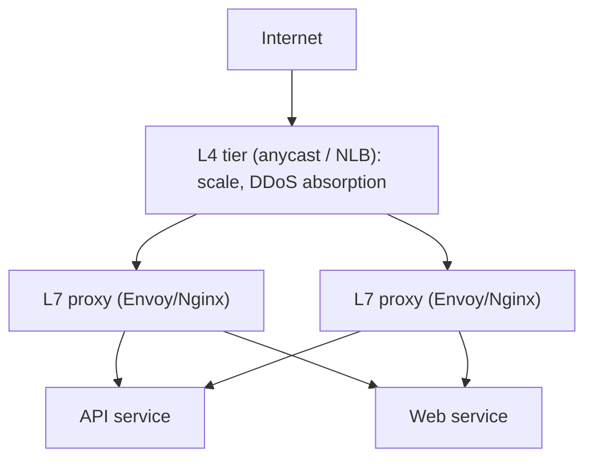

The L4 tier is cheap and absorbs volume; the L7 tier does smart routing and scales horizontally behind it.

**Common pitfalls**
- Expecting L4 to do path-based routing or sticky cookies; it can't see them.
- Losing the client IP: L7 must add `X-Forwarded-For`; L4 proxies need the PROXY protocol or pass-through mode.

**Likely follow-ups**
- *Where is TLS terminated?* Usually at L7; with L4 you can pass TLS through to the backend (end-to-end encryption, but no content routing).
- *Can one product do both?* Yes; HAProxy and Envoy operate in both modes.

</details>

### 3. What load-balancing algorithms are there?

<details>
<summary>Answer</summary>

**In short:** Static algorithms (round robin, weighted round robin, hashing) don't look at server state; dynamic ones (least connections, least response time, power of two choices) use live load. Round robin is fine when servers and requests are uniform; least outstanding requests or "power of two random choices" handle variable request cost best; hashing gives affinity for caches.

#### The algorithms

| Algorithm | How it picks | Good for | Weakness |
|---|---|---|---|
| **Round robin** | Next server in rotation | Identical servers, uniform requests | Ignores load; a slow request still gets more piled behind it |
| **Weighted round robin** | Rotation, weighted by capacity | Mixed instance sizes, canaries (5% weight) | Weights are static |
| **Random** | Uniform random | Simple, stateless across many LB nodes | Uneven in short runs |
| **Least connections / least outstanding requests** | Server with fewest active requests | Variable durations, long-lived connections | Needs accurate counts; each LB node sees only its own traffic |
| **Least response time** | Lowest latency (often combined with fewest connections) | Heterogeneous backends | Can herd onto one fast server, which then slows |
| **IP hash / consistent hashing** | `hash(client IP or key)` to a server | Cache locality, affinity | Uneven if keys are skewed; remaps on changes (less with consistent hashing) |
| **Power of two random choices (P2C)** | Pick 2 random servers, send to the less loaded | Large fleets, many LB nodes | Slightly less precise than global least-loaded, but far cheaper |

#### Why "power of two choices" is so popular

Pure "least loaded" sounds ideal, but with many independent LB nodes each holding slightly stale load info, they all pick the *same* least-loaded server at the same moment and overload it (herding). Pure random avoids herding but gives uneven load. Choosing the better of two random candidates gets most of the benefit of least-loaded (the maximum load drops dramatically versus pure random, a well-known result from balls-into-bins theory) while staying cheap and herd-resistant. Envoy's default "least request" balancer uses this idea.

```python
import random

def pick_backend(backends):
    a, b = random.sample(backends, 2)
    # outstanding = in-flight requests this LB node has sent to that backend
    return a if a.outstanding <= b.outstanding else b
```

#### Choosing in an interview

- Stateless web tier, similar requests: **round robin** is fine.
- Request cost varies a lot (search queries, uploads, LLM inference): **least outstanding requests / P2C**.
- Backend has a per-key cache (e.g. a sharded cache or a chat server owning rooms): **consistent hashing** on the key.
- New instances that need to warm up (JIT, caches): **slow start** (ramp weight up over a minute), supported by many LBs.

**Common pitfalls**
- Round robin with long-lived connections (WebSockets, gRPC): load stays wherever connections first landed; rebalance by periodically recycling connections.
- Least-connections sending a flood to a freshly started, cold instance because it has zero connections. Use slow start.

**Likely follow-ups**
- *How does the LB know load?* Its own counters of in-flight requests, or backend-reported load (e.g. via headers or a control plane).
- *What about client-side load balancing?* The client (gRPC, a service mesh sidecar) gets the endpoint list from service discovery and applies the same algorithms itself, removing a hop.

</details>

### 4. How do health checks work?

<details>
<summary>Answer</summary>

**In short:** The load balancer actively probes each backend (e.g. `GET /health` every few seconds) and removes it after N consecutive failures, re-adding it after M successes; it can also passively watch real traffic and eject servers with high error rates (outlier detection). Health endpoints should separate liveness from readiness and must not fail just because a shared dependency is down.

#### Active vs passive

| | Active health checks | Passive checks / outlier detection |
|---|---|---|
| How | LB sends synthetic probes (TCP connect, HTTP GET, gRPC health) on an interval | LB observes real responses: 5xx rate, timeouts, connection resets |
| Detects | Dead processes, unreachable hosts | "Gray failures": server is up but slow or erroring |
| Cost | Probe traffic (N LBs x M servers x rate) | Free; uses real traffic |
| Example config | interval 5 s, timeout 2 s, unhealthy after 3, healthy after 2 | eject for 30 s after 5 consecutive 5xx, max 20% of hosts ejected |

Use both: active checks catch dead hosts even without traffic; passive checks catch hosts that pass `/health` but fail real requests.

#### Liveness vs readiness

- **Liveness**: "Is the process alive, or should it be restarted?" Keep it trivial (the process can respond). If it fails, the orchestrator (e.g. Kubernetes) restarts the container.
- **Readiness**: "Should this instance receive traffic right now?" False during startup (loading config, warming caches), during graceful shutdown, or when the instance is overloaded. If it fails, the instance is removed from the LB but not killed.

```kotlin
// Ktor-style example
get("/livez") { call.respond(HttpStatusCode.OK) }          // process is up

get("/readyz") {
    val ready = startupComplete && !shuttingDown && localQueueDepth < MAX_QUEUE
    call.respond(if (ready) HttpStatusCode.OK else HttpStatusCode.ServiceUnavailable)
}
```

#### The shared-dependency trap

If `/readyz` checks the database and the database blips, **every** instance fails readiness at the same time and the LB removes them all. A partial degradation (DB slow, some features broken) becomes a total outage (no servers at all). Rules of thumb:
- Readiness checks local conditions; handle dependency failure inside requests (timeouts, fallbacks, circuit breakers).
- Many LBs "fail open": if all backends look unhealthy, they send traffic to all of them anyway rather than none. Know whether yours does.
- Cap outlier ejection (e.g. never eject more than a fraction of hosts).

**Common pitfalls**
- Liveness checks that call dependencies, causing restart loops during a DB outage.
- Thresholds too aggressive (flapping in and out) or too lax (minutes to detect a dead host).
- Health endpoint served on a different thread pool than real traffic, so it says "healthy" while the request pool is exhausted.

**Likely follow-ups**
- *How fast can you detect a failure?* Roughly interval x unhealthy threshold, e.g. 5 s x 3 = 15 s; passive detection can be faster under traffic.
- *What is a gray failure?* A node that is partially broken (slow disk, one bad dependency) and passes simple checks; outlier detection and latency-based checks catch it.

</details>

### 5. What are sticky sessions and why avoid them?

<details>
<summary>Answer</summary>

**In short:** Sticky sessions (session affinity) make the load balancer send a given user to the same server every time, usually via a cookie or IP hash, because that server keeps the user's session in memory. They cause uneven load, lost sessions when a server dies, and harder scaling and deploys, so the default is stateless servers with session state in a shared store (Redis) or in signed tokens. Affinity is still legitimate for connection-oriented or cache-locality cases.

#### How stickiness is implemented

- **LB cookie**: on the first response the LB sets a cookie (e.g. `AWSALB=...`) naming the backend; later requests carrying it go to that backend.
- **Application cookie**: the LB routes on an app cookie such as `JSESSIONID`.
- **Source IP hash**: no cookie needed, but many users behind one corporate NAT or mobile carrier IP all land on one server, and a mobile user switching networks loses affinity.

#### Why it hurts

| Problem | What happens |
|---|---|
| Uneven load | Heavy users or a big NAT pin to one server; new servers only get *new* users |
| Lost state | Server crashes or is deployed: every session on it is gone, users get logged out or lose carts |
| Slow scale-in / deploys | You must wait for sessions to drain before removing a server |
| Hidden coupling | Code starts relying on local memory, so the system silently stops being horizontally scalable |

#### The stateless alternative

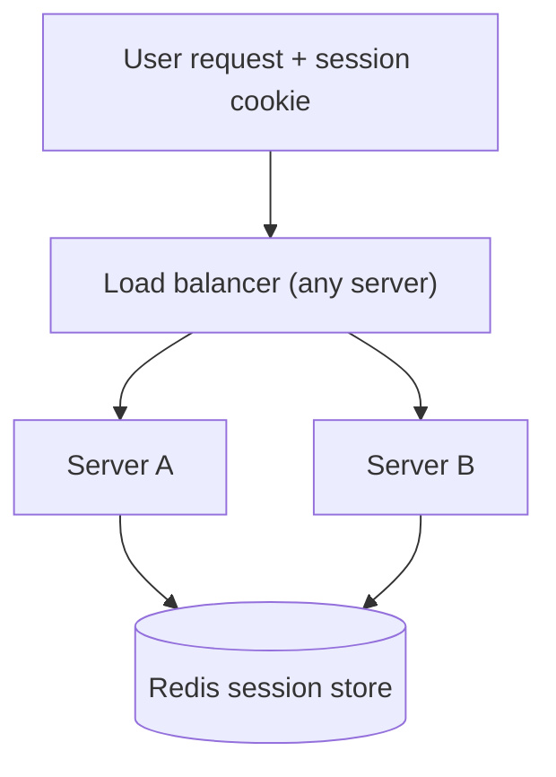

- **Central session store**: the cookie holds only a session ID; any server looks it up in Redis (one sub-millisecond hop).
- **Signed tokens (JWT or signed cookies)**: the state travels with the request and any server can verify it. Trade-off: hard to revoke before expiry, and the token grows with the state.

#### When affinity is fine or necessary

- **WebSockets / long-lived connections**: the connection itself lives on one server. Design for reconnects and keep durable state elsewhere.
- **Cache locality**: route by user or entity ID with consistent hashing so the same server's local cache stays warm. Losing a server only costs cache misses, not correctness.
- **Legacy apps** you can't change yet: use stickiness with a short duration as a stopgap.

**Common pitfalls**
- Assuming stickiness is guaranteed; it breaks on server failure, so correctness must never depend on it.
- IP-hash affinity behind a CDN or another proxy, where the "client IP" is actually the proxy's IP.

**Likely follow-ups**
- *Redis session store is now a dependency; what if it fails?* Replicate it, and degrade gracefully (e.g. force re-login) rather than take the site down.
- *JWT vs server sessions?* JWT avoids a lookup but complicates revocation; server sessions are easy to revoke but need a fast shared store.

</details>

### 6. What is consistent hashing and why is it useful?

<details>
<summary>Answer</summary>

**In short:** Consistent hashing maps both servers and keys onto a hash ring; a key belongs to the first server found clockwise from its position. When a server is added or removed, only about 1/N of keys move (the ones in its neighbouring range), instead of nearly all keys with `hash(key) % N`. Virtual nodes smooth out the load. It underpins sharded caches, Dynamo-style databases and affinity-based load balancing.

#### The problem with modulo hashing

With `server = hash(key) % N`, going from 4 to 5 servers changes the result for roughly 80% of keys (in general, about N/(N+1) of them). For a cache, that is a near-total cache wipe and a stampede onto the database; for a data store, it means moving most of the data.

#### How the ring works

1. Hash each server (e.g. `hash("cache-3")`) onto a circular space, say 0 to 2^32 - 1.
2. Hash each key onto the same ring.
3. Walk clockwise from the key's position; the first server you hit owns it.

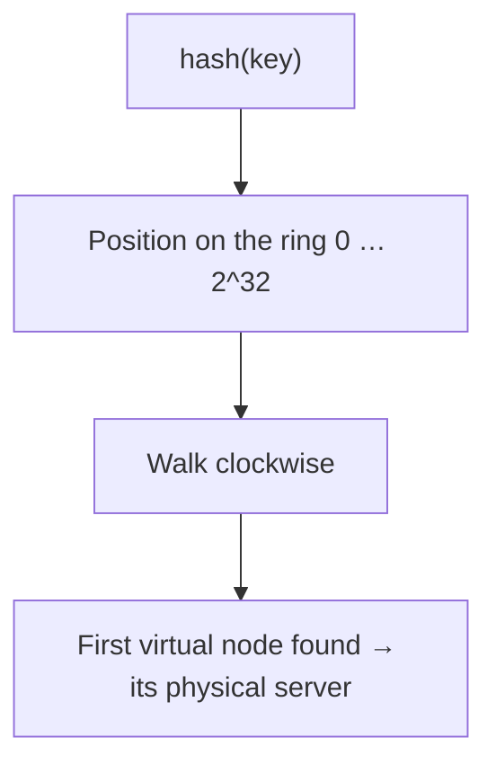

Adding server X between A and B only takes over the keys between A and X that used to belong to B. Removing a server hands its range to the next server clockwise. Everything else stays put.

#### Virtual nodes

With only a few points on the ring, ranges are very uneven, and a removed server dumps its whole load onto one neighbour. So each physical server gets many points (virtual nodes, e.g. 100 to 200): `hash("cache-3#0")`, `hash("cache-3#1")`, ... This:
- evens out the share each server gets,
- spreads a failed server's keys across many survivors,
- lets bigger machines own more vnodes (weighting).

```python
import bisect, hashlib

class Ring:
    def __init__(self, nodes, vnodes=150):
        self.ring = sorted(
            (self._h(f"{n}#{i}"), n) for n in nodes for i in range(vnodes)
        )
        self.keys = [h for h, _ in self.ring]

    def _h(self, s):
        return int(hashlib.md5(s.encode()).hexdigest()[:8], 16)

    def node_for(self, key):
        i = bisect.bisect(self.keys, self._h(key)) % len(self.keys)  # wrap around
        return self.ring[i][1]
```

#### Where it is used

Dynamo and Cassandra (partitioning with replicas on the next nodes clockwise), memcached client libraries (ketama), CDNs choosing which cache server holds an object, and L7 load balancers doing "ring hash" or "Maglev" affinity in Envoy.

#### Alternatives

| Scheme | Idea | Notes |
|---|---|---|
| **Rendezvous (HRW) hashing** | For each key, score every server with `hash(key, server)`, pick the highest | No ring, perfectly even, O(N) per lookup |
| **Jump consistent hash** | Small arithmetic function mapping key to bucket 0..N-1 | Tiny and fast, but buckets can only be added/removed at the end |
| **Fixed slots** (Redis Cluster's 16,384 hash slots) | Key to slot is fixed; slots are assigned to nodes | Rebalance by moving slots explicitly |

**Common pitfalls**
- Too few vnodes, giving uneven load.
- Hot keys: consistent hashing balances *keys*, not *traffic*; one viral key still lands on one server.

**Likely follow-ups**
- *How are replicas placed?* On the next K distinct physical nodes clockwise.
- *What fraction moves when adding a node?* About 1/(N+1) of keys.

</details>

### 7. Forward proxy vs reverse proxy?

<details>
<summary>Answer</summary>

**In short:** A forward proxy acts on behalf of **clients**: clients send their outbound requests through it, and destination servers see the proxy instead of the client (corporate egress proxies, content filters, anonymity). A reverse proxy acts on behalf of **servers**: clients connect to it thinking it is the server, and it forwards requests to hidden backends (Nginx, Envoy, HAProxy) for load balancing, TLS termination, caching and security. A load balancer is a kind of reverse proxy.

#### Side by side

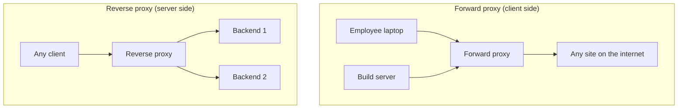

| | Forward proxy | Reverse proxy |
|---|---|---|
| Works for | The clients (an organisation's users or machines) | The servers (a service owner) |
| Configured by | Client side (browser/OS proxy settings, or transparent interception) | Server side (DNS points to the proxy) |
| Who is hidden | The client's identity from servers | The backend topology from clients |
| Typical uses | Egress control, content filtering, logging, caching downloads, bypassing geo-blocks, VPN-like anonymity | Load balancing, TLS termination, caching, compression, rate limiting, WAF, routing to microservices |
| Examples | Squid, corporate secure web gateways, egress proxies in a VPC | Nginx, Envoy, HAProxy, Traefik, CDNs (a CDN is a distributed reverse proxy) |

#### Why backends sit behind a reverse proxy

- One public entry point; backends get private IPs and are never directly exposed.
- Central place for TLS certificates, HTTP/2 and HTTP/3 to clients, gzip/brotli.
- Absorbs slow clients: the proxy buffers the request and response, so a phone on 3G doesn't hold a backend worker for seconds.
- Lets you move, split or replace backends without clients changing anything.

#### In system design

A forward proxy shows up mostly as an **egress proxy**: services in a private network call third-party APIs through a fixed set of proxy IPs that partners can allow-list, and security can audit outbound traffic. Reverse proxies show up everywhere on the inbound path.

**Common pitfalls**
- Backends trusting `X-Forwarded-For` from anyone; only trust it when set by your own proxy.
- Forgetting that a reverse proxy which terminates TLS can see all traffic; re-encrypt to backends if the internal network isn't trusted.

**Likely follow-ups**
- *Is a CDN a forward or reverse proxy?* Reverse; it acts on behalf of the origin.
- *Is a VPN a forward proxy?* Conceptually similar (traffic exits from somewhere else), but it works at the network layer for all traffic, not per HTTP request.

</details>

### 8. What is an API gateway?

<details>
<summary>Answer</summary>

**In short:** An API gateway is a single entry point in front of many backend services that handles cross-cutting API concerns: routing to the right service, authentication, rate limiting and quotas, request/response transformation, and observability. It lets clients talk to one API while the backend is split into microservices. Keep it thin; business logic belongs in services.

#### Why it exists

Without a gateway, a mobile app might call ten services directly. Each service then re-implements token validation, rate limits, CORS and logging, and clients must know internal hostnames and make many round trips. The gateway centralises those concerns and hides the internal layout.

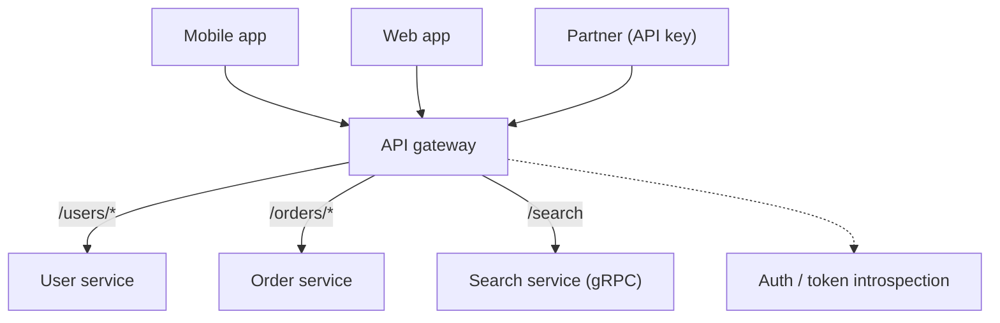

#### Typical responsibilities

| Concern | Example |
|---|---|
| **Routing and versioning** | `/v1/orders` to order-service v1, `/v2/orders` to v2; canary 5% of traffic |
| **Authentication** | Validate a JWT signature and expiry, or an API key; pass the user ID downstream in a header |
| **Coarse authorisation** | "Only partner keys with scope `orders:read`"; fine-grained checks stay in services |
| **Rate limiting and quotas** | 100 req/s per API key; 1M calls/month on the free plan |
| **Aggregation** | One `/home` call fans out to profile, feed and notifications services and merges results |
| **Protocol translation** | Public REST/JSON to internal gRPC |
| **Cross-cutting** | Request IDs and tracing headers, access logs, metrics, CORS, response caching, request size limits |

#### Gateway vs BFF

A **Backend for Frontend (BFF)** is a gateway (or thin service) specialised for one client type. The mobile BFF returns compact payloads shaped for the app's screens; the web BFF returns something else. This avoids one generic API that fits nobody, and lets each client team move independently. Often you have a generic edge gateway for auth and rate limits, then BFFs behind it for aggregation.

#### Risks

- **Bottleneck / single point of failure**: run it as a horizontally scaled, stateless fleet across zones.
- **"God layer"**: business rules creep into gateway config or plugins, and every team's change must go through the gateway team. Keep it to cross-cutting concerns.
- **Added latency**: one extra hop plus plugin processing; usually a few milliseconds, but watch heavy plugins.

Examples: Kong, AWS API Gateway, Apigee, Azure API Management, and Envoy-based gateways.

**Common pitfalls**
- Doing all authorisation in the gateway and trusting any internal call; services should still verify identity (defence in depth).
- Aggregation endpoints that wait on the slowest of many services without timeouts or partial responses.

**Likely follow-ups**
- *Gateway vs service mesh?* The gateway handles north-south traffic (clients into the system); the mesh handles east-west (service to service).
- *Where do you validate JWTs?* At the gateway for early rejection, and again (cheaply, via signature) in services that need the claims.

</details>

### 9. What is a service mesh?

<details>
<summary>Answer</summary>

**In short:** A service mesh moves service-to-service networking concerns (mTLS, retries, timeouts, load balancing, traffic shifting, metrics and tracing) out of application code into proxies that run next to every service (sidecars, typically Envoy), configured centrally by a control plane (Istio, Linkerd). It gives uniform security and observability across languages, at the cost of latency, resources and operational complexity.

#### The problem

With dozens of services in several languages, every team has to implement retries, timeouts, circuit breakers, TLS, and metrics correctly, in every language's libraries, and keep them consistent. Changing a retry policy means redeploying code. A mesh makes these platform features.

#### Architecture

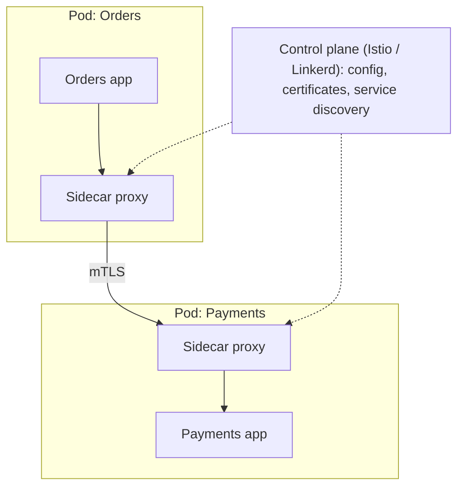

- **Data plane**: the proxies. The app calls `http://payments` in plain HTTP to localhost; traffic is transparently redirected (iptables or eBPF) through the local sidecar, which finds a healthy Payments instance, opens an mTLS connection to Payments' sidecar, applies retries and timeouts, and records metrics.
- **Control plane**: pushes routing rules, issues and rotates short-lived certificates (workload identity), and distributes endpoint lists.

#### What you get

| Area | Features |
|---|---|
| Security | Automatic mTLS between all services, identity-based policies ("only Orders may call Payments") |
| Reliability | Retries with budgets, timeouts, circuit breaking, outlier ejection, client-side load balancing |
| Traffic control | Canary and weighted routing, header-based routing, mirroring, fault injection for chaos tests |
| Observability | Uniform request metrics (rate, errors, latency), access logs, trace span propagation |

#### Trade-offs

- **Latency**: two extra proxy hops per call (out of the caller's sidecar, into the callee's), typically small but it adds up in deep call chains.
- **Resources**: a proxy per pod costs CPU and memory across the fleet.
- **Complexity**: a new distributed system to run, upgrade and debug; misconfiguration can break all traffic.
- **Still needs app cooperation**: apps must propagate trace headers, and retries are only safe for idempotent calls.

It is worth it with many services and teams, polyglot stacks, or compliance needs (encrypt everything internally). For a handful of services, a good shared library or plain Kubernetes services are simpler. Newer **sidecarless / ambient** modes (e.g. Istio ambient mode, which uses a per-node proxy for L4 and optional shared L7 proxies) reduce the per-pod overhead.

**Common pitfalls**
- Retries configured in both the app and the mesh, multiplying load during an outage (retry storms).
- Adopting a mesh purely for metrics when simpler instrumentation would do.

**Likely follow-ups**
- *Mesh vs API gateway?* Mesh is east-west (internal), gateway is north-south (edge); many meshes ship an ingress gateway too.
- *What is mTLS?* Both sides present certificates, so each service authenticates the other and traffic is encrypted.

</details>

### 10. What rate-limiting algorithms exist?

<details>
<summary>Answer</summary>

**In short:** The main ones are token bucket (allows bursts up to a capacity, refills at a steady rate; the most common), leaky bucket (smooths output to a fixed rate), fixed window counter (simple but allows a 2x burst at window boundaries), sliding window log (exact but memory-heavy) and sliding window counter (a cheap, accurate approximation). Pick token bucket for APIs that should tolerate short bursts, sliding window counter for simple "N per minute" limits.

#### Comparison

| Algorithm | How it works | Notes |
|---|---|---|
| **Token bucket** | Tokens refill at rate r up to capacity b; each request takes one | Allows bursts up to b; most common (AWS, Stripe) |
| **Leaky bucket** | Requests enter a queue drained at a fixed rate | Smooths output; bursts wait or are dropped |
| **Fixed window counter** | Count per minute window | Simple; allows 2× burst at window edges |
| **Sliding window log** | Store timestamps of each request | Precise; memory-heavy |
| **Sliding window counter** | Weighted mix of current + previous window counts | Good accuracy, cheap; common choice |

#### Token bucket

Each client has a bucket holding up to `b` tokens, refilled at `r` tokens per second. A request takes a token; no token means reject (429). You don't need a timer: compute the refill lazily from the elapsed time.

```python
import time

class TokenBucket:
    def __init__(self, rate, capacity):
        self.rate, self.capacity = rate, capacity
        self.tokens, self.last = capacity, time.monotonic()

    def allow(self) -> bool:
        now = time.monotonic()
        self.tokens = min(self.capacity, self.tokens + (now - self.last) * self.rate)
        self.last = now
        if self.tokens >= 1:
            self.tokens -= 1
            return True
        return False
```

Two numbers per key (tokens, last refill time), so it is cheap to store in Redis.

#### Leaky bucket

Requests go into a FIFO queue of fixed size that drains at a constant rate. Output is perfectly smooth, which suits protecting a downstream with a hard throughput limit, but bursts add latency (they wait) or get dropped when the queue is full.

#### Fixed window and its edge problem

`count[user][current_minute] += 1`; reject above the limit. With a limit of 100/min, a client can send 100 at 12:00:59 and 100 at 12:01:00, so 200 in two seconds.

#### Sliding window log and counter

- **Log**: keep a sorted set of request timestamps per client; drop entries older than the window; allow if fewer than the limit remain. Exact, but stores one entry per request.
- **Counter**: keep counts for the current and previous fixed windows and estimate:
  `estimated = current_count + previous_count * (1 - elapsed_fraction_of_current_window)`.
  Two counters per key, typically accurate to within a few percent.

#### Distributed concerns

With many gateway nodes, counters must be shared (Redis with atomic Lua scripts or `INCR` + `EXPIRE`) or approximated per node (local limit = global limit / node count, with periodic syncing). See the full [rate limiter design](16-designs-core-infrastructure.md) for distributed implementation.

**Common pitfalls**
- Read-then-write races in Redis (two nodes both read 99 and both allow); use atomic operations or a script.
- Using client clocks or unsynchronised server clocks for window boundaries.

**Likely follow-ups**
- *Token bucket vs leaky bucket?* Token bucket allows bursts and passes requests immediately; leaky bucket enforces a smooth output rate.
- *What key do you limit on?* API key, user ID, IP, or a combination, sometimes per endpoint.

</details>

### 11. Where should rate limiting happen?

<details>
<summary>Answer</summary>

**In short:** In layers. Crude per-IP limits and DDoS absorption at the edge (CDN/WAF); per API key, user or plan quotas at the API gateway; concurrency limits and load shedding inside services to protect expensive endpoints and dependencies; and good client behaviour (backoff, jitter) on the client. Reject with HTTP 429 plus `Retry-After`.

#### The layers

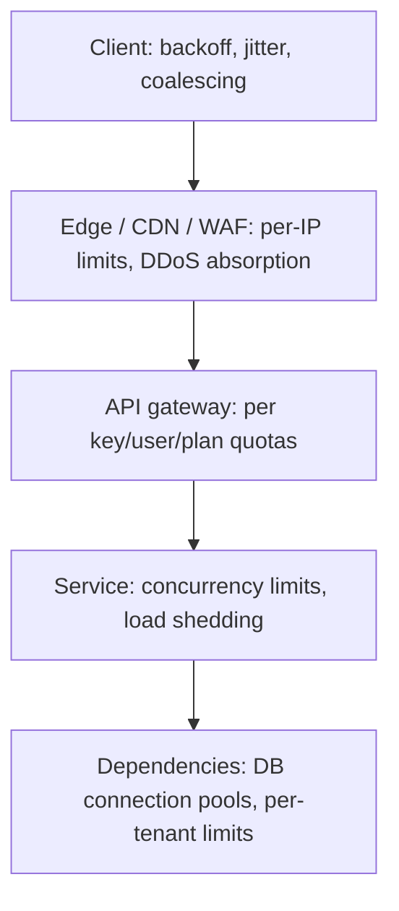

| Layer | What it protects against | Typical limit |
|---|---|---|
| **Edge / CDN / WAF** | Volumetric attacks, scrapers, abusive IPs | Requests per IP per second; bot rules |
| **API gateway** | A single customer overusing the API; enforcing paid tiers | 100 req/s per API key, monthly quotas |
| **Service** | Overload from any cause, including legitimate spikes and retry storms | Max concurrent requests, queue length, CPU-based shedding |
| **Dependency** | One feature or tenant starving a shared DB | Connection pool sizes, bulkheads, per-tenant quotas |
| **Client** | Making things worse during an incident | Exponential backoff with jitter, honouring `Retry-After` |

Why several layers? Each sees different information. The edge sees IPs but not users; the gateway knows API keys and plans; only the service knows that `/export` costs 1000x more than `/profile`, and only it can see its own saturation.

#### Responding well

```http
HTTP/1.1 429 Too Many Requests
Retry-After: 30
RateLimit-Limit: 100
RateLimit-Remaining: 0
RateLimit-Reset: 30
```

`Retry-After` is standard; the `RateLimit-*` headers follow an IETF draft and many APIs use `X-RateLimit-*` variants. Clear headers let well-behaved clients slow down instead of hammering.

#### Rate limiting vs load shedding

Rate limits are **per-client fairness** rules with fixed numbers. Overload protection is about the **server's capacity**, which changes (slow DB, fewer instances). For internal overload prefer:
- **Adaptive concurrency limits**: measure latency and lower the allowed in-flight requests when it rises (in the spirit of TCP congestion control).
- **Load shedding by priority**: drop background jobs, prefetches and analytics before checkout and login.
- **Fail fast** with 503 rather than queueing forever (queues just add latency to requests that will time out anyway).

**Common pitfalls**
- Only per-IP limits: mobile carriers and corporate NATs put thousands of users behind one IP.
- Retrying 429s immediately or without jitter, creating synchronised waves.

**Likely follow-ups**
- *429 vs 503?* 429: *you* (this client) sent too much; 503: the *server* is overloaded or unavailable.
- *Global vs local counters?* Global (Redis) is exact but adds a hop; local per-node limits are fast and approximate; many systems combine both.

</details>

### 12. How do you route traffic globally across regions?

<details>
<summary>Answer</summary>

**In short:** Use GeoDNS or latency-based DNS to hand each user the IP of their nearest healthy region, or anycast so one IP is routed by the network to the nearest point of presence, usually wrapped in global server load balancing (GSLB) that health-checks regions and fails over. The hard parts are not routing but data: residency rules, sending users to the region that holds their data, and keeping enough spare capacity for failover.

#### The three main techniques

| Technique | How it works | Pros | Cons |
|---|---|---|---|
| **GeoDNS / latency-based DNS** | DNS server answers with a different IP depending on the resolver's location or measured latency | Simple, works with any backend | DNS caching delays failover (TTL, resolvers ignoring TTL); location is the resolver's, not the user's (EDNS Client Subnet helps) |
| **Anycast** | Many PoPs announce the same IP via BGP; the internet routes each packet to the "nearest" one | Instant, no DNS caching issue; absorbs DDoS across PoPs | Needs your own IP space and network (or a provider); routes can shift mid-connection |
| **GSLB** | A control layer that combines health checks, weights, geography and capacity to decide where traffic goes | Health-aware failover, weighted shifts for migrations | Another system to run; usually a managed product |

CDNs and Google's global load balancer use anycast to the edge, then forward to backend regions over their private backbone.

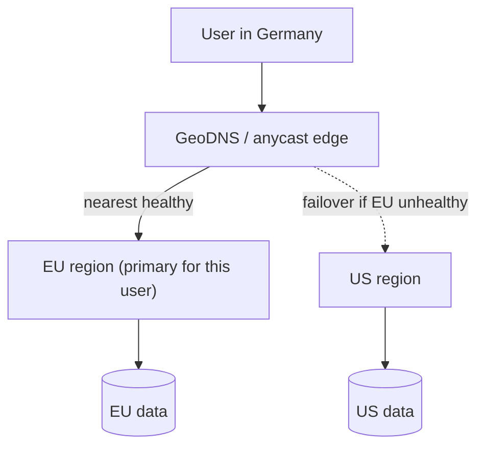

#### Considerations that matter in an interview

- **Data residency**: laws or contracts may require EU users' data to stay in the EU. Routing must respect that even during failover (fail over to another EU region, not to the US).
- **Data locality**: if a user's data lives in one home region, routing them to the nearest region may mean cross-region calls on every request. Options: route by home region (a lookup or a region hint in the token), or replicate data so any region can serve reads.
- **Failover capacity**: with 3 regions each at 70% utilisation, losing one pushes ~35% extra into each survivor and overloads them. Plan for N+1: each region runs with enough headroom to absorb a failed neighbour.
- **Active-active vs active-passive**: active-active uses all regions and fails over smoothly but needs multi-region writes or careful data partitioning; active-passive is simpler but the standby must be tested regularly or it won't work when needed.
- **Failover speed**: DNS-based shifts take as long as clients cache answers (use low TTLs such as 30 to 60 s); anycast or a global L7 LB reacts faster.

**Common pitfalls**
- Failing over into a region whose database is a lagging replica, losing recent writes or causing conflicts.
- Health checks that only test "is the LB up", not "can the region actually serve requests end to end".

**Likely follow-ups**
- *How do mobile apps handle failover?* Retry against a fallback hostname, and respect DNS TTLs; some apps embed a list of regional endpoints.
- *What about WebSockets during a regional failover?* Connections drop; clients reconnect with backoff and jitter and land in the new region.

</details>

### 13. What is connection draining?

<details>
<summary>Answer</summary>

**In short:** Connection draining (deregistration delay) means that when a server is being removed, the load balancer stops sending it new requests but lets in-flight requests finish, up to a timeout such as 30 seconds, before the server is shut down. Together with graceful shutdown in the application, it enables zero-downtime deploys and scale-in.

#### Why it is needed

Without draining, killing an instance during a deploy cuts off every request it is processing: users see 502s or connection resets, uploads fail, and non-idempotent operations may be left half done. Draining turns removal into a controlled hand-off.

#### The sequence

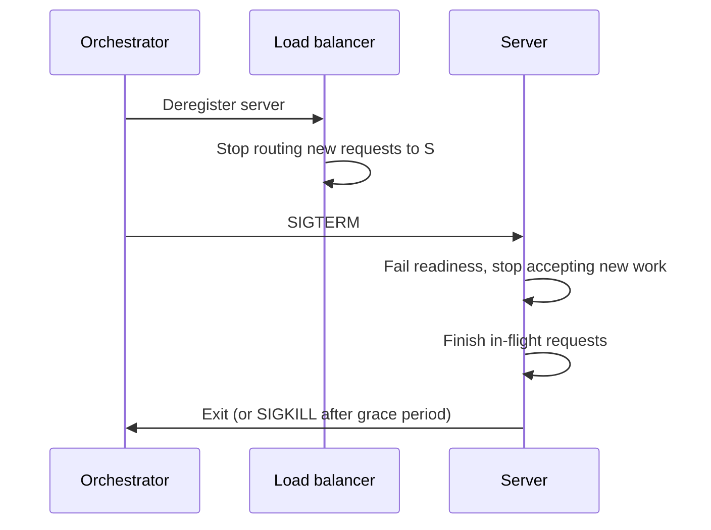

Both sides must cooperate:
1. **LB side**: mark the target as draining; existing connections continue; after the drain timeout, remaining connections are closed.
2. **App side (graceful shutdown)**: on `SIGTERM`, flip readiness to failing, stop accepting new connections, finish in-flight requests and background jobs (or hand them back to a queue), close keep-alive connections, flush logs and metrics, then exit.

```kotlin
Runtime.getRuntime().addShutdownHook(Thread {
    shuttingDown = true                  // /readyz now returns 503
    Thread.sleep(5_000)                  // let LBs notice before we stop listening
    server.stop(gracePeriodMillis = 20_000, timeoutMillis = 25_000)  // finish in-flight
    queueConsumer.stopAndRequeueUnfinished()
})
```

The short sleep matters: in systems like Kubernetes, removing the endpoint from load balancers and sending `SIGTERM` happen in parallel, so an instance that stops listening immediately can still receive a few requests and reset them.

#### Long-lived connections

HTTP requests drain in seconds, but WebSockets, gRPC streams and long polls may last hours. For these, the server sends an application-level "please reconnect" message (or an HTTP/2 `GOAWAY` frame), clients reconnect with jitter to another server, and the server closes the rest at the deadline. Spread this out so thousands of clients don't reconnect in the same second.

**Common pitfalls**
- Drain timeout shorter than the slowest legitimate request (big uploads, reports), cutting them off.
- Orchestrator grace period shorter than the app's drain time, so the process gets `SIGKILL`ed mid-drain.
- Queue consumers that ack messages before finishing work, losing them on shutdown.

**Likely follow-ups**
- *How does this fit into rolling or blue-green deploys?* Each old instance is drained as new ones become ready; in blue-green, the whole old fleet drains after traffic switches.
- *What is a good drain timeout?* A bit above your p99.9 request duration, often 30 to 60 s for APIs.

</details>

### 14. What happens if the load balancer itself fails?

<details>
<summary>Answer</summary>

**In short:** If you have one load balancer, everything behind it goes down with it, so the LB tier itself must be redundant: an active-passive pair sharing a floating virtual IP (keepalived/VRRP), multiple active LBs behind DNS or anycast, or a managed cloud LB that is already distributed across zones. Then remove the next SPOF by spanning availability zones and using health-checked DNS across regions.

#### Options

| Approach | How failover works | Notes |
|---|---|---|
| **Active-passive pair + virtual IP** | Both LBs exchange heartbeats (VRRP via keepalived); if the active dies, the passive claims the virtual IP (gratuitous ARP) within seconds | Classic on-prem; half the capacity idles; connections in flight are lost unless state is synced |
| **Active-active behind DNS** | DNS returns several LB IPs; unhealthy ones are removed by health-checked DNS | Uses all capacity; failover limited by DNS caching |
| **Anycast / ECMP** | Several LB nodes announce the same IP; routers spread flows across them (ECMP) and withdraw a dead node's route | How large providers build L4 tiers (e.g. Maglev uses consistent hashing so any LB node maps a flow to the same backend) |
| **Managed cloud LB** | AWS ALB/NLB, Google Cloud LB are fleets spread across zones behind the scenes | You still choose multi-AZ subnets/targets |

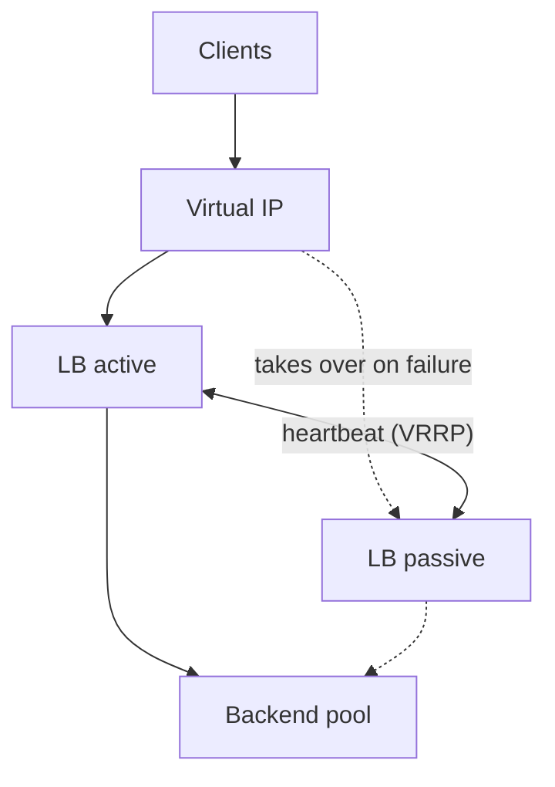

#### Think in layers of failure

1. **One LB node dies**: handled by the pair or the fleet.
2. **A whole availability zone dies**: place LB nodes and backends in at least two or three zones; cross-zone load balancing lets any LB node use any zone's backends.
3. **A whole region dies**: health-checked DNS or a global load balancer shifts users to another region (see global routing).

#### What clients see during failover

Existing TCP connections through the dead LB break (unless connection state is synchronised, which some setups support). Clients must reconnect and retry, which is fine for idempotent requests. This is one reason clients should have sensible timeouts and retries with backoff.

**Common pitfalls**
- Redundant LBs that share one config store, one TLS certificate deployment pipeline or one upstream network link; they fail together.
- Never testing failover; the standby turns out to have stale config.
- Forgetting capacity: if each of two active LBs runs at 70%, one can't absorb the other's load.

**Likely follow-ups**
- *How fast is VRRP failover?* Typically a few seconds, depending on advertisement interval and timeouts.
- *Do managed LBs ever fail?* Yes, rarely and regionally, which is why critical systems also plan multi-region failover.

</details>

### 15. API gateway vs load balancer vs reverse proxy – what's the difference?

<details>
<summary>Answer</summary>

**In short:** A reverse proxy is the general pattern: a server in front of backends that receives client requests and forwards them. A load balancer is a reverse proxy (or network device) whose main job is spreading traffic across identical instances and dropping unhealthy ones, at L4 or L7. An API gateway is an L7 reverse proxy specialised for API management: routing to many different services, auth, rate limits and quotas, transformations, analytics. The lines blur; Envoy or Nginx can play all three roles.

#### Side by side

| | Reverse proxy | Load balancer | API gateway |
|---|---|---|---|
| Core purpose | Front backends: hide them, terminate TLS, cache, compress | Distribute load across replicas of **one** service, high availability | Manage **APIs** across **many** services |
| Layer | Usually L7 | L4 or L7 | L7 only |
| Knows about | HTTP requests | Backend health and load | Clients, API keys, plans, routes, versions |
| Typical features | TLS, caching, compression, buffering slow clients | Algorithms, health checks, draining, stickiness | AuthN/AuthZ, rate limits/quotas, request transformation, aggregation, developer portal, analytics |
| Examples | Nginx, HAProxy, Envoy, Varnish | AWS NLB/ALB, HAProxy, Maglev | Kong, AWS API Gateway, Apigee, Envoy-based gateways |

A useful way to remember it: every load balancer that terminates HTTP is a reverse proxy; every API gateway is a reverse proxy with API-specific features; and most API gateways also load balance across instances of each service.

#### How they combine in a typical setup

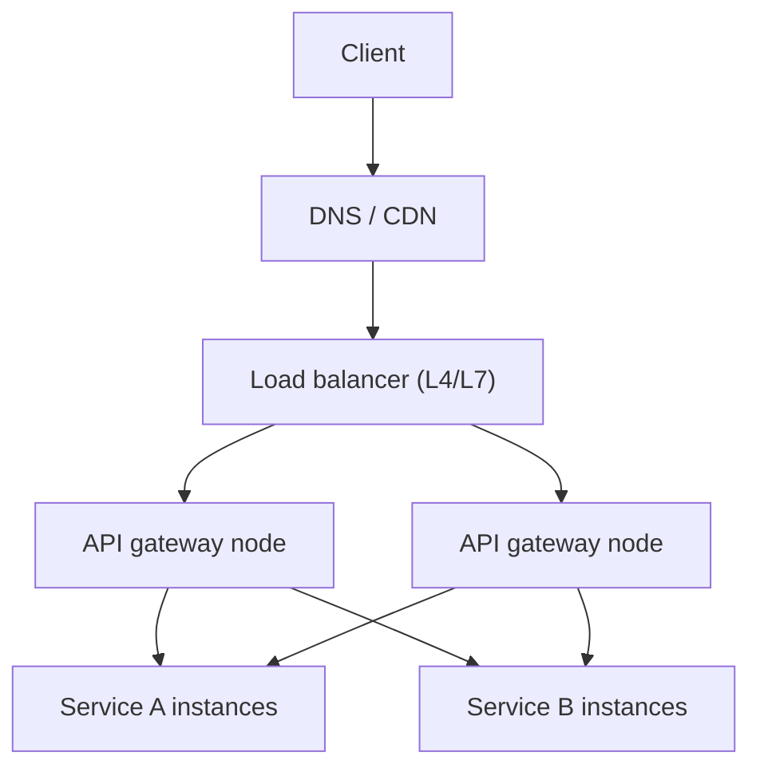

- The **CDN** (a distributed reverse proxy) caches static content and absorbs attacks.
- The **load balancer** spreads traffic across the gateway fleet and handles zone failover.
- The **API gateway** authenticates, rate-limits and routes `/users` to Service A, `/orders` to Service B.
- Inside, each service is load balanced again, by Kubernetes Services, a service mesh, or client-side balancing.

#### How to answer when asked to choose

- Only need to scale one web app? A **load balancer** is enough.
- Need caching, TLS and buffering in front of an app server? A **reverse proxy** (often the same Nginx).
- Exposing many microservices or a public/partner API with keys, quotas and versioning? Add an **API gateway**.

**Common pitfalls**
- Adding an API gateway for a monolith with one client, which mostly adds a hop.
- Duplicating features (auth, retries, rate limits) in the LB, gateway and mesh with conflicting settings.

**Likely follow-ups**
- *Where does a service mesh fit?* Behind the gateway, for service-to-service (east-west) traffic.
- *Can the cloud LB be your gateway?* For simple path routing yes (ALB path rules); for auth, quotas and API keys you want a gateway product.

</details>

---

[⬅ Previous: Networking & Protocols](04-networking-protocols.md) · [⬅ Back to index](../README.md) · [Next: Caching ➡](06-caching.md)
