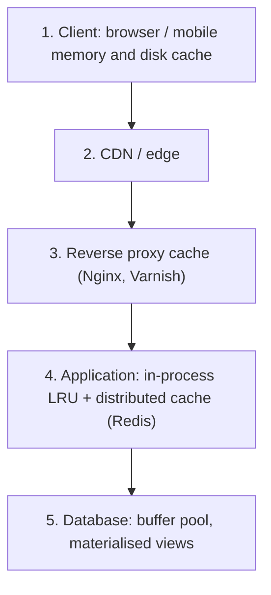
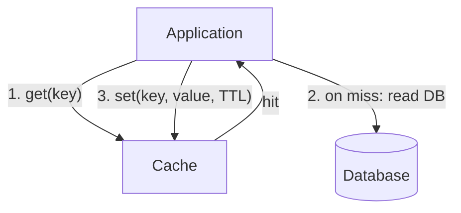
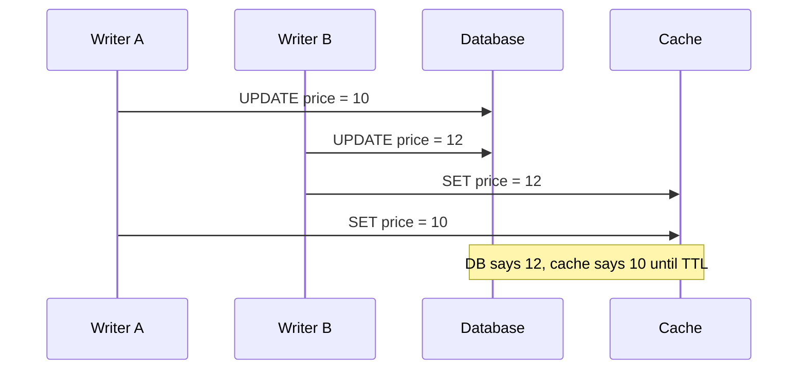
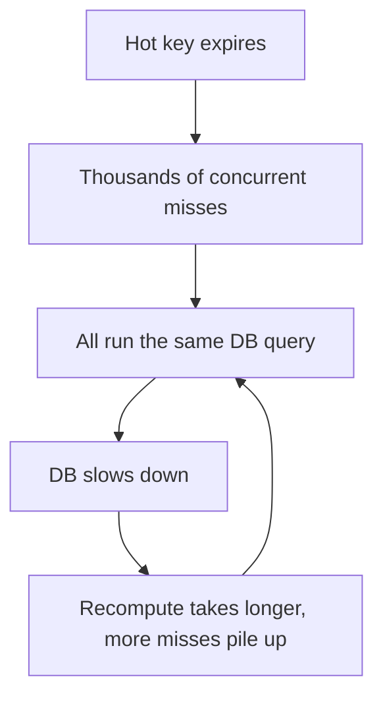
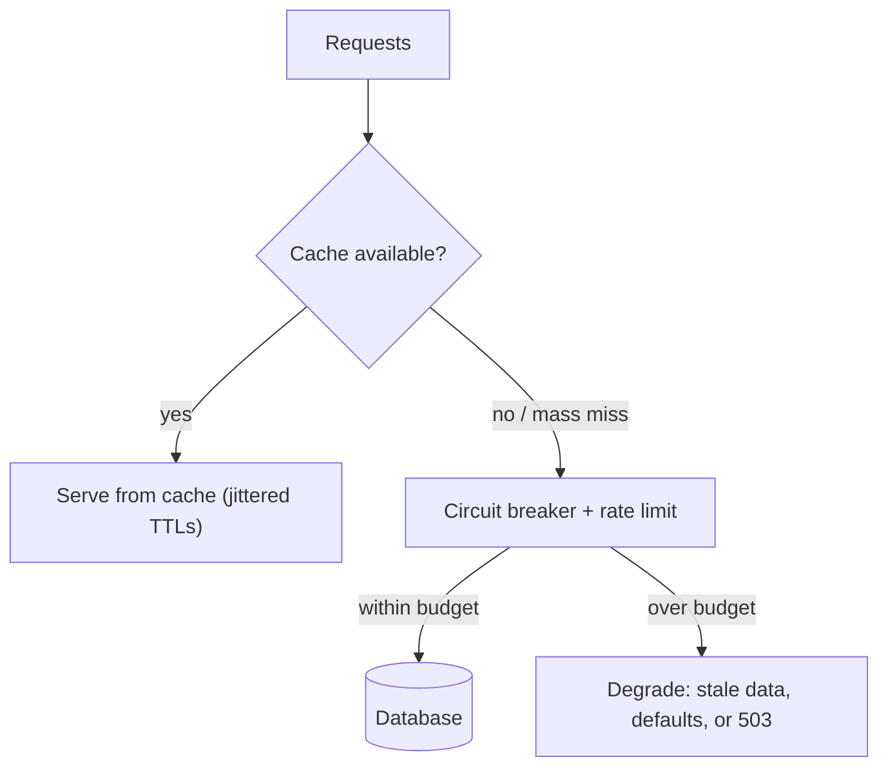
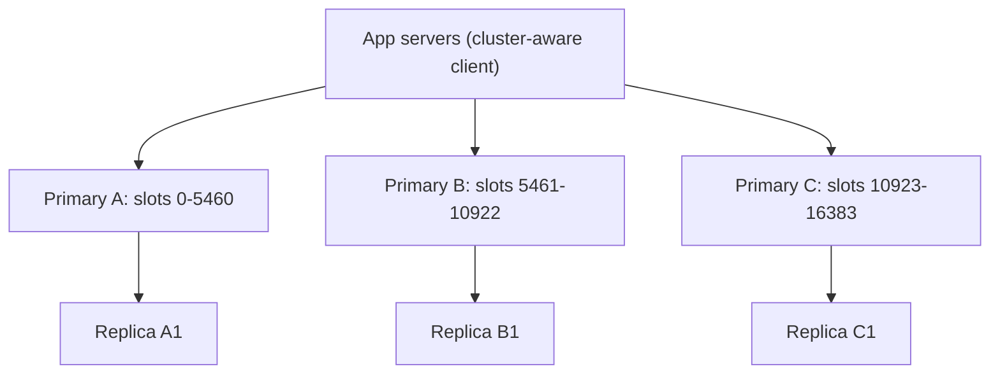
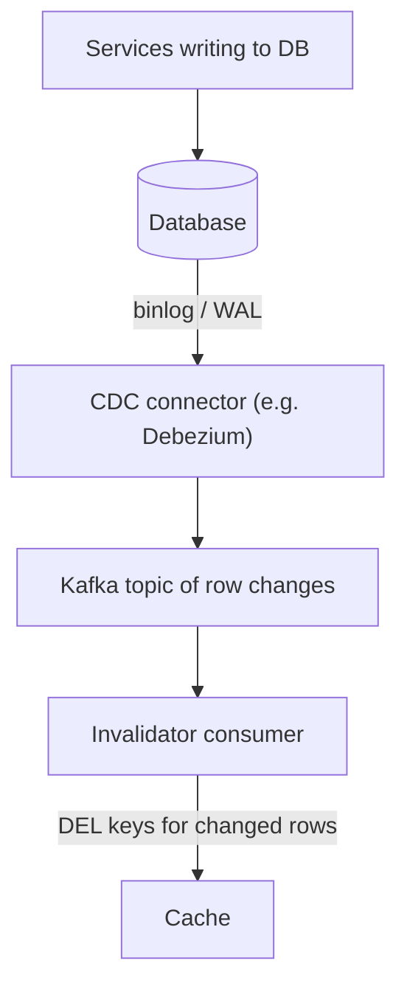
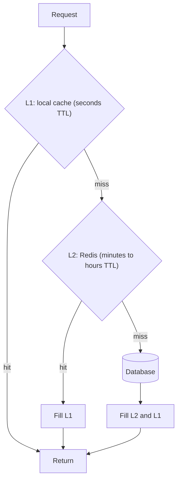
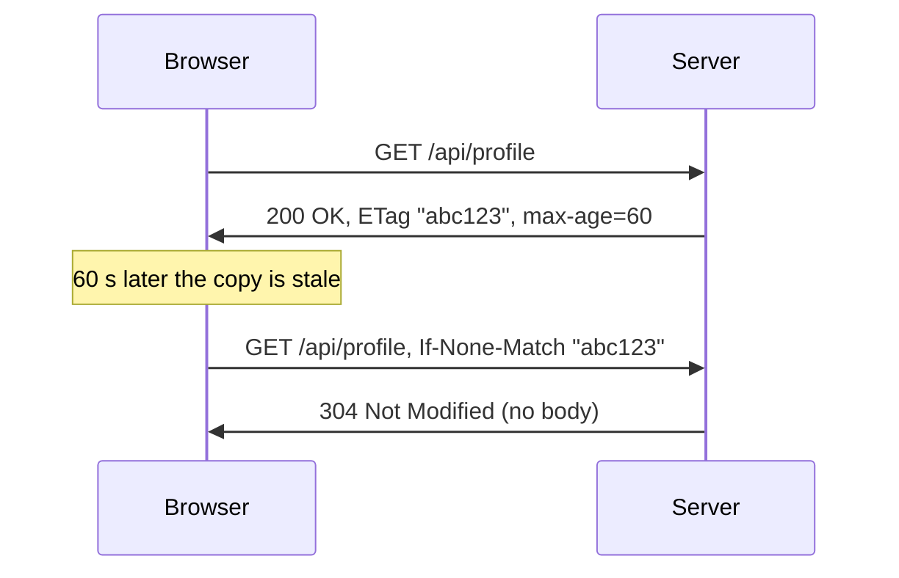
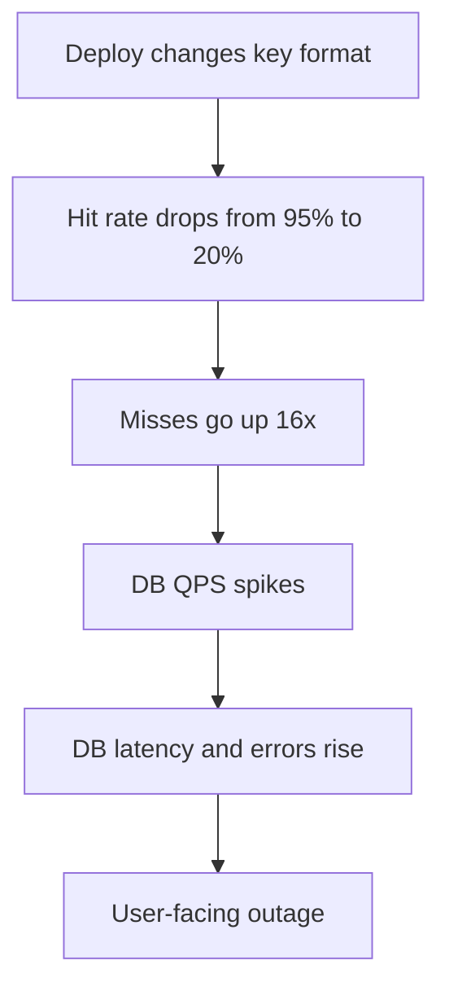

# Caching

[⬅ Back to index](../README.md)

Covers: where to cache, cache-aside vs read-through vs write-through vs write-behind, eviction policies, TTL and invalidation, stampedes, hot keys, consistency, Redis vs Memcached, distributed caches and CDN caching.

---

### 1. Why cache, and where can you cache?

<details>
<summary>Answer</summary>

**In short:** A cache keeps the results of expensive work (database queries, computations, remote calls) in faster storage so repeated requests are cheaper, cutting latency, load on the source of truth and cost. You can cache at every layer, from the client and CDN down to the application and the database itself. Caching pays off when data is read far more often than it is written and access is skewed towards popular items.

#### Why it works

Two facts make caches effective:
- **Speed gap**: reading memory is orders of magnitude faster than a disk-backed query or a cross-region call. Roughly: in-process memory ~100 ns, Redis over the network ~0.5 to 1 ms, an indexed DB query a few ms, a complex query or remote API tens to hundreds of ms.
- **Skew**: real traffic follows a power law. A small fraction of items (the home page, a celebrity's profile, today's top products) receive most requests, so a cache holding a small fraction of the data can serve most reads.

The key number is the **hit rate**. With a 95% hit rate, the database sees only 5% of reads, i.e. 20x less load.

#### Layers, from closest to the user



| Layer | What gets cached | Notes |
|---|---|---|
| **Client** | Images, API responses, offline data | Zero network cost; hardest to invalidate (you don't control the device) |
| **CDN / edge** | Static assets, public API responses, video segments | Serves users from nearby PoPs; huge offload of origin traffic |
| **Reverse proxy** | Full HTTP responses | Good for pages that are the same for everyone |
| **Application** | Objects, query results, computed views, sessions | In-process for the hottest data; Redis/Memcached shared across servers |
| **Database** | Pages in the buffer pool, precomputed aggregates | Automatic; materialised views trade freshness for read speed |

The closer to the user, the bigger the latency win, but the less control you have over invalidation and personalisation.

#### What caching costs you

A cache is a second copy of data, so it can be **stale**; it is another component that can **fail**; and it hides load, so a cold or flushed cache can suddenly expose the database to traffic it can't handle.

**Common pitfalls**
- Caching without measuring hit rate; a 20% hit rate rarely justifies the complexity.
- Sizing the database for cached load only, so a cache outage becomes a database outage.

**Likely follow-ups**
- *What makes a good cache key?* Everything that affects the result (ID, locale, version, permissions) and nothing that doesn't.
- *How do you estimate cache size?* Working set: number of hot items x average size, plus overhead; often 20% of data serves 80% of reads.

</details>

### 2. What are the main caching strategies?

<details>
<summary>Answer</summary>

**In short:** Cache-aside (the app checks the cache, loads from the DB on a miss and fills the cache) is the most common. Read-through moves that loading into the cache layer. For writes: write-through updates cache and DB synchronously, write-behind writes the cache and flushes to the DB later (fast but risks data loss), and write-around writes only the DB. The typical default is cache-aside plus deleting the key on write.

#### Cache-aside (lazy loading)



```python
def get_user(user_id):
    key = f"user:{user_id}"
    cached = redis.get(key)
    if cached is not None:
        return deserialize(cached)                       # hit
    user = db.query("SELECT * FROM users WHERE id = %s", user_id)  # miss
    redis.set(key, serialize(user), ex=3600)            # fill with TTL
    return user

def update_user(user_id, fields):
    db.update_user(user_id, fields)   # 1. commit to source of truth
    redis.delete(f"user:{user_id}")   # 2. invalidate; next read reloads
```

Only requested data is cached, and a cache outage just means slower reads. Downsides: the first read after a miss is slow, and data can be stale until TTL or invalidation.

#### All strategies compared

| Strategy | Read path | Write path | Pros | Cons |
|---|---|---|---|---|
| **Cache-aside** | App reads cache, on miss reads DB and fills cache | App writes DB, deletes key | Simple, resilient, only caches what is read | Miss penalty; stale-read races possible |
| **Read-through** | App asks cache; cache loads from DB on miss | (Paired with any write strategy) | App code simpler; loader logic in one place | Needs a cache library/provider that supports loaders |
| **Write-through** | Cache always has data | Write cache and DB synchronously | Cache always fresh for written keys | Slower writes; caches data that may never be read |
| **Write-behind (write-back)** | Cache always has data | Write cache; flush to DB asynchronously, often batched | Very fast writes; batching reduces DB load | **Data loss** if cache dies before flushing; DB lags behind |
| **Write-around** | Cache fills on reads | Write DB only | Avoids polluting cache with write-once data | Recently written data misses on first read |

#### Where you see each

- **Cache-aside**: most web backends with Redis.
- **Read-through**: in-process caches such as Caffeine `LoadingCache`, or DynamoDB Accelerator (DAX) in front of DynamoDB.
- **Write-through**: data that must be fresh in cache right after writes, e.g. session data, user settings.
- **Write-behind**: counters, metrics, view counts, where losing a few seconds of increments is acceptable; also CPU caches and OS page caches.
- **Write-around**: logs, bulk imports, large uploads that are rarely read back immediately.

**Common pitfalls**
- Updating the cache value on write instead of deleting it, which can race (see the next question).
- Using write-behind for money or orders without durable buffering.
- Forgetting a TTL in cache-aside, so any missed invalidation lives forever.

**Likely follow-ups**
- *Cache-aside vs read-through?* Same behaviour; the difference is who owns the loading code (app vs cache layer).
- *How do you make write-behind safer?* Persist the cache (Redis AOF), replicate it, or write to a durable log (Kafka) first and apply to the DB from there.

</details>

### 3. On a write, should you update the cache or delete the key?

<details>
<summary>Answer</summary>

**In short:** Usually **delete** (invalidate) the key, and do it **after** the database commit. Updating the cache can race between concurrent writers and leave a stale value with no TTL-free way out, while deleting just forces the next read to load the fresh value. A smaller race remains with readers, which you cover with TTLs, versioned writes, delayed double delete or CDC-driven invalidation.

#### Why updating races

Two writers change the same row:



The DB applied A then B, but the cache got B then A. The cache now disagrees with the DB indefinitely (until TTL). Updating also means computing the cached representation on every write, even if nobody reads it.

Deleting avoids this: whatever order the deletes arrive in, the key ends up absent and the next read loads the committed value.

#### Why after the commit

If you delete *before* committing, a reader can miss, load the old row (the write hasn't committed yet), and repopulate the cache with stale data. Deleting after commit closes that window.

#### The remaining race

1. Reader misses and reads the old value from the DB.
2. Writer commits the new value and deletes the key.
3. Reader (delayed, e.g. GC pause) writes the old value into the cache.

It requires a reader to be slower than a whole write, so it is rare but real at scale.

#### Mitigations

| Technique | How it helps |
|---|---|
| **TTL as a safety net** | Bounds how long any stale entry can live |
| **Delayed double delete** | Delete after commit, then delete again ~1 s later to remove values a slow reader put back |
| **Versioned / conditional set** | Store a version (or `updated_at`) with the value; only overwrite if newer (Lua script in Redis, or `cas` in Memcached) |
| **Lease tokens** | On a miss the cache hands out a lease; a delete invalidates it, so a slow reader's set is rejected (the approach described in Facebook's memcache paper) |
| **CDC-driven invalidation** | A consumer of the DB change log deletes keys after each commit, reliably and in commit order |

```python
SET_IF_NEWER = """  -- conditional set: only write if our version is newer than what's cached
local cur = redis.call('HGET', KEYS[1], 'v')
if (not cur) or tonumber(ARGV[1]) > tonumber(cur) then
  redis.call('HSET', KEYS[1], 'v', ARGV[1], 'data', ARGV[2])
  redis.call('EXPIRE', KEYS[1], ARGV[3])
  return 1
end
return 0
"""
```

**Common pitfalls**
- Delete fails (network error) after the DB commit and nothing retries; use retries, a TTL, or CDC.
- Deleting inside a DB transaction that later rolls back.

**Likely follow-ups**
- *When is updating fine?* Single writer per key, or write-through where the cache and DB writes are serialised.
- *What about derived keys (lists, aggregates)?* Track which keys depend on an entity, or use versioned key prefixes so one version bump invalidates them all.

</details>

### 4. What eviction policies exist?

<details>
<summary>Answer</summary>

**In short:** When a cache is full it must drop something. LRU (evict the least recently used) is the sensible default; LFU (least frequently used) is better for stable popularity but adapts slowly; FIFO and random are cheap and simple; TTL expiry removes items by age. Modern caches such as Caffeine use W-TinyLFU, which combines recency and frequency for higher hit rates. Always configure a memory limit and a policy.

#### The policies

| Policy | Evicts | Strengths | Weaknesses |
|---|---|---|---|
| **LRU** | Item not accessed for the longest time | Adapts to changing popularity; O(1) with hash map + doubly linked list | A single large scan (batch job reading everything once) flushes the hot set |
| **LFU** | Item with the fewest accesses | Keeps long-term favourites | Slow to adapt; old popular items linger unless counts decay |
| **FIFO** | Oldest inserted item | Trivial | Ignores usage entirely |
| **Random** | Random item | No bookkeeping; surprisingly decent | Can evict hot items |
| **TTL expiry** | Items past their expiry time | Bounds staleness | Not a capacity policy by itself |
| **W-TinyLFU** (Caffeine) / **ARC** | Mix of recency and frequency | Scan-resistant, high hit rates | More complex (usually you just use the library) |

#### How LRU is built

A hash map gives O(1) lookup; a doubly linked list keeps items in recency order. On access, move the node to the head; on insert when full, remove the tail.

```kotlin
// Minimal LRU using LinkedHashMap's access order
class LruCache<K, V>(private val maxEntries: Int) :
    LinkedHashMap<K, V>(16, 0.75f, /* accessOrder = */ true) {
    override fun removeEldestEntry(eldest: MutableMap.MutableEntry<K, V>) =
        size > maxEntries
}
```

#### What Redis does

Redis evicts only when `maxmemory` is set, according to `maxmemory-policy`:
- `allkeys-lru` / `allkeys-lfu`: evict any key (typical for a pure cache).
- `volatile-lru` / `volatile-lfu` / `volatile-ttl`: evict only keys that have a TTL (useful when the same instance also holds keys that must not be evicted).
- `allkeys-random`, `volatile-random`.
- `noeviction`: reject writes when full (the default; right for Redis used as a primary store, wrong for a cache).

Its LRU and LFU are **approximate**: it samples a few keys and evicts the best candidate among them, which saves memory compared with exact bookkeeping and comes close to exact LRU in practice.

#### Why W-TinyLFU wins

It keeps a compact frequency sketch (a count-min sketch) of recently seen keys. A new item is only admitted into the main cache if it is estimated to be accessed more often than the item it would evict. So a one-time scan can't push out genuinely popular items, while a small "window" LRU still lets new items prove themselves.

**Common pitfalls**
- No memory limit: the cache grows until the process or host runs out of memory.
- Using LRU for workloads with periodic full scans; pick a scan-resistant policy.
- Mixing must-keep data and cache data in one Redis instance with `allkeys-*` eviction.

**Likely follow-ups**
- *Implement an LRU cache?* Hash map + doubly linked list, O(1) get and put.
- *Eviction vs expiration?* Eviction is driven by capacity; expiration by time.

</details>

### 5. How do you choose a TTL?

<details>
<summary>Answer</summary>

**In short:** Pick the TTL from how stale the data is allowed to be and how often it changes: seconds for fast-changing or sensitive data, minutes to hours for profiles and product pages, very long (or forever, with versioned keys) for immutable content. Add random jitter so keys don't expire together, and keep a TTL as a safety net even when you invalidate explicitly.

#### The trade-off

- **Short TTL**: fresher data, lower hit rate, more DB load, more frequent miss latency.
- **Long TTL**: higher hit rate, but users see stale data longer unless you also invalidate on writes.

Ask: "If this value is wrong for X seconds, what happens?" A stale avatar for an hour is harmless; a stale price at checkout is a bug or a legal issue.

| Data | Typical TTL | Why |
|---|---|---|
| Stock level, live prices, rate-limit counters | Seconds | Changes constantly; staleness costs money |
| Feed or timeline pages | Seconds to a minute | Freshness matters but traffic is huge |
| User profile, product details | Minutes to hours, with invalidation on write | Changes rarely; invalidation keeps it fresh |
| Config, feature flags (local cache) | Tens of seconds | Bounds propagation time of changes |
| Immutable content (`image:v3`, content-hashed assets) | Days to forever | Never changes; a new version gets a new key |
| Negative results ("user not found") | Short (30 to 60 s) | Avoid pinning a "missing" result after it's created |

#### Jitter

If you warm 1M keys at deploy time with `TTL = 3600`, they all expire in the same second an hour later and the DB gets a spike (a cache avalanche). Randomise:

```python
import random

def ttl_with_jitter(base_seconds, jitter=0.1):
    return int(base_seconds * random.uniform(1 - jitter, 1 + jitter))

redis.set(key, value, ex=ttl_with_jitter(3600))   # 3240..3960 s
```

#### TTL plus invalidation

Explicit invalidation (delete on write, CDC) gives freshness; the TTL bounds the damage when invalidation is missed (bug, lost message, race). A common pattern is a long TTL (hours) plus delete-on-write, and a short TTL only where invalidation isn't possible.

#### Versioned keys for immutable data

Instead of invalidating, change the key: `product:42:v17` or `app.3f9a2c.js`. Old entries are never read again and simply age out. This is how static assets get `max-age` of a year safely.

**Common pitfalls**
- Same TTL for every key, regardless of data type.
- Sliding expiration (reset TTL on every read) for data that changes: a hot key can stay stale forever because it never expires.
- Very long TTL without any invalidation path, so a bad value can't be fixed quickly.

**Likely follow-ups**
- *How would you set TTLs in practice?* Start from business staleness tolerance, then tune with hit-rate and DB-load metrics.
- *Absolute vs sliding TTL?* Absolute bounds staleness; sliding keeps active sessions alive. Use sliding for sessions, absolute for data.

</details>

### 6. What is a cache stampede (thundering herd) and how do you prevent it?

<details>
<summary>Answer</summary>

**In short:** When a hot key expires (or is deleted), thousands of concurrent requests all miss at once and all recompute it against the database, which can overload or collapse it. Prevent it by letting only one request recompute while others wait or get the stale value (single flight / locking, stale-while-revalidate), refreshing before expiry (probabilistic early expiration), adding TTL jitter, and pre-warming.

#### What happens

A key served 10,000 times per second expires. The recompute takes 200 ms. During those 200 ms, ~2,000 requests miss and each runs the same expensive query. The DB slows down, so the recompute takes longer, so more requests pile up: a feedback loop.



#### Fixes

**1. Request coalescing / single flight (lock per key).** Only the first miss recomputes; others wait briefly and re-read, or serve a stale copy.

```python
def get_with_lock(key, load, ttl=300):
    value = redis.get(key)
    if value is not None:
        return value
    # Only one caller wins the lock (NX = set if not exists, PX = lock expiry)
    if redis.set(f"lock:{key}", "1", nx=True, px=5000):
        try:
            value = load()
            redis.set(key, value, ex=ttl)
            return value
        finally:
            redis.delete(f"lock:{key}")
    # Losers: wait a little and retry the cache instead of hitting the DB
    for _ in range(50):
        time.sleep(0.02)
        value = redis.get(key)
        if value is not None:
            return value
    return load()  # fallback if the lock holder died
```

Within one process, a single-flight map (e.g. Go's `singleflight`, or Caffeine's per-key loading) does the same without Redis.

**2. Stale-while-revalidate.** Store a "soft expiry" inside the value and a longer hard TTL. After soft expiry, keep serving the old value while one background task refreshes it. Users never wait for the recompute.

**3. Probabilistic early expiration (XFetch).** Each read, with probability rising as expiry approaches (and weighted by how long the recompute takes), a request refreshes early. Statistically one request refreshes before expiry, so the herd never forms, with no locks.

**4. TTL jitter.** Prevents many keys from expiring in the same instant.

**5. Pre-warming.** Populate caches before a known spike (a sale, a launch) or after a deploy/flush, so traffic doesn't hit a cold cache.

| Fix | Best when |
|---|---|
| Single flight / lock | Recompute is expensive and a short wait is fine |
| Stale-while-revalidate | Slightly stale data is acceptable; latency matters most |
| Early expiration | You want no coordination at all |
| Jitter / pre-warming | Many keys share a TTL; spikes are predictable |

**Common pitfalls**
- A lock without an expiry: if the holder crashes, nobody ever recomputes.
- Losers that spin on the lock forever instead of falling back after a deadline.
- Invalidating a hot key on every write, causing a mini-stampede each time.

**Likely follow-ups**
- *Stampede vs avalanche?* Stampede is one hot key; avalanche is many keys or the whole cache at once.
- *How does a CDN avoid this?* Request collapsing: the edge sends one request to origin for concurrent misses on the same URL.

</details>

### 7. What is cache penetration and cache avalanche?

<details>
<summary>Answer</summary>

**In short:** Cache **penetration** is repeated requests for keys that don't exist, so they always miss the cache and hit the database (often from bugs or attackers); fix it by caching negative results briefly or checking a Bloom filter first. Cache **avalanche** is a large share of keys expiring together, or the cache cluster going down, sending the full load to the database; fix it with TTL jitter, a highly available cache, and DB protection (circuit breakers, rate limits, degradation). A single hot key expiring is a **breakdown / stampede** (previous question).

#### The three failure modes

| Problem | Trigger | Effect | Main fixes |
|---|---|---|---|
| **Penetration** | Requests for non-existent keys (`/user/-1`, random IDs) | Every request misses and queries the DB | Cache negative results; Bloom filter; input validation; rate limits |
| **Avalanche** | Many keys expire together, or cache cluster fails or restarts | DB gets a large fraction of total traffic at once | TTL jitter; replicated cache; circuit breakers; load shedding; warm-up |
| **Breakdown / stampede** | One hot key expires | Thousands of identical queries | Single flight, stale-while-revalidate, early refresh |

#### Fixing penetration

**Negative caching:** store a sentinel for "not found" with a short TTL so a burst of lookups for the same missing ID costs one DB query.

```python
NOT_FOUND = b"__nil__"

def get_product(pid):
    v = redis.get(f"product:{pid}")
    if v == NOT_FOUND:
        return None
    if v is not None:
        return deserialize(v)
    row = db.find_product(pid)
    if row is None:
        redis.set(f"product:{pid}", NOT_FOUND, ex=60)  # short TTL
        return None
    redis.set(f"product:{pid}", serialize(row), ex=3600)
    return row
```

This doesn't help against an attacker who uses a *different* random ID each time. For that, use a **Bloom filter** of all existing IDs: a compact bit array that answers "definitely not present" or "possibly present". If it says "not present", reject without touching cache or DB. False positives (a small, tunable percentage) just fall through to the normal path. New IDs must be added to the filter when created. Also validate inputs (ID format, ranges) and rate-limit clients that generate many misses.

#### Fixing avalanche



- **Jitter** TTLs so expiries are spread out.
- **High availability**: replicas with automatic failover (Redis Sentinel or Cluster), spread across zones, so a node loss isn't a cache loss.
- **Protect the DB**: limit concurrent DB queries from the cache-miss path, use circuit breakers, and shed low-priority traffic.
- **Graceful degradation**: serve stale data from a local cache, hide non-essential widgets, return defaults.
- **Warm up** after a cache restart before sending full traffic (or ramp traffic gradually).

**Common pitfalls**
- Negative entries with long TTLs, so a newly created item stays "not found".
- Restarting the whole cache fleet at once during maintenance.

**Likely follow-ups**
- *Can a Bloom filter have false negatives?* No, only false positives (unless items are deleted; a standard Bloom filter can't remove items, a counting or cuckoo filter can).
- *How big is a Bloom filter?* Roughly 10 bits per item for about a 1% false-positive rate.

</details>

### 8. How do you handle hot keys?

<details>
<summary>Answer</summary>

**In short:** A hot key is a single key (a celebrity profile, a viral product, a global config) that gets so much traffic that the one cache shard holding it saturates its CPU or network, even though the cluster as a whole is idle. Handle it by caching it in-process in front of the distributed cache, replicating it across shards (`key#1 ... key#N`) and reading a random copy, adding read replicas, and detecting hot keys so they can be treated specially.

#### Why sharding doesn't help

Consistent hashing spreads *keys* evenly, not *traffic*. All requests for `product:viral` go to the same node. If a Redis node handles roughly 100k simple ops/s and the key gets 500k reads/s, that node is overloaded no matter how many other nodes you add. Large values make it worse: a 100 KB value at 50k reads/s is about 5 GB/s of network traffic from one node.

#### Techniques

**1. Local (L1) cache in front of Redis.** Each app server keeps the hottest keys in memory for a few seconds. With 200 app servers, Redis sees at most ~200 requests per key per TTL period, regardless of user traffic.

```kotlin
val local = Caffeine.newBuilder()
    .maximumSize(10_000)
    .expireAfterWrite(Duration.ofSeconds(5))   // short TTL bounds staleness
    .build<String, Product>()

fun getProduct(id: String): Product =
    local.get(id) { redisOrDbLoad(it) }        // per-key loading also coalesces misses
```

**2. Key replication (key splitting).** Write N copies under different keys that hash to different shards, and read a random one.

```python
N = 8
def write_hot(key, value, ttl):
    for i in range(N):
        redis.set(f"{key}#{i}", value, ex=ttl)

def read_hot(key):
    return redis.get(f"{key}#{random.randrange(N)}")
```

Cost: N writes and N invalidations per update, so it suits read-heavy, rarely changing keys.

**3. Read replicas** of the shard, with clients reading from replicas (accepting replication lag).

**4. Hot write keys** (a global counter, a like count) need a different fix: split the counter into N sub-counters and sum on read, or buffer increments locally and flush periodically.

#### Detection

- Client-side sampling: count key frequencies in a small sample of requests and report the top-K.
- Cache tooling: e.g. `redis-cli --hotkeys` (requires an LFU eviction policy) or monitoring per-node ops and network usage; a single node far hotter than the rest is the signature.
- Some systems mark known-hot entities (celebrity accounts) ahead of time.

Once detected, route those keys to the L1 cache or replicated keys automatically.

**Common pitfalls**
- Big L1 TTLs that make invalidation impossible; keep them to seconds.
- Hot *big* values: compress them, or split them into smaller pieces.

**Likely follow-ups**
- *Hot key vs hot partition in a DB?* Same problem one layer down; the fixes are similar (caching, key salting, splitting).
- *How does this relate to the celebrity problem in feeds?* Celebrity posts are hot keys; systems pull them at read time and cache them heavily instead of fanning them out.

</details>

### 9. Redis vs Memcached?

<details>
<summary>Answer</summary>

**In short:** Memcached is a simple, multi-threaded key-to-blob cache with no persistence and client-side sharding: great for a large, straightforward object cache. Redis is a data-structure server (hashes, lists, sets, sorted sets, streams and more) with persistence, replication, clustering, scripting and pub/sub, so it doubles as a store for leaderboards, rate limiters, sessions, queues and locks. Redis is the usual default; Memcached is still a good fit for pure caching at very high throughput.

#### Comparison

| Redis | Memcached |
|---|---|
| Rich data structures: strings, hashes, lists, sets, **sorted sets**, streams, HyperLogLog, geo, bitmaps | Simple key → blob |
| Persistence (RDB snapshots, AOF), replication, Redis Cluster sharding | No persistence; client-side sharding |
| Lua scripting, transactions, pub/sub | Very simple |
| Mostly single-threaded command execution (I/O threads help) | Multi-threaded, scales well per node |
| Used for caches, leaderboards, rate limiters, sessions, queues, locks | Pure, large, simple caches |

#### Why data structures matter

With Memcached, updating one field of a cached object means read, deserialise, modify, serialise, write back (and handle races with `cas`). With Redis, the server does it atomically:

```text
HSET user:42 name "Asha" plan "pro"     # update one field
ZINCRBY leaderboard 50 "user:42"        # add score to a sorted set
ZREVRANGE leaderboard 0 9 WITHSCORES    # top 10
INCR rate:api_key_7:1700000060          # fixed-window counter
SET lock:order:9 token NX PX 30000      # simple lock with expiry
XADD events * type "signup" user 42     # append to a stream
```

That is why Redis shows up in so many design interviews beyond plain caching.

#### Threading and scaling

- **Redis** executes commands on a single main thread, which makes every command atomic without locks. It is still very fast (often 100k+ simple ops/s per instance) and optional I/O threads offload network work. Scale out with **Redis Cluster** (16,384 hash slots spread across primaries, each with replicas). One slow command (`KEYS *`, a huge `SMEMBERS`) blocks everything on that instance.
- **Memcached** is multi-threaded, so one large node uses all its cores. Clients shard keys across nodes with consistent hashing; nodes don't know about each other. Its slab allocator keeps memory predictable for many similarly sized items.

#### Durability and memory

Redis can persist (RDB snapshots, AOF log) and replicate, so a restart doesn't have to mean a cold cache, and it can be a primary store for data you can afford to lose a little of. Memcached loses everything on restart. Note that Redis persistence and asynchronous replication are not the same as a database's durability guarantees: a failover can lose recent acknowledged writes.

#### Ecosystem notes

Meta still runs Memcached at huge scale (its memcache architecture is publicly described). **Valkey** is the open-source fork of Redis created after Redis changed its license; it is largely protocol-compatible.

**Common pitfalls**
- Using Redis as the only copy of important data without understanding its persistence and failover semantics.
- Running O(N) commands on large keys in production Redis and blocking the instance.

**Likely follow-ups**
- *When would you choose Memcached?* Simple string/object caching, very large caches, multi-core nodes, no need for persistence or data structures.
- *Is Redis single-threaded?* Command execution is mostly single-threaded; networking and some background work use other threads.

</details>

### 10. How does a distributed cache scale?

<details>
<summary>Answer</summary>

**In short:** By sharding keys across many nodes (consistent hashing in the client, or fixed hash slots as in Redis Cluster), replicating each shard for read throughput and failover, handling hot keys specially, and making clients efficient with connection pooling, pipelining and batched reads (`MGET`). Losing a node should only cost some cache misses, so the database must be sized to survive a partial cache loss.

#### Sharding

Each node holds a subset of keys:
- **Client-side consistent hashing** (typical for Memcached): the client library hashes the key onto a ring of nodes. Nodes are unaware of each other. Adding a node remaps only ~1/N of keys.
- **Hash slots** (Redis Cluster): `slot = CRC16(key) mod 16384`; each primary owns a range of slots. Resharding moves slots between nodes. Clients cache the slot map and follow `MOVED` redirects when it changes. Hash tags (`{user:42}:profile`, `{user:42}:cart`) force related keys into the same slot so multi-key operations work.
- **Proxy-based** (e.g. twemproxy, Envoy's Redis proxy): clients talk to a proxy that does the sharding, keeping clients simple.



#### Replication and failover

Each primary has one or more replicas (asynchronous replication). If a primary fails, a replica is promoted automatically (Redis Cluster or Sentinel). Replicas can also serve reads to add throughput, at the cost of slightly stale data. Place primaries and replicas in different availability zones.

#### Client efficiency

Network round trips often dominate, not server CPU:
- **Connection pooling**: reuse connections rather than opening one per request.
- **Pipelining**: send many commands without waiting for each reply.
- **Batching**: `MGET` / `MSET` fetch many keys in one call; in a cluster, the client groups keys by node and issues parallel batches.
- **Timeouts**: short (tens of ms); a slow cache should become a miss, not a slow request.

#### Capacity planning

- Memory: working set size x per-key overhead, with headroom (do not run near 100%; eviction and fragmentation hurt).
- Throughput per node: CPU (single command thread in Redis) and network bandwidth, especially with large values.
- Plan for **node loss**: with 10 nodes, losing one means ~10% of keys miss at once. The database must absorb that burst, possibly with help from replicas, request coalescing and rate limiting on the miss path.

**Common pitfalls**
- Multi-key operations across shards failing in Redis Cluster (`CROSSSLOT` errors) because related keys weren't hash-tagged.
- Big keys (a 1M-element set) that can't be split across nodes and make resharding and failover slow.
- No client timeouts, so a degraded cache node stalls every request.

**Likely follow-ups**
- *What happens to keys during resharding?* Slots migrate gradually; clients get `ASK`/`MOVED` redirects and keep working.
- *Can replication lose writes?* Yes, it's asynchronous; acknowledged writes not yet replicated are lost on failover. Acceptable for a cache.

</details>

### 11. How do you keep a cache consistent with the database?

<details>
<summary>Answer</summary>

**In short:** Perfect consistency between a cache and a database is expensive, so you pick an acceptable level: TTL-only (stale for at most the TTL), invalidate on write (cache-aside, delete after commit), CDC-driven invalidation from the database's change log (reliable and decoupled), write-through for data that must be fresh, or versioned keys so stale entries are never read. Data that must be strongly consistent, such as balances or inventory decrements, should be read from the source of truth, not a cache.

#### Why it is hard

The cache and database are two separate systems with no shared transaction. Any write path has a window where one is updated and the other isn't, and failures (a delete that never arrives) or races (a slow reader writing back old data) can leave stale entries. The goal is to make staleness **bounded and rare**.

#### Options

| Approach | Staleness | Complexity | Notes |
|---|---|---|---|
| **TTL only** | Up to the TTL | Lowest | Fine for data where minutes of staleness is acceptable |
| **Invalidate on write** (delete after commit) | Small windows from races | Low | Every write path must remember to invalidate |
| **CDC-driven invalidation** | Seconds (pipeline lag) | Medium | Catches writes from every source, including scripts and other services |
| **Write-through** | Very low for written keys | Medium | Cache and DB updated together; still racy without serialisation |
| **Versioned keys** | None for reads that know the version | Medium | `product:42:v17`; old versions are never read again |

TTL is always used as the safety net under the others.

#### CDC-driven invalidation



Because it reads the database's own commit log, it only acts on committed changes, sees them in commit order, catches writes from every code path (admin tools, migrations, other services), and can retry until the delete succeeds. The trade-off is a little lag and one more pipeline to operate.

#### Versioned keys

Store a version number (or `updated_at`) on the entity. Readers fetch the current version cheaply (or it travels with a parent object), then read `product:42:v17`. Writes bump the version, so old cache entries are simply never requested again and expire on their own. This also makes invalidating many derived keys easy: bump one namespace version, e.g. `catalog_v=8`, and every key prefixed with it becomes unreachable.

#### Read-your-writes for the writer

Users notice when *their own* change doesn't show up. Common fixes: after a write, update or delete the cache synchronously in the request path, or bypass the cache for that user's next few reads (a short "recently wrote" flag), or return the new value directly from the write response so the client shows it.

#### When not to cache

Balances, inventory decrements, seat booking, permission checks for sensitive actions: read from the database (or use atomic operations in a store that *is* the source of truth). It is fine to cache them for display ("about 3 left") but not for the decision itself.

**Common pitfalls**
- Invalidation code scattered across services; one forgotten path means permanent staleness (until TTL).
- Invalidating before the transaction commits.
- Assuming write-through is strongly consistent; without ordering, concurrent writes can still race.

**Likely follow-ups**
- *How do you invalidate list or search caches?* Short TTLs, versioned namespaces, or tagging entries with the IDs they contain and deleting by tag.
- *What about multi-region caches?* Each region's cache needs invalidation; CDC streams replicated to every region are a common approach.

</details>

### 12. In-process (local) cache vs distributed cache?

<details>
<summary>Answer</summary>

**In short:** A local in-process cache (Caffeine, Guava, an LRU map) is extremely fast because there is no network, but each server holds its own copy, so memory is duplicated and invalidation across servers is hard. A distributed cache (Redis, Memcached) is shared, larger and consistent across servers, but costs a network hop (~0.5 to 1 ms). The common pattern is both: a small, short-TTL local cache for the hottest, rarely changing data in front of Redis.

#### Comparison

| | Local (in-process) | Distributed (Redis/Memcached) |
|---|---|---|
| Access time | Nanoseconds to microseconds | ~0.5 to 1 ms (network round trip) |
| Capacity | Limited by each server's heap | Many GB to TB across a cluster |
| Copies | One per server (N x memory) | One shared copy (plus replicas) |
| Consistency across servers | Each server can hold a different version | Everyone sees the same value |
| Survives deploys/restarts | No (cold after every restart) | Yes |
| Failure modes | GC pressure, heap size | Network issues, cluster failover |
| Serialization | None, stores objects | Must serialise/deserialise |

#### Two-level cache



- **L1** absorbs hot keys and removes the network hop for the most common reads (config, feature flags, the top products).
- **L2** gives a large shared working set that survives deploys and keeps the DB protected when L1 is cold.

#### Invalidating local caches

Since each server has its own copy, deleting from Redis doesn't clear L1. Options:
- **Short TTL** on L1 (a few seconds) and accept that staleness bound. Simplest and most common.
- **Broadcast invalidation**: publish the changed key over Redis pub/sub or a message bus; every server evicts it from L1. Messages can be missed, so keep a TTL too.
- **Versioned keys**: L1 entries keyed by version naturally go unused when the version changes.

#### When local alone is enough

Small, read-mostly datasets that every server needs: configuration, country lists, feature flags, ML model metadata. Load at startup, refresh periodically. No Redis needed.

**Common pitfalls**
- Large local caches in JVM/managed runtimes causing long GC pauses; bound size by entries or weight.
- Users seeing values flip between old and new as requests hit different servers with different L1 contents.
- Caching mutable objects locally and then mutating them by accident (return copies or immutable objects).

**Likely follow-ups**
- *How would you cache feature flags?* Local cache refreshed every few seconds, or pushed via a streaming update, with a safe default if the flag service is down.
- *Why not just make the local cache big?* Duplicated memory across every server, cold starts on deploy, and harder consistency.

</details>

### 13. How does HTTP caching work?

<details>
<summary>Answer</summary>

**In short:** HTTP caching is controlled by response headers. `Cache-Control` says who may cache a response and for how long (`max-age`, `s-maxage`, `public`, `private`, `no-cache`, `no-store`); validators (`ETag`, `Last-Modified`) let clients revalidate cheaply and get `304 Not Modified` instead of the full body; `Vary` adds request headers to the cache key. Static assets use fingerprinted file names with a long `max-age` and `immutable`.

#### Cache-Control directives

| Directive | Meaning |
|---|---|
| `max-age=3600` | Fresh for 3600 s in any cache allowed to store it |
| `s-maxage=86400` | TTL for **shared** caches (CDNs, proxies); overrides `max-age` there |
| `public` | Shared caches may store it (even if the request had auth) |
| `private` | Only the user's browser may store it (personalised data) |
| `no-cache` | May be stored, but must be **revalidated** with the origin before each use |
| `no-store` | Never store anywhere (sensitive data) |
| `must-revalidate` | Once stale, must not be served without revalidation |
| `stale-while-revalidate=60` | After expiry, serve stale for up to 60 s while refreshing in the background |
| `stale-if-error=86400` | Serve stale if the origin is failing |
| `immutable` | The content will never change; don't revalidate even on reload |

Note the common confusion: `no-cache` does **not** mean "don't cache"; `no-store` does.

#### Validation with ETag



The server still does a lookup (to compute or compare the ETag), but skips sending the body, saving bandwidth and client parsing. `Last-Modified` / `If-Modified-Since` work the same way with timestamps (1-second resolution, so ETags are more precise).

#### Vary and the cache key

By default, a cache keys on method + URL. `Vary: Accept-Encoding` tells caches to store separate copies for gzip, brotli and uncompressed. Be careful: `Vary: User-Agent` or `Vary: Cookie` can fragment the cache into thousands of variants and destroy the hit rate.

#### Practical recipes

| Response | Headers |
|---|---|
| Fingerprinted static asset (`app.3f9a2c.js`) | `Cache-Control: public, max-age=31536000, immutable` |
| HTML shell that references those assets | `Cache-Control: no-cache` plus `ETag: "v42"` |
| Public API response, cached at the CDN but briefly in browsers | `Cache-Control: public, max-age=30, s-maxage=300, stale-while-revalidate=60` |
| Personalised or sensitive data | `Cache-Control: private, no-store` |

The fingerprint (content hash in the file name) means a new deploy produces new URLs, so assets can be cached for a year while the HTML that points to them is always revalidated.

**Common pitfalls**
- Caching personalised responses as `public`, leaking one user's data to others through a CDN.
- Forgetting that CDNs need a purge or versioned URLs; you can't recall a response already cached in browsers.
- Missing `Vary: Accept-Encoding` behind a proxy, serving compressed content to clients that can't decode it.

**Likely follow-ups**
- *How do mobile apps use this?* HTTP clients such as OkHttp and URLSession honour these headers with their own disk caches.
- *Can you cache POST?* Generally no in practice; use GET for cacheable reads.

</details>

### 14. When should you NOT cache?

<details>
<summary>Answer</summary>

**In short:** Don't cache when the data is written more often than it is read, when it must be strongly consistent (balances, seat availability at checkout), when reuse is so low that the hit rate would be tiny, when the source is already fast enough, or when you can't secure sensitive data in the cache layer. A cache adds staleness, complexity and a new failure mode, so justify it with numbers: expected hit rate, latency saved and database load removed.

#### Cases where caching hurts or doesn't help

| Situation | Why caching is a bad fit |
|---|---|
| **Write-heavy data** | Constant invalidation; entries are deleted before they are read, so you pay cache overhead for no hits |
| **Strong consistency required** (balances, inventory at purchase, seat booking, permission revocation) | Any staleness causes double spends, oversells or security holes |
| **Low reuse** (one-off reports, long-tail personalised queries, unique search queries) | Hit rate near zero; memory wasted |
| **Source already fast** (primary-key lookup on a warm DB, data already in memory) | Network hop to the cache may cost as much as the query |
| **Sensitive data** (secrets, PII, tokens) | The cache may lack encryption, access control or audit; data lingers after deletion requests |
| **Hard-to-key results** (depends on many permissions or parameters) | Risk of serving the wrong user's data; key explosion |

#### Do the maths

A rough model of the average read latency:

`avg_latency = hit_rate x cache_latency + (1 - hit_rate) x (cache_latency + db_latency)`

With a 1 ms cache and a 3 ms DB query, a 30% hit rate gives about 0.3 x 1 + 0.7 x 4 = 3.1 ms, which is **worse** than skipping the cache (3 ms). The same cache pays off clearly at 90%+ hit rates or when the DB query is expensive.

#### Alternatives to consider first

- Add an index or fix the query.
- Use DB read replicas for read scaling with simpler consistency semantics.
- Precompute (materialised views, denormalised tables) when the expensive part is aggregation.
- Cache a *derived, non-critical* view only: e.g. show "few seats left" from the cache but check the real count at booking time.

#### The hidden costs

- **Staleness bugs** that are hard to reproduce.
- **Operational load**: another cluster to size, patch, monitor and fail over.
- **Load masking**: the database is sized for cached traffic; a cache flush or key-format change becomes an outage.
- **Cold starts** after deploys or failovers.

**Common pitfalls**
- Caching "because it's fast" without measuring the baseline.
- Caching authorization decisions for a long time, so revoked access keeps working.

**Likely follow-ups**
- *How would you decide to add a cache?* Measure read/write ratio, key popularity distribution and current latency, estimate the hit rate, and check staleness tolerance.
- *Cache vs read replica?* Replicas keep full query flexibility and simpler consistency (bounded lag); caches are faster and cheaper per read for hot keys.

</details>

### 15. What metrics do you monitor for a cache?

<details>
<summary>Answer</summary>

**In short:** Watch the hit rate (overall and per key pattern), latency (especially p99), evictions, memory usage, connections, hot keys, replication lag, and above all the database load caused by cache misses. A sudden drop in hit rate, from a deploy that changed key formats, a cache flush or a node failure, is a classic cause of outages, so alert on it.

#### What to track and why

| Metric | What it tells you | Warning sign |
|---|---|---|
| **Hit rate / miss rate** (overall and per key prefix) | Whether the cache is doing its job | Sudden drop (deploy, flush, key change); slow decline (working set outgrew memory) |
| **Latency p50 / p99** | Cache health as seen by clients | p99 spikes: slow commands, network issues, CPU saturation on one node |
| **Evictions per second** | Memory pressure | Rising evictions plus falling hit rate means the cache is too small |
| **Memory used / fragmentation** | Capacity headroom | Near `maxmemory`; high fragmentation ratio |
| **Ops/s and CPU per node** | Load distribution | One node far busier than others means a hot key or bad sharding |
| **Network bandwidth per node** | Large values, hot keys | A node near its NIC limit |
| **Connections** | Client behaviour | Connection storms after deploys; pool leaks |
| **Replication lag / failovers** | Data safety and read staleness | Growing lag; frequent failovers |
| **Expired vs evicted keys** | Whether TTLs or capacity drive removal | Mostly evictions when you expected TTL expiry |
| **DB QPS from the miss path** | The real blast radius | DB load climbing when hit rate drops |

#### How they connect



At a 95% hit rate the DB sees 5% of reads; at 20% it sees 80%, i.e. 16x more. That is why the **DB load on misses** and the **hit rate** are the two metrics to alert on first.

#### Practical tips

- Break hit rate down **by key prefix** (`user:*`, `product:*`); an overall number hides a broken feature.
- Instrument in the **client** too: application-side cache latency includes network and serialisation, which server metrics miss.
- Track **large keys** and slow commands (Redis `SLOWLOG`, big-key scans) because they cause latency spikes for everyone on that node.
- Before risky changes (key format changes, cluster migrations), plan a **warm-up** or dual-read period and watch these dashboards closely.

**Common pitfalls**
- Alerting only on cache server health (CPU, memory) and not on hit rate or DB miss load.
- Reading average latency; tail latency is where cache problems show first.

**Likely follow-ups**
- *What is a good hit rate?* Depends on workload; many read-heavy caches aim for 90%+, but the useful question is how much DB load and latency it removes.
- *How do you safely change a key format?* Version the key prefix and warm the new keys (or read new then fall back to old) before cutting over.

</details>

---

[⬅ Previous: Load Balancing, Proxies & API Gateways](05-load-balancing-proxies-gateways.md) · [⬅ Back to index](../README.md) · [Next: Databases ➡](07-databases.md)
