# Databases: SQL, NoSQL & Indexing

[⬅ Back to index](../README.md)

Covers: SQL vs NoSQL, ACID vs BASE, NoSQL families, how to choose, indexes, B-trees vs LSM trees, normalisation vs denormalisation, query optimisation, connection pooling, time-series and graph databases, NewSQL.

---

### 1. SQL vs NoSQL – how do you choose?

<details>
<summary>Answer</summary>

**In short:** Start from the data and the access patterns. Choose a relational (SQL) database when you need transactions, relationships between entities and flexible ad-hoc queries, which describes most systems. Choose a NoSQL store when you have massive scale with simple, known access patterns, very high write throughput, or a data shape that fits a specialised model (key-value, wide-column, graph, time-series). Many real systems use both.

#### What actually differs

| | Relational (SQL) | NoSQL |
|---|---|---|
| Data model | Fixed schema, tables, foreign keys, joins | Flexible schema: document, key-value, wide-column, graph |
| Transactions | **ACID** across rows and tables | Often atomic per item or partition; some offer limited multi-item transactions |
| Consistency | Strong by default on the primary | Often tunable (eventual to strong, per request) |
| Queries | Rich ad-hoc SQL: joins, aggregates, window functions | Queries designed up front around known access patterns |
| Scaling | Vertical + read replicas; sharding is manual or via NewSQL | Horizontal partitioning is built in |
| Examples | PostgreSQL, MySQL, SQL Server | DynamoDB, Cassandra, MongoDB, Redis, Neo4j |

The deeper point: a relational database lets you **decide the questions later**. You normalise the data, and the query planner figures out how to answer new questions with indexes and joins. A NoSQL store like DynamoDB or Cassandra makes you **decide the questions first**: you lay out the data so each known query is a single-partition lookup, which is what lets it scale linearly. That's the real trade.

#### A practical decision process

1. **What are the entities and relationships?** Orders, users, payments, inventory with invariants (no overselling, balances add up) push you to SQL.
2. **What are the access patterns?** If almost everything is "get by key" or "get the latest N items for this key", a key-value or wide-column store fits.
3. **What's the scale?** A single well-tuned Postgres instance with replicas handles tens of thousands of queries per second and terabytes of data. If you need hundreds of thousands of writes per second or petabytes, horizontal-first stores (or sharded SQL/NewSQL) become attractive.
4. **What consistency do you need?** Money and inventory need strong consistency; likes, view counts and feeds tolerate eventual consistency.
5. **What does the team know and operate well?** Operational familiarity is a legitimate factor.

#### Polyglot persistence

Large systems usually combine stores, each for what it does best:

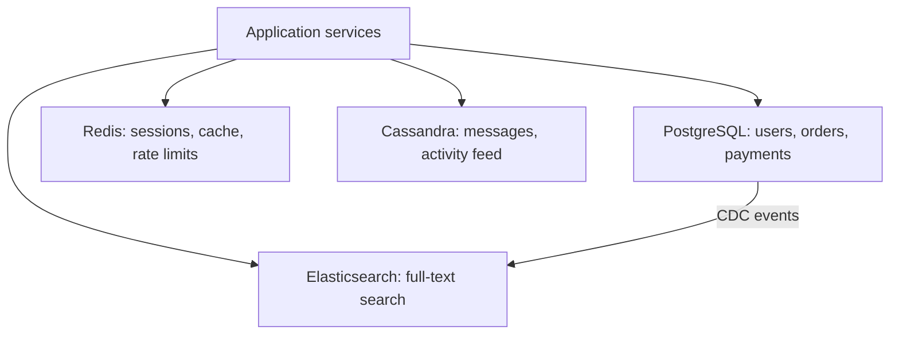

**Pitfalls**
- Picking NoSQL "for scale" when the data is relational and the scale is modest; you then rebuild joins and transactions in application code.
- Assuming SQL can't scale: sharding, read replicas and NewSQL go very far.
- Forgetting that adding a new query pattern to a query-first NoSQL design may need a new table and a backfill.

**Likely follow-ups**
- *Can MongoDB do transactions?* Yes, multi-document ACID transactions exist, but they cost more than single-document writes; the model still favours embedding data read together.
- *How would you scale Postgres?* Indexes and query tuning, vertical scaling, read replicas, caching, partitioning, then sharding (application-level or Citus) or moving to distributed SQL.

</details>

### 2. What does ACID mean?

<details>
<summary>Answer</summary>

**In short:** ACID is the set of guarantees a database transaction gives: **Atomicity** (all or nothing), **Consistency** (constraints always hold), **Isolation** (concurrent transactions don't see each other's partial work) and **Durability** (committed data survives crashes). Together they let you treat a group of writes as one safe unit.

#### Each property, and how it is implemented

| Property | Guarantee | How databases provide it |
|---|---|---|
| **Atomicity** | Every statement in the transaction takes effect, or none do | Undo information / rollback; the commit is a single log record |
| **Consistency** | The DB moves from one valid state to another: constraints, foreign keys, unique keys hold | Constraint checks at statement or commit time (plus your application's invariants) |
| **Isolation** | Concurrent transactions behave as if run one at a time, to the degree of the isolation level | Locks and/or MVCC snapshots |
| **Durability** | Once committed, data survives a crash or power loss | Write-ahead log flushed (fsync) to disk before acknowledging the commit; often replicated too |

Note that "Consistency" in ACID is not the same as "Consistency" in the CAP theorem. ACID consistency means *invariants hold*; CAP consistency means *every read sees the latest write* (linearizability).

#### The classic example

A bank transfer must debit one account and credit another:

```sql
BEGIN;
UPDATE accounts SET balance = balance - 100 WHERE id = 1;  -- debit A
UPDATE accounts SET balance = balance + 100 WHERE id = 2;  -- credit B
-- a CHECK (balance >= 0) constraint enforces consistency
COMMIT;  -- WAL record flushed to disk: durable
```

If the server crashes between the two updates, atomicity guarantees the debit is rolled back on recovery: money never disappears. Isolation guarantees that a report summing all balances concurrently never sees the debit without the credit.

#### Isolation levels (the part interviewers probe)

| Level | Prevents | Still allows |
|---|---|---|
| Read uncommitted | (almost nothing) | Dirty reads |
| Read committed (Postgres default) | Dirty reads | Non-repeatable reads, phantoms, lost updates |
| Repeatable read / snapshot (MySQL InnoDB default) | Non-repeatable reads | Write skew (under snapshot isolation) |
| Serializable | All anomalies | Nothing, but more aborts/retries or locking |

**Pitfalls**
- Assuming the default level is serializable. It usually isn't, so read-modify-write code (`SELECT balance` then `UPDATE`) can lose updates without `SELECT ... FOR UPDATE` or an atomic `UPDATE ... SET balance = balance - 100`.
- Treating `COMMIT` returned as "replicated everywhere": with asynchronous replication, a failover can still lose recent commits.

**Likely follow-ups**
- *What's write skew?* Two transactions read the same data, each writes a different row based on it, and together break an invariant (two doctors both go off call). Fix with serializable isolation or locking the rows read.
- *How do distributed systems get atomicity across services?* Not with ACID directly; use sagas with compensating actions, or the outbox pattern.

</details>

### 3. What is BASE?

<details>
<summary>Answer</summary>

**In short:** BASE stands for **Basically Available, Soft state, Eventually consistent**. It is the design philosophy of many distributed NoSQL stores: stay available even when nodes or networks fail, allow replicas to disagree for a while, and guarantee they converge once writes stop. It trades immediate consistency for availability, latency and scale.

#### The three parts

- **Basically available**: the system keeps answering requests during failures, possibly with stale or partial data, rather than refusing.
- **Soft state**: the state of a replica can change without new input, because updates from other replicas are still arriving.
- **Eventually consistent**: if no new writes happen, all replicas eventually return the same value.

#### Why it exists

When data is replicated across machines (and especially across regions), the CAP theorem says that during a network partition you must choose between consistency and availability. A shopping cart or social feed would rather accept a write and reconcile later than show an error. Amazon's Dynamo paper (2007) popularised this approach: writes go to any of several replicas, and conflicts are resolved later (last-write-wins, vector clocks, or application merge).

#### ACID vs BASE

| | ACID | BASE |
|---|---|---|
| Priority | Correctness and invariants | Availability and scale |
| Reads | Always see committed latest state (on the primary) | May be stale for a while |
| Failure behaviour | May reject writes to stay correct | Accepts writes, reconciles later |
| Typical use | Payments, orders, inventory | Feeds, likes, carts, telemetry |

#### How replicas converge

Mechanisms you should be able to name: **read repair** (fix stale replicas noticed during a read), **hinted handoff** (a healthy node holds writes for a down node and replays them), **anti-entropy with Merkle trees** (background comparison of replicas), and **conflict resolution** (last-write-wins timestamps, vector clocks, CRDTs).

#### The line is blurry today

Modern systems are tunable rather than purely one or the other. Cassandra lets you choose a consistency level per query (`QUORUM` reads plus `QUORUM` writes give read-your-writes), DynamoDB offers strongly consistent reads per request, and NewSQL databases (Spanner, CockroachDB) offer ACID at horizontal scale.

**Pitfalls**
- "Eventually" has no upper bound in the definition; in practice lag is milliseconds but can grow during failures. Design the UX for it (show the user's own write optimistically).
- Last-write-wins silently drops concurrent updates and depends on clock accuracy.

**Likely follow-ups**
- *How do you get read-your-writes in an eventually consistent system?* Read from the leader/same replica for that user for a short window, or use quorum reads and writes where R + W > N.

</details>

### 4. What are the NoSQL families and when do you use each?

<details>
<summary>Answer</summary>

**In short:** The main families are key-value, document, wide-column and graph, plus specialised stores for time-series, search and vectors. Each is optimised for a particular data shape and access pattern; pick the one whose natural query matches your most important queries.

| Family | Examples | Data model | Best for | Weak at |
|---|---|---|---|---|
| **Key-value** | Redis, DynamoDB, Riak | Opaque value per key | Sessions, carts, caches, counters, feature flags | Querying by anything other than the key |
| **Document** | MongoDB, Couchbase, Firestore | JSON-like nested documents, indexable fields | Catalogs, user profiles, CMS content read as a whole | Many-to-many relationships, cross-document joins |
| **Wide-column** | Cassandra, HBase, Bigtable, ScyllaDB | Rows in partitions, sorted by a clustering key | Huge write volumes, messages, feeds, time-ordered data | Ad-hoc queries, secondary access patterns |
| **Graph** | Neo4j, Amazon Neptune | Nodes and edges with properties | Social graphs, recommendations, fraud rings, multi-hop traversals | Bulk analytics over the whole dataset, sharding |
| **Time-series** | InfluxDB, TimescaleDB, Prometheus | Timestamped points with tags | Metrics, IoT, monitoring | General-purpose transactional data |
| **Search** | Elasticsearch, OpenSearch | Inverted index over documents | Full-text search, faceting, log search | Being the source of truth, transactions |
| **Vector** | pgvector, Pinecone, Milvus | High-dimensional embeddings | Semantic search, RAG, recommendations | Exact queries, transactional workloads |

#### How to think about each

- **Key-value** is the simplest and fastest: `GET user:42:session`. Because the store knows nothing about the value, it can partition purely by key and scale nearly linearly.
- **Document** stores let you keep an aggregate together: an order with its line items and shipping address in one document, read in one go. Rule of thumb: embed data that is read together and bounded in size; reference data that is shared or unbounded.
- **Wide-column** stores are built for "all X for key K, ordered by time": `SELECT * FROM messages WHERE channel_id = ? ORDER BY ts DESC LIMIT 50` hits one partition and reads sequentially. They use LSM trees, so writes are cheap.
- **Graph** databases shine when the query walks relationships of unknown depth ("friends of friends who bought X").
- **Time-series** databases compress timestamped data aggressively, downsample old data and make time-window aggregates fast.
- **Search** engines build inverted indexes (term to list of documents), usually fed from the primary database via CDC.
- **Vector** databases do approximate nearest-neighbour search (HNSW, IVF indexes) over embeddings.

#### Example mapping for a chat app

- Users, workspaces, billing: PostgreSQL.
- Messages per channel: Cassandra (partition by channel and time bucket).
- Online presence, typing indicators: Redis with TTLs.
- Message search: Elasticsearch fed by CDC.

**Pitfalls**
- Using a search engine or cache as the source of truth.
- Choosing a document store, then needing heavy cross-document joins.

**Likely follow-ups**
- *Is Redis a database?* It's an in-memory data structure store with optional persistence (RDB snapshots, AOF); great as a cache or for ephemeral state, risky as the only copy of critical data.

</details>

### 5. How does a database index work?

<details>
<summary>Answer</summary>

**In short:** An index is a separate, sorted data structure that maps column values to row locations, so the database can find rows without scanning the whole table, like the index at the back of a book. Most relational indexes are **B+ trees**, which find any key (or the start of a range) in a handful of page reads. You pay for faster reads with slower writes and extra storage.

#### Why it's needed

Without an index, `SELECT * FROM users WHERE email = 'a@b.com'` must read every row: a **full table scan**, O(n). With 100 million rows, that's gigabytes of I/O per query. With a B+ tree index on `email`, it's about 3–4 page reads.

#### How a B+ tree works

- Each node is a disk **page** (typically 8 KB in Postgres, 16 KB in InnoDB) holding hundreds of sorted keys, so the tree is very **wide and shallow**: 3–4 levels cover billions of rows.
- **Internal nodes** hold keys and child pointers to guide the search.
- **Leaf nodes** hold the keys plus row pointers (or the row itself, for a clustered index), and are **linked to their neighbours**, so range scans just walk along the leaves.

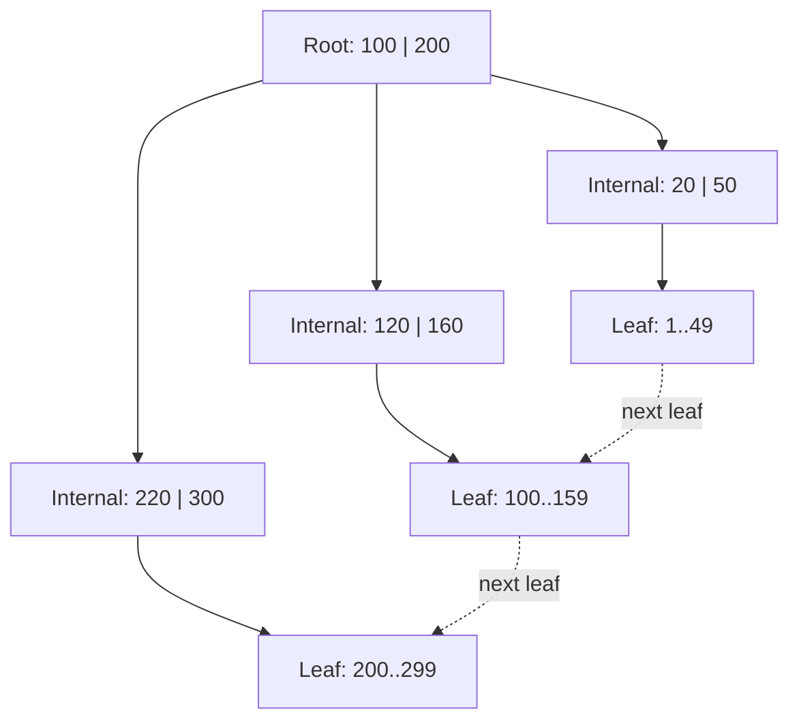

A lookup goes root to leaf, O(log n). A range query (`WHERE created_at BETWEEN ...`) finds the first key then scans leaves in order. Because keys are sorted, the index can also satisfy `ORDER BY` without a sort step.

#### Trade-offs

- **Faster** filters, joins, sorts and uniqueness checks on the indexed columns.
- **Slower writes**: every insert, update of an indexed column, or delete must maintain every index on the table. Ten indexes means roughly ten extra structures to update.
- **Storage and memory**: indexes compete for buffer pool memory.
- Low-selectivity columns (e.g. a boolean `is_active`) rarely benefit; the planner often prefers a scan.

#### Index types worth knowing

| Type | What it is | Use |
|---|---|---|
| Primary / clustered | Rows stored in key order (InnoDB) | Primary-key lookups and ranges |
| Secondary | Separate structure pointing at rows | Any other filter column |
| Composite | Multiple columns; order matters (leftmost prefix) | `WHERE user_id = ? AND created_at > ?` |
| Unique | Enforces no duplicates | Emails, usernames |
| Covering | Contains all columns the query needs | Index-only scans |
| Partial | Indexes only rows matching a predicate | `WHERE status = 'pending'` |
| Hash | Equality only | Exact-match lookups |
| GIN | Inverted index | Full-text, JSONB, arrays (Postgres) |
| GiST / R-tree | Spatial structures | Geospatial queries |

```sql
CREATE INDEX idx_orders_user_created ON orders (user_id, created_at DESC);
CREATE INDEX idx_orders_pending ON orders (created_at) WHERE status = 'pending';  -- partial
CREATE UNIQUE INDEX idx_users_email ON users (lower(email));                      -- expression
```

**Pitfalls**
- Wrapping an indexed column in a function (`WHERE DATE(created_at) = ...`) prevents the index from being used unless you create an expression index.
- Leading wildcards (`LIKE '%foo'`) can't use a B-tree index.
- Over-indexing write-heavy tables.

**Likely follow-ups**
- *How do you know an index is used?* `EXPLAIN` / `EXPLAIN ANALYZE` shows Index Scan vs Seq Scan.
- *Why B+ tree and not a hash table?* B+ trees support ranges and ordering, and are disk-page friendly.

</details>

### 6. B-tree vs LSM tree storage engines?

<details>
<summary>Answer</summary>

**In short:** A **B-tree** engine updates sorted pages **in place**, giving fast, predictable reads; it's the default for relational databases like Postgres and MySQL InnoDB. An **LSM tree** engine **buffers writes in memory and flushes them as immutable sorted files**, merging them in the background; that turns random writes into sequential ones, giving very high write throughput at the cost of more work on reads. Cassandra, RocksDB, LevelDB and ScyllaDB use LSM trees.

#### How a write flows in an LSM tree

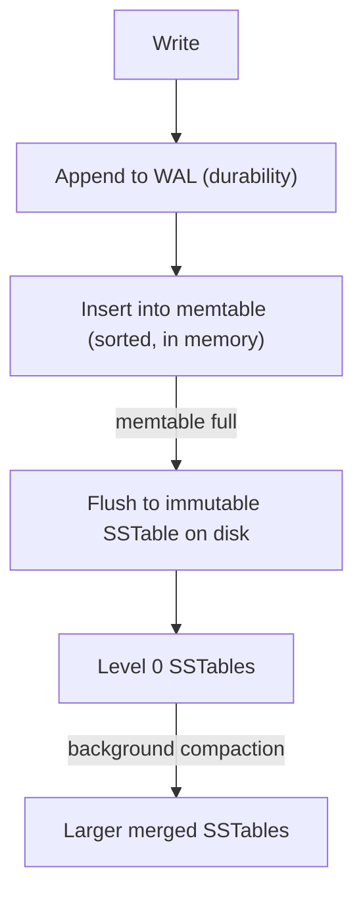

1. The write is appended to a **write-ahead log** (sequential) and inserted into the **memtable**, a sorted in-memory structure. The write is now done: no random disk I/O.
2. When the memtable fills, it is written out as an **SSTable** (sorted string table), an immutable sorted file.
3. **Compaction** merges SSTables in the background, discarding overwritten values and deleted entries (deletes are written as **tombstones**).
4. A read checks the memtable, then SSTables from newest to oldest. **Bloom filters** per SSTable skip files that definitely don't contain the key, and sparse indexes locate the right block.

#### How a B-tree handles writes

The engine finds the leaf page for the key and modifies it in place (in the buffer pool, with the change recorded in the WAL first). If the page is full, it splits. Writes therefore cause **random I/O** when dirty pages are flushed, and a small change rewrites a whole page.

#### Comparison

| | B-tree (Postgres, InnoDB) | LSM tree (Cassandra, RocksDB, ScyllaDB) |
|---|---|---|
| Write path | Update page in place | Append to WAL + memtable, flush sequentially |
| Write throughput | Good; random I/O | **Very high**; sequential I/O |
| Point reads | One tree descent: fast, predictable | May check memtable + several SSTables (Bloom filters help) |
| Range scans | Excellent (linked leaves) | Good, but must merge across files |
| Space | Fragmentation, partially empty pages | Temporary duplicates until compaction |
| Background work | Vacuum / page maintenance | Compaction (can cause latency spikes) |
| Best for | Read-heavy, transactional, OLTP | Write-heavy: logs, events, metrics, messages |

#### The amplification trade-off

- **Write amplification**: bytes written to disk per byte of user data. B-trees rewrite whole pages; LSM trees rewrite data repeatedly during compaction.
- **Read amplification**: LSM reads may touch several files; B-tree reads touch one path.
- **Space amplification**: LSM trees hold stale versions until compaction.

Compaction strategies tune this: **leveled** compaction (RocksDB default, Cassandra LCS) favours reads and space; **size-tiered** compaction favours write throughput.

**Pitfalls**
- Tombstone build-up in Cassandra (mass deletes, queue-like usage) makes reads scan many dead entries.
- Compaction falling behind sustained write load raises read latency and disk usage.

**Likely follow-ups**
- *Why do Bloom filters matter so much here?* They let a read skip most SSTables with one in-memory check, keeping point reads close to one disk seek.
- *Can a relational DB use an LSM engine?* Yes, MyRocks (MySQL on RocksDB) and CockroachDB's Pebble storage are examples.

</details>

### 7. How do composite indexes work? What is the leftmost-prefix rule?

<details>
<summary>Answer</summary>

**In short:** A composite index on `(a, b)` is sorted by `a`, and by `b` within each value of `a`, like a phone book sorted by last name then first name. It can serve queries that filter on `a`, or on `a` and `b`, but not on `b` alone: that's the **leftmost-prefix rule**. Put equality columns first, then range or sort columns.

#### What the sorted order looks like

An index on `orders (user_id, created_at)`:

| user_id | created_at |
|---|---|
| 7 | 2025-01-02 |
| 7 | 2025-03-15 |
| 7 | 2025-06-01 |
| 9 | 2024-11-20 |
| 9 | 2025-02-08 |

All of user 7's orders are contiguous and already sorted by time. All orders from 2025-02 are scattered across users.

#### What it can and can't serve

```sql
-- Uses the index: equality on the leftmost column
SELECT * FROM orders WHERE user_id = 7;

-- Uses the index: equality then range on the next column
SELECT * FROM orders WHERE user_id = 7 AND created_at > '2025-02-01';

-- Uses the index for filtering AND ordering: no sort step, stops after 20 rows
SELECT * FROM orders WHERE user_id = 7 ORDER BY created_at DESC LIMIT 20;

-- Cannot use it efficiently: created_at is not the leftmost column
SELECT * FROM orders WHERE created_at > '2025-02-01';
```

The last query would need a separate index on `created_at` (some engines can do a "skip scan" over distinct leading values, but don't rely on it).

#### Choosing column order

1. **Equality columns first** (`user_id = ?`, `status = ?`).
2. **Then the range or sort column** (`created_at > ?`, `ORDER BY created_at`).
3. Once a range condition is applied to a column, columns after it can't be used for seeking, only filtered while scanning. An index on `(created_at, user_id)` for `WHERE user_id = 7 AND created_at > X` would scan all recent orders for every user.

#### Covering indexes

If the index contains every column the query needs, the database answers from the index alone (an **index-only scan**), skipping the table lookup:

```sql
-- Postgres: INCLUDE adds non-key payload columns to the leaf entries
CREATE INDEX idx_orders_user_created
  ON orders (user_id, created_at DESC) INCLUDE (total, status);

SELECT created_at, total, status
FROM orders WHERE user_id = 7
ORDER BY created_at DESC LIMIT 20;   -- served entirely from the index
```

**Pitfalls**
- Creating separate single-column indexes on `user_id` and `created_at` and expecting them to behave like one composite index. The planner might combine them (bitmap AND), but it's much less efficient.
- Redundant indexes: `(user_id)` is redundant if `(user_id, created_at)` exists.

**Likely follow-ups**
- *Does `WHERE b = ? AND a = ?` use an `(a, b)` index?* Yes, the order of predicates in SQL doesn't matter; the order of columns in the index does.
- *How does this relate to keyset pagination?* `WHERE user_id = ? AND created_at < :last_seen ORDER BY created_at DESC LIMIT 20` is a perfect fit for this index.

</details>

### 8. Normalisation vs denormalisation?

<details>
<summary>Answer</summary>

**In short:** **Normalisation** stores each fact exactly once and links tables with foreign keys, which avoids inconsistent data but means reads need joins. **Denormalisation** deliberately duplicates data so reads are cheap, at the cost of more complex writes that must keep copies in sync. At scale you typically normalise the source of truth and denormalise read models around your hottest queries.

#### Normalisation

Normal forms remove redundancy step by step:
- **1NF**: atomic values, no repeating groups (no `tags = "a,b,c"` column).
- **2NF**: every non-key column depends on the whole primary key.
- **3NF**: non-key columns depend only on the key, not on other non-key columns.

```sql
-- Normalised: the author's name lives in one place
CREATE TABLE users (id BIGINT PRIMARY KEY, name TEXT);
CREATE TABLE posts (id BIGINT PRIMARY KEY, author_id BIGINT REFERENCES users(id), body TEXT);

SELECT p.body, u.name FROM posts p JOIN users u ON u.id = p.author_id;
```

Benefits: no **update anomalies** (rename a user once, every post shows the new name), less storage, integrity enforced by the database.

#### Denormalisation

```sql
-- Denormalised: author name copied into each post, comment count precomputed
CREATE TABLE posts (
  id BIGINT PRIMARY KEY,
  author_id BIGINT,
  author_name TEXT,        -- duplicated
  comment_count INT,       -- precomputed aggregate
  body TEXT
);
```

Now rendering a feed is a single-table read with no join and no `COUNT(*)`. But renaming a user means updating every post they wrote, and incrementing `comment_count` must happen whenever a comment is added.

| | Normalised | Denormalised |
|---|---|---|
| Reads | Need joins, more work per query | Single lookup, fast |
| Writes | Simple, one place | Must update every copy |
| Consistency | Guaranteed by schema | Copies can drift or be stale |
| Storage | Minimal | Duplicated |
| Fits | OLTP source of truth, evolving queries | Read-heavy hot paths, NoSQL, sharded data |

#### Why scale pushes towards denormalisation

- Joins across **shards** mean network round trips to many machines.
- NoSQL stores like Cassandra and DynamoDB don't support joins at all.
- Read-heavy workloads (feeds, product pages) hit the same data millions of times.

Common techniques: precomputed counters, embedded snapshots (an order line stores the product price **at purchase time**, which is actually correct, not just faster), materialised views, fan-out-on-write feed tables, and search indexes.

#### Doing it safely

Keep **one source of truth** and treat denormalised copies as derived data. Update copies asynchronously from change events (CDC or an outbox), make the updaters idempotent, and have a way to rebuild copies from the source.

**Pitfalls**
- Denormalising before measuring; a properly indexed join is often fast enough.
- Duplicating data that changes frequently (it multiplies write load).

**Likely follow-ups**
- *When is duplication actually correct, not just an optimisation?* Historical snapshots: invoice addresses, order prices, which must not change when the source changes.

</details>

### 9. How do you optimise a slow query?

<details>
<summary>Answer</summary>

**In short:** Measure first: read the **query plan** with `EXPLAIN ANALYZE` to see where time goes. Then usually fix it by adding or reshaping an **index** to match the WHERE / JOIN / ORDER BY columns, fetching less data, and removing N+1 patterns. If the query is inherently expensive, cache or precompute it. Finally check the environment: locks, connection pool, memory.

#### Step 1: find and read the plan

Find slow queries via the slow query log or `pg_stat_statements` (sort by total time, not just per-call time; a 5 ms query run a million times matters more than a 2 s monthly report).

```sql
EXPLAIN ANALYZE
SELECT id, total FROM orders
WHERE user_id = 42 AND status = 'paid'
ORDER BY created_at DESC LIMIT 20;
```

Look for:
- **Seq Scan** on a large table where you expected an index.
- **Estimated rows vs actual rows** far apart: stale statistics lead the planner to bad choices.
- **Sort** steps spilling to disk, or large hash joins.
- **Nested loops** over many rows.

#### Step 2: fix the access path

```sql
-- Equality columns first, then the sort column; INCLUDE makes it covering
CREATE INDEX CONCURRENTLY idx_orders_user_status_created
  ON orders (user_id, status, created_at DESC) INCLUDE (total);
```

Also avoid patterns that defeat indexes:

```sql
-- Bad: function on the column, index on email is ignored
SELECT * FROM users WHERE LOWER(email) = 'a@b.com';
-- Good: expression index matches the predicate
CREATE INDEX idx_users_lower_email ON users (LOWER(email));
```

#### Step 3: fetch less

- Select only the columns you need; avoid `SELECT *` (it also prevents index-only scans).
- Paginate with **keyset** pagination instead of large `OFFSET`s:

```sql
-- Bad: OFFSET 100000 still reads and discards 100,000 rows
SELECT * FROM posts ORDER BY id DESC LIMIT 20 OFFSET 100000;
-- Good: seek directly from the last seen id
SELECT * FROM posts WHERE id < :last_id ORDER BY id DESC LIMIT 20;
```

#### Step 4: fix the application pattern

- Remove **N+1** queries with joins or batched `IN (...)` lookups.
- Batch inserts and updates.

#### Step 5: if it's still expensive

- Run `ANALYZE` to refresh statistics; rewrite correlated subqueries as joins.
- **Cache** results (Redis) or **precompute** with materialised views or summary tables.
- Move analytics to a replica or a data warehouse.

#### Step 6: check the environment

Lock contention (a long transaction holding locks), connection pool saturation, buffer pool too small (data not in memory), and disk I/O limits.

**Pitfalls**
- Adding an index without checking write cost or whether one already covers the query.
- Testing on a tiny dev database where everything is fast; plans differ with real data volumes.

**Likely follow-ups**
- *The index exists but isn't used, why?* Low selectivity, stale statistics, a type mismatch or function on the column, or the planner judging a scan cheaper for that many rows.

</details>

### 10. What is the N+1 query problem?

<details>
<summary>Answer</summary>

**In short:** It's when code fetches a list with one query and then runs one more query **per item** to load related data: 1 query for 50 posts, then 50 queries for their authors. Each query is fast, but the round trips add up and hammer the database. Fix it by loading related data in one go: a **join**, a batched `IN (...)` query, ORM eager loading, or a **DataLoader**.

#### How it happens

It's usually hidden by an ORM's lazy loading:

```python
posts = Post.objects.order_by("-created_at")[:50]   # N+1 (looks innocent): 1 query
for post in posts:
    print(post.author.name)                          # 50 more queries, one per post
```

The SQL actually sent:

```sql
SELECT * FROM posts ORDER BY created_at DESC LIMIT 50;
SELECT * FROM users WHERE id = 7;
SELECT * FROM users WHERE id = 9;
-- ... 48 more
```

With 1 ms network round trip per query, that's 50 ms of pure waiting, multiplied across every request and every nested level (posts, then comments per post, then authors per comment).

#### Fixes

```python
posts = Post.objects.select_related("author").order_by("-created_at")[:50]    # Fix 1: eager load via a join (one query)

posts = Post.objects.prefetch_related("author").order_by("-created_at")[:50]  # Fix 2: batch load (two queries total)
```

The batched SQL:

```sql
SELECT * FROM posts ORDER BY created_at DESC LIMIT 50;
SELECT * FROM users WHERE id IN (7, 9, 12, ...);   -- one query for all authors
```

Join vs batch: a join is one round trip but duplicates the author row per post; batching is two round trips but no duplication, and works across services or databases.

#### DataLoader (GraphQL and service calls)

In GraphQL each field resolver runs independently, so N+1 is the default. A **DataLoader** collects all keys requested during one tick of execution, issues a single batched call, and caches results for the duration of the request:

```ts
const userLoader = new DataLoader(async (ids: readonly number[]) => {
  const users = await db.query("SELECT * FROM users WHERE id = ANY($1)", [ids]);
  const byId = new Map(users.map(u => [u.id, u]));
  return ids.map(id => byId.get(id) ?? null);   // must return results in key order
});

// In the resolver: each call is queued, then sent as one batch
author: (post) => userLoader.load(post.authorId)
```

The same problem appears between microservices (calling a user service once per item); the fix is a batch endpoint.

**Pitfalls**
- Not noticing it: enable query logging or count queries per request in tests.
- Over-eager loading everything, fetching data you never use.

**Likely follow-ups**
- *How do you detect N+1 in production?* APM tracing shows many identical queries per request; tools like Bullet (Rails) or query counters in tests flag it.

</details>

### 11. Why do you need connection pooling for databases?

<details>
<summary>Answer</summary>

**In short:** Opening a database connection is expensive, and databases can only hold a limited number of them. A **connection pool** keeps a set of already-open connections that requests borrow and return, which removes the setup cost from every request and caps the load on the database. At larger scale, an external pooler such as **PgBouncer** or RDS Proxy lets thousands of application connections share a few hundred real database connections.

#### Why connections are expensive

Each new connection costs a TCP handshake, often a TLS handshake, authentication, and server-side setup. In **PostgreSQL** every connection is a separate OS **process** with its own memory, so thousands of connections waste memory and cause contention even when idle. MySQL uses a thread per connection, which is lighter but still limited. Typical `max_connections` settings are in the hundreds to low thousands.

#### The exhaustion problem

The arithmetic catches people out: 50 app instances × 20 worker threads each = 1,000 connections. Autoscale to 200 instances during a spike, or add serverless functions that each open their own connection, and you blow past the database limit. New requests then fail with "too many connections", or the database slows down from context switching.

#### How a pool works

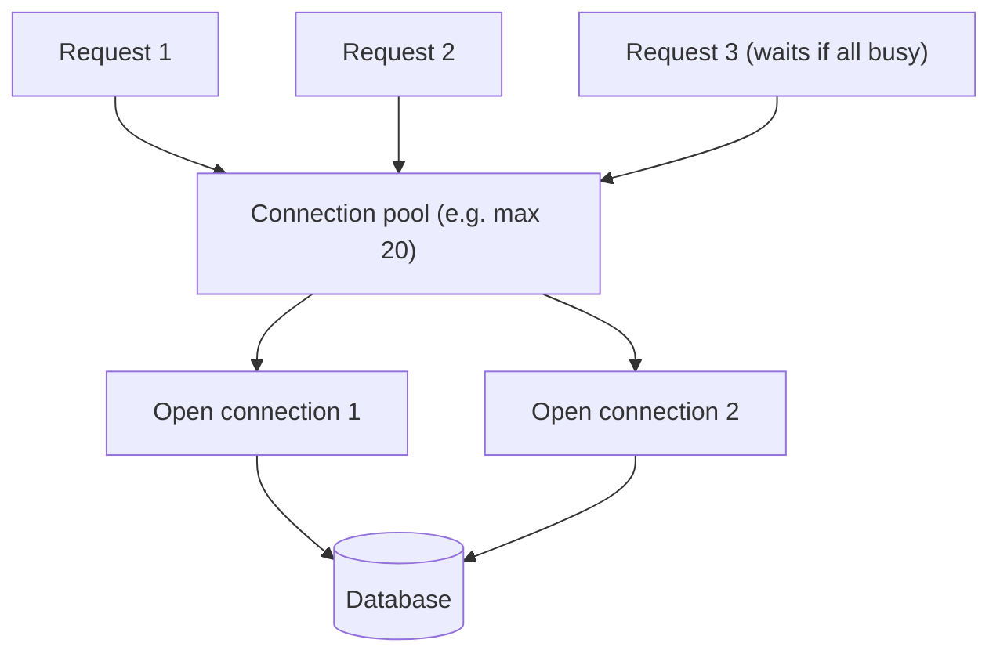

1. At startup (or lazily) the pool opens up to `maxPoolSize` connections.
2. A request **borrows** a connection, runs its queries, and **returns** it, without closing it.
3. If all connections are busy, the request waits up to a **timeout**, then fails fast instead of piling up.
4. The pool validates connections, replaces broken ones and closes idle ones after a while.

```kotlin
// HikariCP (JVM): a small pool is usually best
val config = HikariConfig().apply {
    jdbcUrl = "jdbc:postgresql://db:5432/app"
    maximumPoolSize = 20          // per app instance
    connectionTimeout = 2_000     // ms to wait for a free connection, then fail
    idleTimeout = 600_000
    maxLifetime = 1_800_000       // recycle before DB/proxy kills idle connections
}
val dataSource = HikariDataSource(config)
```

#### External poolers

An in-app pool limits connections per instance, but not across hundreds of instances. A proxy like **PgBouncer** sits between apps and Postgres:

| PgBouncer mode | Server connection is held for | Notes |
|---|---|---|
| Session | The whole client session | Safest, least sharing |
| Transaction | One transaction | Most common; much better sharing, but session state (`SET`, session-level prepared statements, advisory locks) doesn't carry over reliably |
| Statement | One statement | Disallows multi-statement transactions |

Managed equivalents include RDS Proxy; serverless environments especially need one.

**Pitfalls**
- **Bigger pools aren't faster.** The database has a limited number of cores and disks; past a point, more concurrent queries just queue inside the database. Small pools (tens per instance) often give better throughput.
- Holding a connection while doing slow non-DB work (HTTP calls), starving other requests.
- Connection leaks: forgetting to return connections on error paths. Use try-with-resources / `use {}`.

**Likely follow-ups**
- *How do you size the pool?* Start small, make sure the total across all instances stays under the database's `max_connections`, and tune by measuring pool wait time and DB CPU.
- *What happens when the pool is exhausted?* Requests wait up to the timeout then error; monitor pool wait time and active count.

</details>

### 12. What are stored procedures, triggers and materialised views, and should you use them?

<details>
<summary>Answer</summary>

**In short:** **Stored procedures** are code that runs inside the database, **triggers** are procedures that run automatically when rows change, and **materialised views** are query results saved as a table and refreshed later. Use materialised views freely for expensive aggregates and reporting; use triggers sparingly (audit logs, maintaining derived columns); and keep most business logic in application services rather than stored procedures, because services are easier to version, test, deploy and scale.

#### Stored procedures

```sql
CREATE PROCEDURE transfer(from_id BIGINT, to_id BIGINT, amount NUMERIC)
LANGUAGE plpgsql AS $$
BEGIN
  UPDATE accounts SET balance = balance - amount WHERE id = from_id;
  UPDATE accounts SET balance = balance + amount WHERE id = to_id;
END $$;

CALL transfer(1, 2, 100);
```

- **Pros**: one round trip for many statements, logic runs next to the data, a shared enforcement point if many apps touch the same DB.
- **Cons**: lives outside your normal code review, CI and deploy pipeline; harder to unit test and debug; ties you to one vendor's dialect; and the database is the hardest tier to scale, so putting CPU work there is expensive.

#### Triggers

```sql
CREATE FUNCTION audit_order_change() RETURNS trigger LANGUAGE plpgsql AS $$
BEGIN
  INSERT INTO order_audit(order_id, old_status, new_status, changed_at)
  VALUES (OLD.id, OLD.status, NEW.status, now());
  RETURN NEW;
END $$;

CREATE TRIGGER trg_order_audit
AFTER UPDATE OF status ON orders
FOR EACH ROW EXECUTE FUNCTION audit_order_change();
```

- **Reasonable uses**: audit trails, `updated_at` timestamps, enforcing invariants the schema can't express.
- **Risks**: **hidden side effects** (a developer reading the app code can't see that an `UPDATE` also writes elsewhere), extra latency and locking inside every write, cascading triggers, and surprises during bulk loads and migrations.

#### Materialised views

A regular view is just a saved query that runs every time. A **materialised view** stores the result:

```sql
CREATE MATERIALIZED VIEW daily_revenue AS
SELECT date_trunc('day', created_at) AS day, SUM(total) AS revenue
FROM orders WHERE status = 'paid'
GROUP BY 1;

CREATE UNIQUE INDEX ON daily_revenue (day);
REFRESH MATERIALIZED VIEW CONCURRENTLY daily_revenue;  -- e.g. every 5 minutes via a scheduler
```

| | View | Materialised view |
|---|---|---|
| Stored data | No | Yes |
| Freshness | Always current | As of last refresh |
| Read cost | Runs the full query | Reads a table (indexable) |
| Write cost | None | Refresh cost |

Postgres refreshes recompute the whole view (`CONCURRENTLY` avoids blocking readers but needs a unique index). Some systems maintain views incrementally. At larger scale the same idea appears as summary tables updated from change streams.

**Pitfalls**
- Business rules split between app code and procedures/triggers, so nobody knows the full behaviour.
- Expecting a materialised view to be real-time.

**Likely follow-ups**
- *Alternative to triggers for syncing other systems?* Change data capture from the WAL, or the transactional outbox pattern; both keep side effects visible and asynchronous.

</details>

### 13. What is NewSQL / distributed SQL?

<details>
<summary>Answer</summary>

**In short:** NewSQL (distributed SQL) databases keep the **SQL interface and ACID transactions** of a relational database while **scaling horizontally** like NoSQL: they automatically split data into shards, replicate each shard with a consensus protocol (Raft or Paxos), and run distributed transactions across shards. Examples are Google Spanner, CockroachDB, YugabyteDB and TiDB. The cost is higher write latency and operational or monetary cost.

#### The problem it solves

Traditional SQL databases scale writes vertically. Once one primary can't keep up, teams shard manually: routing logic in the app, no cross-shard transactions or joins, painful resharding. NoSQL scales out but gives up joins and multi-row transactions. NewSQL aims to give you both.

#### How it works (typical design)

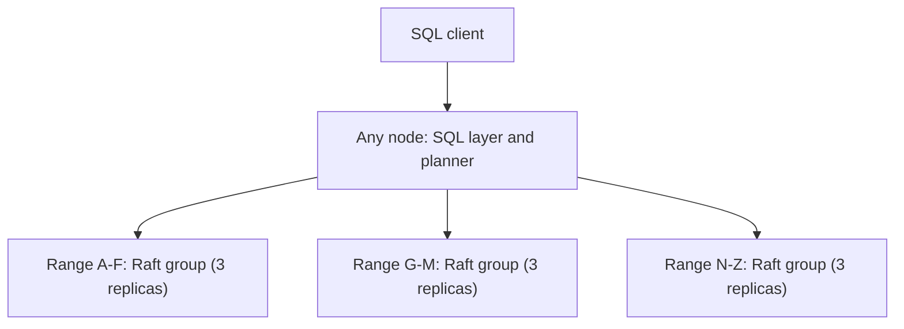

1. Tables are stored as a sorted key-value space, split into **ranges** (shards) that split and move automatically as they grow.
2. Each range is replicated (commonly 3 or 5 copies) and has a **leader**; a write commits when a **majority** of replicas acknowledge it via Raft/Paxos, so losing a minority of nodes loses no data.
3. Transactions touching several ranges use a **two-phase commit** layered on top of the consensus groups, with MVCC timestamps for isolation.
4. Any node accepts SQL, plans the query and routes to the right ranges.

#### Notable systems

| System | Notes |
|---|---|
| **Google Spanner** | Global, externally consistent transactions using **TrueTime** (GPS + atomic clocks bound clock uncertainty; commits wait out the uncertainty) |
| **CockroachDB** | Spanner-inspired, open-source, Postgres wire-compatible; uses hybrid logical clocks instead of special hardware |
| **YugabyteDB** | Spanner-inspired, reuses Postgres's query layer on a distributed storage layer |
| **TiDB** | MySQL-compatible; TiKV storage with Raft |
| **Amazon Aurora** | Not fully NewSQL: scales storage and reads, writes on one primary (Aurora Limitless/DSQL add more) |

#### Trade-offs

- **Latency**: every write needs a consensus round trip; across regions that's tens to hundreds of milliseconds.
- **Hotspots** still exist: sequential primary keys send all inserts to the last range, so prefer hashed or random-prefixed keys.
- **Cost and complexity** compared to a single Postgres instance.
- Compatibility gaps with the Postgres/MySQL features your ORM or extensions expect.

**When to use it**: you need relational semantics and transactions at a scale (or geographic spread) where manual sharding would be painful, such as global financial ledgers or multi-region SaaS with data residency needs.

**Likely follow-ups**
- *Why does Spanner need atomic clocks?* To assign globally meaningful commit timestamps; with bounded clock uncertainty it can guarantee that a transaction committed later has a later timestamp (external consistency).
- *How does this relate to CAP?* These systems choose consistency: a range that loses its majority becomes unavailable for writes.

</details>

### 14. When would you use a graph database?

<details>
<summary>Answer</summary>

**In short:** Use a graph database when your important queries **traverse relationships of variable or multi-hop depth**: friends of friends, fraud rings linked by shared devices or cards, knowledge graphs, permission inheritance, recommendations. In SQL those become chains of joins or recursive queries that get slow as depth grows; graph databases store each node's neighbours directly, so each hop is cheap. For simple one-hop relations like a followers list, a regular database is fine.

#### The data model

Data is **nodes** (entities) and **edges** (relationships), both with properties:

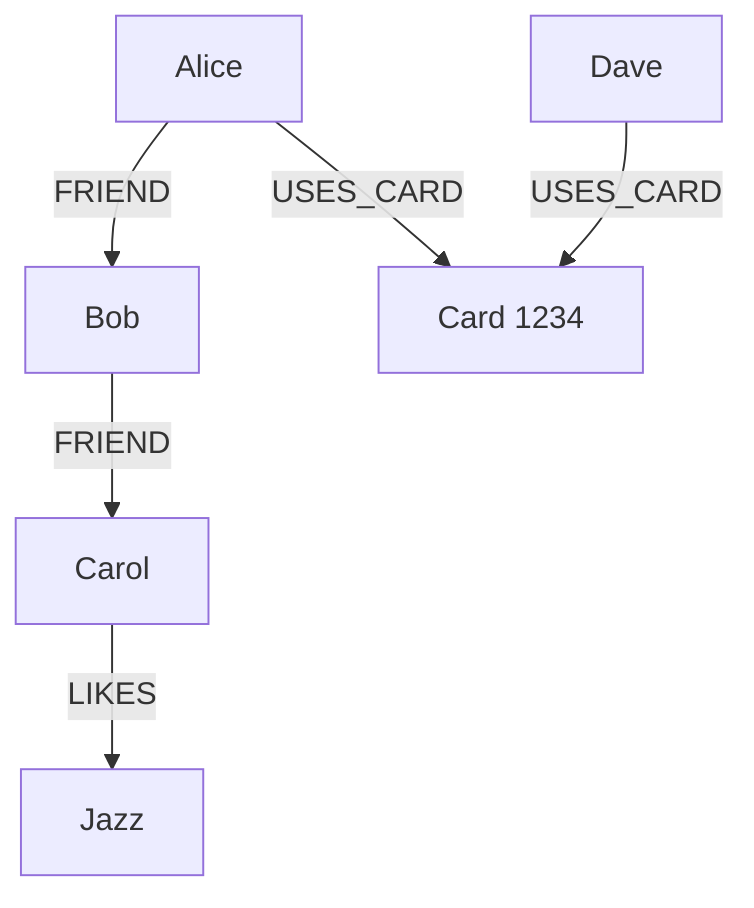

#### Why traversals are faster

In a relational database, "friends of friends" means joining the `friendships` table with itself, using an index lookup per hop. Each extra hop multiplies the work, and variable depth needs `WITH RECURSIVE`. Graph databases like Neo4j use **index-free adjacency**: each node record points directly at its relationships, so following an edge is a pointer hop rather than an index search. Cost grows with the part of the graph you actually touch, not the total table size.

```cypher
// Cypher (Neo4j): friends of friends of Alice who like Jazz, not already her friends
MATCH (a:Person {name: 'Alice'})-[:FRIEND]->()-[:FRIEND]->(fof)-[:LIKES]->(:Genre {name: 'Jazz'})
WHERE NOT (a)-[:FRIEND]->(fof) AND fof <> a
RETURN DISTINCT fof.name;
```

The SQL equivalent:

```sql
SELECT DISTINCT f2.friend_id
FROM friendships f1
JOIN friendships f2 ON f2.user_id = f1.friend_id
JOIN likes l ON l.user_id = f2.friend_id AND l.genre = 'Jazz'
WHERE f1.user_id = :alice
  AND f2.friend_id <> :alice
  AND f2.friend_id NOT IN (SELECT friend_id FROM friendships WHERE user_id = :alice);
```

Fine at two hops; painful at five or at "any depth".

#### Good fits vs poor fits

| Good fit | Poor fit |
|---|---|
| Fraud detection: accounts linked through shared devices, IPs, cards | Simple key lookups and CRUD |
| Recommendations ("people who bought X also...") | Large aggregations over all data (use a warehouse) |
| Knowledge graphs, identity resolution | Very high write throughput of simple events |
| Access control with nested groups and inherited permissions | One-hop lists (followers, likes) |

#### Scale considerations

Graphs are hard to **shard**: any partitioning cuts edges, and traversals that cross partitions need network hops. That's why huge social networks often store a graph *model* on a sharded general-purpose store. Meta's TAO, for example, is publicly described as a graph data model (objects and associations) on top of MySQL with a large caching layer, optimised for one-hop queries at massive scale.

**Likely follow-ups**
- *Can Postgres do graph queries?* Yes, with recursive CTEs (or extensions like Apache AGE); fine for modest depth and size.
- *How would you store a follower graph for 1B users?* An edge table/wide-column store partitioned by user (`follower -> followees` and `followee -> followers`), plus caching; deep traversal is computed offline.

</details>

### 15. What is a write-ahead log (WAL)?

<details>
<summary>Answer</summary>

**In short:** A write-ahead log is an append-only file where the database records every change **before** applying it to the actual data pages. Because appending sequentially and flushing it is cheap, the database can acknowledge a commit as soon as the log record is on disk; after a crash it replays the log to restore committed work. The same log also drives replication, point-in-time recovery and change data capture.

#### The problem it solves

Data pages are scattered across disk and modified in a buffer cache in memory. Writing every modified page to disk on every commit would be slow (random I/O) and still unsafe: a crash halfway through writing a page leaves it torn. The WAL separates **durability** (log on disk) from **data file updates** (done lazily later).

#### How a commit works

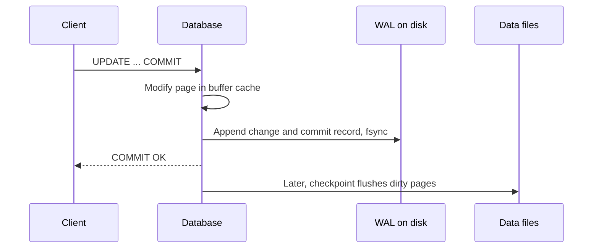

1. The change is applied to the page **in memory**.
2. A log record describing the change (plus a commit record) is appended to the WAL and **fsynced**. Only then does the client get "committed".
3. Dirty pages are flushed to data files later, in the background.
4. A **checkpoint** periodically guarantees all changes up to a log position are in the data files, so older WAL segments can be recycled.

#### Crash recovery

On restart, the database starts at the last checkpoint and **replays (redo)** log records to bring pages up to date. Changes from transactions that never committed are rolled back or ignored (Postgres simply treats them as invisible via MVCC; InnoDB uses undo logs). The rule that makes this work: **the log record must reach disk before the page it describes** — hence "write-ahead".

#### What else the WAL powers

| Use | How |
|---|---|
| **Replication** | Ship the log stream to replicas, which replay it (Postgres streaming replication; MySQL's binlog plays this role) |
| **Point-in-time recovery** | Restore a base backup, then replay archived WAL up to a chosen timestamp ("undo the bad `DELETE` at 14:03") |
| **Change data capture** | Tools like Debezium read the Postgres WAL (logical decoding) or MySQL binlog and publish row changes to Kafka |
| **LSM engines** | Protect the in-memory memtable until it is flushed |

The idea generalises: Kafka is essentially a distributed, replicated log, and event sourcing treats the log as the source of truth.

**Pitfalls**
- Turning off fsync or using `synchronous_commit = off` for speed risks losing recent commits on crash.
- A stuck replica or abandoned replication slot makes the database retain WAL until the disk fills.

**Likely follow-ups**
- *Why is the WAL fast if it's still a disk write?* It's sequential appends, and many concurrent commits can share one fsync (group commit).
- *WAL vs binlog in MySQL?* InnoDB has its own redo log for crash recovery; the binlog is a separate logical log used for replication and CDC.

</details>

### 16. How do you store money, time and IDs correctly?

<details>
<summary>Answer</summary>

**In short:** Store **money** as integers in minor units (cents) or as `DECIMAL`, never floating point, and always with a currency code. Store **time** as UTC timestamps and convert for display, keeping the user's time zone separately when local time matters. For **IDs**, use globally unique, roughly time-ordered IDs (UUIDv7, ULID or Snowflake-style) rather than exposing sequential integers.

#### Money

Binary floating point can't represent most decimal fractions exactly:

```kotlin
println(0.1 + 0.2)               // 0.30000000000000004 -- wrong for money
val total = 10L + 20L            // cents: exact
val price = BigDecimal("19.99")  // exact decimal arithmetic in code
```

```sql
CREATE TABLE payments (
  id            BIGINT PRIMARY KEY,
  amount_minor  BIGINT NOT NULL,        -- 1999 = 19.99
  currency      CHAR(3) NOT NULL        -- ISO 4217: 'USD', 'JPY'
);
-- or: amount NUMERIC(19, 4)
```

- Minor units differ by currency (JPY has none, some currencies use three decimal places), so store the currency and know its exponent.
- Decide rounding rules explicitly (banker's rounding, per-line vs per-total tax) and apply them in one place.
- Never add amounts in different currencies without an explicit conversion with a recorded rate.

#### Time

- Store **instants** in UTC: Postgres `timestamptz` stores an absolute instant and converts on input/output. Avoid `timestamp without time zone` for events.
- Convert to local time only at the edges (UI, emails).
- For **future local events** (a 9:00 meeting in New York every Monday, a store opening hour), store the local time plus an **IANA time zone ID** (`America/New_York`), not a fixed offset, because DST rules change and the UTC instant for "9:00 local" shifts.
- Use server-generated timestamps for ordering; client clocks are unreliable.

#### IDs

| Option | Pros | Cons |
|---|---|---|
| Auto-increment integer | Small, fast, ordered | Enumerable if exposed; reveals volume; needs a central sequence (hard across shards) |
| UUIDv4 (random) | Generated anywhere, unguessable | 16 bytes, random inserts fragment B-tree indexes |
| **UUIDv7 / ULID** | Generated anywhere, time-ordered prefix, good index locality | 16 bytes; leaks creation time |
| **Snowflake-style** (timestamp + machine ID + sequence in 64 bits) | Compact, time-sortable, unique across shards | Needs worker ID assignment; depends on clocks |

Why ordering matters: in a clustered B-tree (InnoDB), random keys insert all over the tree, causing page splits and poor cache use; time-ordered keys append near the end.

**Pitfalls**
- Exposing `/orders/1001` lets anyone guess `/orders/1002` (enumeration); still enforce authorisation, IDs are not security.
- Storing local time without a zone, then being unable to interpret it after a DST change or user move.

**Likely follow-ups**
- *Use a public ID separate from the internal key?* A common pattern: internal `BIGINT` primary key plus an opaque external ID for URLs and APIs.

</details>

### 17. How do you do a schema migration without downtime?

<details>
<summary>Answer</summary>

**In short:** Use the **expand and contract** (parallel change) pattern: first add the new structure alongside the old, deploy code that writes to both, backfill existing data in batches, switch reads to the new structure, and only then remove the old one. Each step is a separate, backward-compatible deploy, so old and new application versions can run at the same time and every step can be rolled back. For large tables, use online schema-change tools so DDL doesn't lock the table.

#### Why it's hard

During a rolling deploy, old and new versions of the app run simultaneously against the same database. A change like renaming a column breaks whichever version doesn't expect it. And some DDL statements take locks that block reads or writes for as long as they run, which on a large table can mean minutes of outage.

#### Example: rename `users.name` to `full_name`

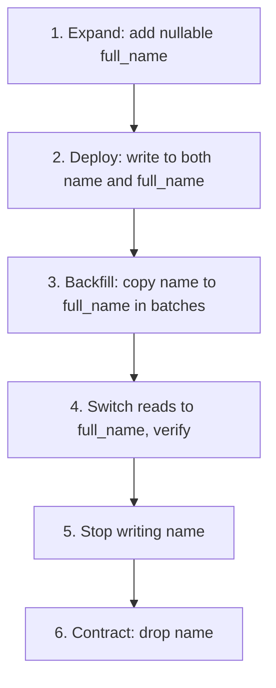

```sql
-- 1. Expand: nullable column, cheap metadata change
ALTER TABLE users ADD COLUMN full_name TEXT;

-- 3. Backfill in small batches to avoid long locks and replication lag
UPDATE users SET full_name = name
WHERE id BETWEEN :start AND :start + 9999 AND full_name IS NULL;
-- repeat with a pause between batches

-- 6. Contract, after all code stops referencing the old column
ALTER TABLE users DROP COLUMN name;
```

Each numbered step ships separately. If step 4 reveals a bug, you roll back the code; the old column is still complete.

#### Making individual DDL safe

- **Adding columns**: nullable, or with a default that the engine can apply without rewriting the table (recent Postgres versions handle constant defaults as metadata-only).
- **Indexes**: Postgres `CREATE INDEX CONCURRENTLY` builds without blocking writes (slower, can't run in a transaction).
- **NOT NULL / foreign keys**: in Postgres, add the constraint as `NOT VALID`, then `VALIDATE CONSTRAINT` separately, which takes a weaker lock.
- **Big MySQL table changes**: tools like **gh-ost** or **pt-online-schema-change** build a shadow copy of the table, keep it in sync, then atomically swap.
- Set a short **lock timeout** on migrations so a DDL waiting behind a long transaction fails instead of queueing every other query behind it.

**Pitfalls**
- Dropping or renaming a column in the same deploy as the code change.
- One giant backfill `UPDATE` that locks rows for minutes, bloats the table and lags replicas.
- Forgetting other readers: analytics jobs, CDC consumers and other services may still use the old column.

**Likely follow-ups**
- *How do you split a table or move data to a new database?* Same pattern at a larger scale: dual-write (or CDC), backfill, verify with shadow reads comparing results, cut reads over, then retire the old store.

</details>

### 18. How do you model data in DynamoDB or Cassandra (query-first design)?

<details>
<summary>Answer</summary>

**In short:** In DynamoDB and Cassandra you design tables **around your queries, not your entities**. List every access pattern first, then choose a **partition key** that groups the data each query needs (and spreads load evenly) and a **sort/clustering key** that orders it for range queries. Duplicate data into extra tables or indexes for each additional access pattern, and keep partitions bounded. You get fast, predictable queries at any scale; the price is that new query patterns need new tables or indexes plus backfills.

#### Why query-first

These stores scale by hashing the partition key to pick a node. A query that names one partition goes to one node and reads one sorted range: fast at any size. A query that doesn't name the partition key means scanning every node. There are no joins, so data needed together must already sit together.

#### The process

1. **List access patterns** with expected volume: "get user profile", "get a user's orders newest first", "get an order by ID", "list pending orders for the warehouse".
2. **Choose the partition key** to group what's read together and spread load: `user_id` for a user's orders.
3. **Choose the sort/clustering key** to order and filter within the partition: `order_date#order_id`.
4. **Add a table or index per extra pattern**, duplicating data: `orders_by_status` keyed by status and a bucket.
5. **Bound partition size**: if a partition could grow forever (a chat channel's messages), add a time bucket to the key (`chat_id + month`).

#### Cassandra example

```sql
-- Query: latest messages in a channel
CREATE TABLE messages_by_channel (
  channel_id  uuid,
  bucket      text,          -- e.g. '2025-06', bounds partition size
  sent_at     timeuuid,
  sender_id   uuid,
  body        text,
  PRIMARY KEY ((channel_id, bucket), sent_at)
) WITH CLUSTERING ORDER BY (sent_at DESC);

SELECT * FROM messages_by_channel
WHERE channel_id = ? AND bucket = '2025-06' LIMIT 50;   -- single-partition, sequential read
```

A second pattern ("all messages by a user") gets its own table, `messages_by_sender`, written alongside (or via a batch / async pipeline).

#### DynamoDB single-table design

Several entity types share one table with generic key names, so one query returns related items together:

| PK | SK | Attributes |
|---|---|---|
| `USER#42` | `PROFILE` | name, email |
| `USER#42` | `ORDER#2025-01-01#9` | total, status |
| `USER#42` | `ORDER#2025-03-12#17` | total, status |
| `ORDER#17` | `ITEM#1` | sku, qty |

- `Query PK = USER#42` returns the profile and all orders in one request.
- `Query PK = USER#42 AND begins_with(SK, "ORDER#2025")` gets this year's orders, sorted.
- A **global secondary index** (GSI) with `GSI1PK = STATUS#pending` serves the warehouse pattern.

#### Partition key choice

| Good key | Bad key |
|---|---|
| High cardinality, evenly accessed (`user_id`, `device_id`) | Low cardinality (`country`, `status`) |
| Matches the main query | Monotonic hot key (`date` with all of today's writes) |

A celebrity user or viral item can still be a **hot partition**; mitigate with write sharding (append a random suffix 0–N and query all N) or caching.

**Pitfalls**
- Modelling relationally (normalised tables) and then needing joins the store doesn't have.
- Using `Scan` or `ALLOW FILTERING` in production paths.
- Unbounded partitions (Cassandra partitions should stay well under hundreds of MB).

**Likely follow-ups**
- *How do you keep duplicated tables consistent?* Write all copies in the request path (Cassandra logged batches, DynamoDB transactions), or update derived tables asynchronously from a stream (DynamoDB Streams, CDC) and accept brief staleness.
- *When is single-table design a bad idea?* When access patterns are still changing or analytics need ad-hoc queries; separate tables are easier to evolve.

</details>

### 19. Clustered vs non-clustered (secondary) indexes?

<details>
<summary>Answer</summary>

**In short:** A **clustered index** determines the physical order of the table: the rows themselves live in the index's leaf pages, so there can be only one per table and range scans on its key are very fast. A **non-clustered (secondary) index** is a separate structure whose leaves point back to the rows, so a lookup may need a second step to fetch the row unless the index is **covering**. MySQL InnoDB clusters the table on its primary key; Postgres stores tables as unordered heaps, so all its indexes are secondary.

#### How each lookup works

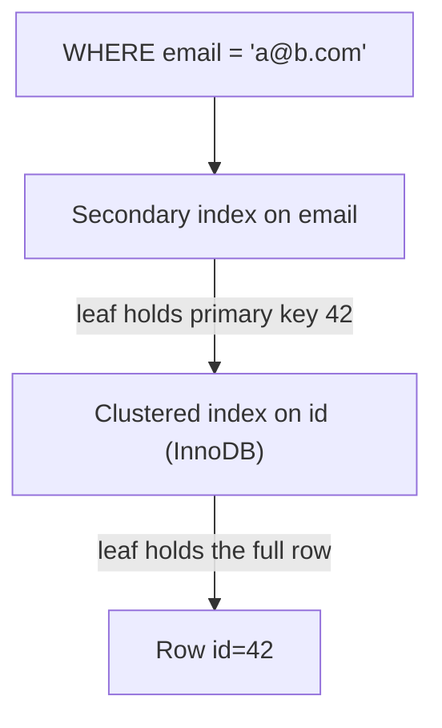

- **InnoDB**: the primary key B+ tree *is* the table. A secondary index leaf stores the indexed value plus the **primary key**; finding the row means a second descent through the clustered index.
- **Postgres**: the table is a **heap** (rows in no particular order). Every index, including the primary key, stores a pointer to the row's physical location (page and slot). The planner may use a **bitmap heap scan** to fetch many rows in page order.
- **SQL Server** lets you choose which index is clustered; that extra fetch is called a key or bookmark lookup.

| | Clustered | Non-clustered (secondary) |
|---|---|---|
| Count per table | One | Many |
| Leaf contains | The full row | Indexed columns + row pointer or primary key |
| Range scan on key | Sequential, very fast | May jump around the table for each row |
| Extra lookup | None | Yes, unless covering |
| Insert cost | Depends on key order (page splits) | One extra structure per index |

#### Why primary key choice matters in InnoDB

- **Random keys (UUIDv4)** insert into random leaf pages, causing page splits, half-empty pages and a working set that doesn't fit in memory. **Sequential or time-ordered keys** (auto-increment, UUIDv7, Snowflake) append to the right edge of the tree.
- Every secondary index stores the primary key, so a wide primary key (a long string or composite) makes **every** index larger.

#### Covering indexes avoid the second step

```sql
-- MySQL: secondary index includes the columns we select (PK is implicitly included)
CREATE INDEX idx_orders_user_status ON orders (user_id, status, created_at);

SELECT status, created_at FROM orders WHERE user_id = 42;   -- "Using index": no row fetch
```

In Postgres, index-only scans also depend on the **visibility map**: recently modified pages still need a heap check, so a well-vacuumed table benefits most.

**Pitfalls**
- Assuming Postgres keeps data ordered after `CLUSTER`: it's a one-time reorder, not maintained on later writes.
- Secondary-index lookups returning many rows can be slower than a full scan; the planner may correctly ignore the index.

**Likely follow-ups**
- *Why is a range query on the clustered key so fast?* Matching rows are physically adjacent in consecutive leaf pages, so it reads a few pages sequentially instead of one random page per row.

</details>

### 20. What is MVCC (multi-version concurrency control)?

<details>
<summary>Answer</summary>

**In short:** MVCC lets a database handle concurrent reads and writes without read locks by keeping **multiple versions of each row**. Each transaction reads a consistent **snapshot** (the versions committed before it, or before each statement under read committed), while writers create new versions instead of overwriting in place. The result: **readers don't block writers and writers don't block readers**. The costs are storing and cleaning up old versions, and the fact that concurrent writes to the same row still conflict.

#### The problem it solves

With pure locking, a long report reading a table would hold shared locks that block every update, and every update would block readers. For web workloads with many concurrent reads and writes, that's a throughput disaster. MVCC keeps old versions around so readers can see a stable past state while writers move on.

#### How it works (Postgres-style)

Each row version carries metadata: the transaction ID that created it (`xmin`) and the one that deleted or replaced it (`xmax`).

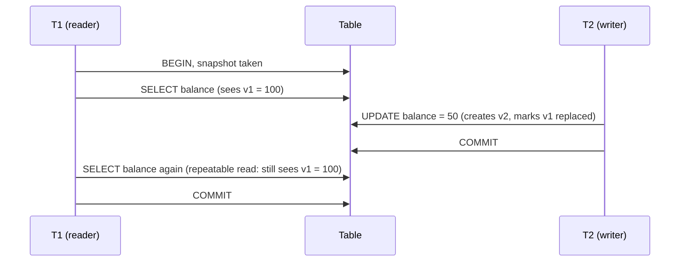

1. An `UPDATE` doesn't overwrite; it writes a **new version** and marks the old one as superseded by its transaction.
2. A reader checks each version against its snapshot: "was the creator committed before my snapshot, and was the deleter not?" Only matching versions are visible.
3. Old versions that no running transaction can see are **dead** and must be cleaned up.

#### Postgres vs InnoDB

| | PostgreSQL | MySQL InnoDB |
|---|---|---|
| Where old versions live | In the table itself (new tuple per update) | Current row in place; old versions reconstructed from **undo logs** |
| Cleanup | **VACUUM** / autovacuum removes dead tuples | Purge threads discard undo records no longer needed |
| Typical pain | Table and index bloat if vacuum falls behind | Undo log growth (history list length) |

#### Isolation and its limits

- MVCC is the basis of **read committed** (new snapshot per statement) and **repeatable read / snapshot isolation** (one snapshot per transaction).
- Two transactions updating the **same row** still conflict: the second waits for a row lock, then, under repeatable read in Postgres, fails with a serialization error if the first committed.
- Snapshot isolation allows **write skew**: two transactions read overlapping data and write *different* rows, together breaking an invariant. Prevent it with `SERIALIZABLE` (Postgres uses serializable snapshot isolation, aborting one transaction) or `SELECT ... FOR UPDATE` on the rows read.

**Pitfalls**
- **Long-running transactions** (including idle-in-transaction sessions) pin old versions, so vacuum/purge can't clean up; tables bloat and queries slow down. Keep transactions short and monitor transaction age.
- Update-heavy tables (counters) generate many dead versions in Postgres.

**Likely follow-ups**
- *Does MVCC eliminate locks?* No; writes still take row locks, and DDL takes table locks. It eliminates read locks.
- *What is transaction ID wraparound in Postgres?* Transaction IDs are 32-bit; vacuum must "freeze" old rows, or the database eventually forces a shutdown to protect data.

</details>

### 21. How do database deadlocks happen, and how do you prevent them?

<details>
<summary>Answer</summary>

**In short:** A deadlock happens when two or more transactions each hold a lock the other needs, forming a cycle: T1 holds row A and waits for B, while T2 holds B and waits for A. Neither can proceed, so the database detects the cycle and **aborts one transaction** with a deadlock error. Prevent them by acquiring locks in a **consistent order**, keeping transactions **short**, and indexing so you lock only what you need; and always **retry** aborted transactions.

#### How it happens

Classic case: two concurrent transfers in opposite directions.

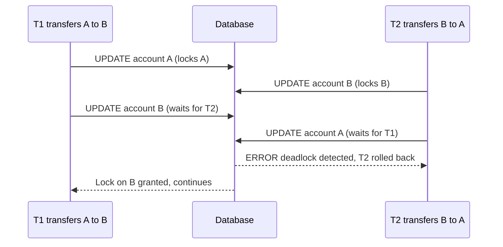

#### How databases detect it

The database maintains a **wait-for graph** (who waits on whom). Postgres checks for cycles after a lock wait exceeds `deadlock_timeout` (1 second by default); InnoDB detects them immediately by default. The victim is rolled back and gets an error (Postgres SQLSTATE `40P01`, MySQL error 1213), and the other transaction proceeds.

#### Prevention

**1. Lock in a consistent order.** If every transaction locks rows in the same order, a cycle is impossible.

```sql
-- Bad: lock order depends on transfer direction
UPDATE accounts SET balance = balance - 100 WHERE id = :from;
UPDATE accounts SET balance = balance + 100 WHERE id = :to;

-- Good: lock both rows in ascending id order first, then update
SELECT id FROM accounts WHERE id IN (:from, :to) ORDER BY id FOR UPDATE;
UPDATE accounts SET balance = balance - 100 WHERE id = :from;
UPDATE accounts SET balance = balance + 100 WHERE id = :to;
```

**2. Keep transactions short.** Never hold locks while calling an external API, waiting for user input, or doing heavy computation.

**3. Index the columns you filter updates on.** Without an index, `UPDATE ... WHERE email = ?` may scan and lock many rows; in InnoDB, range scans also take **gap locks**, widening the chance of collisions.

**4. Use explicit locking deliberately.** `SELECT ... FOR UPDATE` to lock up front; `NOWAIT` to fail immediately instead of waiting; `SKIP LOCKED` for job queues so workers grab different rows:

```sql
SELECT id FROM jobs WHERE status = 'queued'
ORDER BY id LIMIT 10
FOR UPDATE SKIP LOCKED;
```

**5. Prefer optimistic concurrency when conflicts are rare.** No locks held between read and write:

```sql
UPDATE documents SET body = :body, version = version + 1
WHERE id = :id AND version = :expected_version;   -- 0 rows updated means someone else won; retry
```

#### Handling the ones that still happen

Deadlocks can't be eliminated entirely in a busy system. Set **lock timeouts**, catch deadlock and serialization errors, and **retry the whole transaction** with backoff. That requires the transaction to be safe to re-run (idempotent, no side effects outside the DB before commit).

**Pitfalls**
- Retrying only the failed statement instead of the whole transaction (everything was rolled back).
- Foreign keys and triggers taking locks you didn't realise, on parent rows or other tables.

**Likely follow-ups**
- *Deadlock vs lock contention?* Contention is waiting that eventually resolves; a deadlock is a cycle that never resolves without aborting someone.
- *How do you debug one?* Postgres logs both queries on detection; in MySQL, `SHOW ENGINE INNODB STATUS` shows the latest deadlock.

</details>

---

[⬅ Previous: Caching](06-caching.md) · [⬅ Back to index](../README.md) · [Next: Replication, Partitioning & Sharding ➡](08-replication-sharding.md)
