# Replication, Partitioning & Sharding

[⬅ Back to index](../README.md)

Covers: why replicate, leader-follower, multi-leader, leaderless (quorums), sync vs async replication, replication lag problems, failover, partitioning strategies, choosing a shard key, hot spots, rebalancing, secondary indexes and cross-shard queries.

---

### 1. Why replicate data?

<details>
<summary>Answer</summary>

**In short:** Replication keeps copies of the same data on several machines so the system stays **available** when a node dies, **durable** when a disk is lost, can **scale reads** across many copies, and can serve users from a **nearby region**. The hard part is keeping those copies in sync as data changes.

#### The four reasons

| Goal | What replication buys you | Example |
|---|---|---|
| **Availability** | Another replica takes over when one fails, so the service keeps answering | Primary DB crashes; a standby is promoted in seconds |
| **Durability** | Data survives a dead disk, machine or even data centre | Three copies across three availability zones |
| **Read scalability** | Spread read traffic across many replicas | A product catalogue read 1,000x more than it is written |
| **Lower latency** | Put a replica close to users | EU users read from an EU replica instead of crossing the Atlantic |

#### Replication is not backup

A replica copies every change, including mistakes. If someone runs `DELETE FROM orders` without a `WHERE`, the delete replicates to every copy within milliseconds. You still need **point-in-time backups** (snapshots plus the write-ahead log) to recover from logical errors, bad deploys and ransomware.

#### Why it is hard

If data never changed you would copy it once and be done. The difficulty is **writes**: who accepts them, how they reach the other copies, and what readers see in between. The three main answers are:

- **Single leader** – one node accepts writes and streams them to followers (most relational databases).
- **Multi-leader** – several nodes accept writes and exchange them (multi-region, offline clients).
- **Leaderless** – clients write to several replicas directly and use quorums (Dynamo-style stores).

Each model also chooses **synchronous or asynchronous** propagation, which trades write latency against the risk of losing data on failover.

#### Replication vs sharding

Replication puts the **same** data on many nodes. Sharding puts **different** data on different nodes. Real systems use both: each shard is itself replicated.

**Likely follow-ups:**
- *Does replication help write throughput?* Not in single-leader setups: every replica must still apply every write. To scale writes you shard.
- *How many replicas?* Three is the usual default: it survives one failure while still having a majority, and spreads across three zones.

</details>

### 2. How does leader-follower (primary-replica) replication work?

<details>
<summary>Answer</summary>

**In short:** One node, the **leader**, accepts all writes and records them in a replication log; **followers** stream that log and apply the same changes in the same order. Reads can be served by followers. It is simple and widely used (Postgres, MySQL, MongoDB replica sets, Kafka partitions), but write throughput is capped by one leader and follower reads can be stale.

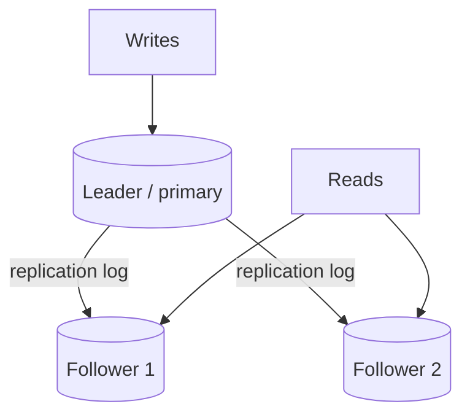

#### Step by step

1. A client sends `UPDATE users SET name='Ana' WHERE id=42` to the leader.
2. The leader applies it locally and appends it to its log (Postgres WAL, MySQL binlog, MongoDB oplog).
3. Each follower keeps a connection open to the leader, pulls new log entries and applies them in order.
4. Depending on configuration, the leader acknowledges the client before or after followers confirm (see sync vs async).
5. Reads can go to the leader (always fresh) or a follower (may lag).

#### What gets shipped

| Log type | How it works | Trade-off |
|---|---|---|
| **Statement-based** | Ship the SQL text | Breaks on non-deterministic calls like `NOW()` or `RAND()` |
| **Physical / WAL shipping** | Ship byte-level page changes | Exact, but tied to the storage engine version; hard to upgrade with zero downtime |
| **Logical / row-based** | Ship "row X changed to Y" | Version-independent; also feeds change data capture (Debezium) |

#### Adding a new follower

You cannot just copy files while the leader is writing. Instead: take a consistent snapshot, record its log position, restore it on the new node, then replay the log from that position until the follower catches up.

#### Limits

- **Write ceiling** – every write goes through one machine. Beyond that, shard.
- **Stale reads** – followers lag by milliseconds normally, seconds or minutes under load.
- **Failover** – when the leader dies, a follower must be promoted, which is where most incidents happen.

**Common pitfalls:**
- Sending a read to a replica right after a write and showing the user old data.
- Long-running queries on a follower blocking replay and growing lag.
- Forgetting that adding replicas increases load on the leader (it serves every log stream); use cascading replicas for many followers.

**Likely follow-ups:**
- *How do you route reads?* A proxy or driver setting splits writes to the primary and reads to replicas; sensitive reads still go to the primary.
- *Why is Kafka listed?* Each partition has a leader broker and follower brokers that replicate its log; producers write only to the leader.

</details>

### 3. Synchronous vs asynchronous replication?

<details>
<summary>Answer</summary>

**In short:** With **synchronous** replication the leader waits for followers to confirm before acknowledging a write: no data loss on failover, but slower and a stuck follower blocks writes. With **asynchronous** replication the leader acknowledges immediately: fast, but recent writes can be lost if the leader dies. Most systems use a compromise: **semi-synchronous** (wait for one follower) or **majority quorum** (Raft-style).

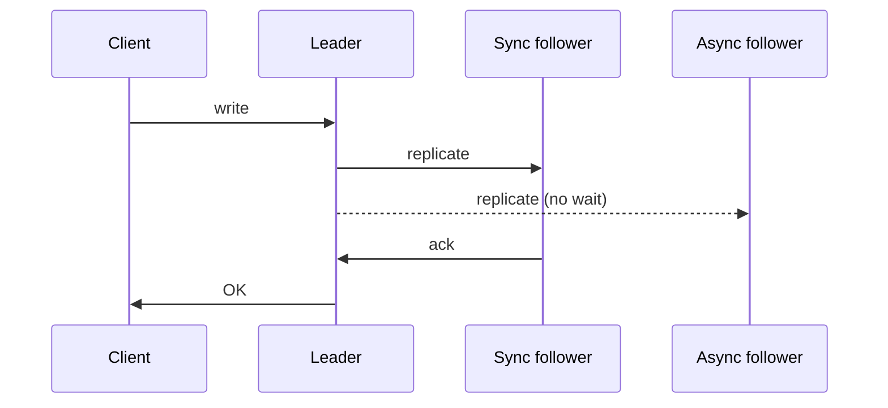

#### Comparison

| | Synchronous | Semi-synchronous | Asynchronous |
|---|---|---|---|
| Leader waits for | All (or named) followers | At least one follower | Nobody |
| Write latency | Highest (slowest follower) | One round trip to nearest follower | Local disk only |
| Data loss on leader crash | None | None, if the sync follower is promoted | Recent writes lost |
| Effect of a slow follower | Blocks all writes | Falls back to another follower or to async | None |
| Examples | Rare in pure form | MySQL semi-sync, Postgres `synchronous_standby_names` with one sync replica | Default MySQL/Postgres streaming replication |

#### Consensus-based replication

Systems built on Raft or Paxos (etcd, CockroachDB, Spanner, Kafka with `acks=all` and `min.insync.replicas`) acknowledge once a **majority** has persisted the write. With 3 replicas you tolerate 1 failure; with 5 you tolerate 2. One slow node does not block writes because only a majority is needed.

#### How to choose

- Money, orders, anything you cannot lose: synchronous to at least one replica, or majority quorum.
- Analytics replicas, cross-region read copies, caches: asynchronous is fine.
- Cross-region synchronous replication adds the inter-region round trip (often 50–150 ms) to every write, so it is usually reserved for data that truly needs it.

**Common pitfalls:**
- Assuming "acknowledged" means "durable everywhere" when replication is async.
- Configuring fully synchronous replication to every follower, then having writes hang when one replica goes down.

**Likely follow-ups:**
- *What is RPO?* Recovery point objective: how much data you can lose. Async gives RPO > 0; sync or quorum gives RPO = 0.
- *Is async ever safe for critical data?* Only if the client can retry idempotently or there is another durable record (e.g. a payment provider log).

</details>

### 4. What problems does replication lag cause, and how do you handle them?

<details>
<summary>Answer</summary>

**In short:** Async followers trail the leader, so reads from them can look inconsistent. The three classic anomalies are **read-your-writes** (you don't see your own update), **monotonic reads** (data appears then disappears), and **consistent prefix reads** (you see an effect before its cause). Fix them by routing certain reads to the leader, tracking log positions, pinning users to a replica, or keeping causally related data together.

#### 1. Read-your-writes (read-after-write)

A user changes their profile photo, the page reloads, the read hits a lagging replica, and the old photo comes back. The user thinks the save failed.

Fixes:
- Read **the user's own data** from the leader (e.g. their profile), and other users' data from replicas.
- Read from the leader for a short window (say 10 seconds) after that user wrote.
- Track the write's log position (LSN / GTID) and only read from a replica that has applied at least that position.

```python
def get_profile(user_id, session):
    last_write = session.get("last_write_lsn")
    if last_write is None:
        return replica_pool.query(user_id)
    replica = replica_pool.pick_caught_up(min_lsn=last_write)
    return (replica or primary).query(user_id)   # fall back to primary
```

#### 2. Monotonic reads

A user refreshes a thread and sees a new comment, refreshes again, hits a more-lagged replica, and the comment is gone. Time appears to go backwards.

Fix: pin each user to one replica, e.g. `replica = hash(user_id) % replicas`. If that replica fails, re-pin, accepting a small glitch.

#### 3. Consistent prefix reads

In a partitioned system, the question "How's the weather?" lands on partition A and the answer "Sunny" on partition B. If B replicates faster, an observer sees the answer before the question.

Fixes: put causally related writes in the same partition (e.g. shard chat messages by `chat_id`), or track causal dependencies with version vectors.

#### Summary

| Anomaly | Symptom | Typical fix |
|---|---|---|
| Read-your-writes | My update vanished | Read own data from leader, or wait for LSN |
| Monotonic reads | Data appears then disappears | Sticky replica per user |
| Consistent prefix | Effect seen before cause | Co-locate related writes; causal ordering |

**Common pitfalls:**
- Fixing read-your-writes per device but not across devices (write on phone, read on laptop). Store the last-write position server-side, not only in a cookie.
- Lag is usually milliseconds, so these bugs only appear under load or during incidents, which makes them hard to reproduce. Monitor replica lag and alert on it.

**Likely follow-ups:**
- *What if a replica is very far behind?* Take it out of the read pool above a lag threshold.
- *Is there a stronger option?* Use a strongly consistent store (consensus-based) for that data, at a latency cost.

</details>

### 5. What is failover and what can go wrong?

<details>
<summary>Answer</summary>

**In short:** Failover is promoting a follower to leader when the leader dies: **detect** the failure (usually heartbeat timeouts), **choose** the most up-to-date follower (via consensus or an orchestrator), and **redirect** clients to it. The main risks are losing async writes, **split brain** (two leaders), bad timeout tuning, and clients still talking to the old leader.

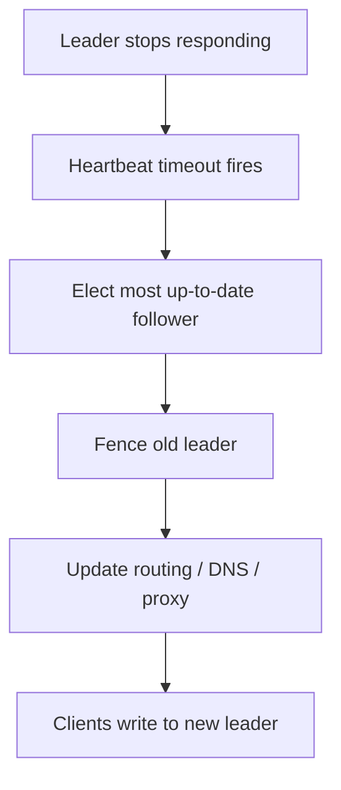

#### How it works

1. **Detection** – the leader misses heartbeats for some period (e.g. 10–30 seconds). There is no perfect detector: a slow network looks the same as a dead node.
2. **Election** – pick the follower with the latest log position. Tools: Raft/Paxos built into the database, or an external orchestrator such as Patroni (Postgres, using etcd/ZooKeeper/Consul) or Orchestrator (MySQL). Managed services such as RDS Multi-AZ do this for you.
3. **Fencing** – make sure the old leader can no longer accept writes.
4. **Reconfiguration** – point clients, proxies or DNS at the new leader. Other followers start replicating from it.

#### What can go wrong

- **Lost writes** – with async replication, writes the old leader acknowledged but never shipped are gone. If the old leader comes back, its extra writes conflict with the new history and are usually discarded. GitHub publicly described an incident where a promoted, lagging MySQL replica caused primary keys to be reused, exposing data across systems that cached those IDs.
- **Split brain** – a network partition makes the old leader unreachable but still alive. Both nodes accept writes and the data diverges.
- **Timeout tuning** – too short and a load spike or GC pause triggers needless failovers (which add more load); too long and you have a long outage.
- **Stale routing** – connection pools, DNS caches and clients keep sending writes to the old address.

#### Preventing split brain

- **Majority quorum** – a leader must hold a majority's support; the minority side cannot elect or keep a leader.
- **Leases** – the leader holds a time-limited lease and stops accepting writes when it cannot renew.
- **Fencing tokens** – each new leader gets a higher epoch number; storage rejects writes carrying an older epoch.
- **STONITH** ("shoot the other node in the head") – forcibly power off the old leader.

```text
Leader A (epoch 7) is partitioned away.
Leader B elected with epoch 8.
A wakes up and writes with epoch 7  -> storage rejects (7 < 8).
```

**Likely follow-ups:**
- *Manual or automatic failover?* Automatic for fast recovery, but many teams require a human for cross-region failover because a false positive there is expensive.
- *How do you test it?* Regular game days or chaos tests that kill the leader in staging and production.

</details>

### 6. What is multi-leader replication and when is it used?

<details>
<summary>Answer</summary>

**In short:** Several nodes, often one per region, each accept writes and replicate them to the others. You get local write latency in every region, survival of a whole-region outage, and support for offline clients. The price is **write conflicts** when the same record is changed in two places at once, which must be avoided or resolved (last-write-wins, application merge, or CRDTs).

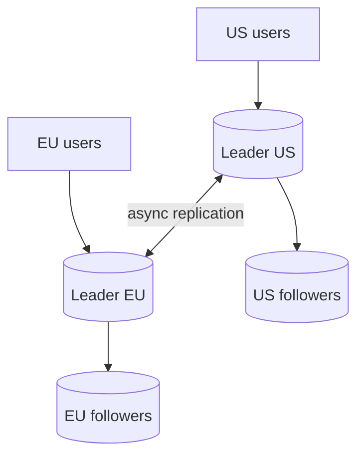

#### When it is used

- **Multi-region deployments** – EU users write to the EU leader with low latency; changes flow to the US asynchronously. If one region fails, the other keeps accepting writes.
- **Offline-first clients** – each phone or laptop is effectively a leader with its own local database, syncing later (calendar apps, notes apps, CouchDB/PouchDB).
- **Collaborative editing** – each user's editor applies changes locally and syncs them (Google Docs uses operational transformation; many newer editors use CRDTs).

#### The conflict problem

Alice in the US sets a document title to "Plan A" while Bob in the EU sets it to "Plan B". Both leaders accept the write locally. When they exchange changes, which wins?

| Strategy | How it works | Trade-off |
|---|---|---|
| **Last-write-wins (LWW)** | Highest timestamp wins | Simple, but silently drops one write; clock skew can pick the "older" one |
| **Application merge** | Custom code merges (e.g. union of shopping-cart items) | Correct for the domain, but you write and test it |
| **Keep siblings** | Store both versions; user or app resolves later | No data loss; more UI complexity |
| **CRDTs** | Data types (counters, sets, text) designed to merge deterministically | Automatic and convergent; limited to supported types |
| **Avoid conflicts** | Route all writes for a record to a "home" region | Simplest in practice; loses local writes when the user travels or home region fails |

#### Other gotchas

- **Auto-increment IDs** collide across leaders. Use UUIDs, Snowflake-style IDs, or per-leader ranges.
- **Unique constraints** (one username) cannot be enforced locally; two regions can both accept "ana".
- **Replication topology** – in circular or star topologies a node failure can stop propagation; all-to-all is more robust but can deliver changes out of order.

**Likely follow-ups:**
- *Would you pick multi-leader for a bank ledger?* No. Use a single leader or consensus so balances never diverge.
- *What's a common real-world compromise?* Single leader per record, with leaders spread across regions by user home region.

</details>

### 7. How does leaderless replication with quorums work?

<details>
<summary>Answer</summary>

**In short:** There is no leader. The client (or a coordinator node) sends each write to all **N** replicas and treats it as successful when **W** acknowledge; reads query replicas and succeed when **R** respond, taking the newest version. If **W + R > N**, every read set overlaps every write set, so a read sees the latest acknowledged write. Stale replicas are fixed by read repair, hinted handoff and anti-entropy. This is the Dynamo model (Cassandra, Riak, ScyllaDB).

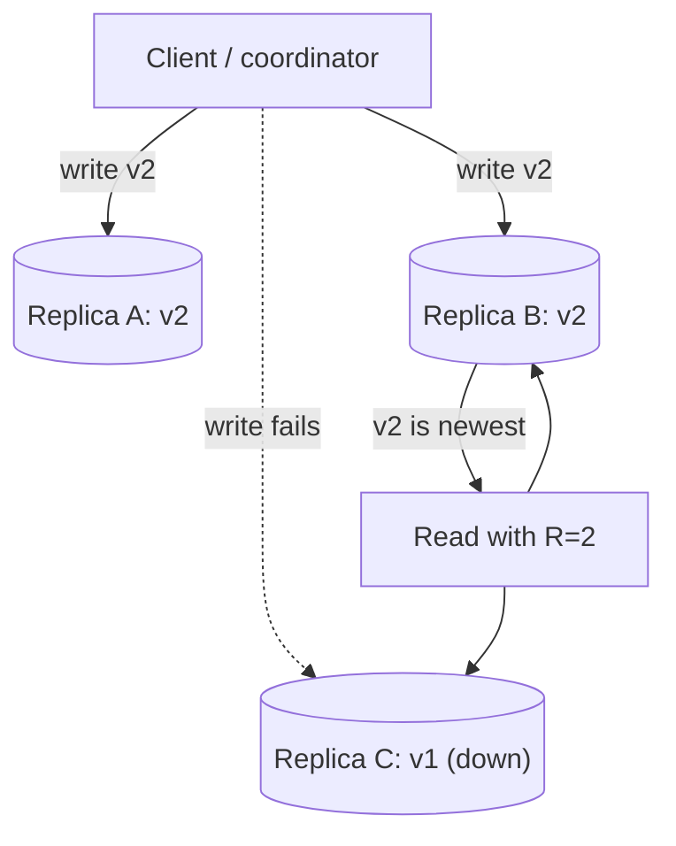

#### Worked example (N=3, W=2, R=2)

1. Write `cart=v2` goes to A, B, C. C is down. A and B acknowledge: W=2 is met, the write succeeds.
2. A read asks B and C. B returns v2, C returns v1. Versions are compared and v2 wins.
3. The coordinator writes v2 back to C (**read repair**).

Because W + R = 4 > 3, at least one replica in any read set has the newest write.

#### Repair mechanisms

- **Read repair** – fix stale replicas noticed during a read. Good for hot keys; rarely read keys stay stale.
- **Hinted handoff** – if a target replica is down, another node stores the write with a "hint" and forwards it when the replica returns.
- **Anti-entropy** – a background process compares replicas using **Merkle trees** (hash trees over key ranges) so only differing ranges are transferred.

#### Tuning per request

| Setting (N=3) | Behaviour |
|---|---|
| W=1, R=1 | Fastest, weakest; reads may be stale |
| W=2, R=2 | Balanced; quorum reads and writes |
| W=3, R=1 | Fast reads, but a write fails if any replica is down |
| W=1, R=3 | Fast writes, slow reads |

In Cassandra this is the consistency level per query: `ONE`, `QUORUM`, `ALL`, `LOCAL_QUORUM` (quorum within the local data centre).

#### Why W + R > N is not full consistency

- **Sloppy quorums**: during an outage, writes may go to nodes outside the key's normal N replicas (with hinted handoff), so the overlap guarantee breaks.
- **Concurrent writes** need conflict resolution. Cassandra uses per-column last-write-wins timestamps; Riak can keep siblings using version vectors.
- A write that succeeds on fewer than W nodes reports failure but is **not rolled back** on those nodes, so later reads may or may not see it.
- No linearizability without extra mechanisms (Cassandra offers lightweight transactions using Paxos).

**Likely follow-ups:**
- *Why choose leaderless?* High write availability and no failover step; good for write-heavy, multi-DC workloads that tolerate eventual consistency.
- *Is DynamoDB leaderless?* The original Dynamo paper was. The DynamoDB service is publicly described as using leader-based replication per partition (Multi-Paxos), so don't assume it is identical.

</details>

### 8. What is partitioning (sharding) and why do it?

<details>
<summary>Answer</summary>

**In short:** Partitioning (sharding) splits one dataset into pieces, each stored on a different node, so each node handles only part of the data and traffic. It is how you scale **storage and write throughput** beyond one machine. Each shard is usually replicated too. It adds real complexity (cross-shard queries, rebalancing, hot spots), so do it only after vertical scaling, read replicas and caching run out.

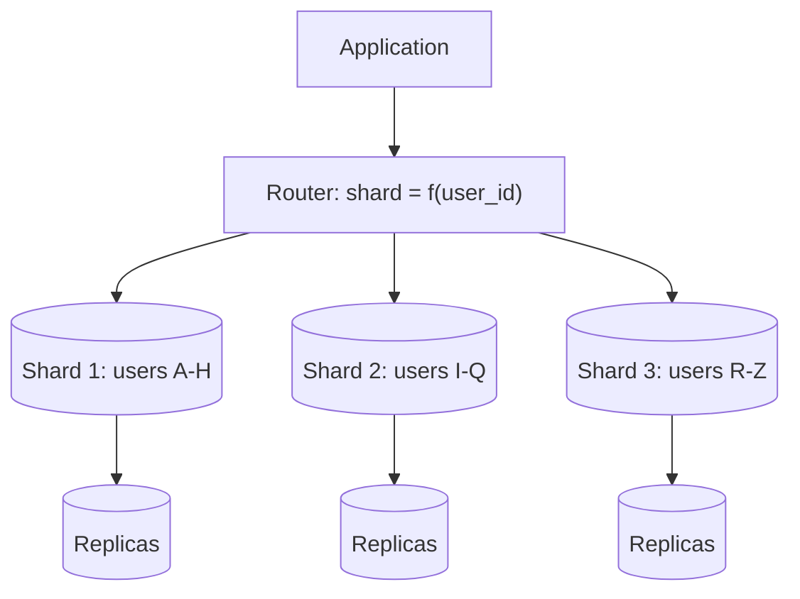

#### Why replicas alone are not enough

Read replicas multiply read capacity, but every replica still stores **all** the data and applies **every** write. When the dataset is larger than one machine's disk, or writes exceed what one leader can handle, you must split the data itself.

#### Terminology

- **Partition / shard / region / tablet / vnode** – different systems' names for the same idea.
- **Horizontal partitioning** – split rows across nodes (this is sharding).
- **Vertical partitioning** – split columns or tables (e.g. move a large `blob` column or the `analytics` tables elsewhere).
- **Partitioning inside one database** – Postgres declarative partitioning splits a table into child tables on the same server; helpful for pruning and dropping old data, but not for scaling beyond one machine.

#### What it costs

| Cost | Why |
|---|---|
| Cross-shard queries | A query not filtered by the shard key must hit every shard |
| Cross-shard transactions | Need 2PC or sagas; joins across shards are expensive |
| Rebalancing | Data must move as nodes are added or as data grows unevenly |
| Hot spots | A poor key concentrates load on one shard |
| Operations | More nodes to back up, monitor, upgrade and migrate schemas on |
| Unique constraints and IDs | Need global ID generation; uniqueness only easy within a shard |

#### Order of scaling moves

1. Optimise queries and indexes.
2. Scale up the machine.
3. Add caching and read replicas.
4. Split by function (separate databases per service).
5. Shard, or move to a store that shards for you (Cassandra, DynamoDB, Spanner, CockroachDB, Vitess on MySQL, Citus on Postgres).

**Likely follow-ups:**
- *When do you know you need to shard?* Write throughput or storage approaches a single primary's limits with headroom gone, or a projected growth curve crosses it within your planning horizon.
- *Can you shard later?* Yes, but it is a large migration. Choosing an entity key (`tenant_id`, `user_id`) early and including it in every table makes it much easier.

</details>

### 9. What partitioning strategies exist?

<details>
<summary>Answer</summary>

**In short:** The main strategies are **range** (contiguous key ranges: great for range scans, prone to hot spots with sequential keys), **hash** (hash of the key: even spread, but range queries hit every shard), **directory/lookup** (a mapping table says where each key lives: most flexible, but the directory is critical infrastructure), **geographic** (by region: latency and data residency), and **compound** keys that hash one part and sort by another.

#### Range partitioning

Each shard owns a contiguous range of keys, e.g. `user_name` A–F, G–M, N–Z, or orders by month.

- **Good:** range scans are efficient (`WHERE created_at BETWEEN ...` touches one or a few shards); data is sorted.
- **Bad:** monotonically increasing keys (timestamps, auto-increment IDs) send all new writes to the last range, creating a **hot spot**. Ranges also need to be chosen well or split automatically.
- **Used by:** HBase, Bigtable, Spanner, CockroachDB, MongoDB ranged sharding (ranges are split automatically as they grow).

#### Hash partitioning

`shard = owner_of(hash(key))`. A good hash spreads even sequential keys uniformly.

- **Good:** even distribution of data and load.
- **Bad:** adjacent keys end up on different shards, so range queries become scatter-gather.
- **Rebalancing:** never use `hash(key) % N` directly; use **consistent hashing** or a fixed number of logical partitions (see rebalancing).
- **Used by:** Cassandra, DynamoDB, Redis Cluster, MongoDB hashed sharding.

#### Directory / lookup-based

A small service or table maps each key (often a tenant or user) to a shard.

```sql
-- shard directory
CREATE TABLE tenant_shard (
  tenant_id  BIGINT PRIMARY KEY,
  shard_id   INT NOT NULL
);
```

- **Good:** you can move any single tenant anywhere, put big tenants on dedicated shards, and change placement without rehashing.
- **Bad:** every request needs a lookup, so the directory must be highly available and heavily cached; it is a single point of failure if done carelessly.

#### Geographic

Partition by user region (EU data in EU, US in US). Reduces latency and helps meet **data residency** laws (e.g. GDPR-driven requirements). Load is uneven across regions, so each region is usually sharded further.

#### Compound keys

Hash one part to choose the partition, then keep rows **sorted** inside it by another part. In Cassandra, `PRIMARY KEY ((chat_id), sent_at)` hashes `chat_id` to pick the node and sorts messages by `sent_at`, so "latest 50 messages in this chat" is one sequential read on one partition. DynamoDB's partition key + sort key works the same way.

#### Comparison

| Strategy | Distribution | Range queries | Rebalancing | Typical use |
|---|---|---|---|---|
| Range | Can skew | Efficient | Split / merge ranges | Time series, ordered data |
| Hash | Even | Scatter-gather | Consistent hashing / fixed partitions | Key-value lookups by ID |
| Directory | Whatever you choose | Depends | Move individual keys | Multi-tenant SaaS |
| Geographic | Uneven by region | Within region | Rare | Residency, latency |
| Compound | Even across partitions | Efficient within a partition | As hash | Chats, feeds, per-user timelines |

**Likely follow-ups:**
- *How would you store time-series events?* Compound key such as `(device_id, day)` as the partition key with `timestamp` as the sort key: spreads writes and keeps per-device time ranges contiguous.
- *Is consistent hashing a partitioning strategy?* It is a way to assign hash partitions to nodes so that adding or removing a node moves little data.

</details>

### 10. How do you choose a good shard key?

<details>
<summary>Answer</summary>

**In short:** Pick a key that has **high cardinality**, spreads data and traffic **evenly**, matches the **dominant query** so most requests touch one shard, keeps data that changes together on the same shard, and never changes for a row. In practice it is usually the main entity ID: `user_id`, `tenant_id`, `chat_id`. Then plan for skew (celebrities, giant tenants) with salting or dedicated shards.

#### The checklist

1. **Cardinality** – there must be far more distinct values than shards. `country` has ~200 values and one of them is huge; `user_id` has millions.
2. **Even load, not just even data** – a key can split storage evenly but still send most traffic to one shard (a celebrity's `user_id`).
3. **Query locality** – list your top queries. If 90% are "get things for user X", shard by `user_id` so they hit one shard. Queries that don't include the key become scatter-gather.
4. **Transactional locality** – rows updated in one transaction should share a shard (an order and its line items, a chat and its messages), avoiding distributed transactions.
5. **Immutability** – changing a row's shard key means moving the row between shards. Don't shard by `email` or `status`.

#### Worked examples

| System | Good key | Why |
|---|---|---|
| Social app user data | `user_id` | Most reads are per user; even spread |
| B2B SaaS | `tenant_id` | All queries are tenant-scoped; enables per-tenant isolation |
| Chat | `chat_id` (sort by `sent_at`) | Messages of one chat read together, in order |
| E-commerce orders | `customer_id` or `order_id` | `customer_id` if "my orders" dominates; `order_id` if lookups by ID dominate |
| IoT metrics | `(device_id, day)` | Spreads writes; bounds partition size |

#### Bad keys

| Key | Problem |
|---|---|
| `country` | Low cardinality, heavy skew |
| `created_at` alone | All new writes hit the newest range |
| `status` / boolean | Two or three values; can't spread |
| Auto-increment ID with range partitioning | Same as timestamp: hot last shard |
| Mutable fields (`email`) | Rows must migrate when the value changes |

#### Handling skew

- **Salting**: append a suffix, e.g. `celebrity_id#0..15`, so one entity's writes spread over 16 partitions; reads fan out to all 16 and merge.
- **Dedicated shards**: with a directory, put the biggest tenants on their own shard.
- **Two-level keys**: shard by `tenant_id`, then sub-shard large tenants by `tenant_id + user_id`.

**Common pitfalls:**
- Choosing a key from the data model instead of the access patterns.
- Forgetting secondary access paths (e.g. "find user by email") that now need a global index or lookup table.

**Likely follow-ups:**
- *What if you picked the wrong key?* Reshard: create the new layout, backfill, dual-write, verify, then switch reads. Slow and risky, so spend time on the choice.
- *Why not shard by a random UUID?* Even spread, but nothing related is co-located, so any multi-row query fans out.

</details>

### 11. What is a hot spot / hot partition and how do you fix it?

<details>
<summary>Answer</summary>

**In short:** A hot spot is one partition receiving far more load than the others (a celebrity's posts, a viral product, today's date in a time-ordered table), so that one node saturates while the rest sit idle. Fix read-heavy hot keys with **caching** and replicas; fix write-heavy ones with **salting** (spread the key across N sub-keys), **write buffering** (batch counters), and **automatic splitting** of hot ranges.

#### Why it happens

Sharding assumes load spreads evenly. Real traffic follows power laws: a tiny fraction of keys gets most requests. Even with a perfect hash, all requests for **one key** still go to **one partition**. Range partitioning on timestamps makes it worse: every new write lands on the newest range.

#### Fixes

**1. Caching (read-heavy)** – put the hot key in Redis/Memcached or a CDN. Add request coalescing so one cache miss doesn't send thousands of identical queries to the database.

**2. Salting (write-heavy)** – split the key into N sub-keys.

```python
N = 16

def record_like(post_id, user_id):
    bucket = hash(user_id) % N             # spread writes over 16 partitions
    db.increment(f"likes:{post_id}#{bucket}")

def get_likes(post_id):
    keys = [f"likes:{post_id}#{i}" for i in range(N)]
    return sum(db.multi_get(keys))         # read fans out and sums
```

The cost moves to reads, so salt only known-hot keys, or salt everything for append-heavy workloads.

**3. Write buffering** – accumulate increments in memory or a queue (Kafka) and flush aggregated values every second. One "+5,000" write instead of 5,000 "+1" writes.

**4. Automatic splitting** – range-based systems (Bigtable, Spanner, HBase) split a range when it gets large or busy and move halves to different nodes. DynamoDB's adaptive capacity similarly shifts throughput to hot partitions and can split them. Splitting cannot help a single hot **key**, only a hot range.

**5. Fix the key design** – replace `created_at` with `(source_id, created_at)` or prefix with a hash bucket so time-ordered writes spread out.

**6. Special-case known hot entities** – e.g. a feed system that pulls celebrity posts at read time instead of fanning them out on write.

| Hot spot type | Best fix |
|---|---|
| Hot key, read-heavy | Cache, more read replicas |
| Hot key, write-heavy | Salting, write buffering |
| Hot range (sequential keys) | Better key design, auto-splitting |
| Predictable event (sale, launch) | Pre-split, pre-warm cache, provision ahead |

**Common pitfalls:**
- Monitoring average load per shard instead of the **max**; the hottest shard defines your capacity.
- Salting every key "just in case" and making all reads N times more expensive.

**Likely follow-ups:**
- *How do you detect hot keys?* Per-partition metrics plus sampling of top keys (e.g. Redis `--hotkeys`, DynamoDB CloudWatch Contributor Insights).
- *Hot partition vs noisy neighbour?* Same symptom, different cause: one key versus one tenant consuming shared capacity.

</details>

### 12. How do you rebalance shards when adding nodes?

<details>
<summary>Answer</summary>

**In short:** Never map keys with `hash(key) % N`, because changing N moves almost every key. Instead use a **fixed number of logical partitions** mapped to nodes (move whole partitions), **consistent hashing with virtual nodes** (a new node takes small slices from many nodes), or **dynamic range splitting**. Then move data in the background, throttled, keep serving during the copy, and switch routing atomically at the end.

#### Why `hash % N` fails

With N=4, key 10 lives on node `10 % 4 = 2`. Add a node (N=5) and it moves to `10 % 5 = 0`. Roughly `1 - 1/(N+1)` of all keys change nodes, here about 80%: a massive, unnecessary data migration.

#### Approach 1: fixed logical partitions

Create many more partitions than nodes up front (e.g. 1,024), and keep a map `partition -> node`. Keys map to partitions with `hash(key) % 1024`, which never changes. Adding a node just reassigns some partitions to it.

```text
Before (4 nodes): each owns 256 partitions
Add node 5:       each old node hands ~51 partitions to node 5
Moved data:       ~20% (only what node 5 needs)
```

Used by Elasticsearch (fixed primary shard count per index), Riak, Couchbase (1,024 vBuckets), and Redis Cluster (16,384 hash slots). Downside: choose the count carefully. Too few and partitions get huge; too many adds overhead.

#### Approach 2: consistent hashing with virtual nodes

Nodes and keys are hashed onto a ring; a key belongs to the next node clockwise. Each physical node gets many positions (**virtual nodes**), so a new node takes small slices from many existing nodes, and load stays balanced. Used by Cassandra and the original Dynamo design.

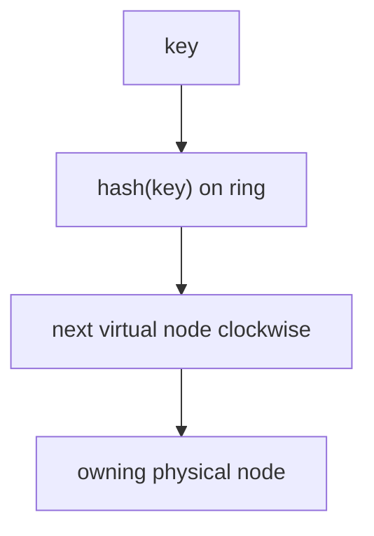

#### Approach 3: dynamic splitting

Range-partitioned systems split a range when it exceeds a size (or load) threshold and move one half elsewhere; ranges can also merge when small. Used by HBase, Bigtable, Spanner, CockroachDB and MongoDB (chunks moved by the balancer). The partition count grows with the data automatically.

#### Doing the move safely

1. **Copy** a snapshot of the partition to the new node while the old node keeps serving.
2. **Catch up** by streaming changes made since the snapshot.
3. **Cut over**: briefly block or redirect writes, apply the last changes, flip ownership in the routing metadata.
4. **Redirect** stale clients (e.g. Redis Cluster replies `MOVED`/`ASK` so clients refresh their slot map).
5. **Clean up** the old copy after verification.

Throttle the copy so rebalancing doesn't starve live traffic, and avoid triggering rebalancing automatically on a single node blip (a short outage would cause pointless data movement).

| Method | Data moved on add | Range scans | Examples |
|---|---|---|---|
| `hash % N` | Almost all | No | Don't |
| Fixed partitions | ~1/(N+1) | No | Redis Cluster, Elasticsearch, Couchbase |
| Consistent hashing + vnodes | ~1/(N+1) | No | Cassandra, Dynamo |
| Dynamic splitting | Only split ranges | Yes | HBase, Spanner, MongoDB |

**Likely follow-ups:**
- *Who tracks which node owns what?* A coordination service (ZooKeeper, etcd), a gossip protocol (Cassandra), or a config server (MongoDB); clients cache it.
- *Can you change the Elasticsearch shard count?* Not in place; you reindex, or use the split/shrink APIs which create a new index.

</details>

### 13. How do secondary indexes work with sharding?

<details>
<summary>Answer</summary>

**In short:** There are two options. A **local index** lives on each shard and covers only that shard's rows: writes are cheap and consistent, but a query by the indexed attribute must **scatter-gather** to every shard. A **global index** is itself partitioned by the indexed value: a lookup hits one index shard, but each write may update index partitions on other nodes, usually **asynchronously** (DynamoDB GSIs are eventually consistent). Pick based on whether reads or writes by that attribute dominate.

#### The problem

Say `users` is sharded by `user_id`. Looking up by `user_id` hits one shard. But "find users where `email = ?`" or "products where `color = red`" has no idea which shard to ask.

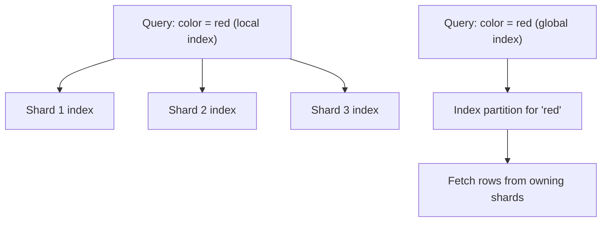

#### Local (document-partitioned) index

Each shard maintains an index over its own documents only.

- **Write:** update the row and its index on the same shard, in the same local transaction. Simple and consistent.
- **Read by secondary key:** send to all shards in parallel, merge results. Latency is set by the slowest shard (**tail latency**), and load grows with shard count.
- **Used by:** MongoDB, Elasticsearch, Cassandra's built-in secondary indexes.

#### Global (term-partitioned) index

The index is a separate dataset partitioned by the indexed value: all `color=red` entries live on one index partition, regardless of where the products live.

- **Read:** go to one index partition, get matching primary keys, then fetch those rows (possibly from several shards).
- **Write:** one product write may touch the data shard plus index partitions on other nodes. Doing that atomically needs a distributed transaction, so most systems update the index **asynchronously** and it is briefly stale.
- **Used by:** DynamoDB global secondary indexes (eventually consistent), Spanner and CockroachDB (indexes updated transactionally, at write-latency cost).

#### Comparison

| | Local index | Global index |
|---|---|---|
| Write cost | Low, one shard | Higher, may touch other nodes |
| Index consistency | Immediate | Often eventual |
| Read by indexed value | Scatter-gather to all shards | One index partition (+ row fetches) |
| Best when | Writes dominate, or queries also include the shard key | Frequent lookups by that attribute |

#### A manual global index

Without built-in support, you can maintain a lookup table yourself, sharded by the lookup value:

```sql
-- sharded by email
CREATE TABLE user_by_email (
  email    TEXT PRIMARY KEY,
  user_id  BIGINT NOT NULL
);
```

Write it alongside the user (via an outbox or CDC stream so it eventually matches), read it to find `user_id`, then go to the right user shard. This is also how you enforce global uniqueness for emails or usernames.

**Common pitfalls:**
- Reading a global index right after a write and not finding the new row.
- Low-cardinality global indexes (e.g. `status`) create hot index partitions.

**Likely follow-ups:**
- *How do you make a local-index query cheaper?* Include the shard key in the query whenever possible so it targets one shard.
- *Alternative for complex search?* Stream changes into a search engine (Elasticsearch/OpenSearch) built for that.

</details>

### 14. How do you handle queries and joins across shards?

<details>
<summary>Answer</summary>

**In short:** First **avoid** them by choosing a shard key that co-locates data queried together. For the remaining cases: **scatter-gather** in parallel for rare queries, **denormalise** so common queries hit one shard, build **separate read models** (search index, warehouse) fed by change streams for analytics, and use **distributed transactions** (2PC) only when unavoidable, preferring sagas.

#### 1. Avoid by design (co-location)

Shard related tables by the same key. If `orders`, `order_items` and `payments` all carry `customer_id` and are sharded by it, "a customer's orders with items" is a normal local join. Vitess and Citus call this co-location (Citus: "co-located tables"; small lookup tables can be **replicated to every shard** as reference tables, so joins against them stay local).

#### 2. Scatter-gather

Send the query to all shards in parallel, then merge, sort and limit in the application or a query router.

```python
async def top_products(limit=10):
    partials = await asyncio.gather(*[
        shard.query("SELECT id, sales FROM products ORDER BY sales DESC LIMIT %s", limit)
        for shard in shards
    ])
    merged = [row for part in partials for row in part]
    return sorted(merged, key=lambda r: r.sales, reverse=True)[:limit]
```

Note each shard must return its own top `limit`, not top `limit / shards`. Costs: every query loads every shard, and latency equals the **slowest** shard, so the more shards, the worse the tail. Use timeouts and decide whether partial results are acceptable. Fine for rare admin queries, bad for hot paths.

#### 3. Denormalise

Store a copy of the data where each query needs it. A message row can include the sender's name; a "followers" table can be stored twice, sharded by follower and by followee. Writes become multiple writes, kept in sync via events, and copies may briefly disagree.

#### 4. Separate read models (CQRS)

Stream changes (CDC with Debezium, or domain events through Kafka) into stores built for the cross-cutting query:

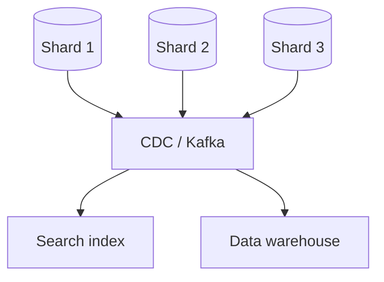

Search queries go to the search index; reports go to the warehouse. These are eventually consistent.

#### 5. Cross-shard writes

- **Two-phase commit (2PC)**: a coordinator asks all shards to prepare, then commit. Atomic, but blocking if the coordinator fails, and slow. Some databases (Spanner, CockroachDB) do this internally with consensus.
- **Sagas**: a sequence of local transactions with compensating actions on failure ("debit A; credit B; if credit fails, refund A"). No global lock, but intermediate states are visible.

| Technique | Consistency | Cost | Use for |
|---|---|---|---|
| Co-location | Strong, local | Design effort | The main access path |
| Scatter-gather | Strong per shard | Load and tail latency | Rare queries |
| Denormalisation | Eventual | Extra writes, storage | Hot read paths |
| Read models | Eventual | Extra infrastructure | Search, analytics |
| 2PC / sagas | Atomic / eventual | Latency, complexity | Unavoidable multi-shard writes |

**Likely follow-ups:**
- *How do you paginate a scatter-gather query?* Use keyset (cursor) pagination with a global sort key; offset pagination across shards is expensive.
- *What about a distributed SQL database?* It hides sharding, but cross-shard joins and transactions still cost network round trips; the same co-location advice applies.

</details>

### 15. How would you shard a multi-tenant SaaS database?

<details>
<summary>Answer</summary>

**In short:** Shard by **`tenant_id`**, since nearly every query is scoped to one tenant. Choose an isolation level: **database per tenant** (strongest isolation, highest cost), **schema per tenant**, or **shared tables with a `tenant_id` column** (cheapest, most scalable). The usual answer is a **hybrid**: a directory maps tenants to shards, many small tenants share a shard, and large tenants get dedicated ones. Guard against the **noisy neighbour** with per-tenant limits.

#### Isolation models

| Model | Isolation | Cost per tenant | Ops at 10,000 tenants | Per-tenant backup/restore |
|---|---|---|---|---|
| Database per tenant | Strongest | High | Hard (10,000 migrations) | Easy |
| Schema per tenant | Medium | Medium | Catalog bloat, slow migrations | Moderate |
| Shared tables + `tenant_id` | Logical only | Lowest | Easy (one schema) | Hard (filter rows out) |

#### Recommended architecture

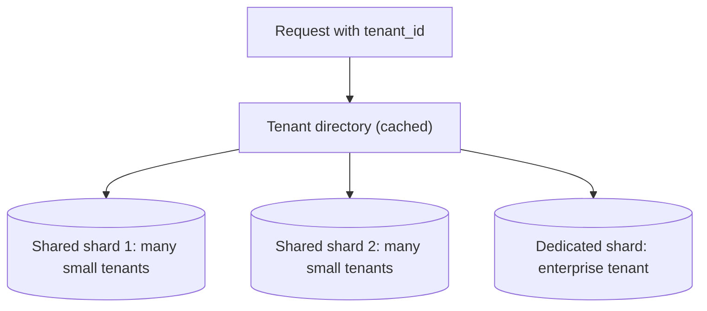

1. **Every table carries `tenant_id`**, and it leads every primary key and index: `PRIMARY KEY (tenant_id, id)`. This makes tenant-scoped queries index-efficient and keeps a tenant's data together.
2. **Directory** (`tenant_id -> shard`) instead of `hash(tenant_id)`, because tenants vary wildly in size and you will want to move them individually.
3. **Placement**: new small tenants go to the least-loaded shared shard; tenants that outgrow it are moved to a dedicated shard (copy, catch up, flip directory entry).
4. **Enterprise options**: dedicated shard or database, possibly in a specific region for data residency, often as a paid tier.

#### Preventing data leaks

The worst multi-tenant bug is showing one tenant's data to another. Defences in layers:

```sql
-- Postgres row-level security
ALTER TABLE invoices ENABLE ROW LEVEL SECURITY;
CREATE POLICY tenant_isolation ON invoices
  USING (tenant_id = current_setting('app.tenant_id')::bigint);
```

- Set `app.tenant_id` per request from the authenticated identity, never from user input.
- Data-access layer that automatically adds `tenant_id` filters.
- Tests that try cross-tenant access.

#### Noisy neighbours

One tenant running a huge export can slow everyone on its shard. Mitigations: per-tenant rate limits and query timeouts, separate queues/workers for heavy jobs, per-tenant usage metrics, and moving heavy tenants to dedicated shards.

**Common pitfalls:**
- Global tables without `tenant_id` that later block sharding.
- Cross-tenant analytics run on production shards; send them to a warehouse instead.
- Hashing `tenant_id` directly, then being unable to isolate one giant tenant.

**Likely follow-ups:**
- *How do you run schema migrations?* Shared tables: once per shard, with backward-compatible (expand/contract) changes. Database per tenant: automated rollout in batches.
- *How do you delete a tenant (GDPR)?* With shared tables, delete by `tenant_id` across all tables and remember backups; with database per tenant, drop the database.

</details>

### 16. What is the difference between partitioning in Kafka and in a database?

<details>
<summary>Answer</summary>

**In short:** In Kafka a partition is an **ordered, append-only log**; it exists for **ordering and consumer parallelism**. Messages with the same key go to the same partition, so ordering holds **per partition only**, and a consumer group can use at most one consumer per partition. In a database, a partition is a slice of **stored, mutable data** that exists for **capacity** (storage and query/write throughput). The shared lessons: choose keys that spread load, watch for hot keys, and plan partition counts for growth, because adding Kafka partitions later changes where keys land.

#### Kafka partitions

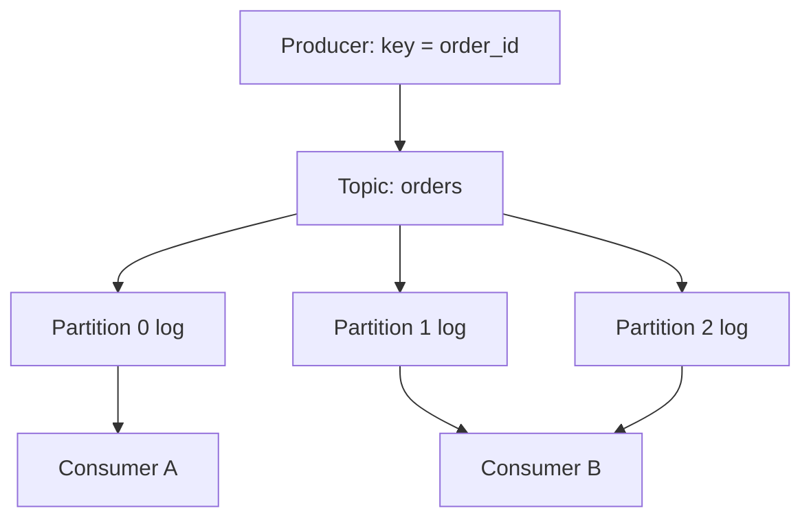

- **Assignment**: the default partitioner uses `hash(key) % numPartitions`; messages without a key are spread across partitions.
- **Ordering**: all events for `order_id=42` land in one partition and are consumed in order. There is no ordering across partitions.
- **Parallelism**: within a consumer group, each partition is assigned to exactly one consumer. 12 partitions means at most 12 active consumers in the group; extra consumers sit idle.
- **Replication**: each partition has a leader broker and followers (the in-sync replica set).
- **Data lifecycle**: records are immutable and removed by retention time/size or compaction; there is no in-place update.

#### Database partitions

- Hold current state; rows are updated and deleted in place.
- Exist to spread **storage and load**; ordering of writes across partitions is not the purpose.
- Queries can target a partition by key, scan ranges, or fan out.
- Can be rebalanced by moving data between nodes.

#### Side by side

| | Kafka partition | Database partition |
|---|---|---|
| Purpose | Ordering + consumer parallelism | Storage and throughput capacity |
| Data | Immutable, append-only events | Mutable current state |
| Key determines | Ordering scope | Data location |
| Reads | Sequential by offset | Random access, ranges, indexes |
| Changing partition count | Can only increase; existing keys map to new partitions, breaking per-key order across the change | Rebalancing moves data; keys stay correctly addressable |

#### Shared lessons

- **Key choice**: a hot key (one huge customer) makes one Kafka partition lag while others idle, exactly like a hot database shard.
- **Plan counts ahead**: in Kafka, size partitions for peak consumer parallelism plus growth, since adding partitions remaps keys. Common practice is to over-provision moderately rather than add later, or create a new topic and migrate when ordering matters.
- **Too many partitions** cost something in both: more files, metadata and leader elections in Kafka; more overhead and fan-out in databases.

**Likely follow-ups:**
- *How do you get global ordering in Kafka?* Use a single partition, which caps throughput at one consumer.
- *How do you scale a slow consumer beyond the partition count?* Increase partitions (accepting the remap), or have each consumer hand work to an internal thread pool while preserving per-key order (e.g. a queue per key).

</details>

---

[⬅ Previous: Databases](07-databases.md) · [⬅ Back to index](../README.md) · [Next: Consistency, Transactions & Consensus ➡](09-consistency-transactions-consensus.md)
