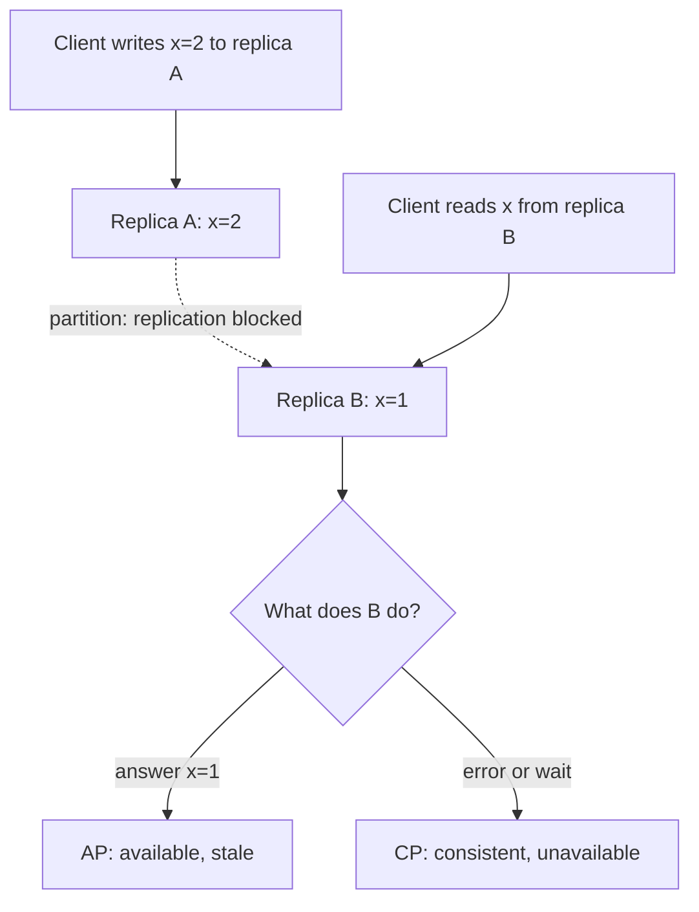
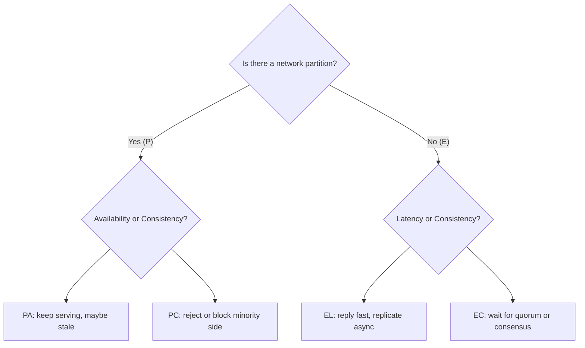
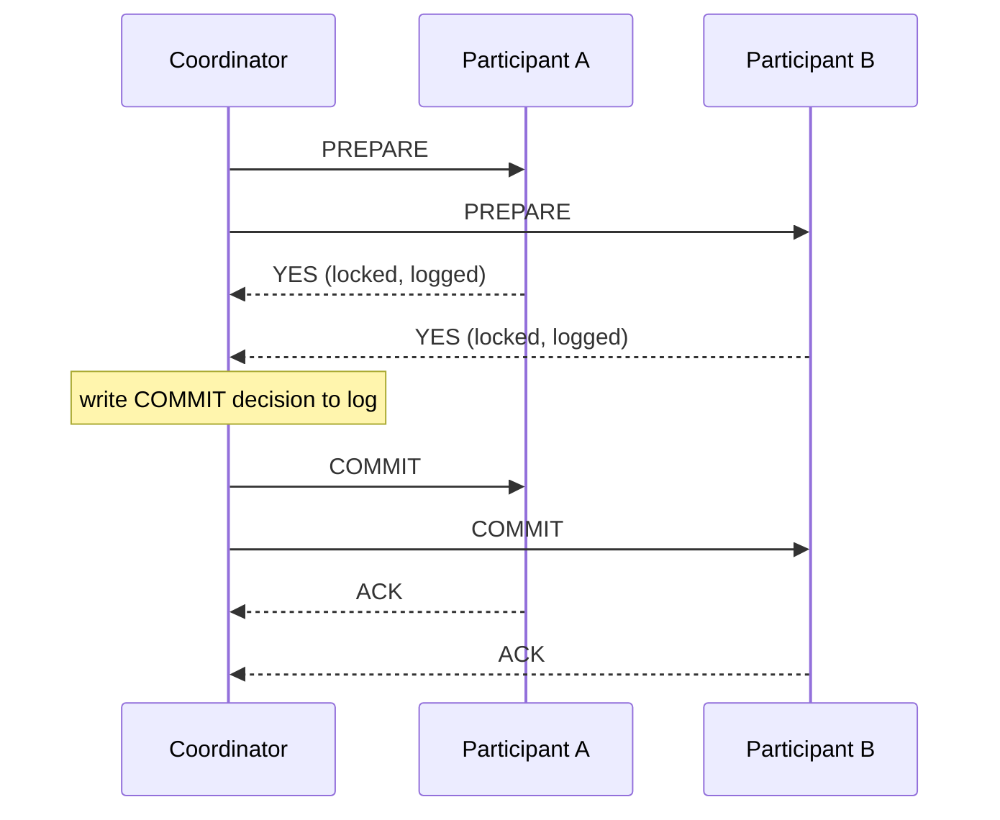
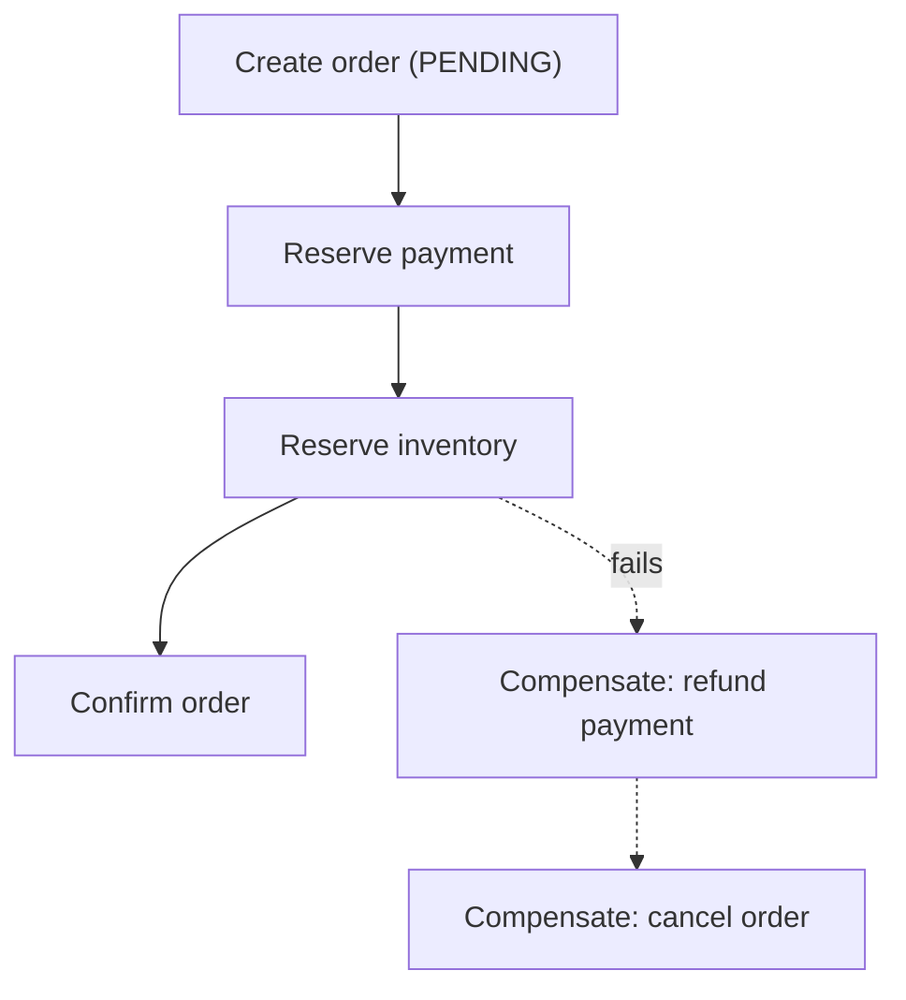
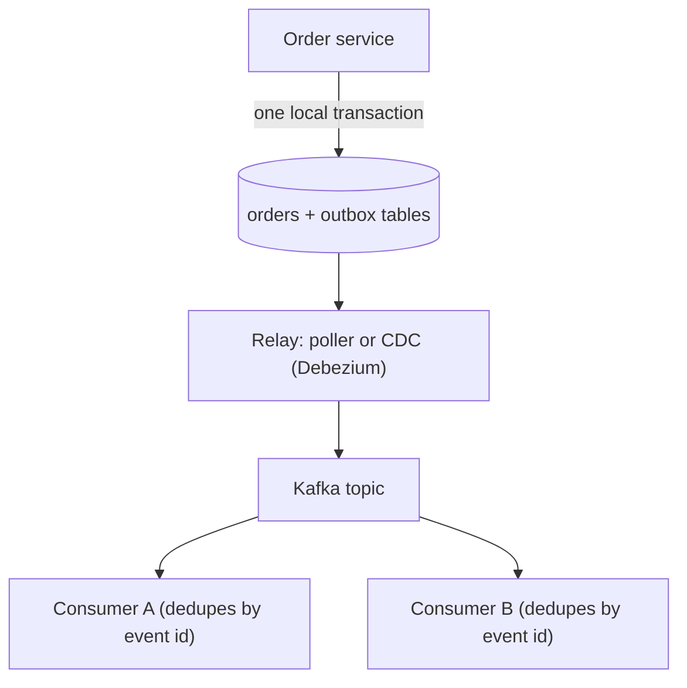
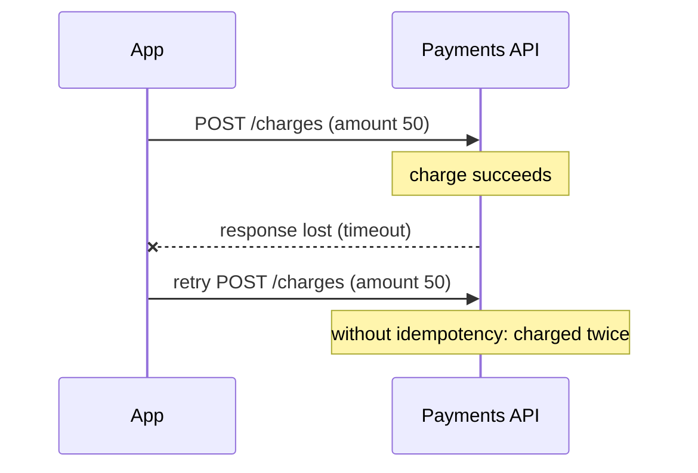
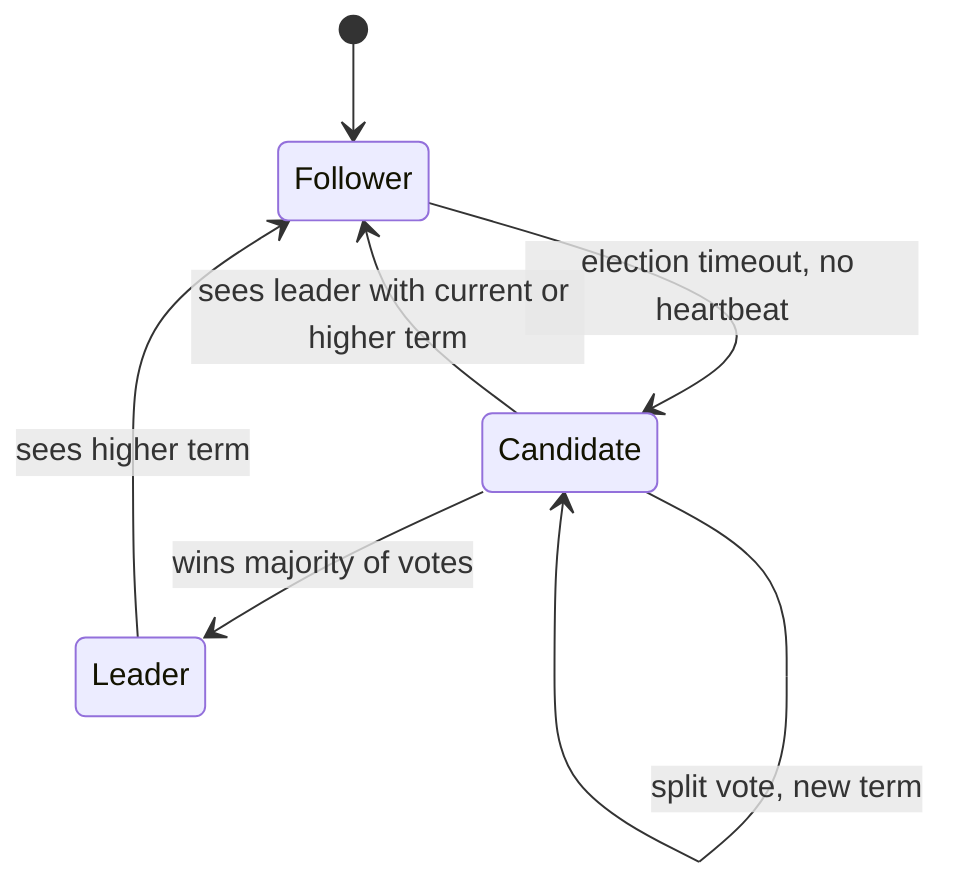
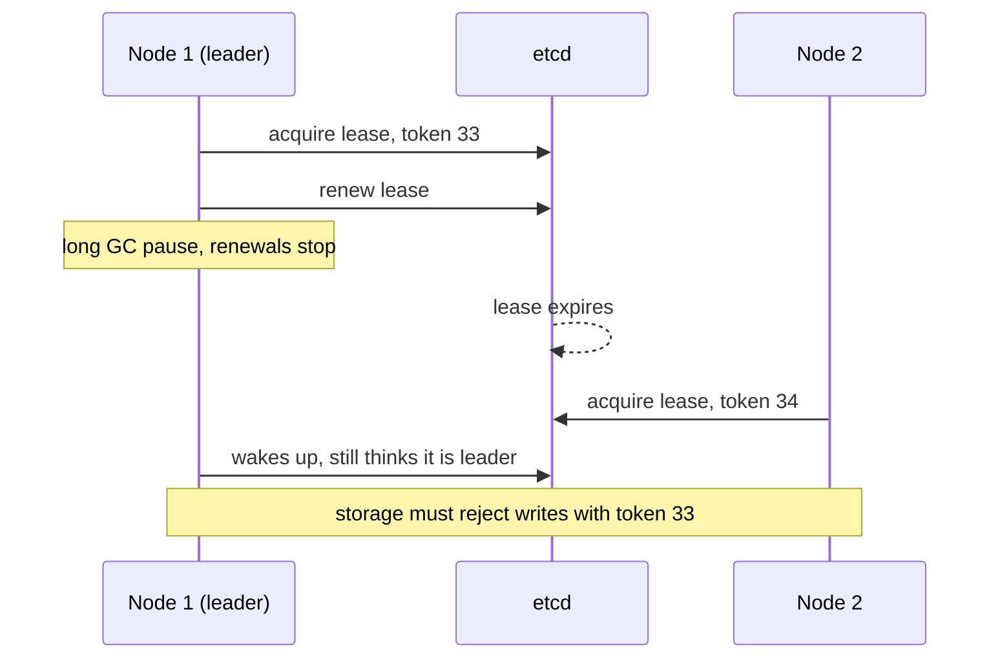
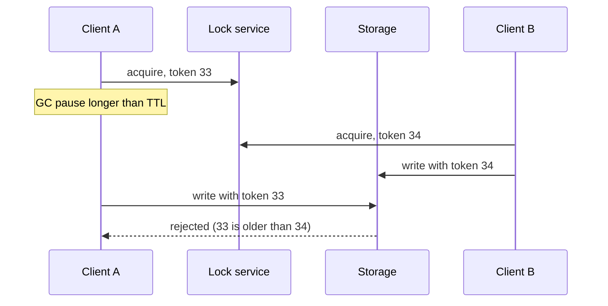
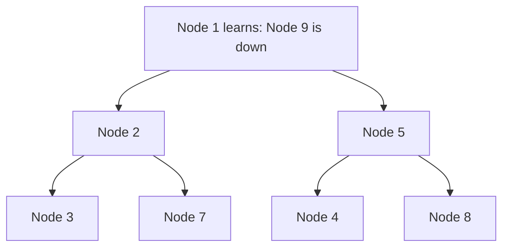

# Consistency, Transactions & Consensus

[⬅ Back to index](../README.md)

Covers: CAP and PACELC, consistency models, isolation levels and anomalies, optimistic vs pessimistic locking, distributed transactions (2PC, sagas, outbox), idempotency and exactly-once, consensus (Raft/Paxos), leader election, distributed locks, clocks and ordering, CRDTs.

---

## Consistency Models

### 1. What is the CAP theorem?

<details>
<summary>Answer</summary>

**In short:** CAP says that when a **network partition** splits a distributed system, each side must either keep answering (and risk returning stale or conflicting data: **Availability**) or refuse/delay some requests so that every answer is up to date (**Consistency**). Partitions will happen, so the practical choice is **CP vs AP during a partition**; without a partition you can have both.

#### The three letters

- **Consistency (C)**: in CAP this means **linearizability**: every read sees the most recent completed write, as if there were a single copy of the data. (This is not the "C" in ACID, which is about invariants.)
- **Availability (A)**: every request that reaches a non-failed node gets a non-error response, without waiting forever.
- **Partition tolerance (P)**: the system keeps operating even when messages between nodes are lost or delayed.

#### Why you can't have all three during a partition

Imagine two replicas, one in each data centre, and the link between them goes down. A client writes `x = 2` to replica A. Another client then reads `x` from replica B.

- If B answers with its old value `x = 1`, the system stayed **available** but broke **consistency**.
- If B refuses (or waits until it can talk to A), it kept **consistency** but is no longer **available** for that client.

There is no third option: B cannot know about a write it never received.



#### Why "pick 2 of 3" is misleading

You can't opt out of partitions: networks drop packets, switches fail, GC pauses look like partitions. So "CA" is not a real choice for a distributed system. And when there is **no** partition, a well-designed system gives you both C and A. CAP only describes behaviour **during a failure**. Also, the choice can be made **per operation**, not per system: Cassandra and DynamoDB let you choose consistency level per request.

#### Typical choices

| Choose | When stale/conflicting data is... | Examples |
|---|---|---|
| **CP** | unacceptable (money, uniqueness, coordination) | Banking ledgers, inventory, leader election, config stores: ZooKeeper, etcd, Spanner, HBase |
| **AP** | acceptable for a while, and downtime is worse | Social feeds, likes, shopping carts, DNS: Cassandra, DynamoDB (default eventually consistent reads), Riak |

**Real-world example:** Amazon's shopping cart (the original Dynamo paper) chose AP: it's better to let users add items during a partition and merge carts later than to show an error page.

**Pitfalls:**
- Saying "MongoDB is CP" or "Cassandra is AP" as absolute facts: behaviour depends on configuration (read/write concerns, quorum levels).
- Confusing CAP consistency (linearizability) with ACID consistency.
- Forgetting that latency matters even without partitions (that's PACELC, next question).

**Likely follow-ups:**
- *Is a single-node database CA?* It is trivially consistent and available, but it's not distributed, so CAP doesn't really apply; if the node dies it's simply unavailable.
- *How does a CP system stay mostly available?* By using majority quorums (Raft/Paxos): the side with the majority keeps serving; only the minority side stops.
- *Can you be AP and still converge?* Yes: eventual consistency with conflict resolution (last-write-wins, vector clocks, CRDTs).

</details>

### 2. What is PACELC?

<details>
<summary>Answer</summary>

**In short:** PACELC extends CAP: **if there is a Partition, choose Availability or Consistency; Else (normal operation), choose Latency or Consistency.** It captures the trade-off you pay on every request, not just during failures: strong consistency requires waiting for replicas or consensus, which adds latency.

#### Why it exists

CAP only talks about the rare partition case. But most of the time the network is fine, and the question that actually shapes your system's performance is: *when a write comes in, do we wait for other replicas to confirm before answering?*

- **Wait for replicas (synchronous / quorum)** → reads anywhere see the write, but every request pays a network round trip, possibly across regions (tens to hundreds of ms).
- **Answer immediately and replicate in the background** → fast, but a read from another replica may be stale.

That's the **E → L or C** half, and it applies to 100% of your traffic.



#### Classifying systems

| Class | Meaning | Examples |
|---|---|---|
| **PA/EL** | Available under partition, low latency normally; eventually consistent | Cassandra, DynamoDB (default settings), Riak |
| **PC/EC** | Consistent always; pays latency | Spanner, etcd/ZooKeeper, RDBMS with synchronous replication |
| **PA/EC** | Consistent normally, but prefers availability under partition | Some configurations of MongoDB and others; depends heavily on settings |
| **PC/EL** | Fast normally, but consistent under partition | Rarer; depends on configuration |

Many modern systems make this a **per-request** knob. Cassandra lets you pick `ONE` (EL) vs `QUORUM` (closer to EC) per query; DynamoDB offers eventually consistent reads (cheaper, faster) or strongly consistent reads.

#### How to use it in an interview

When you choose a database or replication strategy, say both halves: "Under a partition we'd rather stay available for likes (PA), and in normal operation we want low latency, so asynchronous replication (EL). For the payments ledger we need PC/EC, and we accept the extra write latency of a quorum commit."

**Pitfalls:**
- Treating these labels as fixed properties of a product: tunable systems move between classes depending on configuration.
- Ignoring geography: EC across regions can mean 100+ ms per write; within one region it might be 1–2 ms.

**Likely follow-ups:**
- *How do you reduce the latency cost of EC?* Keep the quorum in one region, use leader leases for local reads, or place data near its users (geo-partitioning).
- *What is a quorum?* With N replicas, writing to W and reading from R where R + W > N guarantees the read set overlaps the latest write.

</details>

### 3. What consistency models should you know?

<details>
<summary>Answer</summary>

**In short:** From strongest to weakest: **linearizability** (looks like a single copy, real-time order), **sequential consistency** (one agreed order, not necessarily real-time), **causal consistency** (cause is seen before effect), **session guarantees** (read-your-writes, monotonic reads, etc.), and **eventual consistency** (replicas converge eventually). Stronger models are easier to program against but cost latency and availability, so you pick per feature.

#### What a consistency model is

A consistency model is a contract: "if you do these reads and writes, here are the results you are allowed to see." With one machine the contract is obvious. With replicas, different clients may hit different copies at different times, so the system must define what anomalies are allowed.

#### The models

| Model | Guarantee | Example of what it prevents | Cost |
|---|---|---|---|
| **Linearizability** | Each operation appears to take effect instantly at one point between its start and end; once a write completes, every later read sees it | Reading an old value after someone was told "write succeeded" | Consensus or quorum on the critical path; unavailable under partition |
| **Sequential** | All clients see operations in the same order, consistent with each client's program order, but not necessarily real time | Two observers disagreeing on the order of two writes | Still requires coordination |
| **Causal** | If A could have influenced B (B read A, or same client did A then B), everyone sees A before B; unrelated ops can be seen in different orders | Seeing a reply before the post it replies to | Track dependencies (vector clocks); available under partition |
| **Session guarantees** | Per-client: **read-your-writes**, **monotonic reads** (never go back in time), **monotonic writes**, **writes-follow-reads** | Posting a comment, refreshing, and it's gone | Cheap: sticky sessions or version tokens |
| **Eventual** | If writes stop, replicas converge | Nothing in the meantime | Cheapest, highest availability |

#### Concrete examples

- **Linearizability needed:** a distributed lock, leader election, "username must be unique", decrementing the last seat on a flight. If two clients could both see "seat available", you oversell.
- **Causal is enough:** comment threads and chat. You must not see "Agreed!" before the message it agrees with, but two unrelated chats can be ordered differently on different devices.
- **Session guarantees:** a user edits their profile and immediately reloads. If the read hits a lagging replica, they think the save failed. Fix by routing that user's reads to the leader for a few seconds, or by passing the write's version/LSN and having the replica wait until it has caught up.
- **Eventual:** like counts, view counters, recommendation lists.

#### Implementing session guarantees cheaply

```text
// After a write, the server returns the commit position (LSN / version).
POST /profile -> 200 { "version": 1842 }

// The client sends it on the next read; a replica serves the read only if it has
// applied at least that version, otherwise it waits briefly or forwards to the leader.
GET /profile  X-Min-Version: 1842
```

**Pitfalls:**
- Saying "strong consistency" without saying what you mean; interviewers like hearing "linearizable".
- Assuming a cache in front of a strongly consistent DB keeps it strongly consistent. It doesn't.
- Monotonic-read violations from load balancers spraying reads across replicas with different lag.

**Likely follow-ups:**
- *Linearizability vs serializability?* Linearizability is about single-object recency in real time; serializability is about multi-object transactions behaving as if run one after another. "Strict serializability" is both.
- *Which model does Spanner offer?* External consistency, which is essentially strict serializability, using TrueTime.

</details>

### 4. Strong vs eventual consistency – how do you decide per feature?

<details>
<summary>Answer</summary>

**In short:** Ask **"what is the cost if a user sees stale or conflicting data?"** If it means lost money, overselling, a security hole or a broken uniqueness rule, use **strong** consistency. If it means a like count is off by a few for a second, use **eventual**. For anything the user just did themselves, give at least **read-your-writes**. Mixing models within one system is normal.

#### A practical decision checklist

1. **Is there an invariant across concurrent users?** (balance ≥ 0, one seat per person, unique username) → strong/linearizable for that operation.
2. **Is it security-sensitive?** (revoking access, password change, blocking a user) → strong, or at least bounded staleness with a short window; a revoked token that still works for minutes is a real incident.
3. **Is the data user-visible and personal?** (my post, my settings) → read-your-writes.
4. **Is it aggregate, derived or social?** (counts, feeds, search, recommendations) → eventual is fine.
5. **What's the read/write volume and geography?** Strong consistency across regions costs a lot of latency; it should be reserved for what really needs it.

#### Examples by feature

| Feature | Model | Why |
|---|---|---|
| Wallet balance, payment, ledger | Strong (single-leader DB, serializable transactions) | Double-spend or negative balance is unacceptable |
| Seat / inventory reservation | Strong for the decrement, eventual for "items left" display | Overselling costs money; the displayed count can lag |
| Username / email uniqueness | Strong (unique constraint, or consensus) | Two users can't both claim it |
| Auth, permissions, revocation | Strong or tightly bounded | Security |
| Own posts and profile edits | Read-your-writes | Trust: "my change disappeared" feels like a bug |
| Like / view / follower counts | Eventual | Off by a few for seconds is invisible |
| News feed, search index, recommendations | Eventual | Seconds or minutes of lag are fine |
| Chat messages | Causal ordering within a conversation | Replies must not appear before the message they answer |

#### Hybrid patterns

- **Strong core, eventual edges:** the order service writes to a strongly consistent DB; downstream read models (search, analytics, notifications) update asynchronously via CDC/events.
- **Show the user an optimistic update:** the client immediately displays its own change locally while the backend replicates.
- **Reconcile later:** for eventually consistent counters, periodically recompute exact values in a batch job.

**Pitfalls:**
- Making everything strong "to be safe": it hurts latency and availability, and interviewers see it as not thinking about trade-offs.
- Making everything eventual, then hand-waving about inventory or payments.
- Forgetting that caches turn strong data eventual; invalidate or bypass caches for critical reads.

**Likely follow-ups:**
- *How do you show "3 items left" if it's eventual?* Display is eventual; the actual reservation is a conditional atomic decrement that can fail and tell the user.
- *How do you give read-your-writes with replicas?* Read from the leader for the writing user for a short window, or pass a version token as in the previous question.

</details>

---

## Transactions & Concurrency

### 5. What are transaction isolation levels and their anomalies?

<details>
<summary>Answer</summary>

**In short:** Isolation levels define how much concurrent transactions can see of each other. From weakest to strongest: **read uncommitted**, **read committed** (Postgres default), **repeatable read / snapshot isolation** (MySQL InnoDB default is repeatable read), and **serializable**. Each stronger level removes anomalies (dirty reads, non-repeatable reads, phantoms, lost updates, write skew) at the cost of more locking, aborts or lower throughput.

#### Why isolation levels exist

Perfect isolation (serializable: as if transactions ran one at a time) is expensive. Databases offer weaker levels that are much faster and good enough for most queries, but they allow specific **anomalies**. You need to know which anomaly can bite your use case.

#### The levels

| Level | Prevents | Still allows |
|---|---|---|
| **Read uncommitted** | – | Dirty reads |
| **Read committed** (Postgres, Oracle, SQL Server default) | Dirty reads/writes | Non-repeatable reads, lost updates, write skew |
| **Repeatable read / snapshot isolation** (MySQL InnoDB default is repeatable read) | Non-repeatable reads, most lost updates | **Write skew**, phantoms (implementation-dependent) |
| **Serializable** | Everything; equivalent to running one at a time | Lower throughput, aborts/retries |

Most modern databases implement read committed and snapshot isolation with **MVCC** (multi-version concurrency control): each transaction reads a consistent snapshot of committed versions, so readers don't block writers. Serializable is implemented via strict two-phase locking, actual serial execution (VoltDB, Redis scripts), or **Serializable Snapshot Isolation** (Postgres `SERIALIZABLE`, CockroachDB), which detects dangerous conflicts and aborts one transaction.

#### The anomalies, with examples

- **Dirty read**: T1 reads a row T2 has written but not committed; T2 rolls back, so T1 acted on data that never existed.
- **Non-repeatable read**: T1 reads a balance (100), T2 updates and commits (50), T1 reads again in the same transaction and gets 50.
- **Phantom**: T1 runs `SELECT COUNT(*) WHERE room = 5 AND day = 'Mon'` → 0; T2 inserts a booking; T1's repeated query now returns 1. New rows "appear".
- **Lost update**: two transactions read `counter = 10`, both write `11`. One increment is lost.
- **Write skew**: two transactions read the same condition, then write **different** rows, and together break an invariant.

The classic write-skew example: a hospital requires at least one doctor on call.

```sql
-- Alice and Bob both run this concurrently under snapshot isolation
BEGIN;
SELECT COUNT(*) FROM doctors WHERE on_call = true AND shift_id = 7;  -- both see 2
-- "there's someone else, so I can go off call"
UPDATE doctors SET on_call = false WHERE name = 'alice' AND shift_id = 7;  -- Bob updates his own row
COMMIT;
-- Result: 0 doctors on call. Neither transaction wrote the same row, so snapshot isolation didn't detect a conflict.
```

Fixes: run at `SERIALIZABLE`, or explicitly lock the rows you based your decision on (`SELECT ... FOR UPDATE`), or materialise the conflict (a row per shift that both must update).

**Pitfalls:**
- Assuming your ORM's default is serializable; it's usually read committed.
- Names are not standard across vendors: "repeatable read" in MySQL and Postgres behave differently, and Oracle's "serializable" is actually snapshot isolation.
- Serializable transactions can abort with serialization failures; your code must **retry** them.

**Likely follow-ups:**
- *How do you prevent lost updates at read committed?* Atomic updates (`SET x = x + 1`), `SELECT ... FOR UPDATE`, or optimistic version checks.
- *What is MVCC?* Keeping multiple versions of each row tagged with transaction IDs so each transaction reads a consistent snapshot without locking readers.

</details>

### 6. Optimistic vs pessimistic locking?

<details>
<summary>Answer</summary>

**In short:** **Pessimistic locking** takes a lock before changing data (`SELECT ... FOR UPDATE`) so others wait; it's safe when conflicts are frequent but reduces concurrency and risks deadlocks. **Optimistic locking** takes no lock and checks a `version` at write time (`UPDATE ... WHERE version = ?`); if someone else changed the row first, you retry or report a conflict. It's best when conflicts are rare. Often the best answer is neither: a single **atomic conditional update**.

#### The problem: read-modify-write races

```text
T1: read stock = 1          T2: read stock = 1
T1: write stock = 0         T2: write stock = 0     -> two items sold, only one existed
```

#### Pessimistic locking

```sql
BEGIN;
SELECT qty FROM inventory WHERE sku = 'A1' FOR UPDATE;  -- row is locked until COMMIT
-- application checks qty > 0
UPDATE inventory SET qty = qty - 1 WHERE sku = 'A1';
COMMIT;
```

Other transactions trying to lock the same row block until commit. Good for hot, high-contention rows where retries would be wasted (a popular ticket inventory). Downsides: throughput limited by lock holding time, **deadlocks** if two transactions lock rows in different orders (always lock in a consistent order), and you must never hold DB locks across slow calls like an HTTP request to a payment provider.

#### Optimistic locking

```sql
-- Read: SELECT id, title, body, version FROM doc WHERE id = 42;   -> version = 7
UPDATE doc
SET title = ?, body = ?, version = version + 1
WHERE id = 42 AND version = 7;
-- rows affected = 1 -> success; 0 -> someone else won, reload and retry or show a conflict
```

```kotlin
// JPA / Hibernate does this automatically with @Version
@Entity
class Document(
    @Id val id: Long,
    var body: String,
    @Version var version: Long = 0   // throws OptimisticLockException on conflict
)
```

Great for user edits (profiles, wiki pages, settings) and long "think time" between read and write, because nothing is locked while the user types. Over HTTP the same idea is **`ETag` + `If-Match`**: the server returns `412 Precondition Failed` if the resource changed.

#### Atomic operations: often the best answer

```sql
UPDATE inventory SET qty = qty - 1 WHERE sku = 'A1' AND qty > 0;
-- rows affected = 0 -> sold out
```

No read-modify-write in application code at all; the DB does the check and update in one step. Same idea in Redis (`DECR`, Lua scripts) and DynamoDB (conditional writes).

| | Pessimistic | Optimistic | Atomic update |
|---|---|---|---|
| Conflicts | Frequent | Rare | Any (simple logic only) |
| Cost | Waiting, deadlocks | Retries on conflict | Minimal |
| Good for | Hot inventory, bank transfers within one DB | User edits, REST resources | Counters, stock, balances |

**Pitfalls:**
- Optimistic locking under high contention causes retry storms.
- Forgetting to check "rows affected" makes optimistic locking a no-op.
- Locks don't work across services; use these within one database.

**Likely follow-ups:**
- *How do you avoid deadlocks?* Lock in a consistent order, keep transactions short, use lock timeouts, and retry on deadlock errors.
- *How would you do this in DynamoDB?* Conditional writes: `ConditionExpression: version = :v`.

</details>

### 7. Why are distributed transactions hard? How does two-phase commit (2PC) work?

<details>
<summary>Answer</summary>

**In short:** When one operation spans several databases or services, you need all of them to commit or none, but each can fail independently and the network can lose messages. **Two-phase commit** solves this with a coordinator: first every participant **prepares** (durably promises it can commit), then the coordinator tells all to **commit** or **abort**. It works, but it's **blocking** (participants hold locks if the coordinator dies), slow, and couples the availability of every participant, so across microservices we usually prefer **sagas**.

#### Why it's hard

Within one database, a transaction log gives atomicity. Across two systems (debit in DB A, credit in DB B), problems appear:
- A commits, then the process crashes before B commits → money disappears.
- A message times out: did B commit or not? You can't tell.
- Each system has its own locks and logs; nothing coordinates them.

#### How 2PC works



1. **Prepare phase**: the coordinator asks each participant "can you commit?". A participant does all the work, writes it durably to its log, holds its locks, and votes **yes** or **no**. A yes is a promise: it can no longer abort on its own.
2. **Commit phase**: if every vote is yes, the coordinator durably logs "commit" (the point of no return) and tells everyone to commit. If any vote is no or times out, it tells everyone to abort.

#### The problems

- **Blocking**: if the coordinator crashes after participants voted yes but before sending the decision, participants are "in doubt". They can't commit or abort on their own, so they hold locks until the coordinator recovers.
- **Latency**: at least two round trips plus several forced disk writes.
- **Availability coupling**: one slow or down participant stalls the whole transaction.
- **Poor fit for microservices**: services own their data and have different technologies; many (Kafka, most SaaS APIs) don't support XA prepare.

#### Where 2PC is still used

- Inside distributed databases: **Spanner** runs 2PC across shards where each participant (and the coordinator) is a Paxos-replicated group, so a single machine failure doesn't block. CockroachDB and others use similar ideas.
- **XA transactions** between a database and a message broker in traditional enterprise stacks.
- Kafka transactions use a coordinator with a 2PC-like protocol internally.

**Pitfalls:**
- Proposing 2PC across many microservices owned by different teams in an interview; expect pushback.
- Forgetting the coordinator's log: without durable decisions, recovery is impossible.

**Likely follow-ups:**
- *What is 3PC?* Adds a pre-commit phase to avoid blocking under some failures, but it's unsafe under network partitions and rarely used.
- *What do you use instead across services?* Sagas with compensations, plus the outbox pattern for reliable events.

</details>

### 8. What is the saga pattern?

<details>
<summary>Answer</summary>

**In short:** A saga splits a distributed transaction into a sequence of **local transactions**, one per service, each paired with a **compensating action** that semantically undoes it. If a step fails, the saga runs the compensations for the steps that already succeeded. You get **eventual consistency** without distributed locks, at the cost of visible intermediate states and carefully designed compensations.

#### Why sagas

Across microservices, 2PC is impractical (see the previous question). Instead each service commits its own change immediately and publishes progress; if something later fails, we "undo" by doing the opposite business action, not by rolling back a database.

#### Example: placing an order



1. Order service creates the order as `PENDING`.
2. Payment service authorises the card. Compensation: void/refund.
3. Inventory service reserves stock. If out of stock, run compensations in reverse order: refund payment, cancel order.
4. If all succeed, order becomes `CONFIRMED`.

#### Two styles

| | Choreography | Orchestration |
|---|---|---|
| How | Each service listens to events and emits the next (`PaymentReserved` → inventory reacts) | A central orchestrator calls each step and decides what's next |
| Pros | Loose coupling, no central component | Flow visible in one place, easy to add timeouts, retries, monitoring |
| Cons | Flow is implicit and hard to follow with many steps; risk of cyclic dependencies | Orchestrator is extra infrastructure; risk of putting business logic in it |
| Tools | Kafka/SNS events | **Temporal**, AWS Step Functions, Camunda, a custom state machine |

An orchestrated saga is essentially a durable state machine:

```kotlin
// Pseudocode for a workflow engine such as Temporal (state is persisted between steps)
fun placeOrder(order: Order) {
    val compensations = mutableListOf<() -> Unit>()
    try {
        payments.authorize(order.id, order.total)          // idempotent, keyed by order.id
        compensations += { payments.void(order.id) }
        inventory.reserve(order.id, order.items)
        compensations += { inventory.release(order.id) }
        orders.confirm(order.id)
    } catch (e: BusinessFailure) {
        compensations.asReversed().forEach { it() }        // undo in reverse order
        orders.cancel(order.id)
    }
}
```

#### Design rules

- Every step and compensation must be **idempotent**, because messages and retries will duplicate them.
- Compensations are **semantic**, not physical rollbacks. You can't un-send an email; you send a correction. You can't un-charge a card; you refund.
- Order steps so the hardest-to-compensate step comes **last** (e.g. ship only after payment and stock are confirmed).
- Intermediate states are visible (`PENDING`); design the UI and other services to handle them. Use **semantic locks** (a "reserved" flag) to stop other sagas from using half-finished data.
- Use the **outbox pattern** so the local commit and the "step done" event can't diverge.

**Pitfalls:**
- No isolation between sagas: two sagas can interleave and read each other's intermediate states.
- Compensation failing too: needs retries and, eventually, alerting for manual repair.

**Likely follow-ups:**
- *What if a compensation fails?* Retry with backoff (it's idempotent); after a limit, park it in a dead-letter queue and alert.
- *Choreography or orchestration?* Choreography for 2–3 simple steps; orchestration once the flow has branching, timeouts or many participants.

</details>

### 9. What is the transactional outbox pattern?

<details>
<summary>Answer</summary>

**In short:** The outbox pattern solves the **dual-write problem** (updating your database and publishing an event, where a crash between the two leaves them inconsistent). You write the business change **and** an event row into an `outbox` table in the **same local transaction**; a separate relay reads the outbox (by polling or CDC) and publishes to the broker. Delivery becomes at-least-once, so consumers must be idempotent.

#### The problem

```kotlin
// WRONG: two independent writes
orderRepository.save(order)              // 1. DB commit succeeds
kafka.send("orders", OrderCreated(order)) // 2. process crashes here -> event never sent
```

Reversing the order is no better: the event is sent, then the DB commit fails, and downstream services act on an order that doesn't exist. You can't wrap Kafka and Postgres in one ACID transaction.

#### The fix

```sql
BEGIN;
INSERT INTO orders (id, user_id, total, status) VALUES (:id, :user, :total, 'CREATED');
INSERT INTO outbox (id, aggregate_id, type, payload, created_at)
VALUES (gen_random_uuid(), :id, 'OrderCreated', :json, now());
COMMIT;  -- both rows or neither
```



**Relay options:**
- **Polling publisher**: `SELECT ... FROM outbox WHERE sent = false ORDER BY created_at LIMIT 100`, publish, mark sent (or delete). Simple; adds DB load and some latency.
- **Change data capture**: Debezium tails the database's write-ahead log / binlog and streams outbox inserts to Kafka. Lower latency, no polling load, preserves commit order.

#### Delivery semantics

The relay might publish and crash before marking the row sent, so it publishes again: **at-least-once**. Consumers therefore dedupe by event ID. The consumer-side mirror is the **inbox pattern**: in the consumer's own transaction, insert the processed message ID into an `inbox`/`processed_messages` table with a unique constraint and apply the effect; duplicates hit the constraint and are skipped.

**Pitfalls:**
- Letting the outbox table grow forever; delete or partition old rows.
- Breaking ordering by running many parallel relays without partitioning by aggregate ID.
- Using it but forgetting idempotent consumers.

**Likely follow-ups:**
- *Why not just use CDC on the orders table directly?* You can, but then your internal schema becomes your public event contract; the outbox lets you publish deliberate, versioned events.
- *How does this relate to event sourcing?* In event sourcing the event log *is* the source of truth, so there's no dual write in the first place.

</details>

### 10. What is idempotency and how do you implement it?

<details>
<summary>Answer</summary>

**In short:** An operation is **idempotent** if doing it several times has the same effect as doing it once. Because a timeout never tells you whether a request succeeded, clients and queues **will** retry, so every write that matters must be safe to repeat. Implement it with a client-generated **idempotency key** stored alongside the result in the same transaction, natural idempotency (`PUT`, "set status", unique constraints), and message-ID dedupe in consumers.

#### Why it's essential



The client has no way to know if the first request was processed. Retrying blindly double-charges; not retrying may lose the payment. Idempotency makes retrying safe.

#### Idempotency keys

1. The client generates a unique key (UUID) **per logical operation** (one per "Pay" tap, not per HTTP attempt) and sends it with every retry: `Idempotency-Key: 5f1c...`.
2. The server, in the **same transaction** as the effect, records `key → status, response`.
3. A repeated key returns the stored response instead of re-executing. A repeat while the first is still in progress gets `409` or waits.
4. Keys expire after a TTL (e.g. 24 h). Store a hash of the request body too, and reject a reused key with a different payload.

```sql
CREATE TABLE idempotency_keys (
  key          TEXT PRIMARY KEY,
  request_hash TEXT NOT NULL,
  status       TEXT NOT NULL,        -- IN_PROGRESS | DONE
  response     JSONB,
  created_at   TIMESTAMPTZ DEFAULT now()
);
```

```kotlin
fun charge(key: String, req: ChargeRequest): ChargeResponse = db.transaction {
    val existing = idempotencyKeys.find(key)
    if (existing != null) {
        require(existing.requestHash == req.hash()) { "key reused with different body" }
        return@transaction existing.response ?: throw InProgress()
    }
    idempotencyKeys.insert(key, req.hash(), status = "IN_PROGRESS") // unique PK blocks concurrent duplicates
    val result = ledger.debit(req.accountId, req.amount)
    idempotencyKeys.complete(key, result)
    result
}
```

If the effect is an external call (a card network), store the key with the provider too; Stripe-style APIs accept an idempotency key for exactly this reason.

#### Natural idempotency

- `PUT /users/42` with the full state, `DELETE /items/7`: repeating gives the same end state.
- "Set status = SHIPPED" instead of "advance status".
- Unique constraints on business IDs (`UNIQUE(order_id)` in payments) turn a duplicate into a harmless conflict.
- Conditional writes: `UPDATE ... WHERE version = 7`.

Non-idempotent by nature: `POST` that creates, `x = x + 1`, "send email". These need keys or dedupe.

#### Queue consumers

Brokers deliver at-least-once, so consumers record processed message IDs (inbox table, or a Redis `SET NX` with TTL) and skip repeats.

**Pitfalls:**
- Generating a new key on each retry (defeats the purpose).
- Storing the key in a different transaction from the effect: a crash between them breaks it.
- Keys that expire before the client's retry window ends.

**Likely follow-ups:**
- *Is GET idempotent?* Yes, and safe; PUT and DELETE are idempotent; POST is not by default.
- *Where does the key come from on mobile?* Generate it when the user initiates the action and persist it locally, so a retry after an app restart reuses it.

</details>

### 11. What do at-most-once, at-least-once and exactly-once mean?

<details>
<summary>Answer</summary>

**In short:** These are message delivery guarantees. **At-most-once**: send without retrying, so messages can be lost. **At-least-once**: retry until acknowledged, so messages can be duplicated (the usual default). **Exactly-once**: each message's effect happens once; true exactly-once *delivery* over an unreliable network is impossible in general, so in practice it means **effectively-once processing** = at-least-once delivery + idempotent or transactional processing.

#### Where the guarantee comes from: when you acknowledge

For a consumer reading from a queue, the guarantee depends on the order of "process" and "commit offset/ack":

| Order | Crash between them | Result |
|---|---|---|
| Ack, then process | Message acknowledged but never processed | **At-most-once** (loss) |
| Process, then ack | Processed but not acked; redelivered | **At-least-once** (duplicates) |
| Process and record "done" atomically | Either both or neither | **Effectively-once** |

The same applies to producers: no retries → at-most-once; retries on timeout → at-least-once (the first send may actually have succeeded).

#### When each is used

- **At-most-once**: high-volume telemetry, metrics sampling, some logs, real-time game state where the next update supersedes the last. Losing one is fine; duplicates or delay would be worse.
- **At-least-once**: the default for most queues (SQS standard, Kafka with manual commits, RabbitMQ with acks). Combined with idempotent consumers it's what most systems use.
- **Effectively-once**: payments, billing, counters, anything where a duplicate is a visible bug.

#### How to get effectively-once

1. **Idempotent consumers**: dedupe by message ID (inbox table, unique constraint), or make the operation naturally idempotent (upsert by key).
2. **Atomic offset + result**: store the consumer's offset in the same database transaction as the result, so on restart it resumes exactly where the committed result left off.
3. **Kafka transactions**: the idempotent producer (sequence numbers per partition so broker-side retries don't duplicate) plus transactions let a read-process-write pipeline *within Kafka* commit output messages and input offsets atomically. Kafka Streams and Flink use this. The guarantee stops at the Kafka boundary: if your consumer sends an email or calls an external API, you still need idempotency there.

```kotlin
// Effectively-once consumer: offset and effect in one DB transaction
db.transaction {
    if (processed.insertIfAbsent(record.key + ":" + record.offset)) {
        applyBusinessEffect(record.value)
    }
    offsets.save(record.topic, record.partition, record.offset + 1)
}
```

**Pitfalls:**
- Claiming a system "guarantees exactly-once delivery" end to end; interviewers will probe.
- Turning on Kafka exactly-once and assuming external side effects are covered.

**Likely follow-ups:**
- *Why is exactly-once delivery impossible?* The sender can't distinguish "message lost" from "ack lost" (Two Generals), so it must either risk loss or risk duplication.
- *Which is better default, at-most or at-least?* At-least-once with idempotent handling; data loss is usually worse than a dedupe step.

</details>

---

## Consensus & Coordination

### 12. What is consensus, and what are Paxos and Raft?

<details>
<summary>Answer</summary>

**In short:** **Consensus** is getting a group of nodes to agree on a value (or an ordered log of commands) even when some of them crash, as long as a **majority** is still up and can talk. **Raft** and **Paxos** are the standard algorithms: Raft elects a leader per term, the leader replicates log entries, and an entry is committed once a majority stores it. A cluster of **2f + 1** nodes tolerates **f** failures.

#### Why consensus matters

Many things need a single, agreed answer: who is the leader, which config version is current, which write came first, who holds a lock. If replicas could disagree, you get split brain. Consensus gives a **replicated state machine**: every node applies the same commands in the same order, so they all reach the same state. It's the foundation of etcd, ZooKeeper, Consul, Spanner, CockroachDB, and Kafka's KRaft metadata quorum.

#### Why a majority

Any two majorities of the same cluster overlap in at least one node. So if a value was committed by one majority, any future majority (e.g. electing a new leader) contains at least one node that knows about it. That's what prevents two conflicting decisions.

| Cluster size | Majority | Failures tolerated |
|---|---|---|
| 3 | 2 | 1 |
| 4 | 3 | 1 (no gain over 3) |
| 5 | 3 | 2 |
| 7 | 4 | 3 |

Use odd sizes; 3 or 5 is typical. More nodes means more fault tolerance but slower writes (more acks needed).

#### How Raft works



1. **Terms**: time is divided into numbered terms; each term has at most one leader. Terms act as a logical clock: any node seeing a higher term steps down.
2. **Leader election**: followers expect periodic heartbeats. If one times out (randomised timeouts, e.g. 150–300 ms, reduce split votes), it becomes a candidate, increments the term, votes for itself and requests votes. Nodes vote once per term and only for a candidate whose log is **at least as up to date** as theirs, so a new leader always has every committed entry.
3. **Log replication**: clients send commands to the leader. It appends them to its log and sends `AppendEntries` to followers. Once a **majority** has stored an entry, it's **committed**; the leader applies it to its state machine and replies to the client. Followers apply committed entries in order.
4. **Consistency repair**: each `AppendEntries` includes the previous entry's index and term; a follower with a mismatching log rejects it and the leader backs up until logs match, then overwrites the follower's divergent tail.

#### Paxos

Paxos (Lamport) solves the same problem with **proposers, acceptors and learners** in two phases (prepare/promise, accept/accepted). Basic Paxos decides one value; **Multi-Paxos** with a stable leader decides a log and ends up looking very similar to Raft. It's proven and widely used (Chubby, Spanner) but notoriously hard to implement from the paper. Raft was designed explicitly for understandability.

**Used by:** etcd, Consul, CockroachDB, TiKV, Kafka KRaft (Raft-based); ZooKeeper (ZAB, a Paxos-like atomic broadcast); Spanner, Chubby (Paxos).

**Pitfalls:**
- Running consensus across many continents: every commit waits for a cross-region majority.
- Assuming you can read from any follower and get linearizable results; followers can lag. Linearizable reads go through the leader with a check (read index or leader lease).
- Using a 2-node cluster: losing either node loses the majority.

**Likely follow-ups:**
- *What happens on a partition?* The majority side elects/keeps a leader and continues; the minority side can't commit, so it stops accepting writes (CP).
- *Do you implement Raft yourself in an interview design?* No; you use etcd/ZooKeeper or a database built on it, and explain what it guarantees.

</details>

### 13. How does leader election work, and why use it?

<details>
<summary>Answer</summary>

**In short:** Leader election makes sure exactly **one** node at a time performs a role (DB primary, scheduler, partition owner), so work isn't duplicated and writes don't conflict. In practice you get it from a consensus system: nodes compete for a **lease with a TTL** in etcd, ZooKeeper or Consul; the holder keeps renewing it, and if it dies the lease expires and another node takes over. Because an old leader may not know it was replaced, protect shared resources with **fencing tokens**.

#### Why a single leader

- **Single writer** simplifies ordering and avoids conflicts (primary database, Kafka partition leader).
- **Run-once jobs**: a cron scheduler in a 3-replica service must fire each job once, not three times.
- **Ownership**: one consumer per shard, one node coordinating rebalancing.

#### How it's done with a coordination service

- **etcd**: create a key with a lease (`put /election/scheduler node-1 --lease=<id>` only if absent, using a transaction); keep the lease alive with heartbeats. etcd's client libraries include an election helper.
- **ZooKeeper**: each candidate creates an **ephemeral sequential** znode under `/election`; the one with the lowest sequence number is leader. Each other node watches the node just before it (avoids a "herd" waking up). Ephemeral nodes disappear when the session dies.
- **Kubernetes**: the `Lease` object in the API server (backed by etcd) is used by controllers for leader election.
- **Built-in**: Raft-based systems elect leaders as part of the protocol.



#### The danger: zombie leaders and fencing

A leader can be paused (GC, VM migration, swap) longer than its lease. Meanwhile someone else becomes leader. When the old one wakes it still believes it leads and writes to shared storage: split brain.

**Fencing tokens** fix this: each time leadership is granted, the coordination service hands out a monotonically increasing number (etcd revision, ZooKeeper `zxid`). The leader includes it with every write, and the storage system rejects any write carrying a token lower than one it has already seen.

```sql
UPDATE jobs_state SET value = :v, fence = :token
WHERE id = :id AND fence <= :token;   -- 0 rows -> stale leader, stop
```

**Pitfalls:**
- Using wall-clock-based "I'm leader until 12:00:05" checks without fencing; clocks and pauses break them.
- Lease too short (flapping leadership on network blips) or too long (slow failover).
- The leader doing work after losing leadership because it checks the lease only at startup.

**Likely follow-ups:**
- *What if you don't want a coordinator?* Use a DB row as a lease (`UPDATE leader SET owner = me, expires = now()+30s WHERE expires < now()`), with fencing; fine for low-stakes jobs.
- *How long does failover take?* Roughly the lease TTL plus election time, typically seconds.

</details>

### 14. How do you implement a distributed lock? What are the pitfalls?

<details>
<summary>Answer</summary>

**In short:** Common options are **Redis** (`SET key <unique-id> NX PX 30000`, release only if the value still matches) and **consensus-backed locks** in ZooKeeper or etcd (sessions/leases). Redis locks are fine for **efficiency** (avoiding duplicate work) but not fully safe for **correctness**; for correctness, use a consensus system *and* **fencing tokens**, because a lock can expire while its holder is paused. Better still, design so you don't need a lock (single-writer partitioning, atomic DB operations, optimistic concurrency).

#### Two reasons to lock

- **Efficiency**: avoid two workers doing the same expensive job. If the lock occasionally fails, you waste some work. A Redis lock is fine.
- **Correctness**: two holders would corrupt data or double-charge. You need strong guarantees and fencing.

#### Redis lock

Acquire: set only if the key doesn't exist, with an expiry so a crashed holder doesn't block forever.

```text
SET lock:invoice:42 "c9f1-uuid" NX PX 30000
```

```lua
-- Release: delete only if we still own it (atomic via Lua)
if redis.call("GET", KEYS[1]) == ARGV[1] then
  return redis.call("DEL", KEYS[1])
else
  return 0
end
```

Why the unique value: if your lock expired and someone else acquired it, a plain `DEL` would delete *their* lock.

**Weaknesses:** with Redis primary/replica replication (asynchronous), the primary can grant a lock, crash before replicating, and the promoted replica grants it again. **Redlock** acquires the lock on a majority of independent Redis nodes to reduce this, but its safety depends on timing assumptions; it has been publicly criticised (notably by Martin Kleppmann) and defended by Redis's author. In interviews: "Redis locks for efficiency; ZooKeeper/etcd plus fencing for correctness."

#### ZooKeeper / etcd lock

Built on consensus, with sessions or leases: the lock disappears when the holder's session dies, and it can't be granted twice due to failover. They also give a monotonically increasing version number to use as a fencing token.

#### The fundamental problem: pauses



No lock service can stop a paused process from acting after its lock expired: it doesn't know time passed. Only the **resource** can protect itself, by checking fencing tokens.

**Pitfalls:**
- TTL shorter than the worst-case job time; renew the lock periodically (a "watchdog") and stop work if renewal fails.
- Forgetting the unique-value check on release.
- Holding a lock across slow network calls, causing contention and expiry.
- Using a lock where a DB constraint or atomic `UPDATE ... WHERE` would do.

**Likely follow-ups:**
- *How do you avoid locks entirely?* Partition work so each key has one owner (e.g. Kafka partition per key), use conditional writes, or make operations idempotent so duplicates don't matter.
- *What if the storage doesn't support fencing tokens?* Then you cannot make it fully safe; reduce risk with short critical sections and idempotent writes.

</details>

### 15. Why are clocks unreliable in distributed systems? What are logical clocks?

<details>
<summary>Answer</summary>

**In short:** Physical clocks drift, get corrected by NTP (sometimes **jumping backwards**), and differ between machines by milliseconds or more, so you **can't reliably order events across machines by wall-clock timestamps**; last-write-wins on timestamps can silently drop newer writes. **Logical clocks** order events by causality instead: **Lamport timestamps** give a total order consistent with causality, **vector clocks** can also detect concurrent events, **hybrid logical clocks** combine physical time with a counter, and Spanner's **TrueTime** exposes bounded clock uncertainty and waits it out.

#### What goes wrong with wall clocks

- **Drift**: quartz oscillators drift (tens of ppm); a server can be off by many milliseconds within minutes without sync.
- **NTP corrections**: can step the clock forward or **backwards**; a timestamp taken later can be smaller.
- **Leap seconds, VM pauses, misconfigured hosts**.

Example: node A (clock 5 ms fast) writes `x = 1` at "10:00:00.105". Node B (accurate) writes `x = 2` *afterwards* at "10:00:00.102". Last-write-wins keeps `x = 1`: the newer write is lost, silently.

Rule: use a **monotonic clock** for measuring durations (timeouts, latency) within one machine, and never rely on wall clocks alone for ordering across machines.

#### Lamport timestamps

Each node keeps a counter:
- Increment before each local event.
- Attach it to every message sent.
- On receive: `counter = max(local, received) + 1`.

If A happened-before B, then `L(A) < L(B)`. Ties are broken by node ID, giving a total order. But the converse doesn't hold: `L(A) < L(B)` does **not** tell you whether A caused B or they were concurrent.

#### Vector clocks

Each node keeps a vector with one counter per node. Compare two vectors element-wise:
- If every entry of V1 ≤ V2 (and one is <), V1 happened-before V2.
- If neither dominates, the events are **concurrent**: a genuine conflict to resolve.

```text
Replica A writes cart: {A:1, B:0}
Replica B writes cart: {A:0, B:1}
Neither dominates -> concurrent -> keep both versions ("siblings") and merge (e.g. union of cart items)
```

Used for conflict detection in Dynamo-style stores (Riak, the original Dynamo). Downside: size grows with the number of writers.

#### Hybrid logical clocks (HLC)

A timestamp of (physical time, logical counter): close to wall-clock time, so humans and range queries understand it, but it never goes backwards and preserves causality. Used by CockroachDB and MongoDB (cluster time).

#### TrueTime (Spanner)

Google's TrueTime API returns an interval `[earliest, latest]` guaranteed to contain the real time, using GPS receivers and atomic clocks in data centres to keep the uncertainty small (single-digit milliseconds). On commit, Spanner **waits out the uncertainty** ("commit wait") before making the write visible, so timestamp order matches real-time order across the globe.

| Approach | Orders causally related events | Detects concurrency | Close to real time |
|---|---|---|---|
| Wall clock | No (not reliably) | No | Yes |
| Lamport | Yes | No | No |
| Vector clock | Yes | Yes | No |
| HLC | Yes | No | Yes (approximately) |
| TrueTime | Yes (real-time order) | n/a | Yes, with bounds |

**Pitfalls:**
- Using `System.currentTimeMillis()` to measure timeouts; use a monotonic clock (`System.nanoTime()`).
- Using client device timestamps for ordering; users' clocks can be anything.

**Likely follow-ups:**
- *How do you order chat messages?* A per-conversation sequence number assigned by the server (single writer per conversation), not client timestamps.
- *Why not just use NTP?* It reduces skew but gives no hard bound and can jump; fine for logs, not for correctness.

</details>

### 16. What are CRDTs?

<details>
<summary>Answer</summary>

**In short:** **Conflict-free Replicated Data Types** are data structures whose replicas can be updated independently (even offline) and are mathematically guaranteed to **converge to the same state** once they've seen the same updates, in any order, without coordination. Examples: counters (G-Counter, PN-Counter), sets (OR-Set), registers (LWW-Register), and sequence CRDTs for collaborative text (as in Yjs and Automerge). The trade-off is metadata overhead and that invariants needing coordination ("balance ≥ 0") can't be expressed.

#### The problem they solve

In an AP / multi-leader / offline-first system, two replicas accept concurrent writes. Usually you then need conflict resolution: last-write-wins (loses data) or custom merge code (bug-prone). CRDTs bake a correct merge into the data type: the merge is **commutative, associative and idempotent**, so order, grouping and duplicate delivery don't matter.

#### Examples

**G-Counter (grow-only counter)**: each replica increments only its own slot; the value is the sum; merge takes the element-wise max.

```python
class GCounter:
    def __init__(self, node_id):
        self.node_id, self.counts = node_id, {}

    def increment(self, n=1):
        self.counts[self.node_id] = self.counts.get(self.node_id, 0) + n

    def value(self):
        return sum(self.counts.values())

    def merge(self, other):
        for node, c in other.counts.items():
            self.counts[node] = max(self.counts.get(node, 0), c)  # idempotent, order-independent
```

| Type | How it works | Use |
|---|---|---|
| **G-Counter** | Per-replica counts, sum on read | Views, likes (increment only) |
| **PN-Counter** | Two G-Counters: increments minus decrements | Likes with unlike |
| **G-Set** | Add-only set, merge = union | Seen IDs |
| **OR-Set** (observed-remove) | Each add gets a unique tag; remove deletes only tags it has seen, so a concurrent add wins | Shopping cart, tags, membership |
| **LWW-Register** | Value + timestamp; highest wins | Simple fields (profile name) where losing a concurrent edit is acceptable |
| **Sequence CRDTs** (RGA, and those inside Yjs, Automerge) | Each character has a unique, ordered ID, so concurrent inserts interleave deterministically | Collaborative text editing |

#### Where they're used

- Collaborative editors and local-first apps (Yjs, Automerge).
- Multi-region active-active databases: Redis Enterprise (active-active databases), Riak data types.
- Presence and counters in distributed systems.

Figma has publicly described its multiplayer system as *inspired by* CRDTs but using a central server to simplify things; Google Docs historically used **Operational Transformation** (OT), the main alternative, which relies on a server to transform concurrent operations.

#### Limits

- **Metadata growth**: tombstones for deleted elements and per-replica state; needs garbage collection.
- **No global invariants**: "stock ≥ 0" or "unique username" requires coordination; two replicas can each decrement the last item.
- Merge semantics might not match user intent (concurrent edits to the same word produce an interleaved result).

**Pitfalls:**
- Using LWW everywhere and calling it CRDT; it converges but drops concurrent writes.
- Forgetting that converged doesn't mean correct for your business rule.

**Likely follow-ups:**
- *CRDT vs OT?* OT transforms operations against each other, usually through a central server; CRDTs merge without a server, at the cost of more metadata.
- *How would you build an offline-first notes app?* Store docs as CRDTs on device, sync operations when online, merge on both sides.

</details>

### 17. What is the difference between a gossip protocol and consensus?

<details>
<summary>Answer</summary>

**In short:** **Gossip** spreads information by having each node periodically exchange state with a few random peers, so updates reach the whole cluster in about **O(log N)** rounds. It's scalable and robust but only **eventually consistent**, so it's used for membership, failure detection and metadata. **Consensus** (Raft/Paxos) gives an exact, agreed decision with strong guarantees but needs a majority and doesn't scale to thousands of voters. Large systems use both: gossip for "who's alive", consensus for "who's the leader / what's committed".

#### How gossip works

Every second or so, each node:
1. Picks one or a few random peers.
2. Exchanges its view of state (e.g. a membership list with heartbeat counters or versions).
3. Both keep the newer version of each entry.

Like a rumour or an epidemic, information doubles its reach each round, so even 1,000 nodes learn something within ~10 rounds. No node is special, there's no leader to fail, and lost messages just delay convergence.



#### Comparison

| | Gossip | Consensus |
|---|---|---|
| Guarantee | Eventually everyone knows | Everyone agrees on the same value, in the same order |
| Coordination | None, peer-to-peer | Leader + majority quorum |
| Scale | Thousands of nodes | Typically 3–7 voting nodes |
| Failure tolerance | Very high; partitions just slow it down | Needs a majority reachable |
| Latency to converge | Seconds (probabilistic) | One or two round trips to commit |
| Used for | Membership, failure detection, schema/metadata spreading, ring state | Leader election, config, locks, replicated logs |

#### Real systems

- **Cassandra**: gossip for cluster membership, node state and token ownership; Paxos (lightweight transactions) only for compare-and-set operations.
- **Consul**: gossip (via its Serf library, using SWIM) for membership and failure detection among potentially thousands of agents; Raft among a small set of servers for the catalog and KV store.
- **Amazon Dynamo** (the paper): gossip for membership and ring state.

**Pitfalls:**
- Using gossip state to make decisions that need agreement (e.g. "I think I'm the owner"), leading to split brain.
- Putting hundreds of nodes into a Raft group to "make it more reliable"; it just slows every commit.

**Likely follow-ups:**
- *How does gossip avoid false failure reports?* SWIM uses indirect probes: if A can't reach C, it asks a few other nodes to ping C before suspecting it.
- *How much bandwidth does gossip use?* Constant per node per round, which is why it scales.

</details>

### 18. How do you detect node failures?

<details>
<summary>Answer</summary>

**In short:** Mostly with **heartbeats and timeouts**, improved by **adaptive detectors** (the phi accrual detector outputs a suspicion level from heartbeat history), **gossip-based membership with indirect probes** (SWIM) to avoid blaming a node for one bad link, and **leases** in a coordination service. You can never perfectly tell a dead node from a slow one, so the rest of the system must tolerate wrong guesses: fencing tokens, idempotent operations, and careful failover.

#### Why it's fundamentally hard

In an asynchronous network, silence could mean: the node crashed, the node is in a long GC pause, the node is overloaded, or the network dropped packets. All look identical from outside. Any detector trades **detection speed** against **false positives**:
- Short timeout → fast failover, but slow nodes are wrongly declared dead, triggering failovers and maybe cascading load.
- Long timeout → fewer false alarms, but users wait longer during real failures.

#### Techniques

| Technique | How it works | Used by |
|---|---|---|
| **Heartbeat + fixed timeout** | Node sends "I'm alive" every T; declared dead after k missed | Load balancer health checks, Raft (election timeout) |
| **Phi accrual detector** | Learns the distribution of heartbeat intervals; outputs φ, a suspicion level; act when φ crosses a threshold | Cassandra, Akka |
| **SWIM / gossip** | Ping a random member; on no reply, ask k others to ping it indirectly; mark as *suspect* before *dead*; spread via gossip | Consul/Serf, memberlist |
| **Leases** | Node is alive only while it renews its lease in etcd/ZooKeeper | Leader election, Kubernetes node leases |
| **Health checks (active)** | Load balancer or orchestrator probes an endpoint (`/healthz`) | Kubernetes liveness/readiness, ELB |

#### Practical tips

- Distinguish **liveness** (is the process stuck? restart it) from **readiness** (can it serve traffic? remove from rotation). A dependency outage should fail readiness, not liveness, otherwise you restart every pod at once.
- Make health checks cheap and meaningful (not just "process is up").
- Use **hysteresis**: several failures before marking down, several successes before marking up, to avoid flapping.
- Remember **gray failures**: a node that answers health checks but fails real requests. Watch real-traffic error rates too (outlier detection in service meshes).

**Pitfalls:**
- Aggressive timeouts in a cloud environment with noisy neighbours, causing failover storms.
- A failed-over node coming back and acting as if it were still primary (fencing needed).

**Likely follow-ups:**
- *What timeout would you choose?* Based on observed p99 heartbeat latency plus margin; typically a few seconds for clusters, faster within a host.
- *How does Kubernetes detect a dead node?* The kubelet renews a node lease; if it stops, the control plane marks the node NotReady and later evicts its pods.

</details>

### 19. What is Byzantine fault tolerance, and do typical systems need it?

<details>
<summary>Answer</summary>

**In short:** **Crash faults** mean nodes stop or slow down but never lie; Raft and Paxos tolerate f of them with **2f + 1** nodes. **Byzantine faults** mean nodes may behave arbitrarily or maliciously (send conflicting messages, forge data); BFT protocols such as PBFT, Tendermint and HotStuff need **3f + 1** nodes and many more messages. Typical company systems run inside one trust boundary, so they assume crash faults and handle corruption with checksums and authentication; BFT matters for blockchains and systems where participants don't trust each other.

#### Why 3f + 1

With Byzantine nodes, f nodes might lie, and another f honest nodes might be unreachable. You must still be able to decide with the replies you get (n − f), and among those the honest ones (n − 2f) must outnumber the liars (f): n − 2f > f, so n > 3f, i.e. **n ≥ 3f + 1**. So tolerating one bad node needs 4 nodes; two needs 7.

| | Crash fault tolerant (CFT) | Byzantine fault tolerant (BFT) |
|---|---|---|
| Assumes | Nodes are honest but may fail | Nodes may be arbitrary or malicious |
| Nodes for f faults | 2f + 1 | 3f + 1 |
| Message cost | Low (leader to followers) | Higher (all-to-all rounds in PBFT; HotStuff reduces this) |
| Examples | Raft, Paxos, ZAB | PBFT, Tendermint, HotStuff-family protocols |
| Used in | Databases, etcd, ZooKeeper, Kafka | Blockchains, some permissioned ledgers |

#### What typical systems do instead

Inside one company the nodes run your code on your infrastructure, so outright malice isn't the threat model. But some "Byzantine-ish" faults still happen, and they're handled cheaply:
- **Checksums** on disk blocks and network messages detect corruption (bit flips, bad disks). HDFS, S3 and Kafka checksum data.
- **Authentication and TLS/mTLS** stop outsiders from injecting messages.
- **Input validation** on anything from clients, which are untrusted.
- **Version checks and fencing** stop stale nodes from causing damage.

#### The Two Generals problem

Two generals must agree to attack at the same time but can only communicate by messengers who might be captured. Every message needs an acknowledgement, and that acknowledgement needs one too, forever: **no finite protocol over an unreliable channel guarantees agreement**. This is why distributed systems never rely on certainty. They use timeouts, retries, acknowledgements, idempotency, and quorums that make decisions safe even when some messages are lost. It's also why exactly-once delivery is impossible in general.

**Pitfalls:**
- Suggesting a blockchain or BFT consensus for an internal system where all nodes are trusted; it adds cost for no benefit.
- Confusing Byzantine faults with Two Generals: Two Generals is about unreliable links between honest parties.

**Likely follow-ups:**
- *Do any non-blockchain systems use BFT?* It appears in some aerospace and safety-critical systems, where hardware can fail in arbitrary ways.
- *How does a blockchain like Bitcoin handle Byzantine nodes without 3f + 1 voting?* Proof of work makes influence proportional to compute rather than node count, giving probabilistic finality.

</details>

---

[⬅ Previous: Replication, Partitioning & Sharding](08-replication-sharding.md) · [⬅ Back to index](../README.md) · [Next: Storage, Search & Specialised Data Systems ➡](10-storage-search-specialized.md)
