# Storage, Search & Specialised Data Systems

[⬅ Back to index](../README.md)

Covers: block vs file vs object storage, how S3-like object stores work, large file uploads, erasure coding, distributed file systems, search engines and inverted indexes, geospatial indexing (geohash, quadtree, S2/H3), time-series storage, probabilistic data structures, backups.

---

### 1. Block vs file vs object storage?

<details>
<summary>Answer</summary>

**In short:** **Block storage** is a raw disk volume (EBS, SAN) mounted by one host: lowest latency, used for databases and VMs. **File storage** is a shared directory tree accessed over NFS/SMB (EFS): POSIX semantics for several hosts. **Object storage** (S3, GCS, Azure Blob) stores immutable objects by key over HTTP: virtually unlimited, cheap, very durable and CDN-friendly, but no in-place edits. Put media, backups, logs and data lakes in object storage, keep databases on block storage, and store only the object's **key** in your database.

#### The three models

| | Block | File | Object |
|---|---|---|---|
| Unit | Fixed-size blocks, raw volume | Files in a directory tree | Objects (data + metadata) by key in a flat namespace |
| Access | Mounted disk (EBS, SAN) | NFS/SMB (EFS) | HTTP API (S3, GCS, Azure Blob) |
| Strengths | Lowest latency, databases, VMs | Shared POSIX access | Virtually unlimited scale, cheap, durable, CDN-friendly |
| Weaknesses | One host at a time, limited size | Harder to scale | No partial in-place updates, higher latency |
| Typical latency | Sub-millisecond to low ms | Low ms | Tens of ms per request |
| Pricing model | Pay for provisioned size | Pay for used size (higher per GB) | Pay per GB stored + per request + egress (cheapest per GB) |

#### How each works

- **Block**: the OS sees a disk. It puts a file system (ext4, XFS) or a database's own storage engine on top and can overwrite any 4 KB block in place. A cloud volume is network-attached but behaves like a local disk, typically attachable to **one** instance at a time. That's why databases live here: they need random reads/writes and `fsync`.
- **File**: a server (or a distributed service) owns the file system and exposes it over a network protocol. Many clients can mount it and see the same files, with locks and permissions. Useful for legacy apps, shared home directories, CMS uploads, ML training data that tools expect on a path.
- **Object**: no directories (a `/` in the key is just a character; "folders" are a UI illusion over prefixes), no in-place edits: you `PUT` a whole new object (or upload a new version). Every object has metadata (content type, custom headers) and is addressed by URL, so it plugs directly into CDNs and pre-signed URLs. Durability comes from replicating or erasure-coding across facilities.

#### Choosing

- User uploads (photos, videos, documents), static assets, backups, logs, data lake tables (Parquet) → **object**.
- Database data files, boot volumes, anything needing low-latency random writes → **block**.
- Multiple servers needing a shared POSIX file system → **file**.

```sql
-- Store the reference, not the bytes
CREATE TABLE photos (
  id         BIGINT PRIMARY KEY,
  owner_id   BIGINT NOT NULL,
  object_key TEXT NOT NULL,   -- e.g. 'photos/2026/11/7f3a.jpg'
  bytes      BIGINT,
  created_at TIMESTAMPTZ DEFAULT now()
);
```

**Pitfalls:**
- Storing large blobs in database rows: bloats backups, replication and the buffer cache.
- Treating object storage like a file system (appending to a log file, renaming "directories"; a rename is a copy plus delete per object).
- Ignoring egress costs; serve public content through a CDN.

**Likely follow-ups:**
- *How do you serve private images?* Short-lived pre-signed URLs or signed CDN URLs, generated after an auth check.
- *Can object storage be a database?* Not for transactional workloads, but table formats (Iceberg, Delta Lake) layer tables on top of it for analytics.

</details>

### 2. How does an object store like S3 work internally (at a high level)?

<details>
<summary>Answer</summary>

**In short:** A stateless **front-end API** layer authenticates and routes requests; a sharded, replicated **metadata service** maps `bucket/key` to the object's size, checksum, version and chunk locations; and a fleet of **storage nodes** holds the data in chunks, **replicated or erasure-coded across availability zones**. A write is acknowledged only after it's durable in multiple places. Background processes scrub checksums, repair lost chunks, garbage-collect deletes and move data between storage tiers. S3 provides **strong read-after-write consistency** and is designed for **11 nines** of durability.

#### Architecture

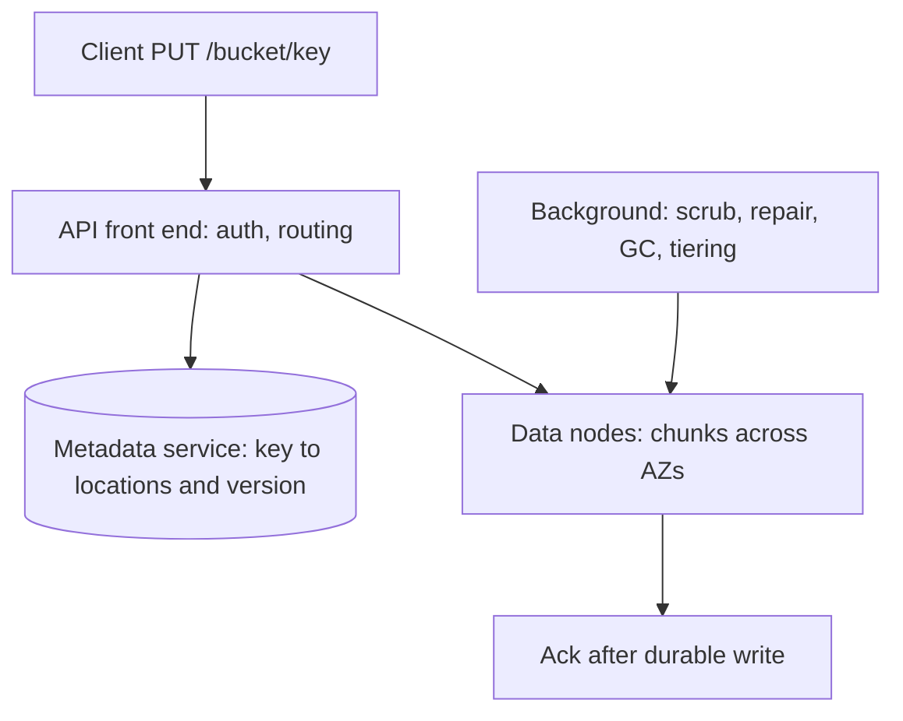

This is a typical design; AWS doesn't publish S3's exact internals, but the components above match what is publicly described and how similar systems (Ceph, MinIO, Azure Storage) are built.

#### Write path (PUT)

1. The front end authenticates the request (signature, IAM policy), finds the bucket's settings.
2. The data is streamed to storage nodes, split into chunks; each chunk is replicated or erasure-coded across **multiple availability zones** and checksummed.
3. Once enough fragments are durably stored, the front end writes the **metadata record** (key → version ID, size, checksum, chunk locations). This commit is the moment the object becomes visible.
4. The client gets `200 OK` with an ETag.

Because the metadata commit is atomic, readers see either the old object or the new one, never a half-written mix.

#### Read path (GET)

1. Look up the key in metadata (heavily cached).
2. Fetch chunks from storage nodes in parallel; verify checksums; for erasure coding, reconstruct from any sufficient subset if some nodes are slow or missing.
3. Stream to the client; supports **range requests** (`Range: bytes=...`), which video players and parallel downloaders use.

#### Metadata service

Must handle huge key counts and high request rates. It's partitioned by key (bucket + key prefix ranges) and replicated with a consensus or quorum protocol. Since S3 became strongly consistent in late 2020, a read after a successful write (including overwrite and delete) returns the latest version, and LIST reflects it.

#### Background processes

- **Scrubbing**: periodically read data and verify checksums to find silent corruption (bit rot).
- **Repair**: when a disk or node dies, rebuild its chunks elsewhere from the surviving replicas/parity, fast enough that a second failure is unlikely before repair finishes. This repair speed is what makes 11-nines durability possible.
- **Garbage collection**: deletes and overwrites just update metadata; old chunks are reclaimed later.
- **Lifecycle / tiering**: move old objects to cheaper classes (infrequent access, Glacier-style archive) or expire them.

#### Features worth mentioning

Versioning, object lock (immutability for compliance and ransomware protection), lifecycle rules, event notifications (to queues/functions), cross-region replication, multipart upload, pre-signed URLs.

**Pitfalls:**
- Hot prefixes: request rates are scaled per prefix, so very high-throughput workloads should spread keys across prefixes.
- Assuming durability equals availability: 11 nines of durability, but availability SLAs are much lower (e.g. 99.9–99.99%).

**Likely follow-ups:**
- *How do you design a mini S3 in an interview?* Front end + metadata DB (sharded by bucket/key) + storage nodes with placement across racks/AZs + repair service; discuss consistency of the metadata commit.
- *How do you handle a very popular object?* Put a CDN in front; caching layers in the store also help.

</details>

### 3. What is erasure coding and why use it instead of replication?

<details>
<summary>Answer</summary>

**In short:** Erasure coding (e.g. **Reed–Solomon**) splits data into **k data chunks** and computes **m parity chunks**; **any k of the k + m** chunks can rebuild the original. A 6 + 3 scheme survives losing any 3 chunks while using only **1.5× storage**, versus **3×** for triple replication. The cost is CPU for encoding, and slower reads and repairs that need data from several nodes, so it's used for large and colder data, while small hot data is often replicated.

#### Intuition

The simplest erasure code is RAID-5 parity: store A, B and P = A XOR B. Lose any one of the three and you can recompute it (A = P XOR B). Reed–Solomon generalises this to m parity chunks that let you survive any m losses.

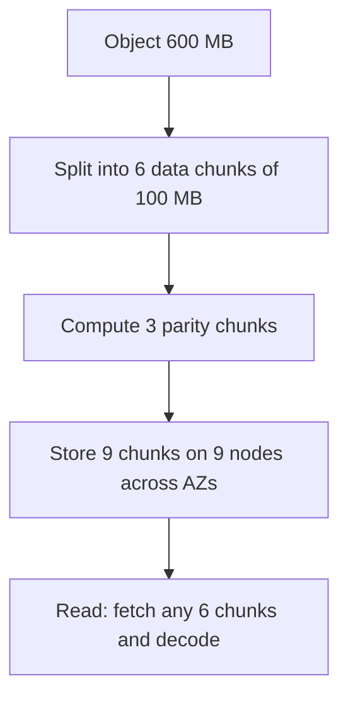

#### Replication vs erasure coding

| | 3× replication | Erasure coding 6 + 3 |
|---|---|---|
| Storage overhead | 3.0× | 1.5× |
| Failures tolerated | 2 copies lost | Any 3 chunks lost |
| Read cost | Read from 1 replica | Read from k nodes (or 1 if stored systematically and all data chunks are healthy) |
| Write cost | Write 3 full copies | Encode (CPU), write k + m smaller chunks |
| Repair cost | Copy 1 replica | Read k chunks to rebuild 1 (more network) |
| Latency | Lowest | Higher, especially on degraded reads |
| Best for | Hot, small, latency-sensitive data | Large, warm/cold data at scale |

At petabyte scale, the difference between 3× and 1.5× is half the hardware bill, which is why object stores and cold storage tiers use erasure coding heavily.

#### Practical details

- **Placement**: spread the k + m chunks across failure domains (racks, AZs) so one rack or AZ outage loses at most a few chunks.
- **Systematic codes**: the data chunks are stored as-is, so healthy reads don't need decoding; only lost chunks require reconstruction.
- **Local reconstruction codes** (used by Azure Storage, as publicly described) add local parity so a single lost chunk can be repaired from fewer nodes, cutting repair traffic.
- **Small objects** are inefficient to erasure-code individually; systems pack them into larger extents first.

**Pitfalls:**
- Erasure coding is not a backup: a delete or corruption at the application level is faithfully encoded.
- Underestimating repair bandwidth after a whole-node failure.

**Likely follow-ups:**
- *Where is erasure coding used?* Object stores (S3-style, Ceph, MinIO), HDFS 3 erasure coding, backup/archive tiers, RAID-6.
- *Why not use it for a database's disk?* Small random writes would need constant re-encoding and multi-node reads; replication is far faster.

</details>

### 4. How do you design large file uploads?

<details>
<summary>Answer</summary>

**In short:** Have the app server authorise the upload and hand back a **pre-signed URL**, so the client uploads **directly to object storage** without your servers proxying gigabytes. Use **multipart (chunked) uploads**: split the file into parts, upload them in parallel, retry only failed parts, **resume** after network drops, and then "complete" to assemble. Verify integrity with **per-chunk checksums**, optionally deduplicate by content hash, and trigger post-processing (virus scan, thumbnails, transcoding) from an upload-complete event.

#### Why not just POST to the API server?

A 2 GB video upload through your API ties up a server connection for minutes, consumes its bandwidth and memory, and if the connection drops at 95% the user starts again. Object stores are built for this traffic; your servers should only handle the control plane.

#### Flow

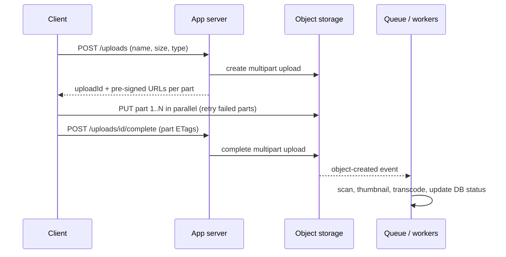

#### Key pieces

- **Pre-signed URLs**: generated after checking auth, quota, file type and size; short-lived (minutes) and scoped to one key and method. The client can't write anywhere else.
- **Multipart upload**: parts of ~5–100 MB (S3 requires at least 5 MB per part except the last, and allows up to 10,000 parts). Upload 3–6 parts concurrently. Each part returns an ETag; completion sends the list.
- **Resumability**: the client persists `uploadId` and which parts succeeded; after a crash or network change, it asks which parts exist (`ListParts`) and continues. On mobile, run it in a background transfer service so it survives the app being backgrounded.
- **Integrity**: send a checksum per part (e.g. `Content-MD5` or a SHA-256 checksum header) so the store rejects corrupted parts; store the full-file hash for later verification.
- **Deduplication** (Dropbox-style): split files into chunks, hash each, and ask the server which hashes it already has; upload only missing chunks. Saves bandwidth for re-uploads and edited files.
- **Cleanup**: lifecycle rule to abort incomplete multipart uploads after N days (otherwise orphaned parts are billed).
- **Status in the DB**: `PENDING_UPLOAD → UPLOADED → PROCESSING → READY / REJECTED`. Don't expose a file until scanning finishes.

```kotlin
// Server side: issue a pre-signed URL for a single-part upload (AWS SDK for Java v2 style)
val presignRequest = PutObjectPresignRequest.builder()
    .signatureDuration(Duration.ofMinutes(10))
    .putObjectRequest { it.bucket("uploads").key("u/$userId/$uploadId").contentType(mime) }
    .build()
val url = presigner.presignPutObject(presignRequest).url()
```

**Pitfalls:**
- Trusting client-declared size and type; enforce limits in the presigned policy and validate after upload.
- Making the uploaded object public immediately, before scanning.
- Forgetting to abort incomplete multipart uploads.

**Likely follow-ups:**
- *How do you upload from a flaky mobile network?* Small parts, retry with backoff, persist progress, resume; use the platform's background transfer APIs.
- *How do downloads work?* Pre-signed GET or signed CDN URLs, with range requests for resumable downloads and video seeking.

</details>

### 5. What is a distributed file system like HDFS/GFS?

<details>
<summary>Answer</summary>

**In short:** HDFS (modelled on Google's GFS) splits files into large **blocks (64–128 MB)**, replicates each (typically **3×**) across data nodes, and keeps the whole namespace and block map in memory on a single **NameNode** (GFS: master). Clients ask the NameNode where blocks live, then read and write **directly** to data nodes. It's optimised for **huge files and sequential batch processing** (MapReduce, Spark) with data locality, not for small files or low latency. Today, cloud object storage has largely replaced HDFS for data lakes.

#### Architecture

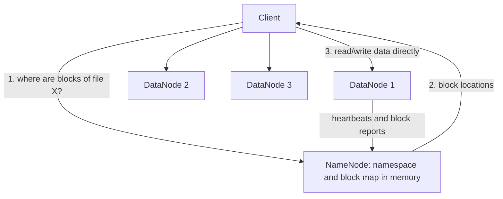

- **NameNode**: stores the directory tree, file → block list, and block → DataNode locations. Metadata changes are logged to an edit log (journal) for durability; block locations are rebuilt from DataNode reports on startup. High availability uses an active/standby NameNode pair with a shared journal and ZooKeeper-based failover.
- **DataNodes**: store blocks as local files, send heartbeats and block reports, and re-replicate on instruction when a node dies.
- **Write pipeline**: the client writes a block to DataNode 1, which forwards to 2, which forwards to 3 (pipelined). Replica placement is **rack-aware**: typically one replica on the writer's rack and two on another rack.
- **Write-once, append-only**: files can't be modified in place, which simplifies consistency.

#### Why the design choices

- **Large blocks** keep metadata small (fits in RAM) and make reads sequential and efficient.
- **Single master** keeps the design simple: one place decides placement and namespace operations, while data traffic bypasses it.
- **Data locality**: schedulers run computation on the nodes that hold the blocks ("move compute to data"), which mattered when networks were slower than disks.

#### Limitations

- **Small-files problem**: every file and block costs NameNode memory; millions of tiny files exhaust it. (Federation splits the namespace across several NameNodes.)
- Not suitable for low-latency random access or frequent updates.
- Running your own cluster: capacity planning, coupled storage and compute.

#### Why object storage took over

Cloud object storage separates storage from compute: you scale and pay for each independently, spin up Spark clusters on demand, and get higher durability with no NameNode to run. Table formats (Iceberg, Delta Lake, Hudi) on top of Parquet files in object storage now provide what HDFS + Hive did, plus transactions and schema evolution.

**Pitfalls:**
- Proposing HDFS for storing user uploads in a product design; object storage is the default.
- Forgetting the NameNode is a scaling and availability bottleneck.

**Likely follow-ups:**
- *How does GFS differ?* Very similar design (64 MB chunks, single master, chunk servers); GFS also supported atomic record appends for many concurrent writers.
- *What replaced GFS at Google?* Colossus, publicly described as distributing the metadata layer to remove the single-master limit.

</details>

---

## Search

### 6. How does full-text search work (inverted index)?

<details>
<summary>Answer</summary>

**In short:** A search engine builds an **inverted index**: a map from each **term** to the list of documents containing it (a **posting list**, often with positions and term frequencies). Documents and queries go through the same **analysis** pipeline (tokenise, lowercase, remove stop words, stem). At query time the engine looks up each query term's posting list, intersects or unions them, and **ranks** the matches with **BM25** plus business signals, increasingly combined with **vector (semantic) search** in hybrid retrieval.

#### Why not `LIKE '%pizza%'`?

A `LIKE` with a leading wildcard can't use a B-tree index, so it scans every row. It also can't handle "pizzas" vs "pizza", rank by relevance, or match "cheap pizza" to a document with the words in a different order. An inverted index answers "which documents contain this word" with one lookup.

#### The inverted index

```
"pizza" → [doc3, doc7, doc42]
"cheap" → [doc7, doc19]
```

Real posting lists store, per document, the term frequency and positions (for phrase queries like `"cheap pizza"`), are sorted by doc ID, and are compressed (delta encoding plus variable-length integers), so intersections are fast merges over sorted lists.

#### Indexing pipeline (analysis)

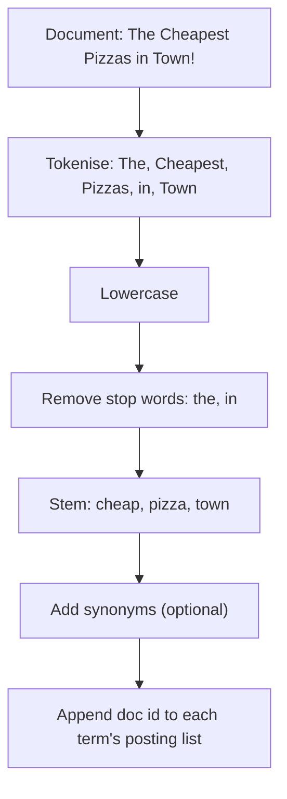

The query `"cheap pizza"` goes through the same analyser, producing `cheap`, `pizza`; intersect their lists → `doc7`. If the analysers differ between indexing and querying, matches silently fail.

#### Ranking: BM25

BM25 scores a document for a query by summing over query terms:
- **Term frequency (TF)**: more occurrences in the document → more relevant, with diminishing returns (saturation).
- **Inverse document frequency (IDF)**: rare terms ("margherita") matter more than common ones ("food").
- **Length normalisation**: a match in a short title counts more than in a 10,000-word page.

Production search adds more: field boosts (title > body), freshness, popularity, personalisation, location, and often a **learning-to-rank** model re-ranking the top few hundred results.

#### Hybrid and semantic search

Keyword search fails on meaning ("affordable Italian food" vs "cheap pizza"). **Vector search** embeds queries and documents with an ML model and finds nearest neighbours (approximate nearest neighbour indexes like HNSW). **Hybrid search** runs both and fuses scores (e.g. reciprocal rank fusion), getting exact-term precision plus semantic recall. Elasticsearch/OpenSearch, Vespa and dedicated vector databases support this.

#### How Lucene stores it

The index is a set of immutable **segments**. New documents go into a new small segment; deletes are marked in a bitmap; background **merges** combine segments. Immutability makes caching and concurrency simple, and is why updates are "delete + re-add".

**Pitfalls:**
- Different analysers at index and query time.
- Over-aggressive stemming hurting precision (e.g. "university" and "universe" stemming to the same root).
- Forgetting language-specific analysis (CJK languages need different tokenisation).

**Likely follow-ups:**
- *How do you support typos?* Fuzzy queries using edit distance (Levenshtein automata) or n-gram indexes.
- *How do you do phrase search?* Use stored positions and check that terms appear adjacently.

</details>

### 7. How does Elasticsearch scale, and how do you keep it in sync with the database?

<details>
<summary>Answer</summary>

**In short:** An Elasticsearch **index** is split into **primary shards** (each a Lucene index) with **replica** shards on other nodes; queries **scatter** to one copy of every shard and **gather** the top results. Choose shard count up front (changing it means reindexing or split/shrink operations) and use time-based indices for logs. Documents become searchable after a **refresh** (~1 s by default). It's **not** your source of truth: keep data in the primary database and sync via **CDC** (Debezium → Kafka → indexer) or an outbox, with periodic full reindexes swapped in atomically via **aliases**.

#### Scaling model

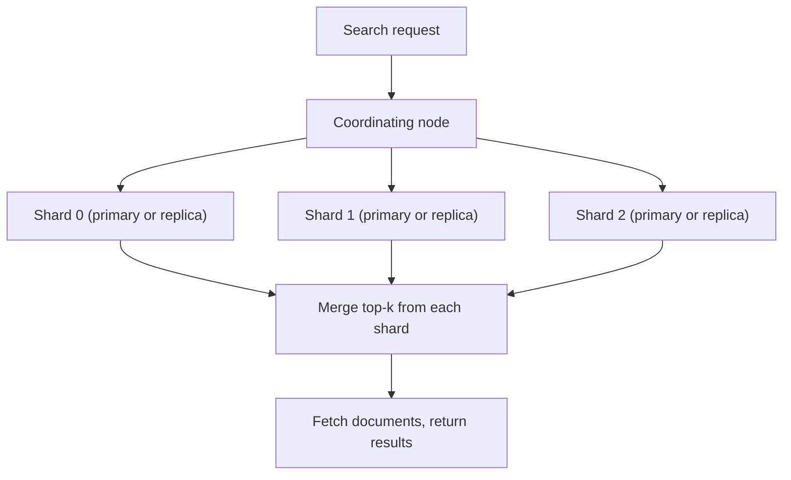

- **Writes** are routed to a shard by `hash(_routing or _id) % number_of_primary_shards`, indexed on the primary, then replicated. That's why the primary shard count can't simply change.
- **Reads** (query then fetch): each shard returns its top-k doc IDs and scores, the coordinator merges them and then fetches the actual documents.
- **Replicas** add read throughput and fault tolerance.
- **Sizing**: commonly cited guidance is shards in the tens of GB each; too many tiny shards waste memory and coordination, too few huge shards make recovery slow.
- **Custom routing** (e.g. by `tenant_id`) lets a query hit one shard instead of all.
- **Logs and events**: time-based indices (`logs-2026.11.20`) or data streams with lifecycle policies (hot → warm → cold → delete), so old data is dropped by deleting whole indices.

#### Near-real-time

Writes go to an in-memory buffer and a translog (for durability). A **refresh** (default every 1 s) turns the buffer into a new searchable segment. So a document is searchable about a second after indexing; a test that writes and immediately searches may miss it. Increase the refresh interval for heavy bulk loads.

#### Why it's not the primary database

No multi-document transactions, eventual visibility, historically weaker guarantees around some failure scenarios, and mapping changes often require reindexing. Treat it as a **derived read model** you can rebuild.

#### Keeping it in sync

| Approach | How | Trade-off |
|---|---|---|
| Dual write from app | App writes DB, then ES | Inconsistent on crashes; avoid |
| Outbox | App writes outbox row in same transaction; relay indexes | Reliable, app controls the event shape |
| **CDC** | Debezium reads DB log → Kafka → indexer service → ES bulk API | Reliable, no app changes, ordered per key |
| Periodic batch | Reindex from DB on a schedule | Simple, stale between runs |

Make the indexer **idempotent** (upsert by document ID; use external versioning with the DB's version or LSN so an out-of-order older event can't overwrite a newer one). For mapping changes or backfills, build a new index in the background, then atomically switch the **alias** (`products` → `products_v2`) so clients never notice.

**Pitfalls:**
- Deep pagination with `from` + `size` (expensive); use `search_after`.
- Unbounded dynamic mappings (mapping explosion from arbitrary JSON keys).
- Over-sharding small indices.

**Likely follow-ups:**
- *How do you handle a reindex while writes continue?* Write to both old and new indices (or replay the CDC stream from the snapshot point) until the alias switch.
- *Elasticsearch vs OpenSearch?* OpenSearch is the AWS-led fork of Elasticsearch 7.10; concepts are the same.

</details>

### 8. How would you implement search autocomplete (typeahead)?

<details>
<summary>Answer</summary>

**In short:** Precompute, offline from query logs, the **top-k completions for every prefix** (a **trie** where each node stores its top suggestions, weighted by frequency and recency), serve them from memory sharded by prefix, and cache hot prefixes at the CDN and on the client. Rebuild periodically and blend in real-time trending terms separately. On the client, **debounce** keystrokes, cancel stale requests and cache per prefix. Alternatives: Elasticsearch completion suggester / edge n-grams or Redis sorted sets. Full design in [Core Infrastructure Designs](16-designs-core-infrastructure.md).

#### Requirements that shape the design

- Very low latency: suggestions must appear as you type (target ~100 ms end to end).
- Very high read QPS: every keystroke can be a request.
- Data changes slowly (popular queries shift over hours), except trending events.

So: **precompute, keep in memory, cache aggressively.**

#### Trie with top-k at each node

Walking a trie from a prefix and collecting all descendants is too slow for short prefixes ("a" has millions of completions). Instead each node stores its precomputed top-k list:

```text
root
 └─ "p"  top: [pizza, paypal, pinterest]
     └─ "pi" top: [pizza, pinterest, pizza hut]
         └─ "piz" top: [pizza, pizza hut, pizza near me]
```

A lookup is O(length of prefix) and returns the stored list directly.

#### Pipeline

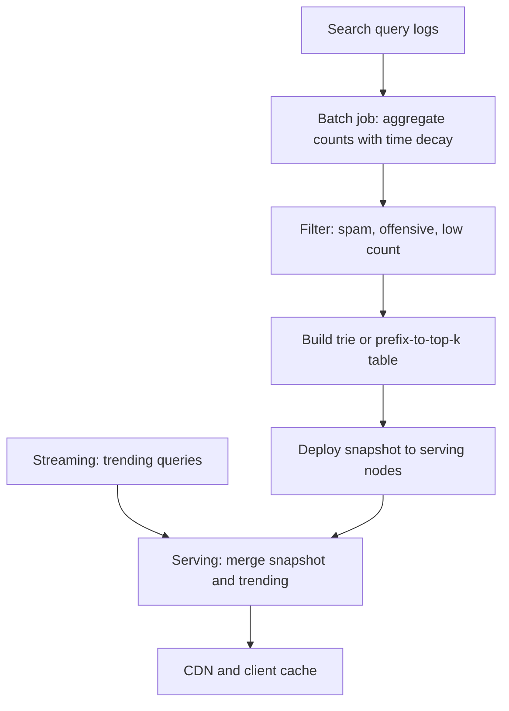

- **Offline build** (e.g. hourly or daily) from logs, with weights `count × decay(age)`.
- **Serving**: the whole structure often fits in memory on each node; if not, shard by prefix range (and beware of skew: "s" is far bigger than "x").
- **Trending**: a streaming job (count-min sketch / heavy hitters over the last few minutes) feeds a small overlay merged at query time.
- **Personalisation**: blend the user's recent searches client-side or in a small per-user store.
- **Storage alternative**: a key-value table `prefix → top-k list` (Redis/DynamoDB) works for prefixes up to a fixed length.

#### Alternatives

- **Elasticsearch completion suggester** (in-memory FST, very fast for prefix lookups) or **edge n-gram** analysers (index "piz", "pizz", "pizza") on a text field.
- **Redis sorted sets** per prefix (`ZINCRBY` to update scores, `ZREVRANGE` for top-k).

#### Client side

```kotlin
// Debounce, drop stale results, cache per prefix (Kotlin Flow)
queryFlow
    .debounce(150)
    .map { it.trim().lowercase() }
    .filter { it.isNotEmpty() }
    .distinctUntilChanged()
    .mapLatest { prefix -> cache[prefix] ?: api.suggest(prefix).also { cache[prefix] = it } } // cancels old request
    .collect { render(it) }
```

**Pitfalls:**
- Querying the primary search index with wildcard queries on every keystroke.
- Not filtering offensive or personal-data suggestions.
- Ignoring that short prefixes are the hottest keys; cache them hardest.

**Likely follow-ups:**
- *How fresh are suggestions?* Base snapshot hourly or daily; trending overlay within minutes.
- *How do you support typos?* Fuzzy matching on the suggester, or a spelling-correction step before lookup.

</details>

---

## Geospatial

### 9. How do you find nearby points efficiently (geospatial indexing)?

<details>
<summary>Answer</summary>

**In short:** A plain `WHERE lat BETWEEN ... AND lng BETWEEN ...` can only use one B-tree index dimension well, so we map 2D space to something indexable: **geohash** (base-32 strings where nearby points share prefixes; query a cell plus its 8 neighbours; built into Redis), **quadtrees** (split cells until each holds ≤ N points, adapting to density), **Google S2** and **Uber H3** (hierarchical cells on a sphere; H3 uses hexagons), or **R-trees** in PostGIS for shapes. Geohash/Redis suits simple "nearby restaurants"; quadtree/S2/H3 suit dense, dynamic data like drivers.

#### Why the naive query is slow

An index on `lat` narrows to a horizontal band around the whole planet; the database then filters every row in that band by `lng`. A composite index helps only on the first column. We need an index where "close in space" means "close in the index".

#### Geohash

Alternately bisect longitude and latitude, interleave the bits, and encode them in base 32. Each extra character makes the cell smaller (roughly: 5 chars ≈ 5 km, 6 ≈ 1.2 km × 0.6 km, 7 ≈ 150 m).

```text
Restaurant at (37.7749, -122.4194) -> geohash "9q8yyk"
Query: user's cell "9q8yy" + its 8 neighbours -> candidate set -> exact distance filter -> sort
```

```sql
CREATE INDEX idx_places_geohash ON places (geohash6);
SELECT * FROM places WHERE geohash6 IN (:cell, :n1, :n2, :n3, :n4, :n5, :n6, :n7, :n8);
```

Why neighbours: two points a metre apart can sit on opposite sides of a cell boundary and share no prefix. Cells also get narrower toward the poles. Redis implements this for you: `GEOADD`, `GEOSEARCH key FROMLONLAT lng lat BYRADIUS 2 km ASC COUNT 20`.

#### Quadtree

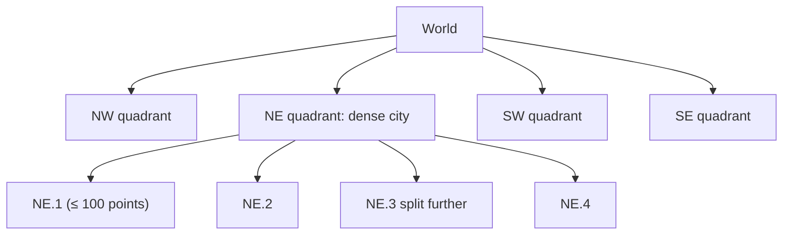

Recursively split a region into four until each leaf has at most N points. Dense downtown areas get tiny cells and the countryside stays coarse, so every leaf holds a similar amount of data. Usually built in memory on each server (a few hundred million points fit) and rebuilt or updated incrementally. Search: find the leaf for the user, expand to neighbouring leaves until you have enough results.

#### S2 and H3

- **S2** (Google): projects the sphere onto a cube and orders cells along a **Hilbert curve**, so cell IDs are 64-bit integers where nearby cells usually have nearby IDs. A region is "covered" by a small set of ID ranges, queried with ordinary range scans. Used in Google Maps and many databases.
- **H3** (Uber): a hierarchical **hexagonal** grid. Every hexagon's 6 neighbours are equidistant from its centre, which makes it great for aggregation, heatmaps and surge pricing by area.

#### R-trees

Group nearby objects into nested bounding rectangles. Supports points and **shapes** (polygons, delivery zones, "which region contains this point"). Available via PostGIS (GiST indexes), MySQL spatial indexes, SQLite R*Tree.

| Approach | Strength | Weakness | Typical use |
|---|---|---|---|
| Geohash | Simple strings, any DB/KV, Redis built-in | Edge cases, uneven cells | Nearby places, Redis geo |
| Quadtree | Adapts to density | Custom in-memory structure | Location services like Yelp-style search |
| S2 | Uniform-ish cells, range scans on integer IDs | More complex | Maps, geofencing |
| H3 | Equal-distance neighbours, aggregation | Hexagons don't nest perfectly | Ride-hailing, analytics |
| R-tree / PostGIS | Shapes, rich queries | Single DB scaling | GIS, polygons, zones |

**Pitfalls:**
- Forgetting the exact-distance filter after the cell lookup (cells are squares, the query is a circle).
- Using straight-line distance when users care about travel time.

**Likely follow-ups:**
- *How do you handle a radius bigger than one cell?* Use a shorter geohash prefix (bigger cells) or a cover of multiple cells.
- *How do you scale reads?* Places data changes rarely, so replicate the index widely and cache popular areas.

</details>

### 10. How do you store and query moving objects (e.g. drivers) at scale?

<details>
<summary>Answer</summary>

**In short:** Driver locations are a firehose of short-lived data (every few seconds per driver), so keep **current positions in memory** (Redis geo sets or an in-memory grid service) **sharded by region/cell**, not in a durable database row per ping. Index drivers by cell (geohash/H3) and move them between cells as they travel. Stream all pings through **Kafka** for trip history and analytics in batch storage. To match, look up the rider's cell plus neighbours, filter by availability, and rank by **ETA**, not straight-line distance.

#### Estimates

Say 1 million active drivers each sending a location every 4 s → **250,000 writes per second**, each ~100 bytes. Every value is useless after a few seconds; only the latest matters for matching. A relational DB updating one row per ping at that rate is wasteful and the index churn hurts. In-memory structures handle this easily.

#### Architecture

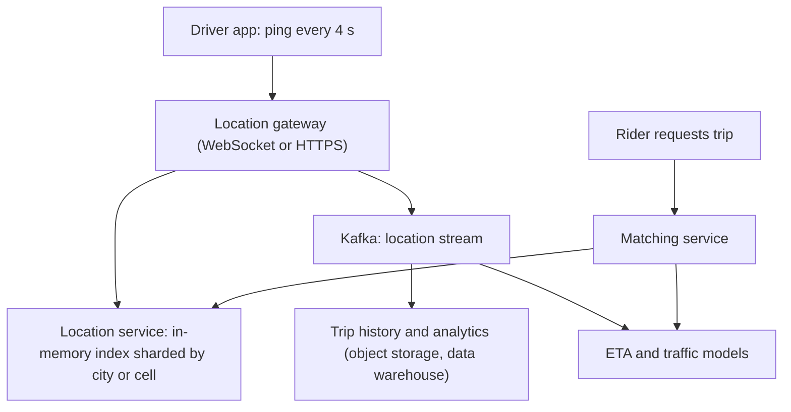

#### Storing current location

- **Redis**: `GEOADD drivers:sf <lng> <lat> driver:123`, plus a hash with status and a TTL heartbeat key so drivers who stop sending are dropped. Shard by city/region so each Redis instance holds one area.
- **In-memory grid service**: each node owns a set of cells (H3/geohash); a map `cell → set of drivers` and `driver → (cell, lat, lng, status, timestamp)`. On each ping, if the driver changed cell, remove from the old cell and add to the new one.
- Locations can be lost in a node crash; that's acceptable, because drivers resend within seconds. Replicate for availability if needed, but don't pay for durability.

#### Matching query

1. Find the rider's cell; get drivers in that cell plus neighbours (expand rings until enough candidates).
2. Filter: available, right vehicle type, recent heartbeat.
3. Rank by **ETA** using the road network and traffic, not crow-flies distance (a river or highway can make the nearest driver 15 minutes away).
4. Offer the trip to the best driver; lock them for the offer window (atomic status change, so two riders can't get the same driver).

#### Hot spots

Downtown at rush hour or a stadium after a game concentrates drivers and riders in a few cells. Use smaller cells there (quadtree-style adaptive splitting or finer H3 resolution), and shard by cell rather than by city if one city overwhelms a node.

**Pitfalls:**
- Writing every ping to the primary database.
- Ranking by straight-line distance.
- Not expiring stale drivers (app killed, no "offline" event).

**Likely follow-ups:**
- *How do riders see the driver move?* Push the assigned driver's pings to the rider over a WebSocket/push channel, with client-side interpolation between updates.
- *How do you reduce ping volume?* Adaptive frequency: more often while on a trip or moving fast, less when idle.

</details>

---

## Time-Series & Probabilistic Structures

### 11. What makes time-series databases special?

<details>
<summary>Answer</summary>

**In short:** Time-series data (metrics, IoT readings, prices) is **append-mostly**, arrives roughly in time order, is queried by **time range** and **aggregated**, and loses value with age. TSDBs (Prometheus, InfluxDB, TimescaleDB, M3, VictoriaMetrics) exploit this with **time-partitioned storage** (cheap retention by dropping whole chunks), aggressive **compression** (delta-of-delta timestamps, XOR-encoded floats from Facebook's Gorilla paper, often 10×+), **downsampling/rollups**, and an index on series **labels**. The main pitfall is **high cardinality**: labels like user IDs explode the number of series.

#### The data model

A **series** is identified by a metric name plus labels, and holds a list of `(timestamp, value)` samples:

```text
http_requests_total{service="checkout", region="eu-west", status="500"}
  (1700000000, 1042) (1700000010, 1047) (1700000020, 1051) ...
```

Typical queries: "p99 latency of checkout over the last hour, by region", "average CPU per host in 5-minute buckets for the last week".

#### Why a general-purpose DB struggles

A row per sample in Postgres with a B-tree index means huge write amplification, large storage per sample (row overhead dwarfs an 8-byte float), and deleting old data row by row is slow and bloats the table. TSDBs are built around the access pattern.

#### Techniques

| Technique | What it does | Why it works |
|---|---|---|
| **Time-partitioned chunks** | Data stored in blocks per hour/day (Prometheus: 2-hour blocks; TimescaleDB: hypertable chunks) | Queries touch only relevant chunks; **retention** = delete old chunk files, nearly free |
| **Columnar, per-series storage** | Timestamps and values of one series stored together | Sequential reads, great compression |
| **Delta-of-delta timestamps** | Store change in interval, usually 0 for regular scrapes | Many timestamps take about 1 bit |
| **XOR float encoding** (Gorilla) | Store XOR with previous value, which is mostly zeros | Slowly changing values compress to a few bits |
| **Downsampling / rollups** | Keep 10 s resolution for a week, 5 min for a month, 1 h for a year | Long-range queries scan far less data |
| **Inverted index on labels** | `label=value → series IDs` | Fast selection like `{service="checkout"}` |
| **Write buffering** | Recent data in memory + WAL, flushed as compressed blocks | High ingest throughput |

Facebook's Gorilla paper reported an average of about 1.37 bytes per sample using these encodings, versus 16 bytes raw.

#### Cardinality

Each unique combination of label values is a separate series with its own index entries and in-memory state. `status` (5 values) × `region` (10) × `service` (200) = 10,000 series: fine. Add `user_id` (10 million) and you have 100 billion potential series: memory blows up and queries crawl. Rules: labels should have bounded values; put high-cardinality identifiers in logs or traces, not metric labels.

#### Choosing

- **Prometheus**: pull-based monitoring, local storage; scale out with Thanos, Cortex/Mimir or VictoriaMetrics for long-term and global views.
- **TimescaleDB**: Postgres extension; full SQL and joins with relational data.
- **InfluxDB**: push-based metrics and IoT.
- **Columnar analytics stores** (ClickHouse, Druid) for high-cardinality event analytics.

**Pitfalls:**
- High-cardinality labels.
- Storing raw data forever without downsampling.
- Averaging percentiles across hosts (mathematically wrong); use histograms and compute percentiles from merged buckets.

**Likely follow-ups:**
- *Pull vs push metrics?* Pull (Prometheus scrapes) makes it easy to detect dead targets; push suits short-lived jobs and devices behind NAT.
- *How do you handle late or out-of-order samples?* Many TSDBs accept them within a window; beyond it they're dropped or need special configuration.

</details>

### 12. What is a Bloom filter and where is it used?

<details>
<summary>Answer</summary>

**In short:** A Bloom filter is a compact probabilistic set that answers "**is X in the set?**" with either "**definitely not**" or "**probably yes**": **no false negatives**, and a tunable **false-positive** rate. It's a bit array plus k hash functions: adding an item sets k bits; a lookup checks those k bits. It's used to skip expensive lookups that would find nothing: LSM-tree databases skipping SSTables, caches blocking lookups of non-existent keys, crawlers tracking visited URLs. A standard Bloom filter can't delete items (counting Bloom filters and cuckoo filters can).

#### How it works

```python
import hashlib

class BloomFilter:
    def __init__(self, m_bits: int, k: int):
        self.m, self.k = m_bits, k
        self.bits = bytearray(m_bits // 8 + 1)

    def _positions(self, item: str):
        # k positions via double hashing from one strong hash
        h = hashlib.sha256(item.encode()).digest()
        h1, h2 = int.from_bytes(h[:8], "big"), int.from_bytes(h[8:16], "big")
        return [(h1 + i * h2) % self.m for i in range(self.k)]

    def add(self, item: str):
        for p in self._positions(item):
            self.bits[p // 8] |= 1 << (p % 8)

    def might_contain(self, item: str) -> bool:
        return all(self.bits[p // 8] & (1 << (p % 8)) for p in self._positions(item))
```

- If any of the k bits is 0, the item was **never added** (definite no).
- If all are 1, either it was added or other items happened to set those bits (false positive).

#### Sizing

With n items and a target false-positive rate p:
- Bits needed: m ≈ −n · ln(p) / (ln 2)²
- Best number of hashes: k ≈ (m / n) · ln 2

Rule of thumb: about **10 bits per item gives ~1%** false positives (with k ≈ 7); ~14–15 bits per item gives ~0.1%. So 100 million items at 1% fits in roughly 120 MB, regardless of how big the items are.

#### Where it's used

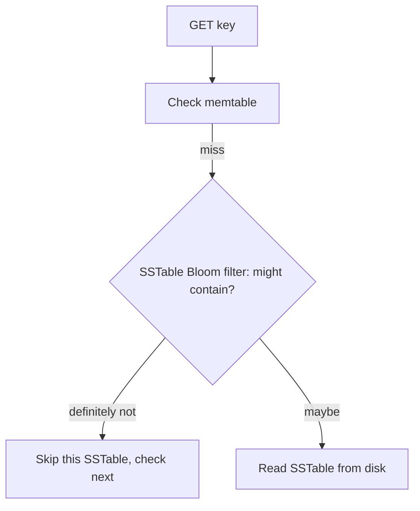

- **LSM-tree databases** (Cassandra, RocksDB, HBase, LevelDB): one filter per SSTable avoids disk reads for keys that aren't there.
- **Cache penetration protection**: requests for IDs that don't exist bypass the cache and hammer the DB; a Bloom filter of valid IDs rejects them early.
- **Web crawlers**: "have I already visited this URL?" for billions of URLs.
- **Username availability pre-check**: "definitely free" answered from the filter; "maybe taken" confirmed against the DB.
- **Malicious URL lists** shipped to browsers or clients compactly, and recommendation systems filtering already-shown items.

#### Variants

- **Counting Bloom filter**: small counters instead of bits, so deletes are possible (more memory).
- **Cuckoo filter**: supports deletes and often uses less space at low false-positive rates.
- **Scalable Bloom filters**: chain filters as the set grows. Redis Stack's Bloom module provides these as `BF.ADD` / `BF.EXISTS`.

**Pitfalls:**
- Overfilling: inserting far more than the designed n makes false positives soar; size for growth or rebuild.
- Expecting to list or delete members.
- Using it where a false positive is unacceptable without a confirming lookup.

**Likely follow-ups:**
- *Why no false negatives?* Bits are only ever set, never cleared, so an added item's bits stay 1.
- *Bloom filter vs hash set?* A hash set stores the items (exact, large); a Bloom filter stores a few bits per item (approximate, tiny).

</details>

### 13. What are HyperLogLog and Count-Min Sketch?

<details>
<summary>Answer</summary>

**In short:** **HyperLogLog (HLL)** estimates the **number of distinct elements** (cardinality) in a set using a fixed, tiny amount of memory (Redis uses ~12 KB per key for ~0.81% standard error), no matter whether there are thousands or billions of items, and HLLs from different shards or time windows can be **merged**. **Count-Min Sketch (CMS)** estimates **how often each item appears** in a stream using fixed memory; it can **overcount but never undercounts**, and combined with a heap it finds **heavy hitters / top-K**. Both trade exactness for huge memory savings.

#### The problem

"How many unique visitors did we have today?" Exactly: keep a set of every visitor ID → gigabytes per day per page, and merging across days means unioning huge sets. "Which hashtags are trending?" Exactly: a counter per distinct hashtag, unbounded. At web scale, ±1% is fine.

#### HyperLogLog: intuition

Hash every item to a uniformly random bit string. Seeing a hash that starts with many leading zeros is rare: a run of k leading zeros happens with probability 1/2^k, so if the longest run you've seen is k, you've probably seen about 2^k distinct items. One such estimate is noisy, so HLL splits hashes into many **buckets** (using the first bits of the hash), tracks the maximum run per bucket, and combines them with a harmonic mean plus bias corrections.

- Duplicates don't change anything (same hash, same bucket, same max) → it counts **distinct** items.
- Merge = take the max per bucket → union of sets, exactly as if counted together.

```text
PFADD visitors:2026-11-20 user:17 user:42 user:17
PFCOUNT visitors:2026-11-20                    -> 2 (approximately)
PFMERGE visitors:week visitors:2026-11-14 ... visitors:2026-11-20
PFCOUNT visitors:week                          -> weekly uniques, no double counting
```

Uses: unique visitors per page, distinct search queries, distinct IPs (DDoS detection), `APPROX_COUNT_DISTINCT` in BigQuery and other warehouses.

#### Count-Min Sketch: how it works

A 2D array of counters with **d rows** and **w columns**, each row with its own hash function.

- **Add x**: for each row i, increment `counter[i][hash_i(x) % w]`.
- **Estimate x**: take the **minimum** of the d counters for x.

Collisions only add counts from other items, so every counter is ≥ the true count; taking the minimum picks the least polluted. Hence: overestimates possible, underestimates never. Width controls the error size and depth the probability of a bad estimate.

#### Top-K / heavy hitters

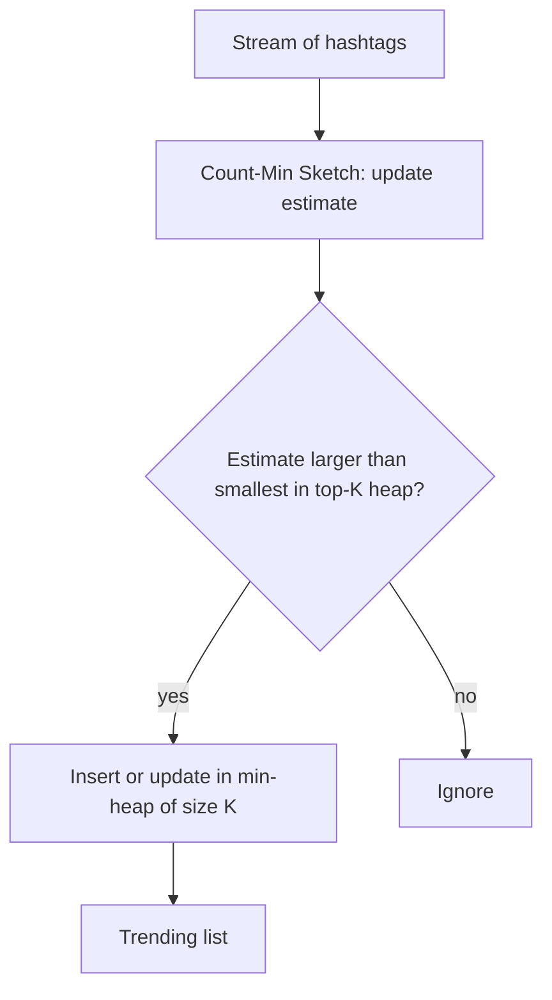

Keep one sketch per time window (e.g. per minute) to make "trending in the last 10 minutes" possible, merging windows by adding counter arrays. Used for trending topics, hot-key detection in caches, top talkers in network monitoring, and rate-limiting by heavy users.

| | HyperLogLog | Count-Min Sketch | Bloom filter |
|---|---|---|---|
| Question | How many distinct items? | How often has item x appeared? | Has x been seen? |
| Error | ± ~1% | Overcount only | False positives only |
| Memory | Fixed (KBs) | Fixed (w × d counters) | ~10 bits per item for 1% |
| Mergeable | Yes (max per register) | Yes (add arrays) | Yes (OR bits, same size) |

**Pitfalls:**
- Using HLL when you need the actual list of users; it only gives a count.
- CMS on very low-frequency items: the overcount dominates; it's for finding big items.

**Likely follow-ups:**
- *Exact uniques for billing?* Use exact methods (dedupe tables, batch jobs); approximate structures are for dashboards and analytics.
- *How do you find top-K exactly?* With MapReduce/Spark over the full data in batch, often combined with a streaming approximate result (lambda-style).

</details>

### 14. What other data structures commonly appear in system design?

<details>
<summary>Answer</summary>

**In short:** Beyond hash maps and B-trees, the usual suspects are: **Merkle trees** (find which data differs between replicas cheaply), **skip lists** (ordered data with O(log n) operations; Redis sorted sets, LSM memtables), **tries** (prefix lookup for autocomplete and routing), **consistent hash rings** (partitioning with minimal data movement), **ring buffers** (fixed-size queues), and **sorted sets** (leaderboards, sliding-window rate limits, delayed jobs). Knowing *where* each shows up lets you justify design choices quickly.

#### Merkle trees

A tree where each leaf is the hash of a data block and each parent is the hash of its children. Two replicas compare **root hashes**; if equal, the data is identical. If not, they descend only into subtrees whose hashes differ, finding the out-of-sync ranges by exchanging O(log n) hashes instead of all data.

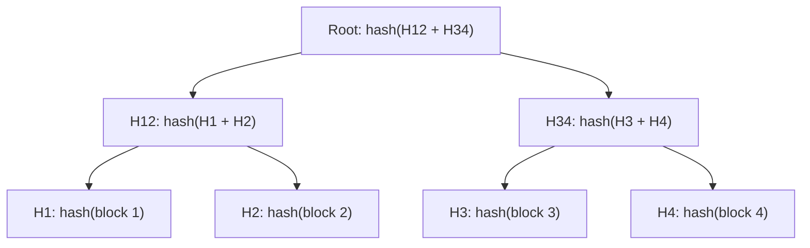

Used in Cassandra and Dynamo-style anti-entropy repair, Git (commits and trees are content-addressed hashes), blockchains (transaction proofs), certificate transparency logs, and file sync tools.

#### Skip lists

A sorted linked list with extra "express lane" levels chosen randomly, giving O(log n) search, insert and delete, plus easy ordered iteration and range scans. Simpler to make concurrent than balanced trees. Used in **Redis sorted sets** (with a hash map for O(1) score lookup) and the memtables of LevelDB/RocksDB.

#### Tries

Trees keyed by characters (or bits): lookup cost depends on key length, not the number of keys, and all keys with a prefix share a subtree. Used for **autocomplete**, spell checkers, and **IP routing tables** (longest prefix match, often as compressed radix trees). HTTP routers use radix trees to match URL paths.

#### Consistent hash ring

Nodes and keys are hashed onto a ring; each key belongs to the next node clockwise. Adding or removing a node moves only about 1/N of keys, instead of nearly all with `hash % N`. Virtual nodes smooth out load. Used in Dynamo, Cassandra, Memcached clients, and load balancers. (See [Replication, Partitioning & Sharding](08-replication-sharding.md).)

#### Ring buffers

A fixed-size array with read and write pointers that wrap around; when full, it overwrites the oldest data or rejects writes. Constant memory, no allocation, cache-friendly. Used for in-memory log buffers, recent-metrics windows, audio/video buffers, and high-performance queues (e.g. the LMAX Disruptor, Linux `io_uring` submission/completion queues).

#### Sorted sets

A set ordered by a score (Redis `ZSET`):
- **Leaderboards**: `ZINCRBY board 10 user:7`, `ZREVRANGE board 0 9 WITHSCORES`, `ZREVRANK board user:7`.
- **Sliding-window rate limiting**: timestamps as scores; `ZREMRANGEBYSCORE` drops old ones, `ZCARD` counts the window.
- **Delayed job queues**: score = run-at time; workers poll `ZRANGEBYSCORE queue 0 <now>`.

| Structure | Key property | Typical use |
|---|---|---|
| Merkle tree | Efficient diff of large datasets | Replica repair, Git, sync |
| Skip list | Ordered, O(log n), concurrent-friendly | Redis ZSET, memtables |
| Trie / radix tree | Prefix lookup | Autocomplete, routing |
| Consistent hash ring | Minimal rebalancing | Partitioning, caches |
| Ring buffer | Fixed memory FIFO | Buffers, queues |
| Sorted set | Order by score + fast rank | Leaderboards, rate limits, schedulers |
| B+ tree / LSM tree | Disk-friendly indexes | Relational DBs / write-heavy KV stores |

**Pitfalls:**
- Naming a structure without explaining why it fits the access pattern; interviewers want the reasoning.

**Likely follow-ups:**
- *Why does Redis use a skip list instead of a balanced tree?* Simpler implementation, easy range operations, comparable performance; its author has said as much publicly.
- *B-tree vs LSM-tree?* B-trees favour reads and in-place updates; LSM trees favour high write throughput with compaction and Bloom filters for reads.

</details>

### 15. How do you design backups and disaster recovery for data?

<details>
<summary>Answer</summary>

**In short:** Start from two numbers: **RPO** (how much data you can afford to lose) and **RTO** (how quickly you must be back). Combine periodic **full snapshots** with continuous **WAL/binlog archiving** for point-in-time recovery, store backups in **another region and account** with **immutability** (object lock), remember that **replicas are not backups** (they replicate deletes and corruption instantly), and **test restores regularly**: an untested backup doesn't exist.

#### RPO and RTO drive everything

| Target | Approach | Cost |
|---|---|---|
| RPO 24 h, RTO hours | Nightly snapshot to object storage | Cheap |
| RPO minutes, RTO ~1 h | Snapshots + continuous log archiving (PITR) | Moderate |
| RPO seconds, RTO minutes | Plus a warm standby in another region (async replica) | Higher |
| RPO ~0, RTO seconds–minutes | Synchronous multi-region replication / multi-region DB, automated failover | Highest; adds write latency |

Different data deserves different tiers: payments may need near-zero RPO; a recommendations cache can be rebuilt from scratch.

#### What a solid setup looks like

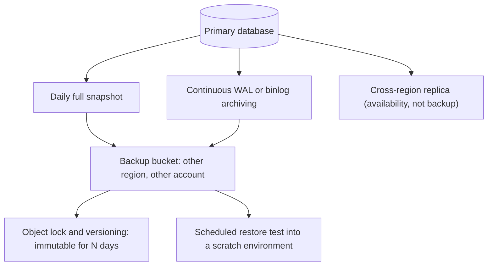

- **Point-in-time recovery (PITR)**: restore the latest snapshot before the incident, then replay logs up to just before the bad event ("restore to 14:31:59, one second before someone ran `DELETE` without a `WHERE`").
- **Isolation**: a separate cloud account with separate credentials, so an attacker or a buggy script with production access can't delete backups. Follow the **3-2-1** rule: 3 copies, 2 different media/services, 1 off-site.
- **Immutability**: object lock / WORM retention protects against ransomware and accidental deletion.
- **Encryption**: encrypt backups, and back up the keys separately; a backup you can't decrypt is useless.
- **Retention**: e.g. daily for 30 days, monthly for a year, respecting legal requirements (and deletion obligations such as GDPR erasure).
- **Everything, not just the DB**: object storage (versioning + cross-region replication), configuration, secrets, infrastructure as code, message queues if they hold unique data.

#### Why replicas are not backups

A replica copies every change within milliseconds, including `DROP TABLE`, a bad migration, an application bug that corrupts rows, and ransomware encryption. Replicas protect against **hardware/zone failure** (availability); backups protect against **logical errors and malice** (recoverability). You need both. A **delayed replica** (applying changes an hour late) is a useful middle ground.

#### Test restores

Automate a restore into a scratch environment on a schedule, run integrity checks (row counts, checksums, application smoke tests), and measure how long it took: that's your real RTO. Run disaster-recovery drills (fail over a region) so the runbook, DNS changes and permissions are proven before you need them.

**Pitfalls:**
- Backups in the same account and region as production.
- Never having timed a full restore; multi-terabyte restores can take many hours.
- Forgetting backups when data is spread across many services and stores (consistency between them at restore time).

**Likely follow-ups:**
- *How do you back up a sharded database consistently?* Snapshot all shards at a coordinated point (or use PITR to the same timestamp on each) and accept or reconcile small cross-shard skew.
- *Active-active vs active-passive DR?* Active-passive is simpler and cheaper but has failover time; active-active gives near-instant failover but needs conflict handling or partitioned ownership.

</details>

---

[⬅ Previous: Consistency, Transactions & Consensus](09-consistency-transactions-consensus.md) · [⬅ Back to index](../README.md) · [Next: Messaging & Event-Driven Architecture ➡](11-messaging-event-driven.md)
