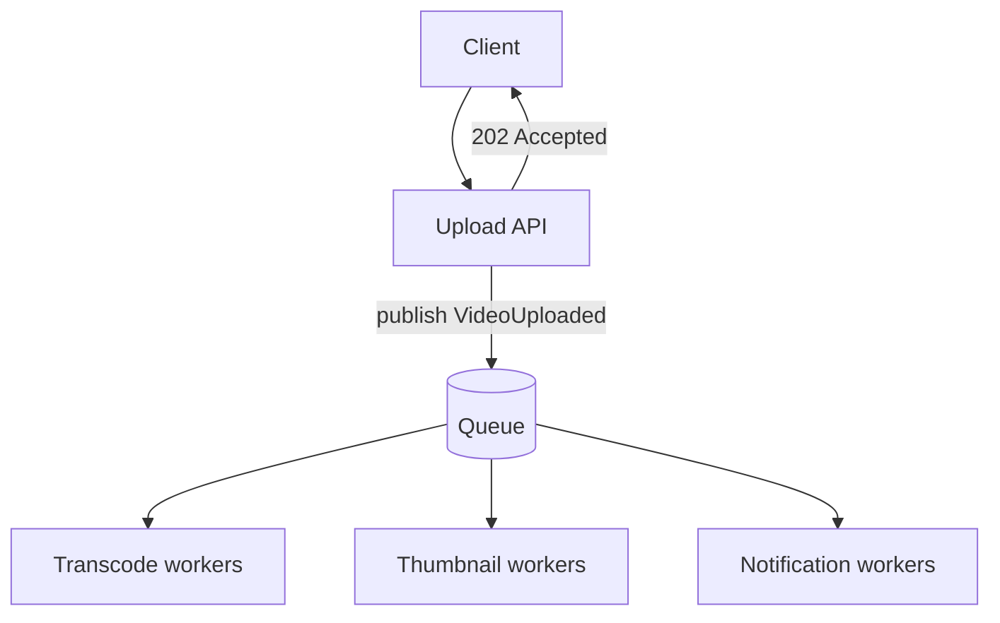
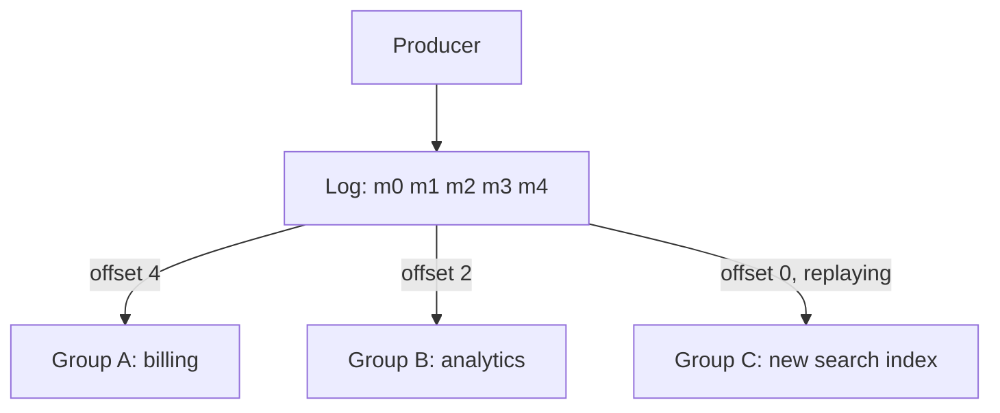
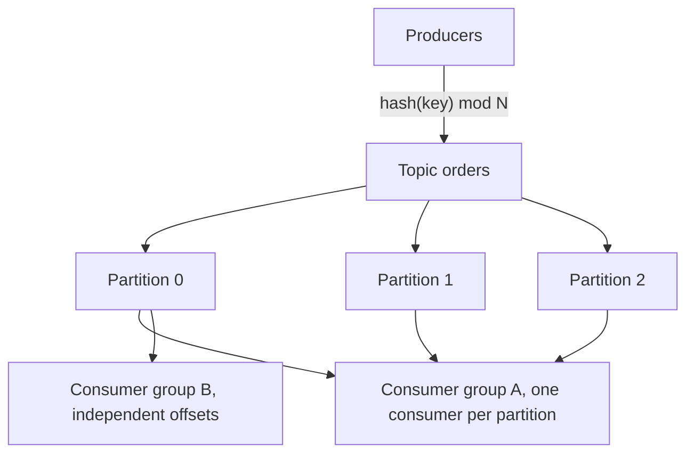
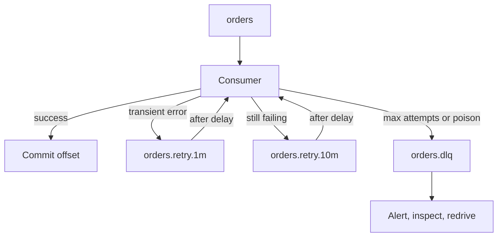
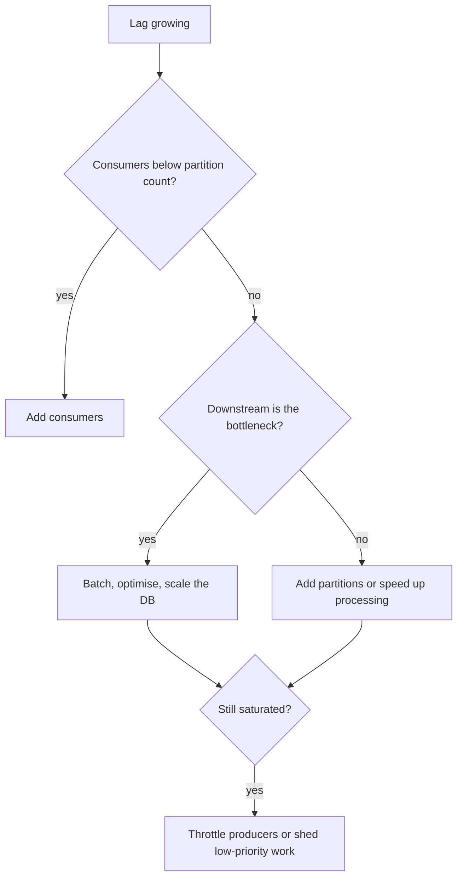
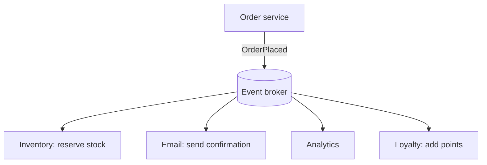
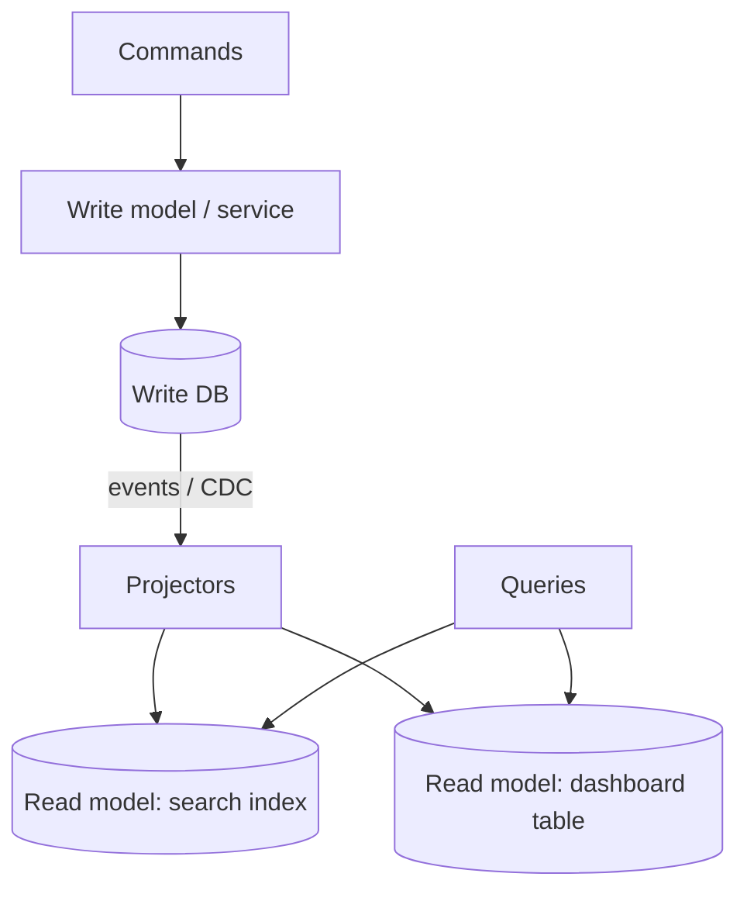
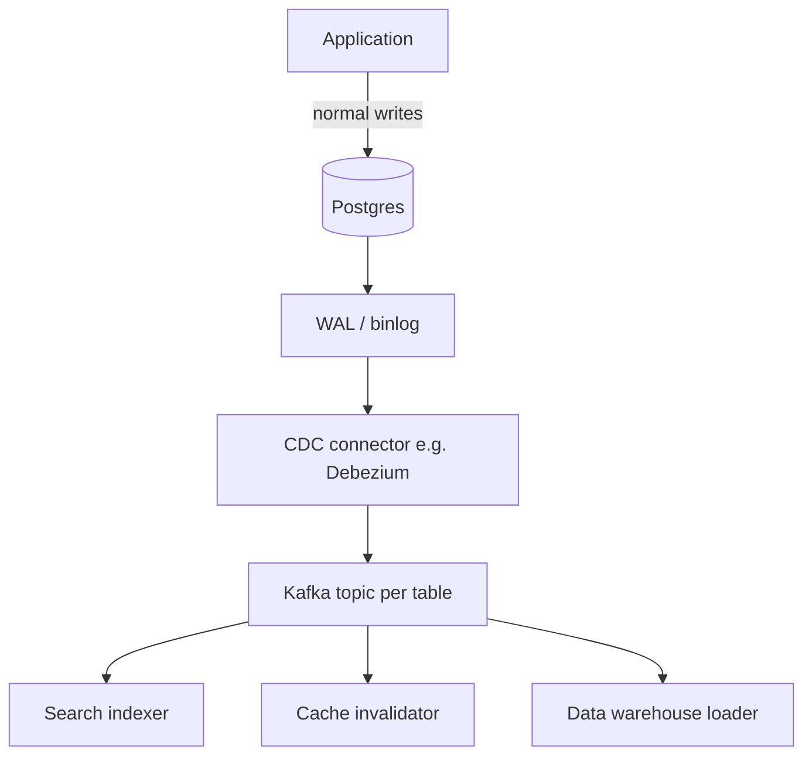
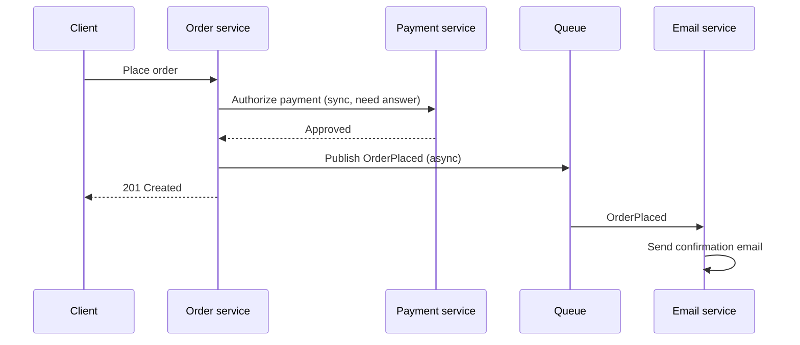

# Messaging & Event-Driven Architecture

[⬅ Back to index](../README.md)

Covers: why queues, queue vs pub/sub vs log, Kafka internals, RabbitMQ vs Kafka vs SQS, delivery guarantees, ordering, consumer groups, retries and dead-letter queues, backpressure, event sourcing, CQRS, CDC, schema evolution and delayed jobs.

---

### 1. Why use a message queue?

<details>
<summary>Answer</summary>

**In short:** A message queue lets a producer hand off work and move on without waiting for the consumer. That decouples services, absorbs traffic spikes, makes slow work asynchronous and makes delivery reliable through persistence and retries. The price is eventual consistency, duplicate messages and extra infrastructure to run and debug.

#### The problem it solves

Picture an upload endpoint that, in one synchronous request, stores a video, transcodes it, generates thumbnails, updates the search index and emails followers. The user waits for all of it. If the email provider is slow, uploads are slow. If the transcoder is down, uploads fail. A spike of 10x uploads hits every downstream system at 10x at the same moment.

With a queue, the endpoint stores the file, publishes a `VideoUploaded` message and returns `202 Accepted`. Workers pick up the message and do the rest at their own pace.



#### Benefits

| Benefit | What it means in practice |
|---|---|
| **Decoupling** | Producer and consumer don't need to know each other's address, be up at the same time, or deploy together. |
| **Buffering / load levelling** | A spike fills the queue; consumers drain it at a steady rate instead of the database falling over. |
| **Asynchronous processing** | The user gets a fast response; slow work happens in the background. |
| **Reliability** | Messages are persisted until acknowledged; a crashed worker's message is redelivered. |
| **Independent scaling** | Add workers when the queue grows, remove them when it's empty (autoscale on queue depth). |
| **Fan-out** | One event can feed many consumers: email, analytics, search indexing. |

#### Costs

- **Eventual consistency**: the thumbnail doesn't exist the instant the upload returns. The UI must handle "processing" states.
- **Duplicates**: most brokers are at-least-once, so consumers must be idempotent (see Q7).
- **Ordering**: parallel consumers process out of order unless you design for it (see Q5).
- **Operational load**: another system to run, monitor (queue depth, consumer lag, DLQ size) and secure.
- **Harder debugging**: a request now spans several processes. Propagate **correlation IDs** and use distributed tracing.

**Pitfalls**
- Using a queue where the caller actually needs the result now (e.g. a price check). That belongs in a synchronous call.
- Unbounded queues that hide an overloaded consumer until the backlog is hours old. Alert on age of oldest message, not just count.

**Likely follow-ups**
- *What happens if the consumer is down for an hour?* Messages accumulate (within retention) and are processed when it comes back; that's the point of buffering.
- *How do you know the system is healthy?* Track queue depth/consumer lag, age of oldest message, processing error rate and DLQ size.

</details>

### 2. Message queue vs pub/sub vs log – what's the difference?

<details>
<summary>Answer</summary>

**In short:** A **queue** delivers each message to exactly one of the competing consumers and deletes it after ack (work distribution). **Pub/sub** delivers a copy of each message to every subscriber (broadcast). A **distributed log** (Kafka, Pulsar, Kinesis) appends messages to a durable, ordered, partitioned log and keeps them; each consumer group tracks its own offset, so you get queue behaviour within a group, pub/sub across groups, and replay.

#### Point-to-point queue

Examples: SQS, a RabbitMQ queue. Several workers pull from the same queue; each message goes to **one** worker. Once acknowledged, it's gone. Ideal for job processing ("resize this image") where you want to spread work.

#### Publish/subscribe

Examples: SNS, Google Cloud Pub/Sub, a RabbitMQ fanout exchange. A publisher sends to a topic; **every subscription gets its own copy**. Ideal when several independent services care about the same event. A common AWS pattern is SNS fan-out into one SQS queue per service, which combines broadcast with per-service work queues.

#### Distributed log

Examples: Kafka, Pulsar, Kinesis. The broker doesn't delete a message when it's read. Messages live in an append-only log for a retention period (hours, days, or forever with compaction). A consumer is just a pointer (an **offset**) into the log.



| | Queue | Pub/sub | Log |
|---|---|---|---|
| Who receives a message | One consumer | Every subscriber | Every consumer **group**; one consumer within a group |
| After consumption | Deleted | Deleted per subscription | Retained until retention expires |
| Replay | No | Limited (some offer seek/snapshot) | Yes, reset the offset |
| Ordering | Usually best-effort (FIFO variants exist) | Usually best-effort | Strict within a partition |
| Typical use | Background jobs | Notifications to many services | Event streaming, CDC, analytics, event sourcing |

The key difference with a log is that **the consumer owns its position**, not the broker. A new service can start from offset 0 and rebuild its state from history, which queues and classic pub/sub can't do.

**Pitfalls**
- Assuming a log gives you per-message acknowledgement and selective retry like a queue. It doesn't: you commit an offset, so one stuck message blocks everything behind it in that partition unless you move it to a retry topic.

**Likely follow-ups**
- *Can Kafka act as a job queue?* Yes, via a consumer group, but parallelism is capped by partition count and there's no per-message ack or visibility timeout; SQS/RabbitMQ are simpler for that.

</details>

### 3. How does Kafka work?

<details>
<summary>Answer</summary>

**In short:** Kafka stores each topic as several **partitions**, which are append-only, replicated logs spread over brokers. Producers pick a partition by hashing the message key, so the same key always lands in the same partition and stays ordered. Consumers in a **consumer group** split the partitions between them, read sequentially and **commit offsets** to record progress. Kafka is fast because of sequential disk I/O, batching, compression, the OS page cache and zero-copy transfer.



#### Storage: topics, partitions, offsets

- A **topic** is a named stream (`orders`). It's split into **partitions**, and each partition is an ordered, immutable sequence of records numbered by **offset** (0, 1, 2…).
- On disk, a partition is a series of **segment files**. Writes only append to the active segment; old segments are deleted or compacted according to retention.
- Ordering is guaranteed **only within a partition**, never across the whole topic.

#### Replication

- Each partition has a **leader** replica and some **followers** on other brokers (replication factor, typically 3).
- Producers write to and consumers read from the leader (by default). Followers fetch from the leader to stay caught up.
- Followers that are caught up form the **in-sync replica set (ISR)**. If the leader dies, a new leader is elected from the ISR, so acknowledged data isn't lost.
- Cluster metadata and leader election are handled by a controller; newer Kafka versions use **KRaft** (a built-in Raft quorum) instead of ZooKeeper.

#### Producing

- The key decides the partition: `partition = hash(key) % numPartitions`. No key means records are spread across partitions.
- Producers batch records per partition (`linger.ms`, `batch.size`) and compress batches, which is a large part of Kafka's throughput.
- `acks` controls durability: `0` (fire and forget), `1` (leader wrote it), `all` (all in-sync replicas have it).
- The **idempotent producer** (`enable.idempotence=true`) attaches a producer ID and sequence numbers so broker-side retries don't create duplicates.

#### Consuming

- Consumers **pull** batches from the broker, starting at an offset.
- In a **consumer group**, each partition is assigned to exactly one consumer, so maximum parallelism equals partition count. Extra consumers sit idle.
- When consumers join or leave, the group **rebalances** and partitions are reassigned.
- Consumers **commit offsets** (stored in an internal `__consumer_offsets` topic). After a crash, the new owner resumes from the last committed offset. If you commit after processing, you get **at-least-once**; commit before processing and you get **at-most-once**.

```java
// At-least-once consumer loop: process first, commit after
consumer.subscribe(List.of("orders"));
while (running) {
    ConsumerRecords<String, Order> records = consumer.poll(Duration.ofMillis(500));
    for (ConsumerRecord<String, Order> r : records) {
        handle(r.value());              // must be idempotent: may be redelivered
    }
    consumer.commitSync();              // only after the whole batch succeeded
}
```

#### Why it's fast

- **Sequential I/O**: appends and sequential reads are fast even on spinning disks.
- **Page cache**: Kafka leans on the OS cache instead of its own heap cache; recent data is usually served from memory.
- **Zero-copy** (`sendfile`): data goes from page cache to the network socket without copying through user space.
- **Batching and compression** amortise per-message overhead.

#### Retention and compaction

- **Time/size retention**: delete segments older than N days or beyond N GB.
- **Log compaction**: keep at least the latest record per key. Good for changelogs ("current address for each user") and rebuilding state stores. A record with a null value (a **tombstone**) deletes the key.

#### Durable configuration

`replication.factor=3`, `min.insync.replicas=2`, producer `acks=all` and idempotence on. With this, a write is only acknowledged once at least two replicas have it, so you can lose one broker without losing data or availability.

**Pitfalls**
- Too few partitions caps consumer parallelism; adding partitions later changes `hash(key) % N`, so keys move partitions and per-key ordering breaks during the change.
- A slow consumer that exceeds `max.poll.interval.ms` gets kicked out, triggers a rebalance, and its batch is reprocessed by someone else.
- Hot keys (one celebrity user) overload a single partition.

**Likely follow-ups**
- *How many partitions?* Enough for peak consumer parallelism and throughput with headroom, e.g. target throughput divided by per-consumer throughput, rounded up generously.
- *Does Kafka support exactly-once?* Within Kafka (read-process-write between topics) yes, with idempotent producers plus transactions; side effects in external systems still need idempotency.

</details>

### 4. Kafka vs RabbitMQ vs SQS?

<details>
<summary>Answer</summary>

**In short:** Kafka is a distributed, replayable log built for high-throughput event streams read by many consumers. RabbitMQ is a traditional broker with rich routing, per-message acks and push delivery, good for task queues and complex routing. SQS is a fully managed AWS queue with near-zero operations, good for simple job queues. Choose Kafka when events are a shared stream many systems read and may replay; choose RabbitMQ or SQS when you need to distribute work.

| | Kafka | RabbitMQ | SQS |
|---|---|---|---|
| Model | Partitioned, replicated log | Broker with exchanges routing to queues | Managed queue (Standard and FIFO) |
| After consumption | Retained; consumers track offsets | Deleted after ack | Deleted by consumer after processing |
| Replay | Yes | No (classic queues) | No |
| Ordering | Per partition | Per queue, while one consumer; breaks with redelivery/multiple consumers | Standard: best-effort. FIFO: per message group ID |
| Throughput | Very high (millions of msgs/s on a cluster) | High, lower than Kafka | Standard scales near-unlimited; FIFO has lower limits |
| Routing | By topic and key only | Direct, topic (wildcards), fanout, headers exchanges | None (pair with SNS/EventBridge for fan-out) |
| Delivery | Consumers pull | Broker pushes with prefetch limit | Consumers pull (long polling) with visibility timeout |
| Per-message features | None (offset-based) | Ack/nack, priorities, TTL, DLX | Visibility timeout, delay, DLQ via redrive policy |
| Ops | Significant (or use a managed service) | Moderate | None |

#### How each handles a failing message

- **Kafka**: you can't nack a single record. You either retry inline (blocking the partition), or publish it to a retry/DLQ topic and commit the offset.
- **RabbitMQ**: `nack` it; it can be requeued or routed to a dead-letter exchange.
- **SQS**: don't delete it; after the visibility timeout it reappears. After `maxReceiveCount` attempts, the redrive policy moves it to a DLQ.

#### Choosing

- **Kafka**: event streaming, CDC, analytics pipelines, event sourcing, multiple teams consuming the same events, need to replay or reprocess history.
- **RabbitMQ**: task queues with complex routing rules, priorities, RPC-style request/reply, lower volume where per-message control matters.
- **SQS**: you're on AWS and want a reliable work queue without running anything; combine with SNS for fan-out.

**Pitfalls**
- Picking Kafka for a simple background-job queue and then fighting partition-bound parallelism and lack of per-message retries.
- Assuming SQS Standard is ordered or exactly-once. It's at-least-once with best-effort ordering; FIFO queues add ordering per group and deduplication within a window.

**Likely follow-ups**
- *What about Pulsar/Kinesis/Google Pub/Sub?* Kinesis is a managed log similar to Kafka (shards instead of partitions); Pulsar separates serving from storage and supports both queue and stream semantics; Pub/Sub is managed pub/sub with per-message acks.

</details>

### 5. How do you guarantee message ordering?

<details>
<summary>Answer</summary>

**In short:** Global ordering requires a single partition and a single consumer, which doesn't scale, so you guarantee order **per key**. Route all events for one entity (order ID, user ID, chat ID) to the same partition or FIFO message group, process one message per key at a time, and include a sequence number or version so consumers can detect and drop stale or out-of-order events.

#### Why order breaks

- Messages spread across partitions/queues are processed in parallel by different consumers.
- Retries: message 1 fails, message 2 succeeds, message 1 succeeds on retry, so the final state reflects 1 instead of 2.
- Producers retrying a failed send can reorder writes (Kafka's idempotent producer prevents this per partition).
- A consumer that processes a batch concurrently with a thread pool loses the partition order.

#### Techniques

1. **Partition by key.** In Kafka, use the entity ID as the record key. Every event for `order-42` goes to the same partition, which only one consumer in the group reads, sequentially.
2. **FIFO queues with group IDs.** SQS FIFO orders messages within a `MessageGroupId` and won't deliver the next message in that group until the current one is deleted. Different groups still process in parallel.
3. **One in-flight message per key.** If you parallelise inside a consumer, shard work by key into per-key lanes so two events for the same key never run concurrently.
4. **Versions / sequence numbers.** Put a monotonically increasing version in each event. The consumer applies an update only if it's newer than what it stored.

```sql
-- Apply an event only if it is newer than what we have (drops stale/out-of-order events)
UPDATE orders
SET    status = :status, version = :version
WHERE  order_id = :order_id
  AND  version < :version;
```

#### Trade-offs

- Ordering per key limits parallelism to the number of distinct keys and partitions, and a **hot key** becomes a bottleneck.
- Strict ordering plus retries means a failing message blocks the messages behind it for that key. You must decide: block (preserve order) or move it aside (preserve throughput, lose order for that key).

**Pitfalls**
- Choosing a key that's too coarse (e.g. `country`) creates hot partitions; too fine (random) gives no useful ordering.
- Increasing partition count remaps keys; in-flight events for a key can be processed out of order across old and new partitions.

**Likely follow-ups**
- *Do you really need order?* Often not: if events carry full state and a version, last-writer-wins by version is enough, and commutative operations (counters) don't need order at all.
- *How do chat apps order messages?* Partition by conversation ID and assign a per-conversation sequence number on the server.

</details>

### 6. How do you handle failures in consumers? What is a dead-letter queue?

<details>
<summary>Answer</summary>

**In short:** Retry transient failures with exponential backoff and jitter, ideally without blocking other messages (retry topics or visibility timeouts). After a fixed number of attempts, move the message to a **dead-letter queue (DLQ)**, a separate queue that holds messages that couldn't be processed, so it stops blocking the pipeline and a human or tool can inspect, fix and **redrive** it. Treat poison messages and downstream outages differently.

#### Two kinds of failure

| | Poison message | Transient failure |
|---|---|---|
| Example | Malformed JSON, missing required field, bug for this input | Database down, 503 from a dependency, timeout |
| Will a retry help? | No, never | Yes, later |
| Right response | DLQ quickly (after 0–few attempts) | Retry with backoff; if everything is failing, **pause consumption** |

If the database is down, every message fails. Sending them all to the DLQ just moves the whole stream to a place no one processes. Better to pause the consumer (or use a circuit breaker) and resume when the dependency recovers.

#### Retry flow with retry topics

In Kafka you can't nack a single record, and retrying inline blocks the partition. A common pattern is tiered retry topics:



Each retry consumer waits until the message's due time before reprocessing. The main partition keeps flowing. The trade-off is that ordering for that key is lost.

In SQS this is built in: don't delete the message, it reappears after the visibility timeout, and the queue's redrive policy moves it to the DLQ after `maxReceiveCount` receives. RabbitMQ uses dead-letter exchanges.

#### Backoff with jitter

```python
def backoff_delay(attempt, base=1.0, cap=300.0):
    # Exponential backoff with "full jitter": spreads retries out so
    # thousands of failed messages don't retry at the same instant.
    return random.uniform(0, min(cap, base * 2 ** attempt))
```

#### Operating the DLQ

- Store context with the message: original topic/partition/offset, error, stack trace, attempt count, timestamps.
- **Alert** when the DLQ is non-empty or growing; a silent DLQ is lost data.
- Build **redrive** tooling to replay messages back into the main queue after a fix, and make sure consumers are idempotent so replays are safe.

**Pitfalls**
- Infinite retries on a poison message: the consumer spins forever and the partition is stuck.
- Retrying non-idempotent side effects (charging a card) without an idempotency key.
- No one owns the DLQ, so messages sit there for months.

**Likely follow-ups**
- *How do you decide max attempts?* Based on how long the dependency could plausibly be down, e.g. retries spanning 30–60 minutes for transient issues, zero or one for validation errors.
- *Does the DLQ break ordering?* Yes for that key; if strict ordering matters, block the key (or park all later events for that key) instead of skipping.

</details>

### 7. How do consumers achieve idempotent processing?

<details>
<summary>Answer</summary>

**In short:** Because most systems deliver **at least once**, a consumer will sometimes see the same message twice, so processing it twice must have the same effect as once. Do it by recording processed message IDs in the same transaction as the side effect (an inbox/dedupe table with a unique constraint), by making the operation naturally idempotent (upserts, conditional updates on a version), or, for Kafka-to-Kafka pipelines, using Kafka transactions. Commit the offset/ack only after the side effect succeeds.

#### Where duplicates come from

- Consumer processes a message, then crashes before committing the offset or deleting it; the message is redelivered.
- Visibility timeout expires while a slow consumer is still working; a second consumer gets it.
- Producer retries after a network timeout, and the first send had actually succeeded.
- Rebalances reassign a partition mid-batch.

"Exactly-once delivery" across a network isn't achievable in general; what you build is **exactly-once effect**: at-least-once delivery plus idempotent processing.

#### Technique 1: dedupe (inbox) table in the same transaction

```sql
BEGIN;
-- Fails with a unique violation if we've already processed this message
INSERT INTO processed_messages (message_id, processed_at) VALUES (:msg_id, now());
UPDATE accounts SET balance = balance + :amount WHERE id = :account_id;
COMMIT;
-- On unique violation: roll back, treat as already done, ack the message
```

The dedupe record and the business change commit atomically, so you can't end up with one without the other. Expire old IDs after a window longer than your maximum redelivery time.

#### Technique 2: naturally idempotent operations

| Not idempotent | Idempotent version |
|---|---|
| `balance = balance + 10` | Record a ledger entry keyed by `transaction_id` (unique) |
| `INSERT INTO orders ...` | `INSERT ... ON CONFLICT (order_id) DO NOTHING` / upsert |
| "Increment status step" | "Set status to SHIPPED" |
| Blind overwrite | `UPDATE ... WHERE version < :new_version` |

#### Technique 3: idempotency keys for external calls

When the side effect is an external API (a payment provider), pass a stable key derived from the message ID. Many payment APIs accept an idempotency key and return the original result for repeats.

#### Technique 4: Kafka transactions

For read-from-Kafka, write-to-Kafka pipelines (e.g. Kafka Streams), a transactional producer writes output records **and** the consumer's offsets in one atomic transaction. Downstream consumers using `isolation.level=read_committed` never see aborted output. This gives exactly-once within Kafka, but not for writes to an external database.

#### Ordering of steps

1. Receive message.
2. Perform side effect idempotently.
3. Then commit offset / delete message.

Commit first and crash, and you lose the message (at-most-once).

**Pitfalls**
- Checking "have I seen this ID?" in Redis and then writing to the DB in a separate step: a crash between the two leaves you inconsistent.
- Using a random ID generated by the consumer as the dedupe key; it must be stable across redeliveries (message ID or business key).

**Likely follow-ups**
- *How long do you keep dedupe records?* Longer than the maximum time a duplicate can arrive (retention or retry window), then TTL them out.
- *What about the producer side?* Use the outbox pattern so the event is written in the same transaction as the state change, and the Kafka idempotent producer to avoid broker-side duplicates.

</details>

### 8. What is backpressure and how do you handle it?

<details>
<summary>Answer</summary>

**In short:** Backpressure is the mechanism by which a system that's receiving more work than it can handle pushes back on its sources instead of collapsing. In messaging, the symptom is growing **consumer lag** or queue depth. You respond by scaling consumers (up to the partition count), batching and speeding up the slow downstream, separating priorities, and, when saturated, throttling or rejecting producers. Bounded buffers everywhere; an unbounded queue only delays the failure.

#### Why it matters

Producers and consumers run at different speeds. If producers outpace consumers for long enough, something gives: memory fills, latency grows to hours, or the slow dependency (usually a database) falls over. A system without backpressure fails in the worst way, all at once and far from the cause.

#### Signals to watch

- **Consumer lag** (Kafka: latest offset minus committed offset per partition) or queue depth (SQS `ApproximateNumberOfMessagesVisible`).
- **Age of the oldest message**: better than count, because it tells you how stale results are.
- Rising processing latency and downstream error rates.

#### Responses, roughly in order

1. **Scale consumers horizontally.** Autoscale on lag/depth. In Kafka you're capped at one consumer per partition per group, so provision partitions for peak.
2. **Make each consumer faster**: batch writes (one bulk insert for 500 messages instead of 500 inserts), increase fetch size, cache lookups, fix the slow query.
3. **Prioritise**: separate queues/topics for critical and bulk work so a bulk backfill can't starve password-reset emails.
4. **Push back on producers**: rate-limit at the API, return `429`/`503` with `Retry-After`, or block the producer when a bounded buffer is full.
5. **Shed or degrade**: drop low-value work (sampled analytics), coalesce updates (only the latest location per user matters).



#### Pull vs push

Pull-based consumers (Kafka, SQS) get backpressure naturally: they only fetch what they can process. Push-based systems need explicit limits, like RabbitMQ's **prefetch count** (max unacked messages per consumer). In-process, the same idea appears as bounded channels or reactive streams' `request(n)`.

**Pitfalls**
- Scaling consumers while the bottleneck is the database just adds more load to the thing that's already struggling.
- Unbounded in-memory buffers in a service: it looks healthy until it runs out of memory.
- Autoscaling on CPU when consumers are I/O bound; scale on lag instead.

**Likely follow-ups**
- *How do you size partitions for peak?* Peak msgs/s divided by what one consumer can do per second, plus headroom, since repartitioning later is disruptive.
- *What's the difference between rate limiting and backpressure?* Rate limiting is a fixed cap set in advance; backpressure is a dynamic signal from the slow component.

</details>

### 9. What is event-driven architecture? Events vs commands?

<details>
<summary>Answer</summary>

**In short:** In an event-driven architecture, services publish **events** describing what happened ("OrderPlaced") to a broker, and other services react, instead of calling each other directly. An **event** is a past-tense fact with no particular recipient; a **command** is a request addressed to one specific receiver to do something ("ChargeCard"). You get loose coupling and easy extensibility, at the cost of eventual consistency and harder end-to-end tracing.

#### Request-driven vs event-driven

In a request-driven design, the Order service places an order and then calls Payment, Inventory, Email and Analytics in turn. It must know all of them, wait for them, and handle each one failing. Adding a loyalty-points feature means changing the Order service.

In an event-driven design, the Order service saves the order and publishes `OrderPlaced`. Everyone who cares subscribes. Adding loyalty points is a new subscriber; the Order service doesn't change.



#### Events vs commands

| | Event | Command |
|---|---|---|
| Tense / meaning | Past: "OrderPlaced", a fact that already happened | Imperative: "ChargeCard", a request |
| Recipients | Zero or many; the publisher doesn't know them | Exactly one intended handler |
| Can it be rejected? | No, it already happened | Yes, the receiver can refuse or fail |
| Coupling | Publisher is unaware of consumers | Sender depends on the receiver's contract |
| Typical channel | Topic / pub-sub / log | Queue addressed to one service |

Mixing them up is a common design smell: an event named `SendWelcomeEmail` is really a command in disguise, and couples the publisher to the email service's job.

#### Thin vs fat events

- **Event notification** (thin): `{"type": "OrderUpdated", "orderId": 42}`. Consumers call back to the Order service for details. Small and simple, but creates runtime coupling and load on the source, and the data fetched may already be newer than the event.
- **Event-carried state transfer** (fat): the event includes the relevant data (items, totals, status). Consumers can keep their own local copy and never call back. More autonomy and resilience, but larger payloads and a bigger schema contract to maintain.

#### Choreography vs orchestration

With many steps (reserve stock, charge, ship), you can let services react to each other's events (**choreography**: decentralised, but the overall flow is implicit and hard to see) or have a coordinator send commands and track state (**orchestration**, e.g. a saga orchestrator or workflow engine: explicit flow, one more component).

#### Benefits and costs

- **Benefits**: loose coupling, independent scaling and deployment, easy to add consumers, natural audit trail, resilience to temporarily unavailable consumers.
- **Costs**: eventual consistency, no single place that shows the end-to-end flow, duplicates and ordering to handle, and events become a public API needing schema governance.

**Pitfalls**
- Publishing the event and writing to the database as two separate steps (dual write): a crash between them loses the event or publishes a phantom. Use the transactional outbox or CDC.
- Events that leak internal table structure, so every schema change breaks consumers.

**Likely follow-ups**
- *How do you trace a request across events?* Propagate a correlation/trace ID in event headers and use distributed tracing.
- *How do you reliably publish an event with a DB write?* Outbox table written in the same transaction, relayed to the broker by a poller or CDC (see Q12).

</details>

### 10. What is event sourcing?

<details>
<summary>Answer</summary>

**In short:** Event sourcing stores the **full, append-only sequence of events** that changed an entity ("Deposited 100", "Withdrew 30") as the source of truth, instead of only its current state. Current state is derived by replaying (folding) those events, with periodic snapshots so you don't replay from the start every time. You gain a complete audit trail, time travel and the ability to build new views from history; you pay with complexity, permanent schema evolution and the need for separate read models (usually CQRS).

#### CRUD vs event sourcing

With CRUD, a bank account row says `balance = 70`. You don't know how it got there unless you also built an audit log. With event sourcing, the store holds:

| seq | account | event | data |
|---|---|---|---|
| 1 | acc-7 | AccountOpened | owner=alice |
| 2 | acc-7 | Deposited | amount=100 |
| 3 | acc-7 | Withdrew | amount=30 |

The balance (70) is computed from these. The events are the truth; the balance is a derived value.

#### How it works

1. **Load**: read the latest snapshot for the entity (if any), then the events after it.
2. **Rebuild state** by applying each event in order.
3. **Handle a command**: validate it against the current state (e.g. sufficient funds), then produce new events.
4. **Append** the new events with an **expected version** check (optimistic concurrency): if someone else appended in the meantime, retry.
5. **Publish** the events to projections that maintain read models (balances table, statements, search).

```kotlin
sealed interface AccountEvent
data class Deposited(val amount: Long) : AccountEvent
data class Withdrew(val amount: Long) : AccountEvent

data class Account(val balance: Long = 0, val version: Long = 0) {
    fun apply(e: AccountEvent) = when (e) {
        is Deposited -> copy(balance = balance + e.amount, version = version + 1)
        is Withdrew  -> copy(balance = balance - e.amount, version = version + 1)
    }
}

fun load(events: List<AccountEvent>, snapshot: Account = Account()) =
    events.fold(snapshot) { state, e -> state.apply(e) }

fun withdraw(acc: Account, amount: Long): List<AccountEvent> {
    require(acc.balance >= amount) { "insufficient funds" }  // command validation
    return listOf(Withdrew(amount))                            // append with expectedVersion = acc.version
}
```

#### Pros

- **Complete audit history** for free, which regulators and debugging love.
- **Time travel**: rebuild state as of any point ("what was the balance on May 1?").
- **New read models by replay**: add a fraud-detection view next year and backfill it from all past events.
- Natural fit for event-driven systems; the events you store are the events you publish.

#### Cons

- **Complexity**: more concepts (aggregates, projections, snapshots, versioning) than CRUD.
- **Schema evolution forever**: old events never change, so code must read every historical version (upcasters convert old shapes to new).
- **Querying** current state across entities ("all accounts with balance > 1000") needs projections; the event store isn't queryable that way.
- **Eventual consistency** between the event store and read models.
- **Deleting personal data (GDPR)** conflicts with immutability. **Crypto-shredding** helps: encrypt personal fields with a per-user key and delete the key.

#### Good fits

Ledgers and accounting, order and shipment lifecycles, collaborative editing, anything where the history itself is valuable. Overkill for simple CRUD like a user-profile settings page.

**Pitfalls**
- Storing generic "state changed" events with full snapshots instead of meaningful domain events, which loses the intent.
- Using the event store as a general message bus for other teams; internal events become an unintended public contract.

**Likely follow-ups**
- *How often to snapshot?* Every N events (e.g. 100) or when replay time crosses a threshold.
- *Is event sourcing the same as CDC or Kafka?* No: CDC derives events from state changes; event sourcing makes events the primary record. Kafka can carry them, but an event store also needs per-entity reads and optimistic concurrency.

</details>

### 11. What is CQRS?

<details>
<summary>Answer</summary>

**In short:** **Command Query Responsibility Segregation** splits the **write model** (handles commands, enforces business rules, uses a normalised store) from one or more **read models** (denormalised views shaped for specific queries, such as a search index, cache or precomputed feed). Read models are updated asynchronously from events or CDC. Each side scales and evolves independently, at the cost of eventual consistency and more moving parts.

#### The problem it solves

One data model often can't serve both sides well. Writes want normalised tables, constraints and transactions. Reads want wide, pre-joined, pre-aggregated data: a product page that joins seven tables, a dashboard that aggregates millions of rows, full-text search. Read traffic is also often far higher than write traffic. Forcing both through one model means slow queries, heavy indexes that slow writes, and a schema nobody can change.

#### How it works



1. A **command** ("PlaceOrder") goes to the write service, which validates it and commits to the write database.
2. The change is emitted as an event (published by the service via an outbox, or captured by CDC).
3. **Projectors** consume the events and update each read model in the shape its queries need.
4. **Queries** go straight to the read models, never touching the write database.

A concrete example: an e-commerce write side in Postgres; one projector writes products into Elasticsearch for search, another maintains a `seller_dashboard` table with daily totals, a third updates a Redis cache for product pages.

#### Pros and cons

| Pros | Cons |
|---|---|
| Reads and writes scale independently | Read models lag the write side (eventual consistency) |
| Each read model is optimised for its query, often a single key lookup | More infrastructure: projectors, a broker, several stores |
| Write model stays small and focused on invariants | Projectors must handle duplicate and out-of-order events |
| New views can be added (and backfilled) without touching writes | Rebuilding a broken read model needs a replay path |

#### Handling the consistency gap

The classic problem: a user saves something and immediately doesn't see it. Options:
- **Read-your-own-writes**: return the new state in the command response, or route that user's next read to the write store briefly.
- Return the write's **version** and have the client wait or poll until the read model reaches it.
- Optimistic UI on the client.

#### When to use it

Use CQRS when reads and writes have very different shapes or loads, or you need several specialised views (search, analytics, feed). It pairs naturally with event sourcing but doesn't require it: a normal relational write DB plus CDC into read stores is common. Don't use it for simple CRUD where one table serves both sides fine.

**Pitfalls**
- Applying CQRS to the whole system instead of the few areas that need it.
- Projectors that aren't idempotent, so replays double-count aggregates.

**Likely follow-ups**
- *Is a read replica CQRS?* A light form: separate read path, same model. Full CQRS uses differently shaped read models.
- *How do you rebuild a read model?* Create a new one, replay events or backfill from the write DB, then switch reads over.

</details>

### 12. What is change data capture (CDC)?

<details>
<summary>Answer</summary>

**In short:** Change data capture reads a database's own **transaction log** (Postgres WAL, MySQL binlog, DynamoDB Streams) and emits every committed row change (insert, update, delete) as an event, typically via a tool like Debezium into Kafka. It keeps caches, search indexes and warehouses in sync **without dual writes**, powers the outbox pattern and zero-downtime migrations, and is reliable because the log is the database's own record of what committed.

#### The dual-write problem

The naive way to keep Elasticsearch in sync with Postgres is to write to both in application code:

```python
db.execute("UPDATE products SET price = 9.99 WHERE id = 42")
search.index("products", id=42, doc={"price": 9.99})   # WRONG (dual write): may fail, or race with another update
```

If the second write fails, they diverge. If two requests race, the index can end up with the older value. There's no transaction spanning both systems.

#### How CDC works



1. Every database already writes each committed change to its log for durability and replication.
2. The CDC connector registers as a log reader (e.g. a Postgres logical replication slot, or acting like a MySQL replica reading the binlog).
3. It turns each change into an event with **before** and **after** row images, operation type, transaction info and the log position.
4. Events go to a topic, usually one per table, keyed by primary key so changes to one row stay ordered.
5. The connector records its log position, so after a restart it resumes where it stopped (at-least-once).

Existing data is handled with an initial **snapshot**: the connector reads current rows, then switches to streaming the log from a consistent point.

#### Uses

- **Sync derived stores** (search, cache, warehouse) without dual writes.
- **Transactional outbox**: the application writes the business row and an `outbox` row in one transaction; CDC publishes the outbox rows as clean domain events. This avoids exposing raw table schemas to consumers.
- **Database migrations**: backfill the new database, stream ongoing changes until it's caught up, then cut over.
- **Near real-time analytics** instead of nightly batch dumps.
- Feeding **CQRS** read models.

#### Why it's reliable

Changes only appear in the log after they commit, in commit order, so consumers never see rolled-back data and per-row ordering is preserved. Application code doesn't change, so no code path can forget to publish.

**Pitfalls**
- Exposing raw table rows as events couples every consumer to your internal schema; prefer the outbox for public events.
- A stalled Postgres replication slot makes the database retain WAL indefinitely and can fill the disk. Monitor slot lag.
- Delivery is at-least-once; consumers must be idempotent (use the log position or row version).

**Likely follow-ups**
- *CDC vs polling an `updated_at` column?* Polling misses deletes and intermediate updates, adds query load, and has clock and ordering issues; log-based CDC captures everything in commit order.
- *Outbox via polling or CDC?* Both work; CDC has lower latency and no polling load, polling is simpler to operate.

</details>

### 13. How do you evolve event schemas safely?

<details>
<summary>Answer</summary>

**In short:** Treat events as a public API. Use a schema format with compatibility rules (Avro, Protobuf, JSON Schema) and a **schema registry** that rejects incompatible changes at publish/CI time. Make only compatible changes: add optional fields with defaults, never remove, rename or retype fields consumers rely on, and never reuse Protobuf field numbers. For a genuinely breaking change, introduce a new event version (`OrderPlaced.v2`), publish both during migration, and have consumers ignore unknown fields (tolerant reader).

#### Why it's harder than API versioning

With a REST API you can deploy client and server together or version the endpoint. With events:
- Producers and many consumers deploy **independently**, often owned by different teams.
- Messages are **retained**: a consumer replaying a Kafka topic or event store reads events written months or years ago, in the old format.
- You often don't even know all consumers.

So each change must work for old readers of new data and new readers of old data.

#### Compatibility types

| Type | Guarantee | Lets you |
|---|---|---|
| **Backward** | New schema can read data written with the old schema | Upgrade consumers first |
| **Forward** | Old schema can read data written with the new schema | Upgrade producers first |
| **Full** | Both | Upgrade in any order |

(These are the modes a schema registry such as Confluent Schema Registry enforces; "transitive" variants check against all previous versions, not just the last.)

#### Safe vs unsafe changes

| Safe (usually) | Unsafe |
|---|---|
| Add an optional field with a default | Remove a field consumers read |
| Add a new event type | Rename a field (it's a remove plus add) |
| Add an enum value, if consumers handle unknowns | Change a field's type or meaning (cents to dollars) |
| Deprecate a field but keep populating it | Reuse a Protobuf field number |

```protobuf
message OrderPlaced {
  string order_id = 1;
  int64 total_cents = 2;
  reserved 3;                 // was "coupon"; never reuse number 3
  reserved "coupon";
  string currency = 4;        // new field: old consumers ignore it, new ones default to ""
}
```

#### Breaking changes: version and migrate

1. Publish `OrderPlaced.v2` (new topic or a version field) **alongside** v1.
2. Migrate consumers to v2 one by one.
3. When no one reads v1 (check consumer groups/metrics), stop publishing it.

For event-sourced stores where old events can't be rewritten, use **upcasters**: functions that convert v1 events to the v2 shape when they're read.

#### Consumer side

- **Tolerant reader**: ignore unknown fields, use defaults for missing ones, don't fail on new enum values.
- Validate only what you actually use.

**Pitfalls**
- Plain JSON with no schema or registry: someone renames a field and a downstream team finds out from a production outage.
- Changing semantics without changing structure (same field, new units) passes every compatibility check and still breaks consumers.

**Likely follow-ups**
- *Where do you enforce it?* In CI (schema compatibility check before merge) and at the registry (producers can't register an incompatible schema).
- *Avro vs Protobuf?* Both support evolution; Avro resolves by field name with the writer's schema available, Protobuf by field number. Choice is mostly ecosystem fit.

</details>

### 14. How do you implement delayed or scheduled jobs?

<details>
<summary>Answer</summary>

**In short:** Pick by delay length and complexity. Short delays: broker **delay queues** (SQS delivery delay up to 15 minutes, RabbitMQ's delayed-message plugin). Arbitrary times at moderate scale: a **Redis sorted set** scored by run time, or a **database table** with an indexed `run_at` that workers claim with `SELECT … FOR UPDATE SKIP LOCKED`. Long timers and multi-step flows: a **workflow engine** (Temporal, AWS Step Functions). Huge numbers of in-memory timers: **timing wheels**. In every case, jobs must be claimed atomically and executed idempotently.

#### Options compared

| Approach | Max delay | Strengths | Weaknesses |
|---|---|---|---|
| SQS delay / message timers | 15 minutes | Zero ops | Too short for most "remind me tomorrow" cases |
| RabbitMQ delayed-message plugin | Long | Fits existing RabbitMQ | Plugin; delayed messages held on one node |
| Redis sorted set | Any | Fast, simple, high throughput | Durability depends on Redis persistence config |
| DB table + `SKIP LOCKED` | Any | Transactional, durable, easy to query and cancel | Polling load; DB becomes the bottleneck at very high volume |
| Workflow engine | Days to months | Durable timers, retries, multi-step logic, visibility | Another platform to learn and run |
| Timing wheel (in memory) | Short | Millions of timers with O(1) insert | Not durable alone; used inside systems (Kafka uses one for request timeouts) |

#### Database table pattern

```sql
CREATE TABLE jobs (
  id       BIGSERIAL PRIMARY KEY,
  run_at   TIMESTAMPTZ NOT NULL,
  status   TEXT NOT NULL DEFAULT 'pending',
  payload  JSONB NOT NULL
);
CREATE INDEX jobs_due ON jobs (run_at) WHERE status = 'pending';

-- Each worker claims a batch; SKIP LOCKED means workers never block on or double-claim rows
UPDATE jobs SET status = 'running'
WHERE id IN (
  SELECT id FROM jobs
  WHERE status = 'pending' AND run_at <= now()
  ORDER BY run_at
  LIMIT 100
  FOR UPDATE SKIP LOCKED
)
RETURNING id, payload;
```

Add a lease (`locked_until`) so jobs held by a crashed worker are picked up again.

#### Redis sorted set pattern

```python
r.zadd("jobs", {job_id: run_at_epoch})                   # schedule

due = r.zrangebyscore("jobs", 0, now(), start=0, num=100)  # poll for due jobs
for job_id in due:
    if r.zrem("jobs", job_id) == 1:                        # atomic claim: only one worker wins
        enqueue_for_execution(job_id)
```

`ZREM` returning 1 means this worker removed it, so only one worker runs each job. A Lua script can combine fetch and claim into one atomic step.

#### Workflow engines

For "send a reminder 3 days after signup unless they've completed onboarding", a workflow engine lets you write it as ordinary code: start, sleep 3 days (a durable timer), check a condition, send. The engine persists the state, survives restarts and handles retries, which is much simpler than chaining scheduled jobs and checking flags.

#### Common requirements regardless of mechanism

- **At-least-once execution**: jobs may run twice after a crash, so make them idempotent.
- **Cancellation and rescheduling**: easy with a DB row, awkward with a message already in a broker.
- **Lateness**: polling intervals mean jobs run a bit after `run_at`; size the interval to your tolerance.

See [Distributed Job Scheduler](16-designs-core-infrastructure.md) for a full design.

**Likely follow-ups**
- *How do you scale the DB approach?* Partition jobs by time bucket or shard, and move due jobs into a regular queue for execution so the scheduler only does the "when" part.
- *Cron-style recurring jobs?* Store the schedule; after each run, compute and insert the next occurrence.

</details>

### 15. Synchronous (request/response) vs asynchronous communication between services?

<details>
<summary>Answer</summary>

**In short:** Synchronous calls (HTTP, gRPC) are simple and give an immediate answer, but create **temporal coupling**: if the callee is slow or down, so is the caller, latencies add up along call chains, and failures cascade. Asynchronous messaging (queues, events) lets the caller continue without waiting and tolerates the receiver being down, but brings eventual consistency and harder debugging. Use sync when the caller **needs the answer to respond**; use async for side effects and anything that can happen later.

#### Synchronous

Service A calls B and blocks (or awaits) until B replies.

- **Pros**: simple mental model, immediate result and error, easy to debug with a stack trace and one trace span per hop, strong consistency at the moment of the call.
- **Cons**:
  - **Availability multiplies**: if A calls five services each at 99.9%, A's best case is about 99.5%.
  - **Latency adds up** along the chain, and tail latency of the slowest dependency dominates.
  - **Cascading failure**: a slow B ties up A's threads/connections, which then makes A slow for its own callers.
- Needs timeouts, retries with backoff, circuit breakers and bulkheads to be safe.

#### Asynchronous

A publishes a message or event and moves on; B processes it later.

- **Pros**: A stays up when B is down, load spikes are buffered, independent scaling, easy fan-out to new consumers.
- **Cons**: eventual consistency, no immediate result (the user sees "processing"), duplicates and ordering to handle, and flows are harder to trace end-to-end.



#### Rule of thumb

| Use sync when | Use async when |
|---|---|
| The response depends on the answer (price, auth check, payment authorisation, stock availability on checkout) | It's a side effect the user doesn't wait for (emails, notifications, analytics, search indexing) |
| The user needs an immediate error | Work is slow or bursty (video transcoding, report generation) |
| Strong consistency is required at that moment | Many services need to react to the same fact |

Most real systems mix both, as in the diagram: sync for the critical path, async for everything after.

#### Hybrid patterns

- **Async request-reply**: return `202 Accepted` with a job ID; the client polls a status endpoint or gets a webhook/push when done.
- **Request-reply over a queue**: the message carries a reply-to address and correlation ID (RabbitMQ RPC style).

**Pitfalls**
- Long synchronous chains (A → B → C → D) for a single user request; each hop adds latency and failure risk.
- Going async for something the user needs immediately, then building polling hacks to fake synchrony.

**Likely follow-ups**
- *How do you keep sync calls safe?* Timeouts on every call, limited retries with backoff and jitter, circuit breakers, and bulkheads (separate pools per dependency).
- *How do you get a result back from async work?* Job ID plus polling, webhooks, or push over WebSocket/SSE.

</details>

### 16. Push vs pull consumers – what's the trade-off?

<details>
<summary>Answer</summary>

**In short:** With **push** (RabbitMQ consumers, SNS, webhooks), the broker sends messages to consumers as soon as they arrive: lowest latency, but the broker must know each consumer's capacity (e.g. a prefetch limit) or it will overwhelm slow ones. With **pull** (Kafka, SQS), consumers ask for messages when they're ready: natural **backpressure**, easy batching and replay, at the cost of slightly higher latency and polling overhead, which long polling mostly removes. Pull suits high-throughput pipelines; push suits low-latency notifications and simple fan-out.

#### Push

The broker owns the delivery rate. A RabbitMQ consumer subscribes and the broker streams messages to it; SNS calls an HTTP endpoint or Lambda; a webhook provider POSTs to your server.

- **Pros**: messages arrive immediately, consumers don't need polling loops, simple for serverless targets.
- **Cons**: the broker can send faster than a consumer can process. Mitigations: **prefetch count** in RabbitMQ (`basicQos`), which limits unacknowledged messages per consumer; retry policies and rate limits for HTTP push targets.
- Webhook receivers must be reachable, authenticate the sender (signatures) and handle retries/duplicates.

```java
// RabbitMQ: limit to 20 unacked messages per consumer so a slow consumer isn't flooded
channel.basicQos(20);
channel.basicConsume("orders", false /* manual ack */, (tag, delivery) -> {
    process(delivery.getBody());
    channel.basicAck(delivery.getEnvelope().getDeliveryTag(), false);
}, tag -> {});
```

#### Pull

The consumer owns the rate. It asks for a batch, processes it, asks for more.

- **Pros**: a consumer can never receive more than it asked for, so overload is impossible by construction. Batching is natural (fetch 500, bulk write). Consumers can rewind (Kafka offsets) and replay.
- **Cons**: an empty poll wastes a request, and a short polling interval adds load while a long one adds latency.
- **Long polling** fixes most of that: the request waits on the broker until messages arrive or a timeout passes (SQS `WaitTimeSeconds` up to 20 s; Kafka's fetch waits up to `fetch.max.wait.ms` for `fetch.min.bytes`).

#### Comparison

| | Push | Pull |
|---|---|---|
| Who controls rate | Broker | Consumer |
| Latency | Lowest | Slightly higher (near-equal with long polling) |
| Backpressure | Needs explicit limits (prefetch, rate limits) | Built in |
| Batching | Harder | Natural |
| Replay | Usually no | Yes on logs (Kafka) |
| Consumer must be reachable | Yes (for HTTP push) | No, it only makes outbound calls |
| Examples | RabbitMQ, SNS, Google Pub/Sub push, webhooks | Kafka, SQS, Kinesis, Pub/Sub pull |

#### Choosing

- **Pull** for high-throughput pipelines, consumers with variable speed, batch processing, and anything that needs replay.
- **Push** for low-latency notifications, serverless or HTTP targets, and simple fan-out at modest volume.

**Pitfalls**
- Push with no prefetch limit (unlimited unacked messages): a slow consumer buffers thousands of messages in memory and they're all redelivered when it crashes.
- Pull with short polling and tiny batches: high cost and broker load for no benefit.

**Likely follow-ups**
- *Is Kafka purely pull?* Yes, consumers fetch, but long-poll fetches make it behave close to push in latency.
- *How do mobile push notifications fit?* APNs/FCM push to devices because devices can't afford to poll; the app then pulls full data from the server.

</details>

---

[⬅ Previous: Storage, Search & Specialised Data Systems](10-storage-search-specialized.md) · [⬅ Back to index](../README.md) · [Next: Microservices & Architecture Patterns ➡](12-microservices-patterns.md)
