# Microservices & Architecture Patterns

[⬅ Back to index](../README.md)

Covers: monolith vs modular monolith vs microservices, service boundaries, database per service, service discovery, timeouts, retries and backoff, circuit breakers, bulkheads, BFF, sidecar, strangler fig, API versioning, serverless, multi-tenancy and cell-based architecture.

---

### 1. Monolith vs microservices – how do you choose?

<details>
<summary>Answer</summary>

**In short:** Start with a well-structured (modular) monolith, because it is cheaper to build, test, debug and run. Move to microservices when the organisation has grown to many teams that block each other, or when parts of the system have very different scaling, reliability or release needs that justify the large operational cost.

#### The two shapes

A **monolith** is one deployable unit: one codebase, one build, one process (possibly many copies behind a load balancer), usually one database. **Microservices** split the system into many small services, each owning one business capability and its data, each deployed independently and talking over the network.

| | Monolith | Microservices |
|---|---|---|
| Deployment | One unit; everyone ships together | Each service ships on its own schedule |
| Calls between parts | In-process function calls (nanoseconds, never "partially fail") | Network calls (milliseconds, can time out, fail or be retried) |
| Transactions | Local ACID transaction across everything | Distributed: sagas, outbox, eventual consistency |
| Scaling | Scale the whole app, even if only one part is hot | Scale hot services individually |
| Tech choice | One stack | Each service can pick its own language or database |
| Debugging | One stack trace, one log | Distributed tracing, correlation IDs, many dashboards |
| Team model | Many teams share one codebase and release train | Teams own services end to end |
| Operational overhead | Low | High: discovery, CI/CD per service, observability, on-call per service |

#### Why microservices exist

The main problem microservices solve is **organisational**. With 200 engineers in one codebase, every deploy contains changes from dozens of teams, one broken test blocks everyone, and nobody fully understands the code. **Conway's law** says the system's structure mirrors the communication structure of the organisation, so giving each team its own service lets them design, deploy and be on call independently.

Technical reasons come second: a search service may need 50 instances while the admin panel needs 2, or a payment service needs stricter reliability and change control than a recommendations service.

#### Why not start with microservices

- You don't yet know the right boundaries. Getting them wrong in a monolith means moving code; in microservices it means changing APIs, migrating data and coordinating deploys.
- Every boundary becomes a network call that can fail, so you need timeouts, retries, circuit breakers, tracing and contract tests from day one.
- A small team spends its time on infrastructure instead of the product.

#### A practical decision rule

1. Small team or new product: modular monolith with clear internal boundaries.
2. Growing pains appear (deploy queues, merge conflicts, one module's load dominating): extract the module with the clearest boundary and the strongest reason (different scaling, team ownership).
3. Keep extracting only where it pays off. Many successful companies run a large monolith plus a handful of services.

**Common pitfalls**
- Splitting by technical layer (a "database service", a "validation service") instead of by business capability.
- Creating more services than teams; one team owning 15 services is mostly overhead.
- Ending up with a **distributed monolith** (see question 18).

**Likely follow-ups**
- *How do you migrate a monolith?* Incrementally with the strangler fig pattern, extracting one bounded context at a time.
- *What's the minimum platform you need before microservices?* Automated CI/CD, centralised logging, metrics and tracing, service discovery, and a standard way to handle config and secrets.

</details>

### 2. What is a modular monolith?

<details>
<summary>Answer</summary>

**In short:** A modular monolith is a single deployable application that is split internally into well-bounded modules by business domain, each with its own public interface and its own data, with the boundaries enforced. You get most of the design benefits of microservices (clear ownership, low coupling) without network calls or distributed transactions, and a module can be extracted into a service later.

#### The problem it solves

A typical "big ball of mud" monolith has no internal boundaries: any class can call any other class and any code can query any table. Over time everything depends on everything and change becomes risky. Microservices force boundaries by putting a network between parts, but that is an expensive way to get discipline. A modular monolith gets the same discipline with build tools and conventions instead.

#### How it works

- **Modules by domain**: `ordering`, `payments`, `catalog`, `shipping`, not `controllers`, `services`, `repositories`.
- **Public API per module**: other modules call only an exported interface (or send in-process events), never internal classes.
- **Data ownership**: each module owns its tables (often a separate schema). Other modules never join against them; they ask through the API.
- **Enforced boundaries**: build-level module visibility (Gradle/Maven modules, Java modules, Kotlin `internal`), or architecture tests (ArchUnit) and static checks that fail the build on illegal imports.

```kotlin
// ordering module depends only on the payments *API*, not its internals
interface PaymentsApi {                      // exported by :payments-api
    fun authorize(orderId: String, amountCents: Long): PaymentResult
}

class PlaceOrder(
    private val payments: PaymentsApi,       // injected; implementation lives in :payments
    private val orders: OrderRepository      // ordering's own tables only
) {
    fun execute(cmd: PlaceOrderCommand): Order {
        val order = orders.save(Order.pending(cmd))
        val result = payments.authorize(order.id, order.totalCents)
        return orders.save(order.withPayment(result))
    }
}
```

Because `PaymentsApi` is already an interface, extracting payments into its own service later means swapping the implementation for an HTTP/gRPC client, without rewriting ordering.

| | Big-ball-of-mud monolith | Modular monolith | Microservices |
|---|---|---|---|
| Deployables | 1 | 1 | Many |
| Internal boundaries | None | Enforced in code/build | Enforced by network |
| Cross-module calls | Anything goes | Through module API | Network APIs/events |
| Transactions | Local | Local (can span modules, but try not to) | Distributed |
| Ops cost | Low | Low | High |

Shopify is a well-known public example: it has described keeping its large Rails monolith and investing in componentising it rather than splitting into microservices.

**Common pitfalls**
- Boundaries that exist only in a diagram; without automated enforcement they erode quickly.
- Sharing tables "just this once" across modules, which makes later extraction very hard.
- Leaking one transaction across many modules; it works in a monolith but won't survive extraction.

**Likely follow-ups**
- *When would you extract a module?* When it needs independent scaling, a different release cadence, a different tech stack, or a separate team's ownership.
- *Can modules communicate asynchronously?* Yes, via an in-process event bus, which also eases a later move to a real message broker.

</details>

### 3. How do you define service boundaries?

<details>
<summary>Answer</summary>

**In short:** Use domain-driven design to find **bounded contexts** (Ordering, Payments, Catalog, Shipping), each with its own model and language, and draw service boundaries around them. A good service owns one business capability and its data, changes mostly for one reason, needs few synchronous calls to do its job, and can be owned by one team.

#### Bounded contexts

The same word means different things in different parts of a business. A "Product" in the Catalog has descriptions and images; in Inventory it is a SKU with stock counts per warehouse; in Shipping it is a weight and dimensions. Trying to build one shared `Product` model for everyone creates a huge coupled object. DDD says each **bounded context** keeps its own model, and contexts translate at their edges. Those contexts are natural service candidates.

#### How to find them in practice

1. **Map business capabilities** with domain experts (event storming is a common workshop: list domain events like `OrderPlaced`, `PaymentCaptured`, `ParcelShipped`, then group them).
2. **Look for language changes**: where the meaning of a term changes, a boundary probably exists.
3. **Follow the data**: which data is created and changed together? That should live in one service.
4. **Check the change pattern**: features that usually change together belong together.
5. **Match to teams**: a service should be ownable by one team (Conway's law).

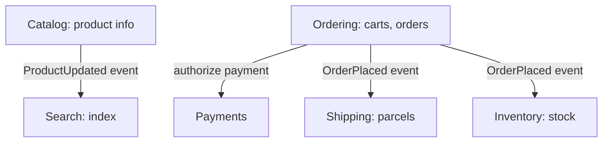

#### Signs of a good boundary

- **High cohesion**: one reason to change; most features touch only one service.
- **Low coupling**: the service can serve most requests from its own data; side effects go out as events.
- **Owns its data**: no other service reads its tables.
- **Independently deployable**: you can ship it without coordinating with others.

#### Red flags

- Services that must always be deployed together (a distributed monolith).
- One user request causing a long chain of synchronous calls (A → B → C → D).
- Two services sharing a database or reading each other's tables.
- "Entity services" (a `CustomerService` that is just CRUD over a table) with business logic scattered in callers.
- Services that are too small ("nanoservices"): each adds network and ops cost.

**Likely follow-ups**
- *What if a boundary turns out wrong?* Merge services, or move responsibilities; this is much easier while still in a modular monolith.
- *What is an anti-corruption layer?* A translation layer at a context boundary that maps another context's (or legacy system's) model to yours so its concepts don't leak in.

</details>

### 4. Why "database per service", and how do you query across services?

<details>
<summary>Answer</summary>

**In short:** Each service owns its data and is the only one allowed to read or write it, so no one can couple to its schema and it can change or even replace its database freely. Cross-service needs are met through API calls, API composition, event-driven local read models, CQRS or a data warehouse for analytics, and sagas for multi-service transactions.

#### Why not share a database?

If Orders and Shipping both read the `orders` table, then:
- renaming a column in Orders breaks Shipping (hidden coupling the compiler can't see),
- a heavy query from one service slows the other,
- neither team can migrate to a different store,
- both must deploy in lockstep for schema changes.

That is a distributed monolith at the data layer. "Database per service" doesn't necessarily mean a separate database server; separate schemas with separate credentials on a shared cluster is common. What matters is that only the owner can access it.

#### Querying across services

| Technique | How it works | Good for | Trade-off |
|---|---|---|---|
| **API call** | Ask the owning service at request time | Fresh, small lookups | Runtime coupling and latency; add caching and timeouts |
| **API composition** | Gateway/BFF calls several services and merges | Screens that show data from many domains | Fan-out latency; partial failures to handle |
| **Event-driven read model** | Subscribe to `ProductUpdated` and keep a local copy of needed fields | High-volume reads, resilience to owner outages | Eventual consistency; more storage |
| **CQRS view** | Build a dedicated query-optimised store from events of several services | Complex search/listing across domains | Extra pipeline to operate |
| **Data warehouse / lake** | Stream changes (CDC) into an analytics store | Reporting, BI, ML | Not for online requests; delayed |
| **Saga** | Sequence of local transactions with compensating actions | Writes spanning services (order + payment + stock) | Complexity; no isolation |

#### Example: order history page with product names

Option 1: the order service stores `productId` only, and the BFF calls Catalog to fetch names (composition). Option 2: when the order is placed, the order service copies the product name and price into the order line, which is correct anyway because the order should show what was bought at that time, even if the catalog changes later. Copying data is often the right answer, not a hack.

```sql
-- Orders service keeps a local, denormalised snapshot
CREATE TABLE order_lines (
  order_id      UUID,
  product_id    UUID,          -- reference only, no FK to another service
  product_name  TEXT,          -- snapshot at purchase time
  unit_price    BIGINT,        -- in cents
  quantity      INT
);
```

**Common pitfalls**
- Distributed joins at request time across 5 services; slow and fragile.
- Forgetting that local copies are eventually consistent; design UX for it.
- Dual writes (update DB, then publish event) without the **transactional outbox**, which loses events on crashes.

**Likely follow-ups**
- *How do you keep a local copy in sync?* Consume change events (or CDC like Debezium) idempotently, ordered per key.
- *How do you do a cross-service transaction?* With a saga: local transactions plus compensations, orchestrated or choreographed.

</details>

### 5. What is service discovery?

<details>
<summary>Answer</summary>

**In short:** Service discovery is how a caller finds the current network locations of healthy instances of a service, which constantly change as instances scale, crash and redeploy. It is done client-side (the client queries a registry and load-balances), server-side (the client calls a stable DNS name or load balancer), or by a service mesh sidecar.

#### The problem

In a static data centre you could hardcode `orders.internal:8080`. In containers and autoscaling groups, instances get new IPs every deploy, scale from 3 to 30 and back, and die unexpectedly. Callers need an always-current list of healthy endpoints.

#### The pieces

1. **Registry**: a database of `service name → list of instances`. Examples: Consul, Eureka, etcd/ZooKeeper, or the Kubernetes API (Endpoints/EndpointSlices).
2. **Registration**: either the instance registers itself on start (self-registration) or the platform registers it (Kubernetes does this automatically when a pod becomes ready).
3. **Health checks**: unhealthy instances are removed; instances deregister on shutdown, and a TTL or heartbeat expires dead ones.
4. **Lookup + load balancing**: someone picks an instance for each request.

#### Client-side vs server-side

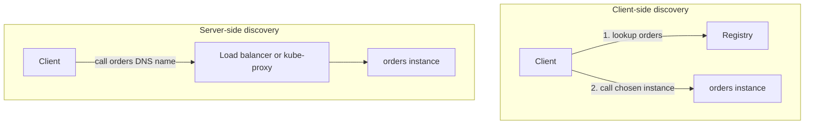

| | Client-side | Server-side | Service mesh |
|---|---|---|---|
| Who balances | Client library (e.g. Ribbon, gRPC client LB) | LB / DNS / kube-proxy | Sidecar proxy (Envoy) |
| Pros | No extra hop; smart balancing | Clients stay simple, any language | Language-agnostic, adds mTLS, retries, metrics |
| Cons | Library per language; coupling to registry | Extra hop; LB must scale | Operational complexity |
| Examples | Netflix Eureka + client, Consul + client | Kubernetes Service, AWS ALB | Istio, Linkerd |

In Kubernetes, a Service gives a stable DNS name (`orders.default.svc.cluster.local`) and virtual IP; kube-proxy (or an eBPF data plane) forwards to ready pods. Readiness probes decide which pods receive traffic.

**Common pitfalls**
- DNS caching: clients that cache DNS results too long keep calling dead instances. Use short TTLs or connection-level balancing.
- Long-lived connections (HTTP/2, gRPC) stick to one pod behind a Kubernetes Service, so load becomes uneven; use client-side or proxy-based L7 balancing.
- Sending traffic before the instance is warm; rely on readiness checks, not just "process started".

**Likely follow-ups**
- *Liveness vs readiness probe?* Liveness failure restarts the container; readiness failure only removes it from load balancing.
- *What if the registry is down?* Clients should cache the last known list; registries are themselves replicated (Consul/etcd use Raft).

</details>

### 6. How should you set timeouts?

<details>
<summary>Answer</summary>

**In short:** Every network call needs a timeout, set from the dependency's measured latency (a bit above its p99 or p99.9), not an arbitrary large value. Use separate connect and request timeouts, and propagate a **deadline** from the edge so each downstream hop only uses the time that remains.

#### Why it matters

Without a timeout, a slow dependency holds a thread, connection or socket for as long as it takes, possibly forever. Requests keep arriving, all of them get stuck, the thread pool fills up, and now your service is down too, and so are its callers. This cascading failure is one of the most common causes of big outages. A timeout turns "hang" into a fast, handleable error.

#### How to choose the value

1. Measure the dependency's latency distribution. If its p99.9 is 120 ms, a timeout around 200–300 ms catches real hangs without cutting off normal slow requests.
2. Check it fits the **overall budget**. If the user-facing SLA is 1 s and you call three services in sequence, they can't each have 1 s.
3. Remember retries consume budget too: timeout × attempts must fit in the deadline.

| Timeout type | What it limits | Typical value |
|---|---|---|
| Connect timeout | Establishing TCP/TLS | Short (tens to a few hundred ms within a data centre) |
| Read / request timeout | Waiting for the response | Based on dependency p99/p99.9 |
| Overall deadline | Whole user request across all hops | From the product SLA |
| Idle / keep-alive timeout | Unused pooled connections | Must be shorter than the server's/LB's idle timeout to avoid using dead connections |

#### Deadline propagation

The edge sets a total budget (say 1 s). Each service passes down the remaining time, so a service that receives a request with 50 ms left won't start a 300 ms query. gRPC does this natively with deadlines; over HTTP you pass a header with the absolute deadline or remaining budget.

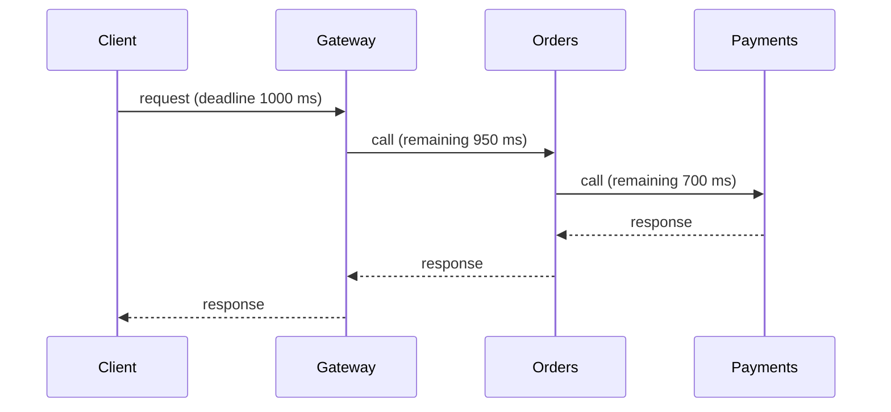

```kotlin
// OkHttp: explicit connect/read timeouts and an overall call timeout
val client = OkHttpClient.Builder()
    .connectTimeout(200, TimeUnit.MILLISECONDS)
    .readTimeout(500, TimeUnit.MILLISECONDS)
    .callTimeout(800, TimeUnit.MILLISECONDS)   // cap including retries/redirects
    .build()
```

**Common pitfalls**
- Library defaults that are infinite or very long (some HTTP and DB clients default to no read timeout).
- Downstream timeout longer than upstream: the caller gives up, but the callee keeps working on a request nobody will read.
- Same timeout for every endpoint; a search query and a health check have different latency profiles.

**Likely follow-ups**
- *What happens to work after a timeout?* It may still complete on the server, so the operation must be idempotent if you retry.
- *What are hedged requests?* Send a second request to another replica if the first hasn't answered by ~p95, and use whichever answers first; reduces tail latency at the cost of extra load.

</details>

### 7. How do you implement retries safely?

<details>
<summary>Answer</summary>

**In short:** Retry only transient failures, only for idempotent operations (or with idempotency keys), with a small cap on attempts and exponential backoff with jitter. Retry at one layer only and limit retries with a budget, otherwise retries multiply load and turn a small blip into an outage.

#### Why retries are dangerous

Retries help with brief glitches: a dropped connection, one bad instance, a leader election. But when a dependency is slow because it is **overloaded**, retries add more load at exactly the wrong moment. If every layer of a 3-layer call chain retries 3 times, one user request can become 3 × 3 × 3 = 27 calls at the bottom. This is a **retry storm**.

#### Rules

1. **Retry only transient errors**: timeouts, connection resets, 503, 429 (respecting `Retry-After`), gRPC `UNAVAILABLE`. Never retry 400/401/403/404/422; they will fail again.
2. **Only idempotent operations**: GET, PUT, DELETE are idempotent by design. For POST (create order, charge card), send an **idempotency key** so the server recognises and deduplicates repeats.
3. **Exponential backoff with jitter**: wait 100 ms, 200 ms, 400 ms… multiplied by a random factor, so thousands of clients don't retry in lockstep.
4. **Cap attempts** (2–3 total) and stay inside the request deadline.
5. **Retry at one layer**, usually closest to the failing call or at the edge, not everywhere.
6. **Retry budget**: allow retries only while they are below ~10–20% of total requests; past that, the dependency is clearly unhealthy and the circuit breaker should take over.

```kotlin
suspend fun <T> withRetry(
    maxAttempts: Int = 3,
    baseDelayMs: Long = 100,
    maxDelayMs: Long = 2_000,
    isRetryable: (Throwable) -> Boolean,
    block: suspend () -> T
): T {
    var attempt = 1
    while (true) {
        try {
            return block()
        } catch (e: Throwable) {
            if (attempt >= maxAttempts || !isRetryable(e)) throw e
            // "full jitter": random delay between 0 and the exponential cap
            val cap = min(maxDelayMs, baseDelayMs * (1L shl (attempt - 1)))
            delay(Random.nextLong(0, cap + 1))
            attempt++
        }
    }
}

// POST is safe to retry only because of the idempotency key
withRetry(isRetryable = { it is IOException }) {
    api.createPayment(idempotencyKey = request.id, body = request)
}
```

#### Idempotency keys on the server

The server stores `key → result` (with a TTL). If a request arrives with a key it has seen, it returns the stored result instead of charging again. The key must be generated once by the client per logical operation and reused across retries.

**Common pitfalls**
- Retrying non-idempotent writes: double charges, duplicate orders.
- Backoff without jitter: synchronized retry waves (thundering herd).
- Retrying when the deadline has already passed, wasting downstream capacity.
- Hidden retries in libraries, proxies and SDKs stacking with your own.

**Likely follow-ups**
- *How do retries and circuit breakers interact?* Retries handle isolated failures; the circuit breaker stops all calls once failures are widespread, and failed retries count toward opening it.
- *What does `Retry-After` mean?* The server tells you how long to wait (seconds or a date) on 429/503; respect it over your own backoff.

</details>

### 8. What is a circuit breaker?

<details>
<summary>Answer</summary>

**In short:** A circuit breaker wraps calls to a dependency and tracks failures. When the failure rate crosses a threshold it "opens" and fails calls immediately (or returns a fallback) instead of waiting on timeouts; after a cool-down it lets a few trial calls through ("half-open") and closes again if they succeed. It protects the caller's resources and gives the struggling dependency time to recover.

#### The problem it solves

Timeouts stop a single call from hanging forever, but if a dependency is down, every request still waits the full timeout before failing. With 500 ms timeouts and 1,000 requests per second, you constantly have hundreds of threads stuck waiting, plus retries hammering a service that is already overloaded. A circuit breaker notices "this is failing a lot" and stops trying for a while, so failures become instant and cheap.

The name comes from electrical circuit breakers: when there's a fault, break the circuit so the damage doesn't spread.

#### The state machine

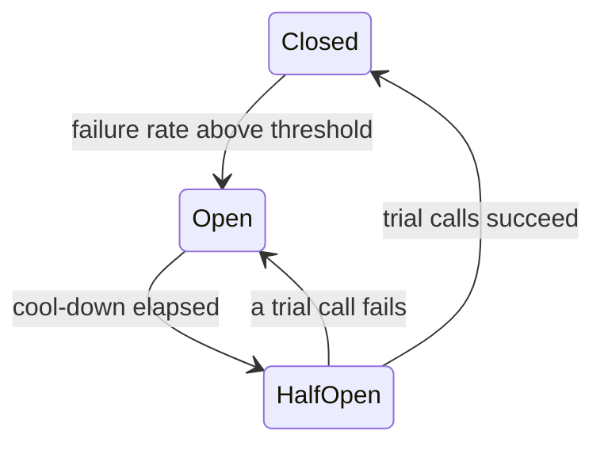

| State | Behaviour |
|---|---|
| **Closed** | Calls pass through normally; successes and failures are recorded in a sliding window (last N calls or last N seconds). |
| **Open** | Calls are rejected immediately with an error or fallback; no traffic reaches the dependency. |
| **Half-open** | After the wait duration, a limited number of trial calls are allowed. If they succeed, close; if any fail, open again. |

Typical configuration knobs: failure-rate threshold (e.g. 50%), minimum number of calls before evaluating (so 1 failure out of 2 doesn't trip it), slow-call threshold (count calls slower than X as failures), wait duration in open state, and number of trial calls in half-open.

```kotlin
// Resilience4j example
val config = CircuitBreakerConfig.custom()
    .failureRateThreshold(50f)                       // open at 50% failures
    .slowCallDurationThreshold(Duration.ofMillis(800))
    .slowCallRateThreshold(80f)                      // or 80% slow calls
    .minimumNumberOfCalls(20)
    .slidingWindowSize(50)                           // last 50 calls
    .waitDurationInOpenState(Duration.ofSeconds(10))
    .permittedNumberOfCallsInHalfOpenState(5)
    .build()

val breaker = CircuitBreaker.of("recommendations", config)

fun recommendationsFor(userId: String): List<Item> =
    try {
        breaker.executeSupplier { recsClient.fetch(userId) }
    } catch (e: CallNotPermittedException) {
        popularItemsCache.get()                      // fallback while open
    }
```

#### Fallbacks

While open, choose a sensible fallback: cached or stale data, a default value (generic recommendations), hiding a non-critical feature, or a fast error for critical paths where a fake answer would be wrong (you should not pretend a payment succeeded).

#### Where it lives

In application libraries (Resilience4j for JVM, Polly for .NET; Netflix Hystrix popularised the pattern and is now in maintenance mode), or in the infrastructure: Envoy/Istio **outlier detection** ejects individual bad hosts from the load-balancing pool, which is a per-instance breaker.

**Common pitfalls**
- One breaker for an entire dependency when only one endpoint is failing; scope breakers per dependency and sometimes per operation.
- Counting client errors (4xx) as failures, which opens the circuit for a caller's own bad input.
- Thresholds tuned so loosely that the breaker never opens, or so tightly that normal blips open it.
- No metrics or alerts on state changes, so nobody knows the feature is silently degraded.

**Likely follow-ups**
- *Circuit breaker vs retry?* Retry assumes the failure is brief; the breaker assumes it is not and stops calling. Use both, with retries counting toward the breaker.
- *Breaker vs rate limiter?* A rate limiter caps how much you send regardless of health; a breaker reacts to the dependency's failures.

</details>

### 9. What is the bulkhead pattern?

<details>
<summary>Answer</summary>

**In short:** A bulkhead isolates resources (thread pools, connection pools, instances, whole clusters) so that one failing dependency or noisy customer can only exhaust its own share, not the whole service. Like a ship's watertight compartments: a leak floods one compartment, not the ship.

#### The problem

Imagine a product-page service with one shared pool of 200 threads. It calls Catalog, Pricing and Recommendations. Recommendations starts hanging. Every request now holds a thread while waiting on it, and within seconds all 200 threads are stuck. Catalog and Pricing are perfectly healthy, but the service can't serve anything. One slow non-critical dependency took down everything.

#### The fix

Give each dependency (or class of work) its own bounded resources:

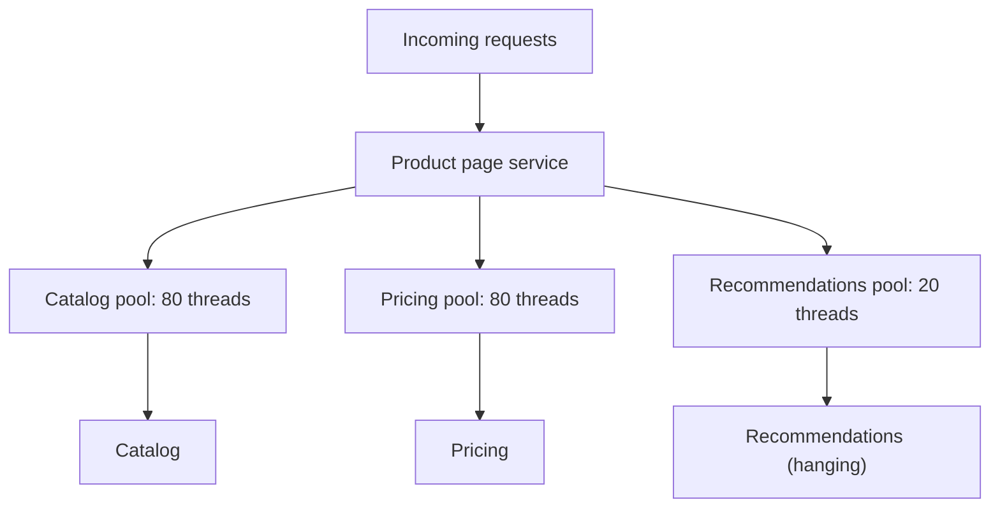

Now when Recommendations hangs, only its 20 slots fill. Further calls to it are rejected immediately (and the page renders without recommendations), while Catalog and Pricing calls continue normally.

#### Levels of bulkheading

| Level | Example |
|---|---|
| Within a process | Separate thread pools or semaphores per dependency; separate DB connection pools for OLTP vs reporting queries |
| Per workload | Separate instances for interactive API vs batch jobs, so a bulk export can't starve user traffic |
| Per tenant / tier | Dedicated capacity for premium or large customers; isolate a noisy tenant |
| Infrastructure | Separate clusters, queues or databases per critical service; **cell-based architecture** is bulkheading at the whole-stack level |

```kotlin
// Resilience4j semaphore bulkhead: at most 20 concurrent calls to recommendations
val bulkhead = Bulkhead.of("recs", BulkheadConfig.custom()
    .maxConcurrentCalls(20)
    .maxWaitDuration(Duration.ZERO)     // reject immediately when full
    .build())

val recs = try {
    bulkhead.executeSupplier { recsClient.fetch(userId) }
} catch (e: BulkheadFullException) {
    emptyList()                          // degrade gracefully
}
```

With coroutines, the same idea is a `Semaphore` or a limited dispatcher (`Dispatchers.IO.limitedParallelism(20)`) per dependency.

**Common pitfalls**
- Pools sized so small that normal peaks are rejected; size from measured concurrency plus headroom.
- Too many tiny pools wasting memory; group low-risk dependencies.
- Bulkheads without timeouts: the pool still fills, it just fills a smaller pool.

**Likely follow-ups**
- *Bulkhead vs circuit breaker?* A bulkhead limits how much damage a failure can do; a breaker stops calling once failure is detected. They complement each other.
- *How do you size a pool?* Little's law: concurrent calls ≈ requests per second × latency in seconds, e.g. 200 rps × 0.05 s = 10, then add headroom.

</details>

### 10. What is graceful degradation and load shedding?

<details>
<summary>Answer</summary>

**In short:** **Graceful degradation** means that when a non-critical dependency fails, the core experience keeps working with fewer features (a product page without reviews). **Load shedding** means that when the system is overloaded, it rejects excess requests early and cheaply (429/503), prioritising important traffic, so the requests it does accept still succeed quickly instead of everything slowing down and failing together.

#### Graceful degradation

Most pages are built from many dependencies, but only some are essential. Decide ahead of time, per feature, what happens when each dependency fails:

| Feature | Dependency down | Degraded behaviour |
|---|---|---|
| Product page | Reviews service | Render page, hide reviews section |
| Home feed | Personalised ranking | Show popular or chronological feed |
| Prices | Pricing service | Show cached price with "may be outdated", confirm before charging |
| Search | Search cluster | Show category browsing |
| Checkout | Payments | Cannot fake this: show a clear error, keep the cart |

Tools: circuit breakers with fallbacks, cached/stale data ("serve stale on error"), feature flags and **kill switches** to turn off expensive features under pressure, and clients (including mobile apps) built to render partial responses.

#### Load shedding

A service has a maximum throughput. Past that point, queues grow, latency rises for everyone, clients time out and retry, and goodput (useful completed work) collapses. It is better to serve 90% of requests well and reject 10% quickly than to serve 100% badly.

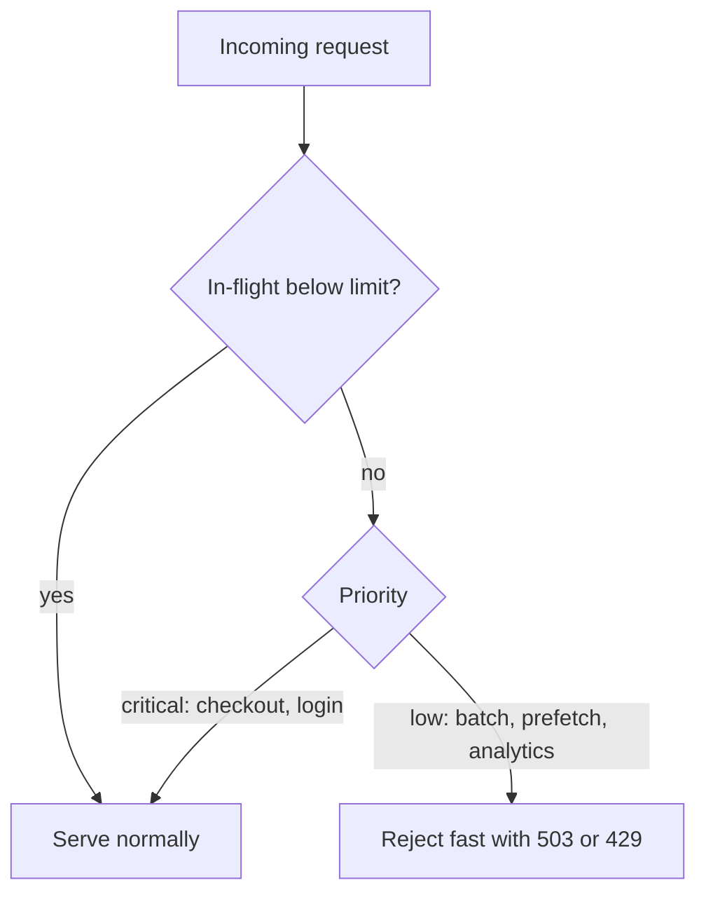

How to shed well:
- **Shed early**, at the edge or the very start of request handling, before spending CPU or DB work on the request.
- **Prioritise**: tag requests by criticality (user-facing vs background, checkout vs browse) and drop the lowest first.
- **Use concurrency limits**, not just requests per second; adaptive limiters (based on observed latency, similar to TCP congestion control) adjust automatically.
- **Drop stale work**: if a queued request's deadline has already passed, discard it; the client has given up.
- **Tell clients to back off** with `Retry-After`, and make clients (especially mobile apps) honour it.

**Common pitfalls**
- Unbounded queues: they hide overload until latency explodes. Bound queues and reject when full.
- Autoscaling as the only plan; scaling takes minutes, overload takes seconds.
- Degraded modes that were never tested and fail differently in production; exercise them in game days.

**Likely follow-ups**
- *Load shedding vs rate limiting?* Rate limiting enforces a fixed quota per client regardless of server health; load shedding reacts to the server's current capacity.
- *How do retries make overload worse?* Overload causes timeouts, timeouts cause retries, retries add load; shedding plus retry budgets breaks the loop.

</details>

### 11. What is the Backend for Frontend (BFF) pattern?

<details>
<summary>Answer</summary>

**In short:** A BFF is a thin backend layer built for one specific client type (mobile app, web, TV) that calls the downstream domain services and returns exactly what that client's screens need, usually in one round trip. It is typically owned by the client team, so they can change their API without waiting on core services. Business rules stay in the domain services; the BFF only aggregates, shapes and adapts.

#### The problem

Without a BFF, a mobile home screen might need to call User, Feed, Notifications, Recommendations and Promotions services directly: five round trips over a slow mobile network, each returning large generic payloads, plus clients knowing about internal service topology. A single general-purpose API for all clients tends to become a compromise that fits nobody: web wants rich data, mobile wants small payloads, TV wants different layouts.

#### How it works

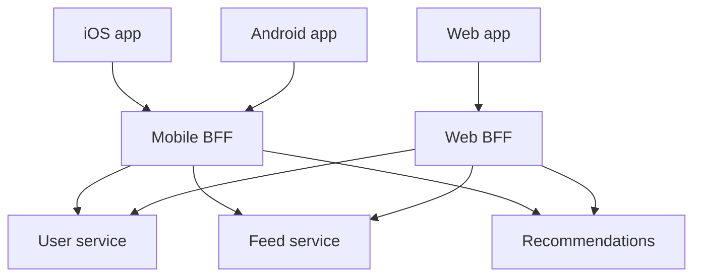

A mobile BFF endpoint like `GET /home` would:
1. Authenticate the user (token validation, session).
2. Call User, Feed and Recommendations **in parallel**, each with a timeout.
3. Trim and reshape: only fields the screen shows, image URLs sized for the device.
4. Degrade gracefully: if Recommendations fails, return the screen without that section.
5. Return one response, with client-appropriate caching headers.

```kotlin
suspend fun home(userId: String): HomeScreen = coroutineScope {
    val profile = async { userClient.profile(userId) }
    val feed    = async { feedClient.page(userId, limit = 20) }
    val recs    = async { runCatching { withTimeout(150) { recsClient.forUser(userId) } }.getOrNull() }

    HomeScreen(
        greeting = "Hi, ${profile.await().firstName}",
        items    = feed.await().map { it.toCard(imageWidth = 720) },
        recommendations = recs.await().orEmpty()   // optional section
    )
}
```

#### Benefits and risks

| Benefits | Risks |
|---|---|
| Fewer round trips and smaller payloads: big wins on mobile latency and battery | **Duplicated logic** across BFFs; keep business rules in domain services |
| Client team evolves its API at its own pace; can serve app-version-specific responses | Another hop and another service to operate |
| Hides internal service changes from clients (split a service without an app release) | A BFF can grow into a monolith of business logic |
| Natural home for client-specific auth flows, feature flags, server-driven UI | Fan-out latency is bounded by the slowest required call |

GraphQL often fills a similar role: one endpoint where each client asks for exactly the fields it needs, with resolvers calling domain services. Some companies use a GraphQL gateway instead of separate BFFs.

**Likely follow-ups**
- *BFF vs API gateway?* The gateway handles generic cross-cutting concerns (routing, auth, rate limits) for all clients; a BFF holds client-specific aggregation and shaping. Often both exist: gateway in front of BFFs.
- *One BFF per platform or per experience?* Usually per experience; iOS and Android often share a mobile BFF because their screens match.

</details>

### 12. What are the sidecar and ambassador patterns?

<details>
<summary>Answer</summary>

**In short:** A **sidecar** is a helper process deployed next to each service instance (in the same Kubernetes pod) that adds cross-cutting features such as proxying, mTLS, log shipping or secret refresh without changing the service's code. An **ambassador** is a sidecar that acts as the service's outbound proxy, handling retries, routing and circuit breaking. An **adapter** sidecar translates the service's output (logs, metrics) into the format the platform expects. Together they let platform teams provide shared features to services written in any language.

#### Why these patterns exist

Every service needs the same plumbing: TLS between services, retries and timeouts, metrics, tracing, log collection, config. If each team implements it in a library, you need a library per language, every team must upgrade it, and behaviour drifts. Moving that plumbing into a separate process next to the app makes it **language-agnostic** and lets a platform team upgrade it independently.

A sidecar shares the pod's lifecycle and network namespace, so the app talks to it over `localhost` with negligible network cost.

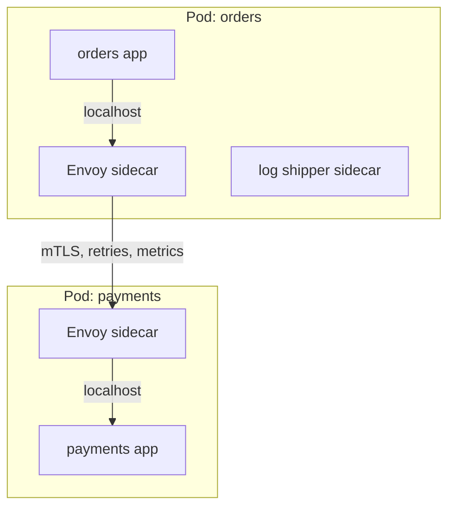

#### The three variants

| Pattern | Direction | Typical jobs | Example |
|---|---|---|---|
| Sidecar (general) | Alongside | Log shipping, config reload, secret rotation, TLS | Fluent Bit, Vault agent |
| Ambassador | Outbound from app | Discovery, retries, timeouts, circuit breaking, routing to external services | Envoy as egress proxy |
| Adapter | From app to platform | Convert metrics/logs to a standard format | Prometheus exporter beside a legacy app |

#### Service mesh

A **service mesh** (Istio, Linkerd) is the sidecar pattern applied fleet-wide: every pod gets a proxy, and a control plane configures them all. You get mTLS everywhere, uniform metrics and traces, traffic splitting for canaries, retries and outlier detection, all by configuration. Newer "sidecar-less" designs (such as Istio's ambient mode) move some of this into per-node proxies to cut overhead.

**Trade-offs and pitfalls**
- Extra latency per hop (small, but two proxies per call add up) and extra CPU/memory per pod.
- More moving parts to debug: is the failure in the app or the proxy?
- Startup and shutdown ordering: the app may start before the proxy is ready, or the proxy may exit before the app finishes draining.

**Likely follow-ups**
- *Sidecar vs shared library?* A library is faster and simpler to debug but per-language and needs app redeploys to upgrade; a sidecar is language-agnostic and independently upgradable.
- *Does the app need to know about the mesh?* Mostly no, but it must propagate trace headers so spans link up.

</details>

### 13. What is the strangler fig pattern?

<details>
<summary>Answer</summary>

**In short:** The strangler fig pattern replaces a legacy system piece by piece. You put a routing facade (proxy or gateway) in front of it, build each new or rewritten capability as a new service, and route more and more traffic to the new parts until the legacy system handles nothing and can be switched off. No big-bang rewrite, easy rollback (route back), and value is delivered continuously. Pair it with an **anti-corruption layer** to translate between old and new models.

The name comes from strangler fig vines, which grow around a host tree until they stand on their own and the tree inside is gone.

#### Why not a big-bang rewrite?

Full rewrites are notoriously risky: the old system keeps changing while you rebuild it, hidden behaviour is discovered late, nothing ships for months, and cut-over day is one huge risk. The strangler approach turns one giant migration into many small, reversible ones.

#### Step by step

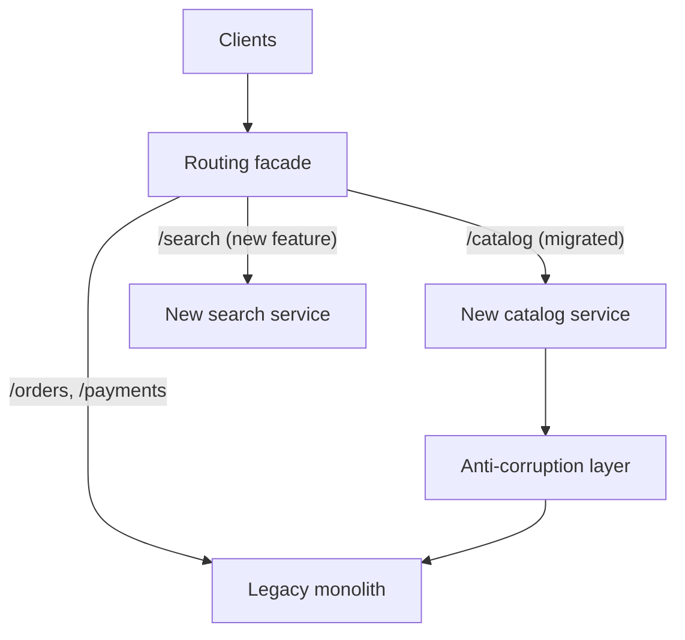

1. **Add the facade** in front of the legacy system, initially passing everything through unchanged.
2. **Pick a slice** with a clear boundary and good payoff (often read-heavy or frequently changed areas).
3. **Build the new service**, with an anti-corruption layer where it must still talk to the old system.
4. **Migrate data**: backfill, then keep in sync (CDC or events) during the transition.
5. **Shift traffic gradually**: shadow traffic first (compare responses), then a small percentage, then all, using feature flags or routing rules.
6. **Remove the old code path** once the new one is stable. Repeat.
7. When nothing is routed to the legacy system, decommission it.

#### Anti-corruption layer

The legacy system often has a messy model (cryptic column names, overloaded fields). The ACL is a translation layer so the new service speaks its own clean domain language and legacy concepts don't leak in.

**Common pitfalls**
- Never finishing: the last 20% of the legacy system lingers for years, so you run two systems. Plan and fund the decommission.
- Unclear source of truth during transition: decide which system owns each entity at each stage.
- Sharing the legacy database with the new service, which keeps them coupled; prefer syncing via events/CDC.

**Likely follow-ups**
- *How do you verify the new service is correct?* Shadow (dark) traffic: send a copy of real requests to both and diff the responses before switching.
- *Does this apply to mobile apps?* Yes: a BFF or gateway can be the facade, and inside an app you can migrate screen by screen (e.g. old views to a new UI toolkit).

</details>

### 14. How do you version APIs and evolve them without breaking clients?

<details>
<summary>Answer</summary>

**In short:** Make changes **additive and backward-compatible** whenever possible (add optional fields and new endpoints; never remove or change the meaning of fields clients use). When a breaking change is unavoidable, publish a new version (`/v2`, a header or media type), run old and new side by side, migrate clients while monitoring old-version traffic, then deprecate with notice. Contract tests catch accidental breaks, and mobile apps make all of this critical because old app versions stay in use for years.

#### What counts as breaking

| Safe (additive) | Breaking |
|---|---|
| Add a new endpoint | Remove or rename an endpoint or field |
| Add an optional request field with a default | Make an optional field required |
| Add a response field (if clients ignore unknown fields) | Change a field's type or format (`"price": "9.99"` to `999`) |
| Add a new enum value (only if clients handle unknown values) | Change a field's meaning or units |
| Relax validation | Tighten validation, change error codes or status codes clients rely on |

Two rules make additive evolution work: the **server** tolerates missing new fields (defaults), and **clients** ignore unknown fields and unknown enum values (the "tolerant reader" principle). In protobuf/gRPC, never reuse or renumber field tags; mark removed ones `reserved`.

```kotlin
// Tolerant client: unknown fields ignored, unknown enum mapped to a safe default
val json = Json { ignoreUnknownKeys = true; coerceInputValues = true }

@Serializable
data class OrderDto(
    val id: String,
    val status: Status = Status.UNKNOWN,   // a new server status won't crash old apps
    val giftMessage: String? = null        // added in a later release, optional
)
```

#### Versioning strategies

| Strategy | Example | Notes |
|---|---|---|
| URL path | `/v1/orders`, `/v2/orders` | Most visible and easiest to route and cache; most common for public APIs |
| Header | `Api-Version: 2024-06-01` | Clean URLs; date-based versions (popularised by Stripe) pin each client to the API as of a date |
| Media type | `Accept: application/vnd.shop.v2+json` | RESTful purist option; less convenient for tooling |
| Schema evolution only | GraphQL, protobuf | No versions; add fields, deprecate old ones (`@deprecated`) and remove when unused |

#### Retiring an old version

1. Release v2; keep v1 running (often v1 is implemented as an adapter on top of v2 to avoid two codebases).
2. Measure v1 usage per client (API key, app version).
3. Announce deprecation; send `Deprecation` and `Sunset` response headers with the shutdown date.
4. Help or nudge remaining clients; remove v1 when traffic is near zero.

#### Mobile specifics

You can't force everyone to update: some users keep an app version for years. So the backend must support every version still in meaningful use, typically with a **minimum supported version** check: the app sends its version, and the server (or a remote config) can show a soft "please update" prompt or a hard forced-upgrade screen for versions you no longer support. A BFF can also tailor responses per app version.

**Common pitfalls**
- Assuming clients ignore unknown fields or enum values when they don't; strict deserialisers crash old apps.
- Breaking changes hidden in behaviour (sorting order, pagination defaults, error codes).
- Too many concurrent versions, each with its own code path; cap how many you support.

**Likely follow-ups**
- *What are consumer-driven contract tests?* Each consumer publishes the requests and responses it relies on (e.g. with Pact); the provider's CI verifies it still satisfies all of them before deploying.
- *How do you version events on a message bus?* Same rules: additive changes, a schema registry with compatibility checks, and a new event type or topic for breaking changes.

</details>

### 15. What is serverless, and when is it a good or bad fit?

<details>
<summary>Answer</summary>

**In short:** Serverless (Functions as a Service, such as AWS Lambda, Google Cloud Functions or Cloudflare Workers) runs your code on demand in response to events; the provider manages servers and scaling (including down to zero), and you pay per invocation and execution time. It fits spiky or low traffic, event processing, glue code and scheduled jobs. It fits poorly for steady high traffic (cost), long-running work (time limits), strict latency (cold starts), heavy connection use, and where vendor lock-in matters.

#### How it works

You deploy a function plus a trigger: an HTTP route, a queue message, a file upload, a database change, a cron schedule. When an event arrives, the platform finds or starts an execution environment, runs your handler, and may keep that environment warm for later events. Many events at once means many environments in parallel. With no traffic, nothing runs and you pay (almost) nothing.

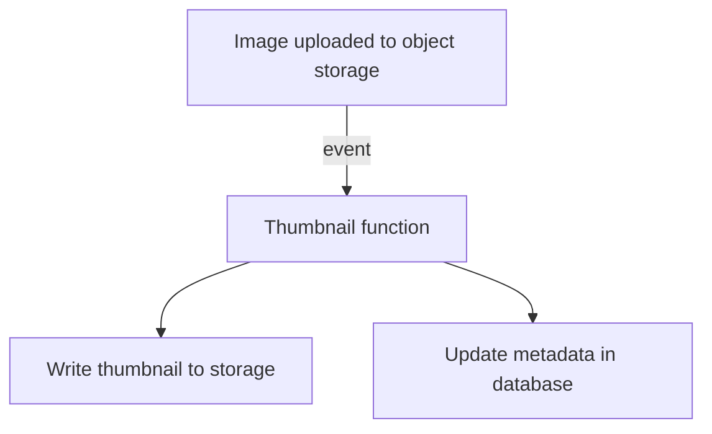

```python
def handler(event, context):
    """Triggered by an object-storage upload event."""
    for record in event["Records"]:
        bucket = record["s3"]["bucket"]["name"]
        key = record["s3"]["object"]["key"]
        image = s3.get_object(Bucket=bucket, Key=key)["Body"].read()
        thumb = make_thumbnail(image, width=256)
        s3.put_object(Bucket=bucket, Key=f"thumbs/{key}", Body=thumb)
```

Functions are **stateless** between invocations (keep state in a database, cache or object store) and should be **idempotent**, because event sources typically deliver at least once.

#### Good fit vs bad fit

| Good fit | Why |
|---|---|
| Spiky or unpredictable traffic | Scales up instantly-ish and down to zero |
| Event processing (upload → thumbnail, queue consumers) | Native triggers, parallelism per event |
| Glue code, webhooks, cron jobs | No server to maintain for small tasks |
| Prototypes, early-stage products | Near-zero ops and cost at low volume |

| Bad fit | Why |
|---|---|
| Steady high throughput | Per-invocation pricing usually costs more than always-on containers at constant load |
| Long-running jobs | Execution time limits (minutes, not hours) |
| Latency-critical paths | **Cold starts**: starting a new environment adds latency, worse for heavy runtimes |
| Many database connections | Thousands of parallel instances can exhaust a relational DB's connections; use a connection proxy (e.g. RDS Proxy) or HTTP-based data APIs |
| Long-lived connections, local state, GPUs | Model doesn't fit well |
| Portability concerns | Triggers, IAM and tooling are provider-specific |

Cold starts can be mitigated with lighter runtimes, smaller bundles, provisioned/pre-warmed capacity, or edge runtimes based on lightweight isolates (as Cloudflare Workers use), at a cost.

**Common pitfalls**
- Uncontrolled concurrency overwhelming downstream systems; set concurrency limits.
- Recursive triggers (function writes to the bucket that triggers it) causing runaway cost.
- Harder local testing and debugging; invest in tracing and structured logs.

**Likely follow-ups**
- *Serverless containers?* Platforms like AWS Fargate or Google Cloud Run run containers without managing servers, a middle ground with fewer limits than functions.
- *How do you handle failures?* Retries by the platform plus a dead-letter queue for events that keep failing.

</details>

### 16. What is cell-based architecture?

<details>
<summary>Answer</summary>

**In short:** Cell-based architecture splits the system into many identical, independent **cells**, each a complete copy of the stack (services and data) serving a subset of users or tenants, with a thin routing layer that sends each request to that user's cell. A failure or bad deploy then affects only one cell, you scale by adding cells, and each cell stays within sizes you have tested. The cost is extra work for anything that spans cells.

#### The problem it solves

In a normal architecture, each service is shared by all users. A bad config push, a poison request, or a database overload hits everyone at once; the **blast radius** is 100%. As the system grows, components also reach sizes nobody has tested. Cells cap both: a cell serves, say, 2% of customers, so the worst single-cell incident affects 2%.

#### How it works

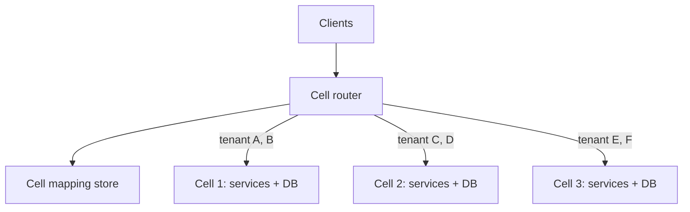

- **Cell**: a full, isolated deployment (its own services, databases, queues, caches), often in its own account or cluster. Cells don't call each other on the request path.
- **Partition key**: usually tenant, workspace, or user ID. All data for a key lives in one cell, so requests never need another cell.
- **Router**: a deliberately simple, highly available layer that looks up `key → cell` (cached mapping, or a hash) and forwards. It must be the most reliable part of the system, so it has minimal logic.
- **Fixed maximum cell size**: when cells fill up, create new cells rather than growing old ones; you only ever run a size you've load-tested.

#### Operating benefits

- **Wave deployments**: deploy to one canary cell, watch metrics, then to more cells in waves. A bad release is caught at one cell.
- **Noisy tenant isolation**: a heavy customer can be moved to its own cell.
- **Predictable scaling**: capacity planning per cell, more cells for more users.

#### Costs

| Challenge | Typical approach |
|---|---|
| Cross-cell features (global search, admin views, analytics) | Separate global services fed by events from all cells |
| Moving a tenant between cells | Migration tooling: copy data, sync, flip the mapping, clean up |
| Global uniqueness (usernames, emails) | Small global service or registry outside the cells |
| More infrastructure and fixed overhead per cell | Automation; infra-as-code for whole cells |
| Router is a single point of failure | Keep it simple, replicated, with cached mappings |

AWS has publicly described using cell-based designs in many of its services, and companies such as Slack and DoorDash have written about moving to cell-based architectures for availability.

**Likely follow-ups**
- *Cells vs shards?* Sharding partitions only the database; a cell partitions the whole stack, so compute, queues and caches are isolated too.
- *Cells vs regions?* Regions are about geography and disaster recovery; you can run many cells per region.

</details>

### 17. What is the difference between orchestration and choreography?

<details>
<summary>Answer</summary>

**In short:** In **orchestration**, a central coordinator (often a workflow engine) tells each service what to do, step by step, and handles failures and compensation. In **choreography**, there is no coordinator: each service reacts to events published by others and emits its own. Orchestration makes complex flows visible and controllable at the cost of a central component; choreography is highly decoupled but the overall flow is implicit and harder to monitor. Use orchestration for complex, business-critical workflows and choreography for simple fan-out reactions.

#### Example: placing an order

The workflow: create order → reserve stock → charge payment → schedule shipping, with compensation (release stock, refund) if a later step fails.

**Orchestration**:

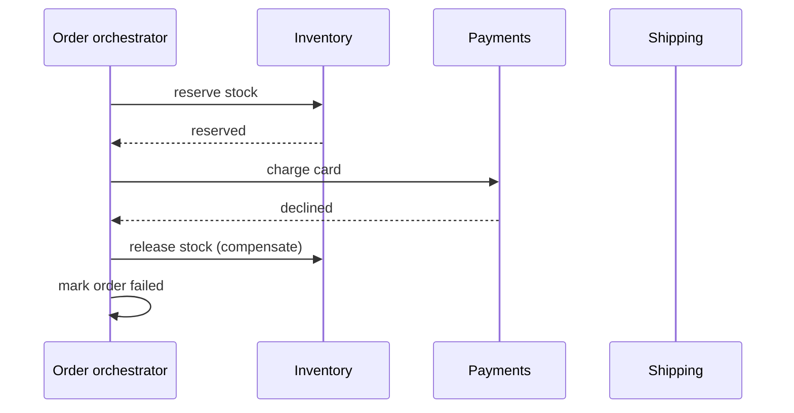

**Choreography**: Order service publishes `OrderPlaced`; Inventory hears it and publishes `StockReserved`; Payments hears that and publishes `PaymentFailed`; Inventory hears that and releases stock; Order hears it and marks the order failed. Nobody "owns" the flow; it emerges from subscriptions.

#### Comparison

| | Orchestration | Choreography |
|---|---|---|
| Control | Central coordinator | Distributed, event-driven |
| Visibility | Flow defined in one place; easy to see each order's state | Flow is spread over services; needs tracing to reconstruct |
| Coupling | Orchestrator knows all participants | Services only know event types |
| Changing the flow | Edit the workflow definition | Change several services' subscriptions |
| Failure handling | Retries, timeouts, compensation in one place | Each service must handle its own and emit failure events |
| Risk | Orchestrator becomes a bottleneck or "god service" | Hidden cyclic dependencies, "event spaghetti" |
| Tools | Temporal, AWS Step Functions, Camunda, Netflix Conductor | Kafka, SNS/SQS, any pub/sub |

```kotlin
// Orchestrated saga sketch (workflow-engine style: durable, retried, resumable)
fun placeOrder(order: Order) {
    inventory.reserve(order.items)
    try {
        payments.charge(order.id, order.total)    // idempotent with order.id as key
    } catch (e: PaymentDeclined) {
        inventory.release(order.items)            // compensating action
        orders.markFailed(order.id, "payment declined")
        return
    }
    shipping.schedule(order.id)
    orders.markConfirmed(order.id)
}
```

Workflow engines such as Temporal persist each step, so if the orchestrator crashes mid-flow it resumes where it left off instead of losing the order.

#### When to use which

- **Orchestration**: multi-step business processes with ordering, timeouts, compensations and a need to answer "where is order 123 stuck?" (fulfilment, onboarding, payouts).
- **Choreography**: independent reactions to a fact (on `UserSignedUp`: send welcome email, create analytics profile, grant trial). Adding a new reaction means adding a subscriber with no change elsewhere.
- Many systems mix them: an orchestrated core workflow that publishes events others react to.

**Likely follow-ups**
- *How do you monitor a choreographed flow?* Correlation IDs on every event, distributed tracing, and sometimes a separate process that tracks state from events.
- *Is the orchestrator a single point of failure?* It should be replicated and durable (state in a database); workflow engines are built for that.

</details>

### 18. What is a distributed monolith and how do you avoid it?

<details>
<summary>Answer</summary>

**In short:** A distributed monolith is a set of "microservices" so tightly coupled that they behave like a monolith with network calls in between: they must be deployed together, share a database, call each other synchronously in long chains, or share libraries that force lockstep upgrades. You pay the costs of microservices (network failures, ops overhead) without the benefits (independent deploys and scaling). Avoid it with clear bounded contexts, strict data ownership, async events for side effects, backward-compatible contracts, and independent deployability as a hard rule.

#### How teams end up here

Usually by splitting a monolith along the wrong lines (technical layers or database tables instead of business capabilities), or by splitting too early before the domain is understood. The code is now in separate repos, but the coupling is still there, only now it crosses the network.

#### Symptoms

| Symptom | Why it's a problem |
|---|---|
| "We need to deploy A, B and C together" | No independent deployability; a release train in disguise |
| Shared database or services reading each other's tables | Schema changes break other services silently |
| One user request causes a long synchronous chain (A → B → C → D) | Latency adds up; availability multiplies down (four services at 99.9% each ≈ 99.6% overall) |
| Shared "common" library with domain models | Changing a model forces every service to upgrade at once |
| One feature routinely needs changes in many services | Boundaries don't match how the business changes |
| An outage in one service takes down most others | No isolation; cascading failures |

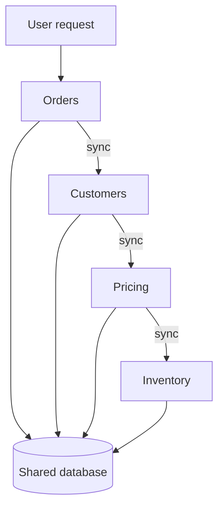

#### How to avoid or fix it

1. **Draw boundaries around business capabilities** (bounded contexts), not layers or tables. Merge services that always change together.
2. **One owner per piece of data.** Others get it through the owner's API or by keeping a local copy from events.
3. **Prefer async events for side effects.** Orders shouldn't synchronously call Email, Analytics and Loyalty; it publishes `OrderPlaced` and they react.
4. **Backward-compatible contracts** with consumer-driven contract tests, so each service can deploy on its own.
5. **Make independent deployability a rule**: if a change requires coordinated deploys, treat it as a design bug.
6. **Share only technical libraries** (logging, tracing clients), never domain models; let each service own its own DTOs.
7. **Resilience patterns** on remaining sync calls: timeouts, circuit breakers, fallbacks.

Sometimes the honest fix is to **merge** services back into a modular monolith, which is cheaper than keeping a distributed one.

**Likely follow-ups**
- *How do you measure coupling?* Track how often deploys or changes span multiple services, and trace call depth and fan-out per request.
- *Is any synchronous call bad?* No; synchronous reads for data you truly need right now are fine. The problem is long chains and runtime dependence for things that could be async.

</details>

### 19. Containers vs virtual machines, and what does Kubernetes do?

<details>
<summary>Answer</summary>

**In short:** A **virtual machine** virtualises hardware and runs its own full OS kernel: strong isolation, but heavy (GBs, slower to boot). A **container** shares the host's kernel and isolates processes with Linux namespaces and cgroups: lightweight (MBs), starts in seconds, and packages an app with its dependencies so it runs the same everywhere. **Kubernetes** orchestrates containers across a cluster: you declare the desired state (which containers, how many, how exposed) and it keeps reconciling reality to match, scheduling, restarting, scaling and rolling out updates.

#### VMs vs containers

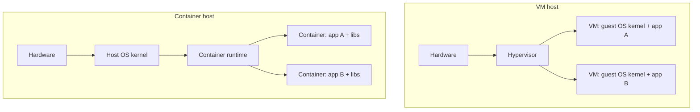

| | Virtual machine | Container |
|---|---|---|
| Isolation boundary | Hypervisor; separate kernel per VM | Shared kernel; namespaces (PID, network, mount, user) and cgroups (CPU/memory limits) |
| Size | GBs (full OS) | MBs (app plus libraries) |
| Start time | Tens of seconds to minutes | Typically under a second to a few seconds |
| Density | Fewer per host | Many per host |
| Security | Stronger isolation | Weaker; a kernel exploit can affect all containers (sandboxes like gVisor or microVMs like Firecracker narrow the gap) |
| Typical use | Different OSes, strong multi-tenant isolation, legacy apps | Microservices, CI, consistent dev-to-prod packaging |

In practice they're combined: containers usually run on VMs in the cloud.

#### What Kubernetes does

Without an orchestrator, you'd manually decide which machine runs which container, restart crashed ones, replace failed machines, and roll out new versions. Kubernetes automates this with a **control loop**: controllers constantly compare the desired state (stored in etcd via the API server) with the actual state and act to close the gap.

| Object | Purpose |
|---|---|
| **Pod** | Smallest unit: one or more containers scheduled together, sharing network and volumes (app plus sidecars) |
| **Deployment** | Desired replica count for stateless pods; rolling updates and rollbacks |
| **Service** | Stable virtual IP and DNS name, load-balancing across ready pods |
| **Ingress / Gateway API** | HTTP(S) routing from outside the cluster to Services |
| **ConfigMap / Secret** | Configuration and credentials injected into pods |
| **StatefulSet** | Stable identity and persistent storage per pod (databases, Kafka) |
| **HorizontalPodAutoscaler** | Scales replicas on CPU, memory or custom metrics |
| **Probes** | Liveness (restart if unhealthy) and readiness (receive traffic only when ready) |

```yaml
apiVersion: apps/v1
kind: Deployment
metadata:
  name: orders
spec:
  replicas: 3                      # desired state: keep 3 pods running
  selector:
    matchLabels: { app: orders }
  template:
    metadata:
      labels: { app: orders }
    spec:
      containers:
        - name: orders
          image: registry.example.com/orders:1.4.2
          resources:
            requests: { cpu: "250m", memory: "256Mi" }   # used for scheduling
            limits:   { memory: "512Mi" }
          readinessProbe:
            httpGet: { path: /ready, port: 8080 }
```

If a node dies, the Deployment controller sees only 2 of 3 pods running and the scheduler places a new one on a healthy node. Changing the image triggers a rolling update that replaces pods gradually, gated by readiness probes.

**Trade-offs**
- Powerful and a de facto standard, but operationally complex: networking, storage, upgrades, security policies, and many YAML objects.
- Managed services (EKS, GKE, AKS) run the control plane for you; simpler platforms (Cloud Run, Fargate, PaaS) hide even more for teams that don't need full control.

**Likely follow-ups**
- *Requests vs limits?* Requests reserve capacity for scheduling; limits cap usage (exceeding the memory limit gets the container OOM-killed; exceeding CPU gets it throttled).
- *How do you do zero-downtime deploys?* Rolling updates with readiness probes, enough replicas, graceful shutdown that drains connections on SIGTERM, and a PodDisruptionBudget.

</details>

---

[⬅ Previous: Messaging & Event-Driven Architecture](11-messaging-event-driven.md) · [⬅ Back to index](../README.md) · [Next: Reliability, Observability & Operations ➡](13-reliability-observability.md)
