# Reliability, Observability & Operations

[⬅ Back to index](../README.md)

Covers: designing for failure, redundancy across AZs and regions, disaster recovery (RPO/RTO), multi-region strategies, cascading failures, chaos engineering, logs/metrics/traces, golden signals, alerting, deployments (blue-green, canary, feature flags), incidents and postmortems, capacity planning.

---

### 1. What does "design for failure" mean?

<details>
<summary>Answer</summary>

**In short:** Assume every component **will** fail (disks, machines, networks, dependencies, whole zones or regions) and design so the system keeps working or degrades gracefully. In practice: redundancy with no single points of failure, timeouts/retries/circuit breakers, idempotent operations, automatic failover, graceful degradation, a limited blast radius, and regularly practising failure.

#### Why it matters

At scale, failure is not an edge case; it is the normal state. With 10,000 disks and an annual failure rate of 2%, roughly one disk dies every other day. Networks drop packets, a dependency deploys a bad version, a whole AZ loses power. A system designed on the assumption that "things usually work" falls over the first time they don't. A system designed for failure treats every remote call and every machine as something that can disappear at any moment.

#### The main techniques

| Technique | What it protects against | Example |
|---|---|---|
| **Redundancy** (N+1, multi-AZ) | Loss of a machine, disk or zone | 3 app instances across 3 AZs behind a load balancer |
| **Timeouts** | Hanging on a slow dependency forever | 300 ms timeout on a call to the pricing service |
| **Retries with exponential backoff + jitter** | Transient errors | Retry 2 times: 100 ms, then ~200 ms, randomised |
| **Circuit breakers** | Hammering a dependency that is already down | Stop calling for 30 s after 50% errors, then probe |
| **Bulkheads** | One dependency exhausting all threads/connections | Separate connection pools per downstream |
| **Idempotency** | Duplicates from retries | Idempotency key on "charge card" |
| **Health checks + failover** | Dead instances still receiving traffic | LB removes an instance after 3 failed checks; DB promotes a replica |
| **Graceful degradation** | Non-critical feature taking down the core | Product page loads without "recommended items" if that service is down |
| **Blast-radius limits** | One bad change or customer hurting everyone | Cells, shuffle sharding, staged rollouts |

A small example of a well-behaved client call:

```python
def get_recommendations(user_id):   # a defensive call to a non-critical dependency
    if breaker.is_open():                    # dependency known to be failing
        return cached_or_empty(user_id)      # degrade, don't fail the page
    try:
        resp = http.get(f"/recs/{user_id}", timeout=0.3)   # always set a timeout
        breaker.record_success()
        return resp.json()
    except (Timeout, ServerError):
        breaker.record_failure()
        return cached_or_empty(user_id)      # stale or empty is better than a 500
```

#### Practising failure

Redundancy you have never exercised is a hope, not a guarantee. Teams run **game days** (planned failure drills) and **chaos experiments** (see question 7) to confirm that failover actually happens, alerts actually fire and runbooks actually work.

**Common pitfalls:**
- Redundant app servers that all depend on a single database, cache or config service (the SPOF just moved).
- Retries without backoff or limits, which turn a small blip into a self-inflicted DDoS.
- Failover paths that were never tested and fail when needed (expired credentials, missing capacity).

**Likely follow-ups:**
- *How do you find single points of failure?* Draw the request path and ask "what happens if this box disappears?" for every node, including DNS, config, auth and secrets.
- *Is graceful degradation always possible?* Not for core functions (you can't "degrade" a payment), but you decide in advance which features are critical and which can be dropped.

</details>

### 2. How do availability zones and regions affect design?

<details>
<summary>Answer</summary>

**In short:** An **availability zone (AZ)** is one or more isolated data centres inside a region, connected to the other AZs by low-latency links (~1–2 ms). A **region** is a geographic area with several AZs, and regions are far apart (tens to hundreds of ms). The production baseline is running across **at least 3 AZs**; going **multi-region** protects against whole-region outages and gives lower latency to global users, but adds data-replication, consistency and cost problems.

#### What each one protects against

| Failure | Single AZ | Multi-AZ (one region) | Multi-region |
|---|---|---|---|
| Machine or rack dies | Survives (if redundant) | Survives | Survives |
| Data centre power/cooling/network loss | Down | Survives | Survives |
| Regional outage (control plane bug, big network event) | Down | Down | Survives |
| Latency for users on another continent | High | High | Low |

AZs have independent power, cooling and networking, but are close enough that **synchronous replication** between them is affordable. That is the key design property: you can keep a database replica in another AZ that is always up to date without a large latency penalty on writes.

#### A typical multi-AZ layout

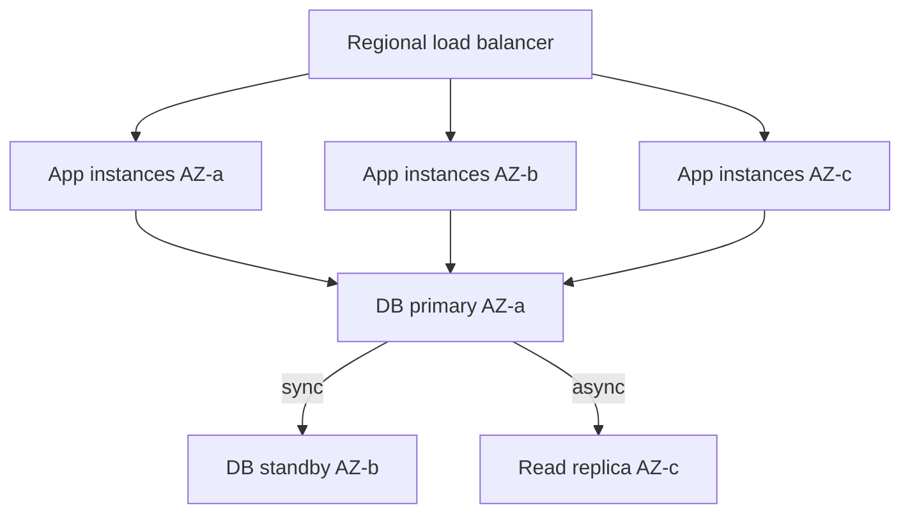

- **Stateless services** are spread evenly across AZs. Size them so losing one AZ still leaves enough capacity (with 3 AZs, each should handle 50% of peak, not 33%).
- **Databases** keep a synchronous or semi-synchronous standby in a different AZ, with automatic failover (managed services such as RDS Multi-AZ do this).
- **Quorum systems** (etcd, ZooKeeper, Cassandra with RF=3) place one replica per AZ, so a majority survives losing one AZ. This is why 3 AZs is the baseline: 2 AZs cannot keep a majority if one fails.

#### Going multi-region

Synchronous replication across regions adds tens to hundreds of ms to every write, so multi-region designs usually replicate **asynchronously** (accepting a small RPO) or use databases built for it (Spanner, CockroachDB) and pay the latency on writes. You also pay for cross-region data transfer and must decide where each user's data "lives". See questions 4 and 5.

**Common pitfalls:**
- Spreading instances across AZs but sizing for normal load, so the surviving AZs are overloaded the moment one fails.
- Cross-AZ traffic costs money in most clouds; chatty services that ignore AZ locality get expensive.
- Hidden regional dependencies (a global control plane, a single-region auth service) that defeat the multi-region setup.

**Likely follow-ups:**
- *Why not just use 2 AZs?* Quorum-based systems need a majority; with 2 AZs, losing one leaves 50%, which is not a majority.
- *When do you need multi-region?* When the business can't tolerate a regional outage (strict RTO), for data residency, or for latency to global users.

</details>

### 3. What are RPO and RTO?

<details>
<summary>Answer</summary>

**In short:** **RPO (Recovery Point Objective)** is the maximum acceptable **data loss**, measured in time ("we can lose at most 5 minutes of writes"). **RTO (Recovery Time Objective)** is the maximum acceptable **downtime** ("we must be serving again within 1 hour"). Together they drive the disaster-recovery design and its cost: RPO ≈ 0 needs synchronous replication; an RTO of seconds needs a hot standby or active-active.

#### Picture it on a timeline

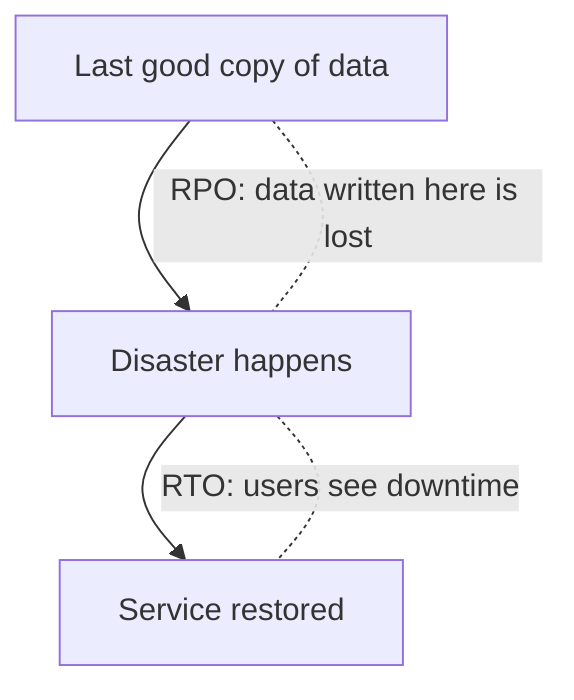

- **RPO** looks backwards from the disaster: how old is the newest copy of the data you can recover? If you back up nightly, your RPO is up to 24 hours. If you replicate asynchronously with ~2 s lag, RPO is a few seconds.
- **RTO** looks forward: how long until users are served again? It includes detecting the problem, deciding to fail over, promoting databases, warming caches and shifting DNS/traffic.

#### How they map to technology

| Target | What you need |
|---|---|
| RPO hours | Periodic backups/snapshots copied to another region |
| RPO seconds–minutes | Continuous async replication, or point-in-time recovery from write-ahead logs |
| RPO ≈ 0 | Synchronous replication (or consensus) to another AZ/region before acknowledging writes |
| RTO hours–days | Restore from backup and rebuild infrastructure |
| RTO minutes | Warm standby, automated failover runbooks, infrastructure as code |
| RTO seconds | Hot standby or active-active with automatic traffic shifting |

#### Example

A payments ledger might target **RPO = 0, RTO = 5 min**: every write is synchronously committed in two AZs, and failover is automated. An internal analytics dashboard might accept **RPO = 24 h, RTO = 1 day**: nightly snapshots are enough. Setting targets per service, rather than one target for the whole company, keeps costs sensible.

**Common pitfalls:**
- Defining RTO but never measuring it in a real drill; actual recovery is usually far slower than planned.
- Forgetting that backups are also needed against **logical** corruption (a bad migration, a deleted table); replication copies the mistake instantly.
- Ignoring dependent systems: your DB can be back in 5 minutes, but if the cache, search index or queue takes 2 hours to rebuild, that's your real RTO.

**Likely follow-ups:**
- *How do RPO/RTO relate to SLAs?* SLAs/SLOs cover normal availability; RPO/RTO cover recovery from a major disaster.
- *Who sets them?* The business (cost of downtime and data loss) together with engineering (cost of achieving them).

</details>

### 4. What disaster recovery strategies exist?

<details>
<summary>Answer</summary>

**In short:** From cheapest/slowest to most expensive/fastest: **backup and restore**, **pilot light**, **warm standby**, and **multi-site active-active**. You pick based on your RPO/RTO targets and budget, and whichever you pick, you must **test failover regularly**.

#### The four strategies

| Strategy | What runs in the DR region | Typical RPO | Typical RTO | Cost |
|---|---|---|---|---|
| **Backup and restore** | Nothing; only backups are stored there | Hours | Hours to days | Lowest |
| **Pilot light** | Data replicated continuously; core infrastructure defined but mostly off | Minutes | Tens of minutes | Low |
| **Warm standby** | A scaled-down but fully working copy of the stack | Seconds to minutes | Minutes | Medium |
| **Multi-site active-active** | Full capacity, serving real traffic | Near zero (with suitable replication) | Near zero | Highest |

**1. Backup and restore.** Snapshots and backups are copied to another region (ideally another account, so ransomware or a bad IAM change can't delete them). On disaster you rebuild everything from infrastructure-as-code and restore the data. Simple and cheap, but slow.

**2. Pilot light.** Like a gas heater's pilot flame: the database is continuously replicated to the DR region, but app servers are either off or at zero. On disaster you start/scale the compute, promote the replica and switch DNS.

**3. Warm standby.** A smaller copy of the full stack runs all the time, often taking a little traffic or synthetic checks, so you know it works. On disaster you scale it up and shift traffic.

**4. Active-active.** Every region serves production traffic. A regional failure just means traffic is routed to the others (see question 5). This is the only option for near-zero RTO, but it forces you to solve multi-region data consistency.

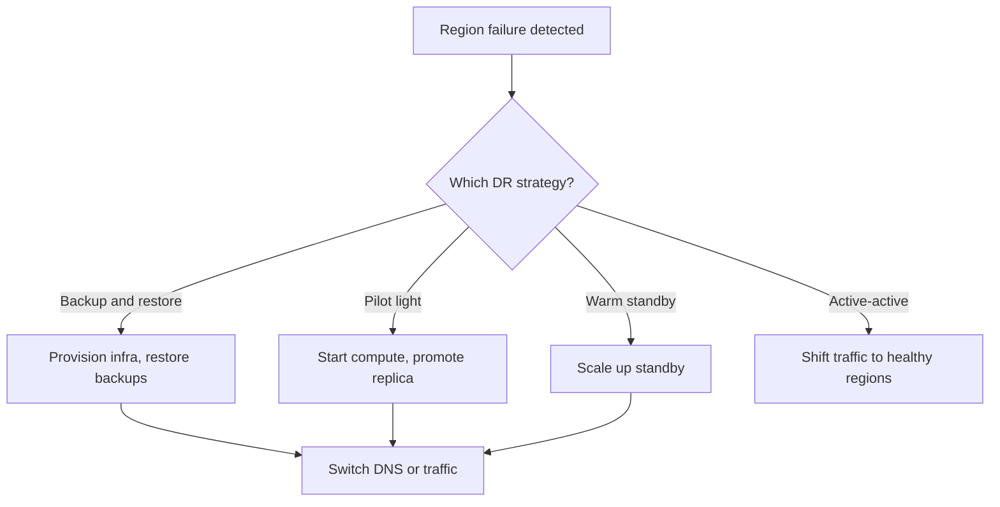

#### Testing

A DR plan that hasn't been exercised will fail: credentials expire, AMIs or images are missing, quotas in the DR region are too low, runbooks are out of date. Run scheduled failover drills, and measure the RPO and RTO you actually achieve.

**Common pitfalls:**
- Backups that are never test-restored (corrupt, incomplete, or too slow to restore).
- Cloud capacity in the DR region is not guaranteed during a large outage, because everyone fails over at once; reserve capacity for critical systems.
- Forgetting failback: getting back to the primary region after the incident is its own risky operation.

**Likely follow-ups:**
- *Which would you choose for an e-commerce checkout?* Warm standby or active-active for checkout; backup and restore is fine for internal reporting.
- *Why keep backups in a separate account?* So a compromised or mistaken admin action can't delete both production and its backups.

</details>

### 5. How do you design an active-active multi-region system?

<details>
<summary>Answer</summary>

**In short:** Route each user to the nearest healthy region and keep them sticky to a "home" region. For data, either **partition by home region** (each user's data has one writing region, replicated asynchronously elsewhere) or use a **globally distributed database** (Spanner, CockroachDB, DynamoDB Global Tables, Cosmos DB). Handle write conflicts (CRDTs, last-write-wins, or avoid them by design), keep **headroom** so each region can absorb a failed region's traffic, make sure global services aren't a hidden single point of failure, and watch cross-region costs.

#### Architecture

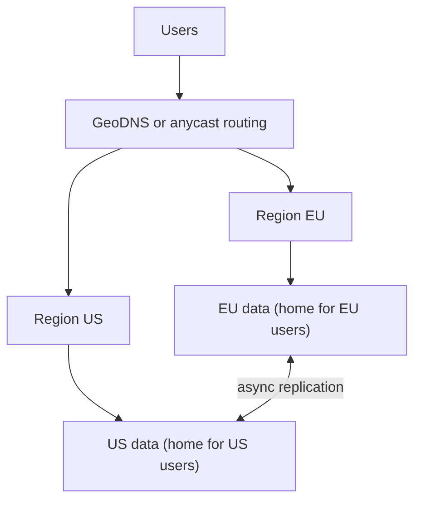

#### Key decisions

**1. Traffic routing.** GeoDNS or anycast sends users to the closest region. Health checks remove a failed region. Users are kept sticky to a home region (via a cookie or a lookup of the user's home) so their reads see their own writes.

**2. Where writes go.** This is the hard part.

| Approach | How it works | Trade-off |
|---|---|---|
| **Home-region partitioning** | Each user/tenant has one region that accepts their writes; others hold async replicas | No write conflicts; on failover, recent writes may be lost (RPO of seconds) |
| **Globally consistent DB** (Spanner, CockroachDB) | Consensus across regions for each write | Strong consistency; writes pay cross-region latency |
| **Multi-master with conflict resolution** (DynamoDB Global Tables, Cassandra) | Any region accepts writes, replicated async | Low latency; concurrent writes need LWW or CRDTs, and LWW can silently drop an update |

Many real designs mix these: user profiles and orders use home-region partitioning, counters and presence use CRDTs, and a small amount of globally unique data (usernames, payment idempotency) uses a strongly consistent store.

**3. Conflict handling.** If two regions can write the same record, decide up front: last-write-wins (simple, loses data), CRDTs (merge automatically, for counters/sets/text), or application-level merge. The best option is to **design conflicts away**: give each record a single owning region.

**4. Capacity headroom.** With two regions each at 60% utilisation, losing one puts 120% on the survivor. Each region must be able to take over a failed region's load, so typical utilisation is ≤ 50% with 2 regions or ≤ ~66% with 3.

**5. Global dependencies.** Auth, ID generation, feature flags and config must be either per-region or replicated so one region's outage doesn't break the others. ID generation should not need a global lock (use Snowflake-style IDs with a region bit).

**6. Cost.** Cross-region data transfer is charged per GB and can dominate the bill for chatty replication. Replicate only what needs to be global.

**Common pitfalls:**
- "Active-active" that actually depends on a single-region database for writes; the other region can't serve when that one fails.
- Failing over automatically on flaky health signals, causing traffic to bounce between regions.
- Not testing a full-region evacuation under real load.

**Likely follow-ups:**
- *How do you fail over a user whose home region is down?* Promote their data in another region (accepting the async lag as data loss) or serve read-only until the home recovers.
- *How do you keep reads consistent after a write?* Route the user's reads to their home region, or read from a replica only once it has caught up to the user's last-write timestamp.

</details>

### 6. What are cascading failures and how do you prevent them?

<details>
<summary>Answer</summary>

**In short:** A cascading failure is when one failure triggers others, so a small problem grows into a full outage. Classic chain: a slow database makes app threads block, thread pools fill, health checks fail, load balancers remove instances, the remaining instances get more load and die, and client retries multiply the traffic. Prevent it with timeouts and deadlines, limited retries with backoff and jitter, circuit breakers and bulkheads, load shedding, health checks that don't depend on shared downstreams, capacity headroom, and serving stale data when a source is down.

#### How a cascade unfolds

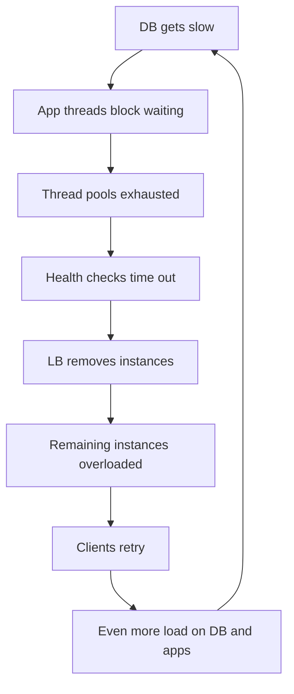

The key feature is a **positive feedback loop**: the system's reaction to stress (retries, failover, removing "unhealthy" nodes) adds more stress. Without something that breaks the loop, the system stays down even after the original trigger is gone; this is sometimes called a **metastable failure**.

#### Defences, and which link each one breaks

| Defence | What it does |
|---|---|
| **Timeouts + deadline propagation** | Don't wait forever; pass the remaining time budget downstream so work isn't done for a caller that already gave up |
| **Retry budgets, backoff, jitter** | Cap retries (e.g. retries ≤ 10% of requests), spread them out so they don't arrive in synchronized waves |
| **Circuit breakers** | Stop sending to a failing dependency so it can recover; fail fast instead of blocking threads |
| **Bulkheads** | Separate thread/connection pools per dependency so one slow dependency can't consume everything |
| **Load shedding / admission control** | Reject excess requests early (HTTP 503, 429) rather than queueing them until they time out |
| **Shallow health checks** | Liveness checks only the process itself, so a DB blip doesn't make every instance "unhealthy" at once |
| **Headroom + autoscaling** | Spare capacity absorbs shifts in load |
| **Stale-on-error caching** | Serve the last good value when the source is down |

Load shedding is often misunderstood: it's better to reject 20% of requests quickly than to accept all of them and have 100% time out. Queues should be bounded, and work that has waited longer than the client's timeout should be dropped, not processed.

```python
def call_with_retry(fn, max_attempts=3, base=0.1, cap=2.0):
    """Retry with exponential backoff, full jitter, a cap and a retry budget."""
    for attempt in range(max_attempts):
        try:
            return fn()
        except TransientError:
            if attempt == max_attempts - 1 or not retry_budget.allow():
                raise
            sleep(random.uniform(0, min(cap, base * 2 ** attempt)))
```

**Common pitfalls:**
- Retrying at every layer: 3 retries at each of 4 layers can turn 1 request into 81.
- Deep health checks that query the DB, causing every instance to be removed during a DB slowdown.
- Unbounded queues that hide overload until latency is minutes long.

**Likely follow-ups:**
- *What is a retry storm?* Many clients retrying at the same time after a failure, multiplying load; fixed with jitter and retry budgets.
- *How do you recover from a metastable state?* Shed load hard (or block traffic), let the system drain, then ramp traffic back gradually.

</details>

### 7. What is chaos engineering?

<details>
<summary>Answer</summary>

**In short:** Chaos engineering is deliberately injecting failures into a system (ideally in production, carefully) to verify that it handles them: killing instances (Netflix's Chaos Monkey), adding latency, cutting off a dependency, failing an AZ. The process is: define steady state, hypothesise it will hold, inject a fault with a small blast radius, observe, and fix the weaknesses you find. It builds real confidence that redundancy and failover work.

#### Why it exists

Redundancy and failover are code paths that rarely run. Like any untested code, they break silently: a retry policy is misconfigured, a standby is missing a secret, an alert doesn't fire. Chaos engineering exercises those paths on purpose, at a time you choose, with people watching, instead of discovering the bug at 3 a.m. during a real outage. Netflix popularised it with Chaos Monkey (randomly terminating instances) and later tools that simulate losing a whole region.

#### The experiment loop

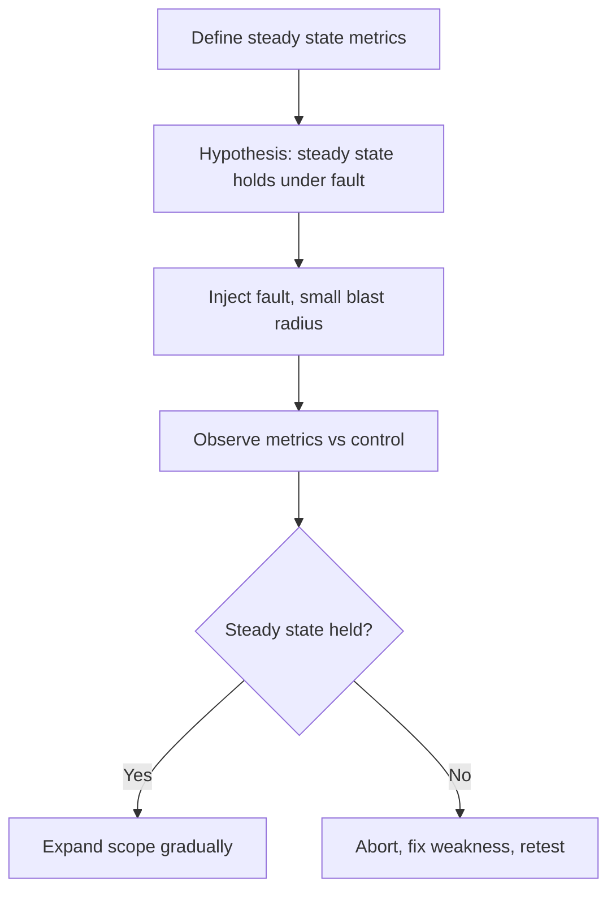

1. **Steady state**: measurable business-level signals, e.g. "successful checkouts per minute" or "p99 latency < 300 ms", not "CPU looks fine".
2. **Hypothesis**: "If we terminate one cache node, checkout success rate stays within 0.1% of normal."
3. **Inject the fault** on a small slice: one instance, 1% of traffic, one AZ.
4. **Observe** and compare with a control group.
5. **Stop conditions**: automatic abort if a guardrail metric degrades.
6. **Fix and repeat**, then widen the scope.

#### Typical faults to inject

| Fault | What it tests |
|---|---|
| Kill an instance or pod | Autoscaling, LB health checks, statelessness |
| Add latency to a dependency | Timeouts, circuit breakers, thread-pool sizing |
| Return errors from a dependency | Fallbacks, graceful degradation |
| Black-hole an AZ | Multi-AZ capacity and failover |
| Fill a disk, exhaust memory | Alerts and resource limits |
| Clock skew, DNS failure | Hidden assumptions |

Start in staging with **game days** (a planned session where the team injects a failure and practises the response), then move to production with tight blast-radius controls. Tools include Chaos Monkey, Gremlin, AWS Fault Injection Service, LitmusChaos and Chaos Mesh for Kubernetes.

**Common pitfalls:**
- Running experiments without good observability, so you can't tell what happened.
- No abort switch; an experiment turns into a real incident.
- Treating it as random breakage instead of hypothesis-driven experiments.

**Likely follow-ups:**
- *Is it safe to do in production?* Yes, if you start small, have automatic stop conditions, and run during business hours with owners present.
- *What do you do with the findings?* Treat them like postmortem action items: owner, priority, tracked to completion.

</details>

### 8. What are the three pillars of observability?

<details>
<summary>Answer</summary>

**In short:** **Metrics** (numeric time series: rates, errors, latency percentiles, saturation; cheap and great for dashboards and alerts), **logs** (detailed, ideally structured, event records; rich but expensive at volume) and **traces** (a request's path across services as a tree of timed spans; essential for finding the slow hop in microservices). Increasingly teams add **continuous profiles** and **events** (deploys, config changes) on the same timeline, and use **OpenTelemetry** as the standard for instrumenting all of them.

#### Comparing the three

| | Metrics | Logs | Traces |
|---|---|---|---|
| **Shape** | Numbers aggregated over time, with labels | Individual timestamped records | Tree of spans for one request |
| **Answers** | "Is error rate rising?" | "What exactly happened in this request?" | "Which service made this request slow?" |
| **Cost** | Low (fixed per series) | High (grows with traffic) | Medium (controlled by sampling) |
| **Cardinality** | Must be low (avoid user_id as a label) | Any | Any, per span attributes |
| **Typical tools** | Prometheus, Datadog, CloudWatch | ELK/OpenSearch, Loki, Splunk | Jaeger, Zipkin, Tempo, Datadog APM |

#### Metrics

Counters (requests_total), gauges (queue_depth), and histograms (request latency buckets, from which percentiles are computed). Because they're pre-aggregated, storage cost depends on the number of distinct label combinations (**cardinality**), not on traffic. Adding a `user_id` label creates millions of series and can bring a metrics system down.

#### Logs

Use **structured logs** (JSON with consistent fields) so they can be queried, and always include a request/trace ID:

```json
{"ts":"2026-03-01T10:15:02Z","level":"error","service":"checkout",
 "trace_id":"4bf92f3577b34da6a3ce929d0e0e4736","user_id":"u_42",
 "msg":"payment declined","provider":"stripe","latency_ms":412}
```

Centralise them, set retention tiers (hot for days, cold/archived for longer), sample noisy debug logs, and never log secrets or unnecessary personal data.

#### Traces

A trace follows one request across services; each operation is a **span** with a start time, duration and parent. It answers questions metrics can't, like "why are 1% of checkouts slow?" See question 11.

#### Correlating them

The real value comes from linking them: an alert fires on a metric, you jump to example traces from that time window (via **exemplars**), and from a slow span to the logs with the same trace ID. Deploy markers on dashboards show whether a change caused the problem.

**Common pitfalls:**
- High-cardinality labels in metrics (user IDs, full URLs) causing cost or outages in the metrics system.
- Unstructured logs that can only be grepped.
- Logging tokens, passwords or full card numbers.

**Likely follow-ups:**
- *What is OpenTelemetry?* A vendor-neutral set of APIs, SDKs and a collector for emitting metrics, logs and traces, so you can switch backends without re-instrumenting.
- *Why not derive everything from logs?* You can, but computing metrics from logs at high volume is far more expensive and slower than native metrics.

</details>

### 9. What are the golden signals, RED and USE?

<details>
<summary>Answer</summary>

**In short:** They are checklists of what to monitor. The **four golden signals** (from Google's SRE book) are **latency, traffic, errors and saturation**. **RED** (for request-driven services) is **Rate, Errors, Duration**. **USE** (for resources such as CPU, disks and connection pools) is **Utilisation, Saturation, Errors**. Measure latency as **percentiles** (p50/p95/p99) and separately for successes and failures.

#### Side by side

| Method | Applies to | Signals |
|---|---|---|
| **Golden signals** | Any user-facing system | Latency, Traffic, Errors, Saturation |
| **RED** | Services/endpoints (request-driven) | Rate (req/s), Errors (failed req/s), Duration (latency distribution) |
| **USE** | Resources (CPU, memory, disk, NIC, thread pools, DB connections) | Utilisation (% busy), Saturation (queued work), Errors (device/resource errors) |

RED is essentially the golden signals without saturation, applied per service; USE fills in the resource side. A practical setup: a RED dashboard for every service and endpoint, plus USE dashboards for the resources those services run on.

#### What each signal means

- **Latency**: how long requests take. Track the distribution, not the average.
- **Traffic**: demand on the system, such as requests per second or messages consumed per second.
- **Errors**: rate of failed requests, explicit (5xx) and implicit (200 with wrong content, or responses slower than the SLO).
- **Saturation**: how "full" the system is: queue length, thread-pool usage, memory pressure. Saturation predicts trouble before latency rises.

#### Why percentiles

Averages hide pain. If 99 requests take 50 ms and one takes 5 s, the average is ~100 ms, which looks fine, yet 1% of users wait 5 seconds. For a page that makes 50 backend calls, most page loads will hit at least one p99 call, so tail latency matters a lot.

p99 latency over 5 minutes from a Prometheus histogram:

```promql
histogram_quantile(0.99,
  sum by (le) (rate(http_request_duration_seconds_bucket{service="checkout"}[5m])))
```

#### Successes vs failures

Measure latency separately for successful and failed requests. A dependency failing fast (returning errors in 2 ms) can drag average latency down and make a dashboard look healthier during an outage.

**Common pitfalls:**
- Averaging percentiles across instances (mathematically wrong; aggregate histograms instead).
- Watching only CPU; a service can be saturated on connection pools or a lock while CPU is low.

**Likely follow-ups:**
- *Which one would you alert on?* Errors and latency against SLOs (user symptoms); saturation is for dashboards and capacity planning.
- *What is saturation for a queue consumer?* Consumer lag or queue depth.

</details>

### 10. How should alerting work?

<details>
<summary>Answer</summary>

**In short:** Alert on **symptoms users feel**, typically **SLO burn rate** (error rate or latency eating into the error budget too fast), not on every possible cause such as high CPU. Use **multi-window burn-rate alerts**: a fast burn pages someone, a slow burn opens a ticket. Every page must be **actionable** and link to a runbook; anything else becomes noise and causes alert fatigue. Route by severity and use dashboards, not alerts, for investigation.

#### SLIs, SLOs and error budgets

- **SLI** (indicator): a measured ratio, e.g. "fraction of requests that succeed in < 300 ms".
- **SLO** (objective): the target, e.g. 99.9% over 30 days.
- **Error budget**: what's left over, 0.1% of requests (or ~43 minutes of full downtime in 30 days).

**Burn rate** is how fast you're spending the budget. A burn rate of 1 uses exactly the whole budget over 30 days; a burn rate of 14.4 uses 2% of the monthly budget in one hour.

#### Multi-window burn-rate alerts

A common pattern (from Google's SRE workbook):

| Severity | Burn rate | Long window | Short window | Action |
|---|---|---|---|---|
| Page | 14.4 | 1 h | 5 min | Wake someone up |
| Page | 6 | 6 h | 30 min | Wake someone up |
| Ticket | 1 | 3 days | 6 h | Fix during working hours |

The **long window** makes sure the problem is significant; the **short window** makes sure it is still happening, so the alert resets quickly after recovery.

A Prometheus-style fast-burn alert for a 99.9% SLO:

```yaml
- alert: CheckoutErrorBudgetFastBurn
  expr: |
    (sum(rate(http_requests_total{service="checkout",code=~"5.."}[1h]))
      / sum(rate(http_requests_total{service="checkout"}[1h]))) > (14.4 * 0.001)
    and
    (sum(rate(http_requests_total{service="checkout",code=~"5.."}[5m]))
      / sum(rate(http_requests_total{service="checkout"}[5m]))) > (14.4 * 0.001)
  labels: {severity: page}
  annotations:
    runbook: https://runbooks.example.com/checkout-errors
```

#### Symptoms vs causes

| Alert on (symptom) | Don't page on (cause) |
|---|---|
| Checkout error rate over SLO | CPU at 85% |
| p99 latency over SLO | One pod restarted |
| Queue consumer lag growing beyond X minutes | Disk 70% full (ticket instead) |

High CPU may be harmless; and if it isn't, the symptom alert will catch it. Cause-based alerts are useful as **tickets** for things that will become problems (disk filling in 3 days, certificate expiring in 14 days).

#### Hygiene

- Every page: clear title, impact, dashboard link, runbook.
- Review pages weekly; delete or fix any that weren't actionable.
- Deduplicate and group related alerts so one incident doesn't send 200 pages.

**Common pitfalls:**
- Static thresholds on every metric, producing alert fatigue so real pages get ignored.
- Alerting only on averages, missing tail-latency problems.
- No alert on the absence of data (a dead exporter looks like "zero errors").

**Likely follow-ups:**
- *What happens when the error budget is spent?* Teams typically freeze risky launches and prioritise reliability work until it recovers.
- *How do you monitor from the user's perspective?* Synthetic probes (black-box checks from outside) plus real-user monitoring.

</details>

### 11. How does distributed tracing work?

<details>
<summary>Answer</summary>

**In short:** The entry service creates a **trace ID**, every downstream call propagates it (the W3C `traceparent` header), and each unit of work records a **span** (name, start, duration, parent span, attributes). A collector assembles the spans into a tree that shows exactly where time goes and where errors start. **Sampling** controls cost (head-based: keep x% chosen up front; tail-based: decide after the trace completes, keeping all slow or failed ones). Putting the trace ID in logs lets you jump between traces and logs.

#### Why it's needed

In a monolith, a profiler or a stack trace tells you where time goes. In microservices, one user request may touch 20 services, queues and databases. Metrics tell you checkout is slow; tracing tells you it's slow because the inventory service's call to Redis takes 800 ms for 2% of requests.

#### How it works

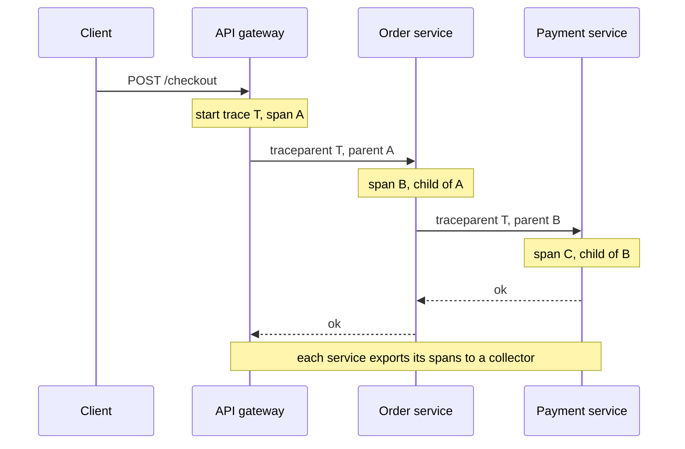

1. **Create**: the first service (or the client/edge) generates a 128-bit trace ID and a root span.
2. **Propagate**: every outgoing HTTP/gRPC call or queued message carries the context. W3C Trace Context format:
   `traceparent: 00-4bf92f3577b34da6a3ce929d0e0e4736-00f067aa0ba902b7-01` (version, trace ID, parent span ID, flags such as "sampled").
3. **Record**: each service creates child spans for its work (handling the request, DB queries, cache calls) with attributes like `http.status_code` or `db.statement`.
4. **Export**: spans are sent asynchronously (in batches) to a collector, e.g. the OpenTelemetry Collector, then stored in Jaeger, Tempo, Zipkin or a vendor backend.
5. **Assemble**: the backend groups spans by trace ID and builds the tree, shown as a waterfall/Gantt chart.

OpenTelemetry in Python, creating a manual child span (HTTP propagation is usually auto-instrumented):

```python
from opentelemetry import trace
tracer = trace.get_tracer("order-service")

def place_order(order):
    with tracer.start_as_current_span("place_order") as span:
        span.set_attribute("order.items", len(order.items))
        reserve_inventory(order)      # auto-instrumented HTTP call carries traceparent
        charge_payment(order)
```

#### Sampling

| Type | How | Pros | Cons |
|---|---|---|---|
| **Head-based** | Decide at the start (e.g. keep 1%), propagate the decision | Cheap, simple | Misses most rare errors and slow requests |
| **Tail-based** | Buffer all spans, decide after the trace completes | Keeps 100% of errors and slow traces | Needs a stateful collector tier; more memory |

#### Linking to logs and metrics

Add the trace ID to every log line (most OpenTelemetry logging integrations do it automatically), and attach **exemplars** (sample trace IDs) to latency histograms so you can click from a spike on a graph straight to a slow trace.

**Common pitfalls:**
- Context lost at async boundaries (thread pools, queues, coroutines), producing broken traces.
- Spans for every tiny function, which inflates cost without adding insight.
- Putting sensitive data (tokens, PII) into span attributes.

**Likely follow-ups:**
- *How do you trace through Kafka?* Put the trace context in message headers; the consumer starts a span linked to the producer's.
- *What's the overhead?* Usually small when spans are exported asynchronously in batches; sampling keeps storage costs down.

</details>

### 12. Blue-green vs canary vs rolling deployments?

<details>
<summary>Answer</summary>

**In short:** **Rolling** replaces instances gradually, a few at a time (no extra capacity, both versions run at once, rollback is another rollout). **Blue-green** runs the new version alongside the old and switches all traffic at once (instant rollback, but double capacity). **Canary** sends a small, growing share of traffic (1% → 5% → 25% → 100%) to the new version, compares metrics automatically and rolls back if worse (smallest blast radius; standard at large companies). All three need **backward-compatible** changes, especially for DB schemas (expand-and-contract).

#### Comparison

| | Rolling | Blue-green | Canary |
|---|---|---|---|
| **Traffic shift** | Gradual by instance | All at once | Gradual by % of traffic |
| **Extra capacity** | None (or a small surge) | 2x during the switch | Small |
| **Mixed versions running** | Yes | Briefly or no | Yes |
| **Rollback** | Roll forward/back again (minutes) | Flip back (seconds) | Route canary traffic away (seconds) |
| **Blast radius of a bad release** | Grows with each batch | Everyone, until flipped back | Only the canary slice |
| **Automated analysis** | Health checks | Smoke tests before the switch | Compare canary vs baseline metrics |

#### How canary works

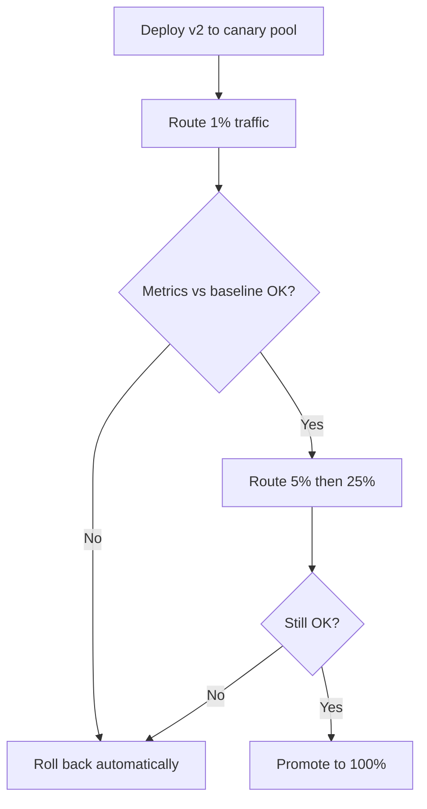

The canary is compared with a **baseline** running the old version and receiving the same share of traffic, rather than with the whole fleet, so that differences in instance age or cache warmth don't skew the comparison. Compared metrics: error rate, latency percentiles, CPU/memory, and business metrics (orders/min). Tools such as Argo Rollouts, Flagger, Spinnaker/Kayenta automate this.

#### Blue-green details

Blue (live) and green (new) are both fully deployed. You test green with smoke tests, then switch the load balancer or DNS. DNS switches are slower to roll back because of caching, so load-balancer switches are preferred.

#### Database compatibility (expand-and-contract)

Because old and new code run at the same time (and you might roll back), schema changes must be split:

1. **Expand**: add the new column/table; old code ignores it.
2. Deploy code that writes to both old and new and reads the old.
3. **Backfill** existing rows.
4. Deploy code that reads from the new.
5. **Contract**: once nothing uses the old column, drop it in a later release.

Never rename or drop a column in the same release that stops using it.

**Common pitfalls:**
- Canary on too little traffic to be statistically meaningful; low-traffic services may need time-based bakes instead.
- Assuming blue-green gives instant rollback when the release also ran an irreversible migration.
- Sticky sessions or caches that mix versions in unexpected ways.

**Likely follow-ups:**
- *How does this apply to mobile apps?* You can't roll back installed binaries, so use staged store rollouts plus server-driven feature flags.
- *What is a dark launch / shadow traffic?* Sending a copy of real traffic to the new version without returning its responses, to test it under load safely.

</details>

### 13. What are feature flags and why are they important?

<details>
<summary>Answer</summary>

**In short:** Feature flags turn code paths on or off **at runtime** without a deploy, which decouples **deploy** (code is in production) from **release** (users see it). They enable gradual rollouts (internal → x% → everyone), instant **kill switches**, A/B experiments and per-tenant entitlements. Flags should be evaluated locally from cached config pushed by a flag service, with safe defaults if that service is unreachable, and old flags must be cleaned up.

#### Why decouple deploy from release

Without flags, shipping code and exposing it to users are the same event, so every deploy is risky and big features sit on long-lived branches. With flags, teams merge to trunk continuously, ship code "dark", and turn it on when ready, for whom they choose. If something goes wrong, turning a flag off takes seconds, much faster than a rollback.

#### Types of flags

| Type | Lifetime | Example |
|---|---|---|
| **Release flag** | Days to weeks | `new_checkout_flow` rolled out 1% → 100%, then removed |
| **Kill switch / ops flag** | Long-lived | `disable_recommendations` to shed load during an incident |
| **Experiment flag** | Duration of the test | A/B test of two pricing layouts |
| **Permission / entitlement flag** | Long-lived | Feature only for enterprise-plan tenants |

#### How a flag system works

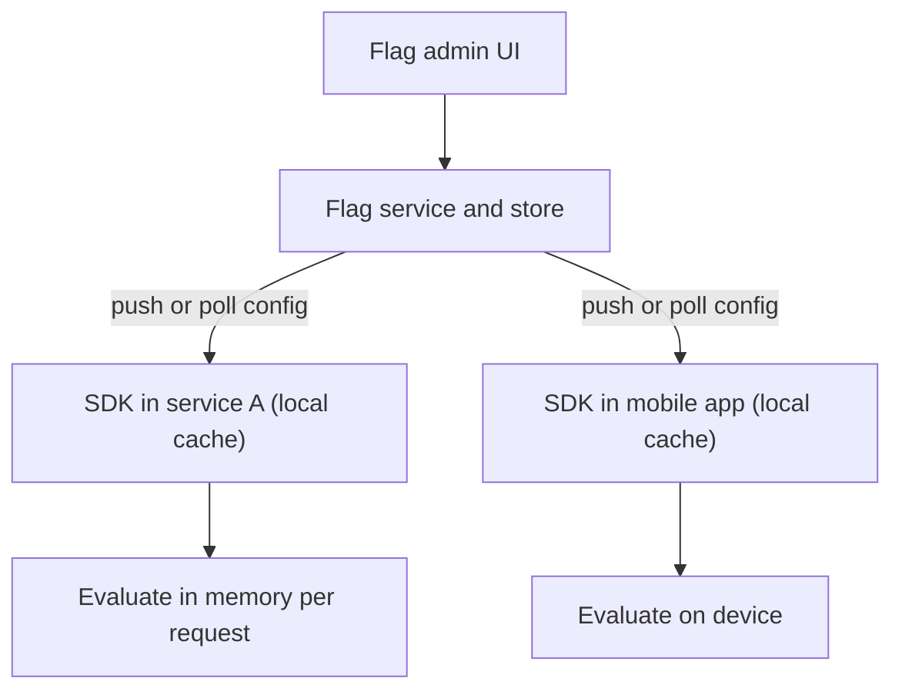

- Evaluation happens **in-process** against a cached ruleset, so a flag check is a memory lookup, not a network call.
- Percentage rollouts hash a stable key so a user gets a consistent result: `bucket = hash(flag_key + user_id) % 100`.
- If the flag service is down, SDKs keep using their last cached config, and fall back to a **coded default** (usually "off" for new features) on cold start.

```kotlin
// Server-side evaluation with a safe default
val useNewCheckout = flags.isEnabled(
    key = "new_checkout_flow",
    context = FlagContext(userId = user.id, country = user.country, plan = user.plan),
    default = false                       // used if the flag is missing or config can't load
)
if (useNewCheckout) newCheckout(cart) else legacyCheckout(cart)
```

Products include LaunchDarkly, Unleash, Flagsmith, Firebase Remote Config, and OpenFeature as a vendor-neutral API; many large companies build their own.

**Common pitfalls:**
- Flag debt: hundreds of stale flags make code hard to reason about. Give release flags an owner and expiry date, and remove them after rollout.
- Testing only one combination; interacting flags can create untested paths.
- Treating flag changes as harmless: a flag flip is a production change and should be audited and, for risky ones, rolled out gradually.

**Likely follow-ups:**
- *Client-side vs server-side evaluation?* Server-side keeps rules private and consistent; client-side (mobile/web) works offline but exposes flag rules to the client, so never put secrets in them.
- *How do flags relate to canary?* Canary shifts traffic between binaries; flags shift users between code paths in the same binary. They're often used together.

</details>

### 14. How do you run an incident and a postmortem?

<details>
<summary>Answer</summary>

**In short:** **During an incident:** declare it, assign roles (incident commander, communications, operations), **mitigate first** (roll back, fail over, shed load, disable a feature) before hunting for the root cause, and communicate status regularly. **After:** write a **blameless postmortem** covering timeline, impact, root cause and contributing factors, what went well, and action items with owners for detection, prevention and mitigation, then track those items to completion and share the learnings.

#### Incident lifecycle

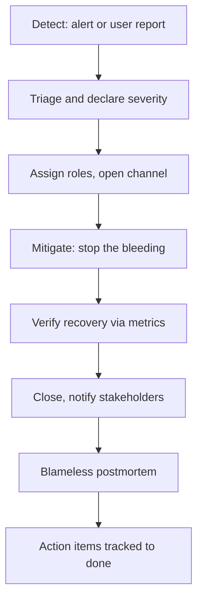

#### Roles

| Role | Responsibility |
|---|---|
| **Incident commander (IC)** | Coordinates, makes decisions, assigns work; does not debug hands-on |
| **Operations / subject-matter leads** | Investigate and apply fixes |
| **Communications lead** | Updates stakeholders, status page and customer support at a regular cadence |
| **Scribe** | Records a timeline of actions and findings |

For small incidents one person may hold several roles, but someone must explicitly be the IC.

#### Mitigate first

Users care that it stops, not why. The fastest safe action usually wins:
- Roll back the last deploy or config change (the most common cause of incidents).
- Turn off a feature flag.
- Fail over to another AZ/region.
- Shed load or block an abusive client.
- Scale up.

Root-cause investigation can happen once users are no longer affected.

#### Severity levels (example)

| Sev | Meaning | Response |
|---|---|---|
| SEV1 | Major outage or data loss, many customers affected | Page immediately, exec and customer comms |
| SEV2 | Significant degradation or one key feature down | Page on-call, status page update |
| SEV3 | Minor impact, workaround exists | Handle in working hours |

#### The blameless postmortem

**Blameless** means asking "what about the system allowed this to happen?" instead of "who made the mistake?". If an engineer could take down production with one command, the gap is the missing guardrail, not the engineer. Blame makes people hide information, which makes future incidents worse.

A typical template:
1. **Summary and impact**: duration, users affected, revenue/SLO impact.
2. **Timeline**: detection, key decisions, mitigation, resolution (with timestamps).
3. **Root cause and contributing factors**: use "5 whys", and expect several factors, not one.
4. **What went well / what went poorly / where we got lucky.**
5. **Action items**: each with an owner and due date, grouped into detect faster, prevent, and mitigate faster.

**Common pitfalls:**
- Debugging the root cause while users are still down instead of rolling back.
- Action items that are never done; the same incident repeats.
- Postmortems that conclude "human error" and stop there.

**Likely follow-ups:**
- *What are MTTD and MTTR?* Mean time to detect and mean time to recover/restore; postmortem actions aim to reduce both.
- *When is a postmortem required?* Commonly for any SEV1/SEV2, any data loss, or any incident that used a large part of the error budget.

</details>

### 15. How do you plan capacity?

<details>
<summary>Answer</summary>

**In short:** Measure current peak usage per service and resource, know each service's per-instance limits from **load tests**, forecast growth (trend plus known events like sales and launches), keep **headroom** (e.g. stay below 60–70% at peak) and **N+1/N+2** spare capacity for failures (including losing a whole AZ or a region's traffic shifting to you), check every dependency, not only app servers, and revisit regularly. Use autoscaling for elasticity, but don't assume it's instant.

#### Step by step

1. **Measure demand.** Peak requests/s, data growth/day, connection counts, per service. Use peaks (e.g. the p99 minute of the busiest day), not averages.
2. **Measure supply.** Load-test one instance to find its limit at your latency SLO, e.g. "one pod handles 800 req/s with p99 < 200 ms". The limit is usually a bottleneck like DB connections or a lock, not CPU.
3. **Forecast.** Organic growth from the trend (e.g. +5% per month) plus known events: Black Friday, a marketing campaign, a big customer onboarding.
4. **Add failure capacity.** If one of 3 AZs fails, the other two must carry 100% of peak.
5. **Add headroom** for spikes, bad deploys and estimation error.
6. **Check dependencies**: DB CPU/IOPS/connections, cache memory, Kafka partitions and disk, third-party API quotas, cloud account limits, IP addresses.

#### Worked example

- Forecast peak: 40,000 req/s next quarter.
- One instance handles 800 req/s at the SLO; target 65% utilisation → 520 req/s per instance.
- Needed: 40,000 / 520 ≈ 77 instances.
- Survive the loss of 1 of 3 AZs: the remaining 2 AZs must hold all 77, so deploy 77 × 3/2 ≈ 116 instances (~39 per AZ).

Then check: can the database take 116 instances × pool size connections? If each has a 20-connection pool, that's 2,320 connections, which may need a connection pooler (e.g. PgBouncer).

#### Autoscaling isn't a capacity plan

Autoscaling handles gradual changes, but:
- It reacts after load rises; booting instances and warming caches takes minutes.
- It can hit account quotas or cloud capacity shortages during regional events.
- Stateful tiers (databases, Kafka) don't scale out in seconds.

So pre-scale before known events, set minimum instance counts that cover failure scenarios, and use predictive or scheduled scaling where traffic is cyclical.

**Common pitfalls:**
- Planning from averages, then falling over at peak.
- Scaling app servers while the database is the real bottleneck.
- Forgetting non-compute limits: file descriptors, NAT gateway ports, API rate limits.

**Likely follow-ups:**
- *How do you load-test safely?* In a production-like environment with realistic data and traffic mixes, or in production with synthetic traffic tagged so it can be filtered and stopped quickly.
- *How much headroom?* Depends on how fast you can add capacity and how spiky traffic is; 30–40% at peak plus N+1 for failure is a common starting point.

</details>

### 16. What is the difference between monitoring and observability?

<details>
<summary>Answer</summary>

**In short:** **Monitoring** tells you **whether** known things are wrong, using predefined dashboards and alerts for expected failure modes. **Observability** is the ability to understand **why** something is wrong, including failures nobody anticipated, by asking new questions of the telemetry (high-cardinality data, traces, rich events). Mature systems need both: monitoring to detect, observability to diagnose.

#### Known unknowns vs unknown unknowns

| | Monitoring | Observability |
|---|---|---|
| **Question** | "Is the error rate above 1%?" | "Why are errors only for Android users on version 5.2 in Brazil using one payment provider?" |
| **Failure modes** | Known in advance ("known unknowns") | Novel ("unknown unknowns") |
| **Data** | Pre-aggregated metrics, fixed dashboards | High-cardinality, high-dimensional events and traces |
| **Mode** | Passive: wait for a threshold | Active: explore, slice, compare |
| **Output** | Alerts | Answers during an investigation |

Monitoring works well for a monolith with predictable failure modes. In distributed systems, many problems are new combinations: one tenant, one region, one app version, one feature flag. You can't create a dashboard in advance for every combination.

#### What makes a system observable

- **High-cardinality dimensions** on events/spans: user ID, tenant ID, build version, region, feature-flag state, endpoint. These let you slice by any field to find "what do the failing requests have in common?"
- **Wide structured events**: one rich record per request with dozens of fields, instead of many small log lines.
- **Distributed traces** to see the path and timing of individual requests.
- **Correlation**: a shared trace ID across metrics exemplars, traces and logs.
- **Change events**: deploys, flag flips and config changes on the same timeline.

#### Example investigation

1. Monitoring: a burn-rate alert fires for checkout errors.
2. Observability: break down failing requests by every attribute; 95% of failures share `app_version=5.2` and `payment_provider=X`.
3. Open a sample trace: the call to provider X fails on a new request field added in 5.2.
4. Mitigate: turn off the flag gating the new field for that provider.

No dashboard existed for "errors by app version × payment provider", but the data allowed asking that question.

**Common pitfalls:**
- Thinking buying a tool equals observability; it depends on how well the code is instrumented.
- Stripping high-cardinality fields to save cost, then being unable to debug.

**Likely follow-ups:**
- *Is observability just the three pillars?* The pillars are data sources; observability is the ability to ask arbitrary questions, which depends on rich context and correlation between them.
- *How do you control the cost of high-cardinality data?* Sampling (keeping all errors and slow requests), retention tiers, and storing it in event/trace stores rather than metric labels.

</details>

### 17. How do you limit the blast radius of failures and changes?

<details>
<summary>Answer</summary>

**In short:** Make sure any single failure, bad change or bad customer affects only a small part of the system: **cell-based architecture and shuffle sharding** (each customer depends on a small, mostly unique subset of servers), **staged rollouts** (one host → one AZ → one region → all, with automated health checks between waves), **feature flags**, **per-tenant quotas and rate limits**, and treating **config changes like code deploys** (validated, staged, revertible), because many major outages come from config.

#### Cells

A **cell** is a complete, independent copy of the service stack (app servers, databases, caches) that serves a subset of customers. A thin routing layer maps each customer to their cell.

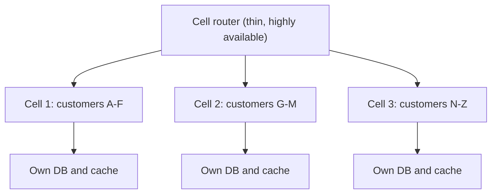

If cell 2 has a bad deploy, a poison-pill request or a database failure, only its customers are affected. Cells also cap the size of each deployment, making scaling predictable (add cells instead of growing one giant cluster). AWS has publicly described using cell-based architecture for many services.

#### Shuffle sharding

With plain sharding, each shard's customers all share the same servers; one abusive customer that crashes its shard takes down everyone on it. With **shuffle sharding**, each customer is assigned a random combination of servers (e.g. 2 out of 8). The number of combinations is large (8 choose 2 = 28), so two customers rarely share exactly the same set. When one customer's traffic kills its 2 servers, other customers usually still have at least one healthy server in their set.

#### Staged rollouts

| Wave | Scope | Wait (bake time) |
|---|---|---|
| 1 | One canary host / one cell | Until metrics look good |
| 2 | One AZ in one region | Hours |
| 3 | One full region (lowest traffic first) | Hours |
| 4 | Remaining regions, a few at a time | Hours to a day |

Each wave is gated by automated health checks; a regression triggers an automatic rollback. Never deploy to all regions at once, so a bad change can't take everything down simultaneously.

#### Other controls

- **Feature flags**: enable new behaviour for 1% of users or one tenant first.
- **Quotas and rate limits per tenant**: stop a noisy neighbour from consuming shared capacity.
- **Config as code**: config changes are reviewed, validated by schema checks, rolled out in stages and reversible. A global config push that's instantly applied everywhere is one of the most common causes of large outages.
- **Dependency isolation**: bulkheads so a failing feature can't drain shared thread pools.

**Common pitfalls:**
- A shared global component (the cell router, a global config service, DNS) that becomes the new single blast radius; keep it simple and extremely reliable.
- "Emergency" changes that skip staging and break more than the original issue.

**Likely follow-ups:**
- *How big should a cell be?* Large enough to be cost-efficient, small enough that losing one is tolerable; there's a maximum size you test for.
- *How do you move a customer between cells?* A controlled migration: copy data, dual-write or freeze writes briefly, then update the router mapping.

</details>

---

[⬅ Previous: Microservices & Architecture Patterns](12-microservices-patterns.md) · [⬅ Back to index](../README.md) · [Next: Security in System Design ➡](14-security.md)
