# Security in System Design

[⬅ Back to index](../README.md)

Covers: authentication vs authorisation, sessions vs JWT, OAuth 2.0 and OIDC, SSO, password storage, RBAC/ABAC/ReBAC, encryption in transit and at rest, key management, secrets, API security, DDoS protection, zero trust, multi-tenant isolation, privacy and compliance.

---

### 1. Authentication vs authorisation?

<details>
<summary>Answer</summary>

**In short:** **Authentication (authn)** answers *who are you?* (passwords, passkeys, OTP, SSO, certificates). **Authorisation (authz)** answers *what are you allowed to do?* (roles, permissions, ownership checks). In a distributed system you typically authenticate once at the edge (the gateway validates the token) and authorise **in each service**, close to the data ("can user 42 edit document 7?"). Identity always comes from the verified token, never from IDs in request parameters.

#### The two steps in a request

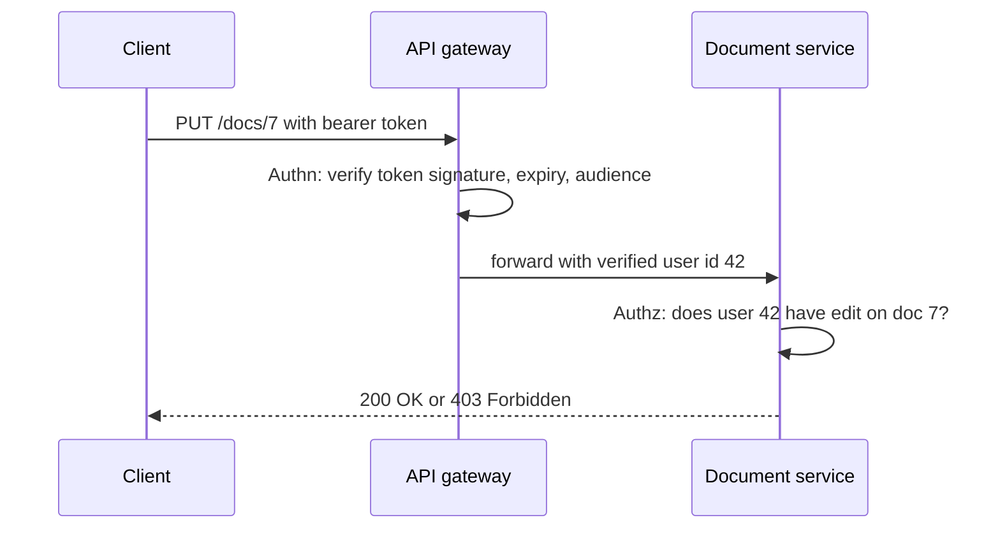

| | Authentication | Authorisation |
|---|---|---|
| **Question** | Who is this? | May they do this action on this resource? |
| **Inputs** | Credentials: password, passkey, OTP, client certificate, SSO assertion | Identity + action + resource (+ context) |
| **Output** | A verified identity (session or token) | Allow / deny |
| **Failure HTTP code** | 401 Unauthorized (really "unauthenticated") | 403 Forbidden |
| **Where** | Once, at login and at the edge | In every service, on every request |

#### Why authorise in each service

The gateway can check coarse things ("is this a valid user with the `orders:read` scope?"), but only the service that owns the data knows whether user 42 owns order 123. Putting all authorisation in the gateway either duplicates business data there or leaves object-level checks missing, which is the most common API vulnerability (see question 9).

```kotlin
// Wrong: trusts a user id from the request body
fun updateDoc(req: UpdateRequest) = docs.update(req.docId, req.userId, req.content)

// Right: identity from the verified token, explicit permission check
fun updateDoc(principal: Principal, docId: String, content: String) {
    if (!authz.check(principal.userId, "edit", "doc:$docId")) throw ForbiddenException()
    docs.update(docId, content, editedBy = principal.userId)
}
```

**Common pitfalls:**
- Checking that a user is logged in but not that they own the resource.
- Services that trust any internal caller because "it's inside the network" (see zero trust, question 11).

**Likely follow-ups:**
- *What is MFA?* Requiring two or more factor types (something you know, have, are), which defeats stolen-password attacks.
- *How does a service know who called it in a chain?* Propagate the end user's identity (a token or a signed internal token) along with the calling service's own identity (mTLS).

</details>

### 2. Server-side sessions vs JWTs?

<details>
<summary>Answer</summary>

**In short:** A **server-side session** is a random ID in a cookie pointing to session data in a store (e.g. Redis): easy to revoke, but needs a lookup per request. A **JWT** is a signed, self-contained token with claims (user, roles, expiry) that any service can verify locally with a public key: scales well across services, but is hard to revoke before it expires. The common approach is **short-lived access tokens (5–15 min JWTs) plus long-lived refresh tokens** stored server-side and **rotated** on each use. On the web, store tokens in `HttpOnly`, `Secure`, `SameSite` cookies rather than localStorage.

#### Comparison

| Sessions | JWT (stateless tokens) |
|---|---|
| Random session ID in a cookie; data in a server store (Redis) | Signed token containing claims (user, roles, expiry) |
| Easy to revoke (delete the session) | Hard to revoke before expiry (need deny lists or short TTLs) |
| Requires a lookup per request | Verified locally with a public key; no lookup → scales well across services |
| Small cookie | Larger, and claims can go stale |

#### What a JWT is

Three base64url parts: `header.payload.signature`. The payload might be:

```json
{ "iss": "https://auth.example.com", "sub": "user_42", "aud": "orders-api",
  "scope": "orders:read orders:write", "iat": 1767225600, "exp": 1767226500 }
```

The auth server signs it with a private key (e.g. RS256 or ES256); services verify it with the public key published at a JWKS endpoint. The payload is **encoded, not encrypted**: anyone holding the token can read it, so never put secrets in it.

#### Access + refresh token pattern

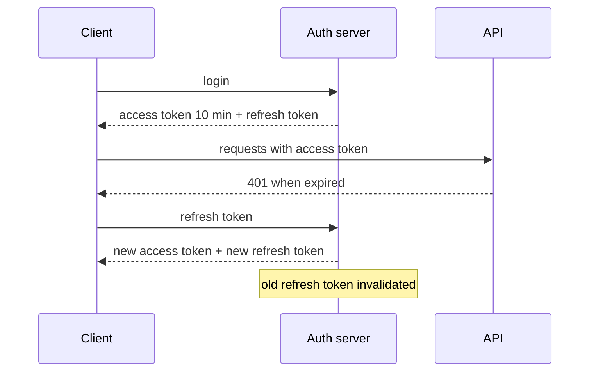

- The **access token** is short-lived, so even though it can't easily be revoked, a stolen one is useful only briefly.
- The **refresh token** is checked against the server on each use, so it can be revoked (logout, password change).
- **Rotation with reuse detection**: each refresh issues a new refresh token. If an old one is used again, someone has a copy, so the server revokes the whole token family.

#### Where to store tokens

| Client | Recommended storage |
|---|---|
| Web app | `HttpOnly; Secure; SameSite=Lax/Strict` cookie, which JavaScript can't read, so an XSS bug can't steal it. Add CSRF protection. |
| Mobile app | Android Keystore-backed encrypted storage / iOS Keychain |
| Server-to-server | Memory, fetched via client-credentials flow |

**Common pitfalls:**
- Accepting `alg: none` or not pinning the expected algorithm when verifying JWTs.
- Not validating `aud` and `iss`, so a token for one service works on another.
- Long-lived JWTs (days) with no revocation path.

**Likely follow-ups:**
- *How do you log a user out everywhere with JWTs?* Revoke their refresh tokens, and either wait for access tokens to expire or keep a short-lived deny list of token IDs (`jti`) or a per-user "tokens valid after" timestamp.
- *Are sessions old-fashioned?* No; for a single web app with one backend, server sessions are simple and secure. JWTs pay off when many services must verify identity independently.

</details>

### 3. How does OAuth 2.0 work? What is OIDC?

<details>
<summary>Answer</summary>

**In short:** **OAuth 2.0** is a **delegation** framework: a user lets an app access their resources at another service without giving the app their password; the app gets a scoped **access token** instead. The standard flow for apps today is **Authorization Code + PKCE**. **OpenID Connect (OIDC)** adds an **identity layer** on top, an **ID token** that says who the user is, which is what powers "Sign in with Google/Apple" and enterprise SSO.

#### Roles

| Role | Example |
|---|---|
| **Resource owner** | The user |
| **Client** | The app wanting access (a photo-printing app) |
| **Authorization server** | Issues tokens (Google's auth server, Okta, Auth0, Keycloak) |
| **Resource server** | The API holding the data (Google Photos API) |

#### Authorization Code + PKCE

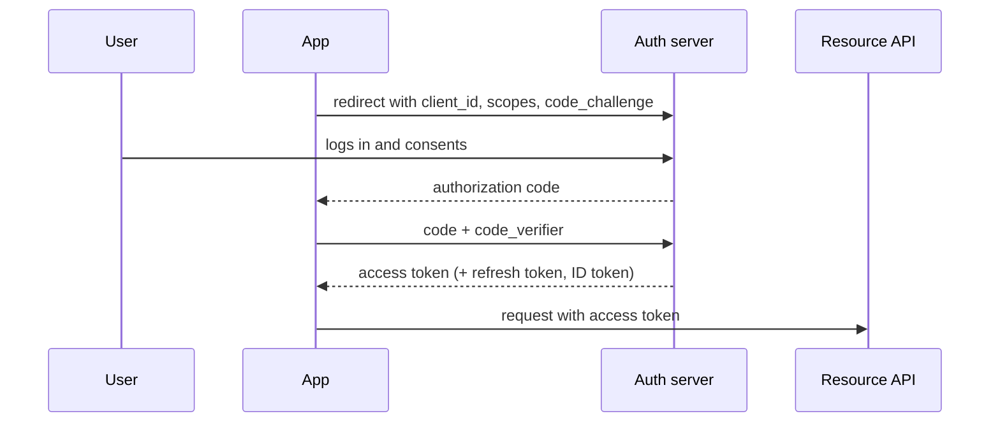

1. The app creates a random secret, the **code_verifier**, and sends its SHA-256 hash (**code_challenge**) with the authorization request, along with `client_id`, `redirect_uri`, `scope` and a random `state`.
2. The user logs in **at the auth server** (the app never sees the password) and approves the requested scopes.
3. The auth server redirects back with a short-lived, one-time **authorization code**.
4. The app exchanges the code plus the original **code_verifier** for tokens. The server hashes the verifier and checks it matches the challenge.

**Why PKCE?** Mobile and single-page apps can't keep a client secret. Without PKCE, malware that intercepts the redirect (e.g. a malicious app registering the same URL scheme) could exchange the stolen code. With PKCE, the code is useless without the verifier, which never left the real app. PKCE is now recommended for all clients, including server-side ones.

**`state`** protects against CSRF on the redirect: the app checks that the returned `state` matches what it sent.

#### Other flows

| Flow | Use |
|---|---|
| **Authorization Code + PKCE** | Web, mobile and SPA apps acting for a user |
| **Client credentials** | Service-to-service, no user involved |
| **Device authorization** | TVs and CLIs: show a code, user approves on their phone |
| **Refresh token** | Get new access tokens without user interaction |
| Implicit, Resource Owner Password | Legacy; deprecated in current best practice |

#### OIDC

OAuth alone tells the app "this token can read photos", not "this is Alice". Apps used to misuse access tokens as proof of login, which is unsafe. OIDC adds:
- The `openid` scope, and an **ID token**: a JWT with `sub` (stable user ID), `iss`, `aud` (your client), `exp`, `nonce`, and optionally email/name.
- A **UserInfo** endpoint and a discovery document (`/.well-known/openid-configuration`).

**Access token** is for calling APIs (audience: the API). **ID token** is for the client to know who logged in (audience: the client). Don't send ID tokens to APIs.

**Common pitfalls:**
- Not validating `redirect_uri` exactly on the auth server (open-redirect token theft).
- Requesting broad scopes "just in case"; ask for the minimum.
- Using the access token as proof of identity instead of the ID token.

**Likely follow-ups:**
- *How does SSO work with OIDC/SAML?* The company's identity provider authenticates the user once; each app trusts assertions/ID tokens from it, so users log in once for all apps.
- *What are scopes vs roles?* Scopes limit what the client may do on the user's behalf; roles describe what the user may do. Effective permission is the intersection.

</details>

### 4. How should passwords be stored?

<details>
<summary>Answer</summary>

**In short:** Never store plaintext or plain fast hashes (SHA-256 is far too fast to resist brute force). Use a **slow, salted password-hashing algorithm**: **Argon2id** (preferred), **bcrypt** or **scrypt**, with a per-user random salt and a tuned cost. Add login rate limiting, breached-password checks and MFA. Better still, support **passkeys (WebAuthn)**, which remove shared secrets entirely and resist phishing.

#### Why fast hashes fail

Databases leak. Once an attacker has the hashes, they guess offline at whatever speed their hardware allows. GPUs can compute billions of SHA-256 hashes per second, so most human-chosen passwords fall quickly. Password-hashing functions are deliberately **slow** and (for Argon2/scrypt) **memory-hard**, which makes each guess expensive and limits GPU/ASIC parallelism.

| Approach | Verdict |
|---|---|
| Plaintext | Never |
| Encryption (reversible) | No: whoever gets the key gets every password |
| MD5 / SHA-1 / SHA-256 | No: too fast, and without salt open to precomputed tables |
| SHA-256 + salt | Still too fast |
| **bcrypt / scrypt / Argon2id** | Yes, with a cost tuned so one hash takes tens to hundreds of ms on your servers |

#### What the salt does

A **salt** is random data stored alongside each hash, so two users with the same password get different hashes, and precomputed "rainbow tables" are useless. Modern libraries generate and embed the salt automatically. The stored string looks like `$argon2id$v=19$m=65536,t=3,p=4$<salt>$<hash>`, carrying the algorithm, cost parameters and salt with the hash:

```python
from argon2 import PasswordHasher
from argon2.exceptions import VerifyMismatchError

ph = PasswordHasher()                     # sensible default time/memory cost
stored = ph.hash("correct horse battery staple")

def login(password, stored):
    try:
        ph.verify(stored, password)       # constant-time comparison
        if ph.check_needs_rehash(stored): # cost raised since this hash was made
            save(ph.hash(password))
        return True
    except VerifyMismatchError:
        return False
```

Some systems also add a **pepper**: a secret kept outside the DB (e.g. in a KMS/HSM), so a DB-only leak is not enough to start guessing.

#### Around the hash

- **Rate limiting and lockouts** per account and per IP against online guessing and credential stuffing.
- **Breached-password checks** (e.g. the Have I Been Pwned k-anonymity API) at signup and change.
- **MFA**: TOTP apps or passkeys; SMS is weaker (SIM-swap).
- Same response for "wrong user" and "wrong password" to avoid account enumeration.

#### Passkeys

With **WebAuthn/passkeys**, the device creates a key pair per site; the server stores only the **public key**. Login is a signed challenge, and the browser binds it to the real domain, so a phishing site can't get a usable signature. A server breach leaks nothing that can be replayed.

**Common pitfalls:**
- Rolling your own crypto or hashing scheme.
- Logging passwords accidentally in request logs.
- Cost set so high that login becomes a DoS vector; balance it and rate limit.

**Likely follow-ups:**
- *How do you migrate from MD5 hashes?* Wrap them (`argon2(md5_hash)`) for all users immediately, then rehash with plain Argon2 on each user's next login.
- *Why is bcrypt limited?* It only uses the first 72 bytes of input and isn't memory-hard, which is why Argon2id is preferred for new systems.

</details>

### 5. RBAC vs ABAC vs ReBAC?

<details>
<summary>Answer</summary>

**In short:** **RBAC (role-based)**: users get roles (admin, editor, viewer) and roles have permissions; simple, but roles can explode in number. **ABAC (attribute-based)**: policies evaluate attributes of the user, resource and context ("managers can approve expenses under $5K in their own department during work hours"); flexible but harder to audit (engines: OPA, Cedar). **ReBAC (relationship-based)**: permissions derive from relationships in a graph ("viewer of a folder → viewer of its documents"); Google's **Zanzibar** model (SpiceDB, OpenFGA) powers Drive/Docs-style sharing at huge scale.

#### Comparison

| | RBAC | ABAC | ReBAC |
|---|---|---|---|
| **Decision based on** | User's roles | Attributes of user, resource, action, environment | Relationships between objects |
| **Example rule** | `editor` can `edit_doc` | `user.dept == doc.dept && time in 9-17` | `user` is `editor` of `doc`, or of its parent `folder` |
| **Strength** | Simple, easy to audit | Very expressive, context-aware | Natural for sharing and hierarchies; per-object |
| **Weakness** | Role explosion; no per-object rules | Hard to answer "who can access X?" | Needs a relationship store; graph can get deep |
| **Typical tools** | Built into most apps and IAM | OPA (Rego), AWS Cedar, XACML | Zanzibar-style: SpiceDB, OpenFGA, Ory Keto |

#### RBAC

Fine for admin consoles and internal tools. It breaks down when permission depends on the specific object ("Alice can edit **this** doc"); people start inventing roles like `editor_project_123`, which is role explosion.

#### ABAC

A policy engine takes a request plus attributes and returns allow/deny. Policies live outside application code and can be reviewed and tested. An OPA (Rego) example:

```rego
package expenses

default allow := false

allow if {
    input.action == "approve"
    input.user.role == "manager"
    input.user.department == input.resource.department
    input.resource.amount < 5000
}
```

The weakness: because rules are arbitrary expressions, it's hard to list everyone who can access a resource, which auditors often ask.

#### ReBAC (Zanzibar model)

Permissions are stored as relationship tuples, `object#relation@subject`:

```
folder:plans#viewer@user:alice
doc:q3-roadmap#parent@folder:plans
doc:q3-roadmap#editor@group:pm#member
```

A schema says "a doc's viewers include its editors and the viewers of its parent folder". Checking "can Alice view q3-roadmap?" walks the graph: doc → parent folder → Alice is a viewer → allow.

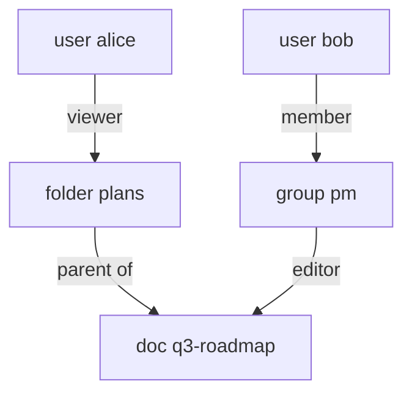

Google's Zanzibar paper describes a globally distributed service handling this for many Google products, with consistency tokens ("zookies") to avoid the "new enemy" problem (a check using stale data after access was revoked).

#### In practice

Many systems combine them: RBAC for coarse org roles, ReBAC for per-object sharing, and ABAC-style conditions (IP range, MFA present, tenant plan) on top.

**Common pitfalls:**
- Authorisation logic scattered through the code with `if` statements, impossible to audit.
- Caching permission decisions too long, so revoked access keeps working.

**Likely follow-ups:**
- *How do you list documents a user can see?* ReBAC systems offer a "lookup resources" API, or you maintain a denormalised ACL index for search.
- *Where should the policy engine run?* Often as a sidecar or library next to each service for low latency, with policies distributed centrally.

</details>

### 6. How do you encrypt data in transit and at rest?

<details>
<summary>Answer</summary>

**In short:** **In transit:** TLS everywhere, from client to edge and between services (**mTLS** in zero-trust networks), plus HSTS for the web. **At rest:** disk/volume and database/object-store encryption (AES-256) with keys managed by a **KMS**, and **field-level encryption** for very sensitive fields (SSN, card data) so DB admins and backups don't see plaintext. **End-to-end encryption** (e.g. the Signal protocol in WhatsApp) means only the endpoints hold keys, so the server can't read content, which also limits server-side features like search and moderation.

#### Layers of encryption

| Layer | Protects against | Doesn't protect against |
|---|---|---|
| **TLS (client ↔ edge)** | Eavesdropping and tampering on public networks | A compromised server |
| **mTLS (service ↔ service)** | Sniffing and spoofing inside the data centre/cloud | A compromised service with valid identity |
| **Disk/volume encryption** | Stolen disks, improper disposal | Anyone who can query the running DB |
| **DB / object-store encryption (KMS)** | Raw storage access; adds audited key access | Authorised app or DBA queries |
| **Application / field-level encryption** | DBAs, backups, logs, DB-level SQL injection dumps | A compromised app server holding the key |
| **End-to-end encryption** | The service provider itself | Compromised endpoints |

#### In transit

- **TLS 1.2+ (prefer 1.3)** with modern cipher suites; certificates managed and renewed automatically (ACME/Let's Encrypt, cloud certificate managers).
- **HSTS** tells browsers to only use HTTPS for your domain, preventing downgrade attacks.
- **mTLS**: both sides present certificates, so the server also knows which service is calling. Service meshes (Istio, Linkerd) automate certificate issuance and rotation.
- Mobile apps may add **certificate pinning** for high-risk apps, at the cost of operational risk when certificates rotate.

#### At rest

Cloud storage encryption is usually a checkbox and should be on by default. But it is transparent: anyone with DB read access sees plaintext. For high-value fields, encrypt in the application before writing:

```python
def save_customer(c):
    ssn_ct = aead.encrypt(c.ssn.encode(), associated_data=c.id.encode())  # e.g. AES-GCM via envelope DEK
    db.execute("INSERT INTO customers (id, name, ssn_enc) VALUES (%s, %s, %s)",
               (c.id, c.name, ssn_ct))
```

Trade-off: you can no longer query or index those fields directly. Common workarounds are storing a keyed hash (HMAC) for exact-match lookup, or **tokenisation** (replace the value with a token, keep the real value in a separate hardened vault, as payment systems do for card numbers to reduce PCI scope).

#### End-to-end encryption

Keys are created and kept on user devices; the server relays ciphertext only. This gives strong privacy but means the server can't search, index, moderate or recover content, and multi-device sync and key backup become hard design problems.

**Common pitfalls:**
- Terminating TLS at the load balancer and sending plaintext over the internal network.
- Encryption keys stored next to the data they protect.
- Assuming "encrypted at rest" protects against SQL injection or a stolen app credential; it doesn't.

**Likely follow-ups:**
- *Where do you terminate TLS?* At the edge/LB for inspection and routing, then re-encrypt (or use mTLS) to the backends.
- *What is AEAD?* Authenticated encryption (AES-GCM, ChaCha20-Poly1305) that provides confidentiality and detects tampering.

</details>

### 7. What is envelope encryption and how is key management done?

<details>
<summary>Answer</summary>

**In short:** Data is encrypted with a **data encryption key (DEK)**, and the DEK is itself encrypted ("wrapped") with a **key encryption key (KEK)** that lives in a **KMS/HSM** and never leaves it. You store the encrypted DEK next to the data. The KMS only handles tiny keys (fast, cheap), **key rotation** re-wraps DEKs instead of re-encrypting all data, and access to the KEK is audited and controlled by IAM. **Crypto-shredding**, deleting a user's key, makes their data unreadable, which helps with GDPR erasure in immutable stores.

#### How it works

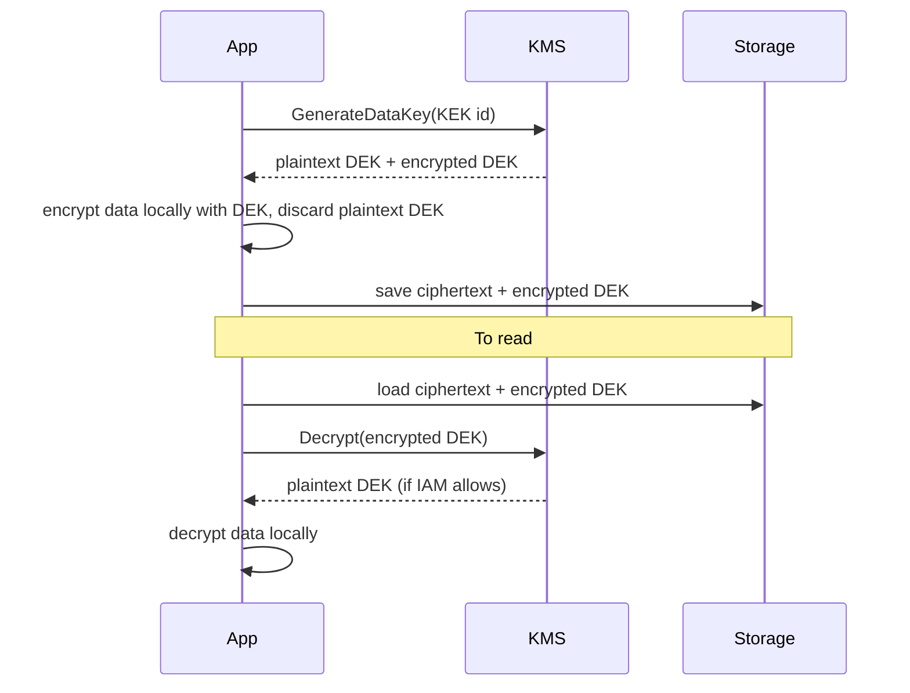

1. **Write**: ask the KMS for a new DEK. It returns the DEK in plaintext (used once, in memory) and wrapped under the KEK. Encrypt the data locally with AES-GCM using the DEK. Store the ciphertext with the wrapped DEK.
2. **Read**: send the wrapped DEK to the KMS, which checks IAM permissions, logs the request and returns the plaintext DEK. Decrypt locally.

#### Why not encrypt everything directly with the KMS?

| Direct KMS encryption | Envelope encryption |
|---|---|
| Every byte goes over the network to the KMS | Only 32-byte keys go to the KMS |
| KMS request size limits (a few KB) | Data of any size |
| KMS latency and rate limits on every operation | Bulk crypto runs locally at memory speed |
| Rotation requires re-encrypting all data | Rotation re-wraps small DEKs |

Apps often cache plaintext DEKs briefly to reduce KMS calls, trading a little exposure for latency and cost.

#### Key hierarchy and management

- **Root keys** live in HSMs (hardware that never exports them).
- **KEKs** (customer master keys) per service, environment, or tenant.
- **DEKs** per object, file, row group or tenant.

Key management practices:
- **Least-privilege IAM**: only the service that needs to decrypt can call `Decrypt` with that KEK; admins who manage keys can't use them.
- **Audit logs** of every key use (who decrypted what, when).
- **Rotation**: new KEK versions are created periodically; new data uses the new version, and old DEKs can be re-wrapped without touching the data.
- **Separation of duties** and deletion waiting periods, because deleting a key destroys all data under it.
- **BYOK / customer-managed keys**: enterprise tenants control their own KEK and can revoke your access.

#### Crypto-shredding

Give each user (or tenant) their own DEK. To erase their data, including from append-only logs, event streams and backups where deleting individual records is impractical, delete the key. The ciphertext remains but is unreadable.

**Common pitfalls:**
- Logging plaintext DEKs or keeping them in memory dumps.
- Reusing a nonce with the same key in AES-GCM, which breaks its security; use library-generated random nonces.
- No plan for KMS outages: if the KMS is down and DEKs aren't cached, nothing can be decrypted.

**Likely follow-ups:**
- *KMS vs HSM?* A cloud KMS is a managed service typically backed by HSMs; dedicated HSMs give you exclusive control for strict compliance needs.
- *Does rotating the KEK re-encrypt the data?* No, only the DEKs are re-wrapped; rotating DEKs themselves requires re-encrypting data and is done less often.

</details>

### 8. How should secrets (API keys, DB passwords) be managed?

<details>
<summary>Answer</summary>

**In short:** Never keep secrets in source code, container images or plain env files in repos. Store them in a **secrets manager** (HashiCorp Vault, AWS Secrets Manager, GCP Secret Manager), inject them at runtime with least privilege, and prefer **short-lived, automatically rotated** credentials (dynamic DB credentials, IAM roles / workload identity instead of static keys). Audit access and scan repos for leaked secrets.

#### Why it matters

Leaked credentials are one of the most common breach causes. Secrets committed to git live forever in history and forks; secrets baked into images spread to every registry and laptop that pulls them; static keys that never rotate stay valid long after an employee leaves.

#### Maturity ladder

| Level | Practice | Problem |
|---|---|---|
| 0 | Hard-coded in code or config in git | Anyone with repo access, forever |
| 1 | Env vars set by hand on servers | No audit, no rotation, drift |
| 2 | Encrypted in a secrets manager, injected at startup | Better; static values still need rotating |
| 3 | **Dynamic, short-lived credentials** issued per workload | Leaked value expires in minutes or hours |
| 4 | **No secrets at all**: workload identity federation | Nothing long-lived to leak |

#### How runtime injection works

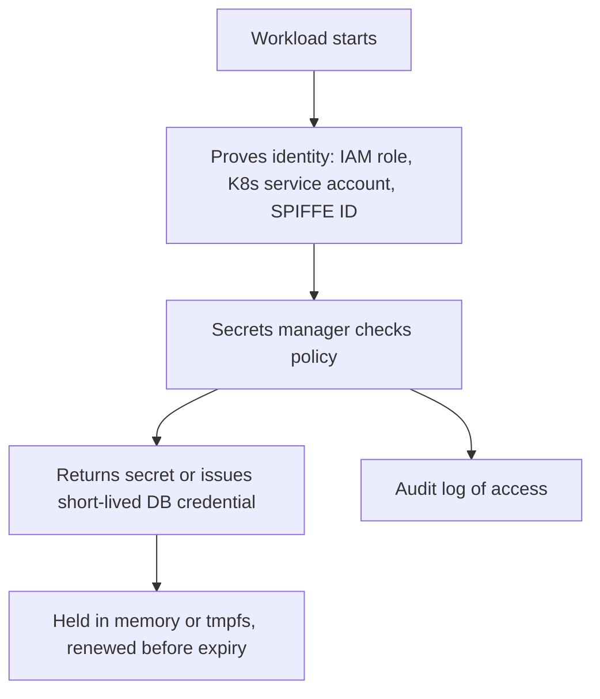

- The workload authenticates with its **platform identity** (cloud IAM role, Kubernetes service-account token), not with another secret. This avoids the "secret zero" problem.
- Policies grant each service only the secrets it needs.
- **Dynamic secrets**: Vault, for example, can create a unique DB user per instance with a TTL of an hour and drop it on expiry.
- Cloud SDKs use **instance/workload credentials** that rotate automatically, so there are no access keys in config.

For example, on AWS EKS a Kubernetes service account can be annotated with an IAM role; pods using it get temporary AWS credentials for that role, and no access key is stored anywhere:

```yaml
apiVersion: v1
kind: ServiceAccount
metadata:
  name: orders-api
  annotations:
    eks.amazonaws.com/role-arn: arn:aws:iam::123456789012:role/orders-api
```

#### Detection and response

- **Secret scanning**: pre-commit hooks (gitleaks, trufflehog) and platform scanning (GitHub secret scanning / push protection).
- Never log secrets; redact known patterns in log pipelines.
- **Leak runbook**: revoke and rotate first, then investigate. Removing a secret from git history isn't enough once it has been pushed.

**Common pitfalls:**
- Mobile/frontend apps embedding API secrets; anything shipped to a client is public. Use a backend proxy or per-user tokens.
- Kubernetes Secrets assumed to be encrypted; by default they're only base64-encoded unless encryption at rest is configured.
- Rotation that requires downtime, so nobody does it. Support two valid credentials during rotation.

**Likely follow-ups:**
- *How do you rotate a DB password with zero downtime?* Create the new credential, roll it out to apps, confirm the old one is unused, then revoke it (two active credentials during the overlap).
- *Env vars vs files?* Mounted files or direct API fetches are slightly safer; env vars leak via process listings, crash dumps and child processes.

</details>

### 9. What are the key API security practices?

<details>
<summary>Answer</summary>

**In short:** Strong authentication (OAuth/OIDC for users, mTLS or workload identity for services) and **object-level authorisation on every request**, since the #1 API vulnerability is broken object-level authorisation (changing `/orders/123` to `/orders/124`). Add input validation and parameterised queries, output encoding, CSRF protection for cookie auth, rate limits and size limits, error messages that don't leak internals, signed webhooks, idempotency keys, audit logs, and follow the **OWASP API Security Top 10**.

#### Broken object-level authorisation (BOLA / IDOR)

The API authenticates the user correctly but never checks that the requested object belongs to them.

```kotlin
// Vulnerable: any logged-in user can read any order by guessing IDs
@GetMapping("/orders/{id}")
fun getOrder(@PathVariable id: Long) = orderRepo.findById(id)

// Fixed: scope the query to the authenticated owner (404 avoids confirming existence)
@GetMapping("/orders/{id}")
fun getOrder(@PathVariable id: Long, @AuthenticationPrincipal user: User) =
    orderRepo.findByIdAndOwnerId(id, user.id) ?: throw NotFoundException()
```

Random IDs (UUIDs) make guessing harder but are **not** a substitute for the check.

#### Checklist

| Area | Practice |
|---|---|
| **Authentication** | OAuth 2.0/OIDC tokens; validate signature, `exp`, `aud`, `iss`; mTLS between services |
| **Authorisation** | Object-level checks on every endpoint; function-level checks for admin endpoints; property-level (don't let users set `isAdmin` via mass assignment) |
| **Input** | Schema validation (types, lengths, enums); parameterised queries against SQL injection; reject unknown fields |
| **Output** | Return only needed fields (no full DB entity); encode output for HTML contexts (XSS) |
| **Browser** | CSRF tokens or `SameSite` cookies for cookie auth; strict CORS allow-lists; security headers (CSP, HSTS) |
| **Abuse** | Rate limits and quotas per user/API key; max page size; payload size limits; timeouts on expensive queries |
| **Errors** | Generic messages externally, details only in logs; consistent format; no stack traces |
| **Integrity** | Idempotency keys on mutating calls; HMAC-signed webhooks with timestamps against replay |
| **SSRF** | If the API fetches user-supplied URLs, allow-list destinations and block internal addresses (e.g. cloud metadata endpoints) |
| **Visibility** | Audit logs for sensitive actions; API inventory so old/shadow versions don't stay exposed |

#### Signed webhooks

When you send webhooks, sign the body with a shared secret: `signature = HMAC-SHA256(secret, timestamp + "." + body)`. The receiver recomputes it, compares in constant time, and rejects old timestamps to stop replays.

#### OWASP API Security Top 10

A widely used checklist of the most common API risks, including broken object-level authorisation, broken authentication, broken object property-level authorisation, unrestricted resource consumption, broken function-level authorisation, SSRF, security misconfiguration and improper inventory management. Naming it in an interview shows you know the standard reference.

**Common pitfalls:**
- Relying on the frontend to hide buttons instead of enforcing checks in the API.
- Old API versions left running without the newer security fixes.
- GraphQL endpoints without query depth/cost limits.

**Likely follow-ups:**
- *401 vs 403 vs 404 for another user's object?* Many APIs return 404 so they don't reveal that the object exists.
- *Where should rate limiting happen?* At the gateway for coarse per-key limits, plus in services for expensive operations.

</details>

### 10. How do you protect a system from DDoS attacks?

<details>
<summary>Answer</summary>

**In short:** Use layered defence: an **edge/CDN with anycast** (Cloudflare, AWS Shield, Akamai) to absorb volumetric attacks across a huge global network, a **WAF** and bot detection for application-layer (L7) attacks, **rate limiting** per IP/user/API key, **autoscaling plus load shedding** to survive legitimate surges, **hidden origins** that accept traffic only from the CDN, and **aggressive caching** so attack traffic hits cached content.

#### Types of attack

| Layer | Example | What it exhausts | Main defence |
|---|---|---|---|
| **L3/L4 volumetric** | UDP floods, DNS/NTP amplification | Network bandwidth | Anycast scrubbing at the edge (provider capacity measured in Tbps) |
| **L4 protocol** | SYN floods | Connection tables | SYN cookies, edge proxies terminating connections |
| **L7 application** | HTTP floods hitting `/search` or login | CPU, DB, app threads | WAF rules, rate limits, bot challenges, caching |

L7 attacks are the hardest: requests look legitimate, and a few thousand requests per second to an expensive uncached endpoint can be enough.

#### Layered architecture

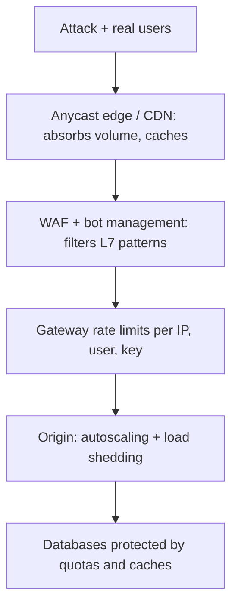

1. **Anycast edge**: the same IP is announced from hundreds of locations, so attack traffic is spread across the provider's global capacity instead of concentrated on your data centre.
2. **WAF**: blocks known-bad patterns, unusual headers, abusive geographies or ASNs; managed rule sets plus custom rules during an attack.
3. **Bot management and challenges**: JavaScript challenges, CAPTCHAs, proof-of-work, device fingerprinting.
4. **Rate limiting** at several granularities, with stricter limits on expensive endpoints (login, search, checkout).
5. **Origin protection**: origin IPs are not public; firewalls accept only the CDN's IP ranges or require an authenticated header/mTLS from the CDN. Otherwise attackers bypass the CDN entirely.
6. **Caching**: anything cacheable is served from the edge; even 1–5 seconds of micro-caching on hot dynamic pages helps.
7. **Load shedding and graceful degradation**: under pressure, drop low-priority traffic and disable expensive features so core flows survive.

#### Operations

- Have a **runbook**: who to contact at the DDoS provider, which emergency rules to enable ("under attack" mode, geo-blocking).
- Monitor traffic baselines so anomalies are detected quickly.
- Cost protection: autoscaling during an attack can be expensive; set maximums and use provider cost-protection programmes where available.

**Common pitfalls:**
- An origin that's still reachable directly by IP.
- Rate limiting only per IP, while botnets use millions of IPs; add per-account, per-session and behavioural limits.
- Expensive endpoints (search, report generation) with no caching or quotas.

**Likely follow-ups:**
- *How do you tell a DDoS from a viral spike?* Traffic shape: real users follow normal navigation paths and conversion; bots hit one endpoint with uniform patterns, odd user agents or failed challenges.
- *Can you handle DDoS without a CDN provider?* Not volumetric attacks at scale; few companies have enough bandwidth on their own.

</details>

### 11. What is zero-trust architecture?

<details>
<summary>Answer</summary>

**In short:** "Never trust, always verify": being **inside the network grants no trust**. Every request, from a user or a service, is authenticated, authorised and encrypted based on identity (and device posture for users), with least privilege. In practice that means mTLS between services with workload identities (e.g. SPIFFE), identity-aware proxies instead of VPNs (Google's BeyondCorp), fine-grained policies and continuous monitoring. It limits an attacker's lateral movement after a breach.

#### The problem with the perimeter model

The traditional "castle and moat" model trusts anything inside the corporate network or VPC. Once an attacker gets in (phished laptop, vulnerable server, rogue insider), they can reach databases and internal services freely. Cloud, remote work and SaaS have also blurred where "inside" even is.

| | Perimeter model | Zero trust |
|---|---|---|
| **Trust based on** | Network location (IP, VPN) | Verified identity + device + context |
| **Internal traffic** | Often plaintext, unauthenticated | mTLS, authenticated and authorised |
| **Remote access** | VPN into the whole network | Identity-aware proxy per application |
| **After a breach** | Lateral movement is easy | Each hop needs credentials and policy |
| **Access duration** | Long-lived | Short-lived, continuously re-evaluated |

#### Building blocks

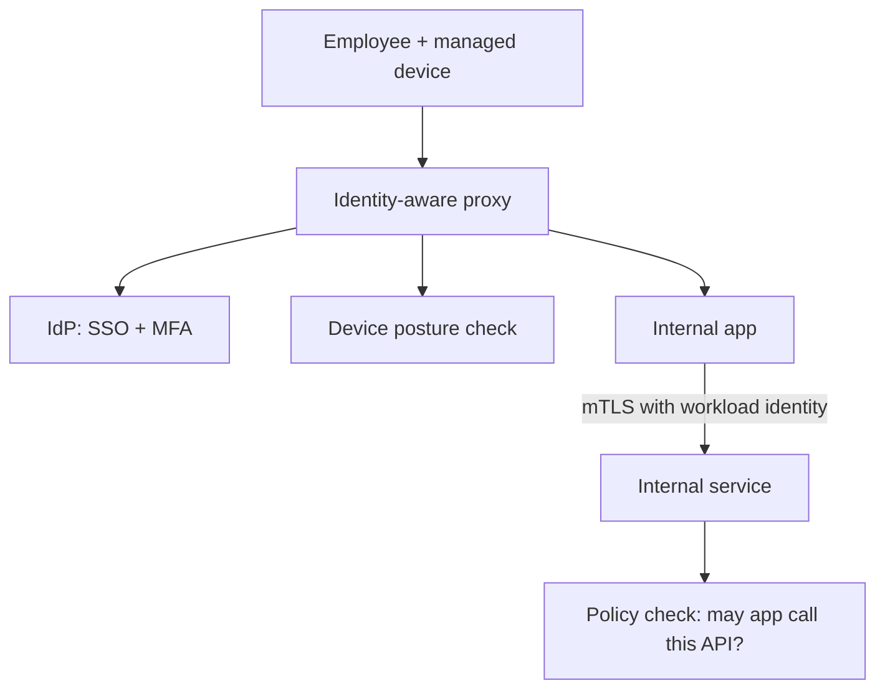

- **Strong user identity**: SSO with phishing-resistant MFA (passkeys/security keys).
- **Device trust**: only managed, patched, encrypted devices get access to sensitive apps.
- **Identity-aware proxy**: each request to an internal app is checked against user, device and policy; there's no network-level access to everything. Google's BeyondCorp is the well-known example of replacing the VPN this way.
- **Workload identity**: each service gets a cryptographic identity (e.g. a SPIFFE ID like `spiffe://prod/ns/payments/sa/api` in a short-lived X.509 certificate). Service meshes such as Istio issue and rotate these automatically.
- **mTLS + authorisation policies** between services: "only `checkout` may call `payments` on `POST /charge`".
- **Least privilege and just-in-time access**: admin rights granted temporarily, with approval and audit.
- **Continuous monitoring**: anomalies (new device, impossible travel, unusual data access) can trigger step-up auth or revocation.

**Common pitfalls:**
- Treating it as a product to buy; it's an architecture and a gradual migration.
- mTLS everywhere but with "allow all" policies, so it authenticates but doesn't restrict.
- Forgetting machine-to-machine access and static credentials in CI/CD.

**Likely follow-ups:**
- *Does zero trust mean no firewalls?* No; network segmentation remains as defence in depth, it just isn't the basis of trust.
- *How does a service mesh help?* Sidecars or node proxies handle mTLS, identity and policy enforcement without changing application code.

</details>

### 12. How do you isolate tenants in a multi-tenant system?

<details>
<summary>Answer</summary>

**In short:** Isolate both **data** and **resources**. For data: separate databases or schemas for high-value tenants, or shared tables with a mandatory `tenant_id` enforced at the data layer (row-level security, a repository layer that always filters, tests that try cross-tenant access). Add **per-tenant encryption keys** for strong isolation and easy offboarding. For resources: quotas, rate limits, separate queues or cells to stop noisy neighbours. Tenant context comes from the verified token, never from user input.

#### Data isolation models

| Model | Isolation | Cost / ops | Good for |
|---|---|---|---|
| **Silo**: DB (or account/cluster) per tenant | Strongest | Highest; many DBs to migrate and monitor | Enterprise/regulated tenants, data residency |
| **Bridge**: schema per tenant in a shared DB | Medium | Medium; schema migrations multiply | Hundreds of mid-size tenants |
| **Pool**: shared tables with `tenant_id` | Weakest by default; relies on code/RLS | Lowest, most efficient | Many small tenants (SaaS self-serve) |

Many SaaS products use a **hybrid**: pool for the free/standard tiers, silo for enterprise customers who pay for it.

#### Enforcing tenant filters in a pooled model

The danger is one missing `WHERE tenant_id = ?` leaking data across customers. Defence in layers:

1. **Tenant context from the token**: the authenticated request carries `tenant_id`; a middleware puts it in request context.
2. **Data-access layer** that always adds the filter (ORM global filters, repository base class).
3. **Database row-level security** as a backstop (PostgreSQL example):

```sql
ALTER TABLE invoices ENABLE ROW LEVEL SECURITY;

CREATE POLICY tenant_isolation ON invoices
  USING (tenant_id = current_setting('app.tenant_id')::uuid);

-- per request/transaction, set from the verified token:
SET LOCAL app.tenant_id = '6f1c0c3e-8a9b-4a7e-9a35-0d9d2f4b1e11';
```

4. **Tests and scanners** that try to read tenant B's data as tenant A.
5. Include `tenant_id` in cache keys, search indexes, object-storage prefixes and queue messages, not only in the DB.

Note that RLS is bypassed by table owners and superusers by default, so the application must connect as a role without those rights.

#### Per-tenant encryption keys

Each tenant's data is encrypted with its own DEK/KEK (see question 7). A bug that reads the wrong rows returns ciphertext that can't be decrypted with the requester's key. Offboarding becomes deleting the key, and enterprises can bring their own keys.

#### Resource isolation (noisy neighbours)

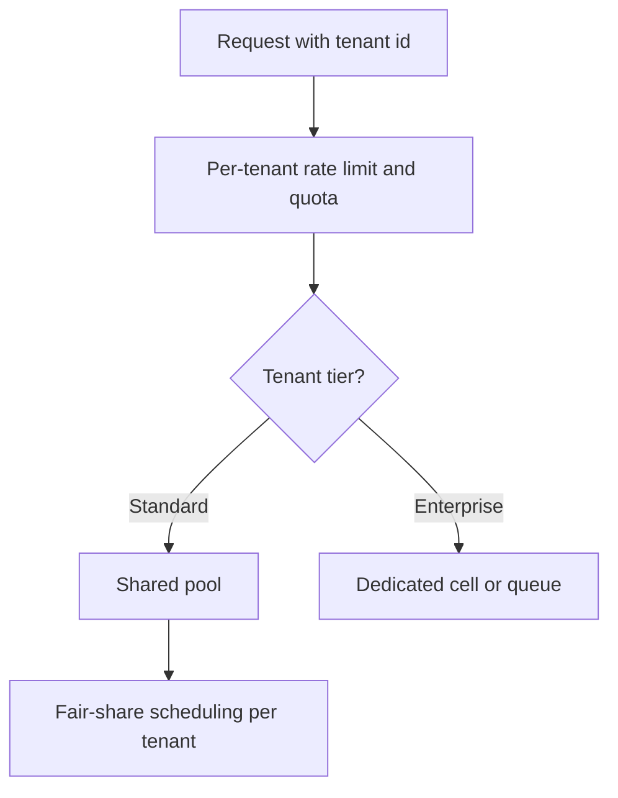

- Rate limits and quotas per tenant (API calls, storage, concurrent jobs).
- **Fair queuing**: separate queues or weighted scheduling so one tenant's backlog doesn't delay everyone.
- **Cells / shuffle sharding** so a tenant that causes overload affects only its cell (see [Reliability Q17](13-reliability-observability.md#17-how-do-you-limit-the-blast-radius-of-failures-and-changes)).
- Move very large tenants to dedicated infrastructure.

**Common pitfalls:**
- Taking `tenant_id` from a header or query parameter set by the client.
- Background jobs and admin tools that bypass the tenant filter.
- Shared caches keyed without the tenant, returning one tenant's data to another.

**Likely follow-ups:**
- *How do you migrate a tenant from pool to silo?* Copy its rows to the new DB, dual-write or briefly freeze writes, then switch the tenant's routing entry.
- *How do you run schema migrations with DB-per-tenant?* Automated, idempotent migrations rolled out tenant by tenant, with tracking of each tenant's schema version.

</details>

### 13. How do privacy regulations (GDPR, CCPA, data residency) affect design?

<details>
<summary>Answer</summary>

**In short:** They turn into concrete system requirements: **data minimisation** (collect only what you need, delete automatically after a retention period), **rights of access and erasure** (find, export and delete all of a user's data across services, caches, backups, logs and analytics, which needs a data inventory and a deletion pipeline, with crypto-shredding for immutable stores), **data residency** (e.g. keep EU users' data in EU regions by routing on a user's home region and partitioning storage), plus **consent tracking**, pseudonymised analytics, audit trails and encryption.

#### Requirements and their design impact

| Requirement | What you build |
|---|---|
| **Data minimisation, storage limitation** | Explicit schemas for personal data; TTLs and retention jobs; avoid logging PII |
| **Right of access / portability** | An export pipeline that gathers a user's data from every service into a machine-readable file |
| **Right to erasure** | A deletion pipeline across all stores, with proof of completion |
| **Consent** | A consent service storing what each user agreed to and when; services check it before processing (marketing, tracking) |
| **Data residency / transfer rules** | Region-pinned storage and processing; controls on cross-border replication |
| **Security of processing** | Encryption, access control, audit logs, breach detection |
| **Breach notification** (GDPR: 72 hours to the regulator) | Incident process that can quickly determine what data was affected |

#### Data inventory

You can't delete what you can't find. Maintain a catalogue: which services store personal data, which fields, for what purpose, retention period and legal basis. Tag schemas (e.g. columns marked `pii: email`) so tools can discover new stores automatically.

#### Deletion pipeline

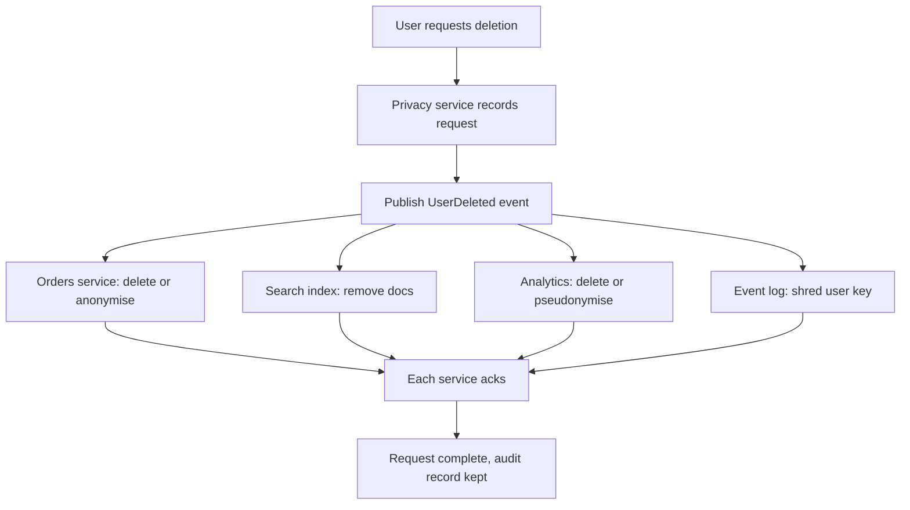

- Every service that holds personal data subscribes and must **acknowledge**; the privacy service tracks completion and retries stragglers.
- **Immutable stores** (Kafka topics with long retention, data lakes, backups): use **crypto-shredding** (encrypt per user, delete the key) or rely on retention so data ages out within a documented period.
- **Legal holds and conflicting obligations**: some data (invoices, for tax law) must be kept; anonymise it or restrict its use rather than deleting.

#### Data residency

- Each user/tenant gets a **home region** at signup.
- Routing sends requests to the home region; personal data is stored only there.
- Global services hold only non-personal or pseudonymised data (e.g. an opaque user ID → region mapping).
- Watch for leaks via logs, backups, support tools and third-party processors outside the region.

#### Analytics

Use **pseudonymisation** (replace identifiers with tokens, keep the mapping separate and protected), aggregation, and where needed techniques like k-anonymity or differential privacy. Note that pseudonymised data is still personal data under GDPR; only truly anonymised data falls outside it.

**Common pitfalls:**
- Personal data copied into logs, caches, search indexes and spreadsheets that the deletion pipeline doesn't know about.
- Treating privacy as a legal checkbox at the end instead of a design input (privacy by design).

**Likely follow-ups:**
- *What about backups?* Typically they are not edited; deleted data expires as backups rotate out, and restores re-apply pending deletions.
- *How does CCPA differ from GDPR?* Broadly similar rights (access, deletion, opting out of sale/sharing); GDPR also requires a legal basis for processing, and the specifics differ by law.

</details>

### 14. What is the principle of least privilege and defence in depth?

<details>
<summary>Answer</summary>

**In short:** **Least privilege**: every user, service and credential gets only the permissions it needs, for only as long as it needs them (scoped tokens, one IAM role per service, just-in-time admin access). **Defence in depth**: several independent layers of protection (WAF, authn, authz, encryption, network segmentation, monitoring) so a single failure doesn't become a breach. Mention both when wrapping up a design: security reviewers look for them.

#### Least privilege in practice

| Subject | Over-privileged | Least privilege |
|---|---|---|
| Service IAM role | `s3:*` on all buckets | `s3:GetObject` on `arn:aws:s3:::invoices-prod/*` |
| DB user for an API | Superuser | `SELECT, INSERT, UPDATE` on its own schema only |
| OAuth token | `full_access` scope | `orders:read` for 15 minutes |
| Engineer | Permanent prod admin | Read-only by default; time-limited admin with approval and audit (just-in-time) |
| CI pipeline | Org-wide deploy keys | Per-repo, short-lived OIDC-federated credentials |

An AWS IAM policy statement scoped to one prefix of one bucket:

```json
{
  "Effect": "Allow",
  "Action": ["s3:GetObject", "s3:PutObject"],
  "Resource": "arn:aws:s3:::invoices-prod/tenant-uploads/*"
}
```

Least privilege limits the **blast radius** of a compromise: if the image-resizer service is hacked, the attacker can read uploaded images, not the payments database. Review permissions regularly and use tooling that flags unused permissions.

#### Defence in depth

Every control fails sometimes, through a bug, a misconfiguration or a new vulnerability. Layers mean an attacker must defeat several independent controls.

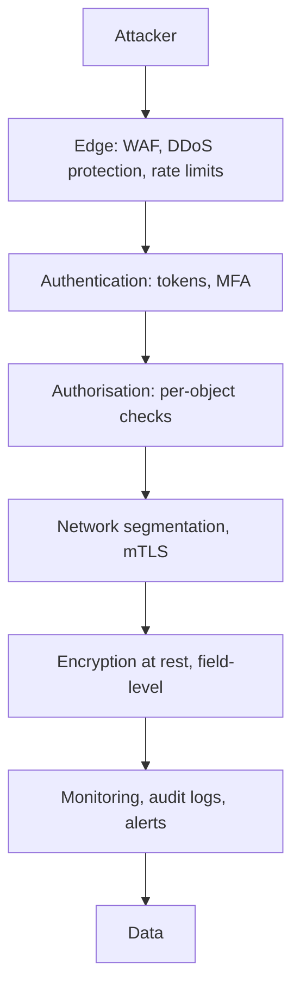

Example: a SQL injection bug slips past code review (one layer failed). But the WAF blocks common injection payloads, the DB user can only read its own schema, sensitive columns are field-encrypted, and anomaly detection alerts on an unusual query volume. The bug becomes a contained incident instead of a breach.

#### How to use this in an interview

At the end of a design, walk through the layers briefly: "TLS at the edge and mTLS internally; OAuth tokens validated at the gateway; per-object authorisation in services; each service has its own IAM role and DB user; PII encrypted with KMS-managed keys; audit logs and alerts on sensitive access."

**Common pitfalls:**
- Wildcard permissions granted "temporarily" and never removed.
- Layers that share a single point of failure (all relying on one shared admin credential).

**Likely follow-ups:**
- *How do you find excessive permissions?* Access analysers that compare granted vs used permissions over time, plus periodic access reviews.
- *What is separation of duties?* No single person can complete a sensitive action alone (e.g. one person writes code, another approves the deploy).

</details>

### 15. How do you secure file uploads?

<details>
<summary>Answer</summary>

**In short:** Upload directly to object storage with **short-lived pre-signed URLs** scoped to one key and a size limit; validate the real content type by inspecting the bytes, not the extension; run **malware scanning** asynchronously before files become visible; serve user content from a **separate domain** to prevent XSS and cookie theft; strip metadata such as EXIF GPS; keep buckets private and serve via signed URLs or a token-authenticated CDN.

#### Upload flow

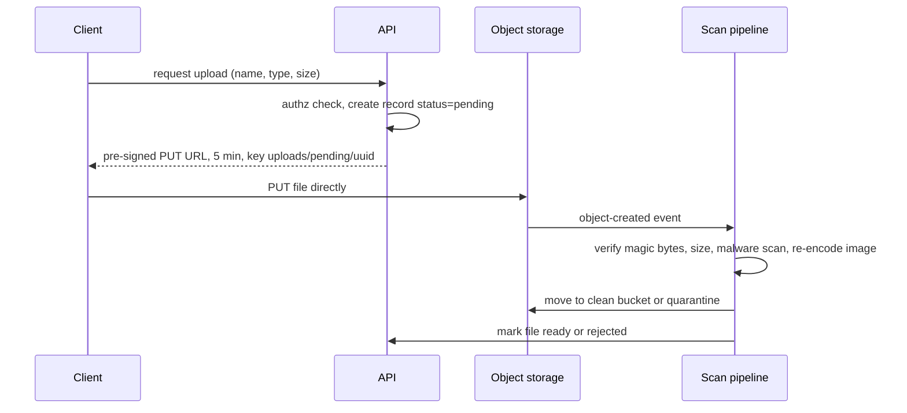

#### Why each step

- **Pre-signed URLs**: the app servers don't proxy large files (saves bandwidth and threads), and the client gets permission for exactly one object key, for a few minutes. The **server generates the key** (a UUID), so users can't overwrite others' files or use path traversal like `../../`. Use a pre-signed POST policy or checks on the final object to enforce max size and content type.
- **Content validation**: extensions and the `Content-Type` header are attacker-controlled. Check magic bytes, enforce an allow-list of types, and reject archives that expand massively ("zip bombs") or images with huge pixel dimensions.
- **Re-encoding images**: decoding and re-encoding (e.g. to WebP/JPEG) removes embedded payloads and metadata. Run image/document processing in **sandboxed** workers, since parsers have a history of vulnerabilities.
- **Malware scanning**: an async pipeline (e.g. ClamAV or a cloud scanning service) before the file is visible to others; files stay in a pending/quarantine state until clean.
- **Strip metadata**: EXIF can contain GPS location, device serials and author names.

#### Serving files safely

| Risk | Mitigation |
|---|---|
| Uploaded HTML/SVG runs scripts on your domain (stored XSS, cookie theft) | Serve from a separate, cookieless domain (e.g. `usercontent.example.net`); `Content-Disposition: attachment` for non-media; `X-Content-Type-Options: nosniff`; restrictive CSP |
| Public bucket exposes private files | Private buckets; short-lived signed GET URLs or CDN signed cookies/tokens after an authz check |
| Hotlinking / bandwidth abuse | Signed URLs with expiry, CDN rate limits |
| Enumeration of file IDs | Random keys **and** an authorisation check when issuing download URLs |

```python
def create_upload(user, filename, size, content_type):
    if content_type not in ALLOWED_TYPES or size > MAX_BYTES:
        raise BadRequest()
    key = f"uploads/pending/{uuid4()}"                 # server-chosen key, never the filename
    files.insert(id=key, owner=user.id, status="pending", original_name=sanitize(filename))
    return s3.generate_presigned_url("put_object",
        Params={"Bucket": UPLOAD_BUCKET, "Key": key, "ContentType": content_type},
        ExpiresIn=300)
```

**Common pitfalls:**
- Serving uploads from the main app domain, so an uploaded SVG or HTML file can run scripts with the user's session.
- Trusting the client-supplied filename for storage paths.
- Making files visible before scanning finishes.

**Likely follow-ups:**
- *How do you handle very large files?* Multipart/resumable uploads with pre-signed URLs per part, then a complete call.
- *How do you control storage abuse?* Per-user quotas, lifecycle rules deleting abandoned pending uploads, and rate limits on upload URL creation.

</details>

---

[⬅ Previous: Reliability, Observability & Operations](13-reliability-observability.md) · [⬅ Back to index](../README.md) · [Next: Big Data & Stream Processing ➡](15-big-data-streaming.md)
