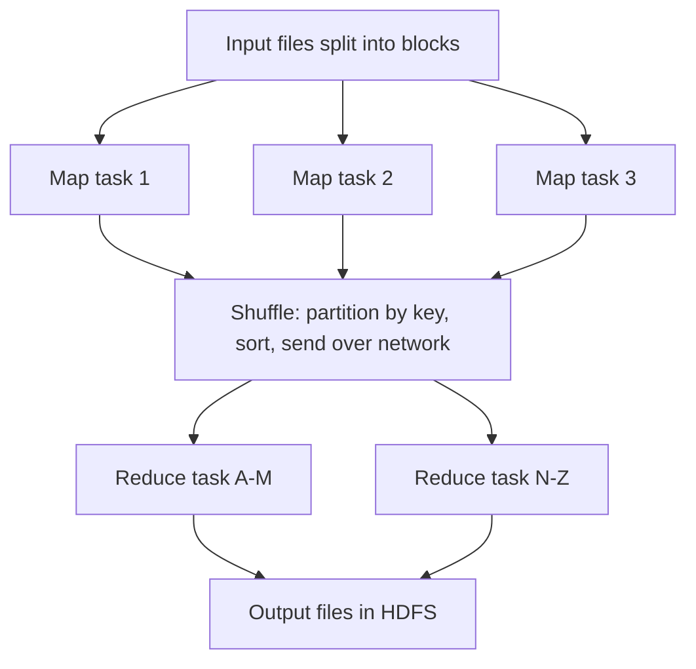
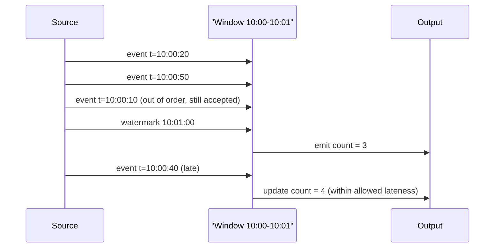
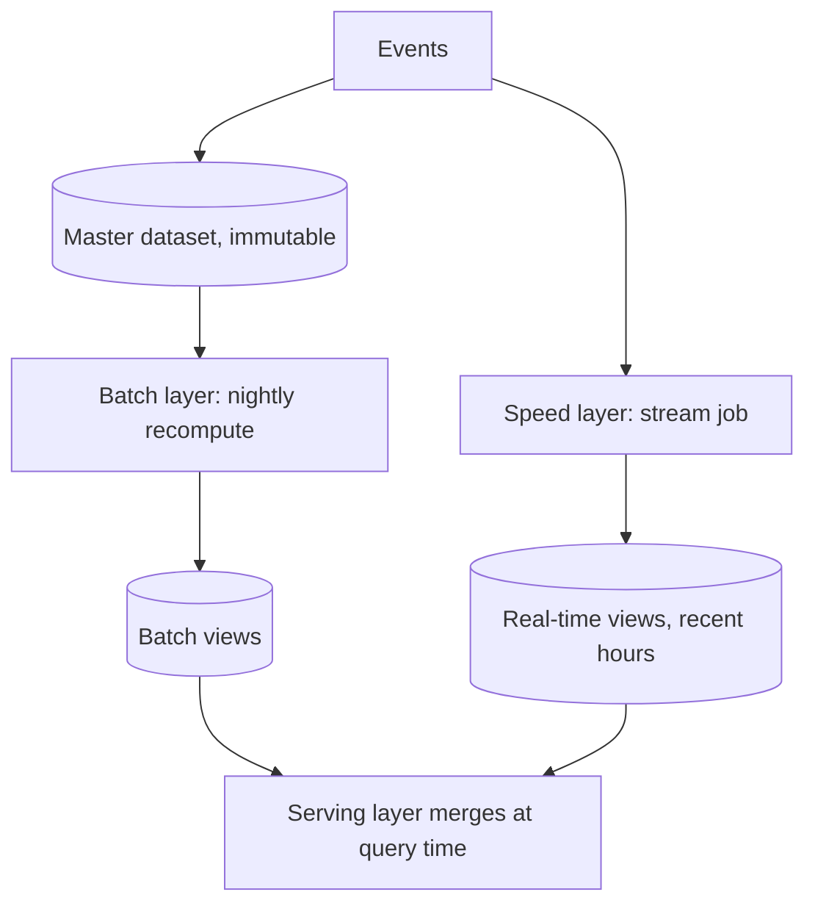
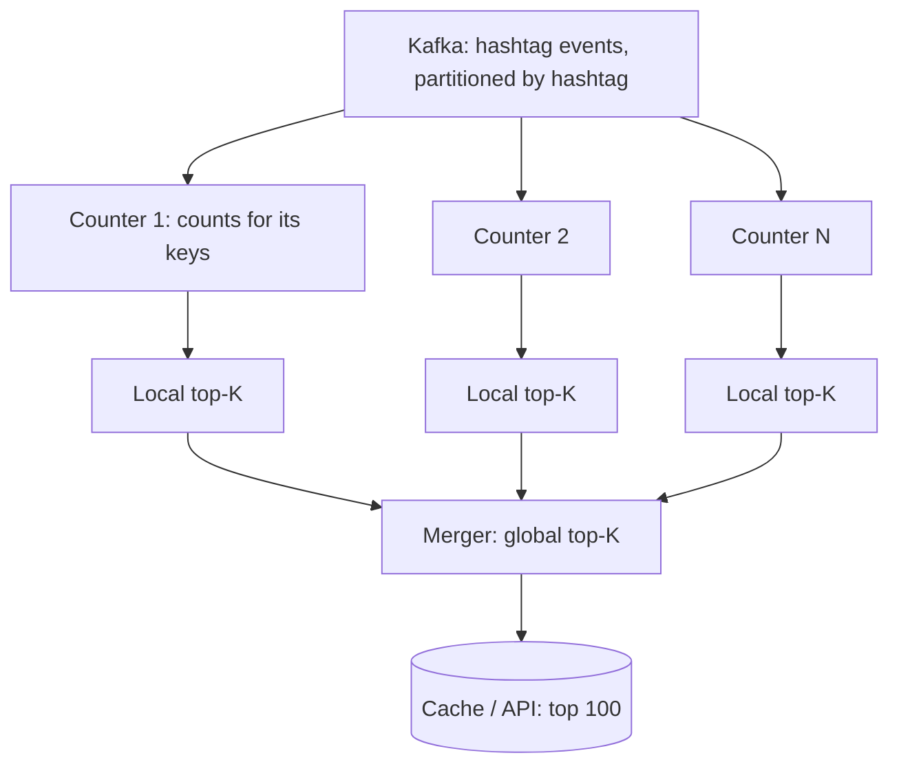
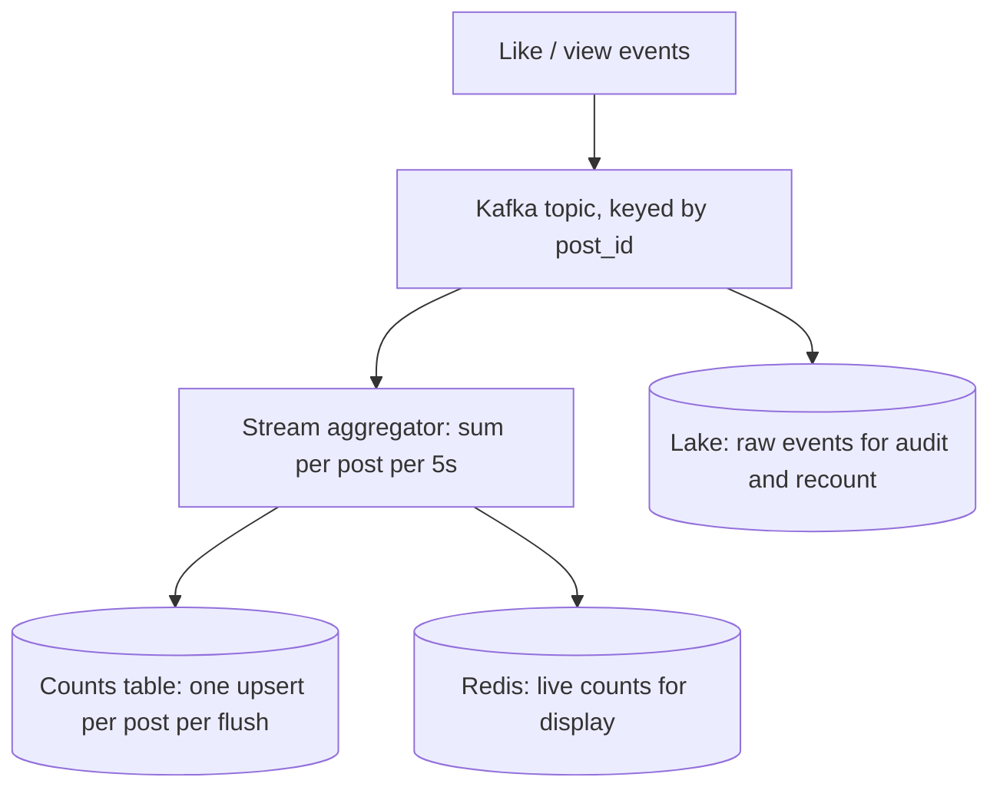
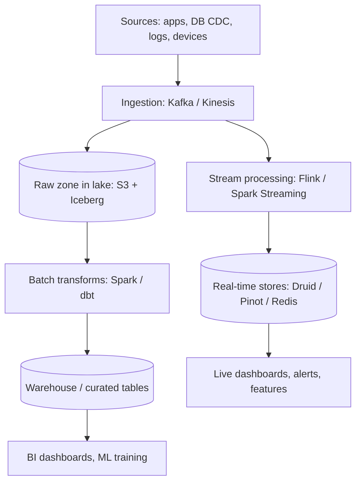
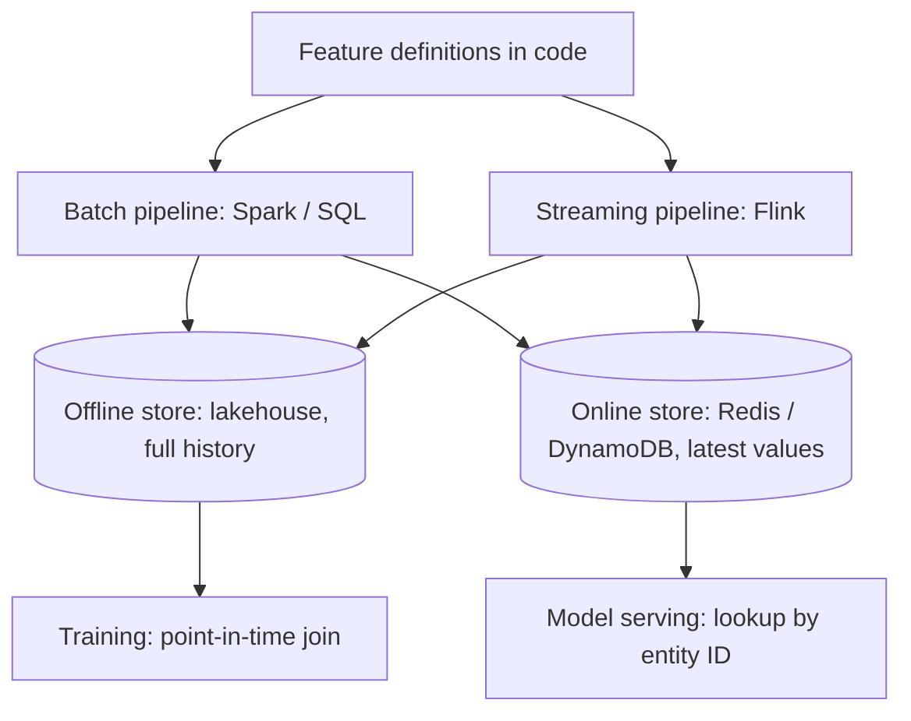

# Big Data & Stream Processing

[⬅ Back to index](../README.md)

Covers: OLTP vs OLAP, data warehouses vs lakes vs lakehouses, ETL vs ELT, batch vs stream processing, MapReduce and Spark, Flink and Kafka Streams, windowing and watermarks, exactly-once in streams, Lambda vs Kappa architecture, columnar storage, top-K and counting at scale.

---

### 1. OLTP vs OLAP?

<details>
<summary>Answer</summary>

**In short:** OLTP systems run the business: many small, fast reads and writes by key (place an order, update a profile). OLAP systems analyse the business: few, huge queries that scan and aggregate millions or billions of rows (revenue by region per month). They need different storage layouts, so you keep them separate and copy data from OLTP into OLAP.

#### Why two kinds of database?

The access patterns pull storage design in opposite directions:

- An OLTP query like `SELECT * FROM orders WHERE id = 42` touches **one row, all columns**. Storing each row contiguously (row-oriented) plus a B-tree index makes this a couple of page reads.
- An OLAP query like `SELECT region, SUM(amount) FROM orders GROUP BY region` touches **every row, two columns**. In a row store you'd read every byte of every row, including the 30 columns you don't need. A column store reads just `region` and `amount`, compressed, and scans them in parallel.

| | OLTP (transactional) | OLAP (analytical) |
|---|---|---|
| Typical query | Point read/write by key | Scan + aggregate over many rows |
| Users | The application, thousands of concurrent requests | Analysts, dashboards, ML jobs, few concurrent heavy queries |
| Latency target | Milliseconds | Seconds to minutes is acceptable |
| Storage | Row-oriented, B-tree indexes | **Columnar**, compressed, partitioned |
| Schema | Normalised (3NF) to avoid update anomalies | Denormalised **star/snowflake** schemas: fact tables + dimension tables |
| Data freshness | Always current | Minutes to hours behind (via CDC/ETL) |
| Examples | Postgres, MySQL, DynamoDB, Spanner | Snowflake, BigQuery, Redshift, ClickHouse, Druid, Pinot |

#### Star schema in one picture

A **fact table** records events with numeric measures (`order_id, date_id, product_id, store_id, amount, quantity`). **Dimension tables** describe the context (`dim_product`, `dim_store`, `dim_date`). Analysts join facts to a few small dimensions and group by dimension attributes.

#### How data moves between them

You **never run heavy analytics on the production OLTP database**: a single full-table scan can saturate disk and CPU and slow down checkout for real users. Instead, replicate data with **CDC** (change data capture, e.g. Debezium reading the Postgres WAL into Kafka) or periodic ETL into the analytical store. A read replica is a stopgap for light reporting, but it is still a row store.

**Common pitfalls**
- Pointing BI tools at the primary database "just for now".
- Expecting OLAP stores to handle high-rate single-row updates; most are optimised for append and bulk loads.

**Likely follow-ups**
- *What is HTAP?* Systems that try to serve both (e.g. TiDB, SingleStore, AlloyDB with a columnar engine) by keeping a row copy and a columnar copy of the same data.
- *Where do Druid/Pinot fit?* Real-time OLAP: they ingest from Kafka and serve sub-second aggregations for user-facing analytics.

</details>

### 2. Data warehouse vs data lake vs lakehouse?

<details>
<summary>Answer</summary>

**In short:** A **warehouse** stores cleaned, structured data with a schema enforced on write, optimised for fast SQL. A **lake** dumps raw data of any format into cheap object storage and applies schema on read. A **lakehouse** adds an open table format (Iceberg, Delta Lake, Hudi) on top of the lake to get warehouse-like ACID tables, schema evolution and fast queries, so one copy of data serves both BI and ML.

#### Data warehouse

Structured, curated tables (Snowflake, BigQuery, Redshift). Data is cleaned and modelled before or right after loading (**schema-on-write**). You get fast SQL, strong governance, and well-understood semantics. Downsides: storage and compute cost more, data is often in a proprietary format, and unstructured data (images, logs, JSON blobs) fits poorly. ML teams often need to export data out of it.

#### Data lake

Raw files (JSON, CSV, Parquet, images, logs) in object storage such as S3 or GCS, read by engines like Spark, Trino or Athena (**schema-on-read**). Extremely cheap and flexible: keep everything, decide later what it means. The problems appear at scale:

- No transactions: a job that fails halfway leaves partial files; readers can see half-written data.
- No reliable schema: producers change fields and downstream jobs break silently.
- Updates and deletes (e.g. GDPR erasure) mean rewriting whole files by hand.
- Without a catalog and ownership it becomes a **data swamp** no one trusts.

#### Lakehouse

Keep the data as Parquet files in object storage, but add a **table format** that maintains metadata: which files make up the table at each version. Writers commit a new snapshot atomically, so you get:

- **ACID transactions** and concurrent writers (optimistic concurrency).
- **Schema evolution** (add/rename columns safely).
- **Time travel** (query the table as of yesterday's snapshot, roll back a bad write).
- **Row-level updates/deletes** via merge-on-read or copy-on-write.
- Partition and file statistics for pruning, giving good query performance.

Because the format is open, many engines (Spark, Flink, Trino, Snowflake, Databricks) can read and write the same tables.

| | Warehouse | Lake | Lakehouse |
|---|---|---|---|
| Storage | Managed, often proprietary | Object storage, open files | Object storage, open files + table metadata |
| Schema | On write | On read | On write, evolvable |
| Transactions | Yes | No | Yes |
| Data types | Structured | Anything | Anything, structured tables on top |
| Cost | Higher | Lowest | Low storage, pay for compute |
| Best for | BI, finance reporting | Raw archive, exploration | Both BI and ML on one copy |

**Likely follow-ups**
- *Why not just a lake with Parquet?* No atomic commits or safe concurrent writes; table formats solve exactly that.
- *Medallion architecture?* Bronze (raw) → silver (cleaned, conformed) → gold (business aggregates) layers inside a lakehouse.

</details>

### 3. ETL vs ELT?

<details>
<summary>Answer</summary>

**In short:** ETL transforms data in a separate processing layer **before** loading it into the warehouse. ELT loads the **raw** data first and transforms it **inside** the warehouse or lakehouse with SQL (typically dbt). ELT is the modern default because cloud warehouses scale compute cheaply and keeping raw data lets you re-run transformations when logic changes.

#### ETL: Extract, Transform, Load

A tool or job (Informatica, custom Spark, Python scripts) pulls data from sources, cleans, joins and aggregates it on its own servers, then loads only the finished tables.

- Made sense when warehouse storage and compute were expensive and fixed-size.
- Useful when data **must** be cleaned before landing: masking PII, dropping fields you're not allowed to store.
- Downside: raw data is lost. If a transform had a bug, you must re-extract from sources, which may no longer have the history.

#### ELT: Extract, Load, Transform

Ingestion tools (Fivetran, Airbyte, Kafka Connect, CDC) copy raw data as-is into staging tables. Transformations are SQL models that build cleaned and aggregated tables from the raw ones:

```sql
-- models/daily_revenue.sql (dbt model)
SELECT
  DATE(o.created_at)  AS order_date,
  c.country,
  SUM(o.amount_cents) / 100.0 AS revenue
FROM {{ ref('stg_orders') }} o
JOIN {{ ref('stg_customers') }} c ON c.id = o.customer_id
WHERE o.status = 'paid'
GROUP BY 1, 2
```

dbt figures out dependencies between models, runs them in order, and supports tests (`not_null`, `unique`, referential checks) and documentation.

| | ETL | ELT |
|---|---|---|
| Where transforms run | Separate engine | Inside warehouse/lakehouse |
| Raw data kept | Usually not | Yes, can reprocess |
| Language | Often code / GUI tools | Mostly SQL |
| Good for | Strict compliance pre-load, legacy | Cloud warehouses, fast iteration |

#### Around the pipeline

- **Orchestration**: Airflow, Dagster or Prefect schedule jobs as DAGs, handle retries and backfills.
- **Data quality**: checks on row counts, nulls, freshness, distribution (dbt tests, Great Expectations); fail the pipeline rather than publish bad numbers.
- **Lineage and catalog**: know which dashboards depend on which source columns.

**Common pitfalls**
- ELT does not mean "no governance": loading raw PII into a broadly readable warehouse is a compliance problem.
- Non-idempotent jobs: re-running a day's load should overwrite that day's partition, not append duplicates.

</details>

### 4. Batch vs stream processing?

<details>
<summary>Answer</summary>

**In short:** Batch processing runs periodically over a **bounded** dataset (yesterday's data) and gives complete, accurate results with hours of latency. Stream processing handles an **unbounded** flow of events continuously, giving results in milliseconds to seconds, at the cost of harder problems: state, out-of-order events and exactly-once. Many systems use both.

#### Batch

A job reads a fixed input (files in a lake, a table partition), computes, writes output, and exits. Examples: daily reports, billing, ML model training, rebuilding a search index, monthly invoices.

- **Simple failure model**: if a job fails, re-run it on the same input.
- **High throughput**: large sequential reads, big parallel scans.
- **Complete data**: by the time the job runs, late events have arrived.
- Latency equals the schedule interval plus run time.

#### Stream

A long-running job consumes events from a log (Kafka, Kinesis, Pub/Sub) and updates results as each event (or micro-batch) arrives. Examples: fraud detection, real-time metrics, alerting, live dashboards, surge pricing, recommendations from recent activity.

Harder because:
- The job runs forever and must keep **state** (counts, windows, joins) that survives crashes.
- Events arrive **late and out of order**, so "the count for 10:00–10:01" is never definitely final (see watermarks).
- Restarts can replay events, so you must avoid **double counting**.
- Code upgrades happen on a running job with live state.

| | Batch | Stream |
|---|---|---|
| Input | Bounded | Unbounded |
| Latency | Minutes to hours | Milliseconds to seconds |
| Correctness | Complete data | Must handle late data |
| Failure recovery | Re-run job | Checkpoints + replay |
| Tools | Spark, dbt, Hive, BigQuery | Flink, Kafka Streams, Spark Structured Streaming |

#### Choosing

Ask: what decision depends on this result, and how stale can it be? A fraud check must block a payment in under a second; a finance report can wait until morning. A common pattern is **streaming for fresh, approximate numbers and batch for the authoritative ones** (e.g. ad dashboards update live, billing reconciles nightly).

**Likely follow-ups**
- *Is micro-batching streaming?* Spark Structured Streaming processes small batches every few hundred ms to seconds; it's streaming in semantics with slightly higher latency than event-at-a-time engines.
- *Is batch a special case of streaming?* Conceptually yes: a bounded stream. Flink and Beam use one API for both.

</details>

### 5. How does MapReduce work, and why did Spark replace it?

<details>
<summary>Answer</summary>

**In short:** MapReduce splits input across workers, runs a **map** function that emits key-value pairs, **shuffles** them so all values for a key land on one machine, then runs **reduce** to aggregate each key. It scales to petabytes and tolerates failures by re-running tasks, but writes intermediate results to disk between every stage. Spark keeps intermediate data **in memory**, plans the whole job as a DAG, and offers higher-level APIs, making multi-stage and iterative jobs far faster.

#### MapReduce step by step



1. **Split**: the input (in HDFS) is divided into blocks; the scheduler runs a map task near each block (**data locality**: move compute to data).
2. **Map**: for each record, emit `(key, value)`. Word count: for each word emit `(word, 1)`.
3. **Combine** (optional): a local mini-reduce on each mapper, e.g. sum the 1s before sending, to cut network traffic.
4. **Shuffle and sort**: map output is partitioned by `hash(key) % numReducers`, written to local disk, and pulled by reducers over the network. This is usually the most expensive phase.
5. **Reduce**: each reducer gets `(key, [values])` and aggregates: `(word, sum)`.
6. Output is written to HDFS (replicated).

```python
def map(line):
    for word in line.split():
        emit(word, 1)

def reduce(word, counts):
    emit(word, sum(counts))
```

**Fault tolerance:** tasks are deterministic and inputs are on durable storage, so a failed or slow task is simply re-run on another machine (slow ones get **speculative** duplicate copies).

#### Why it was slow

A real pipeline (join, then filter, then aggregate, then rank) becomes a chain of MapReduce jobs, each writing its full output to replicated HDFS and the next reading it back. Iterative algorithms (PageRank, k-means, gradient descent) loop dozens of times, paying disk I/O every iteration. The API was also low-level: everything had to be expressed as map and reduce.

#### What Spark changed

- **In-memory intermediate data**: stages pass data in memory (spilling to disk only when needed); datasets can be cached across iterations.
- **DAG execution with lazy evaluation**: transformations (`filter`, `join`, `groupBy`) only build a plan; an action (`count`, `write`) triggers execution. The optimiser (Catalyst for DataFrames/SQL) pushes filters down, prunes columns, picks join strategies, and pipelines narrow steps into one stage. Only **wide** operations (group, join) require a shuffle.
- **Lineage-based fault tolerance**: instead of replicating every intermediate result, Spark remembers how each partition was computed and recomputes lost ones.
- **One engine, many APIs**: SQL/DataFrames, Structured Streaming, MLlib, graph processing.

The commonly quoted speedup is 10–100x for iterative and multi-stage workloads; for a single simple scan the gap is much smaller since both are bound by reading input.

**Common pitfalls (Spark)**
- **Data skew**: one hot key sends most data to one task, which runs for hours. Fix with salting keys or skew-join handling.
- `collect()` on a large dataset pulls it all into the driver and crashes it.
- Too many small files or too few partitions hurt parallelism.

**Likely follow-ups**
- *Narrow vs wide transformation?* Narrow (map, filter) needs no data movement; wide (groupByKey, join) needs a shuffle and creates a stage boundary.
- *Broadcast join?* Ship a small table to every executor to avoid shuffling the large one.

</details>

### 6. What are Flink and Kafka Streams used for?

<details>
<summary>Answer</summary>

**In short:** Both are **stateful stream processors**: they run continuous computations (aggregations, joins, windows, enrichment) over event streams with state that survives failures. **Flink** is a distributed cluster engine with large managed state, event-time processing and exactly-once checkpoints, used for heavy real-time pipelines. **Kafka Streams** is a Java library you embed in your own service, ideal for Kafka-in, Kafka-out microservices without running a separate cluster.

#### Why "stateful" matters

Counting clicks per ad per minute, joining a payment with the user's last 10 transactions, or detecting "3 failed logins within 2 minutes" all require remembering past events. A stateless consumer would have to call a database on every event. Stream processors keep this state **locally** (in memory or embedded RocksDB), partitioned by key alongside the data, and make it fault tolerant.

#### Apache Flink

- **True event-at-a-time** processing (not micro-batches), giving low latency.
- **Event-time** semantics with watermarks, plus rich windowing.
- **Managed keyed state** that can grow to terabytes (RocksDB state backend), with **distributed checkpoints** to durable storage for exactly-once state.
- **Savepoints**: manual snapshots to upgrade code or rescale a job without losing state.
- APIs: DataStream (Java), Flink SQL / Table API, and CEP (complex event pattern matching).
- Runs on its own cluster (often on Kubernetes) with a JobManager coordinating TaskManagers.
- Uses: fraud detection, real-time ETL into lakehouse tables, ad-click aggregation, anomaly detection.

#### Kafka Streams

- A **library**, not a cluster: you deploy it like any app; scaling means running more instances, and Kafka's consumer-group protocol assigns partitions.
- State lives in local RocksDB stores, each backed by a compacted **changelog topic** in Kafka; on failure, another instance restores state by replaying the changelog.
- Exactly-once via Kafka transactions (`processing.guarantee=exactly_once_v2`) when both input and output are Kafka.
- Abstractions: `KStream` (event stream), `KTable` (latest value per key, a changelog), stream-table joins.

```java
StreamsBuilder b = new StreamsBuilder();
b.stream("page-views", Consumed.with(Serdes.String(), Serdes.String()))
 .groupByKey()                                        // key = pageId
 .windowedBy(TimeWindows.ofSizeWithNoGrace(Duration.ofMinutes(1)))
 .count()                                             // state in RocksDB + changelog
 .toStream()
 .to("page-view-counts-1m");
```

#### Spark Structured Streaming

Streaming on the Spark engine using **micro-batches** (also a continuous mode with limitations). Latency is typically sub-second to seconds; the big advantage is reusing Spark DataFrame code and skills for both batch and streaming.

| | Flink | Kafka Streams | Spark Structured Streaming |
|---|---|---|---|
| Deployment | Separate cluster | Library in your app | Spark cluster |
| Sources/sinks | Many (Kafka, Kinesis, files, DBs) | Kafka only | Many |
| Latency | Milliseconds | Milliseconds | Sub-second to seconds |
| State | Very large, checkpointed | Local RocksDB + changelog topics | Checkpointed state store |
| Best for | Large, complex, event-time pipelines | Kafka-centric microservices | Teams already on Spark |

**Likely follow-ups**
- *How does Flink rescale stateful jobs?* State is sharded into key groups; on restart from a savepoint with new parallelism, key groups are redistributed.
- *Why not just use a Kafka consumer?* You'd have to build state management, fault tolerance, windowing and exactly-once yourself.

</details>

### 7. What are windows in stream processing?

<details>
<summary>Answer</summary>

**In short:** A stream never ends, so you can't compute "the total"; you compute aggregates over **windows**, finite slices of the stream. **Tumbling** windows are fixed and non-overlapping (clicks per minute), **sliding/hopping** windows are fixed-size and overlapping (last 5 minutes, updated every minute), and **session** windows group a key's events separated by inactivity gaps (a user's browsing session).

#### Window types

| Type | Definition | Example | Each event belongs to |
|---|---|---|---|
| **Tumbling** | Fixed size, back to back | Orders per minute | Exactly one window |
| **Hopping / sliding** | Fixed size, advancing by a smaller step | Avg latency over last 5 min, every 1 min | size / step windows (here 5) |
| **Session** | Per key; window closes after a gap of inactivity (e.g. 30 min) | Pages per user visit | One session, which can merge with neighbours |
| **Global** | One window for all time with a custom **trigger** | Emit every 1,000 events | The single window |

Visualise a 10-minute timeline:

```
Tumbling 5m:  [00-05)[05-10)
Hopping 5m/1m:[00-05)
               [01-06)
                [02-07) ...
Session gap 3m (one user):  e e  e        e e
                            [session 1]   [session 2]
```

#### How the engine implements them

Windows are usually **keyed** (per user, per ad, per page), so each key has its own window state. For tumbling and hopping windows the engine keeps an accumulator per (key, window); it updates incrementally (e.g. a running sum and count, not a list of events) when possible. The window is **fired** (result emitted) when the watermark passes its end, then state is cleared (after any allowed lateness).

Session windows are dynamic: each event starts a tiny window `[t, t + gap)`; overlapping windows for the same key **merge**. An event arriving late can bridge two sessions into one.

Some engines (Flink's `SlidingEventTimeWindows`) call hopping windows "sliding". A true sliding window (one per event, "the last 5 minutes as of this event") is more costly and is usually approximated with hopping windows or bucketed counts.

**Common pitfalls**
- Hopping windows with a tiny step multiply state and output: size 1 hour / step 1 second means each event updates 3,600 windows. Use pre-aggregated small buckets and combine them instead.
- Windowing by processing time gives results that change when you replay data.
- Forgetting that session windows can grow unbounded for bots that never go idle; cap them.

**Likely follow-ups**
- *What is a trigger?* The rule deciding when to emit a window's result: at watermark, every N events, every N seconds (early results), or again on late data.

</details>

### 8. Event time vs processing time? What are watermarks?

<details>
<summary>Answer</summary>

**In short:** **Event time** is when something actually happened (a timestamp in the event); **processing time** is when the system sees it. Because devices go offline and networks delay data, events arrive late and out of order, so correct results must use event time. A **watermark** is the processor's running assertion "I don't expect any more events older than T"; when it passes the end of a window, that window's result is emitted. Events arriving after that are late and are dropped, sent to a side output, or used to update the result within an allowed lateness.

#### Why processing time gives wrong answers

A phone records a "purchase" at 10:00:30, goes into a tunnel, and uploads at 10:07. Counting by processing time puts the purchase in the 10:07 bucket. During an outage or a replay of yesterday's Kafka data, processing-time counts become nonsense: all of yesterday lands in "now". Event-time results are **deterministic**: replaying the same input gives the same output.

#### How watermarks work

The engine can't wait forever for stragglers, so it needs a signal of progress through event time. Typically each source tracks the max event timestamp seen and emits a watermark = `maxTimestamp - allowedOutOfOrderness` (bounded out-of-orderness). Watermarks flow through the job; an operator with several inputs uses the **minimum** of their watermarks.



```java
WatermarkStrategy
  .<Click>forBoundedOutOfOrderness(Duration.ofSeconds(10))  // tolerate 10s disorder
  .withTimestampAssigner((click, ts) -> click.eventTimeMillis)
  .withIdleness(Duration.ofMinutes(1));                       // idle partitions don't stall progress
```

#### The trade-off

The watermark delay is a dial between **latency and completeness**:
- Small delay: results come out fast, more events are late.
- Large delay: results are more complete, but dashboards lag.

Handling late events:
1. **Drop** them (fine for approximate metrics).
2. **Side output** them to a separate stream for auditing or batch correction.
3. **Allowed lateness**: keep window state a bit longer and emit **updated** results (downstream must handle upserts, not just appends).

**Common pitfalls**
- An **idle partition** (no events) holds back the minimum watermark, so no window ever fires; configure idleness detection.
- Trusting client clocks blindly: device clocks can be wrong by hours. Clamp or use server receive time for sanity checks.

**Likely follow-ups**
- *Is a watermark a guarantee?* No, it's a heuristic; that's why late data handling exists.
- *What does Kafka Streams use?* Stream time (max timestamp seen) plus a **grace period** per window, a similar idea.

</details>

### 9. How do you achieve exactly-once results in stream processing?

<details>
<summary>Answer</summary>

**In short:** You can't stop events from being *processed* more than once after a failure, but you can make the *results* reflect each event exactly once. That takes three things: a **replayable source** (Kafka offsets), **checkpointed state** snapshotted together with those input offsets (Flink's distributed snapshots), and a **transactional or idempotent sink** so replayed output doesn't create duplicates. Add deduplication by event ID if producers can send the same event twice.

#### Why it's hard

A stream job reads an event, updates state (a count), and writes output. If it crashes after updating state but before recording its input position, it re-reads the event on restart and counts it twice. If it records the position first and then crashes, the event is lost.

| Guarantee | Meaning | How |
|---|---|---|
| At-most-once | May lose events | Commit offset before processing |
| At-least-once | May duplicate | Commit offset after processing; retry on failure |
| Exactly-once (effectively-once) | Each event affects results once | Atomic state + offsets, plus idempotent/transactional output |

#### 1. Consistent checkpoints of state and offsets

Flink periodically injects **checkpoint barriers** into the source streams. When an operator has received the barrier on all its inputs, it snapshots its state to durable storage (S3/HDFS) and forwards the barrier. A completed checkpoint is a consistent cut: "state reflects exactly the events before offset X on every partition". On failure, Flink restores all operators from the last checkpoint and **rewinds the sources** to the recorded offsets. Events after the checkpoint are reprocessed, but the state they're applied to has been rolled back, so internal state is exactly-once.

Kafka Streams achieves the same within Kafka: state changelog writes, output records and consumer offset commits all go in **one Kafka transaction**.

#### 2. Sinks that don't duplicate

Rolling back internal state doesn't un-send output to the outside world. Options:

- **Transactional sink with two-phase commit**: write output inside a transaction that is pre-committed at checkpoint time and committed only when the checkpoint completes (Flink's Kafka sink in exactly-once mode, Iceberg/Delta table commits). Downstream Kafka consumers must use `isolation.level=read_committed`. Cost: output becomes visible only once per checkpoint interval, adding latency.
- **Idempotent writes**: make replays harmless by writing with a deterministic key.

```sql
-- Right: upsert the result for (ad_id, window_start); a replay writes the same row again.
INSERT INTO ad_clicks_per_min (ad_id, window_start, clicks)
VALUES (:ad_id, :window_start, :clicks)
ON CONFLICT (ad_id, window_start) DO UPDATE SET clicks = EXCLUDED.clicks;

-- Wrong: not idempotent; a replay adds the delta twice.
UPDATE totals SET clicks = clicks + :delta WHERE ad_id = :ad_id;
```

#### 3. Duplicates from producers

If a mobile client retries an upload, the same event appears twice in Kafka at different offsets; checkpoints can't help. Give each event a unique ID at creation and **deduplicate** in the job (keyed state of seen IDs with a TTL such as 24 hours), or at the sink with a unique constraint. Kafka's idempotent producer removes duplicates caused by producer-to-broker retries, but not application-level retries.

**Common pitfalls**
- Claiming "exactly-once" when the sink is a plain HTTP call or non-transactional insert.
- Side effects inside the job (sending emails, calling payment APIs) repeat on replay; make them idempotent with request IDs.
- Very frequent checkpoints add overhead; very rare ones mean long replays on recovery and delayed transactional output.

**Likely follow-ups**
- *Is exactly-once delivery possible?* Not over an unreliable network in general; systems provide exactly-once *effect*, built from at-least-once delivery plus idempotence or transactions.
- *Aligned vs unaligned checkpoints?* Aligned waits for barriers on all inputs (can stall under backpressure); unaligned also snapshots in-flight buffers to complete faster.

</details>

### 10. Lambda vs Kappa architecture?

<details>
<summary>Answer</summary>

**In short:** **Lambda** runs two parallel paths: a **batch layer** that periodically recomputes accurate results over all data, and a **speed layer** that covers recent data in real time; a serving layer merges them. It's accurate and fresh, but you maintain the **same logic twice**. **Kappa** is **streaming only**: all data flows through a replayable log, and to fix a bug or change logic you replay the log through a new version of the job. Modern stacks lean towards Kappa, with lakehouse tables holding history.

#### Lambda architecture

It was proposed when stream processors were unreliable and approximate (no exactly-once, weak state handling). The idea: let streaming be fast and "good enough", and let batch be the source of truth that overwrites it.



- A query for today's total = batch view (up to last night) + real-time view (since then).
- Errors in the speed layer heal themselves: the next batch run replaces them.

The problem: two codebases (e.g. Spark batch and a streaming job) computing the "same" metric drift apart in subtle ways (time zones, dedup rules, late data), doubling development and debugging. The merge logic is also fiddly.

#### Kappa architecture

It became practical once stream processors gained exactly-once state and event-time handling. Everything is a stream from a durable log (Kafka with long retention or tiered storage).

- Normal operation: one streaming job produces the output tables.
- To change logic: start **v2** of the job from the beginning of the log (or a chosen point in time), writing to a new output table; when it catches up, switch readers over and stop v1.

| | Lambda | Kappa |
|---|---|---|
| Codebases | Two (batch + stream) | One |
| Reprocessing | Batch recompute | Replay the log |
| Requirements | Durable master dataset | Long log retention, strong stream processor |
| Weakness | Logic duplication, merge complexity | Replaying years of data through a stream job can be slow and costly |

#### What teams typically do today

A pragmatic hybrid: stream events into **lakehouse tables** (Iceberg/Delta) with Flink or Spark, and use the *same* code (both engines run one API over bounded and unbounded data) for backfills over the table history. That gives Kappa's single codebase without keeping years of data in Kafka. Naturally batch work (ML training, monthly reports) still runs as batch.

**Likely follow-ups**
- *When would you still pick Lambda?* When the authoritative computation is too heavy for streaming, or a regulated number (billing) must come from an audited batch job while a live estimate is shown.

</details>

### 11. Why is columnar storage so fast for analytics?

<details>
<summary>Answer</summary>

**In short:** Analytical queries read a few columns across many rows. Columnar formats (Parquet, ORC, warehouse internals) store each column contiguously, so a query reads **only the columns it needs**; similar values sit together, so **compression** (dictionary, run-length, delta) is very effective; CPUs process them in tight **vectorised** (SIMD) loops; and per-block min/max statistics plus **partitioning** let the engine skip data that can't match.

#### Row vs column layout

Table `orders(id, user_id, country, status, amount, created_at, ...30 more columns)`.

```
Row store:    [1, 77, US, paid, 20.0, ...][2, 91, DE, paid, 5.5, ...][3, ...]
Column store: id:      [1, 2, 3, ...]
              country: [US, DE, US, US, ...]
              amount:  [20.0, 5.5, 12.0, ...]
```

`SELECT country, SUM(amount) FROM orders GROUP BY country` over a billion rows: a row store reads all 36 columns from disk; a column store reads 2. That alone is often a 10x+ I/O reduction.

#### The four reasons it's fast

1. **Column pruning**: read only referenced columns.
2. **Compression**: a column has one type and often low cardinality.
   - *Dictionary encoding*: `country` becomes small integer codes into `[US, DE, IN, ...]`.
   - *Run-length encoding*: sorted `status` becomes `(paid, 900000), (refunded, 1200)`.
   - *Delta encoding*: increasing timestamps stored as small differences.
   Compressed data means less disk and network I/O and more fits in memory and cache. Some engines operate directly on encoded data.
3. **Vectorised execution**: the engine processes batches of thousands of values of one column at a time in a tight loop, which suits CPU caches and SIMD instructions far better than interpreting one row object at a time.
4. **Data skipping**: Parquet stores row groups with per-column **min/max statistics**. For `WHERE created_at >= '2026-11-01'` the reader skips any row group whose max is earlier (**predicate pushdown**). **Partitioning** (e.g. directories by `date=2026-11-19`) prunes whole files before opening them; sorting or clustering on filter columns makes min/max ranges tighter.

#### The trade-off

| | Row store | Column store |
|---|---|---|
| Fetch one full record | Fast (one place) | Slow (stitch from many columns) |
| Insert/update single row | Cheap | Expensive; done via batches, immutable files, background merges |
| Scan + aggregate few columns | Slow | Very fast |

That's why columnar systems ingest in batches and why OLTP stays row-oriented.

**Common pitfalls**
- `SELECT *` on a columnar warehouse throws away the main benefit and costs more (BigQuery bills by bytes scanned).
- Millions of tiny Parquet files: metadata overhead dominates; compact into files of a few hundred MB.
- Over-partitioning (by user ID) creates tiny partitions; partition by low-cardinality columns like date.

**Likely follow-ups**
- *Parquet vs ORC?* Both are open columnar file formats with similar ideas; Parquet is the more common default across engines.
- *How do column stores handle updates?* Write new immutable files plus delete markers, then merge in the background (LSM-like), as in ClickHouse or lakehouse merge-on-read.

</details>

### 12. How do you compute top-K (heavy hitters) over a huge stream?

<details>
<summary>Answer</summary>

**In short:** Partition the stream by key, count per key in windows, compute a **local top-K** on each partition, and merge those small lists into a **global top-K**. When there are too many distinct keys to count exactly, use a **Count-Min Sketch** for approximate counts plus a **min-heap of size K**, which needs fixed memory. For "trending", use time-decayed counts and compare against a baseline so you find unusual growth, not just things that are always popular.

Running example: top 100 trending hashtags in the last hour, at hundreds of thousands of events per second.

#### Exact approach: partition, count, merge



1. Partition by hashtag so **every occurrence of a key goes to one counter**. Then a key's count is complete on one node, and the global top-K must be contained in the union of local top-Ks (merging is exact).
2. Each counter keeps windowed counts per key (e.g. 1-minute tumbling buckets; the hour total is the sum of the last 60 buckets).
3. Every few seconds each counter emits its local top-K (a min-heap of size K: push each key; if the heap exceeds K, pop the smallest).
4. A single merger combines N lists of K items, which is tiny, and publishes the result to a cache.

Cost: memory grows with the number of distinct keys per window. Hot keys (one viral hashtag) can overload one partition; pre-aggregate on the producer side or in a combiner stage before the keyed shuffle.

Wrong way: partitioning randomly and taking local top-Ks. A hashtag at #101 everywhere locally may be #1 globally, so the merge is wrong.

#### Approximate approach: Count-Min Sketch + heap

A **Count-Min Sketch** is a 2D array of `d` rows x `w` counters with `d` independent hash functions.

```python
def add(key):
    for i in range(d):
        table[i][hash_i(key) % w] += 1

def estimate(key):
    return min(table[i][hash_i(key) % w] for i in range(d))  # collisions only inflate counts

for tag in stream:
    add(tag)
    c = estimate(tag)
    heap.update_or_push(tag, c)   # keep only K entries, evict the smallest
```

- Fixed memory regardless of cardinality (e.g. a few MB).
- It **never undercounts**; collisions can overcount, with error bounded relative to total stream size. Taking the min over rows reduces it.
- Sketches from different partitions **merge** by adding arrays element-wise, so it parallelises well.
- Alternatives: Misra-Gries / Space-Saving algorithms keep a fixed set of candidate counters directly.

#### Making it "trending"

Raw counts favour evergreen tags (#love). Better:
- **Sliding window** sums (last hour, updated every minute) or **exponentially decayed** counts, where each count is multiplied by a decay factor over time.
- Score by **growth vs baseline**: e.g. current-hour count divided by the same tag's average over the past week, with smoothing so tiny tags going 1 → 5 don't win.
- Filter spam and bots, and segment by region/language.

**Likely follow-ups**
- *Need exact top-K for billing or leaderboards?* Use exact keyed counting in the stream, verified by a batch job over the full data.
- *How do you serve it?* Precompute and cache the list per window and region; reads never touch the counters.

</details>

### 13. How do you count things (likes, views) at very large scale?

<details>
<summary>Answer</summary>

**In short:** Don't increment one database row per event; a viral post turns that row into a hot spot that serialises every write. Instead **buffer and batch** (aggregate in memory or in a stream processor and flush every few seconds), spread hot counters with **sharded counters**, use Redis `INCR` for fast live counts, **HyperLogLog** for unique counts, and accept that displayed counts are eventually consistent. Deduplicate events where the count matters for money (ad billing).

#### Why the naive way fails

```sql
-- One row per post, updated on every like: every request locks the same row.
UPDATE posts SET like_count = like_count + 1 WHERE id = 42;
```

A celebrity post getting 50,000 likes per second means 50,000 transactions per second contending for one row lock on one shard. Latency explodes and the database falls over, while all other shards sit idle.

#### Techniques

**1. Buffer and batch (the main one)**



Write the event to a log (cheap, append-only), aggregate per key in a stream job, and flush `+delta` once per interval. 50,000 increments become one write every few seconds. The raw log lets you recompute counts if something goes wrong. Use idempotent flushes (see the exactly-once question) so restarts don't double-add.

**2. Sharded counters**

Split one logical counter into N sub-counters; each write picks one at random; reads sum them.

```python
N = 32
def increment(post_id):
    redis.incr(f"likes:{post_id}:{random.randrange(N)}")

def read(post_id):
    return sum(int(v or 0) for v in redis.mget([f"likes:{post_id}:{i}" for i in range(N)]))
```

Writes spread across N keys (and potentially nodes); reads cost N lookups, so cache the sum. Only shard hot keys.

**3. Redis `INCR` for live counts**: atomic, in-memory and very fast; persist to the database periodically, or rebuild from the event log if Redis loses data.

**4. Unique counts with HyperLogLog**: "unique viewers" needs dedup, and keeping every viewer ID per video is expensive. HyperLogLog estimates cardinality with a fixed ~12 KB per counter in Redis (`PFADD`, `PFCOUNT`) at about 0.81% standard error, and HLLs merge across shards or days.

**5. Separate "is this mine?" from "how many?"**: whether *you* liked a post must be exact (a `likes(user_id, post_id)` table with a unique key, which also makes likes idempotent). The total can be approximate and lag a few seconds.

| Need | Technique |
|---|---|
| High-rate total | Batch via stream aggregation, Redis |
| Single extreme hot key | Sharded counter |
| Unique users | HyperLogLog |
| Money-relevant (ad clicks billed) | Dedup by event ID, exactly-once pipeline, batch reconciliation |

**Common pitfalls**
- Showing exact numbers forces expensive consistency; UIs display "1.2M" anyway.
- Unlikes and deletes: counts must handle decrements, and fraud/bot filtering may subtract later.
- Counting at read time with `COUNT(*)` over the likes table works at small scale but not for hot posts.

**Likely follow-ups**
- *How does YouTube-style view counting avoid fraud?* Commonly described approaches validate and dedup views in a pipeline before they count, so public counts may lag.

</details>

### 14. What is a data pipeline's typical architecture?

<details>
<summary>Answer</summary>

**In short:** Sources (apps, database CDC, logs, devices) publish events into a durable **ingestion log** (Kafka/Kinesis). From there, one path goes to **stream processing** (Flink, Spark Streaming) that feeds real-time stores for live dashboards and alerts, and another lands **raw data in the lake/lakehouse**, where **batch transforms** (Spark, dbt) build curated warehouse tables for BI and ML. Around it you need a schema registry, data quality checks, lineage and catalog, access control and PII handling, and the ability to backfill and replay.



#### Layer by layer

1. **Sources**
   - Application events (clicks, purchases) sent by backend services or mobile SDKs via a collector API.
   - **CDC** from OLTP databases: a connector (e.g. Debezium) reads the database's replication log and emits every insert/update/delete, without querying production tables.
   - Logs and IoT/device telemetry.
2. **Ingestion log**: Kafka/Kinesis decouples producers from consumers, absorbs spikes, and keeps data for days so consumers can replay. Partition by a key that preserves needed ordering (user ID, entity ID). A **schema registry** (Avro/Protobuf schemas with compatibility rules) stops producers from breaking consumers with incompatible changes.
3. **Stream processing**: enrichment, filtering, windowed aggregation, joins, fraud rules. Writes to low-latency stores: Druid/Pinot for real-time OLAP, Redis or a key-value store for counters and features, alerting systems.
4. **Raw zone**: a sink job (Kafka Connect, Flink) writes every event, unchanged, into lakehouse tables partitioned by date. This is the system of record for analytics and for reprocessing.
5. **Batch transforms**: Spark or dbt build cleaned (silver) and business-level (gold) tables on a schedule orchestrated by Airflow/Dagster.
6. **Consumers**: BI dashboards, ad-hoc SQL, ML training, reverse-ETL back into operational tools.

#### Cross-cutting concerns (what makes it production-grade)

| Concern | What it means |
|---|---|
| Data quality | Checks on volume, nulls, freshness, uniqueness; quarantine or block on failure |
| Lineage and catalog | Know where each table comes from and who owns it (DataHub, Unity Catalog, etc.) |
| Access control and PII | Column-level permissions, masking, tokenisation, retention and deletion for GDPR |
| Backfill / replay | Idempotent, partition-overwrite jobs that can rerun any date range |
| Observability | Consumer lag, job failures, data freshness SLAs and alerts |
| Cost | Storage tiering, compaction, query cost limits |

**Common pitfalls**
- Letting every team write directly to the warehouse with ad-hoc schemas; no contracts means constant breakage.
- Non-idempotent jobs that append on rerun, causing duplicates after a backfill.
- No dead-letter path: one malformed event crashes the stream job in a loop.

**Likely follow-ups**
- *Why Kafka in the middle instead of writing straight to the warehouse?* Buffering, fan-out to many consumers, replay, and decoupling producer availability from warehouse availability.
- *What is a data contract?* An agreed, versioned schema and semantics between a producing team and consumers, enforced in CI and at the registry.

</details>

### 15. What is a feature store (for ML)?

<details>
<summary>Answer</summary>

**In short:** A feature store manages ML features so the **same definitions** are used for **training (offline)** and **serving (online)**. The offline store (warehouse/lake) keeps historical feature values for building training sets with **point-in-time correctness** (no leakage of future data); the online store (Redis, DynamoDB) keeps the latest value per entity for millisecond lookups at inference time. Features are computed once by batch and streaming pipelines from shared definitions, which prevents **training-serving skew**. Examples: Feast, Tecton, and publicly described in-house platforms at Uber (Michelangelo) and Airbnb.

#### The problem it solves

A fraud model uses features like "user's number of transactions in the last 24h" and "average order value over 30 days". Without a feature store:
- Data scientists compute them in SQL over the warehouse for training.
- Backend engineers re-implement them in Java for live scoring.
- The two versions differ slightly (time zones, null handling, window boundaries), so the model sees different inputs in production than in training: **training-serving skew**, which silently degrades accuracy.
- Every team rebuilds the same features.

#### How it works



1. **Define** features once (entity, source, transformation, freshness), e.g. `user_txn_count_24h` keyed by `user_id`.
2. **Materialise**: pipelines compute values and write them to both stores. Batch handles slow-changing features (30-day averages); streaming handles fresh ones (last 5 minutes of activity).
3. **Train**: request features for a list of `(entity_id, timestamp, label)` rows; the store does a **point-in-time join**.
4. **Serve**: the model service calls `get_online_features(user_id=...)` and gets the latest values in a few milliseconds.

#### Point-in-time correctness

For a label "transaction at 2026-03-01 14:00 was fraud", training must use the feature values **as they were at 14:00**, not today's values. Otherwise the model learns from information that wasn't available at decision time (e.g. a chargeback count that only rose *because* of this fraud) and looks great offline but fails in production.

```sql
-- For each labelled event, take the latest feature row at or before the event time.
SELECT l.txn_id, l.label, f.txn_count_24h
FROM labels l
LEFT JOIN LATERAL (
  SELECT txn_count_24h FROM user_features f
  WHERE f.user_id = l.user_id AND f.feature_ts <= l.event_ts
  ORDER BY f.feature_ts DESC LIMIT 1
) f ON TRUE;
```

| | Offline store | Online store |
|---|---|---|
| Holds | Full history with timestamps | Latest value per entity |
| Access | Large scans, point-in-time joins | Key lookups, low latency |
| Tech | Warehouse / lakehouse | Redis, DynamoDB, Cassandra |
| Used by | Training, batch scoring | Real-time inference |

**Common pitfalls**
- Stale online features: monitor freshness per feature; streaming lag directly hurts model quality.
- Logging what the model actually saw at inference time (feature logging) is often the most reliable training source; skipping it makes skew hard to debug.

**Likely follow-ups**
- *Do you always need one?* No; for a few batch-scored models, a well-managed warehouse table is enough. It pays off with many models, real-time inference, and shared features.

</details>

---

[⬅ Previous: Security in System Design](14-security.md) · [⬅ Back to index](../README.md) · [Next: Designs – Core Infrastructure ➡](16-designs-core-infrastructure.md)
