# Designs – Core Infrastructure

[⬅ Back to index](../README.md)

Covers full interview walkthroughs of the classic infrastructure prompts: URL shortener, rate limiter, unique ID generator, key-value store, distributed cache, web crawler, notification system, search autocomplete, job scheduler, distributed message queue, and metrics monitoring & alerting.

Each answer follows the interview flow: **requirements → estimates → API → data model → high-level design → deep dives → trade-offs**.

---

### 1. Design a URL shortener (like bit.ly / TinyURL).

<details>
<summary>Answer</summary>

**In short:** A write service turns a long URL into a short, unique base62 code (from pre-allocated counter ranges or random codes with a collision check) and stores `code → long_url` in a key-value store. A stateless redirect service looks the code up (Redis cache in front of the store) and answers with a 301/302. Click analytics are sent to Kafka asynchronously so they never slow the redirect. The system is read-heavy, so most of the design is about making the read path fast and always available.

#### Requirements

- **Functional:** create a short URL for a long URL (optional custom alias and expiry); redirect short → long; basic click analytics (counts, referrer, country).
- **Non-functional:** very low redirect latency (tens of ms); high availability, because a broken link breaks every page and tweet that embedded it; codes should not be enumerable in sequence; read-heavy (~100:1 reads to writes).
- **Out of scope unless asked:** editing a link's destination, user accounts beyond an owner ID, link-in-bio pages.

#### Estimates

| Quantity | Value |
|---|---|
| New URLs | 100M/month ≈ **40 writes/s** |
| Redirects (100:1) | ~**4K/s** average, ~10K/s peak |
| Storage | 6B URLs over 5 years × ~500 B ≈ **3 TB** |
| Code space | 62^7 ≈ **3.5 trillion** codes, so 7 characters is plenty |
| Hot cache | 20% of daily-accessed codes, typically a few to tens of GB |

The numbers say: writes are trivial, reads need caching, and 3 TB fits in a modest sharded store.

#### API

```
POST /v1/urls      { longUrl, alias?, expiresAt? }  → 201 { code, shortUrl }
GET  /{code}       → 301 or 302, Location: longUrl  (404/410 if unknown/expired)
GET  /v1/urls/{code}/stats  → { clicks, byDay, byCountry }
DELETE /v1/urls/{code}      (owner only)
```

Accept an `Idempotency-Key` header on POST so client retries don't create duplicate codes.

#### Data model

```sql
urls(
  code        VARCHAR(10) PRIMARY KEY,  -- base62 code or custom alias
  long_url    TEXT NOT NULL,
  user_id     BIGINT,
  created_at  TIMESTAMP,
  expires_at  TIMESTAMP NULL
)
-- clicks are not stored here: they go to an analytics store (append-only)
```

Every access is by `code`, so a key-value store (DynamoDB, Cassandra) or Postgres sharded by `code` works. No joins, no range queries.

#### High-level design

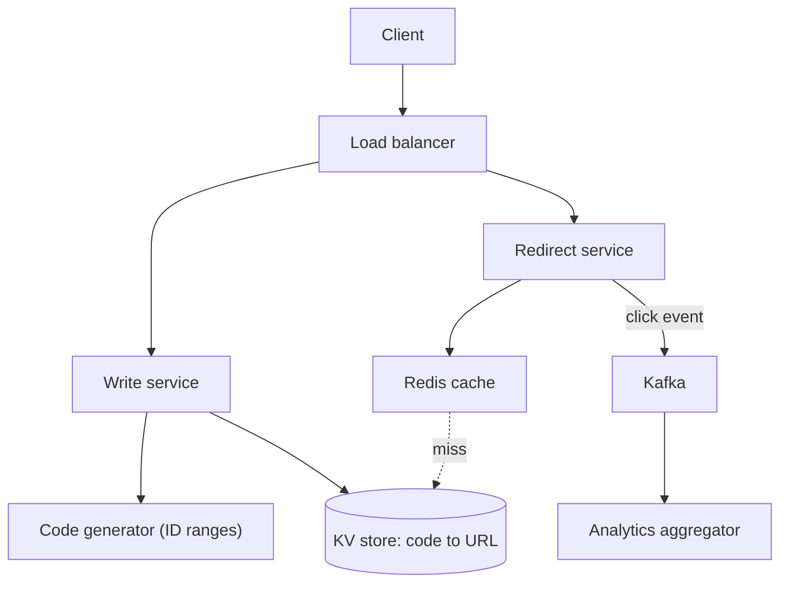

#### Deep dive: generating codes

| Approach | How | Pros | Cons |
|---|---|---|---|
| Hash of URL | MD5/SHA-256 of the URL, base62, take 7 chars | Same URL → same code (natural dedup) | Collisions must be detected and retried; dedup is unwanted if two users want separate stats |
| Counter + base62 | Global counter, encode the number | Unique, no collision check, short | Sequential and guessable; needs a distributed counter |
| Counter ranges | Coordinator (ZooKeeper/DB row) hands each server a block of e.g. 1M IDs | No per-request coordination; server crash only wastes the unused range | Still sequential unless you scramble bits |
| Pre-generated key pool | Offline job creates random unique codes; servers take batches | Random-looking, no collisions at write time | Extra service and storage for the pool |

A common answer: **counter ranges + a reversible bit shuffle** (e.g. multiply by a constant modulo 62^7, or a small Feistel cipher) so codes look random but are still guaranteed unique.

```python
ALPHABET = "0123456789abcdefghijklmnopqrstuvwxyzABCDEFGHIJKLMNOPQRSTUVWXYZ"

def base62(n: int) -> str:
    s = []
    while n:
        n, r = divmod(n, 62)
        s.append(ALPHABET[r])
    return "".join(reversed(s)) or "0"

def new_code(self) -> str:   # each write server holds a range [next_id, range_end) from the coordinator
    if self.next_id == self.range_end:
        self.next_id, self.range_end = coordinator.allocate_range(size=1_000_000)
    n = self.next_id
    self.next_id += 1
    return base62(scramble(n))   # scramble = bijection, so still unique
```

Custom aliases go through a conditional insert (`INSERT ... IF NOT EXISTS` / `attribute_not_exists(code)`) so two users can't claim the same alias.

#### Deep dive: the redirect path

- **301 vs 302**: 301 (permanent) is cached by browsers, so repeat clicks never reach you. That saves load but hides clicks from analytics and makes changing the destination impossible. 302 (or 307) keeps every click visible. Most commercial shorteners use 302 because analytics is the product.
- **Caching**: cache-aside in Redis with a long TTL (mappings almost never change). Also cache negative results (unknown codes) briefly, so scanners hammering random codes don't hit the database.
- **Analytics**: the redirect handler publishes `{code, ts, referrer, ip→country, user agent}` to Kafka fire-and-forget, then returns. A stream processor aggregates counts per code per day. The redirect never waits on analytics.
- **Expiry**: check `expires_at` on read (return 410 Gone) and run a background job to delete expired rows; set the cache TTL to at most the remaining lifetime.

#### Abuse and safety

- Rate-limit link creation per user/IP.
- Scan destination URLs against malware/phishing lists at creation and periodically after (destinations can turn malicious later); disable bad codes.
- Block shortening of your own short URLs (redirect loops).

#### Scaling and failure modes

- The redirect service is stateless: scale horizontally behind the load balancer, deploy in multiple regions with a replicated store.
- If Redis fails, reads fall through to the store; size the store to survive that, or keep a small in-process LRU in each redirect server.
- If the coordinator for ID ranges is down, servers keep working until their current range runs out, which is why ranges are large.
- Losing Kafka loses analytics events, not redirects; that is the right priority.

#### Trade-offs

Random codes avoid enumeration but need collision handling or a key pool; counter ranges are simple and collision-free. A KV store scales simply because every access is by key. 301 reduces load; 302 keeps analytics.

**Common pitfalls**
- Doing a synchronous database write for each click on the redirect path.
- Using an un-scrambled counter, letting anyone enumerate every link.
- Forgetting custom-alias races and reserved words (`/api`, `/login`).

**Likely follow-ups**
- *Same long URL submitted twice?* Either return the existing code (lookup by URL hash index) or create a new one per user; say which and why.
- *How to handle 100x traffic on one viral link?* It's a single hot key: in-process cache on every redirect server plus CDN caching of the 302 with a short TTL.
- *How long can codes stay 7 characters?* 3.5 trillion codes at 1.2B/year lasts thousands of years.

</details>

### 2. Design a distributed rate limiter.

<details>
<summary>Answer</summary>

**In short:** Put rate-limit middleware in the API gateway (or a sidecar) that, for every request, atomically checks and updates a counter in a shared Redis cluster keyed by `rule:client:window`, using a token bucket or sliding-window counter implemented as a Lua script. Allowed requests pass through; others get `429` with `Retry-After`. Rules come from a config service and are hot-reloaded. If Redis is unreachable, most APIs fail open and sensitive ones (login, OTP) fail closed.

#### Requirements

- Limit requests per user / API key / IP per time window (e.g. 100/min), with different rules per endpoint and plan (free vs paid).
- Overhead under ~1–2 ms; accurate across hundreds of gateway servers; highly available; clear feedback to clients (429 + headers).
- Nice to have: burst allowance, per-region limits, a shadow mode that logs would-be rejections without enforcing.

#### Estimates

Say 1M requests/s across the fleet. Each request is one Redis round trip, so the counter store must handle ~1M ops/s: a Redis cluster with tens of shards. Memory is small: a few hundred bytes per active key × tens of millions of active clients ≈ a few GB.

#### Where to put it

| Location | Pros | Cons |
|---|---|---|
| Client side | Free | Can't be trusted |
| API gateway / edge | One place, rejects early, protects all services | Gateway must know client identity |
| Per-service middleware / sidecar | Service-specific rules | Duplicated logic across services |

Usually the gateway, with the limiter as a library plus a shared store.

#### Algorithms

| Algorithm | Idea | Memory | Burst behaviour |
|---|---|---|---|
| Fixed window | `INCR key:minute`, reject over N | 1 counter | Allows 2N at a window boundary |
| Sliding log | Sorted set of timestamps | One entry per request | Exact, expensive |
| Sliding window counter | Weighted mix of current and previous window counts | 2 counters | Close to exact, cheap |
| Token bucket | Bucket refills at rate r up to capacity b; each request takes a token | 2 values | Allows bursts up to b |
| Leaky bucket | Queue drains at a fixed rate | Queue | Smooths bursts entirely |

See also [algorithms](05-load-balancing-proxies-gateways.md). Token bucket is the usual default: it expresses both a sustained rate and a burst size.

#### High-level design

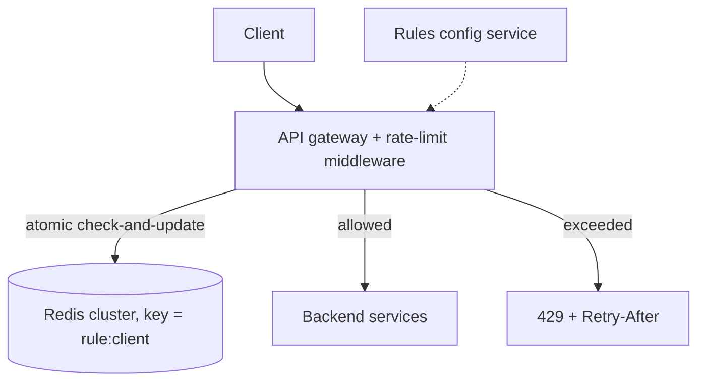

#### Deep dive: atomicity

Two gateway servers reading "99", both allowing, and both writing "100" lets 101 requests through. The read-check-update must be one atomic operation. Redis runs Lua scripts atomically, so a token bucket looks like this:

```lua
-- KEYS[1] = bucket key; ARGV = capacity, refill_per_ms, now_ms, cost
local b = redis.call('HMGET', KEYS[1], 'tokens', 'ts')
local cap, rate, now, cost = tonumber(ARGV[1]), tonumber(ARGV[2]), tonumber(ARGV[3]), tonumber(ARGV[4])
local tokens = tonumber(b[1]) or cap
local ts = tonumber(b[2]) or now
tokens = math.min(cap, tokens + (now - ts) * rate)   -- refill since last call
local allowed = tokens >= cost
if allowed then tokens = tokens - cost end
redis.call('HSET', KEYS[1], 'tokens', tokens, 'ts', now)
redis.call('PEXPIRE', KEYS[1], math.ceil(cap / rate) * 2)  -- idle buckets disappear
return { allowed and 1 or 0, tokens }
```

For a fixed window, `INCR` then `EXPIRE` on first increment is enough. Use the Redis server time (or pass a consistent clock) to avoid clock skew between gateways.

#### Deep dive: latency and scale

- Shard keys across the Redis cluster by client ID; all of one client's keys should land on one shard (hash tags) so a script touches one node.
- For extreme QPS, keep a **local token bucket per gateway** and sync with Redis every few hundred ms, or give each of N gateways 1/N of the limit. Much faster, slightly inaccurate. Many large systems accept that.
- Hot clients (one key getting huge traffic) can be throttled locally first: once a gateway knows a client is over the limit, it rejects locally until the window resets without calling Redis.

#### Multi-region

Options: independent limits per region (simple, a client spread across regions gets more), or asynchronously replicated counters (approximately global). Strictly global limits need a cross-region round trip per request, which is rarely worth it.

#### Failure modes

- **Redis down or slow**: use a tight timeout (a few ms). Fail open for normal APIs (an outage of the limiter shouldn't become an outage of the product), fail closed for sensitive endpoints like login attempts and OTP sends, where abuse costs money or security.
- **Config service down**: gateways keep the last known rules.
- **Thundering herd after 429s**: return `Retry-After` and expect well-behaved clients to back off with jitter.

#### Client response

```
HTTP/1.1 429 Too Many Requests
Retry-After: 12
X-RateLimit-Limit: 100
X-RateLimit-Remaining: 0
X-RateLimit-Reset: 1732099212
```

#### Trade-offs

A central Redis is accurate but adds a hop and a dependency; local limits are fast but approximate. Token bucket allows bursts; leaky bucket smooths them. Rejecting (429) protects the backend; queueing delays requests but keeps them.

**Common pitfalls**
- Non-atomic get-then-set.
- Rate-limiting by IP only (NAT and mobile carriers put many users behind one IP).
- Forgetting key TTLs, so memory grows forever.

**Likely follow-ups**
- *Rate limiting vs load shedding?* Rate limiting is per client fairness; load shedding drops work when the whole server is overloaded, regardless of client.
- *How to limit by cost, not count?* Token bucket with `cost` per request (e.g. expensive search = 10 tokens).
- *Why not just use the load balancer's limits?* Fine for IP limits; per user/plan limits need identity, which the gateway has after auth.

</details>

### 3. Design a unique ID generator in a distributed system.

<details>
<summary>Answer</summary>

**In short:** Use a Snowflake-style generator: each node builds a 64-bit ID from a 41-bit millisecond timestamp, a 10-bit machine ID and a 12-bit per-millisecond sequence. IDs are unique without any per-ID coordination, roughly time-sorted (good for indexes and feeds), and each node can produce ~4 million per second. The hard parts are assigning machine IDs safely and handling clocks that go backwards. If 128 bits are acceptable, UUIDv7 gives similar ordering with zero setup.

#### Requirements

- Unique across all servers and data centres, forever.
- 64-bit numeric (fits a `BIGINT`, cheap to index and send).
- Roughly time-sortable, so newer rows sort after older ones.
- High rate (10K+/s per node) with no central bottleneck or single point of failure.

#### Options

| Option | How | Pros | Cons |
|---|---|---|---|
| DB auto-increment | One database sequence | Simple, dense, ordered | Bottleneck and single point of failure |
| Multi-master step | Server k of N issues k, k+N, k+2N... | No coordination | Adding servers changes N; ordering breaks |
| UUID v4 | 122 random bits | Zero coordination | 128-bit, random, poor B-tree locality, not sortable |
| UUIDv7 / ULID | 48-bit ms timestamp + random bits | Time-ordered, zero setup | 128-bit |
| Ticket server / range allocation | Central service hands out blocks of 1,000 IDs | Short numeric IDs | Central dependency (mitigated by big blocks); order only within a block |
| Snowflake | Timestamp + machine + sequence | 64-bit, sortable, no per-ID coordination | Needs machine IDs and sane clocks |

#### Snowflake layout

`1 sign bit | 41 bits timestamp (ms since custom epoch, ~69 years) | 10 bits machine ID (1,024 machines, often 5 datacentre + 5 worker) | 12 bits sequence (4,096 per ms per machine)`

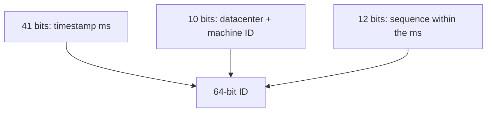

Putting the timestamp in the high bits is what makes IDs sort by time.

```java
public synchronized long nextId() {
    long now = System.currentTimeMillis() - EPOCH;
    if (now < lastTs) {
        // clock moved backwards: wait it out or fail, never reuse old timestamps
        throw new IllegalStateException("Clock moved back " + (lastTs - now) + " ms");
    }
    if (now == lastTs) {
        sequence = (sequence + 1) & 0xFFF;          // 12 bits
        if (sequence == 0) {                         // 4,096 used this ms
            while ((now = System.currentTimeMillis() - EPOCH) <= lastTs) { /* spin */ }
        }
    } else {
        sequence = 0;
    }
    lastTs = now;
    return (now << 22) | (machineId << 12) | sequence;
}
```

#### Deep dives

- **Machine IDs**: two nodes with the same machine ID will create duplicates, so assignment must be safe. Options: static config per host, or lease an ID from ZooKeeper/etcd on startup (ephemeral node, released when the process dies). In Kubernetes, a StatefulSet ordinal is a simple source.
- **Clock going backwards** (NTP step, VM migration): refuse to generate until the clock catches up (fine for small jumps), or keep using `lastTs` and the sequence until real time passes it; alert on large jumps. Run NTP in slew mode to avoid steps.
- **Sequence overflow**: more than 4,096 IDs in one ms on one node → wait for the next ms.
- **Ordering**: IDs are **k-sorted**: ordered by time across machines only to within clock skew; within one machine they are strictly increasing.
- **Information leak**: IDs reveal creation time and rough volume. If that matters for public IDs, expose an encrypted/opaque version.

#### Failure modes and scaling

The generator is usually a library inside each service, so there's no network call and nothing to fail except the clock and ID lease. If the lease service is down, already-running nodes continue; only new nodes can't start. Scale is linear in the number of machine IDs; if 1,024 isn't enough, rebalance the bit split (fewer sequence bits, more machine bits).

#### Trade-offs

Snowflake gives compact, sortable IDs with no per-ID coordination but depends on clock sanity and machine-ID management. Range allocation gives dense numbers but a central dependency. UUIDv7 needs nothing and is time-ordered; pick it when 128 bits are fine.

**Likely follow-ups**
- *Why not UUIDv4 as a primary key?* Random inserts scatter across the B-tree, causing page splits and poor cache hit rates; time-ordered IDs append at the end.
- *Can IDs be strictly increasing across the system?* Only with a single sequencer (or consensus), which costs throughput and availability.
- *What happens after 69 years?* Choose a recent custom epoch; by then you'll have migrated anyway.

</details>

### 4. Design a distributed key-value store (like DynamoDB / Cassandra).

<details>
<summary>Answer</summary>

**In short:** Partition keys over nodes with consistent hashing (virtual nodes for balance), replicate each key to N nodes, and let any node coordinate a request using quorums (write to W, read from R; W + R > N gives read-your-latest-write in the normal case). Handle failures with hinted handoff, read repair and Merkle-tree anti-entropy; detect membership with gossip; store data on each node in an LSM tree. State the CAP choice explicitly: this Dynamo-style design is AP with tunable consistency.

#### Requirements

- `put(key, value)`, `get(key)`, `delete(key)`; values up to ~1 MB.
- Huge scale (TBs–PBs), low single-digit-ms latency, high availability (always writable), tunable consistency, automatic scaling, tolerate node and rack failures.

#### Estimates

Example: 10 TB of data × replication factor 3 = 30 TB; with ~2 TB usable per node that's ~15–20 nodes before headroom. 1M ops/s across 20 nodes = 50K ops/s per node, which an LSM engine on SSDs handles.

#### API

```
put(key, value, context?, consistency=QUORUM)
get(key, consistency=ONE|QUORUM|ALL) → value(s) + context (version info)
delete(key)  → writes a tombstone
```

#### High-level design

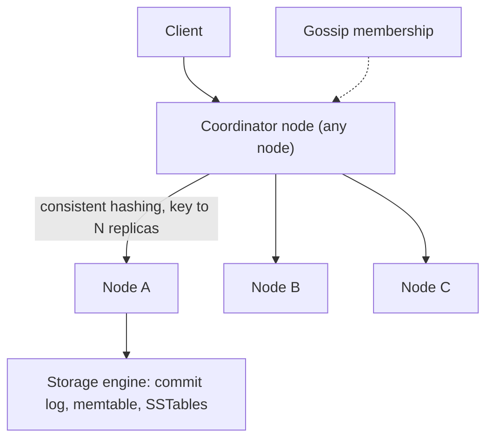

#### Partitioning

Hash each key onto a ring; a node owns the range up to its token, and the key is stored on the next N distinct nodes clockwise (its **preference list**). **Virtual nodes** (each physical node owns many small ranges) spread load evenly and let a new node take a little from everyone rather than half from one neighbour. Replicas are placed on different racks/AZs.

#### Replication and quorums

With N = 3: a write goes to all 3 replicas and succeeds after W acks; a read asks replicas and returns after R responses.

| Setting | Behaviour |
|---|---|
| W=1, R=1 | Fastest, may read stale data |
| W=2, R=2 (quorum) | R + W > N: read set overlaps the latest write set |
| W=3, R=1 | Fast reads, writes fail if any replica is down |

**Sloppy quorum**: if a preferred replica is down, write to the next healthy node with a hint, keeping writes available. That breaks the strict overlap guarantee, which is why Dynamo-style systems are still "eventually consistent" even at quorum.

#### Versioning and conflicts

Concurrent writes to the same key on different replicas can conflict.
- **Last-write-wins (LWW)** by timestamp (Cassandra): simple, but silently drops one write and depends on clocks.
- **Vector clocks** (original Dynamo): detect truly concurrent versions and return them as siblings for the application to merge (the shopping cart example).
- **CRDTs**: data types (counters, sets) that merge automatically.

#### Failure handling

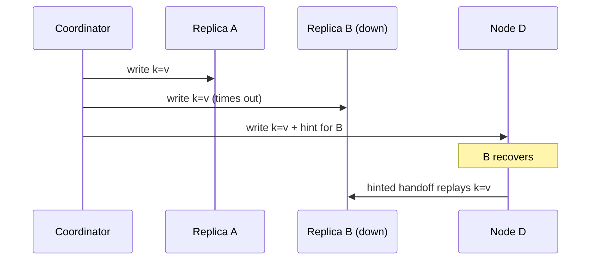

- **Hinted handoff** covers short outages.
- **Read repair**: when a read sees replicas disagree, the coordinator writes the newest version back to stale ones.
- **Anti-entropy**: replicas compare **Merkle trees** of their key ranges and transfer only differing subtrees, fixing long-term divergence cheaply.
- **Membership/failure detection**: gossip spreads who is up and who owns which tokens; a phi-accrual detector decides suspicion. Permanent removal is an explicit admin action to avoid churn on flaps.

#### Storage engine (per node)

LSM tree: append the write to a **commit log** (durability), insert into an in-memory **memtable**, flush full memtables to immutable sorted **SSTables**, and **compact** SSTables in the background. Reads check the memtable then SSTables newest-first, using **Bloom filters** to skip files that can't contain the key. Deletes write **tombstones** that compaction removes after a grace period (long enough for repair to propagate them, or deleted data reappears).

#### Scaling

Add a node → it takes ownership of some virtual-node ranges and streams that data from current owners; no global reshuffle. Hot partitions (one popular key) are the main limit: mitigate with caching in front or key salting.

#### Trade-offs

AP design (always writable, eventually consistent, conflicts possible) vs CP (consensus per partition, e.g. Raft groups as in TiKV or Spanner-style systems: strongly consistent, but a partition without a majority can't accept writes). Under PACELC, Dynamo-style also trades consistency for latency even without partitions (PA/EL).

**Likely follow-ups**
- *How do you support range scans?* Range partitioning instead of hashing (keys stay ordered), at the cost of hot spots on sequential keys.
- *Why do deleted values come back?* A replica missed the tombstone and the tombstone was compacted away before repair ran.
- *How does DynamoDB differ from the Dynamo paper?* Publicly described: DynamoDB uses leader-based replication per partition (Multi-Paxos), giving strongly consistent reads as an option, rather than leaderless sloppy quorums.

</details>

### 5. Design a distributed cache (like Redis Cluster / Memcached at scale).

<details>
<summary>Answer</summary>

**In short:** Split the key space across many in-memory nodes (hash slots or consistent hashing), let clients route directly using a cached slot map (or through a proxy), and give each shard a primary plus async replicas with automatic failover. Each node is a hash table with a memory limit, LRU/LFU eviction and lazy-plus-sampled TTL expiry. The interesting deep dives are hot keys, cache stampedes, keeping the cache consistent with the database, and resharding without downtime.

#### Requirements

- `get`, `set` (with TTL), `delete`; optionally richer types (counters, lists, sets).
- Sub-millisecond latency, millions of ops/s, TBs of total memory.
- High availability; eviction when full; online scaling.
- It's a cache: losing a few recent writes on failover is acceptable, serving wrong data for a long time is not.

#### Estimates

Example: 2 TB of hot data, 64 GB usable per node (leave headroom for fragmentation and replication buffers) → ~32 primaries, plus one replica each = 64 nodes. 5M ops/s ÷ 32 shards ≈ 150K ops/s per primary, comfortable for Redis on one core.

#### High-level design

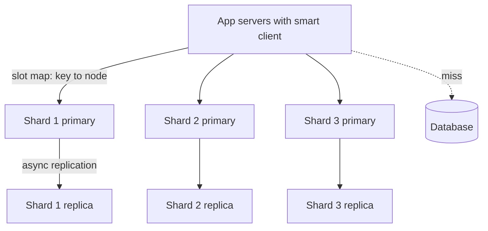

#### Partitioning and routing

- **Hash slots** (Redis Cluster): `CRC16(key) mod 16384` gives a slot; each node owns a set of slots. Moving a slot moves only its keys.
- **Consistent hashing** (Memcached clients, mcrouter): keys on a ring with virtual nodes.
- **Routing**: smart clients cache the slot map and talk to the right node directly (one hop). A **proxy** (Twemproxy, Envoy, mcrouter) keeps clients simple and pools connections, at the cost of an extra hop.

#### Node internals

- In-memory hash table; values in a memory allocator tuned against fragmentation (Memcached uses slab classes).
- **Eviction** when `maxmemory` is reached: approximate LRU or LFU by sampling a few keys and evicting the best candidate (cheaper than a perfect LRU list).
- **TTL**: lazy expiry (check on access) plus a periodic job that samples keys with TTLs and deletes expired ones, so memory is reclaimed even for keys no one reads.

#### Replication and failover

Primaries replicate asynchronously to replicas. Nodes gossip health; if a majority of primaries agree one is down, a replica is promoted and the slot map updated. Because replication is async, writes acknowledged just before the crash can be lost. That's acceptable for a cache, and the reason not to treat it as the system of record.

#### Deep dive: hot keys

One celebrity key can saturate one shard. Fixes: a small **in-process cache** (a few seconds TTL) in each app server; **replicate the hot key** under several names (`key#1..key#8`) and read a random copy; read from replicas for that key. Detect hot keys by sampling client-side or with server-side key stats.

#### Deep dive: stampedes and consistency

- **Cache stampede**: a popular key expires and thousands of requests miss at once and hammer the DB. Use **single-flight** (one request recomputes while others wait, e.g. a short lock key), **stale-while-revalidate** (serve the old value while one request refreshes), and **jittered TTLs** so keys don't expire together.
- **Consistency with the DB**: the standard pattern is cache-aside: read from the cache, on miss load from the DB and set; on write, update the DB then **delete** the cache key (not set, which races). A remaining race (a slow reader re-populating an old value) is narrowed with short TTLs, versioned values, or Meta-style **leases**.
- **Invalidation at scale**: tail the DB change log (CDC) and delete affected keys; publicly described example: Meta's mcsqueal reads MySQL binlogs to send invalidations to memcache across regions.

#### Resharding

Add a node, then migrate slots one at a time: keys move in the background; a client asking the old node for a migrated key gets `MOVED` (update your map) or `ASK` (mid-migration, try the new node once). No downtime.

#### Persistence (optional)

Snapshots (RDB) and an append-only file (AOF) allow warm restarts. Without them, a restart means a cold cache and a DB load spike, so restart nodes one at a time and warm critical keys.

#### Failure modes

| Failure | Effect | Mitigation |
|---|---|---|
| One node down | Its keys miss until failover | Replicas + fast failover; DB sized for some miss traffic |
| Whole cache down | DB overwhelmed | Circuit breaker, load shedding, gradual warm-up |
| Network partition | Split-brain writes on old primary | Primary stops accepting writes when it can't reach the majority |

#### Trade-offs

Async replication is fast but can lose writes. Proxies simplify clients but add latency. Bigger nodes mean fewer to manage but longer recovery. Memcached (multi-threaded, simple values) vs Redis (rich types, persistence, single-threaded command execution per node).

**Likely follow-ups**
- *Write-through vs cache-aside?* Write-through keeps the cache fresh but caches data that may never be read; cache-aside only caches what's read.
- *Why delete instead of update on writes?* Two concurrent writers can set the cache in the opposite order to the DB; delete is idempotent.
- *How to cache across regions?* A cache per region, with invalidations replicated from the primary DB region.

</details>

### 6. Design a web crawler.

<details>
<summary>Answer</summary>

**In short:** A crawler is a loop: take a URL from the **frontier**, fetch it politely, store the raw page, parse it, extract and normalise links, drop ones already seen, and push new ones back into the frontier. The frontier has priority queues (what to crawl next) feeding per-host queues (how fast to hit each site). At billions of pages, the hard parts are politeness, URL and content deduplication, DNS, spider traps and deciding when to recrawl.

#### Requirements

- Crawl billions of pages for a search index; recrawl periodically to stay fresh.
- **Politeness**: obey `robots.txt` and limit requests per host.
- Avoid duplicate URLs and duplicate content; prioritise important and frequently changing pages.
- Robust to traps, slow servers and malformed HTML; horizontally scalable; resumable after crashes.

#### Estimates

| Quantity | Value |
|---|---|
| Pages | 1B/month ≈ **400 pages/s** (peak ~1,000) |
| Size | ~100 KB per page → **~40 MB/s**, ~100 TB/month raw (less compressed) |
| URL-seen set | Tens of billions of URLs × ~8-byte fingerprint ≈ hundreds of GB |

#### High-level design

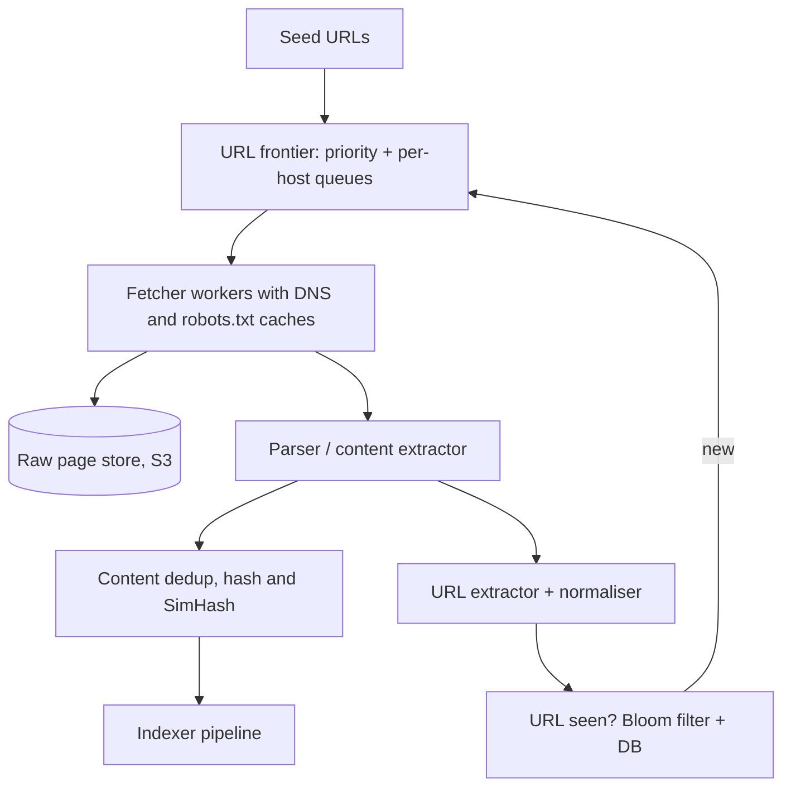

#### Deep dive: the URL frontier

The frontier answers two questions: what's most important, and is it polite to fetch this host now?

- **Front queues** by priority (link-based importance like PageRank, domain quality, how stale the copy is). A prioritiser assigns each URL to a queue; selection is biased toward high-priority queues.
- **Back queues**, one per host. Each host's queue is served by one worker, with a minimum delay between requests (e.g. a few seconds, or `Crawl-delay` from robots.txt). A min-heap keyed by "earliest next fetch time" per host tells workers which host is ready.
- The frontier is too big for memory: keep queue heads in memory and spill the rest to disk (or a DB / Kafka partitions).

#### Deep dive: deduplication

- **URL-level**: normalise first (lowercase host, drop fragments, sort/strip tracking query params, resolve relative paths), then check a **Bloom filter** (fast, may give false positives = skip a few new URLs) backed by a persistent set of URL fingerprints.
- **Content-level**: exact duplicates via a hash of the content (mirrors, `http` vs `https`); near-duplicates via **SimHash** (fingerprints whose Hamming distance is small) or **MinHash**. Roughly a third of the web is duplicated, so this saves a lot of indexing.

#### Deep dive: fetching

- **DNS** is a hidden bottleneck (resolver calls can take tens to hundreds of ms): run a local caching resolver and resolve ahead of fetch.
- **robots.txt** fetched per host, cached for ~a day.
- Timeouts, max page size, limited redirects, conditional GETs (`If-Modified-Since`, `ETag`) to skip unchanged pages.
- **Rendering**: JavaScript-heavy pages need a headless browser. That's 10–100x more expensive, so render only where the static HTML is clearly incomplete.

#### Spider traps

Infinite calendars (`/2026/11/21`, `/2026/11/22`...), session IDs in URLs, and auto-generated links can produce unlimited URLs. Defences: cap URL length and path depth, cap pages per host per crawl cycle, detect repeating path segments, and lower priority for hosts that produce mostly near-duplicates.

#### Recrawl policy

Track how often each page changed over past visits. Recrawl news homepages every few minutes to hourly, stable pages monthly. Sitemaps (with `lastmod`) give hints.

#### Distribution and failure

- Partition the frontier **by host hash** across crawler nodes, so each host's politeness state lives on one node and needs no coordination.
- Workers are stateless; checkpoint the frontier regularly so a crash loses minutes of work, not the crawl.
- A slow or dead host only blocks its own queue, not others.

#### Trade-offs

Breadth-first finds important pages early; priority queues do it better. Bloom filters save memory but occasionally skip a URL. Rendering everything gives complete content but costs too much. Freshness vs coverage is a budget decision.

**Likely follow-ups**
- *How to avoid hammering a site that's hosted on one IP with many hostnames?* Apply politeness per IP as well as per host.
- *How do you crawl only part of the web (e.g. news)?* A focused crawler: score links by topic relevance and drop low-scoring ones.
- *How to handle pages that change every second?* Don't chase them: cap recrawl frequency per page.

</details>

### 7. Design a notification system (push, SMS, email).

<details>
<summary>Answer</summary>

**In short:** Internal services call one Notification API with a recipient, template and idempotency key. The API checks user preferences and rate limits, renders the template, and enqueues a message onto **per-channel, per-priority queues**. Channel workers send through APNs/FCM, SMS and email providers with retries and backoff, record delivery status, and clean up invalid device tokens. Separate queues keep a marketing blast from delaying a one-time password, and dedup keys stop users getting doubles from retries.

#### Requirements

- **Functional:** send via push (APNs/FCM), SMS, email and in-app; templates with localisation; user preferences and opt-outs; scheduling ("9 am local time"); delivery tracking (sent, delivered, opened, clicked).
- **Non-functional:** millions of notifications per minute at peak (marketing campaigns); priorities (OTP and security alerts ≫ social ≫ marketing); at-least-once delivery with no visible duplicates; respect provider rate limits; legal compliance (unsubscribe, quiet hours).

#### Estimates

10M push + 1M SMS + 5M email per day average, but campaigns cause bursts like 10M in 10 minutes ≈ 17K/s. Provider throughput, not your servers, is the usual limit.

#### API

```
POST /v1/notifications
{
  "idempotencyKey": "order-123-shipped",
  "userIds": ["u42"],
  "template": "order_shipped",
  "params": { "orderId": "123" },
  "channels": ["push", "email"],      // or let preferences decide
  "priority": "high",
  "sendAt": "2026-11-21T09:00:00"     // optional, user's local time
}
```

#### Data model

- `device_tokens(user_id, token, platform, app_version, last_seen)`.
- `preferences(user_id, category, channel, enabled)`, `quiet_hours`, timezone.
- `templates(name, locale, channel, body, version)`.
- `notifications(id, user_id, channel, status, provider_msg_id, created_at, ...)`, large and append-heavy, so a wide-column store or partitioned table with a TTL.

#### High-level design

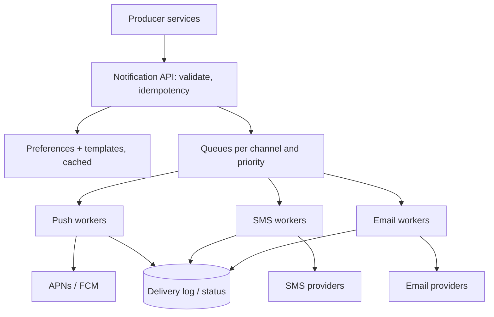

#### Deep dives

- **Queues per channel and priority**: if SMS providers are slow, push isn't affected; if a campaign enqueues 10M marketing emails, the OTP queue has its own workers. Kafka topics or SQS queues work.
- **Fan-out**: a campaign to "all users in segment X" is expanded by a batch job that streams user IDs into the queues gradually, not as one giant API call.
- **Reliability**: at-least-once processing (retry with exponential backoff and jitter); dedupe on `idempotencyKey + user + channel` in a fast store with a TTL so retries don't send twice; DLQ after max attempts; fallback channel for critical messages (push failed → SMS).
- **Device tokens**: APNs/FCM tell you when a token is invalid (app uninstalled); delete it. Users have several devices, so send to all active tokens.
- **User protection**: per-user caps per day, quiet hours (hold until morning), and **digesting** ("5 people liked your post") to reduce noise.
- **Templates & i18n**: a template service renders with the user's locale and fallbacks.
- **Scheduling**: "9 am local time" for a global audience = bucket users by timezone and release each bucket from a delayed queue/scheduler when its local time arrives.
- **Tracking**: providers send delivery webhooks; email opens via tracking pixel, clicks via redirect links; events into the analytics pipeline. Honour unsubscribe immediately (legal requirement for marketing email).

#### Failure modes

| Failure | Handling |
|---|---|
| Provider outage | Circuit breaker; switch to a secondary provider for critical channels |
| Provider rate limit (429) | Token-bucket per provider in workers; back off |
| Worker crash mid-send | Message redelivered; dedup key prevents a double send in most cases |
| Preference service down | Use cached preferences; if unknown, skip marketing but send critical |

Note that "exactly once" to a user can't be guaranteed: if the provider accepted the message but the ack was lost, a retry may duplicate. Dedup reduces this to rare cases.

#### Trade-offs

Third-party providers are the bottleneck and failure point; multiple providers add cost and complexity. Strict per-user limits reduce annoyance but can drop useful messages, so critical categories bypass them.

**Likely follow-ups**
- *How do in-app notifications differ?* Stored in a per-user inbox table and delivered over the app's existing WebSocket or on next open; no third party.
- *How to guarantee OTP latency?* Dedicated high-priority queue and workers, provider failover, short TTL (an OTP after 5 minutes is useless).
- *How to measure success?* Delivery rate, open/click rate per template, opt-out rate after sends.

</details>

### 8. Design search autocomplete (typeahead).

<details>
<summary>Answer</summary>

**In short:** Precompute suggestions offline: aggregate query logs into counts with time decay, build a **trie where every node stores its top-k completions**, and load it into memory on a fleet of autocomplete servers. A lookup is then just walking the prefix (O(length)) and returning the stored list, so it fits a ~100 ms budget even at hundreds of thousands of QPS. Add client debouncing and CDN caching for short prefixes, a streaming job for trending queries, and light personalisation on top.

#### Requirements

- Return the top 5–10 suggestions for a prefix as the user types, end-to-end within ~100 ms.
- Ranked by popularity, with freshness (trending) and some personalisation.
- Filter offensive, unsafe or personal content.
- Billions of searches/day; suggestions refreshed daily, trending within minutes.

#### Estimates

10B searches/day; an average query is ~20 characters, but clients debounce (~100–150 ms) so maybe 5 requests per search → 50B/day ≈ **600K QPS**, much of it served by client and CDN caches. Unique queries worth suggesting: say 100M × ~50 bytes plus top-k lists → tens of GB, which fits in memory, sharded or replicated.

#### API

```
GET /v1/suggest?q=how%20to%20b&lang=en&region=US&limit=8
→ { "suggestions": ["how to boil eggs", "how to be happy", ...] }
```

#### High-level design

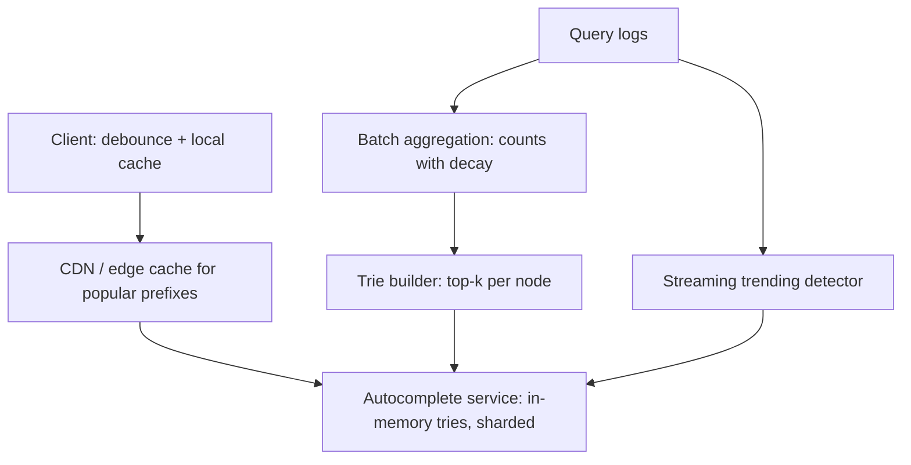

#### Deep dive: the data structure

A plain trie would need a subtree walk to find the most popular completions under "s", which is huge. Instead, each node **caches the top-k completions for its prefix**:

```
root
 └─ "h" top: [hotmail, how to tie a tie, ...]
     └─ "ho" top: [hotmail, how to tie a tie, home depot, ...]
         └─ "how" top: [how to tie a tie, how old is ..., ...]
```

Lookup = follow the characters of the prefix, return the node's list. Memory cost: k entries per node, so store references/IDs rather than strings, and only keep nodes for prefixes that matter (prune rare branches). An alternative is a sorted list of queries with a prefix range scan plus a precomputed top-k per short prefix; same idea.

#### Deep dive: building it

1. Query logs → batch job (Spark) counts each normalised query with **exponential time decay** (yesterday counts more than last month).
2. Filter: offensive terms, low-count queries (also protects privacy: a query typed by one person shouldn't be suggested), legal removals.
3. Build tries per language/region; serialise to a file; servers **load the new version and atomically swap** the pointer. No in-place mutation, no locks on the read path.

#### Deep dive: serving and scale

- **Sharding**: if the trie fits on one machine, **replicate** it everywhere (simplest). If not, shard by prefix range, balanced by traffic, not alphabet ("s" is huge, "x" is tiny); a routing table maps prefix ranges to shards.
- **Caching**: 1–3 character prefixes are extremely hot and identical for everyone in a region: cache at the CDN for minutes. The client also caches results and reuses them (typing "how t" after "how" can filter the earlier list locally).
- **Trending**: a streaming job (Flink/Kafka Streams) counts queries in short windows, detects spikes vs baseline, and injects them into a small overlay merged at query time.
- **Personalisation**: blend in the user's recent searches (stored client-side or in a small per-user store) in a light re-ranking step; keep it cheap so latency stays low.

#### Failure modes

A failed autocomplete must never break search: the client simply shows nothing. Servers keep serving the last good trie if a build fails; validate a new build (size, sample lookups) before swapping it in.

#### Trade-offs

Precomputed top-k = fast reads but stale until the next build and more memory. Replicating the whole trie is simple but limits size. CDN caching is huge for short prefixes but can't personalise.

**Likely follow-ups**
- *How to handle typos?* Fuzzy matching (edit distance within 1) on longer prefixes, or a spelling-correction step; costs latency, so apply selectively.
- *How to remove a harmful suggestion immediately?* A blocklist checked at serve time, not just at build time.
- *Why debounce?* It cuts requests several-fold with no visible delay.

</details>

### 9. Design a distributed job scheduler (like cron at scale).

<details>
<summary>Answer</summary>

**In short:** Store jobs in a sharded database with an index on `next_run_at`. Scheduler nodes each own some partitions (via leases in etcd/ZooKeeper), poll for due jobs, **atomically claim** each run, and push it to a priority queue. Workers execute runs, heartbeat while running, and report results; a reaper retries runs whose heartbeat stopped. Recurring jobs compute their next `next_run_at` when a run is scheduled. Because true exactly-once execution is impossible across failures, aim for at-least-once delivery plus idempotent jobs keyed by a run ID.

#### Requirements

- Schedule one-off jobs ("at 10:00") and recurring jobs (cron expressions); cancel/update; priorities; timeouts; retries with backoff; job history and status.
- Each scheduled run executes once (effectively), on time (within seconds).
- Millions of jobs, horizontally scalable, no single point of failure, per-tenant fairness.

#### Estimates

10M jobs, average once per hour → ~3K runs/s average, with spikes at round times (top of the hour can be 10–50x average because everyone writes `0 * * * *`).

#### API

```
POST   /v1/jobs   { name, schedule: "0 */5 * * *" | runAt, payload, timeoutSec, maxRetries, priority }
GET    /v1/jobs/{id}/runs
DELETE /v1/jobs/{id}
```

#### Data model

```sql
jobs(job_id PK, tenant_id, schedule, payload, next_run_at, status, priority, timeout_sec, max_retries)
  INDEX (shard, next_run_at)               -- find due jobs fast
runs(run_id PK, job_id, scheduled_for, status, attempt, worker_id, heartbeat_at, started_at, finished_at, error)
```

#### High-level design

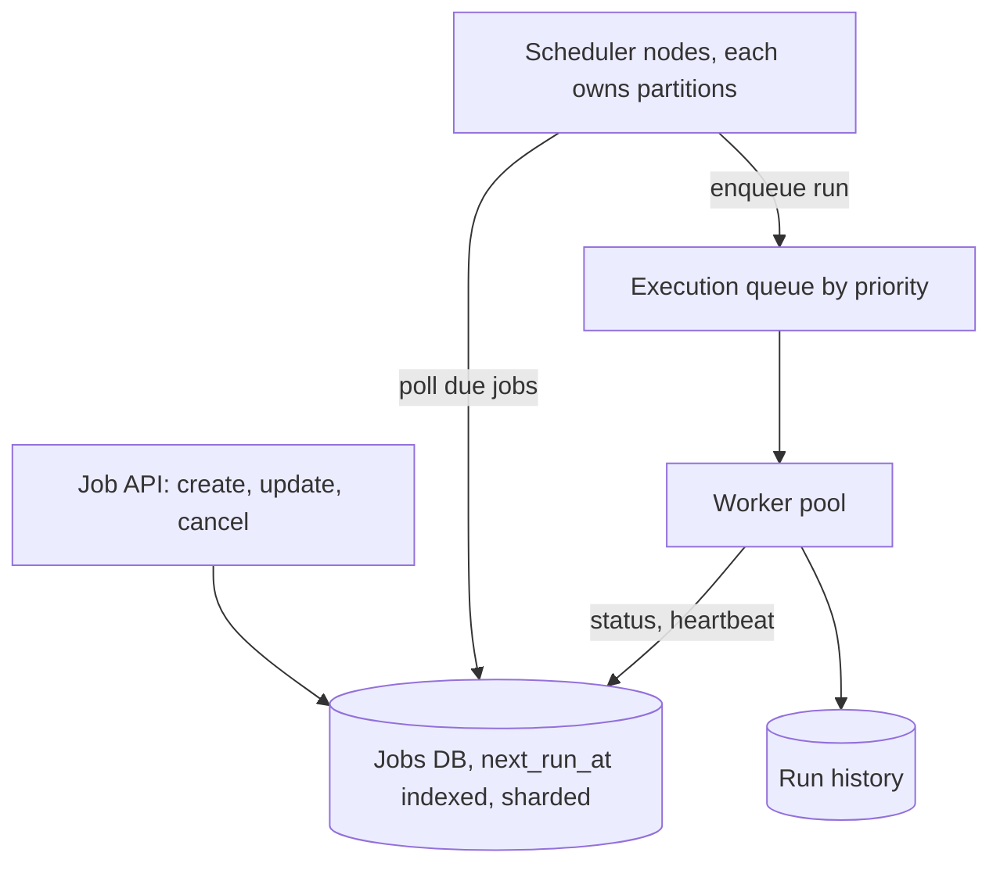

#### Run lifecycle

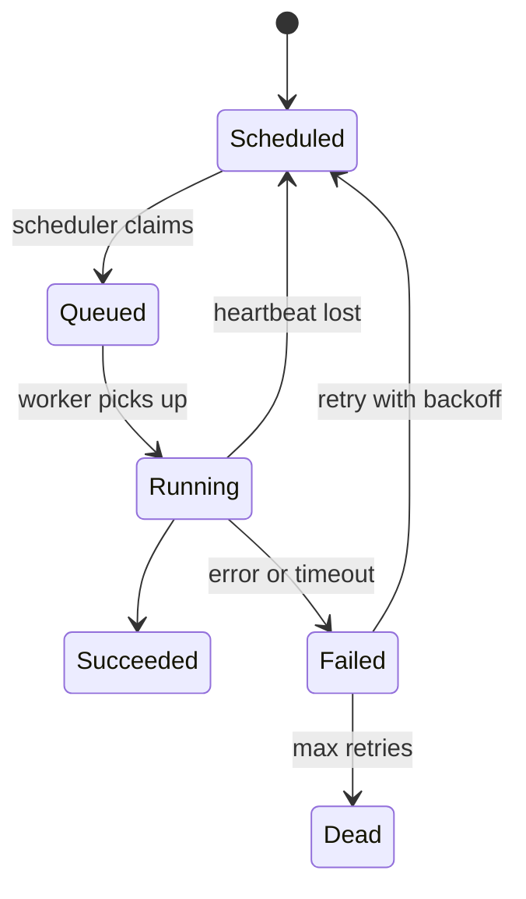

#### Deep dive: finding due jobs

- Each scheduler holds a **lease** on a set of partitions; if it dies, the lease expires and another node takes over. This avoids two schedulers firing the same job.
- Poll `WHERE shard IN (...) AND next_run_at <= now() ORDER BY next_run_at LIMIT 500` every second.
- For very high rates, use **time buckets**: a Redis sorted set scored by run time (`ZRANGEBYSCORE ... now`), or an in-memory **timing wheel** loaded with the next few minutes of jobs.

#### Deep dive: claiming exactly once

```sql
-- Option 1: conditional update; only one scheduler/worker wins
UPDATE runs SET status = 'RUNNING', worker_id = :me, heartbeat_at = now()
WHERE run_id = :id AND status = 'QUEUED';      -- check rows affected = 1

-- Option 2: workers pull directly from the table
SELECT run_id FROM runs
WHERE status = 'QUEUED' ORDER BY priority, scheduled_for
LIMIT 10 FOR UPDATE SKIP LOCKED;               -- concurrent workers skip each other's rows
```

The claim guarantees only one worker *starts* a run. A worker can still crash after doing the work but before reporting success, and the run will be retried. So jobs must be **idempotent**: pass the `run_id` to the job, and have it check "already done for this run_id?" before side effects.

#### Failures

- **Worker dies**: heartbeats stop; a reaper finds `RUNNING` runs with stale `heartbeat_at` and reschedules them (incrementing `attempt`).
- **Timeouts**: kill runs that exceed `timeout_sec`.
- **Retries**: exponential backoff with jitter; after `max_retries`, mark dead and alert the owner.
- **Scheduler dies**: partitions move to another node after the lease expires (seconds of delay).
- **Downtime catch-up**: when the scheduler recovers, decide per job whether to run missed occurrences or only the latest (a "misfire policy").

#### Recurring jobs

When run N is enqueued, compute the next occurrence from the cron expression (in the job's timezone, careful with DST) and update `next_run_at` in the same transaction. That way a crash can't lose or double the next occurrence.

#### Scale and fairness

Shard jobs by `job_id` hash; add schedulers to take partitions. Per-tenant quotas so one tenant's million jobs at midnight don't starve others; separate worker pools for long-running jobs; spread `0 * * * *` jobs with a small random offset if the semantics allow.

#### Trade-offs

Polling a DB is simple and durable but adds latency and load; in-memory timing wheels are precise but need recovery from the DB. Strict exactly-once is not achievable; at-least-once + idempotency is the honest answer.

**Existing tools**: Airflow (DAG workflows, batch), Temporal (durable workflows with retries and state), Kubernetes CronJobs, Quartz (clustered via a DB).

**Likely follow-ups**
- *How to support job dependencies (DAGs)?* Store edges; a run becomes `QUEUED` only when all upstream runs succeeded.
- *How accurate is the timing?* Seconds, bounded by poll interval and queue depth; sub-second needs timing wheels.
- *What about clock skew between schedulers?* Use the database's `now()` as the single clock.

</details>

### 10. Design a distributed message queue (like Kafka).

<details>
<summary>Answer</summary>

**In short:** Model each topic as a set of **partitions**, each an append-only, replicated log stored as segment files on brokers. Producers batch messages and pick a partition by key (which gives per-key ordering). Each partition has a leader and followers; a write is committed once all in-sync replicas have it. Consumers **pull** by offset and commit their position per consumer group; a coordinator assigns partitions to group members. Sequential disk I/O, the OS page cache, batching and zero-copy sends are what make it fast; partitions are the unit of scale.

#### Requirements

- Producers publish to named topics; multiple independent consumer groups each read every message; within a group, each message is handled by one consumer.
- Durable: no loss after an acknowledged write, survives broker failure.
- High throughput (millions of messages/s), low latency (ms), ordering per key, configurable retention (days, or forever with compaction), replay from any offset, horizontal scale.

#### Estimates

1M messages/s × 1 KB = 1 GB/s ingest; × replication factor 3 = 3 GB/s of disk writes cluster-wide. At ~100–200 MB/s per broker disk set, that's 15–30 brokers. 7-day retention: 1 GB/s × 604,800 s × 3 ≈ 1.8 PB.

#### API

```
produce(topic, key, value, headers) → (partition, offset)
poll(group, topics) → batch of records
commit(group, partition → offset)
seek(partition, offset | timestamp)    // replay
```

#### High-level design

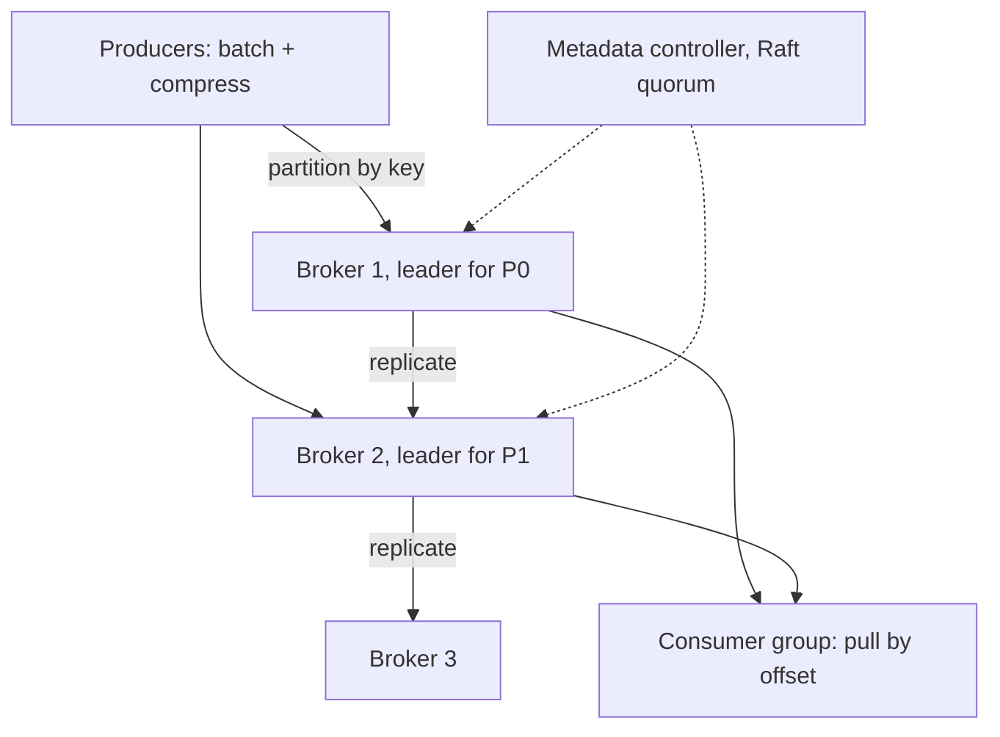

#### Deep dive: storage

Each partition is a directory of **segment files** (e.g. 1 GB each). Writes only ever append to the active segment, which is sequential I/O, fast even on HDDs. A sparse **offset index** maps offsets to file positions, and a time index maps timestamps to offsets for "replay from 9 am". Reads of recent data come from the OS **page cache**, and the broker uses **zero-copy** (`sendfile`) to move bytes from cache to socket without copying through user space. Retention simply deletes whole old segments. **Log compaction** is an alternative retention mode: keep only the latest value per key, which turns a topic into a changelog/table.

#### Deep dive: replication

- Each partition has a **leader** (handles reads/writes) and followers that fetch from it.
- The **in-sync replica set (ISR)** is the followers that are caught up. With `acks=all`, the leader acknowledges a write once every ISR member has it; the **high watermark** is the last offset replicated to the whole ISR, and consumers only see up to it.
- `min.insync.replicas=2` with RF=3 means a write fails (instead of silently being under-replicated) if only the leader is left.
- On leader failure, the **controller** (in modern Kafka, a Raft quorum (KRaft) that stores metadata) elects a new leader from the ISR, so no committed message is lost. Electing an out-of-sync replica ("unclean election") trades data loss for availability.

#### Deep dive: consumers

- **Pull** model: consumers fetch batches at their own pace, so slow consumers don't overwhelm and fast ones can batch heavily.
- A **group coordinator** assigns each partition to exactly one consumer in a group; when members join/leave, it **rebalances** (cooperative/incremental rebalancing avoids stopping everyone).
- Committed offsets are stored in an internal compacted topic.
- Max parallelism in a group = number of partitions.

#### Delivery semantics

| Semantics | How |
|---|---|
| At-most-once | Commit offset before processing |
| At-least-once | Process, then commit (default choice; consumers must be idempotent) |
| Exactly-once (within the system) | Idempotent producer (producer ID + sequence numbers, broker drops duplicates) + transactions that atomically write outputs and commit input offsets |

Exactly-once doesn't extend to external side effects (sending an email); those still need idempotency keys.

#### Ordering

Guaranteed only within a partition. Same key → same partition → ordered. Changing the partition count changes the key mapping, so plan partition counts up front for keyed topics.

#### Scaling and failure modes

- Add partitions and brokers; move partitions with a reassignment tool (copies data, then switches leadership).
- **Broker failure**: leaders for its partitions move to ISR followers within seconds.
- **Slow follower**: removed from the ISR so it doesn't block writes; rejoins when caught up.
- **Consumer lag**: monitor lag per group; scale consumers up to the partition count.
- **Poison message**: consumer retries forever; route it to a retry topic / DLQ after N attempts.

#### Trade-offs

Pull vs push (pull handles slow consumers and batching better; push has lower latency for small volumes). More partitions = more parallelism but more open files, more metadata, longer failovers. `acks=1` is faster but can lose writes on leader failure. A log (Kafka) keeps messages for replay; a traditional queue (RabbitMQ, SQS) deletes them on ack and supports per-message routing, priorities and delays more easily.

**Likely follow-ups**
- *How do you implement delayed messages?* Not native to a log; use per-delay topics or an external scheduler that publishes when due.
- *Why is Kafka fast despite writing to disk?* Sequential appends, page cache, batching, compression and zero-copy.
- *How to keep tiered costs down for long retention?* Tiered storage: old segments move to object storage, brokers keep only recent ones.

</details>

### 11. Design a metrics monitoring and alerting system (like Datadog / Prometheus).

<details>
<summary>Answer</summary>

**In short:** Agents or scrapers collect metrics (name + labels + value + timestamp) from every host and send them through ingestion gateways into a Kafka buffer. From there they go into a **time-series database** sharded by series, built on compressed, time-partitioned blocks with an inverted index on labels, and into a **rule evaluator** that fires alerts to an alert manager (dedupe, group, route to PagerDuty/Slack). Old data is downsampled and moved to object storage. The two problems that dominate are high write volume with **label cardinality**, and making alerting **more reliable than the systems it watches**.

#### Requirements

- Collect metrics from hundreds of thousands of hosts and services (counters, gauges, histograms).
- Store time series with labels; dashboards for the last hour must be fast, last year possible.
- Alert rules evaluated within ~1 minute of the data; notifications with dedupe, grouping, silences and escalation.
- Millions of data points per second; retention with downsampling; multi-tenant quotas.

#### Estimates

100K hosts × 1,000 series each = 100M active series; one sample every 10 s → **10M samples/s**. Raw at 16 bytes/sample = 160 MB/s; Gorilla-style compression brings it to ~1.5 bytes/sample → ~15 MB/s, ~1.3 TB/day before replication. Raw retention of 15 days ≈ 20 TB; rollups are much smaller.

#### Data model

A **series** is identified by metric name + label set: `http_requests_total{service="checkout", method="POST", status="500"}`. A **sample** is `(timestamp, float value)`. Every unique label combination is a separate series, which is why cardinality matters.

#### High-level design

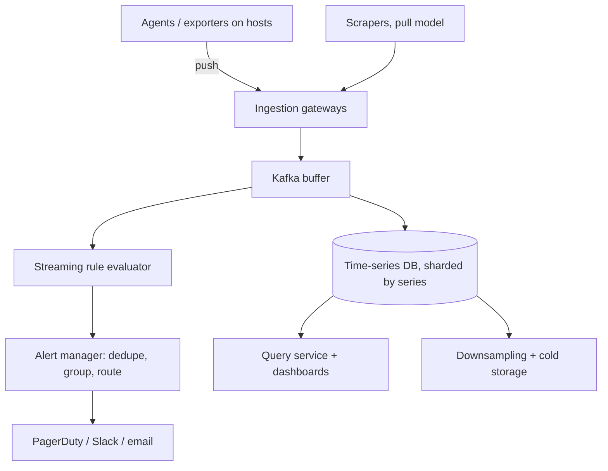

#### Deep dive: push vs pull

| | Pull (Prometheus) | Push (StatsD, Datadog agent, OTLP) |
|---|---|---|
| Health signal | A failed scrape means the target is down | Silence is ambiguous |
| Load control | Server controls the rate | Clients can flood you |
| Short-lived jobs | Can be missed | Natural fit |
| Firewalls / NAT | Server must reach targets | Targets only need outbound access |

Both are common; large systems often pull locally and push (remote-write) to a central store.

#### Deep dive: storage

- Samples arrive in time order per series, so append to an in-memory **head block** per series, with a write-ahead log for crash safety.
- **Gorilla compression**: timestamps stored as delta-of-delta (regular 10 s intervals compress to a bit or two), values XORed with the previous value (slowly changing values have few significant bits).
- Every couple of hours, the head is flushed to an immutable **block** for that time range; blocks are later compacted into bigger ones.
- An **inverted index** maps each `label=value` to the list of series IDs, so `{service="checkout", status="500"}` is a posting-list intersection.
- Shard by hash of series ID across ingesters, replicate ×3 (Cortex/Mimir style), store blocks in object storage.

#### Deep dive: cardinality

Adding a `user_id` label to a metric with a million users creates a million series, each with memory and index cost. Defences: reject or drop high-cardinality labels at ingestion, per-tenant series limits, and cardinality dashboards so teams see their usage. Per-user data belongs in logs/traces, not metrics.

#### Downsampling and retention

Raw data for ~2 weeks, 1-minute rollups (min, max, sum, count per interval, so averages and maxima stay correct) for months, 1-hour rollups for a year or more, all in object storage (Thanos, Cortex, Mimir). The query layer picks the right resolution for the time range.

#### Deep dive: alerting

- Rules like `rate(http_errors[5m]) / rate(http_requests[5m]) > 0.05 for 5m`; evaluate every 15–60 s on recent data (in memory or from the streaming path).
- The `for` clause avoids flapping on brief spikes.
- **Alert manager**: dedupe repeated firings, group related alerts (one page for "20 hosts down in AZ-1", not 20 pages), silences during maintenance, inhibition (if the datacentre is down, suppress per-host alerts), routing and escalation by team.
- **Reliability**: the alerting path must be more available than what it monitors: separate deployment, replicated evaluators (dedupe at the alert manager), and **meta-monitoring** (a "dead man's switch" alert that should always fire; if it stops arriving, the pipeline is broken).

#### Failure modes

- Ingestion overload → Kafka buffers; shed low-priority tenants; never drop alert-critical metrics first.
- Ingester crash → WAL replay plus replicas.
- Query of death (a dashboard over a year at full resolution) → query limits, timeouts, result caching, split queries by time.

#### Trade-offs

Pull vs push; raw retention vs cost; strict per-tenant limits vs flexibility. A dedicated TSDB is far more efficient than storing metrics in a general database, but metrics are aggregates: they tell you *that* something is wrong, logs and traces tell you *why*.

**Likely follow-ups**
- *Why histograms rather than averages?* Averages hide tail latency; histograms let you compute p99 across hosts.
- *How do you alert on "no data"?* An `absent()`-style rule, since a dead service sends nothing.
- *Why buffer through Kafka?* It absorbs bursts and lets storage and alerting consume independently.

</details>

### 12. Design Pastebin.

<details>
<summary>Answer</summary>

**In short:** It's a URL shortener whose payload is large. Generate a unique short key (counter ranges + base62, or random with a collision check), store the **paste content in object storage** (S3) and the small **metadata** (key, owner, size, expiry, visibility) in a key-value or SQL database. Reads look up metadata (cached) and serve the immutable content through a CDN. Expiry is lazy on read plus background deletion; abuse controls (size limits, rate limits, scanning) matter because anyone can upload text.

#### Requirements

- **Functional:** create a paste (text up to ~10 MB) and get a short link; optional expiry, visibility (public, unlisted, private), syntax highlighting, title; view raw; delete by owner.
- **Non-functional:** read-heavy (~10:1 or more), low read latency, durable (pastes don't disappear before expiry), links not guessable for unlisted pastes.

#### Estimates

| Quantity | Value |
|---|---|
| New pastes | 1M/day ≈ **12 writes/s** |
| Reads | 10M/day ≈ 120/s average, spikes when a paste goes viral |
| Average size | ~10 KB → **10 GB/day**, ~3.6 TB/year |
| Metadata | ~200 B × 1M/day → small; fits easily in a KV store |

#### API

```
POST   /v1/pastes  { content, title?, language?, expiresIn?, visibility } → 201 { key, url }
GET    /{key}           → HTML page with highlighting
GET    /raw/{key}       → text/plain content
DELETE /v1/pastes/{key} (owner)
```

#### Data model

```sql
pastes(
  key           VARCHAR(10) PRIMARY KEY,
  owner_id      BIGINT NULL,
  object_key    TEXT,          -- location in object storage (may be a content hash)
  size_bytes    INT,
  language      VARCHAR(32),
  visibility    VARCHAR(10),   -- public | unlisted | private
  created_at    TIMESTAMP,
  expires_at    TIMESTAMP NULL
)
```

#### High-level design

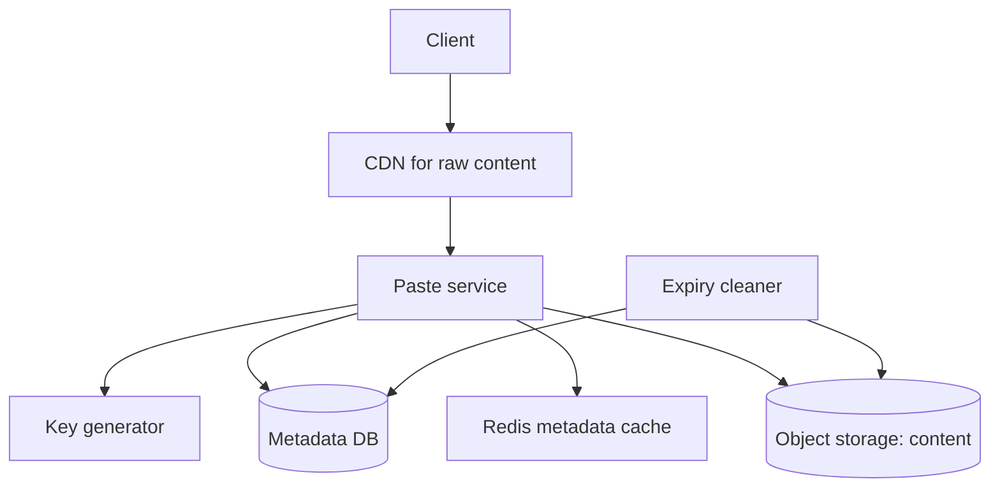

#### Write path

1. Validate size and rate limits; optionally scan for malware links or leaked secrets.
2. Generate a key, same options as the [URL shortener](#1-design-a-url-shortener-like-bitly--tinyurl). Unlisted pastes need **random, long-enough** keys (e.g. 8+ chars) so they can't be guessed or enumerated.
3. Upload content to object storage (or have the client upload directly via a presigned URL for large pastes), then write metadata. Writing content first means a crash leaves only an orphan object (cleaned later), never metadata pointing to nothing.

#### Read path

Look up metadata (Redis cache for hot keys), check expiry and visibility, then return content. Because pastes are **immutable**, the raw content can be served from a CDN with long cache lifetimes; the HTML view can render highlighting client-side so the server just serves the text. Private pastes skip the public CDN cache (or use signed URLs).

#### Other deep dives

- **Expiry**: lazy check on read (return 404/410) plus a background job that deletes expired metadata and objects; object-storage lifecycle rules can expire objects by prefix/date. Remember to purge CDN entries for deleted pastes.
- **Dedup**: identical content can share one stored object keyed by its content hash; then deletes need reference counting, so many systems skip dedup unless storage cost matters.
- **Abuse**: rate limits, size limits, scanning for credentials/malware, a report and takedown flow.

#### Scaling and failure modes

Stateless app servers; the metadata DB is small; object storage scales by itself. A viral paste is a hot key absorbed by the CDN. If the metadata cache fails, the DB handles the modest load. Object storage outages are the main risk for reads, mitigated by CDN caching and cross-region replication for important data.

#### Trade-offs

Content in the database is simpler for small pastes (one read) but bloats the DB; object storage is cheaper and CDN-friendly. A hybrid stores tiny pastes (< a few KB) inline in metadata and large ones in object storage.

**Likely follow-ups**
- *Difference from the URL shortener?* The payload is large, so storage tiering and CDN delivery matter more than redirect latency.
- *How to support edits?* Create a new version object and point metadata at it (keeps immutability, enables history).
- *How to count views?* Async events to an analytics pipeline, as in the URL shortener.

</details>

### 13. Design a content delivery network (CDN).

<details>
<summary>Answer</summary>

**In short:** A CDN is a global set of **points of presence (PoPs)** full of cache servers. Users are routed to the nearest healthy PoP by **anycast** or **latency-based DNS**; inside a PoP, URLs are spread over cache servers with consistent hashing. Misses go to a regional **shield** cache and only then to the origin, with request coalescing so the origin sees about one request per object. A control plane pushes configuration, TLS certificates and purges to every PoP. The CDN cuts latency, offloads the origin and absorbs DDoS traffic.

#### Requirements

- Serve static and cacheable content (images, video segments, JS/CSS, cacheable API responses) from locations near users worldwide.
- Reduce origin load and bandwidth; high availability; TLS termination; purge/invalidation within seconds; per-customer config (cache rules, headers); DDoS resilience; logs and analytics.

#### Estimates

Example: 100 Tbps peak egress across ~200 PoPs, so busy PoPs serve hundreds of Gbps each. Cache hit ratio is the key number: going from 90% to 95% halves origin traffic.

#### High-level design

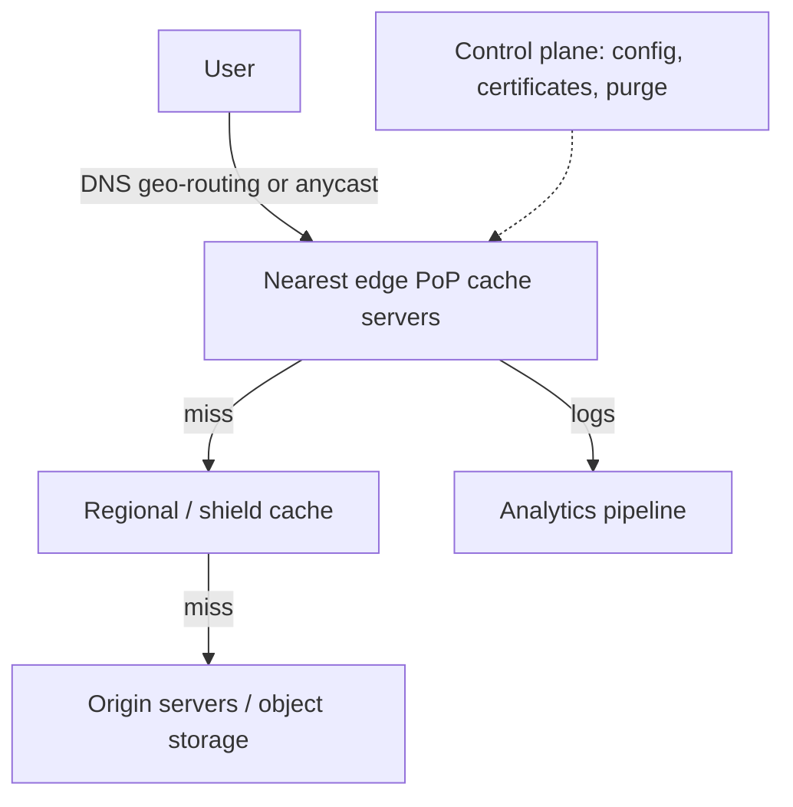

#### Deep dive: routing users

| Method | How | Pros | Cons |
|---|---|---|---|
| Anycast | Every PoP announces the same IP via BGP; the network delivers to the "closest" one | Fast failover (withdraw the route), good for DDoS absorption | BGP closeness isn't always latency closeness |
| DNS-based | Authoritative DNS returns a PoP IP based on the resolver's location and live latency/health data | Fine-grained control, load-aware | DNS caching delays failover; resolver may be far from the user (EDNS Client Subnet helps) |

#### Deep dive: cache hierarchy

Edge → regional shield → origin. Without a shield, 200 PoPs missing the same object would hit the origin 200 times; with it, the origin sees roughly one. **Request coalescing** at each layer means 10,000 concurrent misses for a new video segment become a single upstream fetch while the others wait.

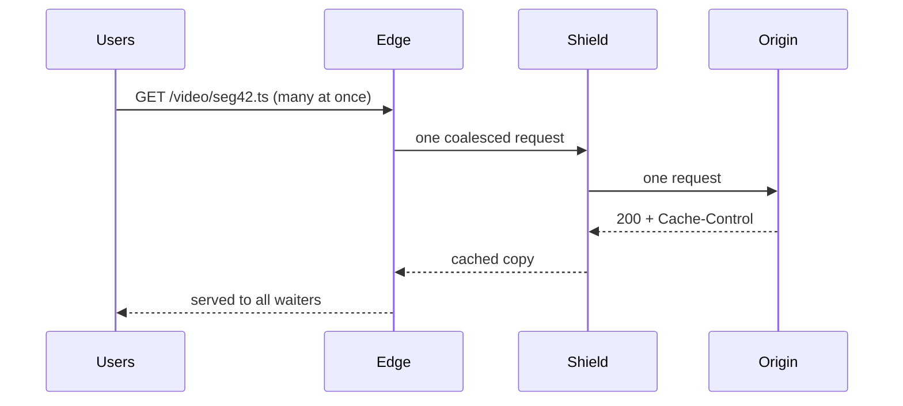

#### Inside a PoP

A load balancer spreads connections; URLs are mapped to cache servers by **consistent hashing**, so each object is stored on one (or a few, for popular items) servers rather than duplicated everywhere. RAM holds the hottest objects, SSDs the long tail. Eviction is LRU-like with admission policies (don't let one-hit wonders push out popular objects).

#### Cache keys and rules

- Key = host + path + selected query params + headers listed in `Vary` (e.g. `Accept-Encoding`). Including unnecessary parts (tracking params, cookies) destroys hit ratio.
- TTL from `Cache-Control: max-age / s-maxage`, overridable by customer rules; `stale-while-revalidate` and `stale-if-error` keep serving while refreshing or when the origin fails.
- Range requests for large files and video.

#### Invalidation

Purge by URL, prefix or tag/surrogate key, pushed from the control plane to all PoPs; it's eventually consistent within seconds. The better practice is **versioned file names** (`app.3f9a1c.js`) with long TTLs, so new content is a new URL and purges are rarely needed.

#### Security and protocols

TLS terminated at the edge with certificates (and private keys) distributed securely, or kept in a key server for customers who don't share keys; HTTP/2 and HTTP/3 (QUIC) to users; persistent, warmed connections to origins. WAF and bot rules can run at the edge too.

#### Failure modes

- **PoP failure**: withdraw anycast routes or stop returning it in DNS; traffic shifts to neighbours.
- **Origin down**: serve stale content (`stale-if-error`), show a cached error page.
- **DDoS**: huge distributed capacity, anycast spreads attack traffic across PoPs, SYN cookies and rate limits at the edge.
- **Bad config push**: stage config rollouts across PoPs, as a global bad push can take down everything at once.

#### Trade-offs

More PoPs = lower latency but lower hit ratio per PoP (traffic is split); shields raise hit ratio but add a hop on misses. Long TTLs help hit ratio but make freshness depend on purges or versioning.

**Likely follow-ups**
- *How does a CDN help dynamic content?* TLS termination near the user, connection reuse to origin, route optimisation, and short-TTL caching of semi-dynamic responses.
- *Push vs pull CDN?* Pull fetches on first miss (common); push uploads content ahead of time (good for large planned releases).
- *How are logs handled at this volume?* Batched and shipped asynchronously from each PoP into a streaming pipeline.

</details>

### 14. Design a distributed logging system (like ELK / Splunk).

<details>
<summary>Answer</summary>

**In short:** Agents on every host tail logs, add metadata (service, host, trace ID), batch and compress them, and ship them to Kafka, which absorbs spikes. Stream processors parse, enrich, redact PII and drop noise, then write to a searchable store for recent data (Elasticsearch/OpenSearch, ClickHouse, or label-indexed Loki) using time-partitioned indices, while older data moves to cheap object storage. A query/alerting layer sits on top. Since logs are one of the largest observability costs, structured logging, sampling and retention tiers are part of the design, not an afterthought.

#### Requirements

- Collect logs from thousands of services and hosts (and containers that come and go).
- Search recent logs within seconds of being written (by service, time, level, trace ID, free text).
- Retain hot data for days to weeks, cold data for months to years (audit/compliance).
- Alerts on error patterns; no log loss under normal failures; access control and PII protection; cost control.

#### Estimates

5,000 services × ~200 lines/s = 1M lines/s × ~500 bytes = **500 MB/s ≈ 43 TB/day raw**. Compression gives 5–10x; full-text indexing can add as much as it saved. Those numbers are why sampling and tiering matter.

#### High-level design

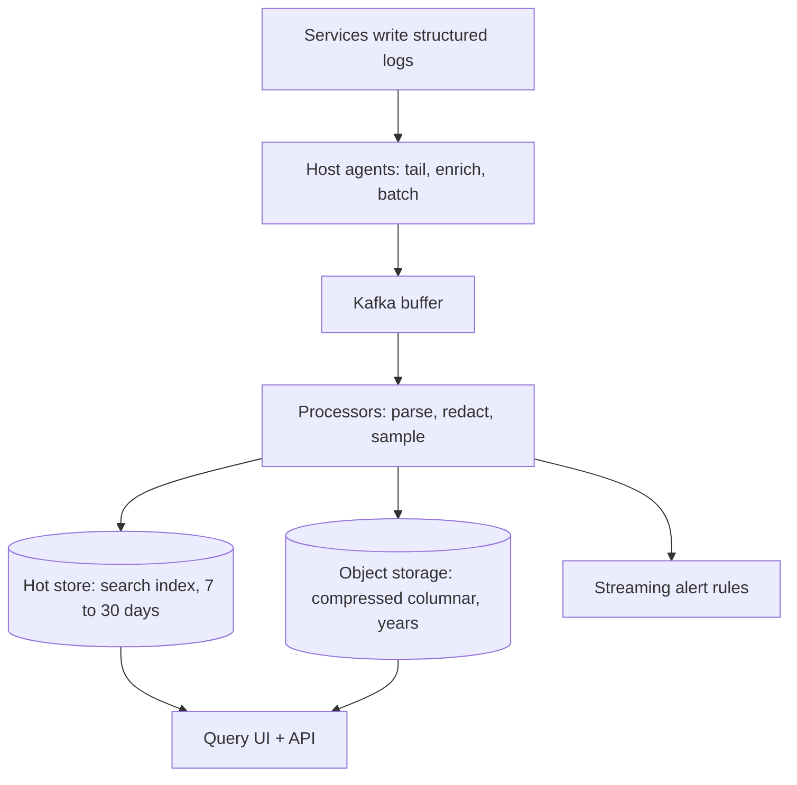

#### Deep dives

- **Collection**: agents (Fluent Bit, Vector, OpenTelemetry Collector) run as a daemon per host/node, read files or container stdout, attach metadata (service, pod, region, version), batch and compress, and keep a **local disk buffer** so a backend outage doesn't lose logs or block the app.
- **Structured logs**: JSON with consistent fields (`ts`, `level`, `service`, `trace_id`, `msg`) are cheap to query; free-text parsing with regexes is expensive and fragile.
- **Buffer**: Kafka decouples ingestion from indexing: if the index cluster is slow or being upgraded, logs queue up instead of being dropped. Partition by service so one noisy service doesn't block others' ordering.
- **Processing**: parse, enrich (geo from IP, team owner), **redact PII and secrets** before storage, drop or sample noisy debug logs, and route by tenant.

#### Deep dive: storage choices

| Store | Indexing | Strength | Weakness |
|---|---|---|---|
| Elasticsearch / OpenSearch | Full-text inverted index | Fast arbitrary search | Expensive storage and memory |
| ClickHouse (columnar) | Sparse primary index + skip indexes | Very cheap, fast aggregations | Free-text search slower |
| Loki | Only labels indexed; chunks of compressed text | Very cheap | Grep-like scans over chunks for text search |

All of them partition **by time** (daily indices or partitions): queries almost always filter by time range, and deleting old data becomes dropping a whole partition. After the hot window, data rolls to **object storage** in a compressed columnar format (e.g. Parquet), queryable on demand by a query engine for audits and incident forensics.

#### Query and alerting

Search UI with saved queries and dashboards; alerts on error-rate thresholds or specific patterns evaluated on the stream (cheaper than repeatedly querying the store). Linking **trace IDs** across logs and traces lets an engineer jump from a slow trace to its logs.

#### Failure modes

- **Backend down**: agent disk buffers + Kafka retention ride it out.
- **Log storm** (a service logging in a tight loop): per-service rate limits and quotas at the agent or processor; drop with a counter rather than starve everyone.
- **Index cluster hot spot**: shard by time and service; avoid one giant index for everyone.

#### Trade-offs

Full-text indexing is fast to query but costly; label-only indexing is cheap but slower for needle-in-haystack searches. Sampling saves money but may drop the one line you needed (never sample errors or audit logs). Longer hot retention means faster investigations at higher cost.

**Likely follow-ups**
- *Logs vs metrics vs traces?* Metrics are cheap aggregates for alerting; logs are detailed events; traces show one request's path across services.
- *How to guarantee audit logs aren't lost?* Separate pipeline with acks end to end, write-once storage, no sampling.
- *How to handle multi-tenant access control?* Tag every record with a tenant/team and enforce filters in the query layer.

</details>

### 15. Design an authentication service (login, sessions, SSO, MFA).

<details>
<summary>Answer</summary>

**In short:** Build an OAuth 2.0 / OpenID Connect authorisation server on top of a strongly consistent identity store (users, Argon2id password hashes, MFA factors, linked identities). Login verifies the password with rate limiting and breach checks, then MFA (passkeys/WebAuthn, TOTP, SMS as last resort) and risk checks. It issues **short-lived signed access tokens** (JWTs verified locally by services using a published JWKS) and **server-side refresh tokens** with rotation and reuse detection; browsers use secure HttpOnly session cookies. Because everything depends on auth, it must be multi-region and keep per-request token checks off its own critical path.

#### Requirements

- Sign-up and login with password, social login (Google/Apple) and enterprise SSO (SAML/OIDC).
- Multi-factor authentication; sessions across web and mobile; token issuance for first- and third-party APIs.
- Account recovery; logout everywhere; brute-force and credential-stuffing protection.
- Very high availability and low latency (if auth is down, everything is down); full audit trail.

#### Estimates

100M users, 10M daily logins ≈ 120/s average, peaks of thousands/s (morning, app releases). Token refreshes are more frequent (every ~15 minutes per active session) → maybe 10K/s. Token verification happens on every API call, which is millions/s, so it must not call the auth service.

#### Data model

```sql
users(user_id PK, email UNIQUE, email_verified, status, created_at)
credentials(user_id, type, hash, params, updated_at)          -- Argon2id hash + salt/params
mfa_factors(factor_id, user_id, type, secret_or_public_key, created_at)
identities(provider, provider_subject, user_id)               -- linked Google/SAML accounts
refresh_tokens(token_hash PK, user_id, device_id, family_id, expires_at, revoked)
audit_events(user_id, event, ip, device, ts)
```

#### High-level design

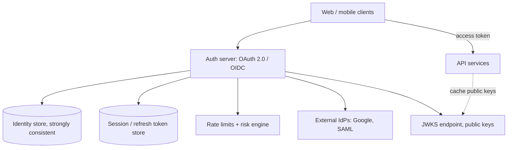

#### Login flow

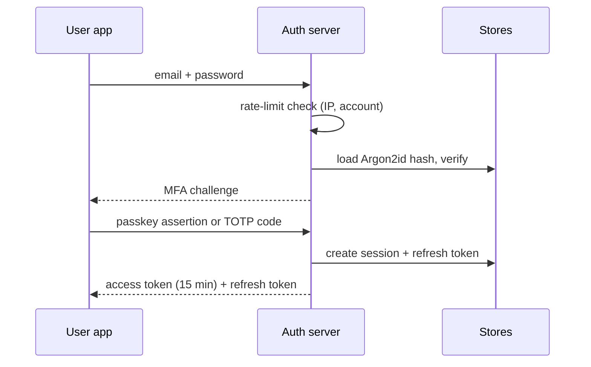

#### Deep dives

- **Passwords**: Argon2id (or bcrypt/scrypt) with per-user salt, never fast hashes. Check new passwords against breached-password lists. Rate-limit by account and by IP, add CAPTCHA or progressive delays, and watch for credential stuffing (many accounts, few attempts each).
- **MFA**: passkeys/WebAuthn are phishing-resistant and the best default; TOTP next; SMS is weakest (SIM swap) and should be a fallback. Risk-based step-up: ask for MFA on a new device, unusual location or sensitive action.
- **Tokens**: access tokens are short-lived (5–15 min) JWTs signed with asymmetric keys; services verify the signature and claims locally using cached public keys from the **JWKS** endpoint, so no call to auth per request. Keys rotate regularly with overlapping validity (`kid` header selects the key).
- **Refresh tokens**: opaque, stored hashed server-side, bound to a device. **Rotation**: each use returns a new refresh token and invalidates the old one; if an old one is reused, assume theft and revoke the whole token family.
- **Revocation**: since JWTs can't be "un-issued", keep them short-lived and revoke refresh tokens/sessions; for urgent cases (account compromise), push a small deny-list of user IDs or token IDs to services.
- **Web sessions**: `HttpOnly; Secure; SameSite=Lax/Strict` cookies, CSRF protection for state-changing requests, session store in Redis for "log out all devices".
- **Mobile**: use the authorisation code flow with **PKCE** in the system browser, store refresh tokens in the Keychain/Keystore.
- **SSO**: SAML or OIDC federation with enterprise identity providers (tenant chosen by email domain); SCIM for automatic user provisioning and deprovisioning.
- **Recovery**: single-use, short-lived reset tokens (hashed in the DB), sent to verified channels; notify the user on password/MFA/email changes; recovery is the most common attack path, so it must be as strong as login.

#### Availability, scale and failure modes

- Local token verification means an auth outage stops new logins and refreshes, not existing API calls (until access tokens expire): an important blast-radius reduction.
- Multi-region deployment; identity data replicated (strong consistency for credential changes, e.g. a primary region with fast failover, or a globally consistent DB).
- Protect the login endpoint itself: it's the main target of bots, so put bot detection and rate limiting in front.
- **Signing key compromise** is the worst case: keys in an HSM/KMS, rotation playbook ready.

#### Trade-offs

JWTs scale (no lookup) but are hard to revoke; opaque tokens are revocable but need introspection calls (cacheable). Longer access-token lifetimes reduce refresh load but widen the window after compromise. Building vs buying (Auth0, Cognito, Keycloak): buying is usually right unless auth is core to your product.

**Likely follow-ups**
- *Authentication vs authorisation?* Authentication proves who you are; authorisation decides what you may do (scopes, roles, policies), often in a separate service.
- *Where to store tokens in a browser?* HttpOnly cookies rather than localStorage (XSS can read localStorage).
- *How to log out everywhere?* Revoke all refresh tokens/sessions for the user; access tokens expire within minutes.

</details>

### 16. Design a feature flag / remote configuration service.

<details>
<summary>Answer</summary>

**In short:** A control plane (UI/API backed by a versioned, audited database) lets teams define flags with targeting rules. Every change produces a new versioned, compiled ruleset that is published to a fast delivery layer: CDN-hosted JSON or a streaming endpoint (SSE) that pushes updates. SDKs in services and apps keep the ruleset **in memory and evaluate flags locally** (deterministic hashing of the user ID for percentage rollouts), persist the last good config to disk, and fall back to code defaults. A flag check is then a function call, and the system keeps working when the flag service is down.

#### Requirements

- Create flags (boolean, multivariate, JSON config) with targeting rules: percentage rollouts, user segments, regions, app versions, allow-lists.
- Evaluation with **near-zero latency** (no network call per check); changes propagate within seconds.
- Safe when the service is unreachable; kill switches; approvals and full audit history; experiment exposure logging.

#### Estimates

Thousands of flags, ~100 KB–1 MB compiled ruleset per environment. Evaluations are billions per minute, but local, so they cost the flag service nothing. The service only sees: connected SDKs (tens of thousands of servers, millions of mobile clients) fetching or streaming updates, which is small for servers and CDN-scale for mobile.

#### Data model

```json
{
  "version": 1842,
  "flags": {
    "new_checkout": {
      "enabled": true,
      "rules": [
        { "if": { "attr": "country", "in": ["DE", "FR"] }, "serve": "on" },
        { "if": { "attr": "email", "endsWith": "@ourcompany.com" }, "serve": "on" }
      ],
      "rollout": { "on": 10, "off": 90 },
      "default": "off",
      "salt": "new_checkout"
    }
  }
}
```

#### High-level design

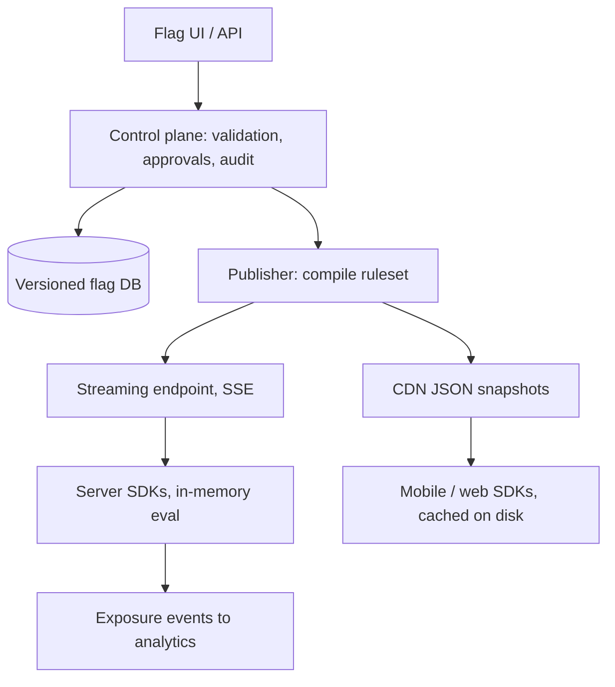

#### Deep dive: local evaluation

```kotlin
fun isEnabled(flag: Flag, user: User): Boolean {
    for (rule in flag.rules) if (rule.matches(user)) return rule.serve == "on"
    // Stable bucketing: same user + same flag always lands in the same bucket.
    val bucket = (murmur3("${flag.salt}:${user.id}") and 0x7fffffff) % 100
    return bucket < flag.rollout.onPercent
}
```

Hashing with a per-flag salt makes rollouts **sticky** (a user at 10% stays in as it grows to 20%) and independent across flags (the same 10% of users aren't in every experiment).

#### Distribution

- **Server SDKs**: hold a streaming connection (SSE/gRPC stream) to receive new versions within seconds; poll as a fallback.
- **Mobile/web**: fetch the snapshot at startup and periodically via CDN (cheap at millions of clients); optionally evaluate server-side for clients to avoid shipping all rules (and secret targeting lists) to the device.
- Every ruleset has a **version**; SDKs report the version in use, which helps debugging ("which hosts still have the old config?").

#### Safety

- Validation and schemas for JSON configs (a malformed config is a classic cause of global outages).
- Staged rollout of config changes themselves (canary environments/regions first), approvals for critical flags.
- **Kill switches** that turn features off instantly; automatic rollback tied to monitoring (if error rate rises after a flag change, revert).
- SDK startup: last-known-good config from disk → code default. Never block app startup waiting on the flag service.

#### Failure modes

| Failure | Behaviour |
|---|---|
| Flag service down | SDKs keep the in-memory/disk config; no new changes until it returns |
| Streaming connection drops | Reconnect with backoff, poll in the meantime |
| Bad config published | Validation rejects it; if it slips through, roll back to previous version |
| New app install offline | Code defaults |

#### Experiments and hygiene

Log an **exposure event** when a user is evaluated into a variant, so A/B analysis compares the right populations. Flags are technical debt: track owners and age, alert on flags fully rolled out for weeks, and remove them from code.

#### Trade-offs

Client-side evaluation is fastest and works offline but exposes rules to clients; server-side evaluation protects rules but needs a call. Streaming is fast but needs persistent connections; polling via CDN is simple and cheap but slower to propagate.

**Likely follow-ups**
- *Feature flags vs config?* Same delivery mechanism; flags are usually temporary booleans, config is long-lived values.
- *Why separate deploy from release?* Code ships dark; turning it on (and off) needs no deploy and takes seconds.
- *How to keep a user's experience consistent across devices?* Bucket by a stable account ID rather than device ID.

</details>

### 17. Design a code deployment system (CI/CD at scale).

<details>
<summary>Answer</summary>

**In short:** On every merge, CI runs hermetic, cached builds and sharded tests, then publishes an **immutable artefact** (e.g. a container image tagged with the commit SHA) to a registry. A deployment orchestrator rolls that same artefact out progressively: canary hosts, then one AZ/region at a time, with **bake time** and automated health checks between waves, and automatic rollback on regressions. Feature flags separate deploying code from releasing features, schema changes follow expand-and-contract so rollback is always safe, and every step is audited.

#### Requirements

- Build and test every change quickly (minutes, even in a large monorepo).
- Produce versioned, immutable artefacts; deploy to thousands of servers across regions safely.
- Detect bad releases automatically and roll back fast; record who deployed what, when.
- Support many services and teams with different pipelines; approvals and deploy freezes for sensitive systems.

#### Estimates

1,000 engineers × a few merges/day ≈ 3K builds/day plus PR builds (often 10x more). Thousands of deploys per day across services. Artefacts of hundreds of MB pushed to tens of thousands of hosts means TBs moved per rollout, so distribution needs caching.

#### High-level design

```mermaid
flowchart TD
    C["Commit / merge"] --> CI["CI: build + tests, parallel, cached"]
    CI --> ART[("Artefact registry: immutable, versioned images")]
    ART --> CD["Deployment orchestrator: pipeline per service"]
    CD --> W1["Wave 1: canary hosts"]
    W1 -->|"health checks pass"| W2["Wave 2: one AZ / region"]
    W2 -->|"pass"| W3["Wave 3: everywhere"]
    MON["Metrics + alarms"] -->|"regression: automatic rollback"| CD
```

#### Deep dive: builds and tests

- **Hermetic builds** (pinned toolchains and dependencies) make outputs reproducible and cacheable. With **remote caching** (Bazel-style), an unchanged target's output is downloaded rather than rebuilt.
- In a monorepo, compute the **affected targets** from the dependency graph and test only those.
- **Test sharding** across many workers; quarantine flaky tests rather than retrying them silently forever.
- A **merge queue** tests changes against the latest main before merging, so main stays green.

#### Deep dive: artefacts

Build once, deploy the **same artefact** to staging and production (rebuilding per environment risks differences). Identify by commit SHA (and image digest), sign it, and keep provenance (which commit, which pipeline) for supply-chain security.

#### Deep dive: progressive rollout

| Stage | Size | Gate |
|---|---|---|
| Canary | 1–2 hosts or 1% of traffic | Compare error rate, latency vs baseline hosts |
| One AZ | ~10–30% of one region | Bake time (e.g. 30–60 min), alarms quiet |
| One region | Full region | Bake time, business metrics |
| Remaining regions | Waves | Same gates |

Automated checks compare canary vs control (same time, same traffic mix) on error rate, latency, CPU/memory, and business metrics (checkouts per minute). Any regression halts the pipeline and triggers rollback. Rolling one fault domain at a time limits the blast radius of a bad change.

```mermaid
stateDiagram-v2
    [*] --> Canary
    Canary --> Baking: deployed
    Baking --> NextWave: metrics healthy
    Baking --> RollingBack: regression
    NextWave --> Baking: more waves
    NextWave --> Done: all waves done
    RollingBack --> [*]
    Done --> [*]
```

#### Distribution to many hosts

A container orchestrator (Kubernetes) or pull-based host agents fetch the desired version. Large artefacts are served from regional registry mirrors or peer-to-peer distribution so the central registry isn't the bottleneck. Rolling updates replace instances in batches, respecting minimum healthy capacity and draining connections first.

#### Rollback and database changes

Rollback = redeploy the previous artefact, which is fast because it's already built and cached. It's only safe if the database is still compatible, so schema changes use **expand and contract**: (1) add new columns/tables (old code ignores them), (2) deploy code that writes both and reads new, (3) backfill, (4) remove old code paths, (5) drop old columns in a later release. Feature flags let you turn off a bad feature without a deploy at all.

#### Governance and failure modes

- Approvals for sensitive services, deploy freezes (holidays, big events), an audit trail of every deploy.
- **Orchestrator down**: running services are unaffected; you just can't deploy. Keep a manual break-glass path.
- **Bad deploy that passes checks**: alarms in later waves still trigger rollback; that's why waves and bake time exist.
- **Config changes** are deployments too and should go through the same staged rollout.

#### Trade-offs

Longer bake times catch more problems but slow delivery; many small deploys are safer than few large ones. Blue-green (two full environments, instant switch) is simple to roll back but doubles capacity; rolling and canary use less capacity but take longer.

**Likely follow-ups**
- *Blue-green vs canary?* Blue-green switches all traffic at once with instant rollback; canary exposes a small slice first and catches problems with less blast radius.
- *How do you deploy mobile apps, where rollback is impossible?* Staged store rollouts, feature flags and remote config, plus server-side compatibility with old app versions.
- *Who triggers deploys?* Ideally continuous deployment from main, with humans approving only for high-risk services.

</details>

---

[⬅ Previous: Big Data & Stream Processing](15-big-data-streaming.md) · [⬅ Back to index](../README.md) · [Next: Designs – Social, Media & Collaboration ➡](17-designs-social-media.md)
