# Designs – Social, Media & Collaboration

[⬅ Back to index](../README.md)

Covers full interview walkthroughs of: news feed, Twitter/X, Instagram, WhatsApp chat, YouTube, live streaming with live comments, Dropbox/Google Drive, Google Docs, Reddit (comments and voting), a web search engine, Spotify, and Zoom video calls.

Each answer follows: **requirements → estimates → API → data model → high-level design → deep dives → trade-offs**.

---

### 1. Design a news feed (like Facebook / LinkedIn).

<details>
<summary>Answer</summary>

**In short:** Store posts once, keep a precomputed per-user feed of post IDs in a cache, and fill it with **hybrid fan-out**: push new post IDs into followers' feeds for normal authors, pull celebrity posts at read time. At read time, gather candidates, rank them with an ML model, hydrate the IDs into full posts from caches, and page with a cursor.

#### Requirements
- **Functional:** users post (text, media); see a feed of posts from friends/followed accounts, ranked; like and comment; infinite scroll.
- **Non-functional:** feed loads in < 200–500 ms, highly available (a stale feed beats an error page), eventual consistency is fine (a post may show up seconds later), and the system is very read-heavy.
- **Out of scope unless asked:** ads, notifications, search, the ranking model internals.

Clarify early: is the feed **ranked or chronological**? Is the graph **symmetric** (friends, Facebook) or **asymmetric** (follows, Twitter/LinkedIn creators)? Asymmetric graphs create celebrities with tens of millions of followers, which drives the whole fan-out decision.

#### Estimates
| Quantity | Calculation | Result |
|---|---|---|
| Feed reads | 500M DAU × 10 loads/day | 5B/day ≈ 60K QPS, peak ~150K |
| Posts | 500M × 0.5 posts/day | 250M/day ≈ 3K writes/s |
| Fan-out writes (push) | 3K posts/s × 300 avg followers | ~1M feed inserts/s |
| Feed cache | 500M users × 500 IDs × 8 bytes | ~2 TB of RAM (before replication) |

The last two lines are why you cannot naively push everything to everyone, and why the feed cache stores **IDs, not post bodies**.

#### API
```
POST /v1/posts { text, mediaIds[] }            → { postId }
GET  /v1/feed?cursor=…&limit=20                → { posts[], nextCursor }
POST /v1/posts/{id}/likes                      (idempotent per user)
POST /v1/media/upload-url                      → pre-signed URL
```

#### Data model
- `posts(post_id, author_id, content, media_refs, created_at)` – sharded by `post_id` (or by author for "my posts" queries); time-sortable IDs (Snowflake-style) so sorting by ID ≈ sorting by time.
- `follows(follower_id, followee_id)` – the social graph, stored in both directions (who I follow, who follows me), often a dedicated graph service (Facebook's TAO is the publicly described example).
- **Feed cache** per user: a Redis list/sorted set of post IDs (plus author ID and timestamp), capped at ~500–1,000 entries. Older history is rebuilt on demand.
- Counters (likes, comments) in a separate counter service.

#### High-level design
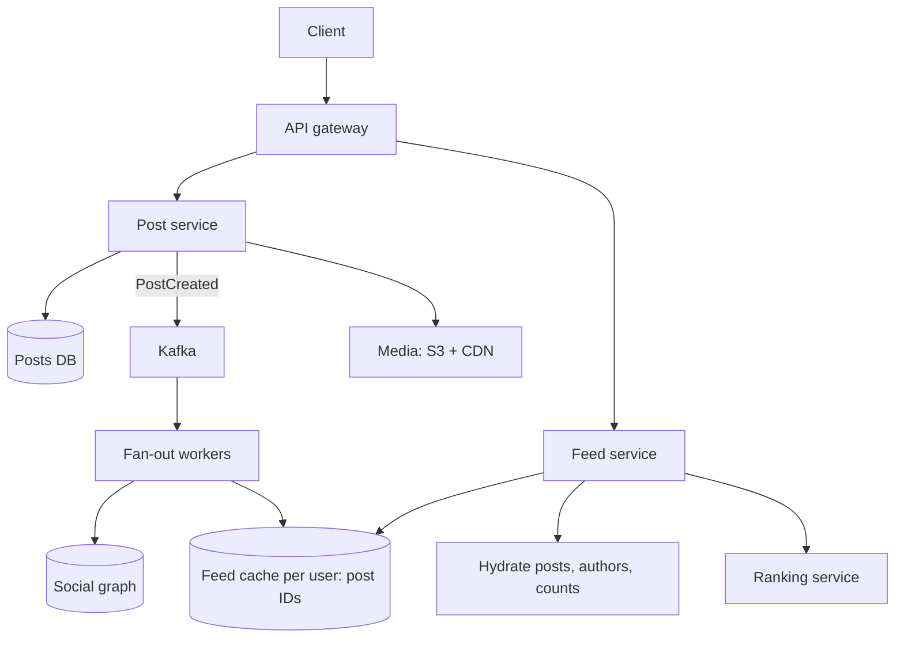

**Write path:** the post service stores the post, then emits `PostCreated`. Fan-out workers read the author's followers from the graph in pages and append the post ID to each follower's feed list. This is asynchronous, so the author's request returns immediately.

**Read path:** the feed service reads the user's cached ID list, merges in recent posts from celebrities they follow, sends candidates to ranking, then hydrates the top N via batched multi-gets (posts, authors, counts, "did I like this").

#### Deep dives

**Fan-out strategies**

| Strategy | How | Good | Bad |
|---|---|---|---|
| Push (fan-out on write) | Insert post ID into every follower's feed | Reads are one cheap list fetch | A celebrity post = millions of writes; work wasted on inactive users |
| Pull (fan-out on read) | Merge recent posts of everyone you follow at request time | No write amplification | Slow reads: query hundreds of authors per load |
| Hybrid (expected answer) | Push for normal authors; pull for celebrities; skip inactive followers | Bounded write cost and fast reads | Two code paths; merging logic |

Rules of thumb: treat authors above some follower threshold (e.g. ~10K–100K) as "pull"; don't push to users inactive for 30+ days, and rebuild their feed from scratch when they log back in.

**Ranking.** A multi-stage funnel: candidate generation (feed cache + celebrity posts + recommended/"suggested" posts) → feature lookup (author affinity, post age, engagement so far, content type) → ML model predicting engagement probabilities → business rules (diversity: not 5 posts in a row from the same author, demote seen posts, insert ads). Cache the ranked first page briefly so a refresh doesn't re-run the expensive model.

**Hydration.** The feed holds only IDs, so updates (edits, deletes, like counts) are reflected automatically. Hydration must be batched: one multi-get for 20 posts, not 20 calls. Deleted or privacy-restricted posts are filtered here.

**Pagination.** Use a cursor (opaque token encoding rank position or last post ID/time), never `OFFSET`. For ranked feeds, keep the ranked list for the session so page 2 doesn't shift when new posts arrive; new posts surface via a "new posts" pill at the top.

**Media.** Clients upload directly to object storage with pre-signed URLs; a processing pipeline generates sizes/formats; the CDN serves them with immutable URLs.

**Counts.** Likes on a viral post create a hot row. Write likes as events, aggregate asynchronously, or use sharded counters (N sub-counters summed on read).

#### Trade-offs
- Push = fast reads, expensive writes; pull = cheap writes, slow reads; hybrid balances by author type.
- Ranking freshness vs latency: precompute ranked feeds (stale, fast) vs rank on read (fresh, more compute).
- Cache size vs depth: capping at ~500 IDs saves RAM; deep scrollers fall back to a slower pull path.

#### Scaling and failure modes
- Feed cache sharded by user ID; replicated; on a cache loss, rebuild lazily from the graph + posts (pull path) rather than all at once.
- Fan-out lag after a spike: Kafka absorbs it; feeds are briefly stale, which is acceptable.
- Ranking service down: fall back to reverse-chronological order of cached IDs (graceful degradation).
- Deleted posts: filter at hydration time; optionally a background job removes IDs from feeds.

**Common pitfalls**
- Storing full post bodies in every follower's feed (huge memory, stale edits).
- Forgetting the celebrity problem or inactive users in the estimate.
- Offset-based pagination on a constantly changing list.

**Likely follow-ups**
- *How do you handle a user who follows 5,000 accounts?* Their pull merge is bounded by only pulling celebrities; everything else is already pushed.
- *How does unfollow work?* Remove that author's IDs lazily: filter at read time, clean up in the background.
- *How to show a post to its author instantly?* Insert it into the author's own feed synchronously (read-your-writes).

</details>

### 2. Design Twitter / X.

<details>
<summary>Answer</summary>

**In short:** Tweets are stored once with time-sortable Snowflake IDs; home timelines are precomputed lists of tweet IDs in Redis filled by hybrid fan-out (push for normal accounts, merge celebrity tweets at read time). A Kafka `TweetCreated` stream also feeds a real-time search index and a streaming trends pipeline, and counts are aggregated asynchronously.

#### Requirements
- **Functional:** post tweets (280 chars + media), follow, home timeline (people I follow), user timeline (one person's tweets), likes/retweets/replies, search, trending topics.
- **Non-functional:** ~300M DAU, read:write ≈ 100:1, home timeline < 200 ms, high availability, eventual consistency acceptable (counts and timelines can lag seconds).

#### Estimates
- Writes: 300M × ~2 tweets/day ≈ 600M/day ≈ 7K tweets/s (peaks several times higher during events).
- Timeline reads: 300M × 20 ≈ 6B/day ≈ 70K QPS.
- Storage: 600M × ~300 bytes ≈ 180 GB/day of tweet text plus metadata; media dominates and lives in object storage + CDN.
- Timeline cache: 300M × 800 IDs × ~16 bytes (ID + author) ≈ 4 TB RAM before replication, so cap and only keep active users.

#### API
```
POST /v1/tweets { text, mediaIds[], replyTo? }     → { tweetId }
GET  /v1/timeline/home?cursor=…                    → { tweets[], nextCursor }
GET  /v1/users/{id}/tweets?cursor=…
POST /v1/tweets/{id}/like | /retweet
GET  /v1/search?q=…   GET /v1/trends?location=…
```

#### Data model
- `tweets(tweet_id, author_id, text, media_refs, reply_to, created_at)` sharded by tweet ID.
- `user_tweets(author_id, tweet_id)` – per-author index for the user timeline.
- `follows(follower_id, followee_id)` both directions.
- Timeline cache: `timeline:{user_id}` → list of (tweet_id, author_id), capped ~800.

#### High-level design
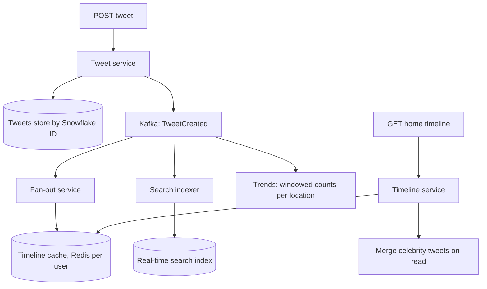

Twitter publicly described precomputing home timelines in Redis for active users and merging in tweets from very high-follower accounts at read time; that is the design interviewers expect.

#### Deep dives

**IDs.** Snowflake: 41 bits of milliseconds + machine ID + sequence. IDs are unique without coordination and roughly time-ordered, so merging sources and paginating (`max_id`/`since_id`) is just comparing integers.

**Home timeline read.** Fetch cached IDs → fetch recent tweets from followed celebrities (their `user_tweets` lists, heavily cached) → merge by ID → optional ranking ("For You") → hydrate tweets, authors, counts in batch → filter blocked/muted/deleted.

**Celebrity problem.** An account with 100M followers would generate 100M Redis writes per tweet and delay delivery for minutes. Skip fan-out above a threshold (e.g. ~100K followers) and pull instead. Merge cost stays small because a user follows few celebrities.

**User timeline.** A range read on `user_tweets` by author, cached for popular profiles.

**Search.** A real-time inverted index (Twitter's publicly described system was called Earlybird): tweets become searchable within seconds; the index is partitioned by time, recent segments in memory, older ones on disk. Queries fan out to partitions and merge by relevance and recency.

**Trends.** Stream processing (Flink/Kafka Streams) counts hashtags and phrases in sliding windows per region, then compares current rate against a historical baseline to detect **acceleration**, not raw volume (otherwise "#love" trends forever). Filter spam and bot-driven bursts before publishing.

**Counts.** Likes/retweets are events aggregated asynchronously; the displayed count is eventually consistent. The per-user "did I like this" is stored exactly (unique key).

**Retweets and replies.** A retweet is a lightweight tweet referencing the original; fan-out pushes the retweet ID; hydration shows the original. Replies link via `reply_to`, and conversation views query by root ID.

#### Trade-offs
- Timeline memory: store only IDs, cap at ~800, keep only active users' timelines warm.
- Eventual consistency on counts and timelines in exchange for availability and speed.
- Precomputed timelines make chronological feeds fast but ranked "For You" feeds need read-time scoring anyway.

#### Failure modes
- Fan-out backlog during a global event: delivery lags but nothing is lost (Kafka retains).
- Redis node loss: rebuild affected timelines lazily from the graph + `user_tweets`.
- Hot tweets (viral): cache tweet objects at multiple layers; sharded counters for likes.

**Likely follow-ups**
- *Why not a relational join per timeline load?* At 70K QPS across hundreds of followees it can't meet 200 ms.
- *How do deletes propagate?* Mark deleted in the tweet store; hydration filters it; cleanup is lazy.
- *Edit tweet?* Store versions; IDs in timelines point to the tweet, which resolves to the latest version.

</details>

### 3. Design Instagram (photo sharing).

<details>
<summary>Answer</summary>

**In short:** Clients upload media directly to object storage with pre-signed URLs; an async pipeline creates resized variants and moderation results; post metadata lives in a database sharded by user ID; the feed reuses hybrid fan-out plus ranking; and all media is served through a CDN with immutable URLs. Stories are a separate store with a 24-hour TTL.

#### Requirements
- **Functional:** upload photos/videos with captions; follow users; home feed; likes/comments; Stories that expire after 24 h; profile grid; explore page (recommendation, mostly black-box).
- **Non-functional:** images load fast globally, uploads are reliable on mobile networks, high availability, eventual consistency OK for feed and counts. Media volume is the dominant cost.

#### Estimates
- 100M uploads/day × ~2 MB → ~200 TB/day raw; plus several variants (thumbnail, feed size, full) → storage grows by petabytes per month. Use cheaper tiers for old originals.
- Reads ≫ writes: perhaps 50–100 image loads per session → millions of image requests/s, which is only possible via CDN.
- Metadata is small (~1 KB per post) → a few hundred GB/day, easily sharded.

#### API
```
POST /v1/media/upload-url { type, size }   → { mediaId, uploadUrl }
POST /v1/posts { mediaIds[], caption }     → { postId }
GET  /v1/feed?cursor=…
GET  /v1/users/{id}/posts?cursor=…         (profile grid)
POST /v1/stories { mediaId }   GET /v1/stories/tray
```

#### High-level design
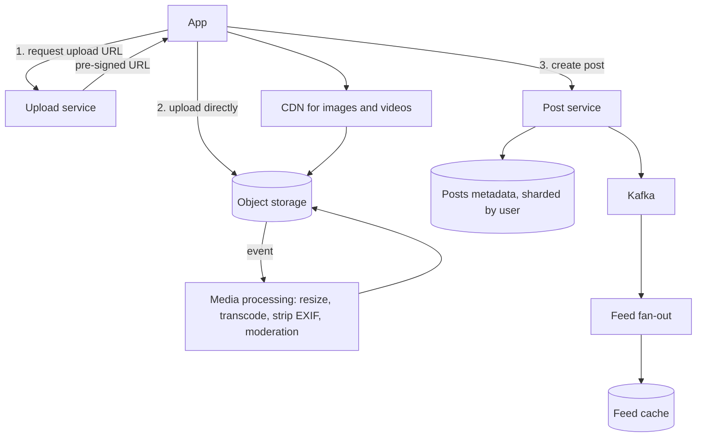

The three-step upload keeps large bytes off the application servers: app servers only hand out URLs and write metadata.

#### Deep dives

**Media pipeline.** On upload completion, an event triggers workers that: strip EXIF (location privacy), generate multiple sizes (e.g. 150 px thumbnail, ~1080 px feed, full) and modern formats (WebP/AVIF with JPEG fallback), transcode video into adaptive bitrates, compute perceptual hashes (duplicate/abuse detection), and run moderation classifiers. The post is marked "ready" when required variants exist. Media URLs contain a content hash or version, so the CDN can cache them "forever".

**Metadata storage.** Posts sharded by `user_id`, so a profile grid is a single-shard range query. Instagram publicly described sharding PostgreSQL into many logical shards, with 64-bit IDs that embed a timestamp, the logical shard ID and a sequence, so any ID tells you where it lives and IDs sort by time.

**Feed.** Same as the news-feed design: hybrid fan-out of post IDs plus ML ranking (predicted likes, comments, time spent, shares), then hydration.

**Stories.** Different access pattern: ephemeral, viewed in order, "seen" state matters.
- Store story items with a 24-hour TTL (or expire via a scheduled job; keep archived copies if the user opts in).
- The **story tray**: for each user, the list of followed accounts with unseen stories, ranked by closeness. Built at read time from "who I follow who posted in the last 24 h" plus my seen-state.
- The client prefetches media of the next few stories so tapping is instant.

**Likes and comments.** Separate services; likes as idempotent per-user records plus asynchronously aggregated counts; comments stored per post, paginated, ranked.

**Moderation.** Classifiers run asynchronously before or shortly after publishing; high-confidence violations are blocked, borderline content is limited or sent to human review.

#### Trade-offs
- Pre-generating variants (storage cost) vs on-the-fly resizing at the edge (compute cost, cold misses). Common: pre-generate a few standard sizes.
- Publish before moderation finishes (fast, risk of exposure) vs after (slower, safer).
- Sharding by user makes profiles fast but a viral post's comments/likes are a hot spot, handled by separate, differently sharded services.

#### Failure modes
- Upload interrupted: resumable/chunked uploads; orphaned objects without a post are garbage-collected.
- Processing backlog: post stays "processing"; the client shows a local preview meanwhile.
- CDN miss storm for a new viral image: origin shield / request coalescing.

**Likely follow-ups**
- *How to make a photo appear instantly for the uploader?* Show the local file optimistically; the server post becomes visible when processing completes.
- *How to delete a photo everywhere?* Delete metadata, purge the CDN by URL, delete objects; feeds filter it at hydration.
- *Explore page?* Embedding-based candidate retrieval + ranking, cached per user.

</details>

### 4. Design a chat app (like WhatsApp / Messenger).

<details>
<summary>Answer</summary>

**In short:** Each device keeps a persistent WebSocket to a gateway; a registry maps users to gateways. The message service assigns a per-chat ordered ID, persists the message (Cassandra partitioned by `chat_id`) and then routes it to the recipient's gateway, or triggers a push notification if they're offline. Client-generated IDs make retries idempotent, acks drive sent/delivered/read ticks, and offline devices sync from their last acknowledged message.

#### Requirements
- **Functional:** 1:1 and group chats (up to ~1,000 members), text + media, delivery states (sent/delivered/read), online/last seen, push notifications when offline, history across devices, ordered messages within a chat.
- **Non-functional:** < 200 ms delivery when both are online, **no message loss**, at-least-once delivery with dedupe (effectively once), high availability, optionally end-to-end encryption.

#### Estimates
- 1B DAU × 50 messages = 50B messages/day ≈ 600K/s average, 1–2M/s peak.
- ~100 bytes of text each → ~5 TB/day (before replication) if stored.
- Connections: hundreds of millions of concurrent WebSockets. At ~100K–1M per tuned gateway, that's hundreds to thousands of gateway servers.

#### API / protocol
- Persistent **WebSocket** (or MQTT, used by Messenger publicly) per device for send/receive/acks/typing/presence.
- REST for history pages, media upload URLs, profile, group management.

```
→ send { clientMsgId, chatId, body }
← ack  { clientMsgId, serverMsgId, ts }          (sent ✓)
← msg  { chatId, serverMsgId, sender, body }
→ delivered { chatId, upToMsgId }                (✓✓)
→ read      { chatId, upToMsgId }                (blue ✓✓)
```

#### Data model
- `messages(chat_id, message_id, sender_id, body, created_at)` in a wide-column store (**Cassandra/HBase**), partition key `chat_id` (plus a time bucket for very active chats), clustering key `message_id` descending → "latest 50 messages in chat X" is one partition read.
- `chat_members(chat_id, user_id, role)`; `user_chats(user_id, chat_id, last_msg_id)` for the inbox list.
- Per device sync state: `cursor(user_id, device_id, chat_id) → last_delivered_msg_id`.

#### High-level design
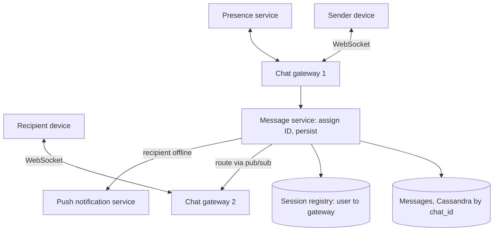

#### Deep dives

**Send flow (sequence).**
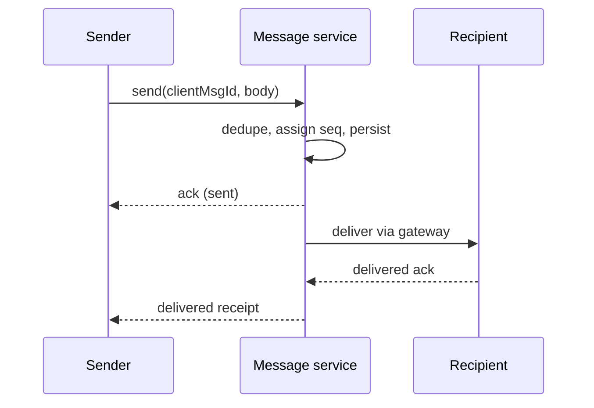

**Routing.** Gateways are stateful (they hold sockets) but contain no business logic. On connect, the gateway writes `user/device → gateway_id` into Redis with a TTL refreshed by heartbeats. The message service persists first, looks up the registry, and forwards to that gateway (direct RPC or a pub/sub topic per gateway). Persist-before-route means a crash after the ack never loses the message.

**Delivery guarantees.** The client generates `clientMsgId` and retries until acked; the server dedupes on it, so retries never duplicate. Recipients ack delivery; unacked messages are re-sent on reconnect. Offline devices reconnect and request "everything after my cursor per chat".

**Ordering.** Wall clocks across devices disagree, so the server assigns a per-chat monotonically increasing sequence (or a time-sortable ID from the chat's owning shard). Clients sort by it; gaps tell the client to fetch missing messages.

**Group chats.** For small groups, fan out on write: one copy of the message in the chat partition, plus a delivery event to each member's gateway/push. Members' inboxes just reference the chat. For very large groups, members pull from the group partition, and only online members get real-time pushes.

**Presence.** Heartbeats every ~30 s, TTL keys in Redis, and fan-out only to contacts who currently have the chat open (see Q14).

**Media.** Upload to object storage (encrypted blob when E2EE), send a message containing the reference and key; recipients download lazily.

**Multi-device.** Each device has its own cursor and its own connection; with E2EE each device has its own keys, so senders encrypt per device.

**End-to-end encryption.** The Signal protocol: the server stores and forwards only ciphertext. Consequences: no server-side search, backups need client-side keys, and spam detection relies on metadata and user reports.

#### Trade-offs
- Long-term server storage of history (Messenger, Slack) vs store-until-delivered (classic WhatsApp kept messages only until delivered): storage cost and privacy vs multi-device history.
- WebSocket vs long-polling vs MQTT: MQTT is lighter on mobile battery; WebSocket is simplest for the web.
- Push via pub/sub per gateway (simple, some fan-out overhead) vs direct RPC (lower latency, needs fresh registry).

#### Failure modes
- Gateway crash: clients reconnect to another gateway (with jittered backoff to avoid a thundering herd) and resync from cursors.
- Stale registry entry: delivery fails → fall back to push notification; the message is safe in storage.
- Partition hot spot from a huge group: time-bucket the partition key.

**Likely follow-ups**
- *How do read receipts in groups work?* Store per-member read cursors; show "read by N" by aggregating.
- *How to guarantee exactly-once display?* At-least-once delivery + client dedupe on `serverMsgId`.
- *How to reduce battery use?* Long heartbeat intervals, push notifications to wake the app, and batch acks.

</details>

### 5. Design YouTube (video upload and streaming).

<details>
<summary>Answer</summary>

**In short:** Uploads go resumably and directly to object storage; a transcoding pipeline (a DAG of parallel segment jobs) produces many resolutions/codecs plus HLS/DASH manifests; viewers fetch the manifest from a playback API and the segments from a CDN, with the player switching bitrate per segment (adaptive bitrate streaming). Metadata, views and comments are separate services with caches and async counters.

#### Requirements
- **Functional:** upload videos; process them; stream smoothly worldwide on any device and network; views, likes, comments; search and recommendations (treat as black boxes in this round).
- **Non-functional:** playback starts in ~1–2 s with minimal rebuffering, very high availability for playback, uploads can take minutes to process, durable storage of originals. Egress bandwidth is the dominant cost.

#### Estimates
- Uploads: ~500 hours of video per minute (publicly cited figure). 1 hour of 1080p ≈ a few GB raw; after encoding into ~6–8 renditions and multiple codecs, storage grows by petabytes per day.
- Views: billions per day; at a few Mbps average per viewer and tens of millions of concurrent viewers, egress is in the hundreds of Tbps. Only a CDN (plus ISP-embedded caches) can serve that.

#### API
```
POST /v1/videos { title, description }     → { videoId, uploadUrl (resumable) }
PUT  {uploadUrl} (chunked, resumable)
GET  /v1/videos/{id}                        → metadata + status
GET  /v1/videos/{id}/manifest               → HLS/DASH manifest URL (signed)
POST /v1/videos/{id}/views | /likes | /comments
```

#### Data model
- `videos(video_id, owner_id, title, description, status, duration, created_at)` – status: uploading → processing → ready / rejected.
- `renditions(video_id, codec, resolution, bitrate, manifest_path)`.
- Object storage: `raw/{video_id}`, `encoded/{video_id}/{rendition}/{segment_n}`.
- View counts and likes in counter services; comments in their own sharded store.

#### High-level design
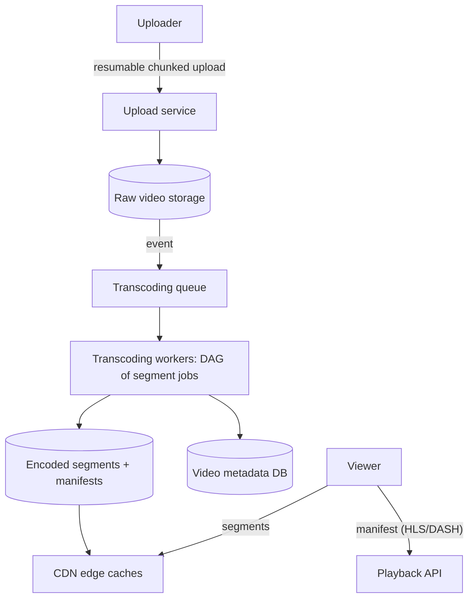

#### Deep dives

**Upload.** Resumable, chunked uploads directly to storage (pre-signed or session URLs) so a dropped connection resumes from the last chunk rather than restarting a 5 GB upload. Validate container/format early.

**Transcoding as a DAG.** Split the source into chunks (e.g. on GOP/keyframe boundaries) and encode them **in parallel** across many workers, then stitch. Tasks in the DAG: inspect → split → encode each (chunk × resolution × codec) → package segments + manifests → thumbnails → content checks (copyright matching like Content ID, moderation) → mark ready. A workflow engine handles retries per task, so one failed chunk doesn't redo the whole video. Publish a low resolution first so the video is watchable quickly, then add higher renditions.

**Adaptive bitrate streaming (ABR).** Each rendition is cut into 2–6 s segments. The manifest lists renditions; the player measures throughput and buffer level and picks the rendition for the next segment. Bad network → drop to 360p rather than stall. Codecs: H.264 for compatibility, VP9/AV1 for ~30–50% bandwidth savings on supported devices.

**CDN strategy.** Popularity is extremely skewed. Popular videos are pushed/warmed to edges proactively; the long tail is served from regional caches or origin. Very large platforms place cache appliances inside ISPs (Netflix's Open Connect is the publicly described example; Google has similar edge caches). Request coalescing at edges prevents origin stampedes.

**Metadata and views.** Metadata in a sharded DB with heavy caching. View counts: events into a stream, deduped (same user/IP within a window), bot-filtered, aggregated into counters; the displayed count is eventually consistent.

**Cost optimisation.** Encoding is expensive: encode everything in a baseline codec, and spend extra compute (AV1, more renditions) only on videos that get popular. Move cold originals to cheaper storage tiers.

#### Trade-offs
- Segment length: short segments = faster start and quicker ABR adaptation, but more requests and worse compression.
- Pre-encode all renditions (storage) vs just-in-time packaging (compute, latency on first request).
- Upload-time strict checks (slower publish) vs post-publish checks (risk of exposure).

#### Failure modes
- Worker crash mid-transcode: the DAG retries that task only (idempotent outputs keyed by chunk and rendition).
- CDN edge failure: DNS/anycast steers to another edge; players retry segments on alternate CDN hosts.
- Origin overload on a viral video: origin shield tier + coalescing.

**Likely follow-ups**
- *How does seeking work?* The player jumps to the segment covering that timestamp; keyframes at segment starts make it possible.
- *How to protect premium content?* DRM (Widevine/FairPlay/PlayReady) with encrypted segments and license servers; signed, expiring URLs.
- *How to estimate storage?* Hours uploaded/day × bitrate sum of all renditions × 3,600 s.

</details>

### 6. Design a live streaming platform with live comments (like Twitch / YouTube Live).

<details>
<summary>Answer</summary>

**In short:** The streamer pushes video over RTMP/SRT/WebRTC to ingest servers; live transcoders produce several bitrates; a packager emits short (low-latency HLS/DASH) segments to an origin; CDN edges with request coalescing fan out to millions. Comments go through a rate-limited, moderated comment service to a per-stream pub/sub channel, and edge gateways that hold viewers' WebSockets subscribe and broadcast locally; huge streams sample comments and aggregate reactions.

#### Requirements
- **Functional:** a streamer broadcasts live; viewers watch with a few seconds of delay; live chat and reactions visible to all viewers; VOD replay afterwards.
- **Non-functional:** up to millions of concurrent viewers per stream; glass-to-glass latency ~2–5 s (sub-second for interactive cases); chat delivery < ~1 s; streams must not stop if one server fails.

#### Estimates
- 1M viewers × 4 Mbps = 4 Tbps egress for one big stream; that's a CDN problem.
- Comments: a big stream can produce thousands/s; fanning 5K comments/s to 1M viewers naively = 5B messages/s. This is why we sample and fan out in two levels.

#### Video path
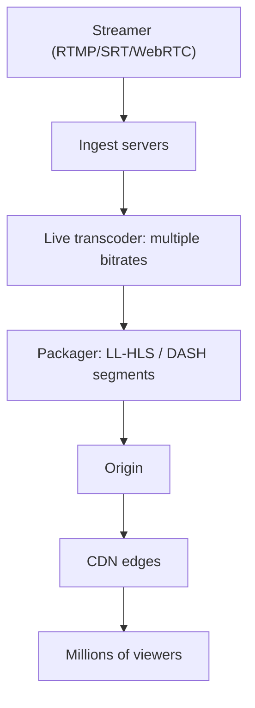
- **Ingest** over RTMP (legacy, ubiquitous) or SRT (better over lossy networks), to the nearest ingest PoP with a stream key for auth.
- **Transcode** in real time into a ladder (e.g. 1080p/720p/480p/160p). This is per-stream dedicated compute; small streamers may only get "source quality" to save cost.
- **Package** into short segments. Standard HLS with 6 s segments gives ~15–30 s latency; **low-latency HLS** with partial segments and preload hints reaches ~2–5 s; **WebRTC** delivers sub-second but is harder to scale to millions.
- **CDN with request coalescing**: when a new segment is published, a million players request it at once; each edge forwards only one request to origin and serves all waiters from that response.

#### Live comments path
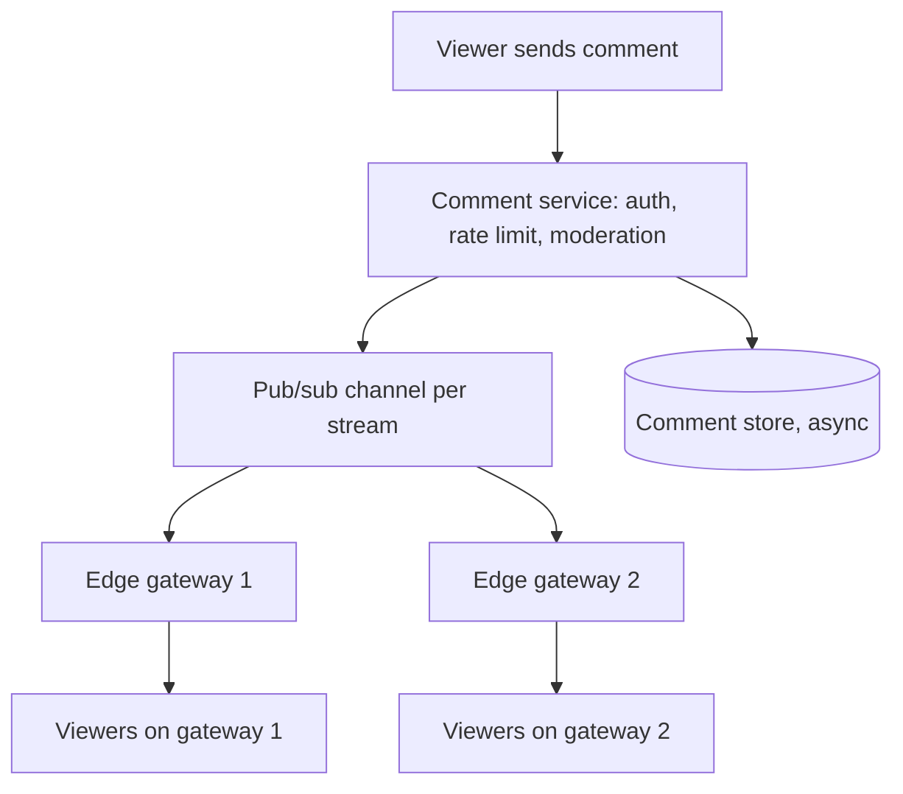
- Viewers hold **WebSocket/SSE** connections to edge gateways. Each gateway subscribes once to the channel of every stream its viewers watch and broadcasts locally. Pub/sub fan-out is to ~hundreds of gateways, not to millions of viewers: this two-level fan-out is the key idea.
- **Batching:** gateways send comments in small batches (e.g. every 100–200 ms) to cut per-message overhead.
- **Sampling** for huge streams: nobody can read 10K comments/s; show a representative sample (prioritise subscribers/moderators/mentions) and aggregate reactions into counts ("hearts x 12K") sent periodically.
- **Moderation:** blocklists, ML filters, slow mode, subscriber-only mode, per-user rate limits, applied before publish.
- **Persistence:** write comments asynchronously with a stream-time offset so VOD replay can show them in sync.

#### Trade-offs
- Latency vs cost and stability: shorter segments mean more requests and less buffer to absorb network hiccups.
- WebRTC (sub-second, expensive at scale) vs LL-HLS (seconds, cacheable on standard CDNs).
- Dropping/sampling comments sacrifices completeness to keep the experience readable and the system stable.

#### Failure modes
- Ingest server dies: the streamer's encoder reconnects to another ingest (viewers see a brief stall); redundant ingest for premium events.
- Transcoder lag: fall back to passing through source quality.
- Gateway failure: viewers reconnect elsewhere; missed comments are acceptable (ephemeral).
- Thundering herd when a huge stream starts: pre-warm CDN, coalescing, staggered client retries.

**Likely follow-ups**
- *How are viewer counts shown?* Gateways report connection counts per stream periodically; aggregate approximately.
- *How do you keep chat in sync with video delay?* Optionally delay chat display by the player's measured latency.
- *Where does VOD come from?* The packager also writes segments to storage; after the stream, a manifest stitches them.

</details>

### 7. Design Dropbox / Google Drive (file storage and sync).

<details>
<summary>Answer</summary>

**In short:** Clients split files into content-hashed blocks (~4 MB) and upload only the blocks the server doesn't already have (delta sync + dedupe) to a block store on object storage; a strongly consistent metadata service records files, versions (as lists of block hashes) and ACLs; a notification service tells other devices that something changed, and they pull changes since their cursor. Conflicts produce a "conflicted copy" instead of silent overwrites.

#### Requirements
- **Functional:** upload/download files; automatic sync across a user's devices; sharing with permissions; version history and restore; offline edits; files up to many GB; conflict handling.
- **Non-functional:** never lose or corrupt data (durability is paramount), consistency of metadata (a folder listing must be correct), efficient bandwidth (mobile/laptops), sync latency of seconds.

#### Estimates
- 500M users, ~100M DAU; average 10 GB stored → ~5 EB logical; dedupe and compression reduce physical storage significantly.
- Change rate: maybe ~1–2 file changes per active user per hour → tens of thousands of metadata commits/s. Metadata is small; blocks are the bulk.

#### API
```
POST /v1/blocks/check { hashes[] }          → { missing[] }
PUT  /v1/blocks/{hash}                      (upload one block)
POST /v1/files/commit { path, parentRev, blockHashes[] } → { rev } | 409 conflict
GET  /v1/changes?cursor=…                   → { entries[], cursor, hasMore }
GET  /v1/blocks/{hash}
```

#### Data model
- `files(file_id, namespace_id, path, latest_rev, deleted)`.
- `versions(file_id, rev, block_hashes[], size, modified_by, created_at)`.
- `blocks(hash, storage_location, refcount)` – content-addressed.
- `namespace_journal(namespace_id, seq, change)` – the ordered change log devices sync from.
- `acl(resource_id, principal, role)`.

#### High-level design
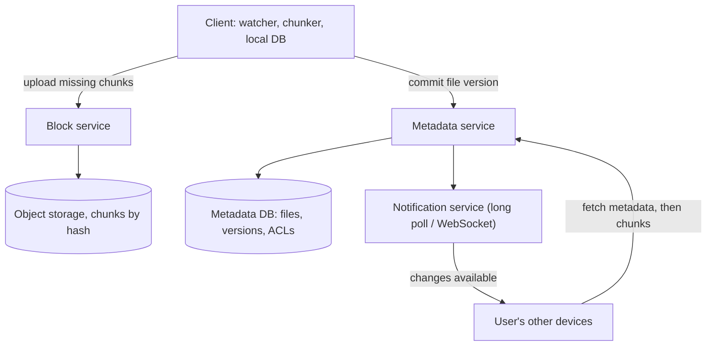

#### Deep dives

**Client components.** A file watcher (OS events), a chunker/hasher, a local SQLite DB recording the last synced state (path → rev, block hashes), and upload/download queues. The local DB is what lets the client compute "what changed" after being offline.

**Chunking, delta sync and dedupe.** Split files into blocks identified by SHA-256. Before uploading, ask the server which hashes are missing; upload only those. Editing one paragraph of a 1 GB file uploads one block. Identical files across users/versions are stored once. Fixed-size chunks shift every boundary when you insert a byte at the start; **content-defined chunking** (a rolling hash picks boundaries based on content) keeps most blocks unchanged after insertions.

**Commit protocol.** Upload blocks first, then commit metadata with `parentRev`. The metadata service does a compare-and-set: if `parentRev` is still the latest, append a new version and a journal entry; otherwise return a conflict. Blocks without a committed version are garbage-collected later.

**Sync protocol.** Each device keeps a cursor into its namespaces' journals. The notification service (long-poll or WebSocket) only says "something changed"; the client then calls `/changes?cursor=` and downloads missing blocks. Separating "notify" from "fetch" keeps the notifier simple and stateless.

**Conflicts.** Two devices edit offline; the second commit fails the CAS. Keep both: save the loser as "file (Alice's conflicted copy).docx". Silent last-writer-wins loses work, which is unacceptable for a storage product.

**Metadata consistency.** Use a relational/strongly consistent store (sharded by namespace/user, e.g. sharded MySQL, which Dropbox has publicly described) because moves/renames, folder listings and quotas need transactions.

**Sharing and permissions.** ACLs per file/folder inherited down the tree, shared folders mounted into other users' namespaces, link sharing with tokens. Check permissions on every metadata and block request (Zanzibar-style relationship-based authorization works well for nested folders).

**Storage cost.** Dedupe, compression, erasure coding instead of 3x replication, and cold tiers for old versions.

#### Trade-offs
- Smaller blocks = better dedupe and delta sync but more metadata and requests; ~4 MB is a common balance.
- Cross-user dedupe saves storage but can leak information ("does this file exist?") and complicates per-user encryption; some systems dedupe only within a user.
- Push-notify + pull-changes vs pushing full changes: the former is simpler and robust to missed messages.

#### Failure modes
- Crash mid-upload: resumable block uploads; commit is atomic, so readers never see half a file.
- Notification lost: clients also poll periodically with their cursor, so nothing is missed.
- Corruption: verify block hashes on read and write; background scrubbing.

**Likely follow-ups**
- *How to sync a 10 GB file efficiently?* Parallel resumable block uploads; only changed blocks on later edits.
- *How is version history kept cheap?* Versions share unchanged blocks; only new blocks cost storage.
- *How do you move a folder with 100K files?* A single metadata operation on the parent (path stored as parent pointers), not 100K updates.

</details>

### 8. Design Google Docs (real-time collaborative editing).

<details>
<summary>Answer</summary>

**In short:** Every open document is owned by one collaboration server (routed by document ID); clients send small operations over a WebSocket, the server orders them and transforms concurrent ones (Operational Transformation) so all replicas converge, appends them to an operation log, and broadcasts them. Snapshots plus the log give fast loading and version history; cursors are ephemeral presence. CRDTs are the alternative when offline/peer-to-peer matters.

#### Requirements
- **Functional:** many users edit the same document concurrently and see each other's edits and cursors in real time (< ~100–200 ms); no lost edits; offline editing then merge; version history; comments; permissions.
- **Non-functional:** convergence (all clients end with identical content), intention preservation (my insert lands where I meant it), durability of every acknowledged edit, low latency via local-first typing.

#### Core problem
Alice inserts "X" at position 5 while Bob deletes position 2. If each applies the other's operation unchanged, Alice's insert lands one position off on Bob's screen and the documents diverge. We need a merge rule that makes concurrent operations commute.

#### Approaches
| | Operational Transformation (OT) | CRDT (Yjs, Automerge) |
|---|---|---|
| Idea | Server orders ops and **transforms** concurrent ones (shift positions) before applying | Each element has a unique ID and ordering metadata, so merges are deterministic anywhere |
| Central server | Required (one authority per doc) | Not required; works peer-to-peer and offline |
| Metadata overhead | Low | Higher (IDs, tombstones), mitigated by compaction |
| Used by | Google Docs (publicly) | Many local-first apps; Figma uses a CRDT-inspired, server-ordered scheme |

Example of a transform: `insert("X", 5)` concurrent with `delete(2)` becomes `insert("X", 4)` when applied after the delete.

#### API / protocol
```
WS  /docs/{id}/collab
→ op { baseRev, ops[], clientOpId }
← ack { rev }          ← remote op { rev, ops[], author }
← presence { userId, cursor, selection }
GET /v1/docs/{id}?rev=…   GET /v1/docs/{id}/history
```

#### High-level design
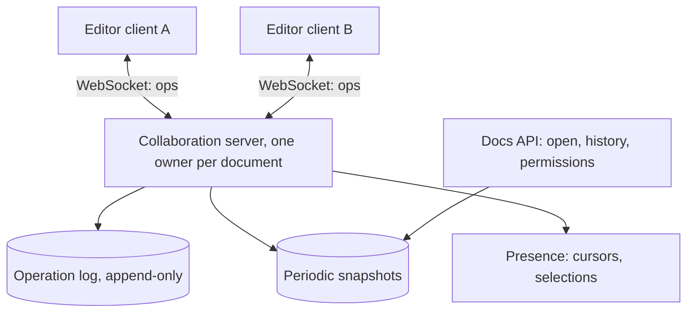

#### Deep dives

**Client loop.** The client applies its own ops locally immediately (no waiting for the network), sends them with the revision they were based on, and keeps at most one batch in flight. Incoming remote ops are transformed against the client's pending local ops. This keeps typing instant even at 300 ms RTT.

**Server loop.** For an op based on revision r while the server is at r+k, transform it against the k ops since r, assign revision r+k+1, append to the log, ack the sender, broadcast to others.

**Document ownership.** Route all sessions of a document to the same collaboration server (consistent hashing on doc ID, or a lease in a coordination service). A single owner makes ordering trivial. On failover, a new owner loads snapshot + log tail and clients reconnect and resend unacked ops (idempotent by `clientOpId`).

**Persistence.** Ack only after the op is durably appended to the log. Snapshot every N ops so loading doesn't replay the full history. Version history = snapshots + ops, with named versions as tagged revisions.

**Presence.** Cursors and selections are broadcast frequently but never persisted; they're also transformed so a remote cursor stays at the right place.

**Offline.** Queue local ops; on reconnect send them based on the last known revision; the server transforms them against everything that happened. Long offline sessions can produce surprising merges, which is where CRDTs shine.

**Comments.** Anchored to ranges that are transformed like cursors; stored separately from content.

**Scale.** Documents are independent, so scale horizontally by document. A very popular document limits per-document concurrency: cap active editors (Google Docs shows view-only beyond a limit) and serve viewers from snapshots + broadcast.

#### Trade-offs
- OT: simpler data, needs a central server, transform functions are tricky to get right for rich text.
- CRDT: offline/P2P friendly, higher memory, tombstones need garbage collection.
- Ack-after-durable-write adds latency but guarantees no lost edits.

#### Failure modes
- Owner server crash: lease expires, new owner takes over, clients resend unacked ops.
- Split brain (two owners): prevented with leases/fencing tokens in the log append.
- Very long op log: compaction via snapshots.

**Likely follow-ups**
- *How does undo work in multiplayer?* Per-user undo: invert your own last op and transform it against later ops from others.
- *Why not lock paragraphs?* Locks hurt the real-time feel and fail badly offline.
- *How to handle permissions changes mid-session?* The server re-checks on each op and can drop the user to view-only.

</details>

### 9. Design Reddit (posts, nested comments, voting and ranking).

<details>
<summary>Answer</summary>

**In short:** Store one vote per user per item (idempotent upsert), stream votes through Kafka to an aggregator that batches score updates (avoiding hot rows), and maintain precomputed listings (hot/new/top) per subreddit in Redis sorted sets using a time-decayed "hot" score. Comments are a tree stored with `parent_id` plus a materialised path for subtree reads, ranked by Wilson "best" score and loaded lazily. Logged-out traffic is served largely from caches/CDN.

#### Requirements
- **Functional:** subreddits; create posts; upvote/downvote posts and comments; listings sorted hot/new/top/rising; deeply nested comment threads; user karma.
- **Non-functional:** very read-heavy (most visitors are logged out), vote counts roughly real-time (seconds), listings < 200 ms, robust to vote manipulation.

#### Estimates
- 50M DAU; ~1M posts/day, ~10M comments/day, ~100M+ votes/day (≈ 1–2K votes/s average, tens of thousands during peaks on viral threads).
- Reads: hundreds of thousands of page views/s at peak, mostly cacheable listings and threads.

#### API
```
GET  /r/{sub}/{hot|new|top}?after=…        → { posts[], after }
POST /v1/posts { sub, title, body|url }
POST /v1/vote { itemId, value: -1|0|1 }    (idempotent)
GET  /v1/posts/{id}/comments?sort=best&depth=…&limit=…
POST /v1/comments { postId, parentId?, body }
```

#### Data model
- `posts(post_id, subreddit_id, author_id, title, body, ups, downs, score, created_at)`.
- `comments(comment_id, post_id, parent_id, path, depth, author_id, body, ups, downs, created_at)` – nested threads via `parent_id` (adjacency list), plus a **materialised path** (`/1/7/42/`) so "subtree of 7" is `path LIKE '/1/7/%'`. A closure table is the alternative when subtrees move.
- `votes(user_id, item_id, value)` with a unique key → one vote per user per item, and changing a vote is an upsert.

#### Design
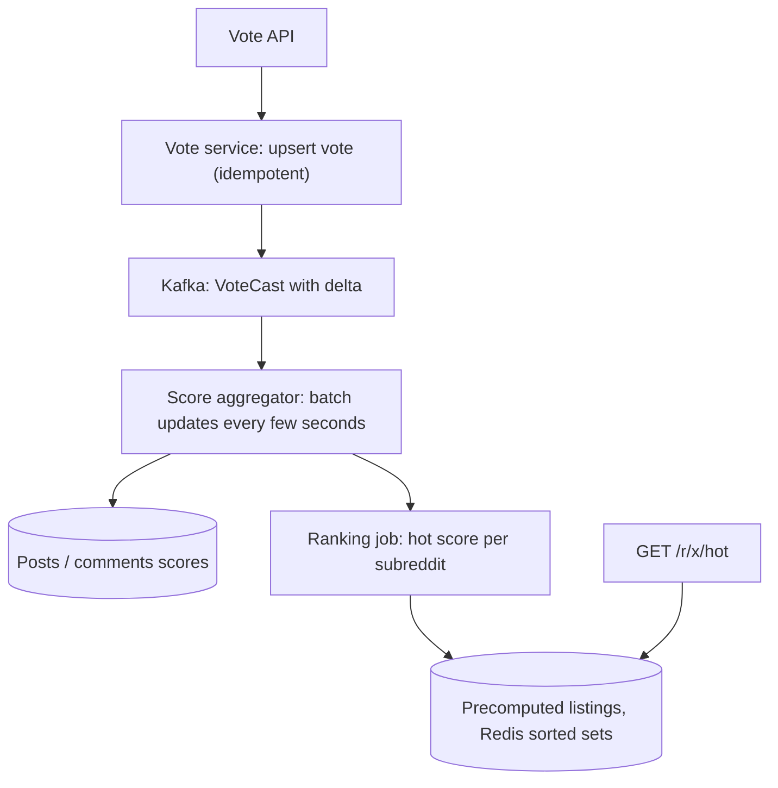

#### Deep dives

**Votes.** The vote service upserts `(user, item) → value` and emits the **delta** (e.g. changing +1 to −1 is −2). Storing individual votes lets the UI show the user's arrow and prevents double voting. The aggregator sums deltas per item over a few seconds and writes one update per item, so a viral post gets one write per batch instead of thousands of row locks per second.

**Hot ranking.** Reddit's historically published formula:
```python
def hot(ups, downs, created_at_epoch):
    s = ups - downs
    order = math.log10(max(abs(s), 1))
    sign = 1 if s > 0 else -1 if s < 0 else 0
    return round(sign * order + created_at_epoch / 45000, 7)
```
The log means the first 10 votes count as much as the next 90; the time term means a post needs ~10x the votes to beat one posted 12.5 hours later. Because the age term is fixed at creation, a post's hot score only changes when votes change, so it can be stored in a sorted set (`ZADD sub:hot score post_id`) and updated incrementally. Keep only the top ~1,000 per listing.

**New / top.** New = sorted by ID/time. Top = sorted by score within a window (day/week/all), recomputed periodically.

**Comments.** Threads can have tens of thousands of comments. Load the top N comments at each level ranked by **"best"** – the lower bound of the Wilson score confidence interval of the upvote ratio – which avoids a comment with 1 up/0 down beating one with 500/50. Return a limited depth/breadth and "load more replies" links that fetch subtrees by path. Cache the rendered tree per (post, sort) and invalidate/refresh periodically on busy threads.

**Caching.** Logged-out users see identical pages → CDN/edge caching for listings and threads with short TTLs. Logged-in users get cached listings plus a personal overlay (their votes, hidden posts).

**Anti-abuse.** Vote fuzzing (displayed counts are slightly noised), rate limits, account-age/karma thresholds, and detection of vote rings (many accounts voting together), with suspicious votes discounted by the aggregator.

#### Trade-offs
- Async aggregation: scores lag a few seconds but writes scale.
- Precomputed listings: fast reads, but the front page and filtered views need merging of many subreddit lists.
- Materialised path: fast subtree reads, expensive to move subtrees (rare on Reddit).

#### Failure modes
- Aggregator down: votes are safe in Kafka/DB; scores freeze then catch up.
- Redis listing lost: rebuild from DB (top posts by hot score per subreddit).
- Viral thread: cache the comment tree, rate-limit comment submissions, shard counters.

**Likely follow-ups**
- *How is the home feed built?* Merge the hot lists of the user's subscribed subreddits (k-way merge of sorted sets), cached per user briefly.
- *How is karma computed?* Asynchronously from the same vote stream, per author.
- *Why not sort by raw score?* Old posts would dominate forever; hot adds time decay.

</details>

### 10. Design a web search engine (like Google, at a high level).

<details>
<summary>Answer</summary>

**In short:** A crawler fetches pages into a document store; an indexing pipeline parses them, builds an inverted index sharded by document, and computes link-based and quality signals (PageRank). A query is normalised (spelling, synonyms), fanned out to all index shards, each returns its local top-k by cheap scoring, the results are merged and re-ranked by ML models, and snippets are generated. Tail latency is controlled with replicas, hedged requests and a results cache.

#### Requirements
- **Functional:** crawl the web; index it; answer keyword queries with ranked results and snippets; keep results fresh.
- **Non-functional:** query latency ~100–300 ms at p99, tens of thousands of QPS, an index of tens to hundreds of billions of pages, high relevance and spam resistance.

#### Estimates
- 50B pages × ~100 KB = ~5 PB raw HTML; compressed text and index are a fraction but still petabytes → thousands of index shards.
- 100K QPS × fan-out to every shard = enormous internal RPC volume, so each shard query must be ~10 ms.

#### Components
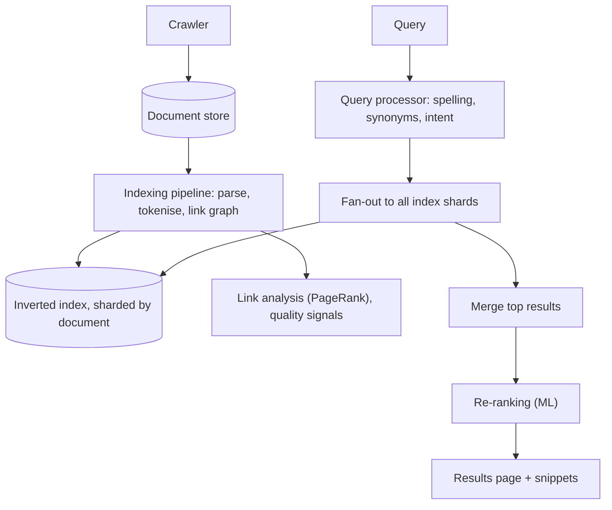

#### Deep dives

**Crawler.** A URL frontier prioritised by importance and expected change rate; per-host politeness queues (respect `robots.txt` and crawl-delay); DNS caching; dedupe URLs (normalisation) and content (SimHash for near-duplicates); recrawl news sites every few minutes and static pages every few weeks. (A separate question in this repo covers the crawler in depth.)

**Indexing.** Parse HTML, extract text, title, anchor text from inbound links (a strong relevance signal), language, structured data. Tokenise and build posting lists: `term → [(doc_id, positions, field flags)]`, compressed (delta + variable-byte encoding). Compute static signals: PageRank over the link graph, spam scores, page quality.

**Index sharding.**
| | By document (standard) | By term |
|---|---|---|
| Query cost | Every query hits every shard; each returns top-k | Only shards holding the query's terms |
| Multi-term queries | Intersection is local to each shard | Posting lists must be shipped and intersected across shards |
| Load balance | Even | Hot terms create hot shards |

Document sharding wins; throughput comes from replicating each shard many times.

**Ranking stages.** A funnel because ML models are too expensive for every document:
1. On each shard: retrieve posting-list intersections, score with cheap features (BM25 + static quality like PageRank), keep top ~1,000.
2. Merge across shards → top few thousand.
3. Expensive re-ranking (learning-to-rank, neural/semantic models, freshness, personalisation, location) on the top hundreds.
4. Diversity and result blending (news, images, videos), snippet generation from cached document text.

**Query processing.** Spelling correction, synonym expansion, stemming, entity recognition, intent detection ("weather paris" triggers a widget). Semantic retrieval with embeddings increasingly complements keyword matching.

**Latency.** With fan-out to 1,000 shards, the slowest shard defines latency. Use replicas, **hedged requests** (send to a second replica if the first is slow past the p95), and return partial results if a shard is late (missing one shard's top results barely changes quality).

**Freshness.** A small, frequently updated real-time index for new content merged at query time with the main index that's rebuilt in large batches.

**Caching.** Query results cache for popular queries (the head of the distribution is very repetitive), plus posting-list caches on shards.

#### Trade-offs
- Freshness vs index-build cost (real-time tier vs batch rebuilds).
- Recall vs latency (how many candidates each stage keeps).
- Partial results vs completeness.

#### Failure modes
- Shard replica down: route to other replicas; partial results if a shard is fully unavailable.
- Bad index build: keep the previous version and roll back (indexes are immutable versions).
- Web spam/link farms: spam classifiers and link-graph analysis demote them.

**Likely follow-ups**
- *How do you build autocomplete?* A separate prefix index of popular queries (see the typeahead design).
- *How to evaluate ranking changes?* Offline human-rated relevance sets plus online A/B tests on clicks and satisfaction.
- *How big is a posting list for "the"?* Billions of entries, which is why stop words and impact-ordered lists with early termination exist.

</details>

### 11. Design Spotify (music streaming).

<details>
<summary>Answer</summary>

**In short:** Tracks are encoded at several bitrates and served from object storage via CDNs; because files are small, the client fetches the first chunk immediately for instant start and prefetches the next track. Catalog metadata is heavily cached plus a search index; playlists are versioned per-user documents; offline downloads are encrypted with expiring licences; and every play is an event into Kafka that feeds royalties (deduped, fraud-checked), charts and recommendation pipelines.

#### Requirements
- **Functional:** search and browse the catalog; stream songs with instant start; create and share playlists (including collaborative); offline downloads for premium; personalised recommendations; accurate play counts for royalty payouts.
- **Non-functional:** playback start < ~200–300 ms, no gaps between tracks, works on flaky mobile networks, catalog of ~100M tracks, hundreds of millions of users.

#### Estimates
- Catalog: 100M tracks × ~4 encodings × ~5 MB ≈ 2 PB, modest compared to video.
- Streams: 200M DAU × 2 h × 160 kbps ≈ significant but Tbps-scale egress → CDN plus client caching (repeat listens are common, so a local cache helps a lot).
- Play events: billions/day → a large but straightforward streaming pipeline.

#### API
```
GET  /v1/search?q=…
GET  /v1/tracks/{id}                   → metadata + stream URLs per quality (signed)
GET  /v1/playlists/{id}?rev=…
POST /v1/playlists/{id}/ops { baseRev, ops[] }
POST /v1/events/play { trackId, ms_played, context, ts }   (batched)
```

#### High-level design
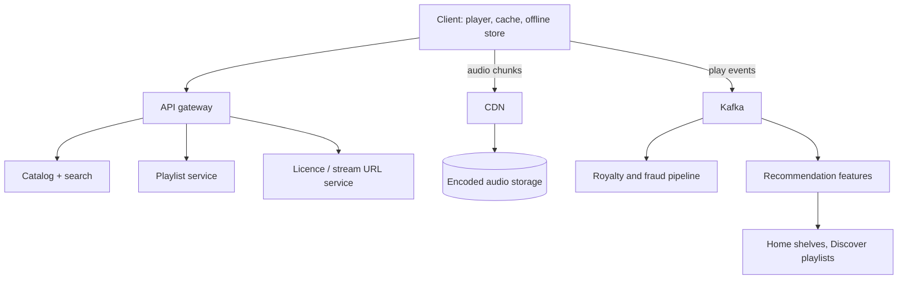

#### Deep dives

**Audio storage and delivery.** Songs encoded at several bitrates (e.g. Ogg Vorbis/AAC from ~96 to 320 kbps). Files are small (~3–10 MB), so the player requests the first chunk with a byte-range request and starts playing within a few hundred ms, then downloads the rest progressively. Prefetch the next track in the queue so transitions are gapless. Pick quality based on network type and user setting. A local disk cache of recently played tracks avoids re-downloading favourites.

**Catalog and metadata.** Artists, albums, tracks, licensing per region – in a sharded DB plus a search index (with typo tolerance and popularity boosting). It changes rarely, so cache it aggressively at every layer. **Licensing is per country**: the stream URL service checks availability for the user's region.

**Playlists.** User-owned documents with ordered track IDs. Store as versioned lists; clients send operations (add, remove, move) with a base revision; the server applies them in order. For collaborative playlists, concurrent operations are merged per operation (last-write-wins per position/move is usually acceptable). Huge playlists are paginated.

**Offline.** Downloaded files are encrypted on device; the decryption keys are tied to a licence that expires unless the app checks in periodically (Spotify publicly requires going online at least every 30 days). Limits on the number of devices and downloads.

**Play events and royalties.** Each play is an event (track, user, ms played, context). Royalty counting has to be accurate: dedupe by event ID, apply rules (a play counts after ~30 s), and detect fraud such as bot farms streaming a track in loops. A batch pipeline produces auditable per-rights-holder totals; a streaming path feeds charts and real-time features.

**Recommendations.** Offline batch jobs (collaborative filtering, audio and text embeddings) generate personalised playlists like Discover Weekly; online ranking orders home-screen shelves using recent listening context.

#### Trade-offs
- Higher bitrate (quality) vs data cost and start latency.
- Aggressive client caching (fewer CDN bytes) vs device storage.
- Real-time vs batch for royalties: batch is auditable and correct; streaming is for dashboards.

#### Failure modes
- CDN hiccup: retry the chunk from an alternate CDN; the buffer covers a few seconds.
- Event loss: clients buffer play events offline and upload in batches with IDs; server dedupes.
- Licence service down: cached licences keep offline content playing.

**Likely follow-ups**
- *How to make skipping feel instant?* Prefetch the first chunk of several upcoming tracks.
- *Why not stream audio over WebRTC?* Not interactive; HTTP range requests through a CDN are cheaper and cacheable.
- *How to handle a new album drop at midnight?* Pre-warm the CDN and caches; scale catalog read replicas.

</details>

### 12. Design a video conferencing system (like Zoom / Google Meet).

<details>
<summary>Answer</summary>

**In short:** Use a signalling service (WebSocket) for meeting state and SDP/ICE negotiation, and **SFU** media servers for the media: each client uploads its stream once in several qualities (simulcast/SVC), and the SFU forwards the right layer to each receiver without decoding. Media flows over UDP (RTP/SRTP) with jitter buffers, FEC and congestion control; ICE/STUN/TURN handles NAT traversal; SFUs are placed regionally and cascaded for global meetings.

#### Requirements
- **Functional:** multi-party audio/video calls (2 to ~1,000 participants), screen sharing, chat, mute/raise hand, recording, waiting room and host controls.
- **Non-functional:** mouth-to-ear latency < ~150–300 ms, resilient to packet loss and bandwidth changes, works behind NATs and firewalls, global participants, secure.

#### Estimates
- A 720p video stream ≈ 1.5–2.5 Mbps; audio ≈ 30–50 kbps.
- 10-person mesh: each client uploads 9 streams (~20 Mbps) → impossible on home connections. With an SFU each uploads once (~2–3 Mbps across simulcast layers) and downloads only what's displayed.
- An SFU server can forward on the order of thousands of streams; capacity planning is by bandwidth more than CPU.

#### Media architectures
| Architecture | How | Client bandwidth | Server cost | Use |
|---|---|---|---|---|
| Peer-to-peer mesh | Everyone sends to everyone | Grows with N | None | 1:1 and 3-person calls |
| MCU | Server decodes, mixes one composite stream per participant | Lowest | Very high CPU; adds latency | Legacy, telephony gateways |
| SFU | Server forwards selected streams without decoding | Upload once, download what you view | Moderate (bandwidth) | The standard today |

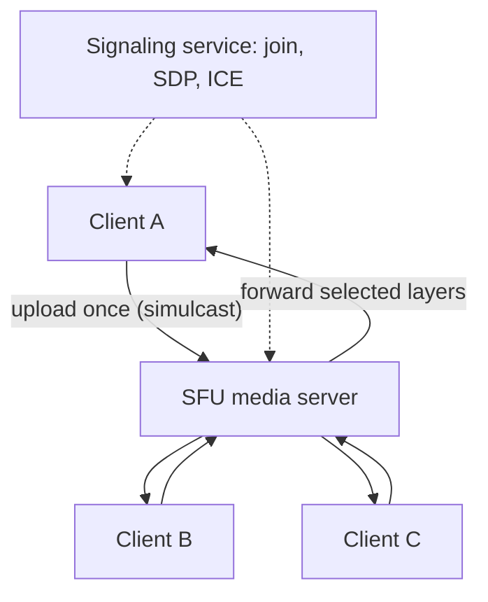

#### Deep dives

**Simulcast and SVC.** With simulcast the client encodes, say, 180p/360p/720p simultaneously; with SVC (scalable video coding) one stream has layers that can be dropped. The SFU picks per receiver: the active speaker in high quality, thumbnails in low, nothing for participants off-screen. It also adapts when a receiver's bandwidth drops – without asking the sender to re-encode.

**Transport.** WebRTC over **UDP** (RTP/SRTP). A late video frame is useless, so most media isn't retransmitted (limited NACK-based retransmission for video keyframes). Jitter buffers smooth arrival times; forward error correction (FEC) and Opus' built-in loss concealment hide drops; congestion control (e.g. Google's GCC/transport-cc) lowers bitrate before queues build. Falls back to TCP/TLS (port 443) through restrictive firewalls at a quality cost.

**NAT traversal.** ICE gathers candidates: local addresses, public addresses learned via **STUN**, and relay addresses on **TURN** servers when direct UDP paths are blocked (corporate networks). With an SFU, clients connect to the SFU's public address, which simplifies things, but TURN-over-TLS is still needed for strict networks.

**Signalling.** A separate stateful service (WebSocket) for meeting state: who's in the meeting, permissions, mute state, SDP offer/answer exchange, which SFU to use. It's low bandwidth but must be consistent (one source of truth per meeting).

**Scale and geography.** Place SFUs in many regions; participants connect to the nearest. For global meetings, **cascade** SFUs: each region's SFU forwards streams to the other regions' SFUs once, rather than every participant crossing the ocean. Very large webinars switch to one-to-many: a few presenters via SFU, thousands of viewers via a live-streaming path (HLS) with a few seconds of delay.

**Recording.** A bot participant joins, receives streams, and composes them server-side (or records raw tracks for later composition) into storage.

**Security.** DTLS-SRTP encrypts media hop-by-hop; true end-to-end encryption needs insertable streams/frame encryption so the SFU forwards ciphertext it can't decode (it still reads RTP headers to route).

#### Trade-offs
- SFU vs MCU: bandwidth vs CPU and latency.
- Simulcast (simple, more uplink) vs SVC (efficient, codec support needed).
- Lower latency (small jitter buffers) vs smoothness on lossy networks.

#### Failure modes
- SFU crash: clients reconnect via signalling to another SFU (ICE restart); seconds of disruption.
- Network degradation: drop to lower layers, then audio only, before dropping the call (audio is the priority).
- Signalling outage: existing media keeps flowing; new joins fail.

**Likely follow-ups**
- *How is the active speaker detected?* Audio-level RTP header extensions let the SFU pick the loudest streams without decoding.
- *How many video tiles can a client show?* Limited by downlink and decoding; the SFU sends only visible tiles at appropriate sizes.
- *How to support phone dial-in?* A SIP/PSTN gateway that mixes audio (MCU-style) for that participant.

</details>

### 13. Design Tinder (location-based matching).

<details>
<summary>Answer</summary>

**In short:** Index users by location (geohash cells or a geo-capable search engine), and in the background build a ranked **queue of candidates** per user (nearby, matching preferences, not yet swiped). Swipes are high-volume writes partitioned by swiper; on a right swipe, a point lookup checks whether the other person already liked you, and if so an idempotent match is created and both are notified. Chat reuses the chat design, restricted to matches.

#### Requirements
- **Functional:** profiles with photos and preferences (age, distance, gender); swipe through nearby recommended profiles; a **match** when both swipe right; chat between matched users; "who liked me" (premium).
- **Non-functional:** tens of millions of DAU, billions of swipes/day, the next card must appear instantly, matches notified within seconds, strong safety/abuse controls.

#### Estimates
- 50M DAU × 100 swipes = 5B swipes/day ≈ 60K writes/s average, 200K+ peak (evenings).
- Swipe records: 5B × ~30 bytes ≈ 150 GB/day → TTL or archive old passes.
- Recommendation reads are mostly prebuilt queues, so query load on the geo index is far lower than swipe volume.

#### API
```
GET  /v1/recs?count=20                    → [profile cards]
POST /v1/swipes { targetId, action: like|pass|superlike, clientSwipeId }
                                          → { matched: bool, matchId? }
GET  /v1/matches?cursor=…
PUT  /v1/me/location { lat, lng }
```

#### High-level design
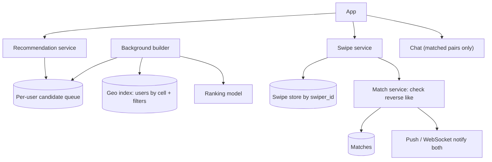

#### Deep dives

**Profiles.** Profile service + DB; photos uploaded to object storage, moderated, resized, served via CDN.

**Geo index.** Bucket users by geohash cell (or use Elasticsearch/OpenSearch geo-distance queries combined with filters on age, gender, activity). To find candidates within 30 km, query the user's cell and neighbouring cells, then filter by exact distance. Dense cities need finer cells; rural areas need wider radius search.

**Candidate queue.** Running a geo query + ML ranking on every swipe would be slow and expensive. Instead a background job builds a queue of ~100–200 ranked candidates per active user (nearby, preferences in both directions, recently active, not already swiped – checked against the swipe store or a per-user Bloom filter), and the app fetches 20 at a time, prefetching photos. Refill when the queue runs low or the user moves significantly.

**Ranking.** An ML model predicting the likelihood of a mutual like, with fairness/exposure controls so a small set of profiles doesn't get all the attention, and boosts for new users (cold start).

**Swipes.** Very high write volume → a wide-column/key-value store (Cassandra/DynamoDB) partitioned by `swiper_id`: `(swiper, target) → like/pass, ts`. Idempotent via `clientSwipeId` or the natural key.

**Match detection.** When A likes B, do a point lookup: did B like A? (Keep a separate "likes received" index keyed by target for "who liked me" and fast checks.) If yes, create the match. A and B can swipe at the same moment, so both requests might detect the match: make match creation idempotent with a deterministic ID (`min(A,B):max(A,B)`) and a conditional insert, so only one match record exists and notifications are deduped.

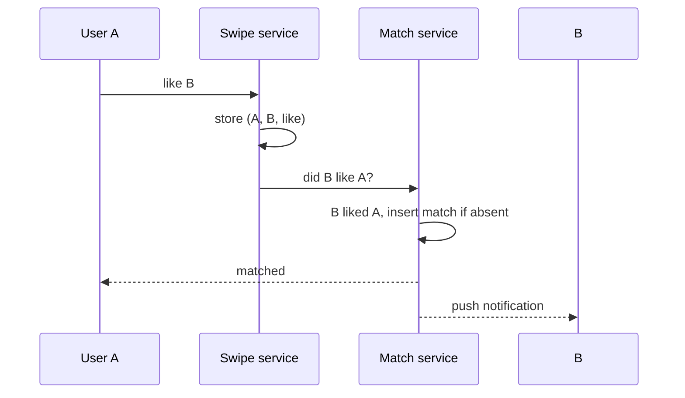

**Chat.** Reuse the [chat design](#4-design-a-chat-app-like-whatsapp--messenger), with a check that the pair is matched (and not unmatched/blocked).

**Location updates.** Update the geo index only when the user moves significantly (e.g. changes cell or > 1 km), not continuously; store coarse location for privacy and never expose exact distance precision.

**Abuse and safety.** Rate-limit swipes (also a product limit for free users), detect bots and fake profiles (behavioural signals, photo verification), photo moderation, block/report flows that immediately hide both users from each other.

#### Trade-offs
- Precomputed queues: instant swipes, but candidates can be slightly stale (someone moved or went inactive).
- Storing all passes forever (avoid re-showing) vs TTL (storage savings, occasional repeats).
- Geo precision vs privacy.

#### Failure modes
- Match service down: swipes are still stored; a reconciliation job finds mutual likes and creates matches later.
- Duplicate notifications: deduped by match ID.
- Hot cell (festival, big city): finer cells and caching of popular-area queries.

**Likely follow-ups**
- *How to avoid showing someone you've swiped?* Filter against the swipe store/Bloom filter when building the queue.
- *How to scale "who liked me"?* The likes-received index by target, paginated.
- *How to handle travel mode?* Treat the chosen location as the query location for queue building.

</details>

### 14. Design an online presence system ("online / last seen").

<details>
<summary>Answer</summary>

**In short:** Connected clients heartbeat (every ~30 s) through their WebSocket gateway, which writes `online` with a short TTL into a sharded in-memory store (Redis) and updates `last_seen`; if heartbeats stop, the key expires and the user is offline, no goodbye needed. Don't broadcast every change to every contact: subscribe only to contacts whose presence is currently visible, batch-fetch when a screen opens, debounce flapping, and enforce privacy at read time.

#### Requirements
- **Functional:** show whether contacts are online and when they were last seen; update within a few seconds; respect privacy settings ("hide last seen").
- **Non-functional:** hundreds of millions of users, very high churn (apps open/close constantly), approximate accuracy is fine, must never overload the system with fan-out.

#### Estimates
- 500M concurrent users × heartbeat every 30 s ≈ 17M heartbeats/s, mostly absorbed at the gateway (which already holds the connection) and turned into much less frequent store writes.
- Status changes: users go online/offline maybe 20–50 times/day → ~100K–300K changes/s. Naive fan-out to 200 contacts each would be ~50M messages/s, which is why fan-out must be selective.

#### High-level design
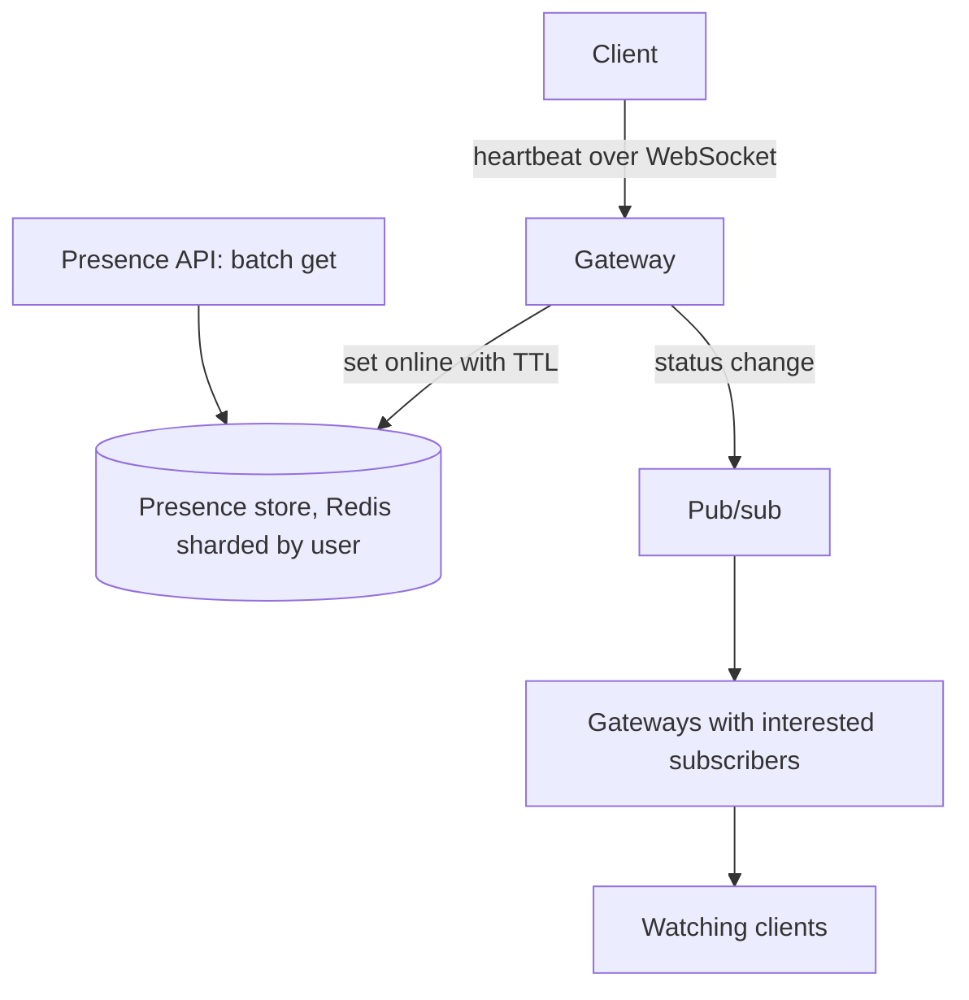

#### Deep dives

**Heartbeats and TTL.** On connect, the gateway sets `presence:{user} = online` with TTL ~60 s; each heartbeat refreshes it. On a clean disconnect, delete the key and write `last_seen:{user} = now`. On an unclean drop (app killed, phone in a tunnel), heartbeats stop, the TTL expires, and the user becomes offline automatically; `last_seen` is the last heartbeat time. The gateway can coalesce heartbeats so the store sees one refresh per ~30 s per user.

**Reading presence.** When a user opens their chat list, the client asks for the presence of the visible contacts in one batched call (multi-get across shards). That handles most of the product need.

**Live updates (fan-out).** Don't push every change to every contact. Instead:
- Subscribe to a contact's presence only while their chat or row is **visible**, and unsubscribe when it isn't.
- Gateways subscribe to pub/sub channels on behalf of their clients; a status change is published once and delivered only to gateways with interested watchers.
- For users with huge contact lists or groups, skip live presence entirely and rely on fetch-on-open.

**Debouncing.** Mobile networks flap. Use a grace period (e.g. 10–20 s) before announcing "offline", and don't announce "online" for a reconnect within that window. This removes most of the noise.

**Privacy.** Apply settings at read time ("last seen: nobody / my contacts / everyone"); a blocked user always sees nothing. Reciprocity rules (if you hide yours, you can't see others') are also read-time checks.

**Typing indicators.** Same idea but even more ephemeral: send only to the open chat, auto-expire after a few seconds, never persist.

#### Trade-offs
- Shorter TTL/heartbeat = more accurate but more battery and load; ~30–60 s is typical.
- Push presence updates (live, chatty) vs poll on screen open (cheap, slightly stale).
- Exact "last seen" vs coarse ("recently") for privacy and less churn.

#### Failure modes
- Presence store shard down: users on that shard appear offline; acceptable degradation, rebuilt by the next heartbeats within a minute.
- Gateway crash: all its users go offline after TTL and come back when they reconnect to other gateways.
- Reconnect storm: jittered reconnects; debouncing hides the flapping from contacts.

**Likely follow-ups**
- *How to show presence across multiple devices?* Online if any device is connected: per-device keys, user is online if any key exists.
- *Why not store presence in the main database?* High churn, ephemeral data: an in-memory TTL store is the right fit.
- *How does Discord/Slack handle huge servers?* Only send presence for members currently visible in the member list.

</details>

### 15. Design TikTok (short-video platform with a "For You" feed).

<details>
<summary>Answer</summary>

**In short:** The For You feed is recommendation-driven, not follower-driven: per request, candidate generation (embedding retrieval, trending, follows, an exploration pool for new videos) feeds a ranking model that predicts watch time and engagement, using real-time features updated from a stream of watch events. The client gets batches of ~10 video IDs and prefetches the first seconds of each from the CDN for instant playback; uploads go through a transcoding/moderation/embedding pipeline.

#### Requirements
- **Functional:** upload short videos; an infinite, personalised feed that starts instantly; likes, comments, shares, follows; a Following feed too.
- **Non-functional:** first frame in < ~200 ms when swiping, recommendations that adapt within a session, hundreds of millions of DAU, global CDN delivery, strong moderation.

#### Estimates
- 1B DAU × ~100 videos watched = 100B video views/day ≈ 1M+ views/s.
- Each view emits several events (start, watch progress, finish, like, skip) → millions of events/s into the stream.
- Uploads: tens of millions/day × several renditions → petabytes/month of media.

#### API
```
GET  /v1/feed/foryou?sessionId=…&count=10   → [{ videoId, manifestUrl, author, counts }]
POST /v1/events (batched) [{ videoId, type, watchMs, ts }]
POST /v1/videos/upload-url   POST /v1/videos { mediaId, caption, music }
```

#### High-level design
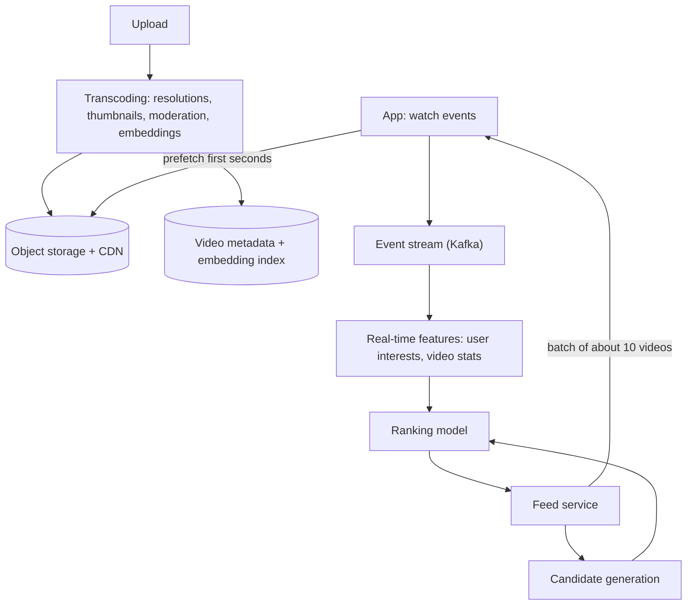

#### Deep dives

**Feed is recommendation-driven, not follower-driven.** Unlike Twitter's fan-out, nothing is precomputed per follower. Each request generates candidates and ranks them; following is just one signal. This lets a creator with zero followers go viral.

**Recommendation funnel.**
1. **Candidate generation** (thousands): approximate nearest neighbour search over video embeddings using the user's interest embedding; trending in the user's region/language; videos from followed creators; similar-to-recently-liked; an **exploration pool** of fresh uploads.
2. **Ranking** (hundreds): a model predicting multiple objectives – completion probability, watch time, like, share, follow, and negative signals ("not interested") – combined into a score.
3. **Re-ranking / policy**: diversity (not five videos of the same creator or sound in a row), dedupe already-seen, safety filters, ads insertion.

**Fast feedback loop.** Watch time, rewatches, skips and likes stream in; a real-time feature pipeline updates the user's short-term interests within seconds to minutes, so the next batch reflects what they just did. The model itself is also updated frequently (online/incremental training is publicly described for TikTok's recommender).

**Cold start.** New videos get a small exploration audience; if engagement (completion, likes, shares) is strong relative to peers, they're promoted to progressively larger pools. New users get popular/diverse content and a quick interest probe.

**Instant playback.** The client always holds a buffer of upcoming videos: it receives the next batch before the current one ends and **prefetches the first segments** (and thumbnails) of the next few. Videos are encoded in several bitrates and short segments; the CDN serves them close to the user.

**Counters and moderation.** Views/likes aggregated asynchronously; moderation runs at upload (ML + human review for borderline) and continuously as reports come in, with the ability to remove videos from all caches.

**Storage.** Metadata in a sharded DB; media in object storage with hot/cold tiers (most views happen in a video's first days).

#### Trade-offs
- Exploration vs exploitation: more new content means a fairer system for creators but riskier per-view quality.
- Prefetch aggressively (instant swipes) vs wasted bandwidth for videos never watched.
- Real-time features add freshness but complexity and consistency issues between online and offline features.

#### Failure modes
- Ranking service slow/down: fall back to cached/trending candidates so the feed never stops.
- Event pipeline lag: recommendations get staler but still work.
- Viral video: CDN handles it; counter sharding for likes.

**Likely follow-ups**
- *How do you avoid repeats?* A per-user seen set (Bloom filter) checked at candidate generation.
- *How is the Following feed built?* A simple fan-out/pull of followed creators, like Twitter.
- *How to measure success?* Online A/B tests on watch time, retention and satisfaction surveys, not just clicks.

</details>

### 16. Design Discord or Slack (servers/workspaces, channels, huge groups).

<details>
<summary>Answer</summary>

**In short:** Clients hold a WebSocket to a gateway and subscribe to the servers/channels they can see; messages are stored per channel partitioned by channel ID + time bucket with time-sortable IDs, published via pub/sub to only the gateways holding interested sessions; huge servers send live updates only to members actively viewing a channel and rely on per-user read-state markers for unread badges. Permissions are cached and checked on every send.

#### Requirements
- **Functional:** workspaces/servers containing channels; real-time messages, threads, reactions, mentions; presence; search; per-channel permissions/roles; unread counts; voice/video channels.
- **Non-functional:** delivery within ~100s of ms, servers with up to millions of members, message history retained (often forever, or per retention policy), high availability.

#### Estimates
- 100M DAU; billions of messages/day (~50K+/s average).
- Largest servers: millions of members, but at any moment only a small fraction is online, and far fewer are looking at a given channel. This asymmetry drives the design.

#### API / protocol
```
WS gateway: IDENTIFY → READY (servers, channels, read states)
            ← MESSAGE_CREATE, TYPING_START, PRESENCE_UPDATE
POST /channels/{id}/messages { content, nonce }
GET  /channels/{id}/messages?before=…&limit=50
PUT  /channels/{id}/read { lastReadMessageId }
```

#### Data model
- `messages(channel_id, bucket, message_id, author_id, content, ...)` – partition `(channel_id, bucket)` where `bucket` is a time window (Discord publicly described this scheme on Cassandra, later ScyllaDB), clustering by `message_id` (Snowflake, time-sortable).
- `read_state(user_id, channel_id, last_read_message_id, mention_count)`.
- `members(server_id, user_id, roles)`, `roles(server_id, role_id, permissions)`, `channel_overrides(channel_id, role_or_user, allow, deny)`.

#### High-level design
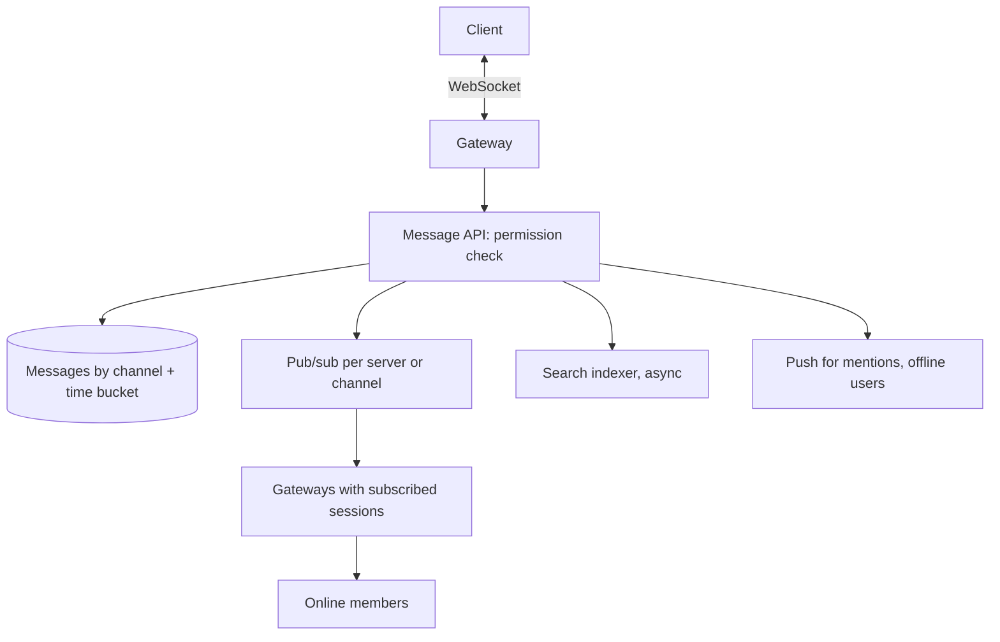

#### Deep dives

**Gateway layer.** Gateways hold sessions and know which servers/channels each session cares about. On connect (`READY`), the client receives the minimum needed state; members, history and presence are loaded lazily.

**Messages and partitioning.** Partitioning only by channel ID would create unbounded partitions in a busy channel; adding a time bucket keeps partitions bounded and makes "latest 50 messages" a read of the newest bucket(s). Time-sortable IDs make pagination (`before=<id>`) and ordering trivial.

**Fan-out.** A message is published once to the server/channel's pub/sub topic; only gateways with subscribed sessions receive it, and each gateway delivers to its local sessions. For **very large servers**:
- Send real-time message events only to sessions that have the channel open (or are mentioned), not to all online members.
- Load the member list lazily (only the visible slice of the sidebar).
- Everyone else learns about activity through unread markers when they look.
Discord has publicly described dedicated per-guild processes (Elixir) that coordinate fan-out for a server, with techniques to split work for the biggest servers.

**Read state.** Per user per channel `last_read_message_id`; a channel is unread if its latest message ID is greater. Mention counts are incremented on mention and reset on read. This avoids storing "unread" per message per user.

**Presence.** Expensive at scale: broadcast only to visible members, batch updates, and skip presence for inactive users in huge servers (see Q14).

**Permissions.** Role-based with per-channel overrides (allow/deny bits). Compute effective permissions, cache them at the gateway/API, check on every send and on subscription (users must never receive events for channels they can't see). Invalidate on role changes.

**Search.** Per-workspace/server search index (Elasticsearch-style) fed asynchronously from the message stream; queries are scoped by permissions.

**Slack specifics.** Data is partitioned by workspace (with enterprise grids spanning workspaces); strong focus on retention policies, legal hold, compliance exports, SSO and integrations (bots, webhooks, apps with scoped tokens).

**Voice/video.** Separate SFU-based media servers per voice channel, chosen by region (see Q12).

#### Trade-offs
- Lazy delivery for huge servers reduces load but means "real-time" only for active viewers.
- Time-bucketed partitions: bounded partitions, but reading across a bucket boundary needs two queries.
- Storing history forever (product value) vs storage cost and compliance requirements.

#### Failure modes
- Gateway node loss: clients reconnect and **resume** with a sequence number so missed events are replayed (or do a full re-sync).
- Hot channel (an announcement in a million-member server): pub/sub fan-out to gateways + rate limiting reactions, slow mode.
- DB hot partition: smaller buckets for very active channels.

**Likely follow-ups**
- *How do threads work?* A thread is a child channel with its own message partition and read state.
- *How do reactions scale?* Aggregated counts per (message, emoji) plus per-user records for "did I react".
- *How to do message edits/deletes?* Update in place by ID and publish `MESSAGE_UPDATE`/`MESSAGE_DELETE` events.

</details>

### 17. Design a collaborative whiteboard (like Figma or Miro) or a collaborative spreadsheet.

<details>
<summary>Answer</summary>

**In short:** Model the board as a tree of objects with properties; route all clients of a document to one document server over WebSocket; edits are small property changes ordered by the server with **per-property last-writer-wins** (Figma's publicly described approach), or CRDTs for offline-first. Presence is broadcast, not persisted; persistence is snapshots + an op log. A spreadsheet adds sparse chunked cell storage and a formula dependency graph recalculated in topological order.

#### Requirements
- **Functional (whiteboard):** shapes, text, frames, images, connectors on an infinite canvas; many concurrent editors with live cursors; undo/redo; comments; version history; large files.
- **Functional (spreadsheet):** cells with values and formulas, live recalculation, concurrent editing, sheets with up to millions of cells.
- **Non-functional:** local edits feel instant, remote edits appear in ~100 ms, no lost work, convergence across clients.

#### Whiteboard / design tool

**Data model.** The document is a **tree of objects** (pages → frames → shapes/text), each with an ID and a property map: `{id: 42, type: rect, parent: 7, x: 120, y: 80, fill: "#f00"}`. Ordering among siblings uses fractional indexes (a string between two neighbours) so concurrent inserts don't renumber everything.

**Sync model.**
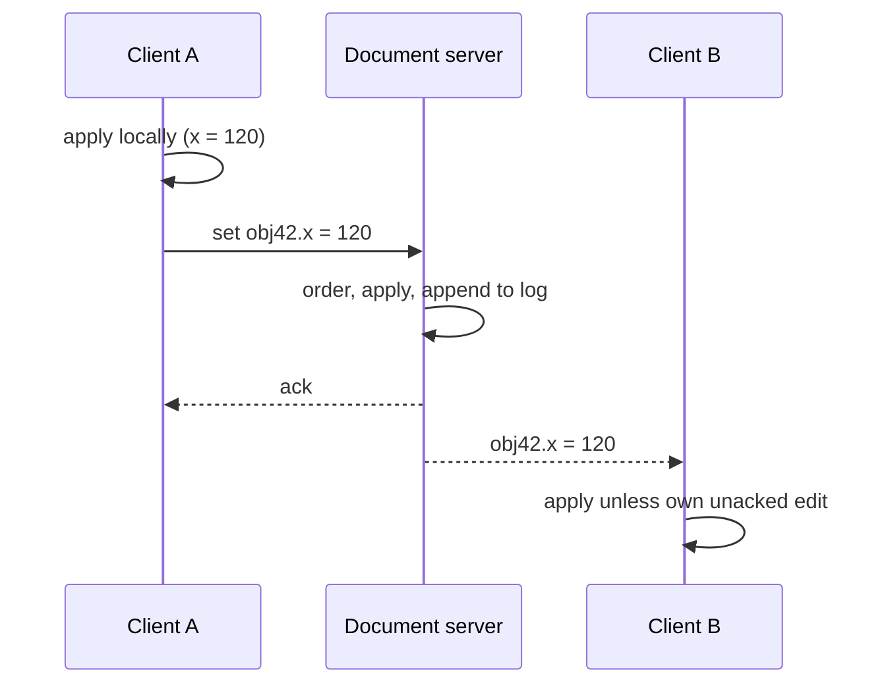
- Clients connect via WebSocket to the **document server** that owns the file (consistent hashing / leases).
- Edits are tiny property sets. With **server-ordered, per-property last-writer-wins**, concurrent edits to *different* properties merge naturally (Alice moves a shape while Bob recolours it), and edits to the *same* property resolve to the last write the server receives. A client ignores remote updates to a property it has an unacknowledged edit for, so its own change doesn't flicker back.
- Structural conflicts (moving an object into a parent that someone deleted, or creating a cycle) are validated by the server.
- **CRDTs** (e.g. Yjs, Automerge) are the alternative when offline-first or peer-to-peer editing matters; text inside shapes often uses a text CRDT/OT.

**Presence.** Cursors, selections, viewports broadcast at a throttled rate (~10–30 updates/s), never persisted.

**Persistence and big files.** Periodic snapshots plus an op log (durably appended before ack). For huge files, load pages/regions lazily and stream assets (images) from a CDN. Rendering uses WebGL/canvas with spatial indexing so only visible objects are drawn.

**Multiplayer undo.** Per user: undo reverts *your* last change (store the inverse property values at the time of your edit), not someone else's.

#### Spreadsheet (like Google Sheets)

**Storage.** Sparse: only non-empty cells, chunked by row ranges (e.g. blocks of 1,000 rows) so a viewport loads only nearby chunks.

**Formula dependency graph.** Each formula cell records the cells/ranges it reads. When a cell changes, find all transitive dependents and recalculate them in **topological order**; detect cycles and show `#REF!`/circular-reference errors. Range dependencies (`SUM(A1:A100000)`) are stored as ranges, not 100K edges.

```mermaid
flowchart TD
    A1["A1 = 5"] --> B1["B1 = A1 * 2"]
    A1 --> C1["C1 = A1 + B1"]
    B1 --> C1
    C1 --> D1["D1 = SUM(C1:C9)"]
```
Changing A1 recalculates B1, then C1, then D1.

**Collaboration.** Cell-level operations ordered by the server; text inside a cell can use OT; structural ops (insert/delete rows) must transform cell references in formulas and in concurrent ops – the hardest part. Recalculation can run on the server for large sheets (single source of truth) and on the client for responsiveness on small ones.

#### Trade-offs
- LWW per property: simple and fast, but one of two simultaneous edits to the same property is lost (acceptable for design tools, not for text).
- Central server ordering vs CRDT: simpler reasoning and validation vs offline/P2P support.
- Server-side recalc (consistent, scalable) vs client-side (instant, limited by device).

#### Failure modes
- Document server crash: new owner loads snapshot + log; clients resend unacked edits idempotently.
- Huge documents: memory limits on the document server; split into pages/sub-documents.
- Formula storms (one change triggering millions of recalcs): incremental and asynchronous recalculation with progress.

**Likely follow-ups**
- *How to handle 500 people viewing one board?* Viewers get broadcasts only; cap active editors; throttle presence.
- *How is version history done?* Named snapshots plus the op log between them.
- *Why fractional indexing?* Concurrent reorders/inserts get a position between neighbours without rewriting siblings.

</details>

### 18. Design a news aggregator (like Google News).

<details>
<summary>Answer</summary>

**In short:** Crawl publisher sites and RSS/Atom feeds on adaptive schedules, extract and deduplicate articles, **cluster them into stories**, classify by topic/region/language, and rank stories by freshness, source authority, coverage breadth and engagement. Precompute top stories per category/region in caches, then personalise at request time by re-ranking cached candidates with user interests while preserving source diversity; detect breaking-news spikes for rate-limited alerts.

#### Requirements
- **Functional:** top stories by region and topic; personalised "For you"; full coverage view (all articles about one story from many outlets); search; breaking-news alerts; follow topics/sources.
- **Non-functional:** new articles appear within minutes, pages load fast for very many users, source diversity and quality, compliance with publisher terms.

#### Estimates
- ~50K–100K sources; ~1–2M new articles/day ≈ 10–20/s, a small write load.
- Reads: tens of millions of users, mostly cacheable per region/category, with a personalised re-ranking layer.

#### High-level design
```mermaid
flowchart TD
    SRC["Publishers: RSS, sitemaps, pages"] --> CR["Crawler / feed poller"]
    CR --> EX["Extraction: text, metadata, entities"]
    EX --> DD["Near-duplicate detection"]
    DD --> CL["Story clustering"]
    CL --> CLS["Topic, region, language classifiers"]
    CLS --> ST[("Stories + articles store")]
    ST --> RK["Story ranking jobs"]
    RK --> CACHE[("Top stories per category and region")]
    U["User request"] --> PERS["Personalised re-ranking"]
    PERS --> CACHE
```

#### Deep dives

**Ingestion.** Poll RSS/Atom feeds and sitemaps; crawl section pages. Poll frequency adapts per source: a wire service every minute, a weekly blog once a day. Publishers can push via sitemaps/pings. Respect `robots.txt`, rate limits and publisher agreements; handle paywalls (index only what's permitted, label paywalled content).

**Processing.** Extract main article text (boilerplate removal), headline, author, publish time, images, language. Detect near-duplicates (syndicated wire copies) with **SimHash/MinHash** or embeddings and keep one canonical copy.

**Story clustering.** Group articles about the same event: embed each article (headline + lead + entities), assign it to the nearest existing story cluster if similar enough within a time window, otherwise start a new cluster. Clusters evolve: merge when two turn out to be the same story; let them age out. Extract key entities (people, places, organisations) for topic pages.

**Ranking stories.** Score each cluster by freshness (decay), **coverage breadth** (how many independent outlets), source authority/quality, originality (who broke it), and engagement, with region and language relevance. Then pick the representative article(s) for display, preferring authoritative and original reporting.

**Personalisation.** Precompute top stories per category/region (cached in Redis and at the CDN for logged-out users). At request time, fetch a few hundred candidate stories and re-rank with the user's interests (topics, followed sources, reading history), keeping **diversity** of sources and viewpoints and guarding against filter bubbles.

**Breaking news.** Detect spikes: a cluster gaining many articles from authoritative sources in minutes. Push notifications to interested users, heavily rate-limited (nobody wants 20 alerts a day) and region-aware.

**Quality and trust.** Source quality scores, spam/clickbait detection, misinformation policies, fact-check labels, and manual editorial overrides for sensitive events.

#### Trade-offs
- Freshness vs accuracy: early clusters may be wrong or based on unverified reports.
- Personalisation vs diversity and editorial responsibility.
- Polling cost vs latency (more frequent polling = fresher, more load on publishers).

#### Failure modes
- Source floods (a site publishing thousands of junk articles): per-source rate limits and quality gating.
- Clustering errors (two unrelated stories merged): confidence thresholds, re-clustering jobs.
- Cache stampede on a major event: pre-warm, request coalescing, serve slightly stale.

**Likely follow-ups**
- *How to support search?* An inverted index over articles with recency boosting, grouped by story cluster.
- *How to measure quality?* Human raters plus engagement metrics such as dwell time, not just clicks.
- *How to handle multiple languages?* Per-language pipelines; cross-language clustering with multilingual embeddings.

</details>

---

[⬅ Previous: Designs – Core Infrastructure](16-designs-core-infrastructure.md) · [⬅ Back to index](../README.md) · [Next: Designs – Location, Commerce & Fintech ➡](18-designs-location-commerce.md)
