# Designs – Location, Commerce & Fintech

[⬅ Back to index](../README.md)

Covers full interview walkthroughs of: Uber, Yelp (proximity search), Google Maps, food delivery, Ticketmaster, Amazon-style e-commerce, flash sales, a payment system, a digital wallet with a ledger, hotel booking, a stock exchange, an ad click aggregator, a real-time leaderboard and an online judge (LeetCode).

Each answer follows: **requirements → estimates → API → data model → high-level design → deep dives → trade-offs**.

---

### 1. Design Uber (ride-hailing).

<details>
<summary>Answer</summary>

**In short:** Drivers stream their GPS position every few seconds into an in-memory geo index (geohash or H3 cells, sharded by city). When a rider requests a trip, a matching service finds available drivers in nearby cells, ranks them by road-network ETA, and offers the trip to one driver at a time with a timeout, atomically reserving that driver so they can never be matched twice. The trip itself is a state machine in a strongly consistent database; live tracking runs over WebSockets; surge pricing comes from stream processing of supply versus demand per cell.

#### 1. Requirements

**Functional**
- A rider enters pickup and destination and sees a fare estimate and ETA.
- The request is offered to nearby drivers; one accepts.
- Rider and driver see each other's live location; the trip starts, ends, and payment is charged.
- Ratings, trip history, cancellations.

**Non-functional**
- Matching in a few seconds; location updates every ~4 s.
- **A driver must never be matched to two rides at once** (correctness on the matching path).
- High availability per city; a problem in one city must not take down others.
- Location data can be lossy (a missed ping is replaced 4 s later); trip and payment data cannot.

Saying out loud which data is "ephemeral and lossy" (positions) and which is "durable and consistent" (trips, payments) is the key framing for this design. It lets you use cheap, fast storage for the first and careful storage for the second.

#### 2. Estimates

| Quantity | Assumption | Result |
|---|---|---|
| Active drivers at peak | 5M | |
| Location update interval | 4 s | ~1.25M writes/s |
| Size of one update | ~100 bytes (id, lat, lng, heading, speed, ts) | ~125 MB/s ingest |
| Current positions in memory | 5M × ~100 B | ~500 MB (fits in RAM easily) |
| Ride requests | ~20M trips/day, peak ×3 | ~1K–2K requests/s, spiky |

The write rate is high but each write only *overwrites* the driver's current position, so the working set is small. That is why an in-memory store is the natural fit. The full history of pings goes to Kafka and a data lake for analytics, not to the hot path.

#### 3. API (sketch)

```text
POST /v1/estimates          {pickup, dropoff}            -> {fare, eta, surge, quote_id}
POST /v1/trips              {quote_id, Idempotency-Key}  -> {trip_id, status: REQUESTED}
GET  /v1/trips/{id}                                      -> trip state
POST /v1/trips/{id}/cancel
WS   /v1/drivers/stream     driver -> server: location pings; server -> driver: offers
POST /v1/offers/{id}/accept | /decline
WS   /v1/trips/{id}/track   rider <- driver location during the trip
```

The `quote_id` locks in the shown price for a few minutes so the rider pays what they saw. The idempotency key stops a flaky network retry from creating two trips.

#### 4. Data model

- **Driver location (in memory, by city):** `driver_id -> {lat, lng, cell_id, status, updated_at}` plus `cell_id -> set(driver_id)`.
- **Driver state:** `AVAILABLE | RESERVED | ON_TRIP | OFFLINE` with a version number.
- **Trips (SQL or a strongly consistent store):** `trips(trip_id, rider_id, driver_id, status, pickup, dropoff, quote_id, fare, created_at, version)`.
- **Trip events (append-only):** every state change, for audit and downstream consumers.

#### 5. High-level design

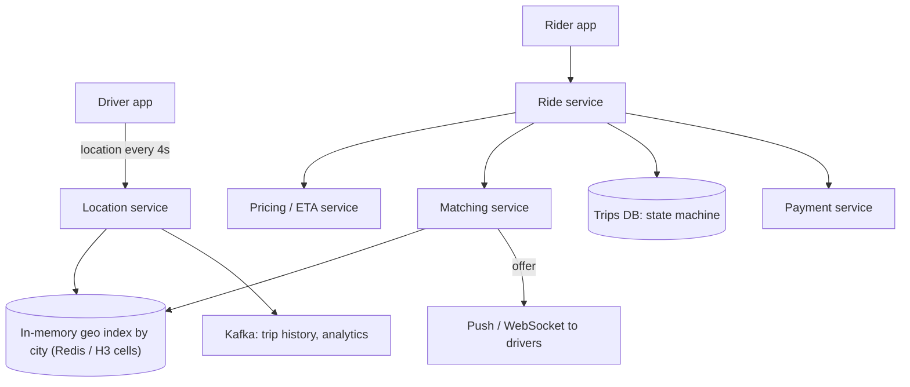

#### 6. Deep dives

**Location index.** Only current positions, in memory, keyed by cell. Geohash turns lat/lng into a string prefix where nearby points share prefixes; Uber publicly built **H3**, a hexagonal grid, because hexagons have uniform neighbour distances (every neighbour's centre is the same distance away, unlike squares where diagonals are farther). On each ping: compute the cell, and if the driver changed cells, move them from the old cell's set to the new one. Shard by city or region so a query never needs to cross machines. If a node dies, it is rebuilt within one ping interval because drivers resend every 4 s, so no replication of this data is strictly needed (a replica just shortens the gap).

**Matching.**
1. Look up available drivers in the pickup cell and its ring of neighbours (expand the ring if too few).
2. Rank candidates by **ETA on the road network**, not straight-line distance (a driver 300 m away across a river may be 10 minutes away).
3. Offer to the best driver with a ~10–15 s timeout; on decline or timeout, move to the next.
4. At scale, **batch matching** works better: every couple of seconds, solve an assignment problem across all waiting riders and free drivers in an area so the overall wait time is minimised instead of greedily giving each rider the nearest driver.

**No double booking.** Before sending an offer, reserve the driver atomically:

```text
-- Redis: only one matcher can take the lock
SET driver:42:lock trip:9001 NX PX 15000

-- or a conditional update on the durable driver state
UPDATE drivers SET status='RESERVED', trip_id=9001, version=version+1
WHERE driver_id=42 AND status='AVAILABLE';   -- 0 rows => someone else got them
```

The TTL means a crashed matcher releases the driver automatically. On accept, the trip moves to `MATCHED` and the driver to `ON_TRIP` in one transaction.

**Trip state machine.**

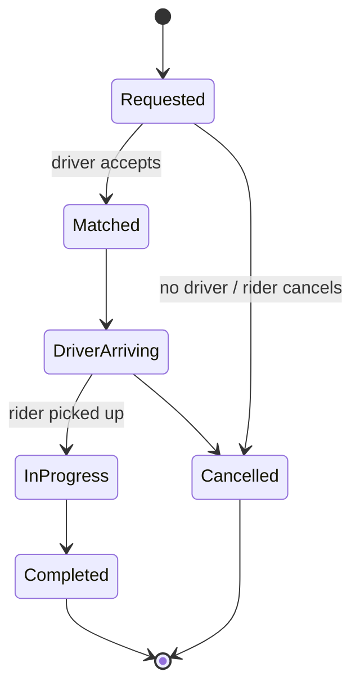

Each transition is a conditional update (`WHERE status = expected`), and emits an event to Kafka for payments, receipts, analytics and ratings. Illegal transitions (e.g. completing a cancelled trip) are rejected.

**Live tracking.** During a trip the rider holds a WebSocket subscribed to `trip:{id}`; the location service publishes the driver's pings to that channel (pub/sub). The client interpolates between pings so the car moves smoothly instead of jumping every 4 s.

**Surge pricing.** A stream job (Flink or similar) counts ride requests and available drivers per H3 cell per minute and computes a multiplier. The pricing service reads the latest multipliers from a cache; the quote shown to the rider is stored with the `quote_id`.

**Payment.** Authorise the card when the trip is requested or starts, capture the final fare on completion (see the payment system design in Q8).

#### 7. Trade-offs

| Decision | Choice | Why / cost |
|---|---|---|
| Location store | In-memory, unreplicated or lightly replicated | Fast and cheap; acceptable loss of a few seconds of positions |
| Geo indexing | H3 / geohash cells | Simple neighbour lookups; need ring expansion at boundaries |
| Matching | Batch vs greedy | Batch improves global wait times; adds a few seconds of latency |
| Trips | Strongly consistent DB | Needed for correctness and money; lower write throughput is fine (thousands/s) |
| Sharding | By city/region | Natural locality and blast-radius isolation; trips crossing regions need care |

#### 8. Scaling and failure modes

- **Cell-based architecture:** each city (or group) runs its own stack, so an outage is contained.
- **Location service overload:** drivers can reduce ping frequency when stationary; the server can shed load by dropping stale pings.
- **Matcher crash mid-offer:** the driver lock TTL expires and the rider's request is retried by another matcher (the request is durable in the trips DB).
- **Pricing slow or down:** fall back to cached multipliers or 1.0×, rather than blocking trip requests.
- **Phone loses network:** driver app buffers the trip's GPS trail locally and uploads it later so the fare can be computed from the actual route.
- **Datacenter failover:** trip state must be replicated; Uber has publicly described storing some trip state on the driver's phone too so a new region can recover in-flight trips.

#### Common pitfalls

- Ranking drivers by straight-line distance instead of ETA.
- Writing every location ping to a relational DB.
- Forgetting the "one driver, one trip" lock, or a lock without a TTL.
- Putting the whole world in one geo index instead of sharding by region.

#### Likely follow-ups

- **How do you find drivers near a cell boundary?** Search the cell plus its neighbour ring; H3 makes "k-ring" lookups cheap.
- **How do you handle a driver going offline mid-offer?** The offer times out and the lock expires; the matcher offers to the next candidate.
- **How would you add ride pooling?** Matching must consider detours for existing passengers, so it becomes a routing optimisation with capacity constraints, usually done in batches.

</details>

### 2. Design Yelp / a proximity service ("find restaurants near me").

<details>
<summary>Answer</summary>

**In short:** A proximity service is read-heavy over data that rarely moves, so keep business records in a relational DB (source of truth) and build a separate **geo index** (geohash cells or an in-memory quadtree) replicated to every search server. A search turns (lat, lng, radius) into a set of cells, fetches candidate business IDs from those cells and their neighbours, filters by exact distance and filters like "open now", ranks them, and hydrates details from a cache. Updates flow to the index asynchronously, because a business appearing a few minutes late is fine.

#### 1. Requirements

**Functional**
- Search businesses near a location within a radius (0.5 km to 20 km), with filters: category, open now, price, rating.
- View a business page with details, photos and reviews.
- Business owners add or update their listing (rarely).

**Non-functional**
- Low latency (< 200 ms for search), high availability.
- Read-heavy: searches vastly outnumber writes.
- Updates to businesses can take minutes to appear in search (eventual consistency is fine).

#### 2. Estimates

| Quantity | Assumption | Result |
|---|---|---|
| DAU | 100M, ~5 searches/day | ~500M searches/day, **~5K QPS avg**, ~15K peak |
| Businesses | 200M | |
| Geo index entry | id (8 B) + lat/lng (16 B) + cell info | ~30–50 B each, **~6–10 GB** total |
| Business detail | ~1–2 KB | ~300 GB in the DB, hot subset cached |

The geo index fits in memory on a single large server. So rather than sharding it, you **replicate** the whole index to every search server and scale reads horizontally. That is a key insight for this question.

#### 3. API

```text
GET /v1/search?lat=..&lng=..&radius=2000&category=cafe&open_now=true&cursor=..
    -> {businesses: [{id, name, distance_m, rating, ...}], next_cursor}
GET /v1/businesses/{id}                   -> details
POST/PUT/DELETE /v1/businesses/{id}       -> owner updates
GET /v1/businesses/{id}/reviews?cursor=..
```

#### 4. Data model

- `businesses(id, name, lat, lng, category, address, hours, price, rating_avg, rating_count, updated_at)` in SQL.
- Geo index: `geohash_prefix -> [business_id]` (as a table, Redis set, or an in-memory structure).
- Reviews in their own service/store, with aggregated rating fields denormalised onto the business.

#### 5. High-level design

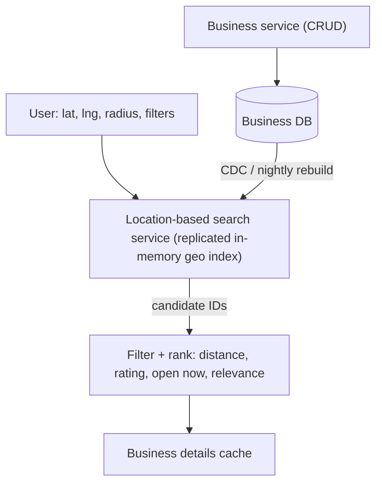

#### 6. Deep dives

**Option A: geohash.** Geohash interleaves the bits of latitude and longitude and encodes them in base32, so each extra character makes the cell smaller and nearby points usually share a prefix. Pick the precision from the radius:

| Geohash length | Approx. cell size | Good for radius |
|---|---|---|
| 4 | ~39 km × 20 km | 20 km |
| 5 | ~4.9 km × 4.9 km | 2–5 km |
| 6 | ~1.2 km × 0.6 km | 0.5–1 km |

Search the user's cell **plus its 8 neighbours**: two points a metre apart can sit in different cells with no shared prefix (the boundary problem), so prefix matching on one cell alone misses results. Then compute exact distances and drop anything outside the radius.

```sql
-- candidates from 9 cells, then precise filter
SELECT id, name, lat, lng FROM business_geo
WHERE geohash6 IN (:c, :n1, :n2, :n3, :n4, :n5, :n6, :n7, :n8);
-- app computes haversine distance, filters <= radius, ranks
```

**Option B: quadtree.** Recursively split the map into four quadrants until each leaf holds at most ~100 businesses. Dense cities get deep, small leaves; oceans stay as one big leaf, so the index adapts to density (a geohash has fixed sizes, so a downtown cell can hold thousands of businesses while a rural one holds none). Built in memory at startup from the DB (a few minutes for 200M rows), so roll out new servers gradually and serve from old ones meanwhile.

**Option C: off-the-shelf.** PostGIS (`ST_DWithin` with a GiST index), Elasticsearch `geo_distance` queries (also gives full-text search and filters in one place), or Redis `GEOSEARCH`. In practice many teams use Elasticsearch because they also need text search ("sushi near me").

| Option | Pros | Cons |
|---|---|---|
| Geohash in DB/Redis | Simple, easy to shard by prefix | Fixed cell sizes; boundary handling |
| Quadtree in memory | Adapts to density; very fast | Custom code; rebuild on start; updates trickier |
| PostGIS | Exact geo queries, SQL | Scaling a single DB for 15K QPS needs replicas |
| Elasticsearch | Geo + text + filters + ranking | Another system to run; near-real-time indexing |

**Expanding the search.** If a small radius returns too few results (rural areas), retry with a shorter geohash prefix (bigger cells) or walk up the quadtree.

**Ranking.** Distance alone is a poor ranking: combine distance, rating (with a confidence adjustment so one 5-star review doesn't beat 2,000 4.7-star reviews), popularity, "open now", and personalisation. Fetch a few hundred candidates from the geo index, then score them.

**Updates.** Owner edits go to the DB; CDC (change data capture) pushes them to the index servers, or the index is rebuilt nightly with incremental changes applied in between.

**Caching.** Business detail pages are cached (Redis/CDN). Search results for popular areas and queries can be cached keyed by (geohash, filters) for a short TTL.

#### 7. Scaling and failure modes

- **Read scaling:** add more replicas of the search service; each holds the full index.
- **If the index grows beyond one machine:** shard by geohash prefix / region, and route queries to the shard(s) covering the search circle.
- **Hot areas (Times Square):** caching by cell; dense cells handled by quadtree splitting.
- **Index server restarts:** load from a snapshot file rather than scanning the DB; keep enough replicas to absorb traffic during rolling restarts.
- **DB failure:** search keeps working from the in-memory index (stale reads OK); writes queue or fail gracefully.

#### Common pitfalls

- Searching only the user's own geohash cell and missing nearby businesses across the boundary.
- Sharding the index when it fits in memory: replication is simpler and faster.
- Computing exact distance for every business in the DB instead of narrowing with cells first.

#### Likely follow-ups

- **How would you support "open now"?** Store hours per business and evaluate against current time in the business's timezone during filtering.
- **Moving objects (food trucks)?** Then it becomes a high-write problem like Uber: in-memory index updated on every ping.
- **Why not just use a SQL `WHERE lat BETWEEN .. AND lng BETWEEN ..`?** A B-tree indexes one dimension well; two range conditions scan a wide strip. Geo indexes (geohash, R-tree, quadtree) reduce 2D to something indexable.

</details>

### 3. Design Google Maps (routing and ETA).

<details>
<summary>Answer</summary>

**In short:** Google Maps is several systems: **map tiles** (pre-rendered or vector, served from a CDN and cached on the device), a **road graph** where routing runs on a hierarchical structure (contraction hierarchies or partitioned graphs with precomputed shortcuts) so continental queries take milliseconds, a **live traffic pipeline** that turns anonymised phone location pings into per-segment speeds that update edge weights, an **ETA model** blending live, historical and ML signals, and **geocoding/place search**. Navigation runs mostly on the client, which reroutes when the user deviates or traffic changes.

#### 1. Requirements

**Functional**
- Render the map at any zoom level; pan and zoom smoothly.
- Search places and addresses (geocoding) and reverse-geocode a coordinate to an address.
- Compute the fastest route between two points, with alternatives and an ETA that reflects live traffic.
- Turn-by-turn navigation with rerouting.

**Non-functional**
- Very high read volume (over a billion users); route queries in well under a second.
- Map data updates (new roads) daily or weekly; traffic updates within minutes.
- Works on poor mobile networks; offline maps are a bonus.

#### 2. Estimates

| Item | Rough numbers | Implication |
|---|---|---|
| Map tiles | Zoom 0–21; zoom 21 has 4^21 ≈ 4.4 trillion tiles | Can't pre-render all at high zoom for raster; vector tiles + rendering on demand for detail, plus heavy CDN caching (most of the world is ocean/empty and compresses to tiny tiles) |
| Road graph | Hundreds of millions of nodes/edges worldwide | Too big for plain Dijkstra per request at continent scale |
| Traffic pings | Hundreds of millions of devices, a ping every few seconds while navigating | Millions of events/s into a stream pipeline |
| Route requests | Tens of thousands/s at peak | Must be milliseconds of CPU each |

#### 3. API (sketch)

```text
GET /tiles/{z}/{x}/{y}.pbf                  -> vector tile (CDN cached)
GET /v1/geocode?q=1600+Amphitheatre        -> [{place_id, lat, lng, address}]
GET /v1/route?from=lat,lng&to=lat,lng&mode=driving&depart=now
    -> {routes: [{polyline, distance_m, eta_s, steps[]}]}
POST /v1/nav/{session}/position             -> {on_route: bool, reroute?: route}
```

#### 4. High-level design

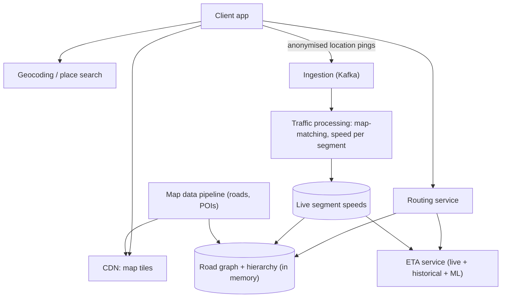

#### 5. Deep dives

**Map tiles.** The world is cut into a pyramid: zoom 0 is one tile; each zoom level splits each tile into four. A client asks for `z/x/y` tiles covering its viewport.
- **Raster tiles** are pre-rendered images: simple, but rotating, tilting or switching languages needs new images.
- **Vector tiles** carry geometry (roads, buildings, labels) and the client renders them with the GPU: smaller, smoothly rotatable, restylable (dark mode), and one tile can serve several zoom levels with overzoom.
- Tiles are immutable per map version, so they cache extremely well on the CDN and the device; offline maps are just a downloaded set of tiles plus a regional routing graph.

**Road graph and routing.** Intersections are nodes, road segments are directed edges with weights (travel time). Dijkstra on a continent explores millions of nodes: too slow. Speed-up techniques:
- **A\*** with a straight-line-distance heuristic: helps, but not enough at country scale.
- **Contraction hierarchies (CH):** preprocess by "contracting" unimportant nodes (residential streets) and adding shortcut edges that preserve shortest paths. A query runs a bidirectional search that only goes "up" the hierarchy, touching a few hundred to a few thousand nodes: milliseconds.
- **Graph partitioning:** split the graph into regions, precompute distances between each region's boundary nodes. A route is local search to the boundary, then hops across precomputed boundary-to-boundary costs. This is the idea behind multi-level / customisable approaches.

**Handling live traffic.** Pure CH bakes weights into the preprocessing, so changing a weight means redoing work. **Customisable contraction hierarchies** (and multi-level partitioning schemes) split preprocessing into a slow, weight-independent phase (graph structure) and a fast "customisation" phase that recomputes shortcut weights in seconds when traffic changes. That is how routing stays fast while weights change every few minutes.

**Traffic pipeline.**
1. Phones send anonymised, sampled GPS points.
2. **Map-matching** snaps noisy GPS traces onto the most likely road segments (often with a hidden Markov model).
3. A stream job aggregates speeds per segment per time window, discarding outliers (a parked car is not a traffic jam).
4. Live speeds update edge weights; segments without fresh data fall back to historical speeds for that time of day and day of week.

**ETA.** Sum segment travel times along the route, but for a trip departing now and lasting an hour, the traffic on the last segment in an hour matters, not now. So ETA blends live speeds (near the start), historical patterns (later in the trip), plus ML corrections for turns, traffic lights and events. Google has publicly described using graph neural networks for ETA prediction with DeepMind.

**Navigation.** The client downloads the route polyline and step list and follows it locally using GPS, so a dropped connection doesn't break directions. It reports position periodically; the server can push a better route if traffic changes, and the client requests a reroute when it detects it's off-route for a few seconds.

**Geocoding and search.** A search index over addresses and places, with geo-biasing (prefer results near the viewport), typo tolerance, and ranking by prominence. Reverse geocoding maps a point to the nearest address via a spatial index.

#### 6. Trade-offs

| Decision | Trade-off |
|---|---|
| Heavy precomputation (CH) | Very fast queries vs slow rebuilds; mitigated by customisable variants |
| Vector vs raster tiles | Smaller and flexible vs more client CPU/GPU and complex rendering |
| Client-side navigation | Works offline and reduces server load vs harder to update logic and route freshness |
| Live vs historical speeds | Freshness vs noise and sparse coverage on small roads |

#### 7. Scaling and failure modes

- Routing servers hold the graph for a region in memory and are replicated; route requests are stateless, so scale horizontally and route by region.
- If live traffic is stale or the pipeline lags, fall back to historical speeds (routes are still sensible).
- Map data updates are versioned: new graph and tiles built offline, then rolled out gradually; the client and server agree on a map version for a navigation session.
- Privacy: pings are anonymised, sampled and trimmed at the start and end of trips so homes can't be inferred.

#### Common pitfalls

- Proposing plain Dijkstra over the world graph per request.
- Forgetting that weights change constantly, which breaks naive precomputation.
- Treating ETA as distance divided by speed limit.

#### Likely follow-ups

- **How do you suggest alternative routes?** Find routes that share little with the best one and are not much slower (penalise already-used edges and rerun, or use via-node methods).
- **How do you detect a road closure?** Sudden absence of traffic on a normally busy segment, plus user reports and official feeds; set the edge weight to infinity.
- **How would offline routing work?** Download the regional graph with its hierarchy and run the same algorithm on the device, using historical speeds.

</details>

### 4. Design a food delivery platform (like DoorDash / Swiggy / Uber Eats).

<details>
<summary>Answer</summary>

**In short:** A food delivery platform is a three-sided marketplace (customer, restaurant, courier) built around an **order state machine**. Customers browse restaurants via geo search with heavily cached menus; placing an order is idempotent and **authorises** payment; the restaurant accepts and prepares; a **dispatch service** assigns a courier from an in-memory geo index, timing the pickup to when the food will be ready and batching orders where possible; the courier's location streams to the customer over WebSockets; payment is **captured** on delivery. Peaks at lunch and dinner drive the scaling design.

#### 1. Requirements

**Functional**
- Browse nearby restaurants and their menus; search dishes.
- Build a cart, place and pay for an order.
- Restaurant accepts or rejects, marks it ready.
- A courier is assigned, picks up, delivers; customer sees live tracking and ETA.
- Ratings, refunds, support.

**Non-functional**
- Order placement must be reliable and not duplicated; payment correct.
- Dispatch decisions in seconds; location updates every few seconds.
- Strong daily peaks (lunch and dinner can be several times the average).
- City-level availability: one city's problems shouldn't affect others.

#### 2. Estimates

| Quantity | Assumption | Result |
|---|---|---|
| Orders/day | 10M | ~115/s average, ~1K/s at dinner peak |
| Active couriers at peak | 500K sending location every 5 s | ~100K location writes/s |
| Menu reads | ~50 browse requests per order | ~50K reads/s peak, mostly cacheable |

Order volume is modest; reads (menus) and courier locations are the heavy parts.

#### 3. API (sketch)

```text
GET  /v1/restaurants?lat=..&lng=..&cuisine=..     -> nearby restaurants with ETA
GET  /v1/restaurants/{id}/menu                     -> menu (cached, versioned)
POST /v1/orders  {cart, address, payment_method, Idempotency-Key} -> {order_id, status}
GET  /v1/orders/{id}                               -> status + ETA
WS   /v1/orders/{id}/track                         -> courier location, status changes
POST /v1/restaurant/orders/{id}/accept | /ready
POST /v1/courier/offers/{id}/accept;  WS courier location stream
```

#### 4. Data model

- `restaurants(id, location, hours, prep_time_stats, status)`, `menu_items(id, restaurant_id, price, available, version)`.
- `orders(id, customer_id, restaurant_id, courier_id, status, items_json, total, payment_id, created_at, version)` in a strongly consistent DB, sharded by city or order ID.
- `order_events(order_id, from, to, at)` append-only.
- Courier locations: in-memory geo index (like Uber), plus a status (`idle`, `assigned`, `en_route`).

#### 5. High-level design

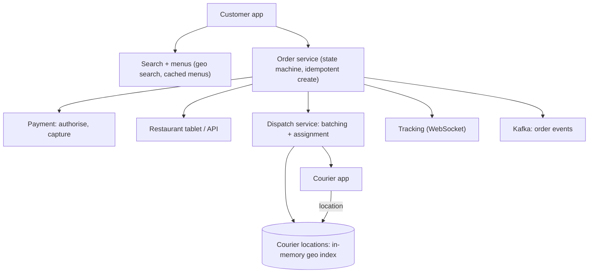

#### 6. Deep dives

**Order state machine.**

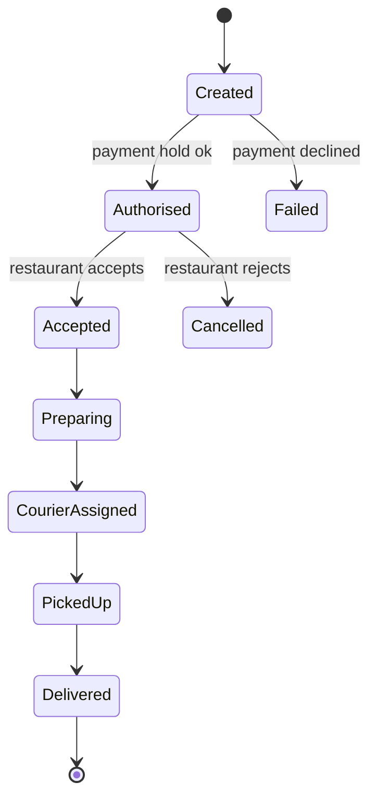

Each transition is a conditional update and emits an event. Payment is only **authorised** at order time (money held, not taken) and **captured** after delivery, so a rejected or cancelled order simply voids the hold instead of needing a refund. Creating the order uses an idempotency key, so a double tap or retry returns the same order.

**Dispatch.** The hard, interesting part. Assign a courier considering:
- **Food ready time** (predicted prep time): sending a courier too early wastes their time waiting; too late makes food cold. Aim for the courier to arrive just as the food is ready.
- **Courier location and travel ETA** on the road network.
- **Batching**: one courier carries two orders from the same or nearby restaurants going in similar directions, if it doesn't delay the first order too much.
- **Fairness and courier earnings**, acceptance rates.

Rather than greedily assigning each order as it arrives, the dispatcher re-optimises every few seconds across all pending orders and free couriers in a zone (an assignment problem with costs = predicted delay). Offers go to couriers with a timeout; on decline, the order returns to the pool. Reserve couriers atomically, exactly like drivers in Uber, so one courier isn't assigned two conflicting orders.

**ETA.** Shown at browse time, at checkout and during delivery. It is an ML prediction combining restaurant prep-time history (by time of day, order size), current restaurant load, courier availability, and travel time. It is updated as the order progresses; under-promising slightly keeps trust.

**Menus and availability.** Menus change rarely, so cache them (CDN/Redis) with a version number. Item availability ("out of paneer") updates from restaurants are eventually consistent; the order service validates items and prices at checkout and tells the user if something changed.

**Live tracking.** The customer subscribes to their order's channel; courier pings are fanned out via pub/sub only to that subscriber. The client interpolates movement.

#### 7. Trade-offs

| Decision | Choice | Trade-off |
|---|---|---|
| Dispatch | Batch re-optimisation | Better overall delivery time vs a few seconds of delay and complexity |
| Payment | Authorise then capture | Clean cancellations vs auth holds can expire on very long orders |
| Menu consistency | Cached, validated at checkout | Fast browsing vs occasional "item unavailable" at checkout |
| Sharding | By city/zone | Locality and isolation vs cross-city users and global reporting |

#### 8. Scaling and failure modes

- **Peaks:** pre-scale before lunch/dinner using predictable patterns; queue order events; degrade gracefully (disable promotions or personalised ranking, show simpler search) instead of failing checkout.
- **Restaurant tablet offline:** detect missed heartbeats, mark the restaurant temporarily closed, call the restaurant automatically, or cancel and refund.
- **No couriers available:** widen search radius, raise courier incentives (surge pay), show longer ETAs or stop accepting orders in the zone.
- **Dispatcher crash:** pending assignments are in a durable store; another instance picks them up; courier locks have TTLs.
- **Payment provider down:** retry with backoff, fail over to a second provider, or allow cash on delivery in markets that support it.

#### Common pitfalls

- Assigning a courier the moment an order is placed, ignoring prep time.
- Capturing payment upfront and then needing refunds for every cancellation.
- Not idempotent order creation (double orders on retry).

#### Likely follow-ups

- **How do you handle a courier who never shows up?** Track progress; if no movement towards the restaurant within a threshold, unassign and re-dispatch.
- **How would you shard?** By city/zone for dispatch and locations; orders by order ID with a city attribute for querying.
- **How do you prevent the restaurant from being overloaded?** Throttle: track in-progress orders per restaurant, increase quoted prep time, or temporarily hide it.

</details>

### 5. Design Ticketmaster (event ticket booking with high contention).

<details>
<summary>Answer</summary>

**In short:** Split the system into a read-heavy, cached browsing side and a small, strongly consistent booking path. Seats are rows with a status (`AVAILABLE → HELD → SOLD`); holding seats is an **atomic conditional update** (or a Redis `SET NX` with a TTL) that succeeds only if every seat is still free, and the hold expires after ~10 minutes if payment doesn't finish. Confirmation flips `HELD → SOLD` only if the hold still belongs to this order. Massive on-sale spikes are absorbed by a **virtual waiting room** that admits users at a controlled rate, plus CDN caching and bot protection.

#### 1. Requirements

**Functional**
- Browse and search events; view the seat map with availability.
- Select seats and **hold them for ~10 minutes** while paying.
- Pay and receive tickets; cancel or transfer.

**Non-functional**
- **Never sell a seat twice** (strong consistency on the booking path).
- Survive huge spikes: millions of users for ~50K seats when a popular tour goes on sale.
- Fairness (first come, first served within reason) and resistance to bots and scalpers.
- Browsing can be slightly stale; availability shown may lag a few seconds.

#### 2. Estimates

| Quantity | Assumption | Result |
|---|---|---|
| Users at on-sale | 10M trying in the first minutes | Read spike of hundreds of thousands of requests/s on event pages |
| Seats | 50K per show | Booking writes: at most ~50K successful holds, but many more attempts |
| Normal traffic | ~1K bookings/min across all events | Tiny; the design is all about spikes |

The interesting insight: the system only needs to *sell* 50K seats. Letting 10M users hit the seats DB directly would mean almost all requests are failed contention. Admission control converts a stampede into a steady flow.

#### 3. API

```text
GET  /v1/events?q=..&city=..                  -> events (cached)
GET  /v1/events/{id}/seatmap                   -> seats with approximate status (cached, few seconds)
POST /v1/events/{id}/holds {seat_ids, Idempotency-Key}  -> {hold_id, expires_at} | 409 seats taken
POST /v1/holds/{id}/checkout {payment_token}   -> {order_id, status}
DELETE /v1/holds/{id}                          -> release
```

#### 4. Data model

```sql
seats(event_id, seat_id, section, row, price_tier,
      status ENUM('AVAILABLE','HELD','SOLD'),
      hold_id NULL, hold_expires_at NULL, version,
      PRIMARY KEY (event_id, seat_id))
holds(hold_id, user_id, event_id, seat_ids, expires_at, status)
orders(order_id, hold_id, user_id, amount, payment_id, status)
events(event_id, venue_id, starts_at, on_sale_at, ...)
```

Partition by `event_id`: all contention for an event is local to one shard, and a transaction never needs to span shards.

#### 5. High-level design

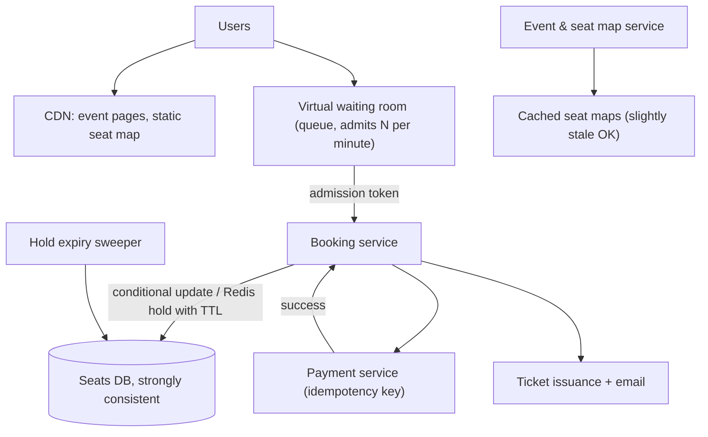

#### 6. Deep dives

**Holding seats safely.** The core correctness question. Use a single transaction with a conditional update:

```sql
BEGIN;
UPDATE seats
SET status='HELD', hold_id=:hold, hold_expires_at=now() + interval '10 minutes'
WHERE event_id=:e AND seat_id IN (:s1, :s2, :s3)
  AND (status='AVAILABLE' OR (status='HELD' AND hold_expires_at < now()));
-- if rows_updated != 3 -> ROLLBACK, return 409 (someone else got a seat)
COMMIT;
```

The `WHERE` clause makes it safe without explicit locks: two concurrent requests can't both see `AVAILABLE` and both win, because the database serialises updates to the same row. The second clause treats an expired hold as available ("lazy expiry"), so correctness doesn't depend on a sweeper running on time.

**Redis alternative.** `SET seat:{event}:{seat} {hold_id} NX EX 600` per seat (or a Lua script that sets all seats or none). Redis is very fast for the hold stampede, but the DB still needs to be the record for SOLD. If you use Redis, be explicit about what happens if Redis loses data (holds lost, which is tolerable because the DB confirmation re-checks) versus the DB (never acceptable).

| Approach | Pros | Cons |
|---|---|---|
| DB conditional update | One source of truth, simple, transactional | Hot rows under extreme contention |
| Pessimistic lock (`SELECT ... FOR UPDATE`) | Explicit | Lock waits pile up; risk of deadlocks with multi-seat holds (lock in sorted order) |
| Redis `SET NX EX` | Very fast, built-in TTL | Second system; must reconcile with DB |

**Confirmation.**

```sql
UPDATE seats SET status='SOLD', order_id=:o
WHERE event_id=:e AND seat_id IN (...) AND hold_id=:hold AND status='HELD';
```

If the hold expired and someone else took a seat, rows updated < expected: refund (or void the authorisation) and tell the user. To avoid this, authorise payment, then confirm seats, then capture. Payment calls carry an idempotency key so retries don't double-charge.

**Releasing holds.** Lazy expiry (above) plus a sweeper that resets expired holds to `AVAILABLE` so seat maps look accurate. The user can also release explicitly.

**Spikes: the virtual waiting room.** Before the on-sale time, users land in a queue page (served from the CDN). At on-sale, each gets a random or arrival-based position; the waiting room admits N users per minute by issuing signed, short-lived **admission tokens**; the booking service rejects requests without a valid token. Benefits: protects the core, gives a fair order, and shows users an honest position instead of errors. Combine with CAPTCHA, device fingerprinting, per-account ticket limits, and verified-fan pre-registration to fight bots.

**Seat map freshness.** The seat map is served from cache with a few seconds of staleness; occasionally a user picks a seat that just went. The authoritative check happens at hold time, and the UI updates. For very hot events, "best available" (system picks seats) reduces contention compared with everyone clicking the same front-row seats.

**General admission.** No seat identity, so keep a counter: `UPDATE inventory SET remaining = remaining - :n WHERE event_id=:e AND remaining >= :n`. For huge throughput, split the counter into shards (e.g. 10 buckets of 5K) and pick a bucket at random, falling back to others when one is empty.

#### 7. Trade-offs

- **Strong consistency only where it matters:** the seats table. Everything else (search, event pages, seat maps) is cached and eventually consistent.
- **Hold duration:** longer holds help slow payers but lock inventory away from others; ~5–10 minutes is typical.
- **Fairness vs throughput:** a waiting room adds latency for everyone but prevents collapse and rewards neither the fastest bot nor luck with retries.

#### 8. Failure modes

- **Booking service crashes after hold, before payment:** the hold just expires.
- **Payment succeeds but confirmation fails:** retry confirmation (idempotent); if the hold is gone, automatically refund; a reconciliation job catches payments without tickets.
- **DB shard for a hot event overloaded:** the waiting room's admit rate is the control knob; tune it to what the shard can handle.
- **Waiting room down:** fail closed for that event (pause the sale) rather than letting the stampede through.

#### Common pitfalls

- Read-then-write ("check if available, then update") without a condition, causing double sales.
- Relying only on a sweeper for expiry (if it lags, seats stay locked or, worse, get double-handled).
- Locking multi-seat selections in random order, leading to deadlocks.

#### Likely follow-ups

- **How would you show a live seat map to millions?** Publish seat status changes to a pub/sub channel per event section and push deltas, or poll the cache every few seconds.
- **What if a user opens two tabs?** Hold creation is idempotent per user and event, and you can limit active holds per user.
- **How do you resell or transfer tickets?** A ticket is reassigned atomically to a new owner with a new barcode; the old barcode is invalidated.

</details>

### 6. Design an e-commerce platform (like Amazon).

<details>
<summary>Answer</summary>

**In short:** Split by workload. The browse side (catalog, search, product pages) is enormous read traffic served from CDNs, caches, a document store and Elasticsearch, and it can be eventually consistent. The cart is a highly available per-user key-value store. Checkout is the small, correctness-critical part: a **saga** that creates a pending order, reserves inventory with atomic conditional decrements, authorises payment, confirms the order, and compensates (release stock, void payment) on failure, with idempotency keys at every step. An `OrderPlaced` event then drives fulfilment, shipping, email and analytics asynchronously.

#### 1. Requirements

**Functional**
- Product catalog with categories and rich, category-specific attributes.
- Search and browse; product detail pages with price, availability, reviews.
- Cart; checkout; payments; order history and tracking.
- Inventory across warehouses; sellers manage listings (marketplace).

**Non-functional**
- Browse: very high read QPS, low latency (page speed affects revenue), high availability.
- Checkout: correctness (no overselling beyond policy, no double charging), durable orders.
- Peak events (sales days) at many times normal traffic.

#### 2. Estimates

| Quantity | Assumption | Result |
|---|---|---|
| DAU | 100M | |
| Page views | ~20 per user/day | ~2B/day, **~25K/s avg**, ~100K+/s peak |
| Orders | 10M/day | ~115/s avg, ~1K+/s peak |
| Products | 500M SKUs × ~5 KB | ~2.5 TB catalog, plus images on object storage/CDN |

Reads outnumber orders by 100–1000×. That ratio justifies the split: optimise browsing for caching and availability; optimise checkout for correctness.

#### 3. API (sketch)

```text
GET  /v1/search?q=..&filters=..&cursor=..         -> results
GET  /v1/products/{id}                            -> product page data
PUT  /v1/cart/items/{sku} {qty}                   -> cart
POST /v1/checkout {cart_version, address_id, payment_method, Idempotency-Key}
     -> {order_id, status}
GET  /v1/orders/{id}                              -> status, shipments
```

#### 4. Data model

- **Catalog** (document DB): `{product_id, title, brand, category, attributes{...}, images[], seller_id}`. Category-specific attributes vary wildly (a TV vs a T-shirt), which fits a flexible schema.
- **Price and offers** (separate service): price can change often and per seller.
- **Inventory** (strongly consistent): `inventory(sku, warehouse_id, available, reserved, version)`.
- **Cart** (KV): `cart:{user_id} -> {items, updated_at, version}`.
- **Orders** (relational, sharded by user or order ID): `orders`, `order_items`, `order_events`.

#### 5. High-level design

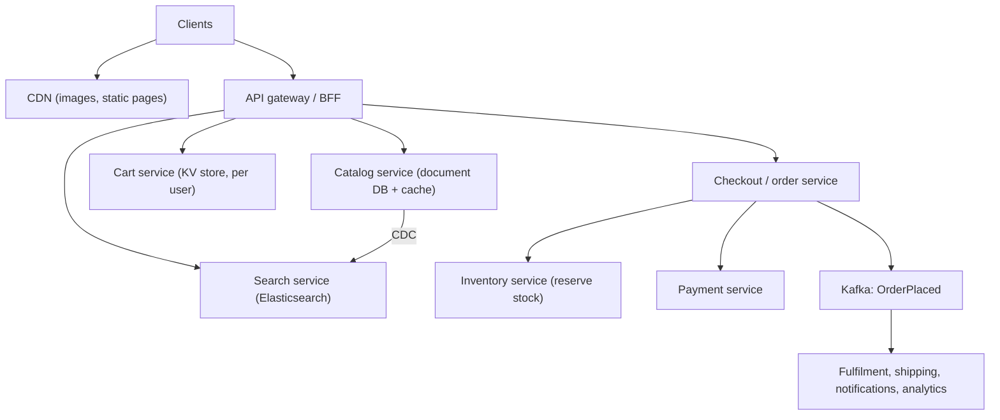

#### 6. Deep dives

**Catalog and product pages.** A product page aggregates catalog data, price, availability, delivery estimate, reviews and recommendations, each from a different service. A BFF calls them in parallel with timeouts and **degrades gracefully**: if recommendations time out, render without them; if availability is down, show "check at checkout" rather than an error page. Static parts are cached at the CDN; dynamic parts are fetched separately.

**Cart.** Per-user KV store (e.g. DynamoDB), partitioned by user ID. Amazon's Dynamo paper famously chose availability for the cart: under a network partition, both sides can accept writes and conflicting versions are merged later (union of items), accepting the occasional "deleted item comes back" anomaly over refusing to add items. Guest carts live in a cookie or anonymous ID and merge on login. The cart is not a reservation: stock is only reserved at checkout.

**Checkout saga.**

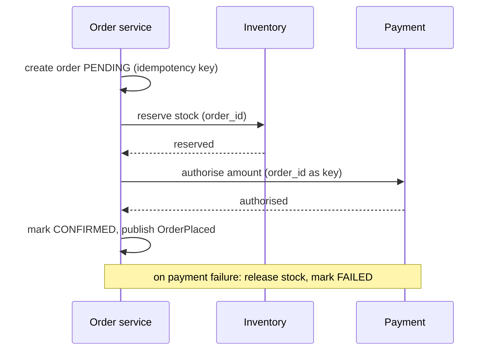

Each step is idempotent keyed by `order_id`, so a crashed orchestrator can resume by replaying. Compensations: release reservation, void authorisation. Payment is **captured** when the item ships (common in card-based e-commerce), so cancellations before shipping just void.

**Inventory and overselling.**

```sql
UPDATE inventory SET available = available - :qty, reserved = reserved + :qty
WHERE sku = :sku AND warehouse_id = :w AND available >= :qty;
-- 0 rows -> out of stock in this warehouse, try another or fail
```

Reservations carry an expiry so abandoned checkouts return stock. For hot items, split stock into buckets (several rows per SKU) to reduce row contention. Some businesses deliberately allow small oversells and backorders; it is a product decision.

**Search.** Elasticsearch indexes products, updated via CDC from the catalog; ranking combines text relevance, sales, conversion, availability and personalisation. Search results show cached prices and availability; checkout re-validates.

**Prices.** Prices can change between page view and checkout. Validate at order creation; if the price changed, show it before charging. Store the price paid on the order line (never recompute from the current catalog).

**Order events.** `OrderPlaced` goes to Kafka via an **outbox** (written in the same DB transaction as the order, then relayed) so the event is never lost or published for an order that didn't commit.

#### 7. Trade-offs

| Area | Choice | Trade-off |
|---|---|---|
| Catalog | Document DB + cache | Flexible schema vs weaker cross-entity queries |
| Cart | AP (available, merge conflicts) | Never lose an add-to-cart vs rare anomalies |
| Checkout | Saga with compensation | No distributed locks vs intermediate states visible and more code |
| Inventory | Reserve at checkout, not in cart | Higher conversion and fewer locked items vs occasional "sold out at checkout" |

#### 8. Scaling and failure modes

- Scale reads with CDN, caches and read replicas; shard orders by user ID (most queries are "my orders").
- Sales events: pre-warm caches, pre-scale, rate-limit, waiting rooms for hot deals (see Q7).
- Payment provider down: retry with backoff, failover provider, or accept the order and authorise later for trusted customers.
- Inventory service down: fail checkout for affected items (correctness) while browsing keeps working.
- Saga orchestrator crash: state is durable; resume from the last completed step.

#### Common pitfalls

- One shared database for everything, so browse traffic hurts checkout.
- Reserving stock when items are added to the cart.
- Publishing events outside the order transaction (lost or phantom events).

#### Likely follow-ups

- **How do you handle multiple sellers in one order?** Split into sub-orders per seller/warehouse with their own fulfilment, under one customer order and one payment.
- **How do you compute delivery estimates?** From warehouse stock location, carrier SLAs and cut-off times, cached per region.
- **How do reviews scale?** A separate service; aggregates (average, count) are precomputed and denormalised onto product data.

</details>

### 7. How would you design for a flash sale (e.g. 10,000 phones at a fixed time)?

<details>
<summary>Answer</summary>

**In short:** Millions of people hit "buy" in the same second for 10,000 units, so the goal is to stop almost all of that traffic before it reaches the core. Serve pages from a CDN, put buyers through a waiting room with admission tokens and bot checks, keep the stock counter in memory (Redis) and grant purchase slots with an atomic decrement, then create real orders asynchronously through a queue so the database only ever sees ~10,000 orders. Winners get a time-limited reservation to pay; unpaid slots go back to stock. Run the sale on isolated, pre-scaled infrastructure.

#### Why it's hard

A normal checkout path might handle 1K orders/s. A flash sale can bring 1M+ requests/s in the first seconds, nearly all for the same SKU: one hot row. If every request does a DB transaction on `inventory WHERE sku = X`, they all queue on a single row lock, the DB saturates, and the outage spreads to normal shopping. The key observation: **only 10,000 requests can succeed**, so the system should reject the rest as cheaply and as early as possible.

#### Requirements

- Sell exactly the stock (no oversell), fairly, at a fixed start time.
- Limit per user (e.g. one phone per account).
- Don't harm the rest of the site.
- Honest, fast feedback to users ("you're in", "sold out").

#### Design: a funnel

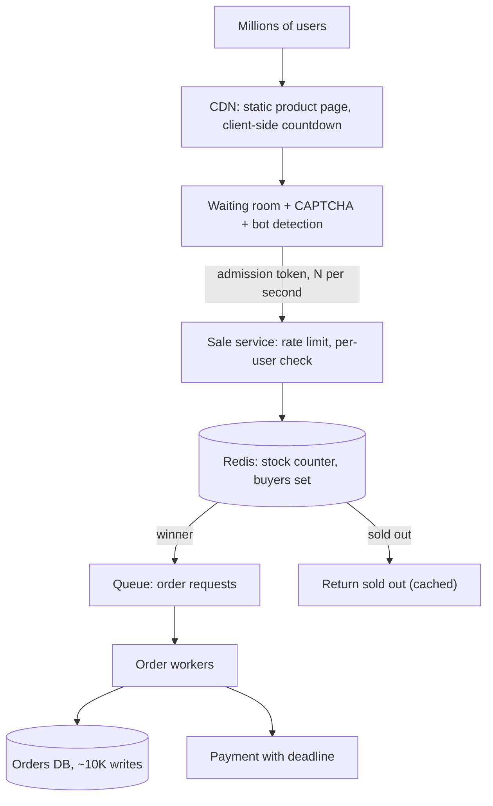

**Layer 1: keep traffic off the servers.** The product page is static and served by the CDN; the countdown runs on the client using server time fetched once; the "Buy" button is enabled at start time, and the purchase URL can be a signed, unguessable value released only then so bots can't pre-hit it.

**Layer 2: admission control.** A waiting room admits users at a rate the backend can handle, issuing signed tokens. CAPTCHA, device fingerprints, account age and per-IP limits remove bots. Once stock is gone, the waiting room itself shows "sold out" and stops admitting.

**Layer 3: in-memory inventory.** Preload the stock into Redis. Use a Lua script so "check per-user limit + decrement stock" is one atomic step:

```lua
-- KEYS[1] = stock key, KEYS[2] = buyers set; ARGV[1] = user_id
if redis.call('SISMEMBER', KEYS[2], ARGV[1]) == 1 then return -1 end -- already bought
local left = tonumber(redis.call('GET', KEYS[1]))
if left <= 0 then return 0 end                                      -- sold out
redis.call('DECR', KEYS[1])
redis.call('SADD', KEYS[2], ARGV[1])
return 1                                                            -- you won a slot
```

Redis handles on the order of 100K+ such operations per second per shard, single-threaded so no race conditions. A local "sold out" flag in each app server (set when Redis returns 0) means later requests don't even reach Redis.

**Layer 4: asynchronous order creation.** Winners get a reservation ID immediately; an order request goes onto a queue. Workers create the order in the DB at a steady rate, with a **unique constraint on (sale_id, user_id)** as a final guard. The DB sees ~10K inserts spread over seconds or minutes instead of millions of contending updates.

**Reservation timeout.** Winners have, say, 10–15 minutes to pay. If they don't, the slot is released: `INCR` the Redis counter, remove the user from the buyers set (or keep them excluded, per policy), and mark the order expired. Released slots can go to people still waiting.

#### Consistency between Redis and the DB

Redis is the gate, the DB is the record. Risks and mitigations:

| Risk | Mitigation |
|---|---|
| Redis grants a slot but the order worker fails | The queue retries; order creation is idempotent by reservation ID |
| Redis node fails mid-sale | Use replication with persistence (AOF); on failover, reconcile counter from DB orders + outstanding reservations; or briefly pause the sale |
| Counter drifts | A reconciliation job compares sold + reserved in DB with the initial stock |
| Oversell through bugs | Final DB guard: decrement a DB stock row with `WHERE stock > 0` in the order worker (cheap now because traffic is low) |

#### Isolation and preparation

- Run the sale on its own cell or cluster (separate Redis, separate worker pool) so normal shopping is unaffected.
- Pre-scale everything and pre-warm caches; load test with realistic traffic shapes (the first second is the hardest).
- Feature flags and a kill switch to pause the sale.
- Make degraded paths cheap: sold-out responses are cacheable.

#### Common pitfalls

- Hitting the relational DB row directly with every buy attempt.
- Using a non-atomic "GET then DECR", allowing oversells under concurrency.
- Forgetting idempotency: a user double-clicks and gets two orders or loses their slot.
- Letting the sale share infrastructure with the main store.

#### Likely follow-ups

- **How is it fair?** The waiting room assigns positions by arrival (or randomly at start to remove the advantage of refreshing); bots are filtered before admission.
- **What if 10K is spread over several warehouses or variants?** One counter per variant (colour, size); hot variants can be split into several counter keys.
- **Why not just a message queue for all requests?** Queuing millions of requests that will fail just delays the "sold out" answer; counting in memory first gives instant answers and only queues winners.

</details>

### 8. Design a payment system (like Stripe / a checkout payment service).

<details>
<summary>Answer</summary>

**In short:** A payment system is about correctness, not raw scale. Card data is tokenised into a PCI-scoped vault so the rest of the system only sees tokens. Every payment is a persisted **state machine** (`created → authorised → captured → refunded`), every API call and every call to the external payment service provider (PSP) carries an **idempotency key**, and timeouts are treated as "unknown" (resolved by querying the PSP or waiting for its webhook), never as failure. Every money movement is recorded in an append-only **double-entry ledger**, and a **reconciliation** job compares internal records with PSP and bank settlement files to catch any mismatch.

#### 1. Requirements

**Functional**
- Merchants charge customers by card or wallet; support authorise/capture, refunds, and payouts to merchants.
- Send results to merchants via webhooks.
- Reconcile with PSPs, card networks and banks.

**Non-functional**
- **Never double-charge, never lose a payment.**
- Full audit trail; regulatory compliance (PCI DSS for card data, strong customer authentication where required).
- High availability (a failed checkout loses revenue), but correctness wins over availability.
- Moderate throughput: even very large systems handle thousands to tens of thousands of payments/s, much less than social apps.

#### 2. Estimates

| Quantity | Assumption | Result |
|---|---|---|
| Payments/day | 10M | ~115/s avg, ~1K/s peak |
| Records per payment | Payment row + ~4–6 ledger entries + events | Tens of millions of rows/day; years of retention |
| PSP latency | 0.5–3 s, sometimes timeouts | Must handle slow and unknown outcomes |

Throughput is easy for a well-sharded SQL database. The difficulty is distributed correctness with an external system you don't control.

#### 3. API

```text
POST /v1/payment_intents
  Headers: Idempotency-Key: 7f3c...
  {amount: 4999, currency: "USD", merchant_id, payment_method_token, capture: "manual"}
  -> {id, status: "authorised" | "requires_action" | "pending" | "failed"}
POST /v1/payment_intents/{id}/capture  {amount?}
POST /v1/refunds {payment_id, amount, Idempotency-Key}
Webhooks to merchant: payment.succeeded, payment.failed, refund.succeeded
```

Amounts are integers in the minor unit (cents), never floating point.

#### 4. Data model

```sql
payments(id, merchant_id, amount, currency, status, psp, psp_reference,
         idempotency_key UNIQUE(merchant_id, idempotency_key),
         created_at, updated_at, version)
payment_attempts(id, payment_id, psp, request_id, status, raw_response)
ledger_entries(id, txn_id, account_id, amount, direction DEBIT|CREDIT, created_at) -- append-only
idempotency_keys(merchant_id, key, request_hash, response, created_at)
outbox(id, topic, payload, published_at)
```

#### 5. High-level design

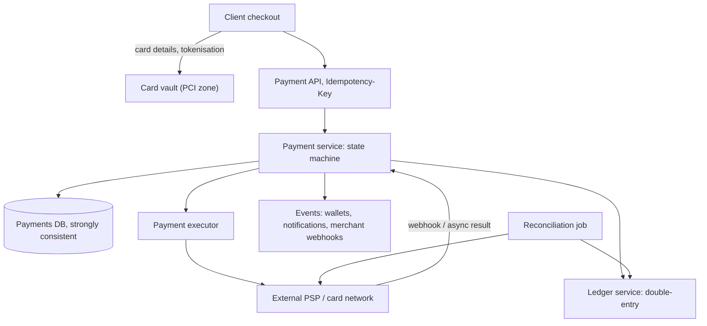

#### 6. Deep dives

**Idempotency.** Networks fail after the server did the work but before the client got the response, so clients retry. The server stores `(merchant, idempotency_key) → request hash + response` in the **same transaction** as the payment. A retry with the same key returns the stored response; a retry with the same key but different body is rejected. Equally important: send a stable reference (e.g. the attempt ID) to the PSP so that **its** side deduplicates, because your retry to the PSP after a timeout must not create a second charge.

**State machine.**

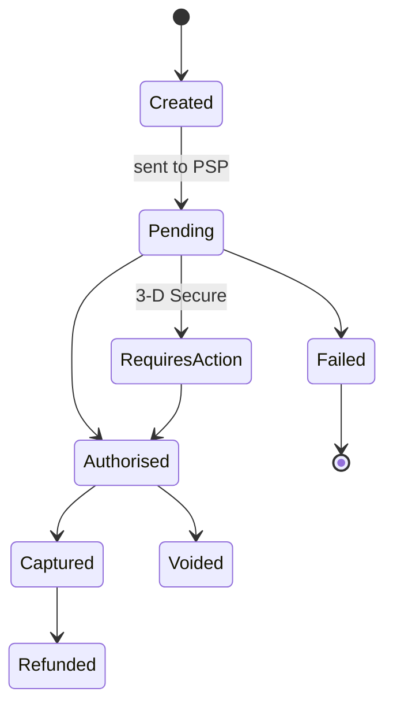

Persist the state **before** calling the PSP (so a crash leaves a `Pending` record to recover) and **after** the response. Transitions are conditional updates (`WHERE status = 'PENDING'`) so a late webhook and a polling worker can't both apply conflicting changes.

**Unknown outcomes.** A timeout means "we don't know". Mark the payment `Pending` and resolve it by: querying the PSP's status endpoint with the reference, waiting for the PSP webhook, or as a last resort, reconciliation. Never retry a charge with a **new** reference after a timeout. Tell the merchant "processing" rather than "failed".

**Double-entry ledger.** Each business event becomes a balanced transaction:

| Event | Debit | Credit |
|---|---|---|
| Customer pays $50 | PSP receivable 50 | Merchant payable 48.50, Platform fees revenue 1.50 |
| PSP settles to our bank | Bank 50 | PSP receivable 50 |
| Payout to merchant | Merchant payable 48.50 | Bank 48.50 |

Sum of debits equals sum of credits for every transaction, so errors become detectable. Entries are immutable; corrections are new reversing entries. Balances are computed (and cached/snapshotted) from entries.

**Reconciliation.** PSPs and banks send settlement files (daily or more often). A job matches every internal payment to an external record by reference and amount, classifying: matched, missing internally, missing externally, amount mismatch. Mismatches go to an automated fixer for known patterns and to finance ops for the rest. This is the final safety net that catches bugs everything else missed.

**Webhooks and events.** Use the **outbox pattern**: write the event row in the same DB transaction as the state change; a relay publishes it to Kafka. Merchant webhooks are delivered at least once with exponential backoff and signed payloads, so merchants must dedupe by event ID.

**Security.** Card numbers only enter the PCI vault (often directly from the client via a hosted field or SDK); everything else uses tokens, keeping most services out of PCI scope. Encrypt at rest, strict access, audit logs. 3-D Secure / strong customer authentication adds a redirect or challenge step (`RequiresAction`).

#### 7. Trade-offs

- **Strong consistency** (SQL with transactions, sharded by merchant or payment ID) over availability for the payments DB.
- **Synchronous vs asynchronous:** authorisation is synchronous for UX; settlement, payouts and webhooks are asynchronous.
- **Multiple PSPs:** routing across PSPs improves availability and cost, but each adds integration and reconciliation work.

#### 8. Failure modes

| Failure | Handling |
|---|---|
| Crash after PSP charged, before DB update | Pending record + PSP query / webhook recovers it |
| PSP outage | Circuit breaker, route to a backup PSP (new attempt, only if the first is known not to have charged) |
| Duplicate webhook | Idempotent transition by event ID and state check |
| Ledger imbalance | Alerts; reconciliation; no silent fixes |
| Region failure | Synchronous replication for payments DB, failover; pending payments resolved afterwards |

#### Common pitfalls

- Floats for money; missing currency on amounts.
- Treating a timeout as a failure and retrying with a new request.
- Updating a mutable `balance` column without an entries table.
- Generating the idempotency key on the server per request (it must come from the client and be reused on retries).

#### Likely follow-ups

- **Authorise vs capture?** Authorise holds funds on the card; capture actually takes them (later, e.g. on shipment). Uncaptured auths expire after some days.
- **How do refunds work?** A new refund object with its own idempotency key, a PSP call, and reversing ledger entries; partial refunds are allowed up to the captured amount.
- **How do you handle currency conversion?** Record both amounts and the FX rate in the ledger; keep separate accounts per currency.

</details>

### 9. Design a digital wallet / money transfer system (like PayPal, Venmo, UPI apps).

<details>
<summary>Answer</summary>

**In short:** The source of truth is an append-only **double-entry ledger**: a $10 transfer from A to B is one transaction with entries `A −10` and `B +10` written atomically, and balances are derived from entries (with snapshots). Prevent overdrafts with a conditional update (`balance >= amount`) or by **serialising all operations per account** through a single writer. Partition by account ID; same-shard transfers are local transactions, cross-shard transfers use a **saga** through a holding account (or a database with distributed transactions). Every transfer has a client-supplied ID for idempotency, and reconciliation with banks plus inline fraud checks complete the design.

#### 1. Requirements

**Functional**
- Users hold balances; send money to other users instantly; top up from a bank or card; withdraw to a bank.
- Transaction history and statements.

**Non-functional**
- **Balances must never go negative** (unless the product allows credit) and money is never created or destroyed.
- Exactly-once effect for every transfer, despite retries.
- Full auditability: every balance must be explainable by its history.
- High throughput: large real-time payment systems handle thousands to tens of thousands of transfers/s at peak, and the design should scale horizontally.
- Low latency (a transfer should feel instant, < 1–2 s).

#### 2. Estimates

| Quantity | Assumption | Result |
|---|---|---|
| Users | 200M accounts | |
| Transfers | 1B/day | ~12K/s avg, ~50K/s peak |
| Ledger rows | 2+ entries per transfer | 2B+ rows/day; partitioned and archived by time |

A single SQL primary won't handle 50K transactional writes/s with strong guarantees, so the ledger must be partitioned. That forces the cross-partition question, which is the heart of the interview.

#### 3. API

```text
POST /v1/transfers
  {transfer_id (client UUID), from_account, to_account, amount, currency}
  -> {transfer_id, status: COMPLETED | PENDING | REJECTED, reason?}
GET  /v1/accounts/{id}/balance
GET  /v1/accounts/{id}/transactions?cursor=..
POST /v1/topups, /v1/withdrawals   (involve external banks, asynchronous)
```

#### 4. Data model

```sql
accounts(account_id, user_id, currency, balance, version, status)    -- balance = cached projection
ledger_entries(entry_id, txn_id, account_id, amount_signed, created_at,
               balance_after)                                        -- append-only
transfers(transfer_id PRIMARY KEY, from, to, amount, status, created_at)  -- idempotency
```

Storing `balance_after` on each entry makes statements and audits easy and lets you verify the chain.

#### 5. High-level design

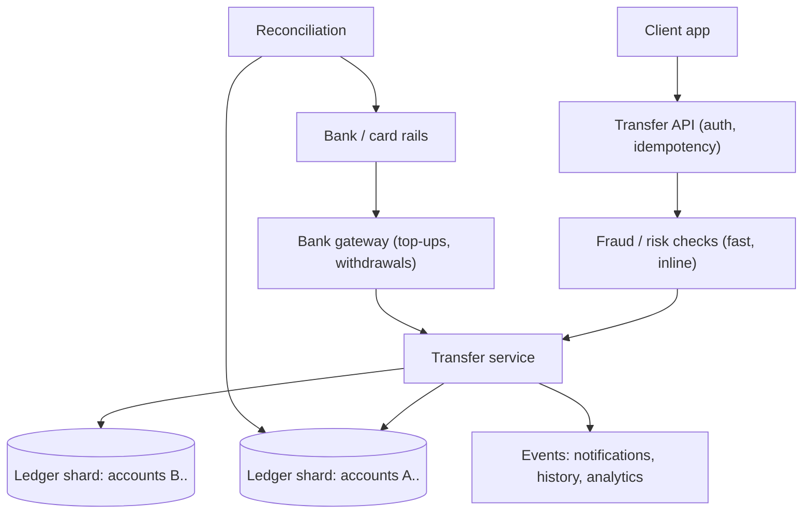

#### 6. Deep dives

**Same-shard transfer (the easy case).**

```sql
BEGIN;
INSERT INTO transfers(transfer_id, ...) VALUES (:id, ...);   -- duplicate key => already done, return stored result
UPDATE accounts SET balance = balance - :amt, version = version + 1
  WHERE account_id = :a AND balance >= :amt;                  -- 0 rows => insufficient funds, ROLLBACK
UPDATE accounts SET balance = balance + :amt WHERE account_id = :b;
INSERT INTO ledger_entries VALUES (.., :id, :a, -:amt, ..), (.., :id, :b, +:amt, ..);
COMMIT;
```

The idempotency row, both balance updates and both ledger entries commit together or not at all.

**Cross-shard transfer.** Options:

| Approach | How | Trade-off |
|---|---|---|
| 2PC | Coordinator prepares both shards, then commits | Atomic, but blocking if coordinator fails; lower throughput |
| Distributed SQL (Spanner, CockroachDB) | DB runs the distributed transaction | Simplest app code; cross-region latency and cost |
| Saga via holding account | Debit A into an in-flight account (shard 1), then credit B (shard 2); compensate by refunding A on failure | High throughput, no global locks; money is briefly "in transit" (still balanced) |

The saga keeps the books balanced at every step because the in-flight/suspense account holds the money between steps. A durable transfer record drives retries, and each step is idempotent by `(transfer_id, step)`.

**Serialising per account (event-sourcing style).** Instead of row locks, route every command for an account to one partition (e.g. a Kafka partition keyed by account ID) consumed by a single writer that holds the balance in memory, validates, appends events, and periodically snapshots. No concurrent writers means no race on the balance. Throughput comes from many partitions in parallel. Crash recovery: load the last snapshot and replay events since. This is how some high-throughput wallet and exchange systems are commonly built, at the cost of more complex infrastructure.

**Hot accounts.** A merchant receiving thousands of payments a second becomes a hot row. Credits to it can be split across sub-accounts (sharded balance) and summed when reading, or buffered and applied in batches; debits from it are rarer and can be serialised.

**Event sourcing and audit.** Because entries are immutable and every balance change has a cause, you can rebuild any balance at any point in time, answer regulators, and detect tampering. Corrections are reversing entries, never edits.

**External money movement.** Top-ups and withdrawals involve banks with slow, sometimes asynchronous confirmations. Model them as state machines (`initiated → pending_bank → settled | failed`) with funds held in clearing accounts; reconcile daily against bank statements.

**Fraud and limits.** Inline, low-latency checks (velocity limits, device reputation, ML risk scores) before committing; if the score service is slow, fall back to stricter static limits rather than blocking all transfers.

#### 7. Trade-offs

- **Consistency is non-negotiable for balances**; scale comes from partitioning by account, not from relaxing guarantees.
- **Synchronous local transactions vs asynchronous sagas:** sagas show intermediate states ("pending") to users but avoid distributed locks.
- **Mutable balance column vs pure event log:** the column gives fast reads; the log gives truth. Keep both, with the balance updated in the same transaction as the entry.

#### 8. Failure modes

| Failure | Handling |
|---|---|
| Client retries after timeout | `transfer_id` dedupe returns the original result |
| Saga crashes after debit | Durable transfer state; a worker resumes and credits, or compensates |
| Shard unavailable | Transfers touching it go `PENDING` or are rejected; others continue |
| Ledger and bank disagree | Reconciliation flags it; suspense account holds the difference until resolved |

#### Common pitfalls

- Read balance, check in application code, then write (race condition leading to negative balances).
- Floating-point money.
- No idempotency key, or one generated server-side per request.
- Deleting or editing ledger entries.

#### Likely follow-ups

- **How do you show the balance quickly?** Read the cached `balance` column (or the in-memory writer's state); the ledger is for truth and audit.
- **How do you handle currency conversion?** Separate accounts per currency and an FX account that takes the opposite side of both legs.
- **What does UPI-style interoperability add?** Transfers between different banks go through a central switch, so each transfer is a multi-party protocol with timeouts and reversals, not a local DB write.

</details>

### 10. Design a hotel booking system (like Booking.com / Airbnb).

<details>
<summary>Answer</summary>

**In short:** Model inventory as **one row per hotel, room type and night** (`total`, `reserved`). Searching is the heavy, read-mostly part, served from a search index with cached, slightly stale availability and prices. Booking is low volume but must be correct: in one transaction, conditionally increment `reserved` for every night of the stay (`WHERE reserved < total`, optionally with an overbooking allowance); if any night fails, roll back. A reservation ID created at the start of checkout makes the booking idempotent. Shard inventory by `hotel_id` so every booking transaction stays on one shard.

#### 1. Requirements

**Functional**
- Search hotels by location, dates, guests, filters; see availability and price.
- View hotel and room details.
- Book a room for a date range; pay now or at the hotel; cancel and modify.
- Hotel managers update rooms, rates and inventory.

**Non-functional**
- **No overbooking** beyond a configured policy.
- Search is latency-sensitive and very high volume; bookings are a tiny fraction (look-to-book ratios are commonly hundreds or thousands to one).
- Availability shown in search may be slightly stale; the booking step is authoritative.

#### 2. Estimates

| Quantity | Assumption | Result |
|---|---|---|
| Hotels | 1M, ~5 room types each | 5M room types |
| Inventory rows | 5M × 365 nights | ~1.8B rows (small rows; partitioned by hotel) |
| Bookings | 1M/day | ~12/s avg, ~100/s peak: easy for a sharded SQL DB |
| Searches | 1000× bookings | ~10K+/s: needs caching and a search index |

#### 3. API

```text
GET  /v1/search?location=..&checkin=2026-12-01&checkout=2026-12-04&guests=2&filters=..
POST /v1/reservations/start  {hotel_id, room_type_id, checkin, checkout}  -> {reservation_id, price, expires_at}
POST /v1/reservations/{id}/confirm {payment_token}                       -> {status: CONFIRMED}
POST /v1/reservations/{id}/cancel
PUT  /v1/hotels/{id}/inventory  (hotel admin)
```

#### 4. Data model

```sql
hotels(hotel_id, name, location, ...)
room_types(room_type_id, hotel_id, name, capacity, ...)
room_type_inventory(hotel_id, room_type_id, date, total, reserved,
                    PRIMARY KEY (hotel_id, room_type_id, date))
rates(hotel_id, room_type_id, date, price, currency)
reservations(reservation_id PRIMARY KEY, hotel_id, room_type_id, checkin, checkout,
             guest_id, status, amount, created_at)
```

Inventory is by room **type**, not by physical room: guests book "Deluxe King"; the hotel assigns room 412 at check-in. That keeps the counter simple.

#### 5. High-level design

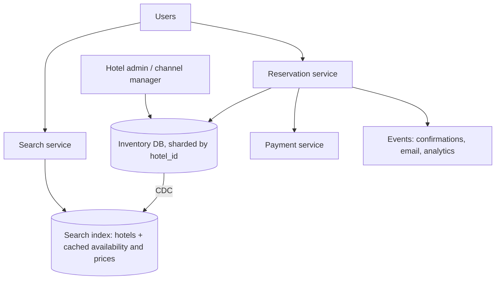

#### 6. Deep dives

**Booking a multi-night stay atomically.**

```sql
BEGIN;
-- one statement per night, or a single statement over the date range:
UPDATE room_type_inventory
SET reserved = reserved + 1
WHERE hotel_id = :h AND room_type_id = :rt
  AND date >= :checkin AND date < :checkout
  AND reserved + 1 <= total * 1.05;     -- 5% overbooking allowance (policy)
-- if rows_updated != number_of_nights -> ROLLBACK (some night is full)
INSERT INTO reservations (...) VALUES (:reservation_id, ..., 'CONFIRMED');
COMMIT;
```

The conditional `WHERE` prevents two concurrent bookings from both taking the last room, without explicit locks. Alternatives: optimistic locking with a `version` column (read, then update `WHERE version = :v`, retry on conflict), or pessimistic `SELECT ... FOR UPDATE`. With low contention per hotel, optimistic or conditional updates are the natural choice.

**Idempotency.** The client gets a `reservation_id` when checkout starts and reuses it on every retry. Because it is the primary key of `reservations`, a duplicate submit fails the insert and the service returns the existing reservation instead of booking twice.

**Holds during payment.** Either (a) reserve inventory with a `PENDING` status and expiry, then confirm after payment, releasing on expiry; or (b) authorise payment first, then run the inventory transaction, and void the authorisation if it fails. Option (a) avoids "paid but sold out"; option (b) avoids locking inventory for abandoned checkouts. Many systems use (a) with short expiries.

**Search.** Precompute for each hotel a compact availability summary per date (min price, rooms left) and index it in Elasticsearch with geo and filter fields. Update through CDC from the inventory DB. Search shows cached availability; the price and availability are rechecked at `reservations/start`, and the UI tells the user if something changed. Cache popular searches (city + dates) for a short time.

**Cancellations and modifications.** Cancel decrements `reserved` for each night in a transaction and marks the reservation cancelled; refunds follow the rate's policy. A date change is cancel-old + book-new in one transaction (on the same shard).

**Channel managers.** Hotels sell the same rooms on many sites. Inventory updates come from third parties via APIs; conflicts are why small overbooking allowances and "walk" policies (relocating a guest) exist in the industry.

**Airbnb specifics.** Each listing is usually a single unit, so inventory is a calendar of available/blocked dates per listing (`total = 1`). Booking may require host approval (a request state with a timeout), instant book skips it. Trust and safety, two-sided reviews, and pricing suggestions are separate services.

#### 7. Trade-offs

| Decision | Trade-off |
|---|---|
| Per-night inventory rows | Simple atomic updates; many rows (fine, they're tiny) |
| Stale availability in search | Fast and cheap search; occasional "no longer available" at booking |
| Overbooking allowance | More revenue from no-shows vs risk of relocating guests |
| Shard by hotel_id | All of a booking's rows on one shard; very large chains are still fine since each hotel is independent |

#### 8. Scaling and failure modes

- Search scales via index replicas and caching; reservation service scales via sharding by `hotel_id`.
- Inventory DB uses synchronous replicas for failover (bookings must not be lost).
- Payment failure after hold: hold expires or is released; user sees an error with no booking.
- CDC lag: search shows stale availability longer; booking remains correct.
- Hot hotels during events: contention is limited to one hotel's rows; conditional updates keep throughput acceptable.

#### Common pitfalls

- Storing availability as booked date ranges and checking for overlaps with queries (race-prone without locks).
- Checking availability in application code, then inserting.
- Forgetting idempotency on the confirm call.

#### Likely follow-ups

- **How do dynamic prices work?** A pricing service writes per-date rates; the price is quoted and locked at `reservations/start` for a short window.
- **How do you prevent abandoned holds from blocking inventory?** Short expiries plus a sweeper and lazy treatment of expired holds as free.
- **How would you add "only 2 rooms left" messaging?** Read from the cached summary; it's approximate and that's acceptable.

</details>

### 11. Design a stock exchange (order matching engine).

<details>
<summary>Answer</summary>

**In short:** Orders flow through gateways (auth, validation, pre-trade risk checks) into a **sequencer** that stamps each with a global sequence number and writes it to an append-only journal. A **matching engine** keeps each symbol's order book in memory and processes the sequenced input on a single thread, matching by **price-time priority**: best price first, earliest order first at the same price. Because the engine is deterministic, replaying the journal rebuilds its state exactly, and a hot standby fed the same input can take over instantly. Trades and book updates go out as sequenced events to market data (often multicast) and to clearing.

#### 1. Requirements

**Functional**
- Accept, cancel and modify orders: limit orders (at a price or better) and market orders (at the best available price).
- Match buyers and sellers fairly by price-time priority.
- Publish trades and order book updates (market data); send execution reports to brokers.
- Send trades to clearing and settlement.

**Non-functional**
- Ultra-low, *predictable* latency (microseconds per order inside the engine; tail latency matters more than averages).
- Deterministic and fair: same inputs always give the same outputs.
- No lost or duplicated orders; complete audit trail.
- High availability with near-instant failover, but correctness comes first.

#### 2. Estimates

| Quantity | Assumption | Result |
|---|---|---|
| Symbols | ~10K | Each symbol's book is independent |
| Orders | Billions of messages/day, mostly cancels and modifies | Peaks of hundreds of thousands to millions of messages/s across the exchange |
| Book size | Thousands of resting orders per symbol | Easily fits in memory |

The data is small; the challenge is latency and determinism, not storage.

#### 3. API (broker-facing, usually FIX or a binary protocol)

```text
NewOrder    {client_order_id, symbol, side BUY|SELL, type LIMIT|MARKET, price, qty, time_in_force}
Cancel      {client_order_id, orig_client_order_id}
Replace     {orig_client_order_id, new price/qty}
-> ExecutionReport {status NEW|PARTIALLY_FILLED|FILLED|CANCELED|REJECTED, fill_qty, fill_price}
Market data feed: book updates (add/modify/delete at price level), trades
```

#### 4. High-level design

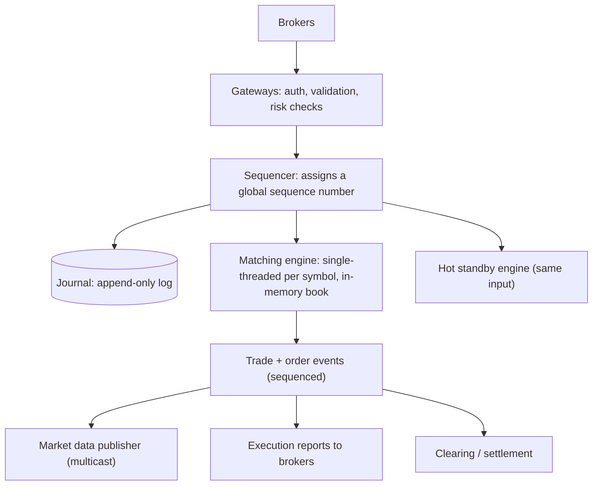

#### 5. Deep dives

**Order book structure.** Per symbol, two sides:
- **Bids** sorted by price descending (best = highest), **asks** sorted ascending (best = lowest).
- Each price level is a **FIFO queue** of orders (time priority).
- A hash map `order_id → node` for O(1) cancel (cancels are the most common message).

Prices are integers in ticks (never floats). Implementations use sorted maps/trees of price levels, or arrays indexed by price tick near the current price for O(1) access.

**Matching example.** Book has asks: 100 @ $10.01 (order A, earlier), 50 @ $10.01 (order B), 200 @ $10.02. A buy limit for 120 @ $10.02 arrives:
1. Match A: 100 @ $10.01 (A filled).
2. Match B: 20 @ $10.01 (B partially filled, 30 left).
3. Buyer fully filled: done. If anything were left, it would rest on the bid side at $10.02.

Trades execute at the **resting** order's price; the aggressor gets price improvement.

```text
match(incoming):
  while incoming.qty > 0 and best_opposite exists and crosses(incoming.price, best_opposite.price):
      resting = best_opposite.queue.front()
      fill = min(incoming.qty, resting.qty)
      emit Trade(price=resting.price, qty=fill)
      reduce both; pop resting if 0; remove level if empty
  if incoming.qty > 0 and incoming.type == LIMIT: add to own side at its price (back of queue)
```

**Why single-threaded and in-memory.** Matching is sequential by nature (each order changes the book the next one sees). One thread per symbol (or per group of symbols) avoids locks and cache-line contention, making latency predictable. The LMAX architecture popularised this: a ring buffer (the Disruptor) feeds a single business-logic thread, with journaling and replication happening in parallel on other threads.

**Sequencer, journal and determinism.** The sequencer gives every input a monotonic number and persists it before (or in parallel with) processing. Since the engine is a pure function of its input sequence, you get:
- **Recovery:** restart, load a snapshot, replay the journal from that point.
- **Hot standby:** a second engine consumes the same sequenced stream and stays in identical state; failover is switching which one publishes.
- **Audit:** regulators can replay any moment exactly.

Determinism rules: no wall-clock reads inside the engine (timestamps come from the sequencer), no randomness, no iteration over hash maps with unstable order.

**Latency engineering.** Kernel-bypass networking, pinned CPU cores, pre-allocated memory and object pools (no GC pauses in Java, or C++/Rust), co-location for brokers, binary protocols instead of text.

**Fairness.** The sequencer defines arrival order. Market data is published to all subscribers simultaneously (multicast), and some exchanges equalise cable lengths for co-located clients.

**Risk checks.** Gateways reject orders before they reach the engine: credit and position limits, price collars ("fat-finger" protection: reject prices far from the last trade), maximum order size. Exchange-wide circuit breakers halt trading on extreme moves.

#### 6. Trade-offs

| Decision | Trade-off |
|---|---|
| Single thread per symbol | Simple and predictable vs one very hot symbol limited to one core |
| In-memory state | Microsecond latency vs needs journal + replay for durability |
| Synchronous replication to standby | Zero data loss on failover vs added latency on every message |
| Multicast market data | Fair and efficient fan-out vs requires gap detection and retransmission service for lost packets |

#### 7. Failure modes

- **Engine crash:** standby takes over at the same sequence number; brokers see no lost orders.
- **Journal disk slow:** back-pressure on the sequencer (better to slow intake than lose durability).
- **Market data packet loss:** subscribers detect sequence gaps and request retransmission or a snapshot.
- **Gateway failure:** brokers reconnect to another gateway; idempotent `client_order_id` prevents duplicate orders.

#### Common pitfalls

- Using a database transaction per order (far too slow).
- Floating-point prices.
- Multi-threaded matching on a shared book with locks.
- Forgetting cancels and modifies, which are most of the traffic.

#### Likely follow-ups

- **How does a market order behave in a thin book?** It walks the book until filled; exchanges add protections (price bands) so it can't fill at absurd prices.
- **What's an auction (open/close)?** Orders accumulate without matching, then one price is computed that maximises matched volume and all cross at once.
- **How do you scale to more symbols?** Partition symbols across engine instances; each has its own sequencer stream or a shared sequencer with per-partition routing.

</details>

### 12. Design an ad click aggregator.

<details>
<summary>Answer</summary>

**In short:** The click service logs each click (with a unique, signed click ID) to Kafka and immediately redirects the user to the advertiser. A stream processor such as Flink deduplicates by click ID, filters fraud, and aggregates counts per ad per minute using **event-time windows with watermarks** so late clicks land in the right minute. Results are upserted idempotently into an OLAP store (Druid, Pinot, ClickHouse) for dashboards. Because the numbers drive **billing**, raw events are also kept in a data lake and a daily batch job recomputes exact counts and corrects the streaming results.

#### 1. Requirements

**Functional**
- Record ad clicks and redirect the user to the advertiser's landing page.
- Aggregate clicks per ad (and per campaign, country, device...) per minute.
- Query: "clicks for ad X in the last M minutes", "top N ads in the last hour", with filters.

**Non-functional**
- Redirect must be fast (< ~100 ms) and never fail because analytics is slow.
- Aggregates available within about a minute; queries in sub-second time.
- **Accurate**: no double counting, no lost clicks (money depends on it).
- Handle late and out-of-order events; fraud filtering.

#### 2. Estimates

| Quantity | Assumption | Result |
|---|---|---|
| Clicks/day | 10B | ~115K/s avg, ~500K/s peak |
| Event size | ~200 B | ~2 TB/day raw |
| Active ads | 10M | Aggregated rows: up to 10M × 1440 min/day if every ad got clicks every minute; in practice far fewer non-zero rows |

#### 3. API

```text
GET /click?ad=123&imp=<signed impression id>   -> 302 Location: advertiser URL
GET /v1/ads/{id}/clicks?from=..&to=..&granularity=minute&filter=country:IN
GET /v1/ads/top?window=1h&n=100&filter=..
```

#### 4. Data model

- **Raw click event:** `{click_id, impression_id, ad_id, campaign_id, user_id/hash, ip, user_agent, country, event_time, ingest_time}`.
- **Aggregate:** `(ad_id, minute, dimensions...) -> click_count, unique_users_approx`, keyed for idempotent upsert.

#### 5. High-level design

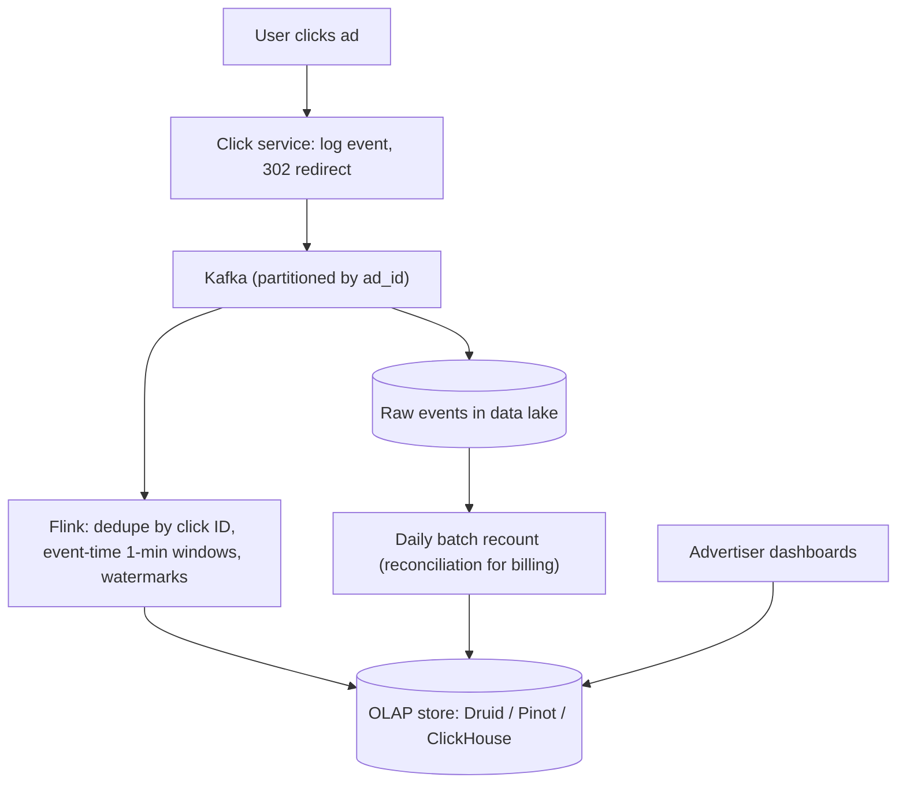

#### 6. Deep dives

**Click path.** The click service validates the signed impression ID (proving the ad was actually served), produces the event to Kafka asynchronously (with a local buffer if Kafka is briefly slow), and returns the 302 at once. If Kafka is down, write to local disk and ship later, rather than blocking the user's redirect.

**Deduplication.** Users double-click, browsers retry, and bad actors replay URLs. Each click carries a unique ID; Flink keeps recently seen IDs in keyed state with a TTL (e.g. 24 hours), or a Bloom filter for memory efficiency with a small false-positive rate. Fraud filters (IP reputation, click rate per user, bot user agents) mark or drop invalid clicks; advertisers are billed only for valid ones.

**Event time and watermarks.** Aggregate by when the click *happened*, not when it arrived: mobile clients can deliver events minutes late. A **watermark** says "I believe all events up to time T have arrived"; when it passes the end of a window, Flink emits the window's count. Events arriving after that but within an **allowed lateness** update the window again (emit a corrected count); events later still go to a side output and are fixed by the batch job.

```text
clicks
  .keyBy(ad_id)
  .window(TumblingEventTimeWindows.of(1 minute))
  .allowedLateness(5 minutes)
  .aggregate(count)          // emits updates when late events arrive
  -> upsert into OLAP keyed by (ad_id, window_start)
```

**Exactly-once.** Flink checkpoints its state and Kafka offsets together. If it crashes, it restarts from the last checkpoint and reprocesses some events. That is safe if writes to the sink are **idempotent upserts** keyed by `(ad_id, minute)` (overwrite the count, don't add to it) or use a transactional sink. Result: each click affects the final number exactly once.

**Hot ads.** One viral ad can overload the single Kafka partition and Flink task for its key. Pre-aggregate locally (combine counts in each task for a second before the shuffle), or salt the key (`ad_id#0..9`), aggregate per salt, then sum the salts in a second step.

**Querying.** OLAP stores are columnar, pre-aggregate on ingest (roll-ups), and index dimensions, so "clicks per ad per minute for the last day, filtered by country" scans little data. Keep minute granularity for recent data and roll up to hourly/daily for older data to save space. Top-N queries can be served from a separate stream job keeping a heap per window, or by the OLAP store directly.

**Reconciliation (Lambda style).** The batch job reads raw events from the lake (complete, including very late events), applies the same dedupe and fraud logic, and overwrites the day's aggregates. Billing uses the reconciled numbers; dashboards show streaming numbers that are corrected later. Kappa-style alternative: reprocess by replaying Kafka through the same streaming code, avoiding two codebases.

#### 7. Trade-offs

| Decision | Trade-off |
|---|---|
| Streaming + batch (Lambda) | Fresh numbers plus exact billing vs two pipelines to keep consistent |
| Allowed lateness window | More accurate real-time counts vs more state and more updates |
| Bloom filter dedupe | Low memory vs rare false positives (dropping a real click) |
| Minute granularity | Detailed charts vs storage; roll up older data |

#### 8. Failure modes

- **Flink job crash:** restart from checkpoint; idempotent sink means no double counting.
- **Kafka broker loss:** replication factor 3 with `acks=all` for the click topic.
- **OLAP store down:** dashboards stale, ingestion buffers in Kafka; billing unaffected (batch).
- **Bad deploy that miscounts:** replay Kafka or the raw lake to recompute.

#### Common pitfalls

- Making the redirect wait for the analytics write.
- Aggregating by processing time, which misplaces late clicks.
- Using `count += n` sinks with at-least-once delivery (double counts on retry).

#### Likely follow-ups

- **How do you count unique users?** HyperLogLog sketches per window: mergeable and small, with ~1% error.
- **How long to keep raw data?** As long as billing disputes and regulation require; tier to cheaper storage.
- **How do you detect click fraud in real time?** Rate limits per IP/device, anomaly detection on click-through rates, and rules that flag sudden spikes for an ad.

</details>

### 13. Design a real-time gaming leaderboard.

<details>
<summary>Answer</summary>

**In short:** Use a **Redis sorted set** per leaderboard (e.g. per season): `ZADD`/`ZINCRBY` to update a score, `ZREVRANGE` for the top N and `ZREVRANK` for a player's rank, all O(log n). Persist scores in a durable database as the source of truth so Redis can be rebuilt. One sorted set handles tens of millions of players; beyond that, shard (by score range, or by user with scatter-gather for the top N) and accept approximate ranks for the long tail. Break ties with a timestamp encoded in the score, and validate scores on the server.

#### 1. Requirements

**Functional**
- Update a player's score after each match.
- Show the top 10/100.
- Show a player's own rank and the players just above and below them.
- Friends leaderboard; seasonal/monthly leaderboards that reset.

**Non-functional**
- Near-real-time (rank visible within a second or two of a match ending).
- Millions to tens of millions of players; high read rate (leaderboard is opened often).
- Scores must not be lost; cheating should be hard.

#### 2. Estimates

| Quantity | Assumption | Result |
|---|---|---|
| Players | 25M monthly active | |
| Score updates | 5 matches/day per DAU (5M DAU) | 25M/day, ~300/s avg, a few thousand/s peak |
| Leaderboard reads | 10× updates | ~3K–30K/s |
| Memory | ~100 B per sorted-set member incl. overhead | ~2.5 GB for 25M members: fits one Redis node |

#### 3. API

```text
POST /v1/scores {match_id, user_id, score_delta}   (from game server, not client)
GET  /v1/leaderboards/{season}/top?n=10
GET  /v1/leaderboards/{season}/users/{id}           -> {rank, score, neighbours: [...]}
GET  /v1/leaderboards/{season}/friends/{id}
```

#### 4. Why a sorted set

A sorted set is a hash map (member → score) plus a skip list ordered by score, so it supports both "what is this user's score" and "who is at rank k" efficiently.

| Approach | Top N | Rank of a user | Problem |
|---|---|---|---|
| SQL `ORDER BY score DESC LIMIT 10` | Fast with an index | `COUNT(*) WHERE score > x` scans many rows | Rank queries get slow at millions of rows |
| Recompute ranks in a batch job | Fast reads | Fast reads | Not real time |
| Redis sorted set | O(log n + N) | O(log n) | Memory-bound per node |

```text
ZINCRBY lb:2026-11 50 user:42          # add 50 points after a match
ZREVRANGE lb:2026-11 0 9 WITHSCORES    # top 10
ZREVRANK lb:2026-11 user:42            # 0-based rank of user 42
ZREVRANGE lb:2026-11 (r-5) (r+5)       # neighbours around rank r
ZMSCORE lb:2026-11 user:7 user:9 ...   # friends' scores, sort in the app
```

#### 5. High-level design

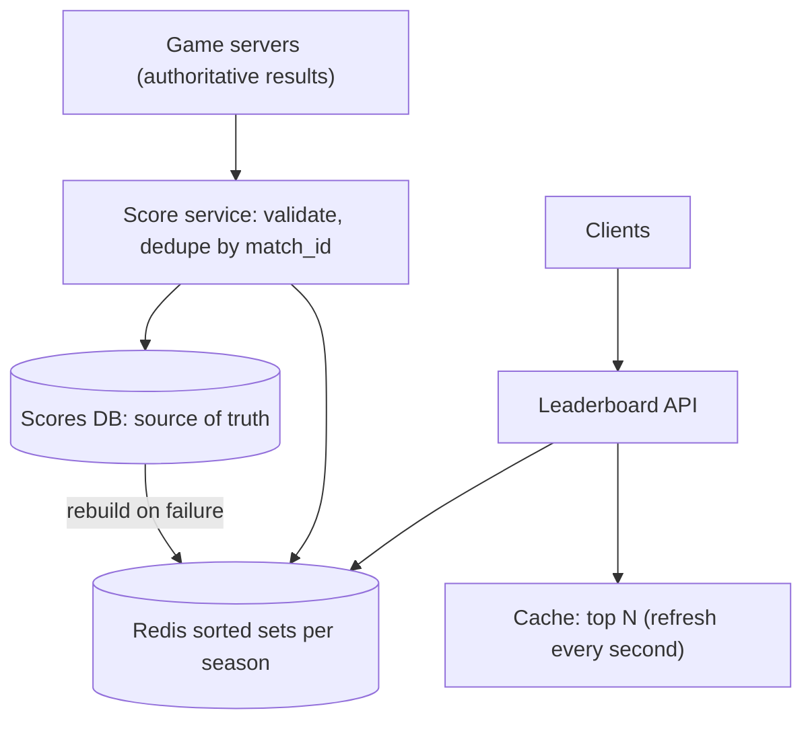

#### 6. Deep dives

**Write path.** Game servers (not clients) report match results. The score service dedupes by `match_id` (so a retried request doesn't add points twice), writes to the DB, then updates Redis. To avoid DB and Redis diverging, write the DB first and update Redis from a change stream or retry queue; if Redis is ever wrong, rebuild it from the DB.

**Ties.** Two players with 1,000 points: who ranks higher? Usually whoever got there first. Encode it in the score: `score * 10^10 + (MAX_TS - achieved_at_seconds)`, so equal points sort by earlier time. Keep the combined value within 2^53, because Redis stores scores as double-precision floats.

**Seasons and resets.** Use a new key per period (`lb:2026-11`) instead of deleting a giant set at midnight. Old keys get a TTL or are archived to the DB. Daily/weekly/all-time boards are separate keys updated together (pipeline the `ZINCRBY`s).

**Scaling beyond one node.**
- **Shard by score range:** shard 1 holds scores 0–999, shard 2 1,000–4,999, etc. Top N comes only from the highest shard. A user's rank = rank within their shard + total counts of all higher shards (`ZCARD`). Downside: uneven, shifting distribution; players move between shards as scores change.
- **Shard by user hash with scatter-gather:** each shard returns its top N, merge for the global top N (exact). Exact global rank for an arbitrary user needs a count of higher scores on every shard (`ZCOUNT`): fine for occasional queries, heavy at high QPS.
- **Approximate ranks:** for players outside the top few thousand, show a percentile ("top 12%") from a periodically computed score histogram. Players rarely care whether they are #1,203,511 or #1,203,498.

**Reads at scale.** The top-N list is identical for everyone, so cache it in the API layer for a second; add Redis read replicas for rank lookups.

**Anti-cheat.** Only trust scores from game servers; sanity checks (max points per match, impossible rates); flag outliers for review; remove a cheater with `ZREM`.

#### 7. Trade-offs and failure modes

- **Redis loses data:** enable AOF persistence plus a replica; worst case rebuild from the DB (takes minutes for tens of millions of rows; serve a cached top N meanwhile).
- **Exact vs approximate ranks:** exactness for the top tier, approximation for the long tail saves enormous cost.
- **Write ordering:** write the DB first, then Redis. The reverse order risks showing points that were never persisted if the DB write then fails.
- **Encoding limits:** with `score * 10^10 + time`, scores must stay below ~900,000 to fit in 2^53; pick the multiplier from your real score range.

#### Common pitfalls

- Computing rank with `COUNT(*)` in SQL on every request.
- Forgetting tie-breaking, so ranks flicker between equal players.
- Letting the client submit its own score.
- Exceeding float precision when encoding timestamps into scores.

#### Likely follow-ups

- **Leaderboard per region or per game mode?** Separate keys; the write path updates several sets in a pipeline.
- **How do you show "you moved up 3 places"?** Store the previous rank at match start and compare after the update.
- **How would you do a friends leaderboard for users with 5,000 friends?** `ZMSCORE` in batches and sort in memory; or maintain a per-user friends set only for very active users.

</details>

### 14. Design an online judge (like LeetCode).

<details>
<summary>Answer</summary>

**In short:** Submissions are stored and put on a queue; a pool of **judge workers** pulls them, runs the code in a strongly isolated **sandbox** (container with seccomp, gVisor, or a Firecracker microVM) with no network and strict CPU, memory and time limits, compares output against hidden test cases cached on the worker, and writes the verdict to a results DB. The client learns the result by polling or a WebSocket. Workers autoscale on queue depth and are pre-scaled for contests, and contest rankings live in a Redis sorted set ordered by (problems solved, penalty time).

#### 1. Requirements

**Functional**
- Browse problems; write code in many languages; "Run" against sample tests and "Submit" against hidden tests.
- Verdicts: Accepted, Wrong Answer, Time Limit Exceeded, Memory Limit Exceeded, Runtime Error, Compile Error.
- Contests: thousands of users submitting at once, live leaderboard.

**Non-functional**
- **Security**: untrusted code must not escape, attack other users, reach the network, or read test cases' expected outputs.
- Fair, consistent timing (same code should get the same verdict).
- Results within a few seconds normally; graceful queueing during contest spikes.

#### 2. Estimates

| Quantity | Assumption | Result |
|---|---|---|
| Submissions | 1M/day normally | ~12/s avg |
| Contest peak | 20K participants, a burst at the start and end | Hundreds of submissions/s |
| Cost per submission | Compile ~1–5 s + tests up to a few seconds | One worker handles ~10–20 submissions/min per core slot |
| Workers at peak | 300/s × ~5 s | ~1,500 concurrent sandboxes |

The compute per submission is the dominant cost; storage is small (code is KBs; test data per problem is MBs).

#### 3. API

```text
POST /v1/submissions {problem_id, language, code, contest_id?}  -> {submission_id, status: QUEUED}
GET  /v1/submissions/{id}                                     -> {status, verdict, runtime_ms, memory_kb, failed_test?}
WS   /v1/submissions/{id}/events                              -> status updates
GET  /v1/contests/{id}/leaderboard?page=..
```

#### 4. Data model

- `problems(id, statement, limits{time_ms, memory_mb}, test_set_version)`.
- Test cases in object storage: `tests/{problem_id}/{version}/{n}.in|.out`.
- `submissions(id, user_id, problem_id, language, code_ref, status, verdict, runtime_ms, memory_kb, created_at, contest_id)`.

#### 5. High-level design

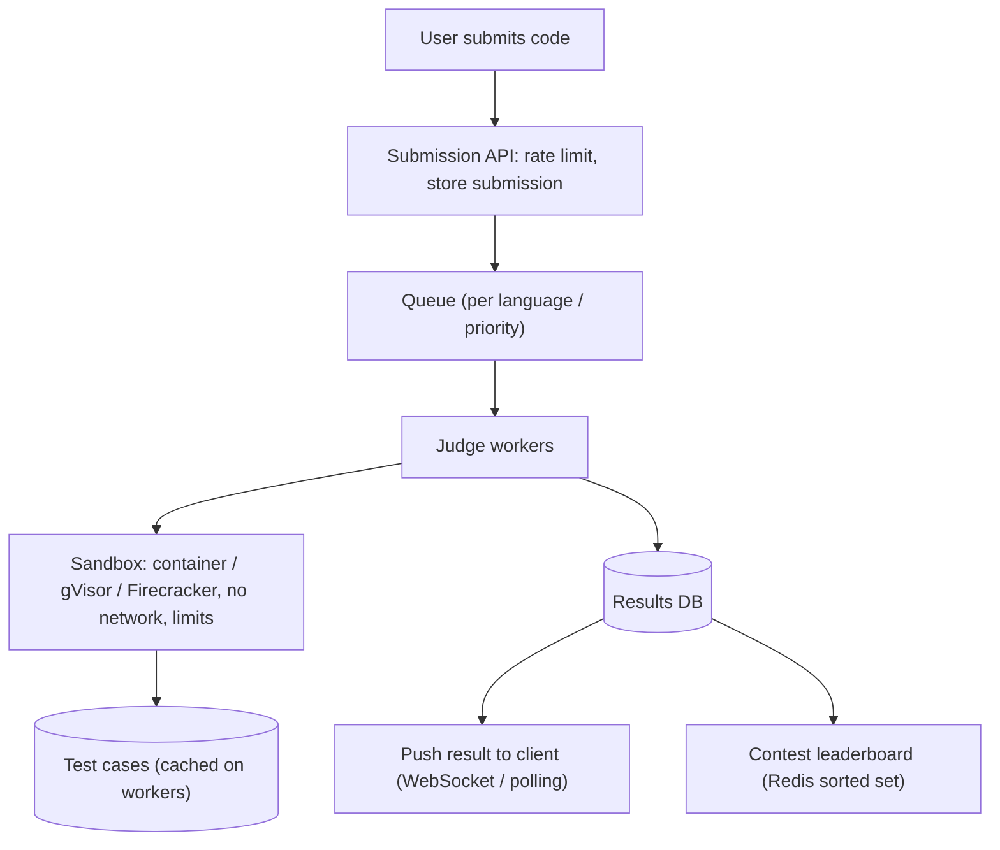

#### 6. Deep dives

**Judging flow.**
1. Worker pulls a submission and fetches the problem's tests (from a local cache, keyed by test-set version).
2. Starts a sandbox from a pre-warmed image for the language.
3. Compiles with its own time limit (Compile Error on failure).
4. Runs each test: feed `.in` on stdin, capture stdout, enforce limits, stop at the first failure (or run all for partial scoring).
5. Compares output (exact, whitespace-tolerant, or a custom **checker** program for problems with many valid answers or floating-point tolerance).
6. Writes the verdict, destroys the sandbox, acknowledges the queue message.

**Sandbox security (defence in depth).**

| Layer | What it prevents |
|---|---|
| MicroVM (Firecracker) or user-space kernel (gVisor) | Kernel exploits escaping to the host |
| seccomp syscall allow-list | `fork` bombs, raw sockets, `ptrace` |
| No network namespace | Data exfiltration, calling out to the internet |
| cgroups: CPU, memory, PIDs | Resource exhaustion, memory bombs |
| Read-only root FS, small tmpfs, non-root user | Tampering, disk filling |
| Wall-clock and CPU timeouts, kill whole process group | Infinite loops, sleeping processes |
| Expected outputs never mounted into the sandbox | Reading answers |

Each submission gets a fresh sandbox (or a reset snapshot), so one user's code can't affect the next.

**Timing fairness.** Measure **CPU time** (not wall time) for limits, use identical machine types, avoid noisy neighbours (one sandbox per dedicated core), and give slower languages adjusted limits (e.g. a multiplier for Python). Some judges run timing-sensitive cases twice and take the better result.

**Scaling.** Queues per language (so a slow language doesn't block others) and per priority (contest submissions first, "Run" with sample tests on a fast lane). Autoscale workers on queue depth and age of the oldest message. Before contests, pre-scale and pre-warm images and test caches; the burst at contest start is predictable.

**Reliability.** The queue gives at-least-once delivery: if a worker dies mid-judge, the message reappears after a visibility timeout and is judged again. Judging is deterministic and verdict writes are idempotent by submission ID, so a re-run is harmless. Messages that repeatedly crash workers go to a dead-letter queue.

**Contest leaderboard.** Score = problems solved (desc), then penalty time (asc): penalty = sum of solve times plus a penalty per wrong attempt. Encode as one number for a sorted set, e.g. `solved * 10^7 - penalty_minutes`. Many contests **freeze** the public leaderboard in the last hour; compute the final standings after all queued submissions are judged.

**Results to clients.** Poll every second or two (simple, cache-friendly) or push via WebSocket. Show "queued, position N" during spikes for honest feedback.

#### 7. Trade-offs

| Decision | Trade-off |
|---|---|
| MicroVM vs container | Stronger isolation vs higher startup cost (mitigated by snapshot/pre-warm pools) |
| Stop at first failing test | Faster and cheaper vs less feedback |
| Push vs poll | Lower latency vs connection management at scale |

#### 8. Failure modes

- **Worker host compromised:** isolation layers limit blast radius; hosts are ephemeral and rotated.
- **Test-case update mid-contest:** version test sets; rejudge affected submissions explicitly.
- **Queue backlog during contest:** scale out, prioritise contest traffic, extend the contest if the judge was down.

#### Common pitfalls

- Running user code in a plain Docker container with the network enabled.
- Using wall-clock time on a shared machine for limits.
- Executing code directly in the API server request.

#### Likely follow-ups

- **How do you detect plagiarism?** Offline similarity (token/AST fingerprinting such as winnowing) across submissions after the contest.
- **How do you support interactive problems?** The sandbox runs the solution and an interactor process connected by pipes, with limits on both.
- **How do you rejudge thousands of submissions after fixing tests?** Enqueue them on a low-priority queue so live traffic isn't affected.

</details>

### 15. Design a coupon / promotions system for an e-commerce platform.

<details>
<summary>Answer</summary>

**In short:** A coupon service stores coupon definitions and evaluates eligibility with a cached **rules engine** (minimum cart value, categories, new users, payment method, validity window, stacking). Validation at cart time is read-only and fast; **redemption** happens at order placement as a step in the checkout saga: atomically check-and-increment the global and per-user usage counters (conditional DB update or Redis), reserve the coupon against the order ID, confirm it on payment success and release it on failure or cancellation. Idempotency keys stop double redemption, sharded counters handle viral codes, and abuse checks limit fraud.

#### 1. Requirements

**Functional**
- Create coupons: percentage or flat off, free delivery, buy-X-get-Y, cashback.
- Eligibility rules: minimum cart value, categories/brands/sellers, new users only, payment method, region, platform.
- Validity window; **global limit** (first 10,000 uses) and **per-user limit** (once per user).
- Stacking rules (e.g. one coupon plus an automatic bank offer, not two coupons).
- Public codes (`DIWALI50`) and unique single-use codes.

**Non-functional**
- Validation in milliseconds on the checkout path.
- **Never over-redeem** beyond limits; never charge the discount twice or lose a valid redemption.
- Handle sale-day spikes on popular codes.

#### 2. Estimates

| Quantity | Assumption | Result |
|---|---|---|
| Active coupons | ~100K definitions | Fit in memory on every service instance |
| Validations | Every cart view and checkout: ~10K/s peak | Must be in-memory evaluation |
| Redemptions | = orders using coupons, ~1K/s peak | Counter updates; hot for viral codes |

#### 3. API

```text
POST /v1/coupons/validate {code, cart, user_ctx}  -> {valid, discount, reason?}       (read-only)
POST /v1/coupons/reserve  {code, order_id, user_id, cart_total} -> {reservation_id, discount}
POST /v1/coupons/confirm  {reservation_id}                      (on payment success)
POST /v1/coupons/release  {reservation_id}                      (on failure / cancel)
Admin: POST /v1/coupons {rules, limits, validity}
```

#### 4. Data model

```sql
coupons(coupon_id, code UNIQUE, type, value, max_discount, rules_json,
        starts_at, ends_at, global_limit, used_count, per_user_limit, status)
coupon_redemptions(coupon_id, user_id, order_id UNIQUE, status RESERVED|CONFIRMED|RELEASED,
                   discount, reserved_at, expires_at)
user_coupon_usage(coupon_id, user_id, count, PRIMARY KEY(coupon_id, user_id))
```

#### 5. High-level design

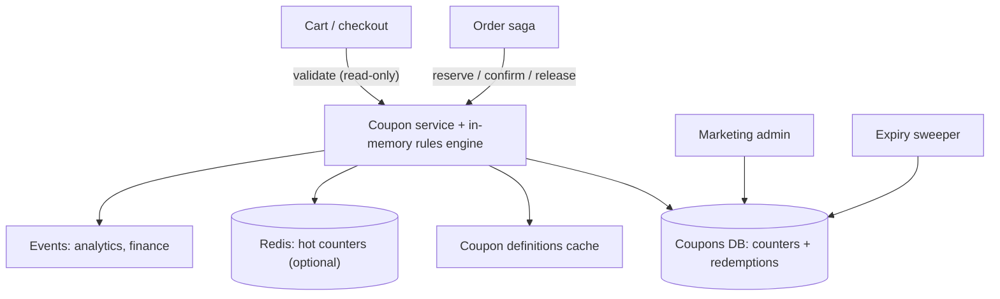

#### 6. Deep dives

**Rules engine.** Rules are stored as data (JSON conditions), not code, so marketing can create them without a deploy:

```json
{"all": [
  {"field": "cart.total", "op": ">=", "value": 999},
  {"field": "cart.items.category", "op": "any_in", "value": ["electronics"]},
  {"field": "user.order_count", "op": "==", "value": 0},
  {"field": "payment.method", "op": "in", "value": ["UPI", "HDFC_CARD"]}
]}
```

Definitions are cached in each instance and refreshed on change events. Evaluation returns not only valid/invalid but the **reason** ("add ₹200 more to use this coupon"), which drives conversion. Discount computation handles caps (`max_discount`), item-level allocation (which items the discount applies to, needed for partial returns), and rounding.

**Validation vs redemption.** Validation is read-only: it can be called many times as the cart changes. Usage counters are only touched at redemption, otherwise abandoned carts would burn through the global limit.

**Atomic redemption.**

```sql
BEGIN;
UPDATE coupons SET used_count = used_count + 1
WHERE coupon_id = :c AND used_count < global_limit AND now() BETWEEN starts_at AND ends_at;
-- 0 rows -> exhausted or expired
INSERT INTO user_coupon_usage (coupon_id, user_id, count) VALUES (:c, :u, 1)
ON CONFLICT (coupon_id, user_id) DO UPDATE SET count = user_coupon_usage.count + 1
WHERE user_coupon_usage.count < :per_user_limit;
-- 0 rows affected -> per-user limit reached, ROLLBACK
INSERT INTO coupon_redemptions (coupon_id, user_id, order_id, status, expires_at)
VALUES (:c, :u, :order_id, 'RESERVED', now() + interval '15 minutes');
COMMIT;
```

`order_id UNIQUE` on redemptions makes the reserve call **idempotent**: a retry for the same order finds the existing reservation instead of using the coupon twice.

**Part of the checkout saga.**

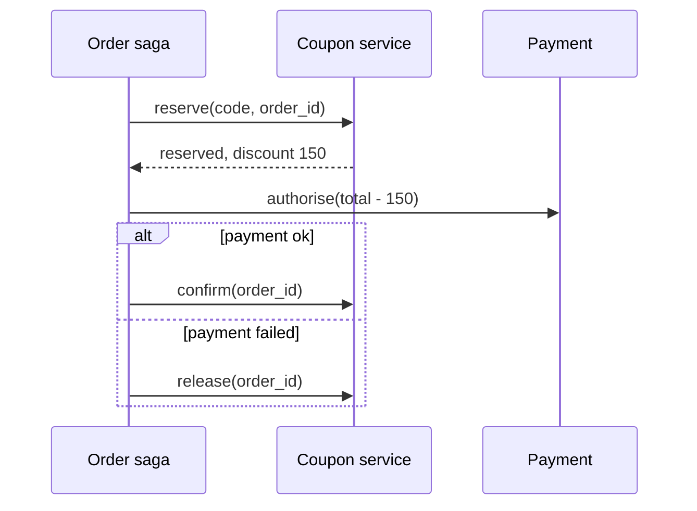

Abandoned reservations expire: a sweeper releases them (decrement counters, mark `RELEASED`). Order cancellations and full returns release or keep the usage according to business policy.

**Hot coupons.** A viral code on sale day can mean thousands of updates/s on one row. Options: keep the counter in Redis (`DECR` on remaining via a Lua script that also checks the per-user set) with the DB updated asynchronously from the result; or **pre-split** the limit into N sub-counters (10 rows of 1,000) and pick one at random, falling back to others when it's empty.

**Unique codes.** For single-use codes, generate them in bulk with a secure random generator (long enough to be unguessable, avoiding confusing characters like 0/O), store hashed or plain with a `used` flag, and redeem with `UPDATE ... WHERE code = ? AND used = false`.

**Abuse prevention.** Per-device and per-payment-instrument limits (people create many accounts for "new user" offers), velocity checks, blocking known fraud signals, rate limiting the validate endpoint to stop code guessing, and audit logs of every redemption.

**Analytics.** Redemption events feed dashboards: cost of discounts, incremental orders, conversion uplift versus a control group, so marketing knows whether a coupon paid off.

#### 7. Trade-offs

| Decision | Trade-off |
|---|---|
| Redis counters for hot codes | Throughput vs reconciliation with the DB |
| Reserve at order creation | No over-redemption vs inventory of coupons temporarily held by unpaid orders |
| Rules as data | Marketing self-service vs a limited rule language and need for testing tools |
| Strict global limits | Accurate budget vs contention; some businesses allow a small overshoot |

#### 8. Failure modes

- **Coupon service down at checkout:** let the order proceed without the coupon (with a clear message) or fail checkout; decide per business. Usually fail open for validation display, fail closed for redemption.
- **Payment succeeded, confirm call lost:** confirm is idempotent and retried by the saga; the sweeper must not release reservations whose order is paid (check order status first).
- **Counter drift:** reconcile `used_count` against confirmed redemptions periodically.

#### Common pitfalls

- Incrementing usage at validation time.
- Read-then-write on counters without a condition.
- Not releasing coupons when payment fails, locking users out of their one-time offer.

#### Likely follow-ups

- **How do you choose the best coupon automatically?** Evaluate all eligible coupons for the cart and apply the one (or allowed combination) with the largest discount.
- **How do partial returns affect discounts?** Use the per-item discount allocation saved at order time to compute the refund.
- **How do you schedule a coupon to go live at midnight?** `starts_at` in the definition, with caches loaded in advance so the switch is a time check, not a deploy.

</details>

---

[⬅ Previous: Designs – Social, Media & Collaboration](17-designs-social-media.md) · [⬅ Back to index](../README.md) · [Next: Mobile System Design ➡](19-mobile-system-design.md)
