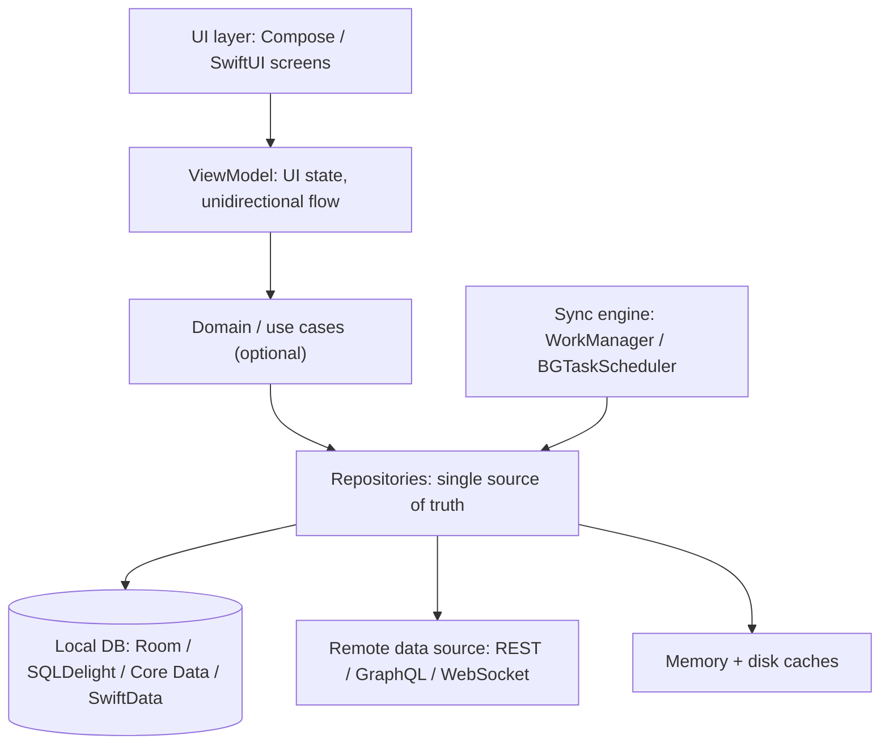
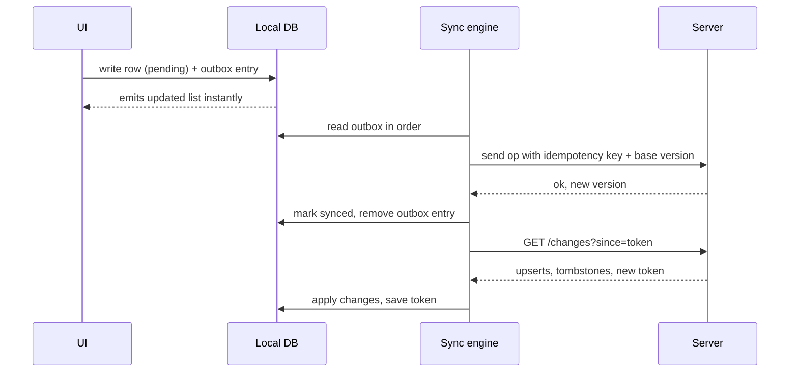
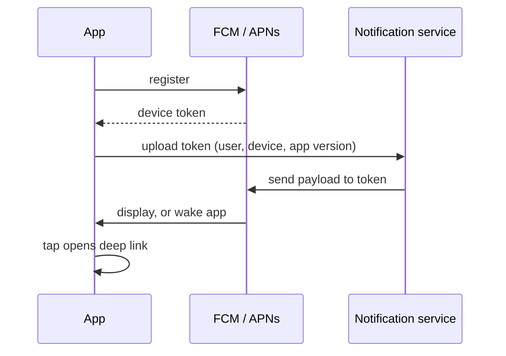
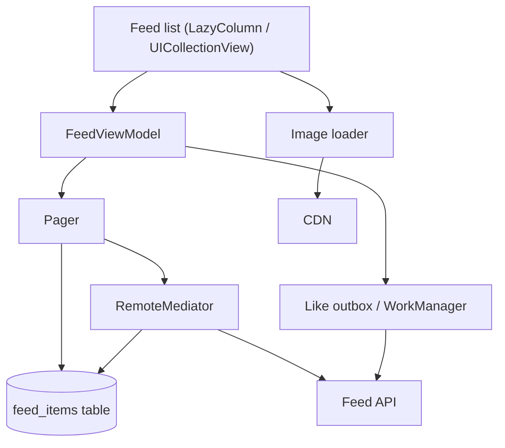
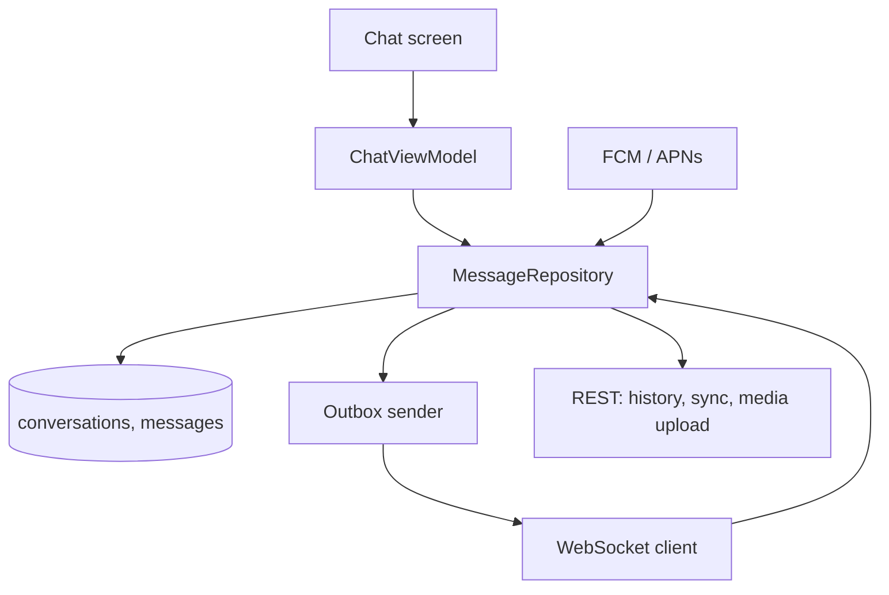
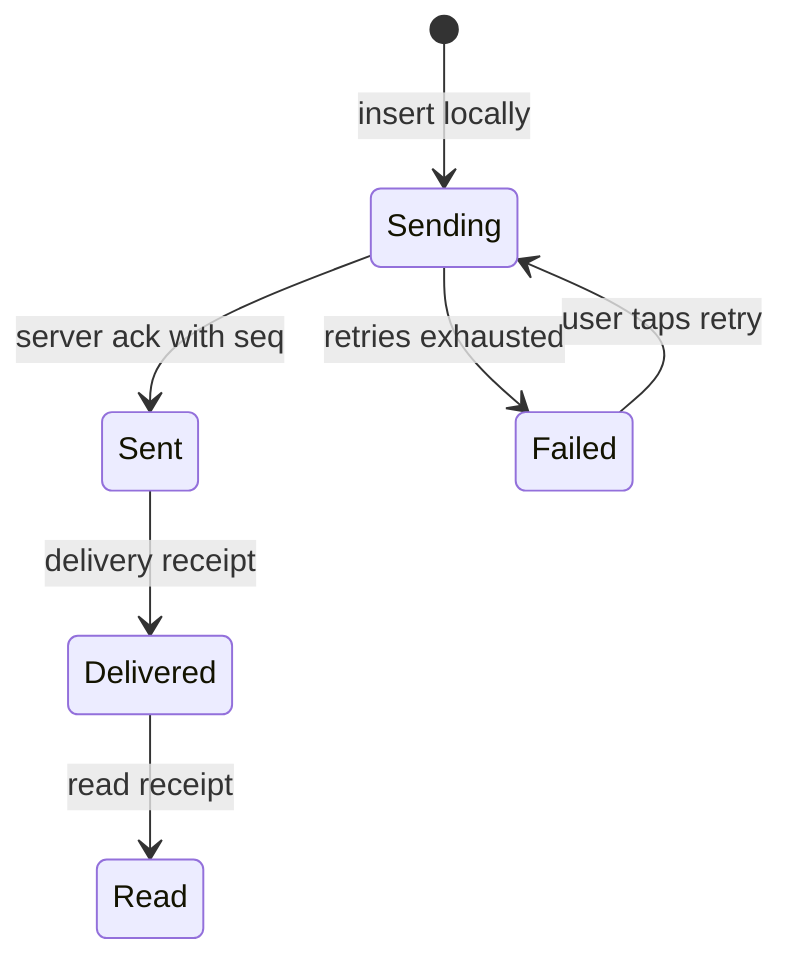
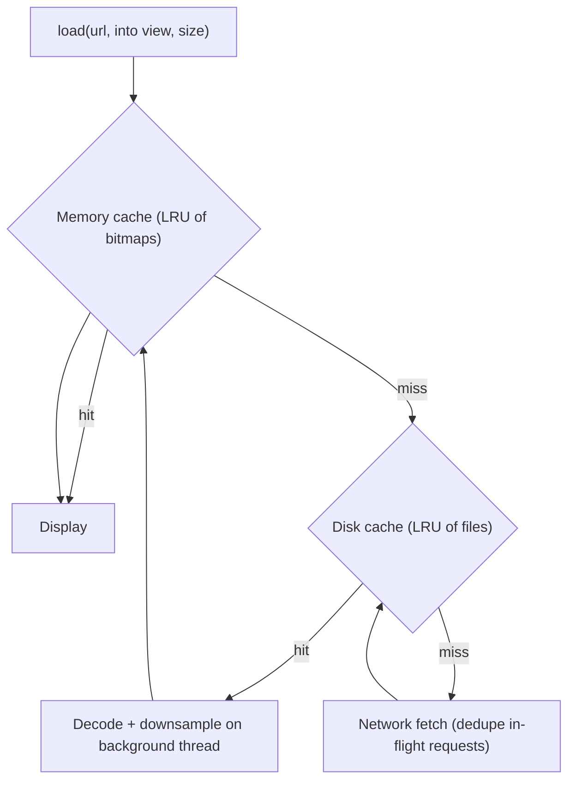
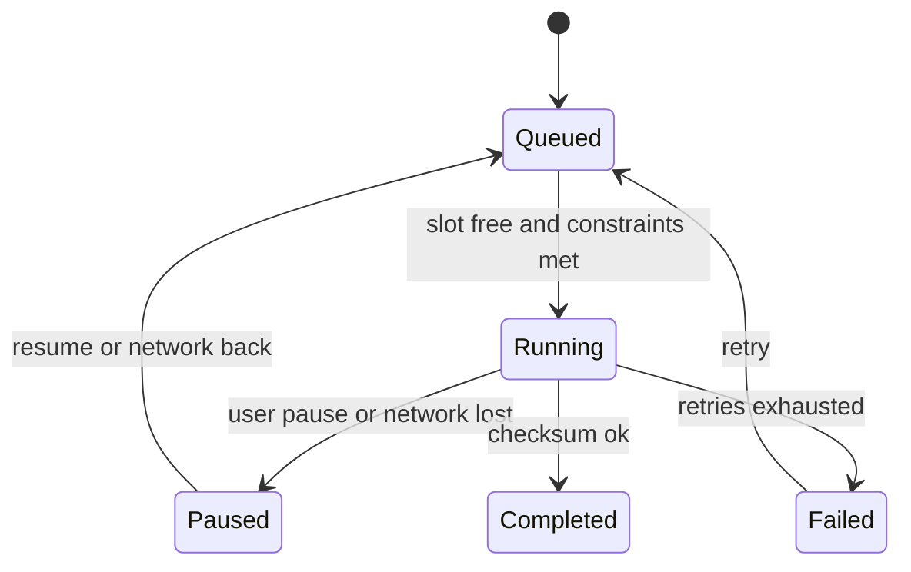
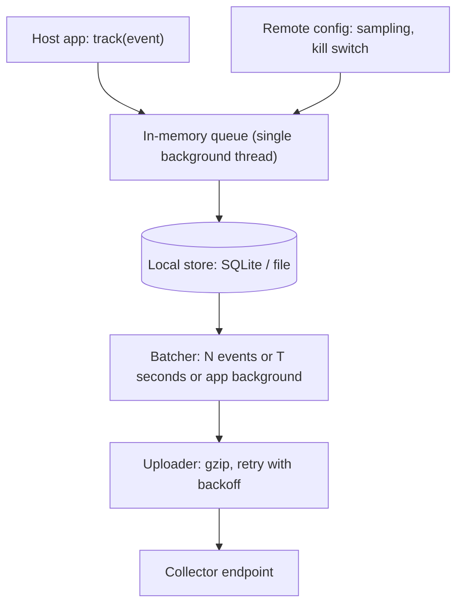
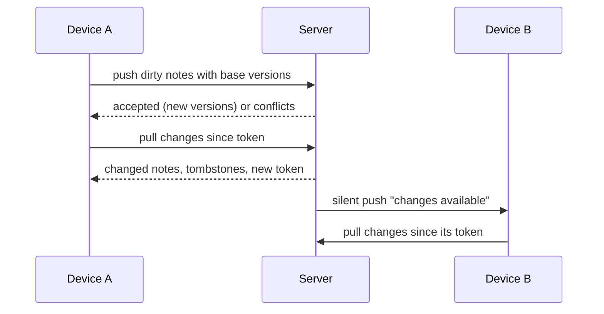

# Mobile System Design

[⬅ Back to index](../README.md)

Covers: how the mobile round differs, the client architecture, API design for mobile, offline-first and sync, caching, pagination, real-time updates, push notifications, image loading, background work, performance and battery, releases and feature flags, plus worked designs (feed, chat, offline notes, image loader, downloader, analytics SDK). Platform notes compare Android and iOS.

For platform-specific depth, see the [Android](https://github.com/AkshayAshokCode/Android-Interview-Questions-and-Answers) and [iOS](https://github.com/AkshayAshokCode/iOS-Interview-Questions-and-Answers) repos.

---

## Foundations

### 1. How is a mobile system design interview different from a backend one?

<details>
<summary>Answer</summary>

**In short:** The mobile round is centred on the **client**: the app's internal architecture, its contract with the backend, and how it copes with phone constraints (flaky networks, limited battery/memory, an OS that can kill it, and slow releases with old versions in the wild). You still sketch the backend, but the depth is expected in storage, sync, caching, threading, pagination and real-time on the device.

#### Why it is a different exercise

A backend round asks "how do we serve 100M users?" and you reason about sharding, queues and replication. A mobile round asks "how does *one device* give a great experience when everything around it is unreliable?" The hard part moves from throughput to **constraints**:

| Constraint | What it means for the design |
|---|---|
| **Unreliable networks** | Offline, slow links, captive portals, Wi-Fi ↔ cellular handoffs mid-request. Every request can fail or time out, so you need retries, idempotency, local persistence and an offline story. |
| **Limited resources** | Battery, RAM, storage, metered data plans, slow CPUs on low-end devices. Caches must be bounded, images downsampled, network calls batched. |
| **OS-controlled lifecycle** | The OS can suspend or kill the process at any time in the background, and background execution is restricted (Doze on Android, suspension on iOS). State must survive process death. |
| **Slow, sticky releases** | App store review, staged rollouts, and users who never update. Old app versions live for years, so APIs must stay backward compatible and features need remote kill switches. |
| **UX expectations** | Instant UI, smooth 60/120 fps scrolling, optimistic updates, no spinner on cold start. Anything heavy must be off the main thread. |

#### What a good answer covers

1. **Clarify requirements**: features, offline support, real-time needs, platforms, how much data lives on the device.
2. **Client architecture**: layers (UI, ViewModel, repository, local DB, network) and the data flow between them.
3. **API contract**: endpoints, pagination, payload shape, real-time channel, auth.
4. **Deep dives**: offline sync, caching, image loading, background work, push.
5. **Cross-cutting concerns**: performance, battery, security, observability, releases and feature flags.

The backend usually gets a few boxes (API gateway/BFF, push service, CDN) unless the interviewer asks for more.

**Common pitfalls**
- Spending half the interview on server-side database sharding.
- Ignoring offline and error states, or assuming the network is always there.
- Forgetting that the app can be killed between "user tapped send" and "request completed".

**Likely follow-ups**
- *How do you support old app versions?* Additive API changes, versioned endpoints, and a minimum-supported-version check for forced updates.
- *What runs on the main thread?* Only UI work; I/O, parsing and decoding go to background threads/coroutines.

</details>

### 2. What client architecture should you propose?

<details>
<summary>Answer</summary>

**In short:** A layered architecture with **unidirectional data flow**: UI → ViewModel (UI state) → optional use cases → **repositories** that treat a **local database as the single source of truth**, refreshed by remote data sources and a background sync engine. Add dependency injection and feature modularisation for large teams.



#### The layers and why each exists

- **UI layer** renders state and forwards user events. It holds no business logic, which keeps it easy to test and lets it survive configuration changes.
- **ViewModel / presentation (MVVM or MVI)** exposes a single observable `UiState` (loading, content, error) and handles events. **Unidirectional data flow** means state flows down and events flow up; there is one place where state changes, so bugs are easier to trace.
- **Domain / use cases** are optional. Add them when business logic is shared between screens (e.g. "can this user send a message?"). Skip them in small apps to avoid ceremony.
- **Repositories** hide where data comes from. The key decision: the UI observes the **local DB**, and the network only ever writes into the DB. This gives offline support, instant rendering from cache, and one consistent view of the data.
- **Remote data sources** wrap the HTTP/GraphQL/WebSocket clients.
- **Sync engine** runs background jobs that push pending writes and pull changes.

```kotlin
class FeedRepository(
    private val dao: FeedDao,
    private val api: FeedApi,
) {
    // UI observes the DB; it never reads the network directly
    fun feed(): Flow<List<Post>> = dao.observeFeed()

    suspend fun refresh() {
        val page = api.getFeed(cursor = null, limit = 20)
        dao.replaceFirstPage(page.items)   // DB emits, UI updates
    }
}
```

#### Cross-cutting pieces to name

- **Networking layer**: auth token injection and refresh, retries with backoff, logging, certificate pinning if needed.
- **Image loader**, **analytics**, **logging/crash reporting**, **feature flags/remote config**.
- **Dependency injection** (Hilt/Koin on Android, manual or a container on iOS) so layers can be swapped in tests.
- **Modularisation by feature** (`:feature:feed`, `:feature:chat`, `:core:network`) for build speed and team ownership.

**Common pitfalls**
- ViewModels calling the API and pushing results straight to the UI, which breaks offline support and cache consistency.
- Multiple sources of truth (an in-memory list in the ViewModel plus the DB) drifting apart.

**Likely follow-ups**
- *MVVM vs MVI?* MVI forces a single immutable state and an explicit reducer; MVVM is looser. Both work if data flow is unidirectional.
- *Why a DB as the source of truth instead of an in-memory cache?* It survives process death and supports offline use.

</details>

### 3. How do you design the API for a mobile client?

<details>
<summary>Answer</summary>

**In short:** Design for slow, flaky, expensive networks and for old app versions: few round trips per screen, small payloads, cursor pagination, delta sync, idempotent writes, strict backward compatibility, the right real-time channel, and short-lived tokens with a single transparent refresh.

#### Principles and the reasons behind them

| Principle | Why on mobile | How |
|---|---|---|
| **Minimise round trips** | Each request on cellular costs latency (often hundreds of ms) and battery (radio wake-ups). | One request per screen via a **BFF** (backend-for-frontend) or GraphQL; batch endpoints. |
| **Small payloads** | Data plans and slow links. | Only needed fields, gzip/Brotli, Protobuf for heavy traffic, image URLs sized for the device's screen density. |
| **Cursor pagination** | Lists change while the user scrolls; offset pagination skips or duplicates items. | `GET /feed?cursor=abc&limit=20` returns `items` + `next_cursor`. |
| **Delta sync** | Re-downloading everything wastes data. | `GET /changes?since=<sync_token>` returns upserts, tombstones and a new token. |
| **Idempotency keys** | Retries after a timeout must not create duplicate posts or payments. | Client sends `Idempotency-Key: <uuid>`; server stores the result by key. |
| **Backward compatibility** | Old versions live for years. | Additive changes only, never rename/remove fields in place, version endpoints when needed, a minimum-supported-version endpoint for forced upgrades. |
| **Real-time channel** | Different freshness needs. | Polling, SSE, WebSocket or push (see question 5). |
| **Auth** | Tokens expire while the app is open. | Short-lived access token + refresh token; on 401 refresh **once** even if many requests fail at the same time. |

#### Example: idempotent write and paginated read

```http
POST /v1/posts/123/likes
Idempotency-Key: 6f1c2b7e-...
Authorization: Bearer <access_token>

GET /v1/feed?cursor=eyJpZCI6IjEyMyJ9&limit=20
-> { "items": [...], "next_cursor": "eyJpZCI6IjEwMyJ9" }
```

#### Single-flight token refresh

When five requests get a 401 at once you must not fire five refreshes (refresh tokens are often single-use). Serialise it:

```kotlin
class TokenAuthenticator(private val auth: AuthStore) : Authenticator {
    override fun authenticate(route: Route?, response: Response): Request? {
        synchronized(this) {
            val current = auth.accessToken
            val usedToken = response.request.header("Authorization")?.removePrefix("Bearer ")
            // Another thread already refreshed: just retry with the new token
            val token = if (usedToken != current) current
                        else auth.refreshBlocking() ?: return null   // null = log out
            return response.request.newBuilder()
                .header("Authorization", "Bearer $token").build()
        }
    }
}
```

**Common pitfalls**
- Offset pagination on a live feed (duplicates when new items arrive at the top).
- Returning huge nested objects "just in case".
- Changing a field's type in a release and crashing every old client.

**Likely follow-ups**
- *REST vs GraphQL for mobile?* GraphQL lets each screen fetch exactly what it needs in one call; REST with a BFF gets similar results with simpler HTTP caching.
- *How do you force an update?* The app checks a config endpoint for `min_supported_version` on launch and blocks or nudges.

</details>

### 4. How do you design an offline-first app with sync?

<details>
<summary>Answer</summary>

**In short:** The local database is the source of truth: the UI always reads from it, writes are applied locally right away and recorded in an **outbox** of pending operations, and a **sync engine** pushes the outbox (with idempotency keys) and pulls server changes since a sync token. Conflicts are detected with versions and resolved by a chosen policy; deletes use tombstones.

#### How it works



1. **Reads** always come from the local DB, so the app opens instantly and works offline.
2. **Writes** are optimistic: update the row and insert an outbox record (`op_id`, `type`, `payload`, `created_at`, `attempts`). IDs are generated on the client (UUIDs) so objects exist before the server knows about them.
3. **Triggers** for sync: connectivity regained (WorkManager with a network constraint on Android, `BGTaskScheduler`/app foreground on iOS), app foreground, a debounced timer after edits, or a silent push.
4. **Push** pending ops in order, each with an idempotency key so a retry after a lost response is harmless.
5. **Pull** changes since the last sync token and apply them in one transaction; persist the new token in the same transaction.

#### Conflicts

Detect with a `version` or ETag: the client sends the version it edited from; if the server has moved on, it is a conflict.

| Strategy | Good for | Downside |
|---|---|---|
| Last-write-wins | Settings, simple fields | Silently loses edits |
| Field-level merge | Records where different fields are edited | Same-field conflicts still need a rule |
| Server wins + notify | Business data (inventory, bookings) | User must redo work |
| Conflict copy | Notes, documents | User resolves manually |
| CRDTs | Collaborative text, lists | Complexity, metadata size |

#### Deletes and UI

- **Tombstones** (`deleted = true` plus version) let other devices learn about deletions; purge them later once all devices are past that point.
- Show sync state: pending badge, failed with retry, last synced time.

**Common pitfalls**
- Saving the sync token before the changes are applied (a crash in between loses data).
- Retrying non-idempotent operations and creating duplicates.
- Relying on device clocks for last-write-wins (clocks drift; prefer server versions).

**Likely follow-ups**
- *What if an outbox op is rejected permanently (validation error)?* Mark it failed, roll back or flag the local row, and tell the user.
- *What about a very long offline period?* If the token is too old the server answers "resync required"; the client does a full refresh while keeping unsynced local edits.

</details>

### 5. How do you handle real-time updates on mobile?

<details>
<summary>Answer</summary>

**In short:** Pick the channel by how fresh and how bidirectional the data must be: polling for rare updates, SSE for server-to-client streams, WebSocket for frequent two-way traffic, and push notifications when the app is backgrounded or killed. On mobile you usually **combine** a WebSocket in the foreground with push in the background, and **resync from a cursor** on every reconnect.

| Method | How it works | Use | Cost |
|---|---|---|---|
| Polling | Request every N seconds | Rare updates; simple | Wastes battery and data; latency up to N |
| Long polling / SSE | Server holds the request open and streams events | Server → client streams: scores, order status | One-way |
| WebSocket | Persistent full-duplex connection | Chat, collaboration, live tracking | Must manage reconnects and heartbeats |
| Push notifications (FCM/APNs) | OS-level channel shared by all apps | App in background or killed; "silent" pushes to trigger a sync | Not guaranteed, throttled, unordered |

#### Mobile-specific realities

- **Sockets die in the background.** iOS suspends apps soon after they leave the foreground; Android restricts background network access in Doze. So close the socket when backgrounded and rely on push.
- **Networks switch.** A Wi-Fi to cellular handoff silently kills the TCP connection. Use **heartbeats** (e.g. a ping every ~30 s) to detect dead connections, and connectivity callbacks to reconnect quickly.
- **Reconnect with exponential backoff and jitter** so a server restart does not trigger a thundering herd from millions of clients.
- **Gaps are inevitable.** Events sent while disconnected are missed. On reconnect, fetch `GET /events?since=<last_seq>` to fill the gap, then resume the live stream. The real-time channel is an optimisation; the cursor sync is the correctness guarantee.

```kotlin
suspend fun connectLoop() {
    var delayMs = 1_000L
    while (isForeground()) {
        try {
            socket.connect()
            syncSince(store.lastSeq())             // fill the gap first
            delayMs = 1_000L
            socket.events().collect { store.apply(it) }  // idempotent by seq
        } catch (e: IOException) {
            delay(delayMs + Random.nextLong(500))  // jitter
            delayMs = (delayMs * 2).coerceAtMost(60_000)
        }
    }
}
```

**Common pitfalls**
- Treating push as reliable delivery (it can be dropped or collapsed).
- Keeping a socket open in the background and draining battery.

**Likely follow-ups**
- *Why not use push for everything?* It is throttled, unordered and has no delivery guarantee; fine as a wake-up signal, not as the data channel.
- *How do you avoid duplicates after a resync?* Apply events idempotently by ID or sequence number.

</details>

### 6. How do push notifications work end to end?

<details>
<summary>Answer</summary>

**In short:** The app registers with FCM (Android) or APNs (iOS) to get a **device token**, uploads it to your backend tied to the user and device, your notification service sends payloads to FCM/APNs for those tokens, and the OS displays the notification or wakes the app; tapping it deep-links into the right screen.



#### Step by step

1. **Register**: on launch the app asks the platform for a token (and, on iOS and Android 13+, asks the user for permission to show notifications).
2. **Upload the token** to your backend on every launch and whenever the token-refresh callback fires; tokens change after reinstall, restore or expiry. Store `(user_id, device_id, token, platform, app_version, locale)`.
3. **Send**: a backend notification service (often fed by a queue of events like "new message") looks up the user's tokens and calls FCM/APNs.
4. **Delivery**: a **notification message** is shown by the OS. A **data / silent message** wakes the app briefly to do work; these are throttled by the OS and not guaranteed.
5. **Open**: tapping launches the app with a deep link (`app://chat/42`), and you log the open for analytics.

#### Backend design points

- **Preferences**: per-user, per-category opt-outs, quiet hours.
- **Dedupe and collapse**: an ID or collapse key so "5 new likes" replaces earlier ones.
- **Rate limiting** per user so you do not spam.
- **Invalid-token cleanup**: when FCM/APNs report a token as unregistered, delete it.
- **Fan-out** for big broadcasts via a queue and workers, or topics.
- **Rich notifications**: images via a Notification Service Extension on iOS, `BigPictureStyle` on Android; localise text per user locale.
- **Analytics** on sends and opens.

**Common pitfalls**
- Uploading the token only once at sign-up (it changes).
- Relying on silent pushes for critical delivery; always resync when the app opens.
- Putting sensitive data in the payload, which appears on the lock screen and passes through third-party servers.

**Likely follow-ups**
- *How do you notify a user on three devices?* Store all tokens per user and send to each; clear stale notifications on other devices with a follow-up silent push when one device reads it.
- *How do you measure effectiveness?* Track sent, opened and resulting actions per campaign.

</details>

### 7. How do you approach caching on mobile?

<details>
<summary>Answer</summary>

**In short:** Use layers: an **in-memory LRU** for hot objects and decoded images, **disk caches** (HTTP cache honouring Cache-Control/ETag, an image disk cache, and the local DB for structured data), and a **stale-while-revalidate** UI that shows cached data immediately and refreshes in the background. Bound every cache, clear on logout, and encrypt anything sensitive.

#### The layers

| Layer | What it stores | Speed | Survives process death? |
|---|---|---|---|
| Memory (LRU) | Decoded bitmaps, recent objects | Fastest | No |
| HTTP disk cache (OkHttp `Cache`, `URLCache`) | Raw responses keyed by URL | Fast | Yes |
| Image disk cache | Encoded image files | Fast | Yes |
| Local DB (Room, Core Data, SQLite) | Structured, queryable data | Fast | Yes, and it is the source of truth |

#### Stale-while-revalidate

The user sees content in milliseconds and the network quietly makes it fresh:

```kotlin
fun profile(id: String): Flow<Profile> = flow {
    dao.get(id)?.let { emit(it) }               // 1. cached, instant
    runCatching { api.profile(id) }             // 2. revalidate
        .onSuccess { dao.upsert(it); emit(it) } // 3. update screen
}
```

HTTP-level revalidation uses `ETag` / `If-None-Match`: if nothing changed the server replies `304 Not Modified` with no body, saving data.

#### Policies to decide

- **Freshness**: a TTL per data type (a feed goes stale in minutes; a country list in days).
- **Eviction**: LRU with a size cap (memory cache sized as a fraction of available heap; disk cache a fixed MB budget); react to low-storage signals.
- **Invalidation**: on local writes (update the DB row), on server push, and on logout (wipe everything user-specific).
- **Security**: encrypt sensitive data at rest; do not put auth responses or PII in a shared HTTP cache.

**Common pitfalls**
- Unbounded caches causing OOMs or filling the device.
- Showing the previous user's cached data after an account switch.
- Caching error or empty responses as if they were valid.

**Likely follow-ups**
- *Why both memory and disk?* Memory avoids decode cost; disk survives restarts and saves network.
- *How do you avoid a burst of duplicate requests on app start?* Deduplicate in-flight requests for the same key.

</details>

### 8. How do background work limits affect mobile design?

<details>
<summary>Answer</summary>

**In short:** Both OSes aggressively limit background execution to save battery, so you cannot assume your code runs when you want it to. Use the platform schedulers (WorkManager on Android; BGTaskScheduler and background URLSession on iOS) for deferrable work, design sync to tolerate delays, and make anything time-critical **server-driven via push**.

#### Android

- **Doze and App Standby** defer jobs, network access and alarms when the device is idle or the app is rarely used.
- **WorkManager**: deferrable, *guaranteed* work that survives process death and reboot, with constraints (network, charging, storage not low), retries with backoff, chaining, and unique work names to avoid duplicates.
- **Foreground services** for long, user-visible tasks (playback, navigation, an active download); they show a persistent notification and must declare a foreground service type.
- **High-priority FCM** messages can wake the app for urgent work.

```kotlin
val request = PeriodicWorkRequestBuilder<SyncWorker>(6, TimeUnit.HOURS)
    .setConstraints(
        Constraints.Builder().setRequiredNetworkType(NetworkType.CONNECTED).build()
    )
    .build()
WorkManager.getInstance(context)
    .enqueueUniquePeriodicWork("sync", ExistingPeriodicWorkPolicy.KEEP, request)
```

#### iOS

- Apps are **suspended** soon after backgrounding.
- **BGTaskScheduler**: refresh tasks (short) and processing tasks (longer, can require power/network); the system decides when they run, based on usage patterns.
- **Background URLSession**: uploads/downloads continue in a system process even if the app is suspended or terminated by the system.
- **Silent pushes** wake the app briefly and are throttled.
- **Background modes** for specific use cases: audio, location, VoIP.

| Need | Android | iOS |
|---|---|---|
| Periodic sync | WorkManager periodic work | BGTaskScheduler refresh task |
| Large transfer | WorkManager / foreground service | Background URLSession |
| Urgent wake-up | High-priority FCM | Push (alert or silent) |
| Long user-visible task | Foreground service | Background mode, if eligible |

#### Design consequences

- Sync must be **opportunistic**: also run on app foreground, not only in background jobs.
- Work must be **idempotent and resumable**, since the OS can stop it at any point.
- Never promise exact timing for background work; real-time behaviour must come from the server (push).

**Common pitfalls**
- Using exact alarms or long-running threads for sync.
- Assuming an iOS background task runs on a schedule (it may barely run for rarely used apps).

**Likely follow-ups**
- *How do you upload a large video reliably?* Background URLSession on iOS; WorkManager (long-running, with a foreground notification) and chunked resumable uploads on Android.

</details>

### 9. What performance and battery considerations should you mention?

<details>
<summary>Answer</summary>

**In short:** Cover startup time, smooth scrolling, network efficiency, battery (fewer radio wake-ups, cheap location), bounded memory, and app size, and say how you would measure each. The general rule: keep the main thread for UI only, do less work, and batch what remains.

| Area | What hurts | What helps |
|---|---|---|
| **Startup time** | SDK init in `Application`/`AppDelegate`, main-thread disk I/O, large DI graphs | Lazy initialisation, deferring non-critical SDKs, Baseline Profiles (Android), showing cached content first |
| **Smooth scrolling** | Parsing/decoding on the main thread, full-size images, unstable list keys causing rebinds | Background parsing and decoding, image downsampling to view size, stable item IDs and diffing, prefetching |
| **Network** | Chatty APIs, polling, large payloads | Batching requests, compression, one call per screen, respecting metered connections, prefetching on Wi-Fi |
| **Battery** | Frequent radio wake-ups, continuous GPS, wake locks | Batch network calls, significant-change location or geofences, limit background work |
| **Memory** | Unbounded caches, leaks (long-lived objects holding screens), large bitmaps | Bounded LRU caches, leak detection, reacting to low-memory signals |
| **App size** | Unused code and resources, bundled assets | Code shrinking (R8 on Android), resource shrinking, on-demand resources / feature modules |

#### Why the radio matters so much

A cellular radio stays in a high-power state for a while after each transfer before dropping back to idle. Ten small requests spread over a minute keep it awake far longer than one batched request. That is why analytics SDKs batch events and why prefetching happens in bursts.

#### Measure, do not guess

- Android: Macrobenchmark for startup and scroll jank, Android vitals in Play Console, Perfetto traces, LeakCanary for leaks.
- iOS: Instruments (Time Profiler, Allocations, Energy Log), MetricKit for field data, Xcode Organizer.
- Track field metrics: cold start p50/p90, slow/frozen frames, ANR rate, crash-free users.

**Common pitfalls**
- Optimising on a flagship phone only; test on low-end devices.
- Loading a 4000-px image into a 100-dp thumbnail.

**Likely follow-ups**
- *How do you speed up cold start?* Measure first, then defer SDK init, lazily build dependencies, avoid main-thread I/O, use Baseline Profiles, and show cached data immediately.

</details>

### 10. How do releases, feature flags and versioning work for mobile apps?

<details>
<summary>Answer</summary>

**In short:** You cannot hot-fix an installed app, so you ship safely: **staged rollouts** with crash monitoring, **feature flags / remote config** to turn features on or off without a release, a **minimum supported version** for forced or soft updates, **backward-compatible APIs**, **server-driven UI** for fast-changing screens, and strong **observability**.

#### Why mobile releases are different

On the web you deploy and every user has the new version within minutes. On mobile a release goes through store review, users update over days or weeks, and some never update. A bad build cannot be pulled back from devices that already installed it, so risk control moves to rollouts and runtime switches.

#### The toolbox

- **Staged rollouts**: Play Console percentage rollout, App Store phased release. Watch crash-free rate and key metrics, then expand or halt.
- **Feature flags / remote config**: ship code dark, enable it for employees, then for a percentage of users. Use flags for A/B tests and as **kill switches** for broken features. Flags need safe defaults when config cannot be fetched, and should be cached locally.
- **Forced / soft update**: the backend returns `min_supported_version` (block below it, for security fixes or breaking API changes) and a recommended version (show a dismissable nudge).
- **Server-driven UI**: the server returns a layout description (sections, components, actions) that the app renders from a library of native components. Good for home screens and promotions that change often; costs complexity and needs a versioned component schema with fallbacks.
- **Backward-compatible APIs**: additive changes, tolerant parsing (ignore unknown fields, default missing ones); old versions keep working for years.
- **Observability**: crash reporting (e.g. Crashlytics), performance monitoring, analytics, and logs uploaded selectively (e.g. remotely triggered for a user who reports a bug).

```kotlin
if (flags.isEnabled("new_checkout", default = false)) {
    NewCheckoutScreen()
} else {
    LegacyCheckoutScreen()
}
```

**Common pitfalls**
- Flags that never get removed, leaving dead branches everywhere.
- A forced-update check that blocks users when the config endpoint itself fails (fail open instead).
- Server-driven UI sending a component an old client does not know about.

**Likely follow-ups**
- *How do you roll back a bad mobile release?* Halt the rollout, disable the feature via a flag, and ship a fixed build with a higher version.
- *How do you A/B test?* Assign users to buckets server-side, deliver the variant via remote config, log exposure events and compare metrics.

</details>

---

## Worked Mobile Designs

### 11. Design the client for a social feed (Instagram/Twitter app).

<details>
<summary>Answer</summary>

**In short:** An infinite, cursor-paginated feed backed by a local `feed_items` table as the source of truth, paged from the DB with network fetches at the edges (Paging 3 + RemoteMediator on Android, an equivalent pager on iOS). Media goes through an image loader with memory/disk caches, downsampling and prefetch; likes are optimistic with a queued, idempotent request; pull-to-refresh and a "new posts" pill keep content fresh without jumping the list.

#### Requirements

- **Functional**: infinite scrolling feed of posts with images/videos; like and comment; pull to refresh; works offline with cached content; "new posts" indicator.
- **Non-functional**: fast first paint (cached feed on launch), smooth scrolling on low-end devices, low data usage, battery friendly.

#### API

```http
GET /v1/feed?cursor=<opaque>&limit=20
-> {
  "items": [{ "id": "p1", "author": {...}, "text": "...",
              "media": [{ "type": "image", "url": "https://cdn/.../p1_720w.jpg",
                          "width": 720, "height": 900, "blurhash": "..." }],
              "like_count": 10, "liked_by_me": false }],
  "next_cursor": "..."
}
POST   /v1/posts/{id}/like     (Idempotency-Key header)
DELETE /v1/posts/{id}/like
GET    /v1/feed/new_count?since=<top_item_id>
```

The client sends its screen width/density (or the server offers several sizes) so media URLs are already sized for the device. Width/height let the list reserve space before the image loads, avoiding layout jumps.

#### Client architecture



#### Data model

```sql
CREATE TABLE feed_items (
  id TEXT PRIMARY KEY,
  position INTEGER NOT NULL,     -- order in the feed
  payload TEXT NOT NULL,         -- serialised post (or normalised tables)
  like_count INTEGER, liked_by_me INTEGER,
  pending_like INTEGER DEFAULT 0
);
CREATE TABLE remote_keys (id TEXT PRIMARY KEY, next_cursor TEXT);
```

The Pager reads pages from the DB. When the user nears the end, the RemoteMediator fetches the next page with the stored cursor and inserts it into the DB in a transaction; the list updates because it observes the DB. On refresh, the mediator clears and reloads the first page.

#### Deep dives

- **Images and video**: image loader with memory + disk caches, downsampling to view size, prefetching the next few items' media, placeholders (blurhash or dominant colour). Video autoplays muted only when mostly visible, only one player at a time (reuse the player instance), and only on Wi-Fi or if the user allows cellular autoplay.
- **Likes**: tap → update `liked_by_me` and `like_count` in the DB (UI updates instantly) → enqueue the request with an idempotency key → on permanent failure, roll back and show a message. Debounce rapid like/unlike toggles and send only the final state.
- **Fresh content**: pull to refresh fetches from the top. While the user is reading, poll `new_count` occasionally (or receive a push/socket hint) and show a **"new posts" pill**; tapping it scrolls to top and refreshes. Never insert items above the user's scroll position silently.
- **Performance**: stable item keys and diffing so only changed rows rebind; flat item layouts; JSON parsing on background threads; reuse view types; keep the feed table bounded (e.g. a few hundred items) to cap storage.
- **Offline**: launch shows the cached feed instantly with a "you're offline" banner; likes queue in the outbox.

#### Trade-offs and failure modes

| Decision | Choice | Why |
|---|---|---|
| Pagination | Cursor | New posts don't shift pages |
| Source of truth | Local DB | Offline, instant launch, consistent like state |
| Ranking | Server-side | Client stays simple; ranking can change without releases |

**Likely follow-ups**
- *How do you handle a deleted post still in the cache?* The next refresh drops it; if opened, the detail API returns 404 and the client removes it locally.
- *How would you add ads?* The server interleaves ad items into the feed response as another item type, so the client just renders a different view type.

</details>

### 12. Design the client for a chat app.

<details>
<summary>Answer</summary>

**In short:** A local DB of conversations and messages is the source of truth; a WebSocket carries messages while the app is in the foreground and push notifications cover the background. Sends are inserted locally with a client message ID and status `sending`, delivered via an outbox with retries, and confirmed by server acks; on every reconnect the client syncs from its last known server sequence per conversation, so gaps are filled and ordering follows server sequence numbers.

#### Requirements

- 1:1 and group chats, text and media, delivery/read receipts, typing indicators, offline reading and composing, push when the app is closed, message history pagination.
- Non-functional: low latency in the foreground, no lost or duplicated messages, correct order, battery friendly.

#### Architecture



#### Data model

```sql
CREATE TABLE messages (
  client_id TEXT PRIMARY KEY,   -- UUID generated on device
  server_id TEXT UNIQUE,        -- null until acked
  conversation_id TEXT NOT NULL,
  seq INTEGER,                  -- server sequence per conversation
  sender_id TEXT, body TEXT, media_ref TEXT,
  status TEXT,                  -- sending, sent, delivered, read, failed
  created_at INTEGER
);
CREATE INDEX idx_conv_seq ON messages(conversation_id, seq);
```

#### Sending flow



1. Insert the message with a fresh `client_id` and status `sending`; the UI shows it immediately.
2. The outbox sends it over the socket (or REST if the socket is down). The `client_id` doubles as an idempotency key, so a resend after a lost ack does not create a duplicate.
3. The server acks with `server_id` and `seq`; update the row to `sent`. Delivery and read receipts later move it to `delivered`/`read`.
4. If offline, the message stays in the outbox; WorkManager (network constraint) or the next foreground/reconnect flushes it.

#### Receiving and gap filling

- Incoming messages are written to the DB (upsert by `server_id`, so duplicates are harmless), then acked to the server.
- Per conversation, the client tracks the highest contiguous `seq`. On reconnect, or if a received `seq` skips ahead, it calls `GET /conversations/{id}/messages?after_seq=N` to fill the gap.
- In the background, a push notification shows the message; a tap or the next foreground triggers a sync so the DB catches up.

#### Ordering, pagination, media, extras

- **Ordering**: sort by server `seq`; local pending messages (no `seq` yet) appear at the bottom in local creation order. Never order by device clock across users.
- **Pagination**: open a conversation with the latest ~50 messages from the DB; scrolling up loads older ones from the DB, and when local history ends, fetches `before_seq` from the server.
- **Media**: compress/resize locally, upload via a background upload job (WorkManager / background URLSession) with progress, then send the message referencing the uploaded media ID. Show a local thumbnail while uploading.
- **Typing indicators and presence**: ephemeral socket events, never stored, throttled (e.g. one per few seconds).
- **Security**: TLS always; for E2EE, private keys live in the Android Keystore / iOS Keychain, and the server only relays ciphertext.

**Common pitfalls**
- Using device timestamps for ordering.
- Marking a message sent before the server ack.
- Assuming the socket delivered everything without a sequence-based resync.

**Likely follow-ups**
- *How do you show unread counts?* Store `last_read_seq` per conversation; unread = latest seq − last read seq; sync it across devices.
- *What about large groups?* Read receipts become aggregated counts; the server fans out, the client stays the same.

</details>

### 13. Design an image loading library (Glide/Coil/Kingfisher).

<details>
<summary>Answer</summary>

**In short:** A request pipeline that checks a **memory cache** of decoded bitmaps, then a **disk cache** of encoded files, then the **network**, decoding and **downsampling to the target size** on a background thread. Around that core: in-flight request deduplication, cancellation when views are recycled, lifecycle awareness, priorities for visible items, bitmap reuse, transformations cached by key, and placeholders/error images.



#### Public API

```kotlin
imageLoader.load("https://cdn.example.com/p1.jpg")
    .size(targetWidthPx, targetHeightPx)   // usually inferred from the view
    .placeholder(R.drawable.ph)
    .error(R.drawable.err)
    .transform(RoundedCorners(16))
    .into(imageView)                        // returns a Disposable
```

#### Components

| Component | Responsibility |
|---|---|
| Request manager | Ties requests to a lifecycle (screen/view); cancels on destroy or view reuse |
| Memory cache | LRU of decoded bitmaps keyed by `url + size + transformations`, sized as a fraction of heap |
| Disk cache | LRU of original (or resized) files keyed by URL hash, fixed MB budget |
| Fetcher | HTTP via the app's shared client; honours Cache-Control/ETag |
| Decoder | Decodes with downsampling to target size; supports formats like JPEG, PNG, WebP, GIF |
| Transformer | Rounded corners, crop, blur; results cached under their own key |
| Dispatcher | Bounded thread pools, priority queue (visible first), in-flight dedupe |

#### Key techniques, explained

- **Downsampling**: a 4000×3000 photo is about 48 MB as ARGB_8888. Decoding it at the thumbnail's size (e.g. using `inSampleSize` on Android or ImageIO thumbnail options on iOS) saves memory and decode time. This is the single biggest win.
- **Request deduplication**: if ten cells ask for the same URL, one download runs and all ten callbacks receive the result.
- **Cancellation**: when a list cell is recycled for another item, cancel its old request, otherwise the wrong image flashes in and bandwidth is wasted. Track the request on the view (e.g. a tag) and compare on completion.
- **Lifecycle awareness**: pause requests when the screen stops, cancel when it is destroyed, to avoid leaks and wasted work.
- **Bitmap pooling/reuse**: reuse bitmap memory of the same size to reduce garbage collection churn (more important on older Android versions).
- **Priority and prefetch**: visible items first, prefetch the next screen at low priority.
- **Memory pressure**: trim the memory cache on low-memory callbacks.

**Common pitfalls**
- Keying the memory cache by URL only, so a thumbnail is served where a full-size image is needed.
- Decoding on the main thread.
- Forgetting to cancel on recycle, leading to wrong images in lists.

**Likely follow-ups**
- *Cache original or resized images on disk?* Original lets you serve any size later; resized saves decode time. Many libraries support both.
- *How would you support progressive loading?* Show a low-res or blurhash placeholder first, then swap in the full image.

</details>

### 14. Design a large file downloader (offline videos/podcasts).

<details>
<summary>Answer</summary>

**In short:** Persist a **queue of download tasks** in a DB, execute them with OS-sanctioned background mechanisms (WorkManager or a foreground service on Android, background URLSession on iOS) so downloads continue when the app is backgrounded, make them **resumable with HTTP Range requests** and verify checksums at the end, enforce constraints (Wi-Fi only, storage, limited concurrency), expose observable progress, and store files privately with eviction and licence expiry.

#### Requirements

- Download episodes/videos for offline playback; pause, resume, cancel; Wi-Fi-only option; survive app backgrounding, process death and network drops; show progress in the app and in a notification; manage storage.

#### Data model

```sql
CREATE TABLE downloads (
  id TEXT PRIMARY KEY,
  url TEXT NOT NULL,
  file_path TEXT,
  status TEXT,            -- queued, running, paused, completed, failed
  bytes_downloaded INTEGER DEFAULT 0,
  total_bytes INTEGER,
  etag TEXT,              -- to detect the file changing on the server
  checksum TEXT,
  priority INTEGER,
  wifi_only INTEGER,
  expires_at INTEGER      -- for licensed/DRM content
);
```

#### Execution



- **Android**: a WorkManager worker per download (or one worker draining the queue), marked long-running with a foreground notification showing progress, and constraints such as `NetworkType.UNMETERED` for Wi-Fi-only.
- **iOS**: `URLSession` with a background configuration. The system performs the transfer even if the app is suspended or terminated by the system, and relaunches the app in the background to deliver completion events. Note: background sessions do not resume after the user force-quits the app.

#### Resumable downloads

```http
GET /episodes/42.mp3
Range: bytes=10485760-
If-Range: "etag-abc"
-> 206 Partial Content   (append to the partial file)
-> 200 OK                (file changed: restart from 0)
```

Write in chunks to a temporary file and persist `bytes_downloaded` periodically. On completion verify size and checksum, then atomically move the file to its final path and mark `completed`. On iOS, background URLSession provides resume data for interrupted downloads.

#### Constraints and UX

- **Concurrency**: 2 to 3 parallel downloads; more rarely helps throughput and hurts everything else.
- **Storage**: check free space against `total_bytes` before starting; fail clearly if insufficient.
- **Retries**: exponential backoff on transient errors; stop on 4xx like 403/404.
- **Progress**: the DB row is the observable state (the UI observes it); throttle updates (e.g. every 1% or 500 ms) to avoid hammering the DB and UI.

#### Storage and DRM

- Save to the app-private directory (excluded from backups on iOS for large re-downloadable media).
- DRM content stays encrypted; playback uses the platform DRM stack, and licences have expiry dates that remove or lock the file.
- Eviction: user-set storage limit, auto-delete played episodes, delete on logout.

**Common pitfalls**
- Keeping downloads in an in-memory queue lost on process death.
- Not handling the server file changing between partial downloads (use ETag with `If-Range`).
- Updating progress for every received buffer.

**Likely follow-ups**
- *How do you download a whole season efficiently?* Enqueue items with priorities; the scheduler runs a few at a time in order.
- *Large file vs many chunks (HLS video)?* For segmented video, download the playlist and segments as a unit, tracking per-segment completion; platform media download APIs can help here.

</details>

### 15. Design an analytics / logging SDK.

<details>
<summary>Answer</summary>

**In short:** `track(event, properties)` is a non-blocking call that never crashes the host app. Events are enqueued in memory, persisted to a local store so they survive process death, and uploaded in **compressed batches** (every N events or T seconds, and when the app backgrounds), with retries, event IDs for server-side dedupe, storage caps, automatic context, privacy controls and remote configuration (sampling, kill switch).

#### Requirements

- Embeddable in other teams' or companies' apps: tiny, few dependencies, thread-safe, zero crashes, negligible battery/data impact.
- Reliable delivery: events survive app kills and offline periods; at-least-once upload with dedupe on the server.

#### Pipeline



#### API

```kotlin
object Analytics {
    fun track(name: String, props: Map<String, Any?> = emptyMap()) {
        if (!enabled || !consentGiven) return
        val event = Event(
            id = UUID.randomUUID().toString(),   // server dedupes on this
            name = name, props = props,
            clientTs = System.currentTimeMillis(),
            sessionId = session.id,
        )
        executor.execute {                       // never on the caller's thread
            runCatching { store.insert(event) }  // never throws into the host app
        }
    }
}
```

#### Design details

- **Reliability**: delete events from the store only after a 2xx response; retry with exponential backoff; event IDs let the server drop duplicates from retries (at-least-once + dedupe gives effectively once).
- **Storage caps**: a maximum number of events or bytes; when full, drop the oldest or lowest-priority events first.
- **Efficiency**: batch to minimise radio wake-ups; gzip payloads; upload on app background (iOS gives a short window; Android can use WorkManager); optional Wi-Fi-only for bulky logs; no main-thread work; small binary.
- **Context**: automatically attach session ID, device model, OS version, app version, locale, and timestamps. Correct clock skew: the server returns its time in responses, the SDK stores the offset, and events carry both client time and corrected time.
- **Privacy**: consent handling (no tracking before consent where law requires it), PII scrubbing, opt-out, deletion requests, data residency (regional endpoints).
- **Configuration**: remote sampling rates per event, event allow/deny lists and a global **kill switch** if the SDK misbehaves.
- **Robustness**: catch all internal exceptions, guard against recursion (the SDK must not log its own failures through itself), and avoid conflicting transitive dependencies.

**Common pitfalls**
- Doing disk or network I/O on the caller's thread.
- Sending one HTTP request per event.
- Unbounded local storage on devices that stay offline.

**Likely follow-ups**
- *How do you guarantee ordering?* Include a per-session sequence number; the server orders by it rather than by arrival time.
- *What about crash reporting?* Crashes are written to disk synchronously in the crash handler and uploaded on next launch.

</details>

### 16. Design an offline-first notes or to-do app with multi-device sync.

<details>
<summary>Answer</summary>

**In short:** Each device keeps a local DB of notes (client-generated UUIDs, `version`, `updated_at`, `deleted` tombstone, `dirty` flag). Edits apply locally and are marked dirty; the sync engine pushes dirty records with their base version (the server accepts or reports a conflict) and pulls changes since a **sync token**. Conflicts are resolved by field merge or last-write-wins with conflict copies, or CRDTs for collaborative text. Sync runs on launch/foreground, after debounced edits, periodically, and on a silent push from another device.

#### Requirements

- Create, edit, delete notes offline; sync across a user's phone, tablet and web; no lost edits; fast launch; optional end-to-end encryption.

#### Data model

```sql
-- client
CREATE TABLE notes (
  id TEXT PRIMARY KEY,        -- UUID generated on device
  content TEXT,
  updated_at INTEGER,
  version INTEGER,            -- last server version this row is based on
  deleted INTEGER DEFAULT 0,  -- tombstone
  dirty INTEGER DEFAULT 0     -- has local changes not yet pushed
);
CREATE TABLE sync_state (key TEXT PRIMARY KEY, value TEXT);  -- sync_token
```

The server stores each note with a monotonically increasing `version` and a global change sequence per user, which backs the sync token.

#### Sync protocol



1. **Push**: `POST /sync/push` with dirty records, each carrying its base `version`. If the base version equals the server's, the server applies it and returns the new version; the client clears `dirty`. Otherwise it returns a conflict with the current server copy.
2. **Pull**: `GET /sync/changes?since=<token>` returns everything changed since, including tombstones, plus a new token. Apply in one DB transaction along with saving the token. Skip overwriting rows that are still dirty locally (they will be pushed or resolved).
3. **Push first, then pull**, so local changes are not overwritten by stale server data.

#### Conflict resolution

- **Field-level merge**: if device A changed the title and device B the body, keep both.
- **Same field changed**: last-write-wins by server order, but save the losing version as a **conflict copy** ("Note (conflict from Pixel)") so nothing is lost.
- **Collaborative rich text**: use CRDTs (e.g. Automerge or Yjs) so concurrent edits merge automatically character by character.

#### Triggers

- App start and foreground.
- After local edits, debounced (e.g. a couple of seconds after typing stops).
- Periodic background job (WorkManager / BGTaskScheduler).
- Silent push from the server when another device changes data.

#### Security

- Encryption at rest (platform file protection or an encrypted DB).
- Optional **E2EE**: content is encrypted on device with a key derived from the user's secret; the server only stores ciphertext, so server-side search and merge are impossible, and conflicts must be resolved on the client.

**Common pitfalls**
- Using auto-increment IDs on the client (collide across devices).
- Hard-deleting rows, so other devices never learn about the deletion.
- Pulling before pushing and clobbering unsent edits.

**Likely follow-ups**
- *How do you sync attachments?* Upload blobs separately (content-addressed by hash) and reference them from the note; download lazily.
- *How do you handle a new device with thousands of notes?* Initial full sync in pages, showing titles first and loading bodies lazily.

</details>

---

[⬅ Previous: Designs – Location, Commerce & Fintech](18-designs-location-commerce.md) · [⬅ Back to index](../README.md) · [Next: Scenario-Based Questions ➡](20-scenario-based.md)
