# Scenario-Based Questions (FAANG-Style)

[⬅ Back to index](../README.md)

Covers: the "what would you do if…" questions asked as follow-ups or as whole rounds: performance incidents, traffic spikes, database and cache failures, hot keys, data inconsistencies, migrations, duplicate payments, region outages, breaking changes, and scaling decisions.

> How to answer: **(1) stop the bleeding / mitigate, (2) find the root cause with data, (3) fix it properly, (4) prevent it from happening again.** Mention the metrics you'd look at, and the trade-offs of each fix.

---

## Performance & Load

### 1. Your API's p99 latency suddenly jumped from 200 ms to 2 s. How do you investigate?

<details>
<summary>Answer</summary>

**In short:** First narrow the scope (which endpoints, instances, regions, since when) and line it up with recent changes, because most incidents follow a deploy, config change or traffic shift; roll back if one matches. Then use distributed traces to find which span got slower, check saturation metrics (CPU, GC, connection and thread pools), and look at dependencies and traffic patterns. Mitigate first, find the root cause second, then add a fix and an alert.

#### Why p99 and not the average

p99 means 1% of requests are slower than this value. Averages hide tail problems: if 2% of requests now wait 5 s on an exhausted connection pool, the average barely moves but p99 explodes. Tail latency also compounds: a page that makes 20 backend calls hits *someone's* p99 on most page loads. So a p99 jump is a real user problem even if the dashboard average looks fine.

#### Step-by-step investigation

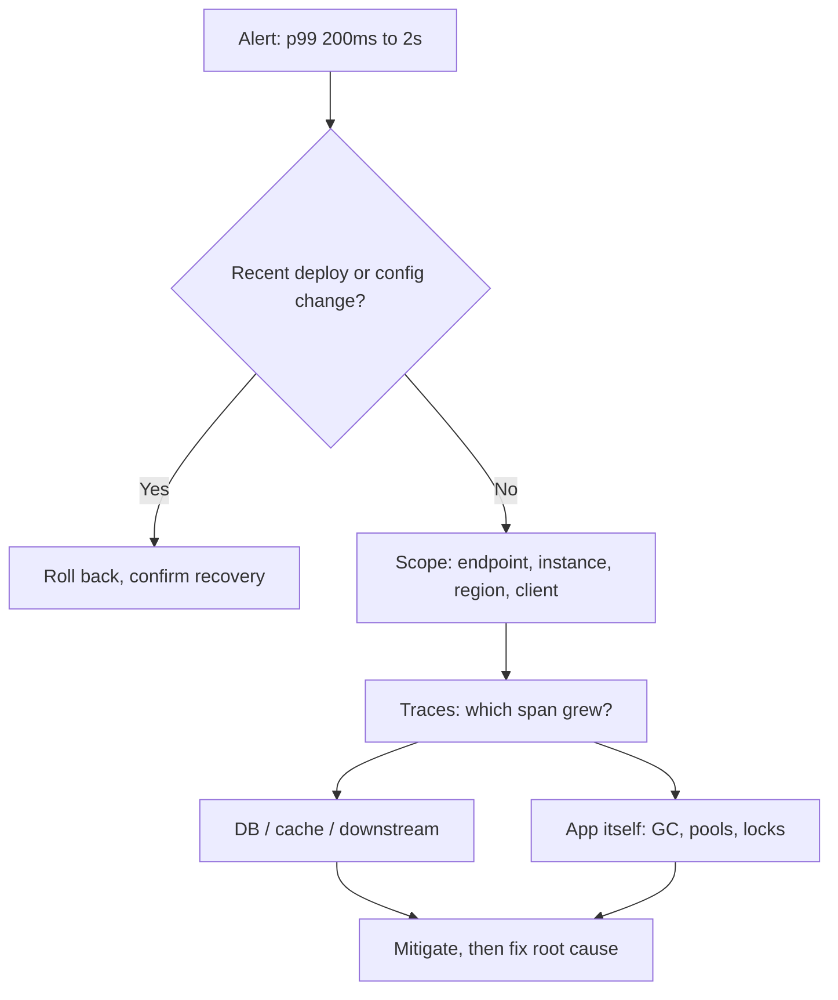

1. **Scope it.** All endpoints or one? All instances or a few (a bad host, a noisy neighbour)? One region or AZ? One client version? When exactly did it start? A sharp step usually means a change; a slow ramp usually means growth (data size, traffic, a leak).
2. **Correlate with changes.** Deploys, feature flag flips, config pushes, schema migrations, infra changes, a dependency's deploy. If one lines up, **roll back first and investigate later**; that is the fastest mitigation.
3. **Traces.** Compare a slow trace against a normal one. Which span grew: a DB query, a cache call, a downstream service, or time spent *inside* the app between spans (GC pauses, waiting for a thread)?
4. **Saturation metrics.** Use the USE method (Utilisation, Saturation, Errors) per resource: CPU, memory and GC pause time, DB connection pool wait time, thread pool queue length, file descriptors, disk I/O, network. An exhausted pool shows up as requests waiting *before* they do any work.
5. **Dependencies.** Slow queries (a changed query plan after stats updated, a missing index on a new query, lock contention), a cache hit rate drop (cache flushed, new key format after a deploy), a slow third-party API.
6. **Traffic pattern.** A scraper or bot, a new mobile release that calls an endpoint in a loop, a single hot key or tenant, a batch job that started running at peak.

#### Mitigation options while you dig

| Situation | Mitigation |
|---|---|
| Lines up with a deploy | Roll back or flip the flag off |
| CPU-bound, all instances | Scale out |
| One bad host | Drain it from the load balancer |
| Abusive client / bot | Rate-limit or block it |
| Slow dependency | Tighter timeout + cached/default fallback |
| Overload | Shed low-priority traffic |

Then fix properly (add the index, rewrite the query, resize the pool, fix the retry loop) and **add an alert on the cause**, not just the symptom (for example, "connection pool wait > 50 ms").

#### Common pitfalls

- Jumping to a theory without data; check traces before guessing.
- Scaling out when the bottleneck is the database; more app servers mean more DB connections and make it worse.
- Forgetting coordinated omission in load tests and dashboards: clients that wait don't send, so latency looks better than it is.

#### Likely follow-ups

- *"No deploy, no traffic change. Now what?"* Look for slow-moving causes: data growth changing a query plan, a memory leak raising GC time, certificate or DNS issues, a dependency that changed.
- *"Only one AZ is slow?"* Infra problem in that AZ or cross-AZ calls; shift traffic away from it.
- *"How do you prevent recurrence?"* Canary deploys with automatic rollback on latency SLO, and a post-mortem with action items.

</details>

### 2. Your database is at 95% CPU during peak. What do you do?

<details>
<summary>Answer</summary>

**In short:** Find out *what* is burning the CPU before adding hardware: the top queries by total time usually show one or two culprits that an index, query fix or throttled batch job will solve. In the medium term offload reads to replicas and caches; in the long term reduce data per node (archiving, partitioning, sharding) or change the data model. Verify every change against the CPU and latency graphs.

#### Why 95% CPU is dangerous

A database at 95% CPU has no headroom. Queueing theory says latency rises sharply as utilisation approaches 100%: queries wait for CPU, hold locks and connections longer, connection pools on the app side fill up, and timeouts and retries add even more load. A small traffic bump can tip it into a full outage.

#### Short term: find the expensive queries

```sql
-- Postgres: top queries by total time spent (requires pg_stat_statements)
SELECT query, calls, total_exec_time, mean_exec_time, rows
FROM pg_stat_statements
ORDER BY total_exec_time DESC
LIMIT 10;
```

Sort by **total** time, not mean: a 2 ms query called 50,000 times per second costs more than one 3-second report. Then:

- **Missing index** on a hot query → add it (`CREATE INDEX CONCURRENTLY` in Postgres to avoid blocking writes). Check with `EXPLAIN ANALYZE` that the plan changed from a sequential scan.
- **Bad query** (N+1 from the ORM, `SELECT *` on wide rows, unbounded `OFFSET` pagination) → fix it.
- **Offending job** (an analytics report or a backfill running on the primary at peak) → kill it, throttle it, or move it off-peak.
- **Scale vertically** if the cloud lets you (a bigger instance, often with a brief failover).
- **Shed or rate-limit** non-critical traffic to protect the critical path.

#### Medium term: take load off the primary

| Technique | Helps with | Trade-off |
|---|---|---|
| Read replicas | Read-heavy load | Replica lag, stale reads |
| Cache (Redis) for hot reads | Repeated identical reads | Invalidation complexity |
| Batching writes | Many tiny writes | Slightly delayed writes |
| Connection pooler (PgBouncer) | Too many connections | Some session features limited |
| Move analytics to a warehouse | Big scans on OLTP DB | Data pipeline to maintain |

#### Long term: change the shape of the problem

- **Archive cold data** so indexes and working sets fit in memory.
- **Partition** big tables (by time, for example) so queries touch less data.
- **Shard** by a key that spreads load evenly (user ID, tenant ID).
- **CQRS / read models**: precompute the views that expensive queries build on the fly.
- A **different database** if the access pattern doesn't fit (for example, time-series data in a time-series store).

#### Verifying

For each change, state the metric you expect to move: CPU %, query p99, top-query total time, replica lag, cache hit rate. Change one thing at a time so you know what worked.

#### Common pitfalls

- Adding replicas when the load is write-heavy; replicas don't help writes.
- Adding too many indexes; each one slows writes and uses memory.
- Caching without a plan for invalidation, which trades a CPU problem for a correctness problem.

#### Likely follow-ups

- *"It's writes, not reads."* Batch writes, reduce write amplification (fewer indexes), queue non-urgent writes, then shard.
- *"CPU is fine but I/O is pegged?"* The working set no longer fits in memory: more RAM, better indexes, archive data.

</details>

### 3. Traffic will be 10× next week for a big sale/launch. How do you prepare?

<details>
<summary>Answer</summary>

**In short:** Load test at 10–15× with realistic traffic to find and fix bottlenecks one at a time, pre-scale (autoscaling reacts too slowly to a sudden spike) and raise quotas, warm caches and push static content to the CDN, queue non-urgent work to protect the critical path, and prepare overflow controls (rate limits, waiting room, kill switches). Freeze code, staff on-call and rehearse failover before the day.

#### Why a known spike is different from organic growth

Organic growth is gradual, so autoscaling and capacity planning keep up. A sale launch is a **step function**: traffic goes from normal to 10× in seconds when the countdown hits zero. New instances take minutes to boot and warm up; caches start cold; databases can't be resized instantly. Anything that isn't ready before the spike will fall over during it.

#### Preparation plan

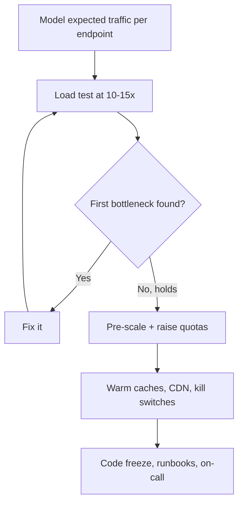

1. **Model the traffic.** It's not just "10× QPS": a sale changes the mix (more product page views and checkouts, fewer profile edits). Estimate per-endpoint peaks.
2. **Load test** with a realistic mix and realistic data at 10–15× (a margin for error). Find the first resource to saturate, fix it, repeat until the target holds. Include the database, caches and third-party sandboxes where possible.
3. **Pre-scale.** Set minimum instance counts high ahead of time; scale the database up or add replicas; pre-warm load balancers if your provider requires it. Raise **quotas and limits** with your cloud provider and third parties (payment gateway, SMS, email) because their rate limits will hit before your servers do.
4. **Caching.** Warm caches with the sale products, push images and static pages to the CDN, set sensible TTLs on catalogue data.
5. **Protect the critical path.** Checkout and payment are what make money. Move everything else async: confirmation emails, analytics events, recommendation updates go through a queue and can lag.
6. **Overflow controls.** Rate limits per user/IP (bots love sales), a **virtual waiting room** that admits users at a controlled rate, and load shedding of low-priority requests.
7. **Kill switches.** Feature flags to turn off expensive non-essential features (personalised recommendations, "people also bought", live counters) if the system gets hot.
8. **Operational readiness.** Code freeze a few days before, on-call engineers staffed for the event, dashboards for the key metrics, runbooks for likely failures, and a tested database failover.

#### Inventory-specific concerns

Flash sales concentrate writes on a few hot rows (the stock count of the featured item). Use atomic conditional decrements (`UPDATE ... SET stock = stock - 1 WHERE id = ? AND stock > 0`), or pre-split stock into buckets, or reserve stock in Redis and settle to the DB asynchronously.

#### Common pitfalls

- Load testing with uniform random data, which hides hot keys.
- Forgetting third-party limits (payment provider, SMS).
- Relying on autoscaling alone.
- Deploying new features the day before.

#### Likely follow-ups

- *"What if the load test shows the DB can't handle it?"* Cache reads, queue writes, add a waiting room to cap concurrency at what the DB can handle.
- *"How do you stop bots?"* Rate limits, CAPTCHAs at the waiting room, per-account purchase limits.

</details>

### 4. A celebrity with 100M followers posts. Your feed system falls over. Why, and how do you fix it?

<details>
<summary>Answer</summary>

**In short:** With fan-out on write, one celebrity post means 100M feed-cache inserts, which floods the fan-out queue and delays everyone's feeds; then millions of followers read and like the same post, creating **hot keys**. Fix it with **hybrid fan-out**: push posts from normal accounts at write time, but pull posts from high-follower accounts at read time and merge them in, plus heavy caching of the celebrity post and sharded or buffered counters.

#### Background: push vs pull feeds

| Model | How it works | Good for | Breaks when |
|---|---|---|---|
| Fan-out on write (push) | On post, write post ID into every follower's precomputed feed | Fast reads | Author has huge follower count |
| Fan-out on read (pull) | On feed load, fetch recent posts from everyone you follow and merge | Cheap writes | User follows many accounts; reads are slow |
| Hybrid | Push for normal authors, pull for celebrities | Both | Needs a follower-count threshold |

Most users have a few hundred followers, so push is cheap and gives fast reads. A celebrity breaks it.

#### Why it falls over

1. **Write amplification.** 100M inserts into feed caches. Even at 1M inserts/second across the cluster, that's 100 seconds of saturated fan-out workers.
2. **Queue backlog.** The fan-out queue is shared, so every normal user's posts get stuck behind the celebrity's 100M jobs. Feeds go stale for everyone.
3. **Hot reads.** Every follower opens the app and fetches the same post object, author profile and counters, all living on one cache shard.
4. **Hot writes.** Millions of likes per minute increment the same counter row.

#### The fix: hybrid fan-out

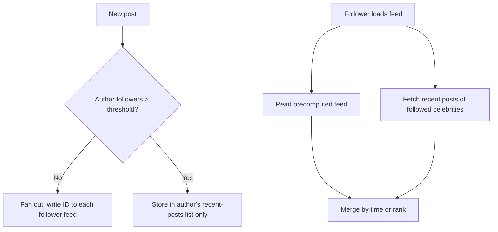

```python
def get_feed(user_id, limit=50):
    pushed = feed_cache.get_range(f"feed:{user_id}", 0, limit)       # precomputed
    celebs = followed_celebrities(user_id)                            # usually few
    pulled = [p for c in celebs for p in recent_posts_cache.get(c)]   # heavily cached
    return merge_and_rank(pushed, pulled)[:limit]
```

- Pick a threshold (for example, accounts above some follower count); a user follows few celebrities, so the read-time merge is cheap.
- The celebrity's recent-posts list is one key read by millions, so cache it in **local in-process caches** and at the edge with short TTLs.
- **Counters**: shard the like counter (`likes:post:123:{0..N}`) and sum on read, or buffer increments in memory and flush every second. Show approximate counts ("1.2M").
- **Separate queues** for fan-out so a big job can't starve normal ones.

#### Common pitfalls

- Applying the threshold only to posting, not to likes, comments and notifications, which have the same fan-out problem.
- A single global "celebrity list" that itself becomes a hot key; cache it locally.

#### Likely follow-ups

- *"What about notifying 100M followers?"* Async batched notification pipeline, rate-limited, spread over minutes; not everyone needs it instantly.
- *"Accounts that suddenly go viral?"* Reclassify dynamically based on follower count or recent engagement.

</details>

### 5. One key in your Redis cluster is getting 500K requests per second. What do you do?

<details>
<summary>Answer</summary>

**In short:** A Redis Cluster maps each key to one shard, so a single hot key saturates that one node no matter how many nodes you add. Spread or absorb the load: a short-TTL **local in-process cache** on app servers, **key replication** (`key#0..key#9` on different shards, read a random copy), read replicas for that shard, and for counters, **buffered or sharded increments**. Detect hot keys proactively.

#### Why adding nodes doesn't help

Redis Cluster splits the keyspace into 16,384 hash slots; a key's slot is `CRC16(key) mod 16384`, and each slot lives on exactly one primary. Redis executes commands on a single main thread, so one node tops out at a certain ops/second (often quoted in the low hundreds of thousands for simple commands, depending on hardware). 500K requests/second to one key all land on one node: CPU at 100%, network saturated, latency spikes for every *other* key on that shard too.

#### Options

**1. Local in-process cache (usually the first and best fix)**

```kotlin
// Caffeine (JVM) local cache in front of Redis
val local: LoadingCache<String, String> = Caffeine.newBuilder()
    .maximumSize(10_000)
    .expireAfterWrite(Duration.ofSeconds(2))   // short TTL bounds staleness
    .build { key -> redis.get(key) }           // load on miss

fun getConfig(key: String): String = local.get(key)
```

With 200 app servers and a 2-second TTL, Redis sees about 100 reads/second for that key instead of 500K. The cost is up to 2 seconds of staleness, fine for things like a trending post or a config value.

**2. Replicate the key across shards**

Write the value to `hot:key#0` through `hot:key#9` (which hash to different slots, so different nodes). Readers pick a random suffix. Writes must update all copies, so this suits read-heavy keys.

**3. Read replicas for that shard**

Send reads to replicas (`READONLY` in cluster mode). Helps but is limited by the replica count, and replicas can lag.

**4. Counters**

If it's a hot `INCR` (likes, views), batch increments in memory per app server and flush every second (`INCRBY key 742`), or split into N sub-counters and sum on read.

| Option | Reads | Writes | Staleness |
|---|---|---|---|
| Local cache | Excellent | No help | TTL-bounded |
| Key replication | Very good | Worse (write N) | Brief inconsistency between copies |
| Read replicas | Good | No help | Replica lag |
| Buffered counter | n/a | Excellent | Flush interval |

#### Detecting hot keys

- `redis-cli --hotkeys` (requires an LFU `maxmemory-policy`) or sampling with `MONITOR` briefly (expensive; don't leave it on).
- Client-side metrics: count requests per key prefix in the app and alert on outliers.
- Per-node CPU skew in the cluster is a strong signal.

#### Common pitfalls

- Re-sharding or adding nodes, which moves the slot but not the problem.
- Long local-cache TTLs on data that must be fresh (prices, stock).
- Thundering herd when the hot key expires: use request coalescing or refresh-ahead.

#### Likely follow-ups

- *"How do you know which keys will be hot in advance?"* Often you don't; detect dynamically and promote keys to local caching automatically.
- *"What if it's a hot write key?"* Buffer, shard the key, or rethink the data model.

</details>

### 6. A message queue's consumer lag keeps growing. What do you do?

<details>
<summary>Answer</summary>

**In short:** Lag grows when messages arrive faster than they are processed, so first work out which side changed: did the **producer rate** go up, or did **consumer throughput** drop (slow downstream, retries, a poison message, rebalance loops)? Mitigate by scaling consumers up to the partition count, batching, sending poison messages to a DLQ and pausing non-critical producers. If only one partition lags, it's a hot partition key. Long term: more partitions, faster downstream writes, priority queues and lag alerts measured in time.

#### How lag works

In Kafka, lag per partition = latest offset − consumer group's committed offset. Lag is fine if it's stable; it's a problem if it **keeps growing**, because that means input rate > processing rate and it will never catch up on its own.

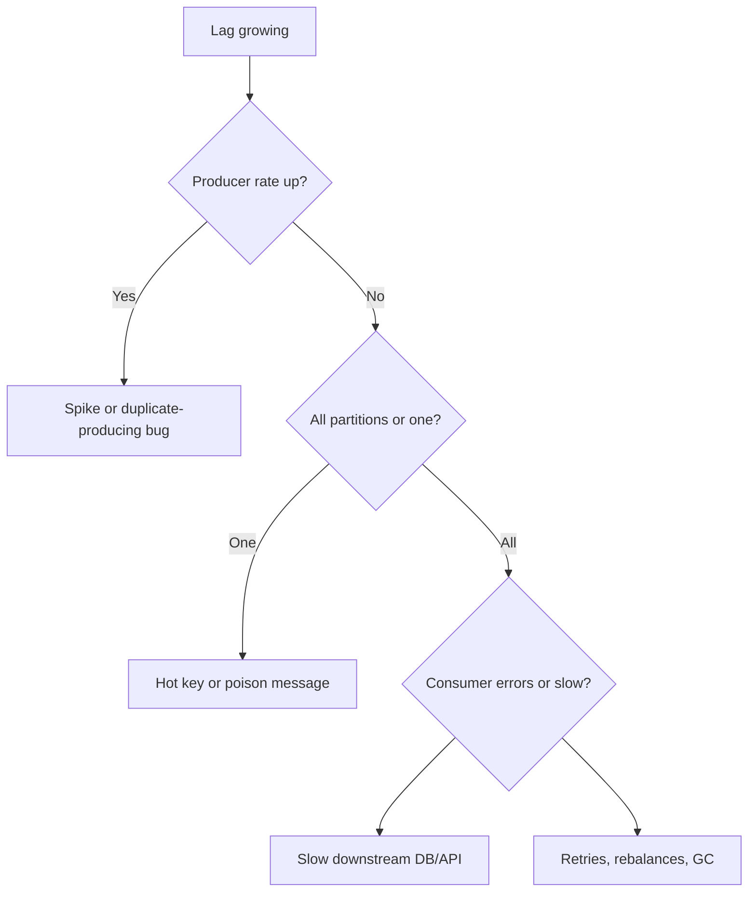

#### Diagnose

1. **Producer side.** Compare incoming message rate with the baseline. A marketing campaign, a retry storm, or a bug publishing each event twice can double input.
2. **Consumer side.** Look at processing time per message, error rate, and consumer group membership:
   - Slow downstream (DB writes got slower, a third-party API is throttling you).
   - Errors with in-line retries: each failing message is retried several times, blocking the partition.
   - A **poison message** that always fails, which blocks its partition forever if you retry indefinitely.
   - **Rebalance loops**: in Kafka, if processing a batch takes longer than `max.poll.interval.ms`, the consumer is kicked out of the group, partitions are reassigned, and work restarts. Lag grows while nobody makes progress.
3. **Per-partition view.** If one partition lags and others are fine, either a hot key routes most traffic there or a poison message is stuck there.

#### Mitigate

- **Scale consumers**, but only up to the partition count; extra consumers in a group sit idle.
- **Batch** downstream writes (one bulk insert of 500 rows instead of 500 inserts).
- **Poison messages**: after N attempts, move to a dead-letter queue and continue.
- **Reduce batch size or raise `max.poll.interval.ms`** if rebalances are the cause.
- **Pause non-critical producers** or drop low-value messages (for example, analytics) temporarily.

#### Fix long term

- More partitions (plan ahead: increasing partitions changes key-to-partition mapping, which breaks per-key ordering during the transition).
- Better partition key, or **salting** a hot key (`key + random(0..N)`) if per-key ordering isn't required.
- Faster consumers: async I/O, parallel processing within a partition keyed by sub-key.
- Separate topics by priority so bulk work doesn't delay urgent work.
- **Alert on lag in time** ("oldest unprocessed message is 5 min old"), not only message count, because 10K messages means different things at different rates.

#### Common pitfalls

- Adding consumers beyond the partition count.
- Infinite retries in the consumer.
- Auto-committing offsets before processing, which hides lag but loses messages on crashes.

#### Likely follow-ups

- *"Can you just skip ahead?"* Only if the data is disposable (metrics); otherwise you lose data.
- *"How do you replay the DLQ?"* Fix the bug, then re-publish DLQ messages to the main topic idempotently.

</details>

### 7. Your service works fine at 1K QPS but falls over at 5K QPS. How do you find the bottleneck?

<details>
<summary>Answer</summary>

**In short:** Ramp load up step by step (1K, 2K, 3K...) while watching the saturation of every resource: CPU, memory and GC, thread pools, connection pools, file descriptors, network, locks and downstream latency. The first resource to hit its limit is the bottleneck. Fix it, re-test, and find the next one; there is always a next one.

#### Why "falls over" usually means a queue somewhere

Every service is a chain of limited resources. Below capacity, requests flow through. Once one resource is full, requests start **queueing** in front of it, latency rises, clients time out and retry, which adds more load, and the system collapses well before CPU looks busy. So the question is: which queue fills first?

#### Method

1. **Reproduce in a load test** with a realistic request mix and data. Ramp gradually and hold each step for a few minutes so caches, pools and GC reach steady state.
2. **Plot latency and throughput against load.** Throughput rises linearly, then flattens (the knee); latency stays flat then shoots up. The knee is your capacity.
3. **At the knee, check every resource** (the USE method: utilisation, saturation, errors):

| Resource | What saturation looks like | Typical fix |
|---|---|---|
| CPU | Near 100%, run queue grows | Profile hot code, scale out |
| Memory / GC | GC pauses grow, heap near max | Fix allocations, tune heap |
| Thread pool | All threads busy, queue grows | Async I/O, size pool properly |
| DB connection pool | Requests wait to get a connection | Resize pool, faster queries |
| HTTP client pool | Waits for outbound connection | Raise per-host limit |
| File descriptors | "Too many open files" errors | Raise ulimit, reuse connections |
| Locks | Low CPU but high latency | Reduce critical sections, shard lock |
| Downstream | Dependency latency rises | Cache, batch, ask for capacity |

4. **Profile** under load (flame graphs, thread dumps). A thread dump with 200 threads all waiting on the same lock or on `getConnection()` tells you immediately.

#### The classic culprits

- **Undersized DB connection pool**: 10 connections, each request holds one for 20 ms → a max of 500 requests/second per instance from that pool alone.
- **Synchronous blocking calls** holding request threads while waiting on slow I/O.
- **A single hot lock or hot row** (a global counter, a `synchronized` cache).
- **Synchronous logging** to disk at high volume.
- **N+1 queries** that are fine at 1K and kill the DB at 5K.
- **A downstream rate limit** you didn't know about.

A quick sanity check using Little's Law: concurrent requests = throughput × latency. At 5K QPS and 100 ms latency, you need 500 requests in flight; if your thread pools across instances total 400, you've found the limit.

#### Common pitfalls

- Load testing from a single client machine that itself becomes the bottleneck.
- Testing against an empty database or a perfectly warm cache.
- Fixing the symptom (raising a pool size) and moving the bottleneck to the database.

#### Likely follow-ups

- *"CPU is only at 40% but it falls over. Why?"* Something other than CPU: lock contention, pool exhaustion, or a downstream limit.
- *"How do you make it degrade gracefully instead of falling over?"* Bounded queues, load shedding and timeouts, so excess requests fail fast instead of piling up.

</details>

---

## Failures & Outages

### 8. Your cache cluster goes down completely. What happens and how do you design for it?

<details>
<summary>Answer</summary>

**In short:** Every read that the cache used to absorb now hits the database, which was sized for maybe 5–10% of the traffic, so it overloads and takes the whole service down: a **cache avalanche** turning into a cascading failure. Design for it with a replicated, multi-AZ cache, rate limits and circuit breakers in front of the DB, request coalescing, a local cache tier, gradual warm-up on recovery, and DB capacity for realistic partial cache loss.

#### Why it cascades

With a 95% hit rate, the DB sees 5% of reads. If the cache disappears, DB read load jumps **20×** instantly. The DB slows, app threads wait on DB connections, pools fill, requests time out, clients retry (more load), and health checks start failing on app servers too. Even after the cache comes back, it's empty (cold), so the DB stays hammered until it refills.

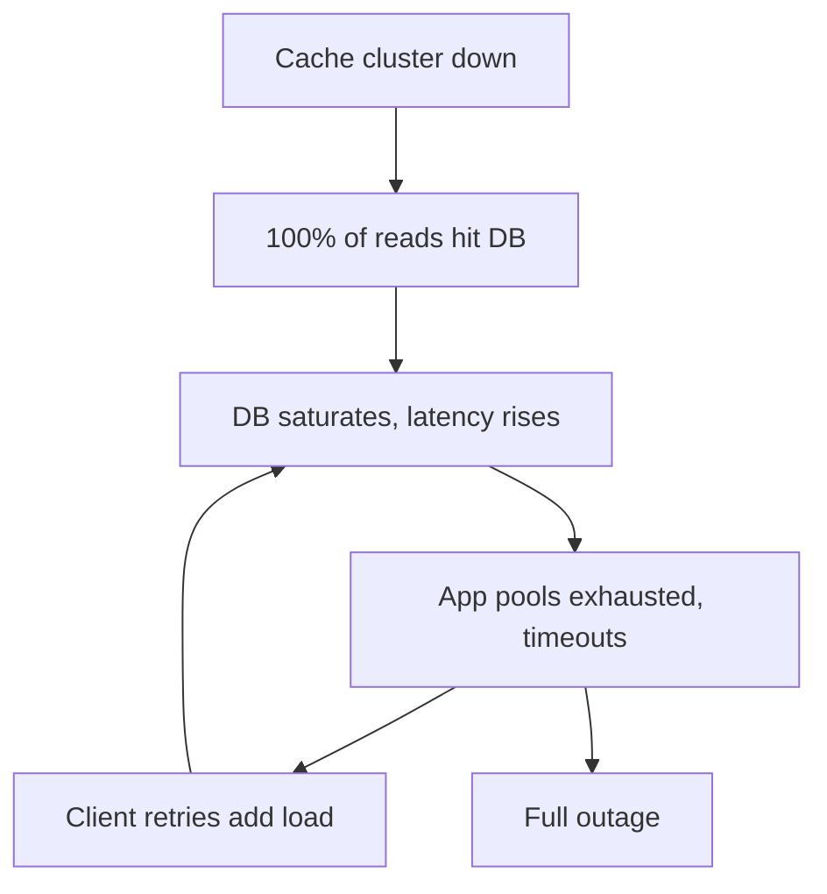

#### Design for it

**Prevent the total loss**
- Run the cache with **replicas and automatic failover** spread across availability zones (for example, Redis with replicas per shard), so losing a node or an AZ loses only part of the cache.
- Use **consistent hashing / cluster slots** so a lost node moves only its share of keys.

**Protect the database when it happens anyway**
- **Rate limit / concurrency limit** calls to the DB; beyond the limit, fail fast or serve degraded responses (default content, slightly stale data).
- **Circuit breakers** on the DB path so the app stops piling on when the DB is struggling.
- **Request coalescing (single-flight)**: if 1,000 requests miss the same key at once, only one goes to the DB and the rest wait for its result.

```kotlin
// Single-flight: concurrent misses for the same key share one DB load
private val inFlight = ConcurrentHashMap<String, CompletableFuture<Product>>()

fun getProduct(id: String): CompletableFuture<Product> =
    inFlight.computeIfAbsent(id) {
        CompletableFuture.supplyAsync { db.loadProduct(id) }
            .whenComplete { _, _ -> inFlight.remove(id) }
    }
```

- A small **local in-process cache** on app servers for the hottest keys keeps serving them even when the remote cache is gone.
- **Load shedding**: drop low-priority traffic (recommendations, analytics) to keep core flows alive.

**Recover safely**
- **Warm the cache gradually**: let traffic back in progressively, or pre-load hot keys from a list before taking full traffic.
- Add **TTL jitter** so keys written during recovery don't all expire at the same moment later.

**Plan capacity**
- Size the DB to survive a realistic partial loss (say, one cache shard or one AZ), not necessarily total loss.

#### Common pitfalls

- Treating the cache as optional "just performance" when the DB can't survive without it; at that point it's critical infrastructure.
- Retrying failed cache calls aggressively, which adds load to a recovering cluster.
- All keys sharing the same TTL, causing mass expiry (a mini avalanche) every hour.

#### Likely follow-ups

- *"Cache stampede vs avalanche?"* Stampede: many requests miss one hot key at once. Avalanche: many keys miss at once (mass expiry or cache loss).
- *"Should the app fail open or closed?"* Usually serve degraded or stale data for reads, and fail closed for anything correctness-critical.

</details>

### 9. An entire AWS region goes down. What happens to your system?

<details>
<summary>Answer</summary>

**In short:** It depends on the disaster-recovery strategy, which you should state in terms of **RPO** (how much data you can lose) and **RTO** (how long you can be down). Single region: you're down until AWS recovers. Active-passive: fail over traffic to a standby region and promote its replica database, possibly losing the last seconds of async-replicated writes. Active-active: healthy regions absorb traffic automatically if they have headroom. Then discuss hidden single-region dependencies, testing failover, and failback.

#### The two numbers to state first

- **RPO (Recovery Point Objective)**: maximum acceptable data loss, measured in time. Async replication with ~1 s lag gives an RPO of roughly seconds; nightly backups give an RPO of up to 24 hours.
- **RTO (Recovery Time Objective)**: maximum acceptable downtime until service is restored.

Lower RPO and RTO cost more money and complexity. A payments system and an internal reporting tool deserve different answers.

#### Strategies

| Strategy | What happens in an outage | RPO | RTO | Cost |
|---|---|---|---|---|
| Single region + cross-region backups | Down; restore elsewhere if prolonged | Hours (backup age) | Hours | Low |
| Pilot light / warm standby | Scale up standby, promote DB, switch DNS | Seconds to minutes | Minutes to an hour | Medium |
| Active-passive (hot standby) | Fail over to fully running standby | Seconds | Minutes | High |
| Active-active | Traffic shifts automatically | Near zero to seconds | Near zero | Highest |

#### Active-passive failover, step by step

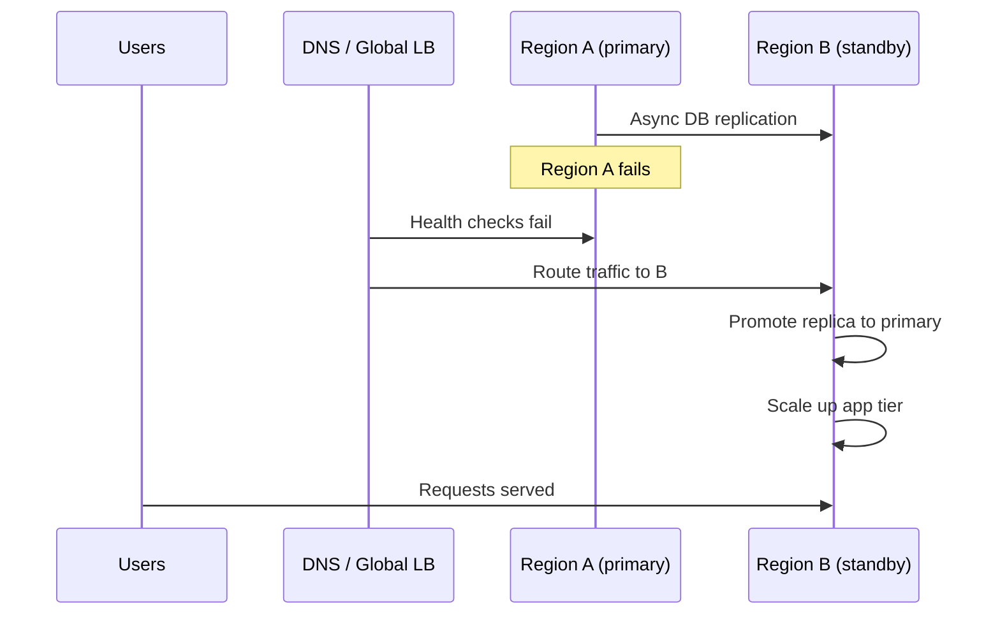

1. Health checks (or a human decision) declare the region down. Automated failover is fast but risks flapping on a partial failure; many teams keep a human in the loop for region-level failover.
2. DNS or a global load balancer routes users to the standby region. DNS TTLs and client caching delay this.
3. Promote the replica database. Writes that were committed in the old primary but not yet replicated are **lost or stranded**; you'll need to reconcile them after recovery.
4. Scale up the standby if it ran at reduced capacity.

#### Active-active

Both regions serve traffic. When one dies, the global load balancer shifts its users to the others. Requirements: each region needs **headroom** to absorb the extra load (for two regions, each runs at no more than about 50%), and data must be replicated across regions with a conflict strategy (home region per user, or a globally consistent database).

#### The parts candidates forget

- **Hidden single-region dependencies**: the auth service, secrets manager, config store, container registry, CI/CD pipeline, or a third-party API that lives only in the failed region. Your failover fails because you can't deploy or log in.
- **Data written only in the failed region** (uploads in a regional bucket without replication).
- **Testing**: failover that isn't exercised regularly (game days) usually doesn't work when needed.
- **Failback**: returning to the original region means re-syncing data in the other direction and repeating the switch carefully.

#### Likely follow-ups

- *"Why not always active-active?"* Cost, and cross-region data consistency is hard; many products don't need near-zero RTO.
- *"What about a single AZ failure?"* Much more common; handle it with multi-AZ deployments inside the region, which every production system should have.

</details>

### 10. A downstream service is slow (not down). How do you prevent it from taking your service down?

<details>
<summary>Answer</summary>

**In short:** A slow dependency is more dangerous than a dead one, because a dead one fails fast while a slow one holds your threads and connections until you run out of them. Protect yourself with **tight timeouts**, a **circuit breaker** that also trips on slow calls, a **bulkhead** (bounded pool just for that dependency), a **fallback**, limited retries with backoff and jitter, and **deadline propagation**. Shed load early if your own queues grow.

#### How a slow dependency takes you down

Say your service has 200 request threads and normally calls the recommendations service, which answers in 50 ms. It slows to 5 s. Each request now holds a thread 100× longer. At 1,000 requests/second, you'd need 5,000 threads; you have 200. Within a second, every thread is stuck waiting on recommendations, and requests that don't even need recommendations (login, checkout) can't get a thread. One non-critical dependency has taken down the whole service.

#### The defences

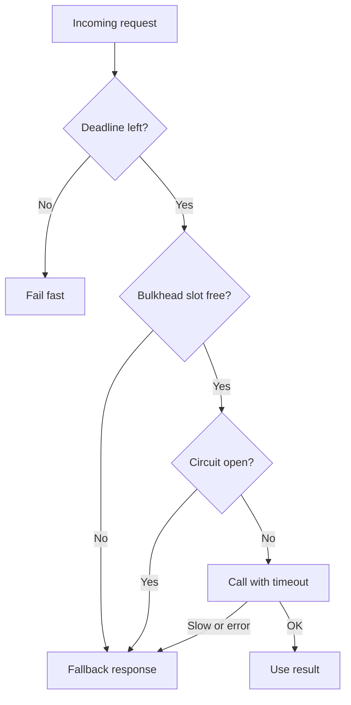

| Technique | What it does |
|---|---|
| Timeout | Caps how long one call can hold resources. Set from the dependency's p99.9, not "30 s by default". |
| Circuit breaker | After many failures *or slow calls*, stop calling for a cool-down period and fail fast; probe occasionally (half-open). |
| Bulkhead | A separate, bounded thread pool or semaphore per dependency, so a slow one can only exhaust its own slots. |
| Fallback | Cached value, default content, or hide the feature ("recommendations unavailable"). |
| Retries | Few (1–2), with exponential backoff and jitter, only for idempotent calls, and with a retry budget. Retries on a slow service add load. |
| Deadline propagation | Pass the remaining time budget downstream (gRPC deadlines do this) so nobody works on a request the user already abandoned. |
| Load shedding | When your own queue or concurrency is high, reject new work early with 503 rather than accept work you can't finish. |

```kotlin
// Resilience4j: bulkhead + circuit breaker (opens on slow calls) + timeout + fallback
val cb = CircuitBreaker.of("recs", CircuitBreakerConfig.custom()
    .failureRateThreshold(50f)
    .slowCallDurationThreshold(Duration.ofMillis(300))
    .slowCallRateThreshold(50f)          // trip if half the calls are slow
    .waitDurationInOpenState(Duration.ofSeconds(10))
    .build())
val bulkhead = Bulkhead.of("recs", BulkheadConfig.custom()
    .maxConcurrentCalls(20)              // at most 20 threads tied up on recs
    .build())

fun recommendations(userId: String): List<Item> =
    try {
        Decorators.ofSupplier { recsClient.fetch(userId, timeout = Duration.ofMillis(300)) }
            .withBulkhead(bulkhead)
            .withCircuitBreaker(cb)
            .get()
    } catch (e: Exception) {
        popularItemsCache.get()           // fallback
    }
```

#### Common pitfalls

- Default client timeouts that are very long or infinite.
- A circuit breaker that only counts errors, so a slow-but-successful dependency never trips it.
- Retries at every layer multiplying load (3 layers × 3 retries = 27 calls).
- Sharing one connection pool across all dependencies.

#### Likely follow-ups

- *"How do you choose the timeout?"* Slightly above the dependency's healthy p99/p99.9, and within the caller's overall deadline.
- *"Is the dependency critical?"* If yes, no fallback exists; fail fast with a clear error rather than hang.

</details>

### 11. A bad deploy is corrupting data in production. What do you do?

<details>
<summary>Answer</summary>

**In short:** Stop the damage first: roll back or turn off the feature flag, and pause writes on that path if needed. Then measure the blast radius (which records, since when, which users), repair the data from point-in-time backups, event logs or audit trails with a tested, idempotent script that corrects forward without wiping newer valid writes, communicate with affected users, and add safeguards so it can't recur.

#### Why speed matters, and what not to rush

Every minute the bad code runs, more records are corrupted and more downstream systems (caches, search indexes, analytics, emails to customers) copy the bad data. So **stopping** must be immediate. **Repairing** is the opposite: a rushed repair script on production data can do more damage than the original bug. Move fast on step 1, carefully on step 3.

#### Step by step

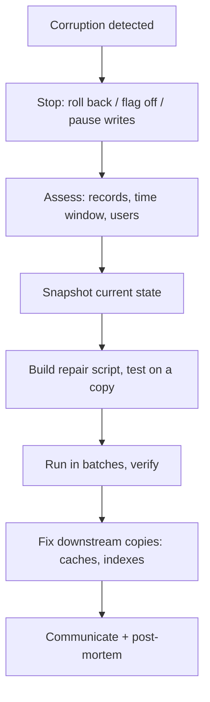

1. **Stop it.** Roll back the deploy or disable the feature flag. Rolling back code does *not* undo data changes, so also consider pausing writes on the affected path or putting the feature in read-only mode.
2. **Assess.** Use the deploy timestamp to bound the window. Identify affected rows (audit columns like `updated_at`, the change log, application logs, CDC stream). Count them and identify users.
3. **Snapshot first.** Take a backup of the current state before repairing, so a bad repair can be undone.
4. **Repair.** Options:
   - **Recompute from a source of truth**: replay the event log or recompute derived values from raw data.
   - **Point-in-time recovery (PITR)** into a *separate* instance, then copy the correct old values for affected records only.
   - **Correct forward**: an update script that fixes specific fields, rather than a bulk restore that would erase legitimate writes made after the bug.
   Test the script on a copy of production, make it idempotent and restartable, run it in batches, and verify counts after.
5. **Fix downstream copies.** Invalidate caches, re-index search, correct data sent to partners, and flag analytics for the window.
6. **Communicate.** Affected customers, support teams, and, for regulated data, compliance or legal.
7. **Prevent.**
   - Canary releases with **data-validation checks** (invariants like "balance never negative") that trigger automatic rollback.
   - Database constraints (NOT NULL, CHECK, foreign keys) that reject impossible data.
   - Audit logs / event sourcing so you always know the previous value.
   - Regular **restore drills**: an untested backup is not a backup.

#### Common pitfalls

- Restoring the whole database to before the deploy and losing hours of valid data from all users.
- Forgetting derived stores, so the corruption reappears from a cache.
- Running the repair script once, unbatched, on the primary at peak.

#### Likely follow-ups

- *"What if you have no audit trail?"* PITR into a side instance and diff against current data for the window.
- *"How would you detect it sooner?"* Invariant checks, anomaly alerts on write patterns, and reconciliation jobs.

</details>

### 12. Users report that they sometimes see stale data after updating their profile. Why?

<details>
<summary>Answer</summary>

**In short:** The write succeeded, but the next read came from somewhere that hasn't caught up: a **lagging read replica**, a **cache** that wasn't invalidated (or was re-populated with the old value by a race), a CDN or client cache, or another region in an eventually consistent setup. Fix it by guaranteeing **read-your-writes** for the user who just wrote (route their reads to the primary briefly or use a version token), invalidate caches after commit, mark personalised responses non-cacheable, and update the client UI optimistically.

#### Why "sometimes"

Intermittent staleness is the signature of a race between replication or invalidation and the next read. If the read happens 5 ms after the write and replica lag is 50 ms, the user sees old data; a second later, it's correct. Under load, lag grows and the bug gets "worse at peak".

#### The causes and how to spot them

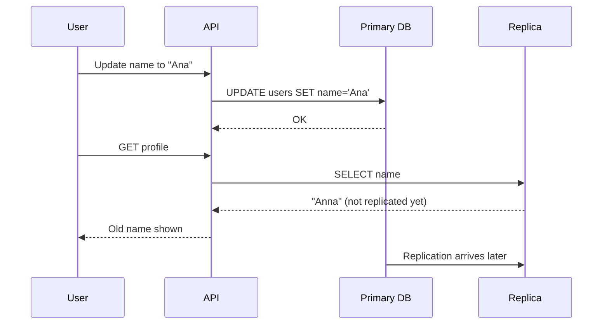

| Cause | Clue | Fix |
|---|---|---|
| Replica lag | Correlates with replica lag metric | Read-your-writes routing |
| Cache not invalidated | Stale until TTL expires | Delete cache key after commit |
| Cache race | Rare, stale until TTL | Versioned values, short TTL, delayed second delete |
| CDN / browser cache | Stale across refreshes, fixed by hard refresh | `Cache-Control: private, no-store` |
| Multi-region | User routed to a different region | Sticky home region, or version token |

#### The cache race in detail

Reader A misses the cache and reads the old value from the DB. Writer B updates the DB and deletes the cache key. Reader A then writes its old value into the cache. Now the cache holds stale data until the TTL. Mitigations: store a version number with the value and only overwrite if newer, use short TTLs, or do a second delayed delete a moment after the write.

#### Read-your-writes options

```kotlin
// After a write, pin this user's reads to the primary for a short window
fun updateProfile(userId: String, p: Profile) {
    primary.update(userId, p)
    cache.delete("profile:$userId")                         // after commit
    session.put("readPrimaryUntil", now() + 5.seconds)
}

fun getProfile(userId: String): Profile {
    val usePrimary = now() < session.get("readPrimaryUntil")
    return if (usePrimary) primary.load(userId) else replica.load(userId)
}
```

A more precise option: return the commit's log position (an LSN in Postgres, a GTID in MySQL) to the client, and only serve reads from a replica that has replayed past that position.

On mobile and web, also **apply the update to local state immediately** (optimistic UI) so the user sees their change regardless of what the next GET returns.

#### Common pitfalls

- Invalidating the cache *before* the DB transaction commits, so a reader re-caches the old value.
- Caching personalised API responses at the CDN.
- Sending all reads to the primary, which "fixes" it by removing the benefit of replicas.

#### Likely follow-ups

- *"Other users see the old name for a second. Is that OK?"* Usually yes; read-your-writes is a per-user guarantee, and global strong consistency costs much more.
- *"Write-through vs delete on update?"* Deleting is simpler and avoids writing values nobody reads; write-through keeps the cache warm but has its own races.

</details>

---

## Data & Correctness

### 13. Some customers were charged twice. How did it happen and how do you prevent it?

<details>
<summary>Answer</summary>

**In short:** Almost always a **retry after an ambiguous failure**: the first charge succeeded, but the response was lost (timeout, crash, network drop), so the client or service retried and charged again. Double-clicks and queue redeliveries to non-idempotent consumers cause the same thing. Prevent it with **idempotency keys** stored atomically with the result, passing a unique reference to the payment provider, unique constraints per order, an explicit `pending` state where unknown outcomes are resolved by **querying status, not re-charging**, and reconciliation jobs that catch and refund any duplicate that slips through.

#### Why timeouts are ambiguous

A timeout tells you that you didn't get an answer, not that the operation failed. The charge may have succeeded at the bank, and only the reply was lost. A naive retry turns "unknown" into "charged twice".

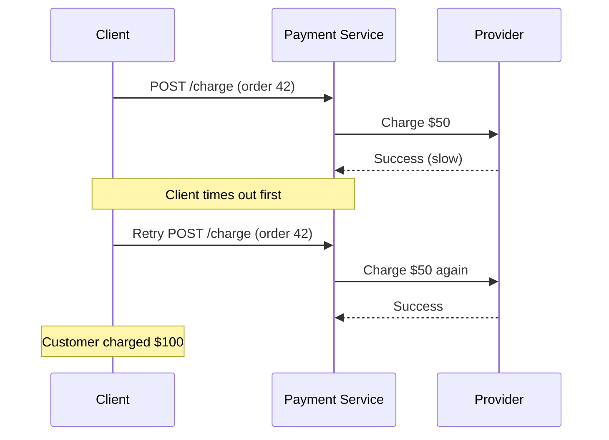

#### Defences in layers

**1. Idempotency key on your API.** The client generates a unique key per *intent* (per checkout attempt, not per HTTP request) and sends it with every retry. The server records the key and its result atomically.

```sql
CREATE TABLE payment_requests (
  idempotency_key TEXT PRIMARY KEY,
  order_id        BIGINT NOT NULL,
  status          TEXT NOT NULL,     -- PENDING, SUCCEEDED, FAILED
  provider_ref    TEXT,
  response_body   JSONB,
  created_at      TIMESTAMPTZ NOT NULL DEFAULT now()
);
-- Only one successful charge per order, whatever the key
CREATE UNIQUE INDEX one_success_per_order
  ON payment_requests(order_id) WHERE status = 'SUCCEEDED';
```

Flow: insert the key as `PENDING` (a conflict means it's a retry: return the stored result, or "in progress"); call the provider; update to `SUCCEEDED`/`FAILED` with the response.

**2. Idempotency at the provider.** Major payment providers accept an idempotency key or unique merchant reference; pass your own key so even your own retries to them are deduplicated.

**3. Unknown outcomes.** If the provider call times out, keep the record `PENDING` and **query the provider for the status** of that reference (or wait for its webhook) instead of charging again. A background job resolves stuck `PENDING` rows.

**4. Queues.** Consumers of payment messages must be idempotent: check the key before acting, because at-least-once delivery means redelivery will happen.

**5. Client UX.** Disable the Pay button and show a spinner after the click. Helpful, but never the only defence.

**6. Reconciliation.** A daily (or more frequent) job compares your records with the provider's settlement reports, flags duplicates and mismatches, and triggers refunds and alerts.

#### Common pitfalls

- Generating a new idempotency key on every retry, which defeats it.
- Checking "does a charge exist?" and then charging as two separate steps without a lock or unique constraint (a race between two concurrent retries).
- Expiring idempotency keys too quickly, shorter than the client's retry window.

#### Likely follow-ups

- *"Where does the key come from on mobile?"* Generated on the device when the user starts checkout and persisted, so app restarts reuse it.
- *"What if two requests with the same key arrive at once?"* The primary-key insert lets only one proceed; the other gets "in progress" (often HTTP 409) and retries later.

</details>

### 14. Two microservices have inconsistent data (orders show paid, payments show failed). How do you handle it?

<details>
<summary>Answer</summary>

**In short:** The usual root causes are **dual writes** (write the DB, then publish an event, and one of them fails), **lost or unprocessed events**, **out-of-order processing**, or a **saga step that failed without compensation**. Fix the pattern with a transactional outbox or CDC, idempotent consumers, sagas with compensations and timeouts, and version numbers to drop stale events. Detect drift with **reconciliation jobs**, and repair by re-syncing from the **owner** of each fact (the payment service owns payment status).

#### How it happens

In microservices there is no single transaction spanning both databases, so consistency depends on events flowing reliably. Common failure modes:

| Cause | Example |
|---|---|
| Dual write | Payment service commits "failed" but crashes before publishing the event; orders never hears about it |
| Lost event | Event published to a non-durable channel, or consumer committed offset before processing |
| Out-of-order | "Payment succeeded" (from a first attempt) arrives after "payment failed" (from a retry) and wins |
| Missing compensation | Order marked paid optimistically; payment later fails but no step reverts the order |
| Bug in consumer | Event processed, but mapping logic is wrong |

#### Fix the pattern

**Transactional outbox**: write the business change and the event into the same local database transaction; a separate relay (polling or CDC like Debezium) publishes outbox rows to the broker. Either both happen or neither does.

```sql
BEGIN;
UPDATE payments SET status = 'FAILED', version = version + 1 WHERE id = 991;
INSERT INTO outbox (aggregate_id, type, payload)
VALUES (991, 'PaymentFailed', '{"orderId": 42, "version": 7}');
COMMIT;
-- Relay publishes outbox rows to Kafka, at-least-once
```

**Idempotent consumers**: deliveries are at-least-once, so record processed event IDs or make updates naturally idempotent.

**Versioning**: each event carries the aggregate version; the consumer ignores an event older than what it already applied.

```sql
UPDATE orders SET payment_status = :status, payment_version = :v
WHERE id = :orderId AND payment_version < :v;   -- drops stale events
```

**Sagas**: model the order flow as a state machine (`PENDING_PAYMENT → PAID` or `→ CANCELLED`) with explicit compensations and timeouts. An order shouldn't show "paid" until the payment service confirms.

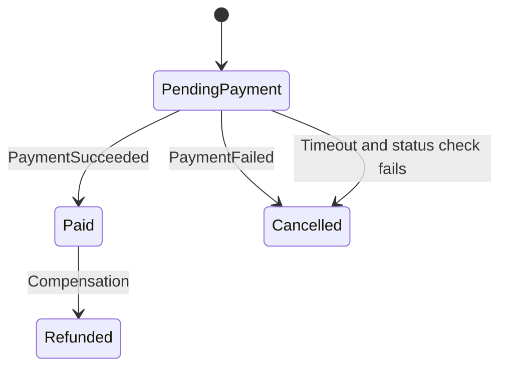

#### Detect

A **reconciliation job** periodically compares both sides (for example, all orders updated in the last hour against payment statuses), alerts on mismatches, and reports the drift rate. Even with perfect patterns, bugs happen; reconciliation is the safety net.

#### Repair

- Decide the **source of truth per fact**: payment status is owned by the payment service, so the order service copies it, never the other way round.
- Re-sync the mismatched records from the owner (replay its events from the log, or call its API), idempotently.
- For money, involve the provider's records too: the payment service itself may be wrong.

#### Common pitfalls

- "Fixing" the mismatch by editing the order to match without checking what the payment provider actually did.
- Letting both services write the same field.
- Trusting event arrival order across partitions.

#### Likely follow-ups

- *"Why not a distributed transaction (2PC)?"* Blocking, poor availability, and many brokers and services don't support it; outbox + sagas are the common alternative.
- *"How quickly should reconciliation run?"* As often as the business can tolerate inconsistency; minutes for payments, daily for reporting.

</details>

### 15. How would you migrate a large database to a new database with zero downtime?

<details>
<summary>Answer</summary>

**In short:** Run old and new side by side and move traffic in small, reversible steps: keep the new DB in sync (preferably with **CDC** from the old one), **backfill** history in restartable batches, **verify** with data comparisons and shadow reads, shift reads gradually behind a flag, then switch writes, keep the old DB in sync in reverse for rollback, and only then decommission it.

#### Why not just "dump, load, switch"?

A large database takes hours or days to copy. During that time writes keep arriving, so the copy is stale the moment it finishes, and stopping writes for that long is the downtime you're trying to avoid. You also can't be sure the new system behaves the same (query semantics, performance, data types) until it handles real traffic. So the migration becomes a sequence of small, observable, reversible steps.

#### The phases

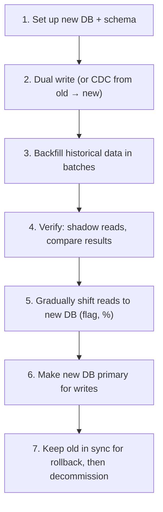

1. **Set up the new DB and schema**, including the mapping from old to new model if it changes.
2. **Keep it in sync with new writes.** Two ways:
   - **CDC** (change data capture, for example Debezium reading the old DB's replication log): every committed change streams to the new DB. No app changes, no gaps, ordered per key.
   - **Application dual writes**: the app writes to both. Simpler to start, but if one write fails you get silent divergence, because there's no atomicity across two databases.
3. **Backfill** historical rows in batches, throttled to protect the old DB. Make it **idempotent** (upserts keyed by primary key, or "only write if newer") so it can be restarted and so it doesn't overwrite fresher CDC changes.
4. **Verify.** Row counts and checksums per range; **shadow reads** where the app reads from both and logs mismatches while still returning the old result. Fix bugs until the mismatch rate is zero.
5. **Shift reads gradually** with a feature flag: 1% → 10% → 50% → 100%, watching latency and errors. Reversible instantly.
6. **Switch writes.** The new DB becomes the source of truth. This is the riskiest step; a brief write pause (seconds) may be the simplest way to guarantee nothing is lost at the cut-over.
7. **Reverse sync** new → old for a while so you can roll back without losing data, then **decommission** once you're confident.

#### Doing it in waves

For multi-tenant or sharded data, migrate one tenant or shard at a time: start with internal accounts, then small customers, then large ones. Each wave reduces risk and teaches you something.

| Approach | Pros | Cons |
|---|---|---|
| CDC | No app changes, consistent ordering | Needs log access, schema mapping in the pipeline |
| Dual writes | Simple, no extra infra | Divergence on partial failure |
| Big-bang with downtime | Simplest | Downtime, no gradual rollback |

#### Common pitfalls

- No way back after the write switch.
- Backfill overwriting newer CDC data.
- Comparing only row counts and missing subtle data-type differences (timezones, collations, decimal precision).
- Forgetting other readers of the old DB (reports, ETL jobs, other services).

#### Likely follow-ups

- *"How do you handle auto-increment IDs?"* Keep IDs from the old DB, or switch to IDs that don't depend on one database (UUIDs, a central ID generator) before migrating.
- *"How long do you keep the old DB?"* Until a full business cycle (for example, month-end jobs) has run cleanly on the new one.

</details>

### 16. You need to add a column with a default to a table with 2 billion rows. How?

<details>
<summary>Answer</summary>

**In short:** The danger is a **table rewrite under an exclusive lock**, which would block reads and writes for hours. First check whether your database can add the column as a **metadata-only** change (Postgres 11+ for constant defaults, MySQL 8 `INSTANT` ADD COLUMN). If not, use an **online schema change tool** (gh-ost, pt-online-schema-change). Backfill any computed values in **small throttled batches** while watching replication lag, follow **expand and contract** so code works with both states, and add constraints and indexes only after the backfill, without blocking.

#### Why a naive ALTER is dangerous

On older engines, `ALTER TABLE ... ADD COLUMN x INT NOT NULL DEFAULT 0` rewrites every row to include the new value. On 2 billion rows that can take hours, while holding a lock that blocks writes (and in some cases reads). Even a short lock is dangerous: in Postgres, an `ALTER` waiting for its lock queues *behind* long-running queries and *ahead of* all new queries, so the whole table can stall.

#### Options

**1. Metadata-only add (check first)**

- **Postgres 11+**: adding a column with a *constant* (non-volatile) default stores the default in the catalog; existing rows aren't rewritten. A volatile default like `random()` or `clock_timestamp()` still rewrites.
- **MySQL 8.0**: `ALGORITHM=INSTANT` supports adding columns without copying the table (with some restrictions depending on the version).

```sql
-- Postgres: protect against lock queueing, then add
SET lock_timeout = '3s';                        -- give up instead of stalling the table
ALTER TABLE orders ADD COLUMN priority INT NOT NULL DEFAULT 0;   -- metadata-only on 11+

-- MySQL 8: fail instead of silently falling back to a table copy
ALTER TABLE orders ADD COLUMN priority INT NOT NULL DEFAULT 0, ALGORITHM=INSTANT;
```

**2. Online schema change tools (when a rewrite is unavoidable)**

gh-ost and pt-online-schema-change create a shadow copy of the table with the new schema, copy rows in chunks, keep it in sync with ongoing changes (gh-ost reads the binlog; pt-osc uses triggers), then atomically swap table names. They throttle on replication lag and can be paused.

**3. Expand and contract for computed values**

If the new column needs per-row values (not a constant), split it into safe steps:

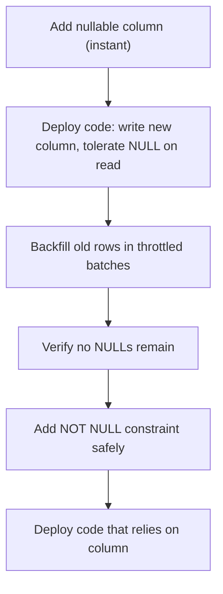

```sql
-- Backfill in small batches; repeat until 0 rows updated, sleep between batches
UPDATE orders SET priority = compute_priority(amount)
WHERE id IN (
  SELECT id FROM orders WHERE priority IS NULL LIMIT 5000
);
```

Batch by primary-key ranges for efficiency, sleep between batches, and pause if replica lag rises.

In Postgres, enforce NOT NULL without a long scan under lock by first adding `CHECK (priority IS NOT NULL) NOT VALID`, then `VALIDATE CONSTRAINT` (which takes a weaker lock).

**4. Indexes**

Use `CREATE INDEX CONCURRENTLY` (Postgres) or an online DDL / gh-ost (MySQL), which build without blocking writes but take longer.

#### Common pitfalls

- Assuming the add is instant without checking the version and default type.
- One giant `UPDATE` for the backfill: huge transaction, replication lag, bloat, locks.
- Deploying code that requires the column before the migration has run everywhere.

#### Likely follow-ups

- *"How do you drop a column safely?"* Contract phase: stop reading it, stop writing it, deploy, then drop.
- *"Why does replication lag matter?"* Replicas fall behind, read-your-writes breaks, and failover could lose data.

</details>

### 17. A user asks to delete all their data (GDPR). How does your system ensure it?

<details>
<summary>Answer</summary>

**In short:** You can only delete what you know about, so start with a **data inventory** of every store holding personal data, keyed by user ID. A **deletion orchestrator** publishes a `UserDeletionRequested` event, each owning service deletes or anonymises its data and acknowledges, and the orchestrator tracks completion and retries until done within the legal deadline. Handle derived copies (caches, search indexes, analytics) and backups (let them expire within the retention window, or **crypto-shred** by deleting the user's key), and keep an audit record of the deletion that contains no personal data.

#### Why it's hard

In a monolith with one database, deletion is a few `DELETE` statements. In a real company, a user's data is spread across dozens of services, caches, search indexes, data warehouses, logs, third-party tools (email, CRM, analytics) and backups. GDPR's right to erasure generally requires acting without undue delay (typically within about a month), and you must be able to show it was done.

#### Architecture

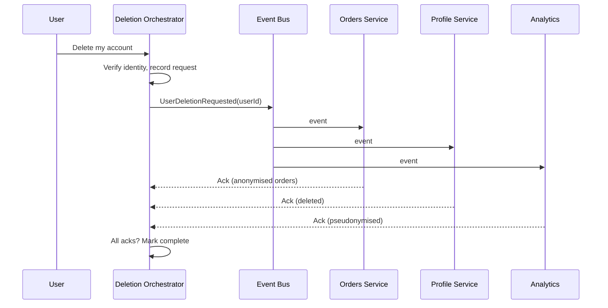

1. **Data inventory / registry.** Every service registers what personal data it stores and how it's keyed. New services must register before launch; otherwise the system silently misses them.
2. **Verify the request** (it's really the user) and record it with a deadline.
3. **Orchestrator** publishes the event and tracks an acknowledgement from each registered service. Missing acks are retried and escalated before the deadline.
4. **Each service owns its deletion**, because only it knows its schema. Choose per data type:
   - **Delete** profile data, messages, uploads.
   - **Anonymise** records you must keep for other reasons (orders for tax/accounting: keep the amount, strip name and address). Legal retention obligations can override erasure for specific data.
5. **Derived stores**: invalidate caches, remove documents from search indexes, delete or pseudonymise in the warehouse, and call third-party processors' deletion APIs.
6. **Logs**: avoid logging personal data in the first place; otherwise rely on short log retention.

#### Backups

You usually can't edit immutable backups. Two accepted approaches:
- **Retention-based expiry**: backups age out within a defined window, and if a backup is ever restored, the deletion list is re-applied before the data goes live.
- **Crypto-shredding**: encrypt each user's personal data with a per-user key stored in a key service; deleting the key makes every copy (including backups) unreadable.

#### Audit

Record that request X for an internal ID was received, which services confirmed, and when, without storing the deleted personal data itself.

#### Common pitfalls

- Hard-coded lists of services in the orchestrator that drift from reality.
- Forgetting data copied into events on the bus (long-retention Kafka topics) or into third-party tools.
- Deleting data that must legally be retained.

#### Likely follow-ups

- *"How do you test it?"* Create a synthetic user, exercise every feature, delete, then scan all stores for their identifiers.
- *"How does this relate to data export requests?"* Same inventory, opposite direction: each service exports instead of deletes.

</details>

---

## Design Decisions & Evolution

### 18. Your monolith is slowing down development for 200 engineers. How do you approach splitting it?

<details>
<summary>Answer</summary>

**In short:** Don't do a big-bang rewrite. First diagnose what actually slows teams down, then **modularise inside the monolith** (clear domain boundaries, owned modules, enforced dependencies). Extract services incrementally with the **strangler fig** pattern, starting with domains that change often, have clean boundaries or different scaling needs; each extracted service owns its data. Invest in the platform (CI/CD, observability, service templates, contract testing) first, and measure success by deploy frequency and lead time, not by the number of services.

#### Diagnose before prescribing

"The monolith is slow for 200 engineers" can mean different things, and not all need microservices:

| Symptom | Possible fix without splitting |
|---|---|
| Builds and tests take an hour | Incremental builds, test sharding, better caching |
| Merge conflicts, broken main | Trunk-based development, ownership, CI gates |
| One team's change breaks another | Module boundaries, enforced dependency rules |
| Releases are monthly and scary | Feature flags, automated deploys |
| One part needs to scale differently | That part is a real extraction candidate |

#### Step 1: a modular monolith

Define domains (orders, payments, catalogue, users) with owners. Each module exposes an internal API and hides its internals and tables; enforce dependency rules with build tooling or architecture tests. This gets most of the team-independence benefit with none of the network costs, and it makes later extraction easy because the boundaries already exist.

#### Step 2: strangler fig extraction

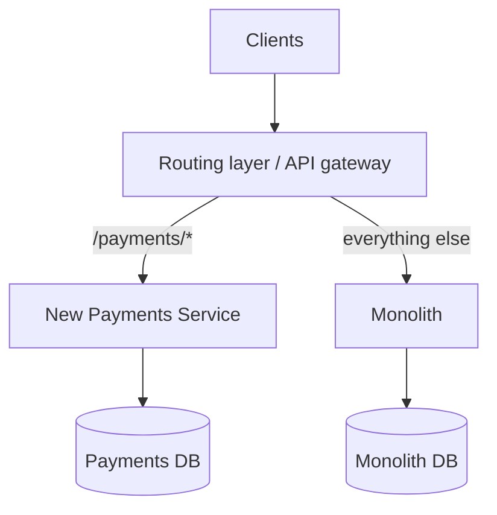

- Put a routing layer in front. Move one capability at a time to a new service and route its traffic there; the monolith shrinks over time, like a strangler fig growing around a tree.
- **Choose extraction order** by value and ease: high change rate, clear boundaries, few dependencies, or different scaling or reliability needs. Avoid starting with the most tangled core domain.
- **Data ownership**: the new service gets its own database. Migrate data with CDC, and replace cross-domain SQL joins with API calls or replicated read models. Shared databases between services recreate the coupling you're trying to remove.

#### Step 3: invest in the platform first

Each new service multiplies operational work. Before extracting many, have:
- CI/CD pipelines that make a new service deployable in minutes.
- Observability: centralised logs, metrics, distributed tracing.
- Service templates with auth, health checks and config baked in.
- Contract testing between services so teams can deploy independently.

#### Measure success

Track the DORA-style metrics: deploy frequency, lead time for changes, change failure rate and time to restore. If those aren't improving, more services aren't helping.

#### Common pitfalls

- The **distributed monolith**: services that must be deployed together and call each other synchronously in long chains.
- Splitting by technical layer (a "database service") instead of business domain.
- Too-small services that create more coordination, not less.

#### Likely follow-ups

- *"How do you handle transactions that span the split?"* Sagas with compensations, and outbox for events.
- *"When would you not split at all?"* When problems are tooling and process, or the team is small; a well-modularised monolith is a legitimate end state.

</details>

### 19. You need to make a breaking change to a public API used by thousands of clients. How?

<details>
<summary>Answer</summary>

**In short:** Avoid the breaking change if you can by making it **additive** (new fields, new endpoints, new optional parameters). If you can't, ship **v2 alongside v1**, provide a migration guide and updated SDKs, measure v1 usage per client and contact heavy users, announce a deprecation timeline (with `Deprecation`/`Sunset` headers), run **brownouts** to flush out stragglers, and only then remove v1. For mobile clients, keep old versions working until a forced-upgrade threshold.

#### Why it's a big deal

You don't control when thousands of clients update. Some are integrations written years ago by a contractor who has left; some are mobile apps installed on phones that never update. A breaking change shipped in place silently breaks them, and they find out from their own customers. The process exists to move everyone without surprising anyone.

#### What counts as breaking

| Change | Breaking? |
|---|---|
| Add an optional request field or a response field | Usually no (if clients ignore unknown fields) |
| Add a new endpoint | No |
| Remove or rename a field | Yes |
| Change a field's type or meaning | Yes |
| Make an optional field required | Yes |
| Add a new enum value | Often yes, for clients with strict parsing |
| Change error codes or pagination behaviour | Yes |

#### First, try to avoid it

- Add a new field next to the old one (`full_name` alongside `name`) and keep populating both.
- Add a new endpoint for new behaviour.
- Use the **tolerant reader** principle in your own clients and SDKs, and document that clients must ignore unknown fields and enum values.

#### If you must break it

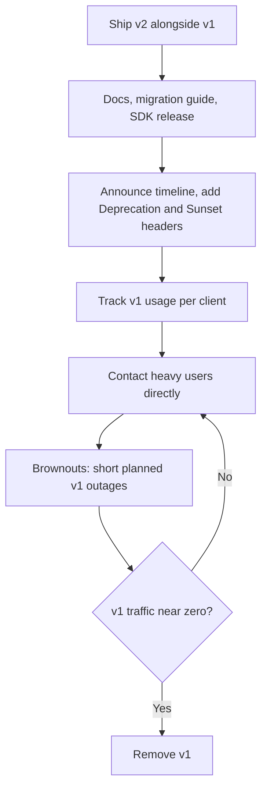

1. **Version it**: URL (`/v2/orders`), header, or media type. URL versioning is the most visible and easiest to route.
2. **Implement v1 on top of v2** where possible (a translation layer), so you maintain one core implementation.
3. **Communicate**: changelog, email to registered developers, migration guide with before/after examples, updated SDKs.
4. **Signal in responses**: the `Sunset` HTTP header (RFC 8594) carries the removal date; the `Deprecation` header (RFC 9745, a Unix timestamp prefixed with `@`) says when the endpoint was deprecated; include a link to the migration docs.

```http
HTTP/1.1 200 OK
Deprecation: @1767225600
Sunset: Sun, 01 Aug 2027 00:00:00 GMT
Link: <https://api.example.com/docs/migrate-v2>; rel="deprecation"
```

5. **Measure** v1 usage per API key; this tells you who still needs help.
6. **Brownouts**: disable v1 for scheduled short windows (say 10 minutes, then an hour) before the final date. Integrations that nobody is watching fail loudly while they can still fix them.
7. **Remove** v1 when traffic is negligible, and leave a clear error message (`410 Gone` with a link).

#### Mobile clients

Old app versions live for years. Keep server compatibility for supported app versions, use a **minimum supported version** check that prompts or forces an upgrade below a threshold, and design APIs so the server can add behaviour without a client update.

#### Common pitfalls

- Too short a deprecation window for enterprise customers.
- Removing v1 based on a date rather than actual usage.
- Maintaining many versions forever with duplicated code.

#### Likely follow-ups

- *"URL vs header versioning?"* URL is explicit and cache-friendly; headers keep URLs stable but are less visible.
- *"How does GraphQL handle this?"* Typically no versions: add fields, mark old ones `@deprecated`, and track field usage before removing.

</details>

### 20. How would you design a system to handle data for a celebrity tenant 1,000× larger than others?

<details>
<summary>Answer</summary>

**In short:** Treat outliers explicitly instead of hoping hashing spreads them. Use a **directory-based shard map** so the giant tenant can live on its **own shard or cell**, **sub-partition** its data further (by sub-key or time), enforce **per-tenant rate limits and quotas** so it can't starve others, give it **separate queues and worker pools**, and special-case its caching. Keep the default path optimised for the ordinary tenants.

#### Why hash sharding breaks here

With `shard = hash(tenant_id) mod N`, each tenant lives on exactly one shard. That's ideal when tenants are similar in size. A tenant 1,000× larger than average puts 1,000× the data and load on one shard, which outgrows any single machine and makes every other tenant on that shard suffer (the **noisy neighbour** problem). Adding shards doesn't help, because the tenant still maps to one.

#### Design

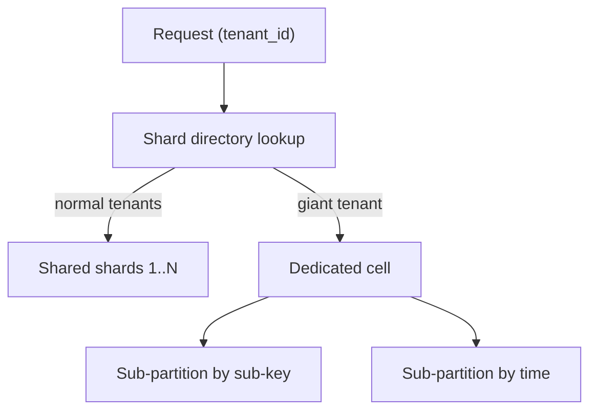

**1. Directory-based shard map.** Store `tenant_id → shard/cell` in a small, heavily cached lookup table instead of computing it with a hash. This lets you place any tenant anywhere and move tenants between shards without changing the hashing scheme.

**2. Dedicated shards or cells.** Put the giant tenant (and other large ones) on dedicated infrastructure: its own database cluster, possibly its own full stack ("cell"). It can be sized and tuned independently, and its incidents don't affect anyone else.

**3. Sub-partitioning.** If it's too big even for one dedicated database, shard *within* the tenant: by a sub-key such as `(tenant_id, project_id)` or `(tenant_id, user_id)`, or by time (`(tenant_id, month)`) for append-heavy data. Queries for that tenant then have to fan out or include the sub-key.

**4. Fairness controls.**
- Per-tenant **rate limits** and concurrency limits at the API.
- **Quotas** on storage, jobs and expensive operations.
- **Separate queues / worker pools** per tier, so the giant tenant's 10M-row import doesn't sit in front of everyone else's small jobs.

**5. Caching.** The giant tenant's hot data may justify its own cache cluster or local caches; its keys can also become hot keys on a shared cache.

| Concern | Normal tenants | Giant tenant |
|---|---|---|
| Placement | Shared shards, packed densely | Dedicated shard or cell |
| Data partitioning | By tenant | By tenant + sub-key or time |
| Background jobs | Shared queue | Own queue and workers |
| Limits | Standard plan limits | Negotiated, enforced |

#### Common pitfalls

- Designing everything around the outlier and making the common path complex.
- No mechanism to move a tenant once it grows; a directory map makes moves possible.
- Cross-tenant queries (admin reports) that assume all data is on one kind of shard.

#### Likely follow-ups

- *"How do you move a tenant to a new shard without downtime?"* Copy with CDC, verify, briefly pause writes for that tenant, flip the directory entry, resume.
- *"How do you detect a tenant becoming an outlier?"* Track per-tenant size, QPS and resource usage, and alert on thresholds.

</details>

### 21. Your product needs strong consistency and is going global. What are your options?

<details>
<summary>Answer</summary>

**In short:** Three main options. (1) **Home region per data item**: each user or tenant's data has one writer region, giving strong consistency there, while other regions read replicated (possibly stale) copies or proxy to the home region; this is usually the most practical. (2) A **globally distributed consensus database** (Spanner, CockroachDB) gives strong consistency everywhere, but each write pays cross-region round trips (~100+ ms). (3) **Relax where you can**: strong consistency only for critical data (balances, inventory), eventual consistency elsewhere. Always explain the latency cost: the speed of light makes cross-continent consensus slow.

#### Why it's a hard trade-off

Strong consistency (linearizability) means every read sees the latest committed write. To guarantee that across regions, a write must be acknowledged by a majority of replicas in different regions before it commits. Light in fibre covers roughly 200 km per millisecond, so a round trip between, say, the US East Coast and Europe takes tens of milliseconds at best, and around the world well over 100 ms. That cost is per write (and sometimes per read), no matter how good the software is. The CAP theorem adds that during a network partition you must choose between consistency and availability for the partitioned side.

#### Option 1: home region (single writer per item)

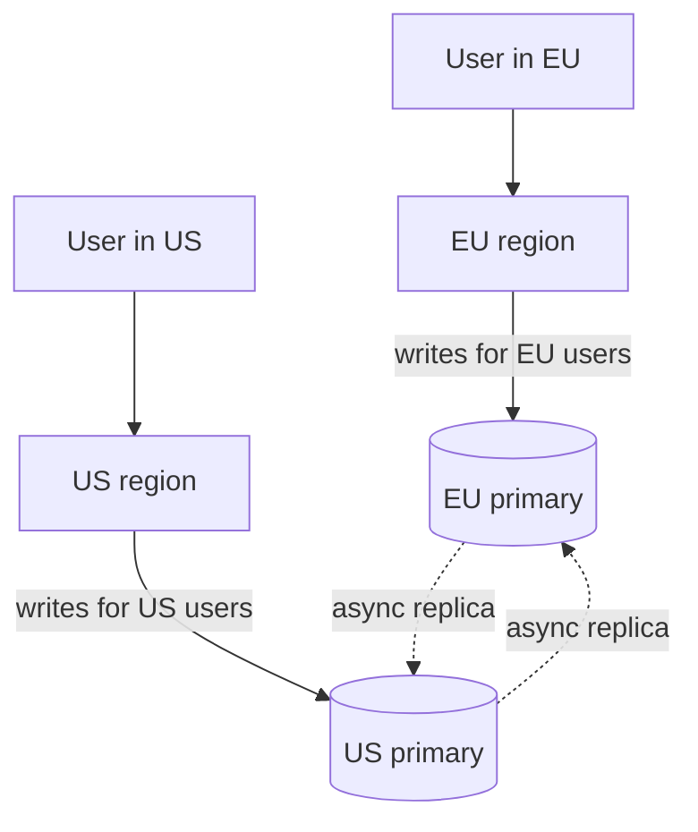

- Assign each user/tenant a home region (usually nearest, or by data-residency law). All writes for that entity go to its home primary, so it's strongly consistent locally with low latency.
- A user travelling abroad: proxy their writes to the home region (slower but correct).
- Other users reading that data from another region get a replicated copy that may be slightly stale, or you proxy the read for strong consistency.
- Hard parts: data shared between entities in different regions (a chat between an EU and US user), and moving a user's home.

#### Option 2: globally distributed consensus database

Google Spanner (publicly described as using synchronised clocks with bounded uncertainty, TrueTime, plus Paxos replication) and CockroachDB (Raft-based) offer serializable transactions across regions. You get one logical database and no conflict logic in the app. You pay with write latency equal to a cross-region quorum round trip, plus cost and some vendor lock-in. Placing replicas carefully (for example, a quorum within one continent) reduces latency for data mostly used there.

#### Option 3: relax consistency where possible

| Data | Needs | Approach |
|---|---|---|
| Account balance, inventory, payments | Strong | Home region or consensus DB |
| Profile, posts, comments | Read-your-writes is enough | Async replication + sticky reads |
| Like counts, view counts | Eventual | CRDTs or periodic aggregation |
| Product catalogue | Eventual, read-heavy | Replicas + CDN |

Many teams combine these: a small strongly consistent core and an eventually consistent majority.

#### Common pitfalls

- Multi-master async replication with "last write wins" for data that needs strong consistency; concurrent writes silently lose data.
- Ignoring data-residency laws when choosing where data lives.
- Promising both strong consistency and low global write latency.

#### Likely follow-ups

- *"What does the user experience when their home region is down?"* Either writes are unavailable for them (consistency chosen), or you fail over the home with possible loss of recent async writes.
- *"How do you reduce latency for global reads?"* Follower reads with bounded staleness, or caches, for data that tolerates it.

</details>

### 22. Search results are slow and expensive. The DB does `LIKE '%term%'` queries. What do you do?

<details>
<summary>Answer</summary>

**In short:** A leading-wildcard `LIKE '%term%'` can't use a B-tree index, so every search scans the whole table. Move search to an **inverted index**: a dedicated search engine (Elasticsearch/OpenSearch) fed from the database by CDC, or Postgres full-text search with a GIN index at smaller scale. Then add relevance ranking, typo tolerance, facets for filters, caching for popular queries and pagination limits. The database stays the source of truth.

#### Why LIKE '%term%' is slow

A B-tree index is sorted, like a phone book. `LIKE 'term%'` (prefix) can jump to the right place. `LIKE '%term%'` could match anywhere in the string, so the database has to read every row and scan every value: O(rows × text length) per query. As data grows, every search gets slower and burns DB CPU that other queries need. It also gives poor results: no ranking, no stemming ("running" won't match "run"), no typo tolerance, case and accent issues.

#### How an inverted index works

Instead of "document → words", a search engine stores "word → list of documents containing it" (posting lists). Text is first **analysed**: split into tokens, lowercased, stemmed, stop words removed. A query is analysed the same way, the posting lists for its terms are looked up and intersected, and results are ranked (BM25 is a common default) by how important the term is in each document.

```text
"Red running shoes"  -> tokens: [red, run, shoe]
Inverted index:
  red  -> [doc 3, doc 17, doc 42]
  run  -> [doc 17, doc 99]
  shoe -> [doc 17, doc 42, doc 99]
Query "running shoe" -> run AND shoe -> [doc 17, doc 99], ranked by BM25
```

#### Architecture

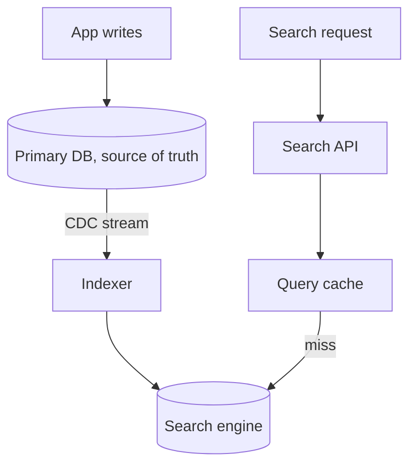

- **Sync via CDC** (for example, Debezium to Kafka to an indexer) rather than having the app write to both, so the index can't silently miss updates. Expect a short indexing delay (often around a second).
- Support **reindexing** from scratch (new mapping, new analyser) by building a new index and swapping an alias.

#### Options

| Option | When it fits | Trade-off |
|---|---|---|
| Postgres full-text search (`tsvector` + GIN) | Moderate data, simple ranking, want one system | Less flexible relevance, scales with your DB |
| Postgres `pg_trgm` + GIN | Substring/fuzzy matching on short fields (names, SKUs) | Not for long text ranking |
| Elasticsearch / OpenSearch | Large scale, facets, typo tolerance, custom relevance | Another cluster to run, eventual consistency |

```sql
-- Postgres full-text search, smaller scale
ALTER TABLE products ADD COLUMN search tsvector
  GENERATED ALWAYS AS (to_tsvector('english', name || ' ' || description)) STORED;
CREATE INDEX products_search_idx ON products USING GIN (search);

SELECT id, name FROM products
WHERE search @@ plainto_tsquery('english', 'running shoes')
ORDER BY ts_rank(search, plainto_tsquery('english', 'running shoes')) DESC
LIMIT 20;
```

#### Making it fast and cheap

- **Cache** popular queries (a small number of queries usually dominates traffic).
- **Limit pagination depth**; deep `from/offset` is expensive, so use cursor-based (`search_after`) paging.
- **Filters as facets** (category, price range) using keyword fields, which are cheap and cacheable.
- **Autocomplete** with a dedicated prefix index (edge n-grams or completion suggesters).
- Debounce search-as-you-type on the client.

#### Common pitfalls

- Treating the search engine as the source of truth.
- Dual writes from the app, causing drift.
- Over-sharding a small index.

#### Likely follow-ups

- *"How do you handle deletes and permission filtering?"* Propagate deletes through CDC; store access fields in the document and filter on them in every query.
- *"How do you evaluate relevance?"* Click-through and conversion metrics, plus a labelled query set for offline tests.

</details>

### 23. Your notification system sent the same push to users 5 times. Why, and how do you fix it?

<details>
<summary>Answer</summary>

**In short:** The pipeline is **at-least-once** and nothing deduplicates: a consumer sends the push, then crashes or times out (or a rebalance happens) before committing its offset, so the message is redelivered and sent again; retries at several layers multiply this; or the producer emitted the event several times. Fix it with a deterministic **notification ID** per (event, user, channel), an atomic **check-and-record** in a dedupe store (Redis `SET NX` with a TTL, or a DB unique key) before sending, offsets committed after recording, **one** retry layer with backoff, and alerts on unusual send rates.

#### Why exactly five?

A clean number like 5 is a strong clue: it often matches a retry limit (`maxRetries = 5`) or the number of attempts before something gave up. Typical chains:

- The push provider call is slow; the consumer's processing time exceeds the broker's timeout (for example Kafka's `max.poll.interval.ms` or an SQS visibility timeout), so the message is handed to another consumer while the first one still sends.
- The send succeeds but a later step fails (writing to the DB), and the whole handler is retried, including the send.
- The upstream service retried publishing the event because its publish call timed out.

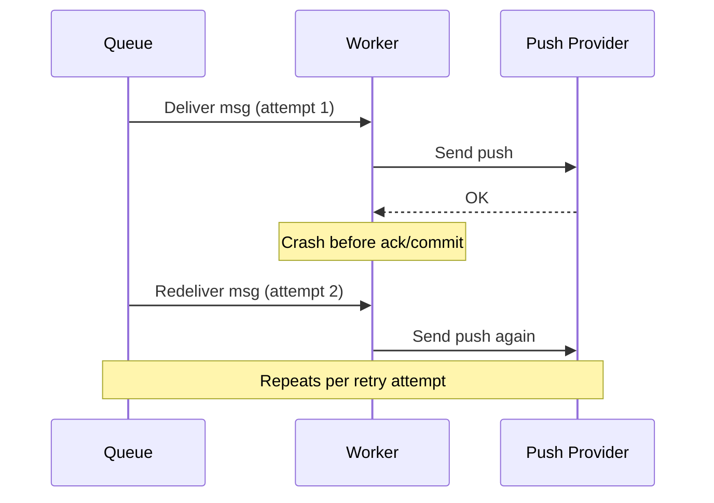

#### The fix

**1. Deterministic notification ID.** Derived from the business event, not generated per attempt: for example `hash(event_id, user_id, channel)`. Every retry of the same logical notification has the same ID.

**2. Check-and-record before sending.**

```python
def handle(msg):
    notif_id = f"{msg.event_id}:{msg.user_id}:push"
    # Atomic: only the first worker to claim this ID proceeds
    claimed = redis.set(f"notif:{notif_id}", "sending", nx=True, ex=86400)
    if not claimed:
        return ack(msg)                 # duplicate: already sent or in progress
    try:
        push_provider.send(msg.user_id, msg.payload, collapse_key=notif_id)
        redis.set(f"notif:{notif_id}", "sent", ex=86400)
    except TransientError:
        redis.delete(f"notif:{notif_id}")   # release so a retry can try again
        raise
    ack(msg)
```

There's still a tiny window (sent, then crash before marking `sent`), which is why the claim happens *before* sending: a crash then leads to at most one missed retry rather than duplicates. For notifications, "at most one duplicate in rare crashes" or "rarely missed" is a product decision; for most pushes, avoiding spam wins.

**3. Collapse keys on the device side.** Push services support collapsing or replacing notifications with the same identifier (for example, APNs `apns-collapse-id`, FCM collapse keys or tags), so duplicates that slip through replace each other instead of stacking.

**4. One retry layer.** Retry in one place (the queue), with exponential backoff and a DLQ, rather than in the HTTP client, the worker and the queue.

**5. Processing time vs timeout.** Keep handlers well under the visibility/poll timeout, or extend it while working.

**6. Monitoring.** Alert on sends per user per minute and on duplicate-claim rates; a spike tells you before users do.

#### Common pitfalls

- Using a random UUID per attempt as the dedupe key.
- Dedupe with "check then set" as two non-atomic steps, letting two workers both send.
- A dedupe TTL shorter than the maximum retry window.

#### Likely follow-ups

- *"Can't Kafka give exactly-once?"* Kafka's exactly-once covers reading and writing within Kafka; sending to an external push service is a side effect outside it, so you still need idempotency.
- *"What about user-level rate limits?"* Cap notifications per user per hour as a final guard against any bug.

</details>

### 24. How would you reduce your cloud bill by 30% without hurting reliability?

<details>
<summary>Answer</summary>

**In short:** Measure first: tag resources and break the bill down by service, team and category, because savings come from the few biggest line items. Then right-size over-provisioned instances, autoscale (including scaling down at night), buy commitments (reserved instances / savings plans) for steady load and use spot for interruptible batch work, add storage lifecycle policies, cut data transfer (egress, cross-AZ), trim logs and metrics, and delete idle resources. Protect reliability by keeping headroom, changing one thing at a time, and tracking cost next to SLOs.

#### Why "measure first"

Cloud bills are long-tailed: typically compute, databases, storage and data transfer make up most of it, and within each, a few services dominate. Without tagging you can't tell which team or feature owns a cost, so nobody acts on it. Make cost visible per service and per unit (cost per order, per active user) so you can tell if a reduction is real or just lower traffic.

#### The levers

| Lever | Typical opportunity | Reliability risk | How to stay safe |
|---|---|---|---|
| Right-sizing | Instances running at 10–20% CPU | Too little headroom | Size from p95/p99 usage, keep buffer |
| Autoscaling, scale down off-peak | Fixed fleets sized for peak | Slow scale-up | Sensible minimums, pre-scale for known peaks |
| Reserved / savings plans | Steady baseline usage | None (financial commitment) | Commit only to the stable floor |
| Spot / preemptible | Batch, CI, stateless workers | Interruptions | Only for interruptible work, mixed fleets |
| Storage lifecycle | Old logs, backups, snapshots | Losing needed data | Retention policy agreed with legal |
| Data transfer | Cross-AZ chatter, internet egress | Fewer AZs = less resilience | CDN, compression, AZ-aware routing |
| Logs and metrics | Debug logs in prod, high-cardinality metrics | Less observability | Sampling, keep error logs, drop noise |
| Idle resources | Old environments, unattached volumes, idle load balancers | Deleting something in use | Tag owners, check usage first |
| Architecture | Chatty services, overprovisioned DBs | Varies | Caching, consolidation, managed tiers |

#### A practical sequence

```mermaid
flowchart TD
    A["Tag everything, cost per service"] --> B["Top 10 line items"]
    B --> C["Quick wins: idle resources, old snapshots"]
    C --> D["Right-size and autoscale"]
    D --> E["Commit to steady baseline"]
    E --> F["Architecture changes for big items"]
    F --> G["Cost dashboards + budgets alerts"]
```

1. **Quick wins** (days): delete unused resources, unattached disks, old snapshots, forgotten test environments; turn off non-production environments outside working hours.
2. **Right-size and autoscale** (weeks): use utilisation data, roll changes out gradually with canaries, watch latency and error SLOs.
3. **Commitments**: after right-sizing (not before, or you commit to waste), cover the steady baseline with reserved instances or savings plans; those discounts are commonly large compared with on-demand pricing.
4. **Architectural** (months): add caching to shrink database size, move cold data to cheaper storage tiers, reduce cross-AZ traffic, compress payloads, move batch jobs to spot.
5. **Keep it there**: budgets and anomaly alerts per team, cost in design reviews, and unit-cost metrics tracked alongside SLOs.

#### Not hurting reliability

- Never remove redundancy (multi-AZ, replicas) to save money on critical paths without an explicit decision.
- Keep enough headroom for failover: if one AZ dies, the others must absorb its load.
- Change one lever at a time and watch SLOs; roll back if they degrade.

#### Common pitfalls

- Buying commitments before right-sizing.
- Cutting logs that you need during incidents.
- Optimising small items while the biggest line item is untouched.

#### Likely follow-ups

- *"Where is the biggest surprise usually?"* Data transfer and logging/observability bills.
- *"How do you make it stick?"* Ownership per team, showback/chargeback, and cost as a reviewed metric.

</details>

### 25. An interviewer asks: "What would break first in your design if traffic grew 100×?"

<details>
<summary>Answer</summary>

**In short:** Walk your own diagram from the edge inwards. Stateless services scale horizontally, so they're rarely first. The **stateful and singular** parts break first: the primary database's write throughput (→ sharding), cache memory and hot keys, fan-out work, queue partition counts, single-leader components (ID generator, scheduler), third-party rate limits and cross-region bandwidth. Name the most likely one, give a rough number for where it breaks, and propose the next evolution. The interviewer is testing whether you understand your own design's limits.

#### Why this question is asked

Anyone can draw boxes. A senior engineer knows which box fails first and roughly when. Answering well shows you can reason with numbers and that you designed for today with a path to tomorrow, rather than overbuilding from day one.

#### How to answer: a systematic walk

```mermaid
flowchart TD
    A["Multiply current numbers by 100"] --> B["Stateless tier: scale out, check LB limits"]
    B --> C["Caches: memory, hot keys"]
    C --> D["Database: writes, storage, connections"]
    D --> E["Queues and fan-out"]
    E --> F["Single-leader components"]
    F --> G["External limits: third parties, bandwidth"]
    G --> H["Pick the first to break, propose fix"]
```

1. **Multiply your estimates.** If you said 2K writes/s and 20K reads/s, now it's 200K writes/s and 2M reads/s. Storage growth ×100 too.
2. **Stateless services**: add instances behind the load balancer. Fine, though check connection counts to the database (100× app servers × pool size can exceed what the DB accepts; a connection pooler helps).
3. **Cache**: does the working set still fit in memory? Hot keys at 100× may exceed one shard's capacity.
4. **Database**: usually the first real wall. A single primary has a write ceiling (as a rough order of magnitude for a well-tuned relational primary, thousands to low tens of thousands of writes per second, depending heavily on hardware and row size). Reads can go to replicas; writes need **sharding** or a different store.
5. **Queues and fan-out**: partition count caps consumer parallelism; fan-out-on-write cost multiplies with followers.
6. **Single-leader components**: an ID generator, a scheduler or a lock service designed as one instance.
7. **External limits**: payment, SMS or email provider rate limits, cloud account quotas, egress bandwidth costs.

#### What a strong answer sounds like

> "At 100×, the stateless API tier just scales out. The first thing to break is the Postgres primary: we'd go from about 2K to 200K writes/s, far beyond a single node. I'd shard the messages table by conversation ID, since all hot queries are per conversation, using a directory so we can rebalance. Second, the fan-out workers: group chats with thousands of members would need fan-out on read for large groups. Third, our push provider's rate limit; we'd need to negotiate higher limits and batch."

Notice: a specific component, a number, why it breaks, and a concrete next step, in priority order.

| Component | Breaks because | Next evolution |
|---|---|---|
| DB primary | Write throughput, storage | Sharding, write batching, different store |
| Cache | Memory, hot keys | More shards, local caches, key replication |
| Fan-out | Write amplification | Hybrid push/pull |
| Queue | Partition count | More partitions, better keys |
| Singleton service | One machine | Partitioned leaders, distributed design |
| Third parties | Rate limits | Batching, contracts, multiple providers |

#### Common pitfalls

- Saying "add more servers" for everything.
- Listing everything without picking the first bottleneck.
- Forgetting cost: something may scale technically but become unaffordable (for example, egress or storage at 100×).

#### Likely follow-ups

- *"Why didn't you shard from the start?"* Sharding adds complexity; designing for 100× on day one slows the team. Choose a shard-friendly key early so the move is easier later.
- *"What about 1000×?"* Usually a different architecture: cells, multi-region active-active, specialised storage per access pattern.

</details>

---

[⬅ Previous: Mobile System Design](19-mobile-system-design.md) · [⬅ Back to index](../README.md) · [Next: Low-Level Design ➡](21-low-level-design.md)
