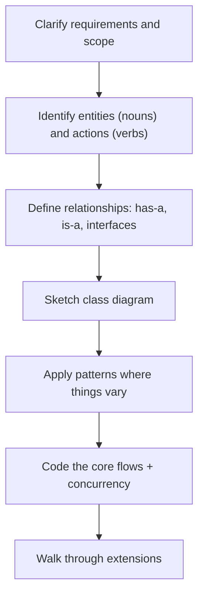
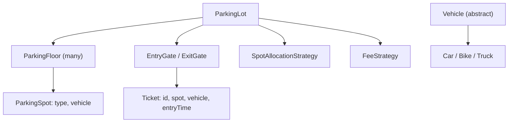
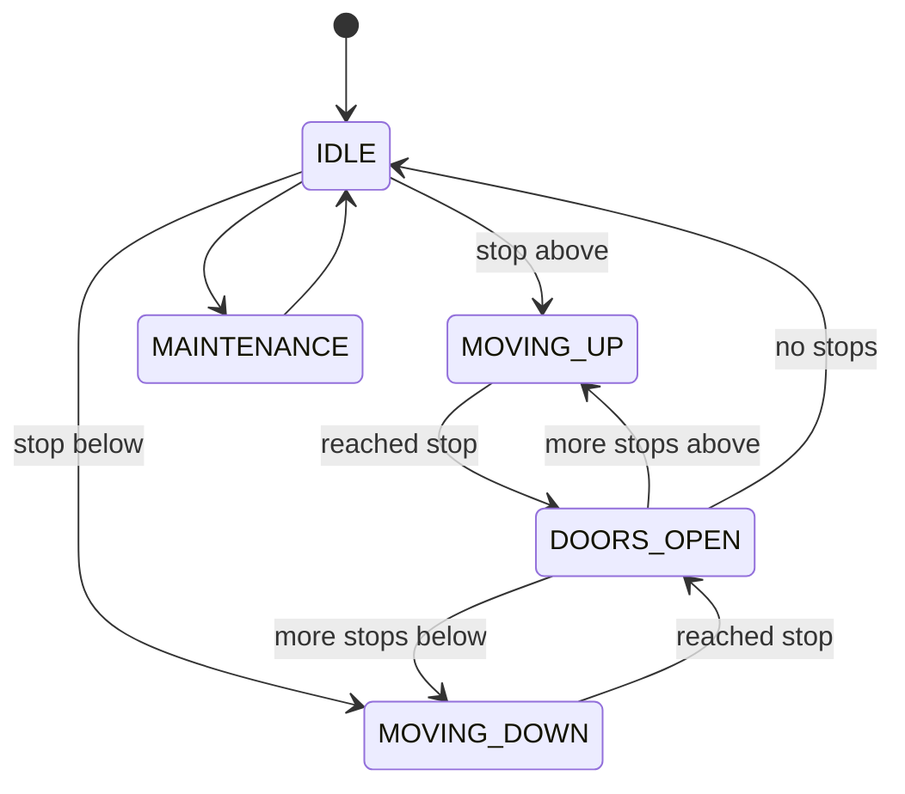
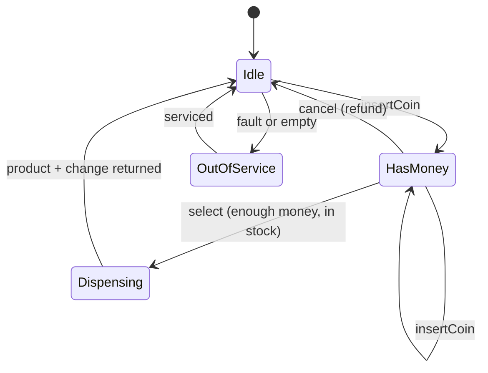
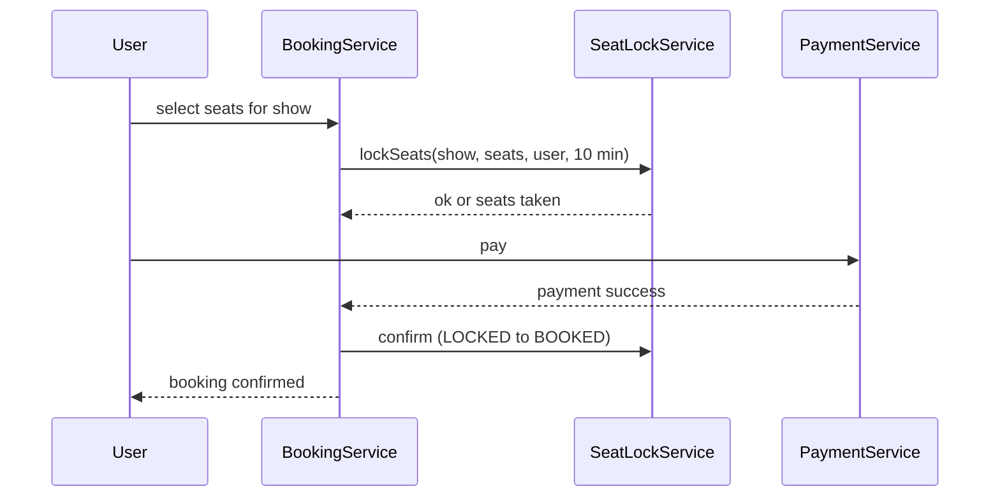
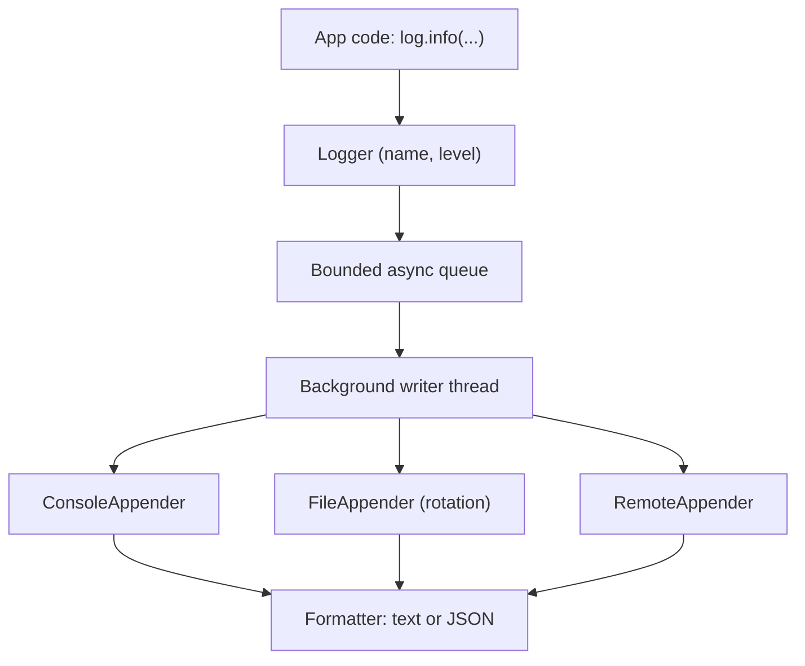
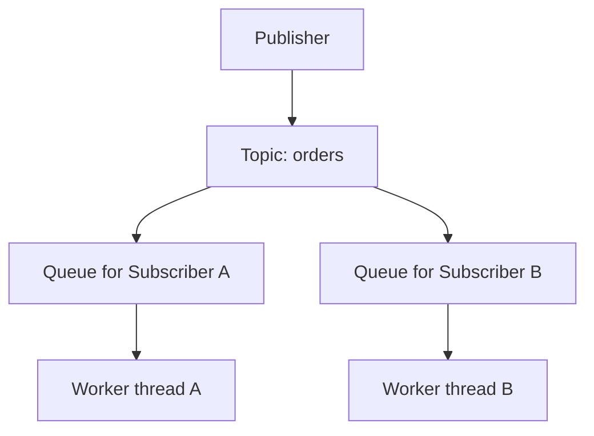
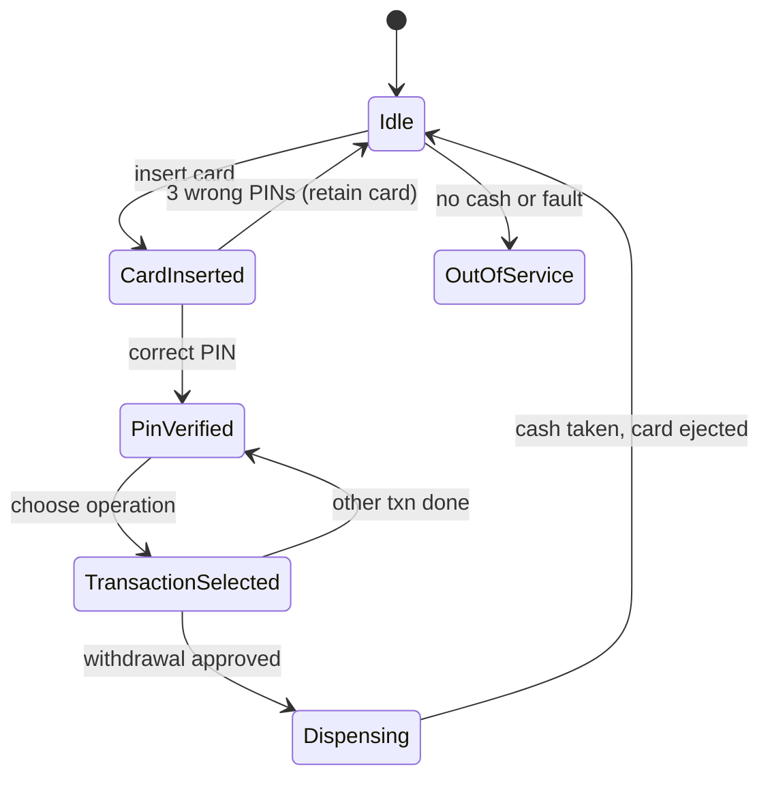
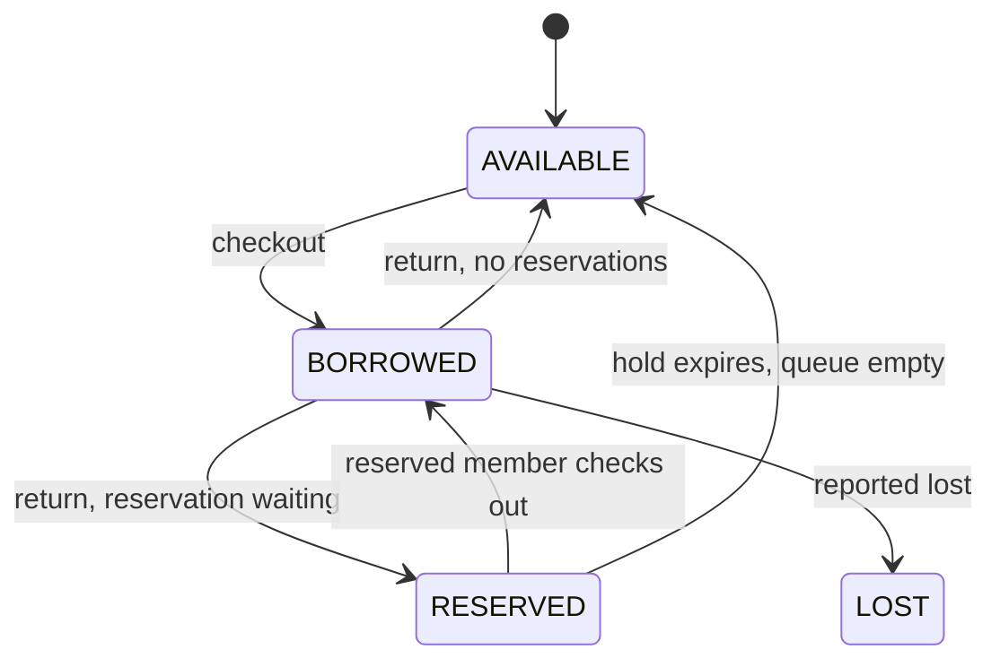

# Low-Level Design (Object-Oriented Design)

[⬅ Back to index](../README.md)

Covers: how to approach an LLD / machine-coding round, SOLID and the patterns that come up most, concurrency in LLD, and worked designs: parking lot, elevator system, LRU cache, rate limiter, vending machine, movie ticket booking, Splitwise, in-memory key-value store with TTL, logger, pub/sub system, chess and snake & ladder.

Code samples are in Java (the most common LLD language); the same ideas apply in Kotlin, Swift, C++ or Python.

---

## Approach

### 1. How do you approach a low-level design round?

<details>
<summary>Answer</summary>

**In short:** clarify requirements, pull out the entities and their relationships, sketch a class diagram, apply patterns only where something genuinely varies, write the core flows as clean runnable code with thread safety, and finish by showing how a new requirement plugs in without editing existing classes.

An LLD (or "machine coding" / "object-oriented design") round tests whether you can turn a fuzzy problem into well-structured code in 45–90 minutes. Unlike high-level system design, the output is classes, interfaces and working methods, not boxes for services and databases. The interviewer is judging how you think about abstractions, not whether you implement every feature.

#### A step-by-step approach



1. **Clarify requirements and scope (about 5 minutes).** List the use cases out loud and confirm them. Ask questions that change the design: "Multiple floors? EV charging spots? Which payment types? Is it single-process or many entry gates at once?" Write down what is *out* of scope so you don't drift.
2. **Identify entities.** Nouns in the requirements become candidate classes (`ParkingLot`, `Floor`, `Spot`, `Vehicle`, `Ticket`); verbs become methods (`park`, `unpark`, `calculateFee`). Drop nouns that are just attributes (a "colour" is a field, not a class).
3. **Define relationships.** Is it *is-a* (inheritance: `Car` is a `Vehicle`) or *has-a* (composition: a `Floor` has `Spot`s)? Prefer composition; use interfaces for anything that can vary (pricing, allocation, payment).
4. **Draw a class diagram** with the key fields and methods. It doesn't need UML perfection; it gives you and the interviewer a shared map before you code.
5. **Apply patterns where they fit.** Strategy for interchangeable algorithms, State for lifecycles, Factory for creation, Observer for notifications, Singleton sparingly for a shared manager. Name the pattern and say *why* it fits; don't force patterns in.
6. **Write the core code.** Clean, compilable-looking, with the main flows working end to end. Handle the obvious edge cases (lot full, invalid input) and **thread safety** where shared state is mutated.
7. **Discuss extensions.** Show that adding a new vehicle type, pricing rule or payment method means adding a class, not editing a switch (Open/Closed).

#### What interviewers score

| Signal | What it looks like |
|---|---|
| Requirement gathering | Asks focused questions, states assumptions |
| Abstractions | Small cohesive classes, interfaces where behaviour varies |
| SOLID / patterns | Used with a reason, not as decoration |
| Code quality | Readable names, no god class, runnable flows |
| Concurrency | Spots the race and prevents it |
| Extensibility | New requirement fits with minimal change |

**Common pitfalls**
- Jumping into code before agreeing on scope, then rewriting halfway.
- A single god class (`ParkingLotManager` doing everything).
- Pattern-stuffing: five patterns where one would do.
- Ignoring concurrency when the problem clearly has multiple actors (gates, users, threads).

**Likely follow-ups**
- *"How would you test this?"* Inject dependencies (clock, strategies, random) via interfaces so you can pass fakes.
- *"What if we need persistence?"* Put a `Repository` interface between domain classes and storage; the domain logic doesn't change.
- *"How would this run across many servers?"* Move shared state to a database or cache and replace in-memory locks with DB constraints or conditional updates.

</details>

### 2. Which SOLID principles matter most in LLD answers?

<details>
<summary>Answer</summary>

**In short:** all five matter, but in practice the interviewer looks hardest for **Single Responsibility** (no god classes), **Open/Closed** (new behaviour = new class, usually via Strategy) and **Dependency Inversion** (depend on interfaces, inject implementations). Liskov and Interface Segregation show up as "don't build hierarchies or interfaces that force fake implementations".

SOLID is a set of five object-oriented design principles. In an LLD round, they are the vocabulary you use to justify design choices.

| Principle | Meaning | LLD example |
|---|---|---|
| **S – Single responsibility** | A class has one reason to change | `ParkingLot` manages spots; `FeeCalculator` computes fees |
| **O – Open/closed** | Open for extension, closed for modification | New pricing rule = new `FeeStrategy` class, no edits to a switch |
| **L – Liskov substitution** | Subtypes must work wherever the parent is expected | No subclass that throws `UnsupportedOperationException` for half the parent's methods |
| **I – Interface segregation** | Many small interfaces beat one fat one | `Payable`, `Refundable` instead of one `PaymentEverything` |
| **D – Dependency inversion** | High-level code depends on abstractions | `BookingService` takes a `PaymentProcessor` interface, injected |

#### Open/closed in code: the wrong way and the right way

```java
// Wrong: every new vehicle type means editing this method
long fee(Vehicle v, long hours) {
    switch (v.type()) {
        case CAR:   return hours * 20;
        case BIKE:  return hours * 10;
        case TRUCK: return hours * 50;   // add EV? edit here again
        default: throw new IllegalArgumentException();
    }
}

// Right: behaviour is pluggable
interface FeeStrategy { long fee(Ticket t, Instant exit); }

class HourlyFee implements FeeStrategy {
    private final Map<SpotType, Long> ratePerHour;
    HourlyFee(Map<SpotType, Long> rates) { this.ratePerHour = rates; }
    public long fee(Ticket t, Instant exit) {
        long hours = Math.max(1, Duration.between(t.entryTime(), exit).toHours());
        return hours * ratePerHour.get(t.spot().type());
    }
}
// Weekend pricing, flat pricing, surge pricing: new classes, no edits to ParkingLot.
```

#### Dependency inversion and testability

```java
class BookingService {
    private final PaymentProcessor payments;   // interface, not StripeClient
    private final Clock clock;                 // inject time so tests can control it
    BookingService(PaymentProcessor p, Clock c) { this.payments = p; this.clock = c; }
}
```

Injecting interfaces is what makes the design testable: in a unit test you pass a fake `PaymentProcessor` and a fixed `Clock`.

#### Liskov: the classic trap

A `Penguin extends Bird` where `Bird` has `fly()` breaks Liskov: callers that expect any `Bird` to fly get an exception. Fix it by splitting capabilities (`FlyingBird`) or using composition. In LLD this shows up as e.g. a `ReadOnlyAccount extends Account` that throws on `withdraw()`.

**Common pitfalls**
- Reciting definitions without tying them to your design.
- Over-applying SRP until there are dozens of one-method classes.
- Making everything an interface "just in case": abstract only what actually varies.

**Likely follow-ups**
- *"Where did you apply Open/Closed?"* Point to your Strategy interfaces (pricing, allocation, splitting).
- *"Is Singleton a SOLID violation?"* It often hides a dependency and hurts testability; prefer creating one instance and injecting it.

</details>

### 3. Which design patterns come up most in LLD interviews?

<details>
<summary>Answer</summary>

**In short:** Strategy and State dominate, followed by Factory, Observer and Singleton; Builder, Decorator, Command, Chain of Responsibility and Composite each map to a specific family of problems. Know one concrete use for each and use a pattern only when you can say what it lets you change.

| Pattern | Typical use in LLD problems |
|---|---|
| **Strategy** | Pricing/fee rules, spot allocation, elevator scheduling, split types in Splitwise, eviction policies |
| **State** | Vending machine, elevator, order/booking lifecycle |
| **Factory** | Creating vehicles, spots, payment methods, pieces in chess |
| **Observer** | Notifications, display boards, pub/sub, stock price updates |
| **Singleton** | A single ParkingLot/Logger manager (be ready to discuss testability) |
| **Builder** | Complex objects (requests, reports) |
| **Decorator** | Adding toppings/features, logging/caching wrappers |
| **Command** | Undo/redo, queued requests (elevator requests, text editor) |
| **Chain of responsibility** | Logger levels, request handling/validation pipelines, ATM cash dispensing |
| **Composite** | File systems, menus, org charts |

#### How to tell which one fits

- **An algorithm can be swapped** (how to pick a spot, how to compute a fee) → **Strategy**: an interface plus several implementations, chosen at runtime.
- **Behaviour depends on the object's current mode** (vending machine with/without money) → **State**: each state is a class implementing the same actions differently, replacing `if (state == ...)` chains.
- **Creation logic is conditional** ("make the right piece for this square") → **Factory**.
- **Many parties react to one event** (spot freed → display board, app notification) → **Observer**.
- **You need to add behaviour around an object without subclassing** (caching, logging, extra toppings) → **Decorator**.
- **Actions must be stored, queued or undone** → **Command**.
- **A request passes through a sequence of handlers** (validation, note denominations) → **Chain of Responsibility**.
- **Part-whole trees treated uniformly** (file and folder both have `size()`) → **Composite**.

#### Strategy vs State: the most-confused pair

Both look the same in code (an interface with several implementations held by a context object). The difference is **who chooses the implementation**:

| | Strategy | State |
|---|---|---|
| Who switches it | The client/config, usually once | The states themselves, as events happen |
| Implementations know each other? | No | Yes (a state sets the next state) |
| Example | `FeeStrategy` chosen per lot | `IdleState` → `HasMoneyState` on coin insert |

```java
// Decorator example: add caching around any repository without changing it
interface PriceRepo { long price(String sku); }
class CachingPriceRepo implements PriceRepo {
    private final PriceRepo inner; private final Map<String, Long> cache = new ConcurrentHashMap<>();
    CachingPriceRepo(PriceRepo inner) { this.inner = inner; }
    public long price(String sku) { return cache.computeIfAbsent(sku, inner::price); }
}
```

**Common pitfalls**
- Using Singleton for everything: it creates hidden global state and makes tests hard. Mention dependency injection as the alternative.
- Naming a pattern without explaining the variation it isolates.

**Likely follow-ups**
- *"Singleton thread safety in Java?"* Use an enum singleton or the holder-class idiom; double-checked locking needs `volatile`.
- *"Factory vs Builder?"* Factory picks *which* type to create; Builder assembles *one* complex object step by step.

</details>

### 4. How do you handle concurrency in an LLD answer?

<details>
<summary>Answer</summary>

**In short:** find the **shared mutable state** (free spots, seat status, cache map), name the race ("two gates assign the same spot"), and make the check-then-act step atomic, using the narrowest lock possible, atomic/concurrent structures, or optimistic versioning, and keeping everything else immutable.

Most LLD problems have multiple actors acting at once: several entry gates, many users booking seats, threads hitting a cache. Interviewers expect you to bring this up without being asked.

#### The core bug: check-then-act

```java
// Wrong: two threads can both see the spot as free, then both take it
if (spot.isFree()) {        // thread A and B both pass this check
    spot.assign(vehicle);   // both assign: double booking
}

// Right: make check and act one atomic operation
class ParkingSpot {
    private Vehicle vehicle;
    synchronized boolean tryOccupy(Vehicle v) {
        if (vehicle != null) return false;
        vehicle = v;
        return true;
    }
}
```

#### Toolbox

| Technique | When to use | Example |
|---|---|---|
| `synchronized` / `ReentrantLock` | Compound check-then-act on one object | `tryOccupy`, LRU cache get/put |
| Fine-grained locks | Independent parts can proceed in parallel | Lock per floor, per show, per room |
| Concurrent collections | Shared maps/queues | `ConcurrentHashMap.compute`, `BlockingQueue` |
| Atomics / CAS | Single counters or references | `AtomicInteger` free-spot count, `compareAndSet` |
| Optimistic locking | Low contention, data in a DB | `UPDATE seat SET status='BOOKED', version=v+1 WHERE id=? AND version=v` |
| Immutability | Value objects shared across threads | `Ticket`, `Money`, `Move` as records |
| Single-threaded ownership | Ordering matters more than throughput | One executor per elevator or per subscriber |

#### Granularity matters

One global lock is correct but makes every gate wait for every other gate. Locking per spot (or per show, per room) lets unrelated operations run in parallel. When you need several locks at once (booking seats A3 and A4), **acquire them in a consistent order** (e.g. sorted by seat ID) to avoid deadlock, or use an all-or-nothing approach with rollback.

#### In-process vs distributed

In-memory locks only protect one process. If the interviewer asks "what if there are many servers?", move the guarantee to the shared store: a unique constraint, a conditional update (`WHERE status = 'AVAILABLE'`), or a Redis `SET key value NX PX ttl` lock.

**Common pitfalls**
- Making individual methods thread-safe but not the *sequence* (`isFree()` then `occupy()` from outside).
- Holding a lock while doing slow work (payment calls, I/O).
- Forgetting deadlock when acquiring multiple locks.

**Likely follow-ups**
- *"Optimistic vs pessimistic locking?"* Optimistic (version check, retry on conflict) suits low contention; pessimistic (lock first) suits hot rows where retries would storm.
- *"How do you test it?"* Run many threads against it with a `CountDownLatch` start gate and assert invariants (no spot assigned twice).

</details>

---

## Worked Designs

### 5. Design a parking lot.

<details>
<summary>Answer</summary>

**In short:** model `ParkingLot → ParkingFloor → ParkingSpot`, with `Vehicle` subtypes that declare the spot type they need, a `Ticket` issued at entry, and two Strategy interfaces: one for **spot allocation**, one for **fee calculation**. Make "find a free spot and take it" atomic (`tryOccupy`) so two gates never assign the same spot.

The parking lot is the most common LLD warm-up because it touches every core skill: entity modelling, inheritance vs composition, Strategy, and a clear concurrency race.

#### Requirements (confirm with the interviewer)

- Multiple floors; spot types: motorcycle, compact, large, EV.
- Vehicles of different sizes need a compatible spot.
- Entry issues a ticket; exit calculates the fee by duration and vehicle/spot type.
- Display free spots per floor.
- Several entry and exit gates operate concurrently.

#### Classes



#### Core code

```java
enum SpotType { BIKE, COMPACT, LARGE, EV }

abstract class Vehicle {
    final String plate;
    Vehicle(String plate) { this.plate = plate; }
    abstract SpotType requiredSpot();
}
class Car extends Vehicle { Car(String p) { super(p); } SpotType requiredSpot() { return SpotType.COMPACT; } }
class Bike extends Vehicle { Bike(String p) { super(p); } SpotType requiredSpot() { return SpotType.BIKE; } }

class ParkingSpot {
    final String id; final SpotType type; private Vehicle vehicle;
    ParkingSpot(String id, SpotType type) { this.id = id; this.type = type; }
    synchronized boolean tryOccupy(Vehicle v) { if (vehicle != null) return false; vehicle = v; return true; }
    synchronized void free() { vehicle = null; }
    synchronized boolean isFree() { return vehicle == null; }
}

class ParkingFloor {
    final int number; final List<ParkingSpot> spots;
    ParkingFloor(int n, List<ParkingSpot> spots) { this.number = n; this.spots = spots; }
}

record Ticket(String id, Vehicle vehicle, ParkingSpot spot, Instant entryTime) {}

interface SpotAllocationStrategy { Optional<ParkingSpot> find(List<ParkingFloor> floors, SpotType type); }
interface FeeStrategy { long fee(Ticket t, Instant exit); }

class NearestFirst implements SpotAllocationStrategy {
    public Optional<ParkingSpot> find(List<ParkingFloor> floors, SpotType type) {
        return floors.stream().flatMap(f -> f.spots.stream())
                .filter(s -> s.type == type && s.isFree()).findFirst();
    }
}

class ParkingLot {
    private final List<ParkingFloor> floors;
    private final SpotAllocationStrategy allocator; private final FeeStrategy fees;

    ParkingLot(List<ParkingFloor> floors, SpotAllocationStrategy a, FeeStrategy f) {
        this.floors = floors; this.allocator = a; this.fees = f;
    }

    Ticket park(Vehicle v) {
        while (true) {
            ParkingSpot spot = allocator.find(floors, v.requiredSpot())
                .orElseThrow(() -> new IllegalStateException("Lot full"));
            if (spot.tryOccupy(v)) return new Ticket(UUID.randomUUID().toString(), v, spot, Instant.now());
            // another gate took it between find() and tryOccupy(): retry
        }
    }
    long unpark(Ticket t) { t.spot().free(); return fees.fee(t, Instant.now()); }
}
```

#### Design discussion

- **Concurrency.** `find` is just a hint; `tryOccupy` is the atomic check-and-take. If another gate wins the race, we loop and look again. Locking per spot means gates on different floors never block each other.
- **Open/Closed.** New spot types, pricing rules (hourly, weekend, flat) or allocation rules (nearest to entrance, fill lowest floor first, EV first) are new classes.
- **Observer.** Display boards subscribe to spot changes and update free counts per floor, instead of polling.
- **Faster lookup.** For large lots, keep a free-spot queue per `(floor, type)` instead of scanning; the allocator polls from it.
- **Singleton?** The lot is often shown as a singleton, but creating one instance and injecting it is more testable.

**Common pitfalls**
- Putting fee calculation inside `ParkingLot` or `Ticket` (violates SRP).
- `if (spot.isFree()) spot.occupy(v)` from outside: the classic race.
- Deep inheritance for spots (`CompactSpot`, `LargeSpot`) when an enum field is enough.

**Likely follow-ups**
- *"A car can use a large spot if compact is full?"* Make `requiredSpot()` return an ordered list of acceptable types and let the allocator try them in order.
- *"Lost ticket?"* Look up the active ticket by plate (keep a `plate → ticket` map) and charge a max-daily fee.
- *"Multiple buildings / persistence?"* Store spots in a DB and use a conditional update `WHERE vehicle_id IS NULL` as the atomic step.

</details>

### 6. Design an elevator system.

<details>
<summary>Answer</summary>

**In short:** an `ElevatorController` receives hall calls (up/down buttons on a floor) and assigns each to an `Elevator` via a pluggable `SchedulingStrategy`; each elevator holds sorted sets of pending stops and moves with the **LOOK** algorithm (keep going in one direction while there are stops ahead, then reverse). Model elevator state explicitly (IDLE, MOVING, DOORS_OPEN, MAINTENANCE).

#### Requirements

- N elevators, M floors.
- **Hall calls**: someone on floor 5 presses "up". **Car calls**: someone inside presses "9".
- Efficient scheduling (low wait time), door handling, capacity/weight limits, emergency stop and maintenance mode.

#### Classes

| Class | Responsibility |
|---|---|
| `ElevatorController` | Receives hall calls, picks an elevator via `SchedulingStrategy` |
| `Elevator` | Current floor, direction, state, pending up/down stops |
| `Request` | Floor + direction (hall) or target floor (car) |
| `ElevatorState` | IDLE, MOVING_UP, MOVING_DOWN, DOORS_OPEN, MAINTENANCE |
| `SchedulingStrategy` | Nearest-car, LOOK-based cost, zoning |



#### Elevator movement

```java
enum Direction { UP, DOWN, IDLE }

class Elevator {
    final int id; int floor; Direction dir = Direction.IDLE;
    final TreeSet<Integer> upStops = new TreeSet<>(), downStops = new TreeSet<>();

    Elevator(int id) { this.id = id; }

    synchronized void addStop(int f) {
        if (f > floor) upStops.add(f);
        else if (f < floor) downStops.add(f);
        else openDoors();                      // already here
    }

    synchronized void step() {                 // called on each tick by a simulation thread
        if (dir != Direction.DOWN && !upStops.isEmpty()) {
            dir = Direction.UP; floor++;
            if (upStops.remove(floor)) openDoors();
        } else if (!downStops.isEmpty()) {
            dir = Direction.DOWN; floor--;
            if (downStops.remove(floor)) openDoors();
        } else if (!upStops.isEmpty()) {
            dir = Direction.UP;                // was going down, nothing left below: reverse
        } else {
            dir = Direction.IDLE;
        }
    }
    void openDoors() { /* state = DOORS_OPEN, start door timer */ }
}
```

Using `TreeSet` keeps stops sorted so "next stop in this direction" is cheap, and duplicates (two people pressing 7) collapse automatically.

#### Scheduling (Strategy)

- **Within one elevator: SCAN / LOOK** (from disk scheduling). SCAN goes to the end of the shaft before reversing; LOOK reverses as soon as there are no stops ahead. This avoids starvation and the zig-zagging of "nearest request first".
- **Across elevators (dispatching a hall call):** compute a cost per elevator and pick the lowest:
  - moving towards the floor in the requested direction → cost = distance;
  - idle → cost = distance;
  - moving away or in the opposite direction → distance to its turnaround point plus back.

```java
interface SchedulingStrategy { Elevator choose(List<Elevator> cars, Request r); }

class NearestSuitableCar implements SchedulingStrategy {
    public Elevator choose(List<Elevator> cars, Request r) {
        return cars.stream().min(Comparator.comparingInt(e -> cost(e, r))).orElseThrow();
    }
    private int cost(Elevator e, Request r) {
        int d = Math.abs(e.floor - r.floor());
        boolean onTheWay = (e.dir == Direction.UP && r.floor() >= e.floor && r.dir() == Direction.UP)
                        || (e.dir == Direction.DOWN && r.floor() <= e.floor && r.dir() == Direction.DOWN);
        if (e.dir == Direction.IDLE || onTheWay) return d;
        return d + 2 * 50;   // penalty: must finish current sweep first (tune by building height)
    }
}
```

Alternatives worth naming: **zoning** (elevators serve floor ranges in tall buildings), and **destination dispatch** (passengers enter the destination in the lobby and are grouped into cars going to nearby floors).

**Concurrency:** button presses arrive from many threads while a simulation thread calls `step()`. Guard each elevator's stop sets (synchronized here) or give each elevator its own single-threaded command queue.

**Common pitfalls**
- One global FIFO queue of requests: causes zig-zagging and starvation.
- Forgetting the "reverse direction" case, so an elevator stops with requests pending.
- Mixing hall-call dispatch logic into the `Elevator` class.

**Likely follow-ups**
- *"Capacity full?"* Skip hall calls (don't stop) when load exceeds a threshold; re-dispatch the call to another car.
- *"Emergency / fire mode?"* A state that ignores all calls and returns to the ground floor; State pattern makes this a new class.
- *"Optimise for morning rush?"* Park idle elevators at the lobby (a different idle-positioning strategy).

</details>

### 7. Implement an LRU cache.

<details>
<summary>Answer</summary>

**In short:** combine a **hash map** (key → node, O(1) lookup) with a **doubly linked list** ordered by recency (O(1) move and remove). On `get`, move the node to the head; on `put` beyond capacity, evict the tail. Both operations are O(1).

LRU (Least Recently Used) evicts the entry that hasn't been touched for the longest time, on the bet that recently used data will be used again soon. It's asked constantly because it tests data-structure choice, pointer manipulation and thread safety in one small problem.

#### Why two structures

- A map alone gives O(1) lookup but no ordering.
- A list alone gives ordering but O(n) lookup.
- Map values point **directly at list nodes**, so we can unlink a node in O(1) without searching. The list must be **doubly** linked so removal knows the previous node.

Sentinel `head` and `tail` nodes remove all null checks for empty/one-element lists.

```java
class LRUCache<K, V> {
    private final int capacity;
    private final Map<K, Node<K, V>> map = new HashMap<>();
    private final Node<K, V> head = new Node<>(null, null), tail = new Node<>(null, null);

    LRUCache(int capacity) { this.capacity = capacity; head.next = tail; tail.prev = head; }

    public synchronized V get(K key) {
        Node<K, V> n = map.get(key);
        if (n == null) return null;
        remove(n); addFirst(n);              // mark as most recently used
        return n.value;
    }

    public synchronized void put(K key, V value) {
        Node<K, V> n = map.get(key);
        if (n != null) { n.value = value; remove(n); addFirst(n); return; }
        if (map.size() == capacity) {        // evict least recently used
            Node<K, V> lru = tail.prev; remove(lru); map.remove(lru.key);
        }
        n = new Node<>(key, value); addFirst(n); map.put(key, n);
    }

    private void remove(Node<K, V> n) { n.prev.next = n.next; n.next.prev = n.prev; }
    private void addFirst(Node<K, V> n) { n.next = head.next; n.prev = head; head.next.prev = n; head.next = n; }

    private static class Node<K, V> { K key; V value; Node<K, V> prev, next; Node(K k, V v) { key = k; value = v; } }
}
```

The node stores its **key** too: when evicting the tail we need the key to remove it from the map.

#### Shortcut in Java

```java
class LRU<K, V> extends LinkedHashMap<K, V> {
    private final int cap;
    LRU(int cap) { super(16, 0.75f, true); this.cap = cap; }   // accessOrder = true
    @Override protected boolean removeEldestEntry(Map.Entry<K, V> e) { return size() > cap; }
}
```

Mention it, but expect to be asked to write the manual version.

#### Variants

| Variant | Idea |
|---|---|
| LFU | Evict least *frequently* used: map key → node, plus map frequency → linked list, track min frequency; still O(1) |
| TTL | Store `expiresAt` per node; treat expired as a miss on read |
| Pluggable policy | `EvictionPolicy` interface (Strategy) with LRU/LFU/FIFO implementations |

**Thread safety:** `synchronized` on both methods is simplest and correct. Note that even `get` mutates the list, so a read-write lock doesn't help. Under heavy contention, use **lock striping** (N independent LRU segments chosen by key hash, giving approximate global LRU) or a library like Caffeine.

**Common pitfalls**
- Using a singly linked list (O(n) removal).
- Forgetting to update recency on `put` of an existing key.
- Not removing the evicted key from the map, which leaks memory.

**Likely follow-ups**
- *"Why not a `ConcurrentHashMap` and no lock?"* The map and list must change together atomically; separate thread-safe pieces don't make the combination safe.
- *"How does Redis do LRU?"* It uses an approximation: sample a few keys and evict the oldest, avoiding a global list.

</details>

### 8. Implement a rate limiter class (token bucket).

<details>
<summary>Answer</summary>

**In short:** each client gets a bucket holding up to `capacity` tokens that refills at a fixed rate; a request takes one token or is rejected. Refill **lazily** on each call by computing elapsed time × rate, so there is no background thread. Keep buckets in a `ConcurrentHashMap` keyed by client, and make each bucket's refill-and-take atomic.

#### How the token bucket works

- Bucket starts full (`capacity` tokens) so short bursts up to `capacity` are allowed.
- Tokens are added continuously at `refillRate` per second, never exceeding `capacity`.
- Each request consumes one token; with zero tokens the request is rejected (HTTP 429 in an API).
- Long-run throughput is limited to `refillRate`; burst size is limited to `capacity`.

```java
class TokenBucket {
    private final long capacity; private final double refillPerNano;
    private double tokens; private long lastRefill;

    TokenBucket(long capacity, double refillPerSecond) {
        this.capacity = capacity; this.refillPerNano = refillPerSecond / 1e9;
        this.tokens = capacity; this.lastRefill = System.nanoTime();
    }

    synchronized boolean tryAcquire() {
        long now = System.nanoTime();                       // monotonic: safe against clock changes
        tokens = Math.min(capacity, tokens + (now - lastRefill) * refillPerNano);
        lastRefill = now;
        if (tokens >= 1) { tokens -= 1; return true; }
        return false;
    }
}

class RateLimiter {
    private final ConcurrentHashMap<String, TokenBucket> buckets = new ConcurrentHashMap<>();
    boolean allow(String clientId) {
        // 100 requests burst, refilling 100 per minute
        return buckets.computeIfAbsent(clientId, id -> new TokenBucket(100, 100 / 60.0)).tryAcquire();
    }
}
```

`computeIfAbsent` guarantees only one bucket is created per client even when two requests race; `synchronized` on the bucket makes refill + consume atomic per client without blocking other clients.

#### Making it extensible

```java
interface RateLimitStrategy { boolean allow(String clientId); }
// TokenBucketStrategy, SlidingWindowLogStrategy, FixedWindowCounterStrategy ...
```

| Algorithm | Idea | Trade-off |
|---|---|---|
| Token bucket | Tokens refill at a rate | Allows bursts; tiny state |
| Leaky bucket | Queue drained at fixed rate | Smooth output; adds latency |
| Fixed window | Counter per minute | Simple; 2× burst at window edges |
| Sliding window log | Timestamps of recent requests | Exact; memory per request |
| Sliding window counter | Weighted current + previous window | Good approximation, small state |

#### Operational details to mention

- **Evict idle buckets** or the map grows forever: store last-access time and sweep periodically, or use a cache with expire-after-access.
- **Configuration per tier** (free vs paid) via a `limitsFor(clientId)` lookup when creating the bucket.
- **Distributed version**: in-memory buckets only limit one server. Across servers, keep the bucket state in Redis and update it atomically with a Lua script; see the [distributed version](16-designs-core-infrastructure.md).

**Common pitfalls**
- Using `System.currentTimeMillis()` (wall clock can jump); prefer `nanoTime()` for elapsed time.
- A scheduled thread per bucket to add tokens: doesn't scale to millions of clients.
- Non-atomic read-modify-write of `tokens`.

**Likely follow-ups**
- *"Cost-based limits?"* `tryAcquire(int permits)` that takes N tokens for expensive calls.
- *"Should the client wait instead of being rejected?"* Compute the time until the next token and return it (Retry-After), or block for that long.

</details>

### 9. Design a vending machine.

<details>
<summary>Answer</summary>

**In short:** a textbook **State pattern** problem. The machine delegates every action (insert coin, select product, cancel) to its current state object (`Idle`, `HasMoney`, `Dispensing`, `OutOfService`), and each state decides what the action means and which state comes next. `Inventory` and a `CoinDispenser` handle stock and change.

#### Why State

Without it, every method becomes a switch on a status field:

```java
// Wrong: every new state means editing every method
void selectProduct(String code) {
    if (status == IDLE) display("Insert money first");
    else if (status == HAS_MONEY) { /* ... */ }
    else if (status == DISPENSING) display("Please wait");
    else if (status == OUT_OF_SERVICE) display("Out of service");
}
```

With the State pattern, each state is a class implementing the same interface, so adding `MaintenanceState` means adding one class.



#### Code

```java
interface VendingState {
    void insertCoin(VendingMachine m, Coin c);
    void selectProduct(VendingMachine m, String code);
    void cancel(VendingMachine m);
}

class IdleState implements VendingState {
    public void insertCoin(VendingMachine m, Coin c) { m.addBalance(c.value); m.setState(new HasMoneyState()); }
    public void selectProduct(VendingMachine m, String code) { m.display("Insert money first"); }
    public void cancel(VendingMachine m) { /* nothing to refund */ }
}

class HasMoneyState implements VendingState {
    public void insertCoin(VendingMachine m, Coin c) { m.addBalance(c.value); }
    public void selectProduct(VendingMachine m, String code) {
        Product p = m.inventory().get(code);
        if (p == null || m.inventory().count(code) == 0) { m.display("Sold out"); return; }
        if (m.balance() < p.price()) { m.display("Insert more"); return; }
        if (!m.coins().canMakeChange(m.balance() - p.price())) { m.display("Exact change only"); return; }
        m.setState(new DispensingState());
        m.dispense(p); m.returnChange(m.balance() - p.price());
        m.setState(new IdleState());
    }
    public void cancel(VendingMachine m) { m.returnChange(m.balance()); m.setState(new IdleState()); }
}

class VendingMachine {
    private VendingState state = new IdleState();
    private long balance;                               // in cents
    private final Inventory inventory; private final CoinDispenser coins;

    VendingMachine(Inventory i, CoinDispenser c) { inventory = i; coins = c; }
    synchronized void insertCoin(Coin c) { state.insertCoin(this, c); }
    synchronized void selectProduct(String code) { state.selectProduct(this, code); }
    synchronized void cancel() { state.cancel(this); }
    // setState, addBalance, dispense, returnChange (resets balance), display, accessors...
}
```

#### Supporting classes

- `Product(code, name, price)` with prices in integer cents.
- `Inventory` – `code → (product, count)`; decrement on dispense.
- `CoinDispenser` – coin counts by denomination; `canMakeChange` and `makeChange`. Greedy (largest coin first) is correct for canonical coin systems like 1/5/10/25; for arbitrary denominations use DP.

**Check before committing:** verify stock, balance and change availability *before* dispensing, so you never take money and fail halfway.

**Common pitfalls**
- Floating-point money.
- Dispensing before verifying change can be made.
- States holding mutable data that belongs to the machine (keep balance in the machine; states should be stateless and reusable).

**Likely follow-ups**
- *"Card payments?"* A `PaymentMethod` Strategy (`CoinPayment`, `CardPayment`); the `HasMoney` state becomes "payment authorised".
- *"Admin restocking?"* A `MaintenanceState` reachable with an admin key, allowing `restock` and `collectCash`.

</details>

### 10. Design a movie ticket booking system (like BookMyShow).

<details>
<summary>Answer</summary>

**In short:** model `Cinema → Screen → Seat`, `Movie`, `Show` (movie on a screen at a time) and a per-show `ShowSeat` with status AVAILABLE / LOCKED / BOOKED. The key flow is **lock seats temporarily (all-or-nothing, with a TTL) → pay → confirm or release**. The interesting part is preventing two users from booking the same seat.

#### Entities

| Entity | Key fields |
|---|---|
| `City`, `Cinema`, `Screen` | Location hierarchy; a screen has a fixed seat layout |
| `Seat` | row, number, type (REGULAR, PREMIUM, RECLINER) |
| `Movie` | title, duration, language, genre |
| `Show` | movie, screen, start time, price per seat type |
| `ShowSeat` | show, seat, status, lockedBy, lockExpiry |
| `Booking` | user, show, seats, amount, status (PENDING, CONFIRMED, CANCELLED) |
| `Payment` | booking, amount, method, status, transaction id |

`Seat` belongs to a screen and never changes; `ShowSeat` is the per-show availability. That split is the most important modelling choice.

#### Booking flow



If payment fails or the TTL expires, the locks are released and seats become available again.

#### Seat locking (in-memory version)

```java
record SeatLock(String userId, Instant expiresAt) {
    boolean expired() { return Instant.now().isAfter(expiresAt); }
}

class SeatLockService {
    private final Map<String, SeatLock> locks = new ConcurrentHashMap<>(); // key = showId:seatId

    boolean lockSeats(String showId, List<String> seatIds, String userId, Duration ttl) {
        List<String> acquired = new ArrayList<>();
        List<String> sorted = new ArrayList<>(seatIds); Collections.sort(sorted); // consistent order
        for (String seat : sorted) {
            String key = showId + ":" + seat;
            SeatLock fresh = new SeatLock(userId, Instant.now().plus(ttl));
            SeatLock existing = locks.compute(key, (k, cur) ->
                (cur == null || cur.expired()) ? fresh : cur);       // atomic per key
            if (existing != fresh) {                                  // someone else holds it
                acquired.forEach(k -> locks.remove(k, fresh));       // all-or-nothing rollback
                return false;
            }
            acquired.add(key);
        }
        return true;
    }

    boolean isLockedBy(String showId, String seatId, String userId) {
        SeatLock l = locks.get(showId + ":" + seatId);
        return l != null && !l.expired() && l.userId().equals(userId);
    }
}
```

`ConcurrentHashMap.compute` runs atomically per key, so two users can't both acquire the same seat. Before confirming, `BookingService` re-checks `isLockedBy` for every seat (the lock could have expired during a slow payment).

#### Distributed version

With many app servers, in-memory locks aren't enough. Move the guarantee into the database:

```sql
UPDATE show_seat
SET status = 'LOCKED', locked_by = :user, lock_expiry = now() + interval '10 minutes'
WHERE show_id = :show AND seat_id IN (:seats)
  AND (status = 'AVAILABLE' OR (status = 'LOCKED' AND lock_expiry < now()));
-- succeed only if rows updated = number of seats requested, otherwise roll back the transaction
```

See [Ticketmaster](18-designs-location-commerce.md) for the full high-level design.

#### Patterns

- **Strategy** – pricing (weekday/weekend, surge, seat type) and payment methods.
- **Observer** – booking confirmations and reminders.
- **State** – booking lifecycle (PENDING → CONFIRMED / CANCELLED / EXPIRED).

**Common pitfalls**
- Storing availability on `Seat` instead of per show.
- Partial locks (seat A3 locked, A4 failed, A3 left locked).
- Holding a DB lock or mutex during the payment call.

**Likely follow-ups**
- *"Payment succeeded but the lock expired?"* Detect it at confirm time; if seats were taken by someone else, refund automatically.
- *"Show the live seat map?"* Push seat status changes over WebSocket/SSE, or poll; it's only a hint because the lock step is authoritative.

</details>

### 11. Design Splitwise (expense sharing).

<details>
<summary>Answer</summary>

**In short:** `User`, `Group`, `Expense` (who paid, total, list of `Split`s), and a `BalanceSheet` that tracks how much each user owes each other user. Split types (equal, exact, percent) are a **Strategy** that turns an expense into per-user amounts. Store money as integer cents, validate that splits add up, and offer **debt simplification** by netting balances and greedily matching debtors with creditors.

#### Entities

| Entity | Fields |
|---|---|
| `User` | id, name, email |
| `Group` | id, members, expenses |
| `Expense` | id, paidBy, total, splits, description, createdAt |
| `Split` | user, amount (computed) |
| `SplitStrategy` | `EqualSplit`, `ExactSplit`, `PercentSplit`, `ShareSplit` |
| `BalanceSheet` | `from → (to → amount)` |

#### Computing splits (Strategy)

```java
record Split(User user, long amount) {}   // amounts in cents

interface SplitStrategy { List<Split> compute(long total, List<User> users, List<Double> params); }

class EqualSplit implements SplitStrategy {
    public List<Split> compute(long total, List<User> users, List<Double> ignored) {
        long base = total / users.size(), remainder = total % users.size();
        List<Split> out = new ArrayList<>();
        for (int i = 0; i < users.size(); i++)
            out.add(new Split(users.get(i), base + (i < remainder ? 1 : 0)));  // spread leftover cents
        return out;
    }
}

class PercentSplit implements SplitStrategy {
    public List<Split> compute(long total, List<User> users, List<Double> pct) {
        if (Math.abs(pct.stream().mapToDouble(d -> d).sum() - 100.0) > 1e-9)
            throw new IllegalArgumentException("Percents must sum to 100");
        List<Split> out = new ArrayList<>(); long assigned = 0;
        for (int i = 0; i < users.size(); i++) {
            long amt = (i == users.size() - 1) ? total - assigned        // last person absorbs rounding
                                               : Math.round(total * pct.get(i) / 100.0);
            assigned += amt; out.add(new Split(users.get(i), amt));
        }
        return out;
    }
}
```

A `SplitFactory.of(SplitType)` returns the right strategy for the request.

#### Recording balances

```java
class ExpenseService {
    private final Map<String, Map<String, Long>> balances = new HashMap<>(); // a owes b → amount

    synchronized void addExpense(User paidBy, long total, List<Split> splits) {
        long sum = splits.stream().mapToLong(Split::amount).sum();
        if (sum != total) throw new IllegalArgumentException("Splits must sum to total");
        for (Split s : splits) {
            if (s.user().equals(paidBy)) continue;          // you don't owe yourself
            adjust(s.user().id(), paidBy.id(), s.amount()); // s.user owes paidBy
        }
    }
    private void adjust(String from, String to, long amt) {
        balances.computeIfAbsent(from, k -> new HashMap<>()).merge(to, amt, Long::sum);
        balances.computeIfAbsent(to, k -> new HashMap<>()).merge(from, -amt, Long::sum);
    }
}
```

Storing both directions (A→B = +x, B→A = −x) makes "show my balances" a single map lookup.

#### Simplifying debts

If A owes B 10 and B owes C 10, the simplified result is A pays C 10.

1. Compute each user's **net balance** (total owed to them minus total they owe).
2. Put creditors (positive) in a max-heap and debtors (negative) in another max-heap by absolute value.
3. Repeatedly pop the largest creditor and largest debtor, settle `min(credit, debt)`, push back any remainder.

This gives at most n−1 transactions. Finding the true minimum number of transactions is NP-hard (it reduces to subset-sum), so greedy is what real apps and interviews use.

**Common pitfalls**
- `double` for money: rounding errors accumulate. Use cents (`long`) or `BigDecimal`.
- Losing a cent when 100 is split three ways.
- Not validating exact splits sum to total or percents to 100.

**Likely follow-ups**
- *"Multiple currencies?"* Keep balances per currency; convert only when settling, with a recorded rate.
- *"Edit or delete an expense?"* Reverse its balance effects, then apply the new one; keep an audit log of expense versions.

</details>

### 12. Design an in-memory key-value store with TTL.

<details>
<summary>Answer</summary>

**In short:** a `ConcurrentHashMap` of key → `(value, expiresAt)`. Expire **lazily** on read (an expired entry is treated as missing and removed) plus an **active** background sweep so keys that are never read again don't leak memory. For efficient sweeps, index entries by expiry time (min-heap or timing wheel).

#### Why two expiry mechanisms

- **Lazy only:** cheap, but a key written once and never read stays in memory forever.
- **Active only:** reads could return a stale value between sweeps, and full scans are expensive on big maps.
- **Both:** reads are always correct; the sweeper reclaims memory. Redis uses this combination: lazy deletion on access plus a periodic job that samples keys with TTLs and deletes the expired ones.

```java
class KVStore<K, V> {
    private record Entry<V>(V value, long expiresAt) {
        boolean expired(long now) { return expiresAt > 0 && now >= expiresAt; }   // 0 = no TTL
    }
    private final ConcurrentHashMap<K, Entry<V>> map = new ConcurrentHashMap<>();
    private final ScheduledExecutorService cleaner = Executors.newSingleThreadScheduledExecutor();

    KVStore() { cleaner.scheduleAtFixedRate(this::evictExpired, 1, 1, TimeUnit.SECONDS); }

    void put(K k, V v, Duration ttl) {
        map.put(k, new Entry<>(v, ttl == null ? 0 : System.currentTimeMillis() + ttl.toMillis()));
    }

    V get(K k) {
        Entry<V> e = map.get(k);
        if (e == null) return null;
        if (e.expired(System.currentTimeMillis())) { map.remove(k, e); return null; }   // lazy expiry
        return e.value();
    }

    void delete(K k) { map.remove(k); }

    private void evictExpired() {
        long now = System.currentTimeMillis();
        map.entrySet().removeIf(en -> en.getValue().expired(now));
    }

    void shutdown() { cleaner.shutdownNow(); }
}
```

Note `map.remove(k, e)`: it removes only if the entry is still the expired one, so a concurrent `put` of a fresh value isn't wiped out.

#### Making cleanup efficient

The sweep above scans the whole map, O(n) per second. Better options:

| Approach | How | Cost |
|---|---|---|
| Full scan | Iterate all entries | O(n) per sweep |
| Min-heap / `DelayQueue` by expiry | Pop while top is expired; verify it's still the current entry | O(log n) per insert/expire |
| Timing wheel | Buckets per time slot; advance a pointer | O(1) insert, good for huge numbers of timers |
| Random sampling (Redis-style) | Sample K keys with TTL, delete expired, repeat if many were expired | Bounded CPU, probabilistic |

With a heap, an overwritten key leaves a stale heap entry; on pop, only delete if the map still holds that exact entry.

#### Extensions

- **Memory limit:** combine with LRU eviction (see the LRU cache question).
- **Transactions / snapshots:** a `begin/commit/rollback` stack of change maps.
- **Persistence:** append every write to a log (like Redis AOF) and replay on startup; periodic snapshots to bound replay time.
- **Typed operations:** `incr`, lists, sets, each atomic via `compute`.

**Common pitfalls**
- Relying only on lazy expiry (memory leak).
- Sweeper thread that holds a global lock during a full scan, stalling reads.
- Using wall-clock time for TTLs and not considering clock jumps (fine for an interview, but worth a sentence).

**Likely follow-ups**
- *"How do you make it distributed?"* Shard keys by consistent hashing; replicate each shard; that's the [distributed cache design](16-designs-core-infrastructure.md).
- *"`ttl(key)` command?"* Return `expiresAt - now` or −1 for no TTL.

</details>

### 13. Design a logging framework.

<details>
<summary>Answer</summary>

**In short:** `LoggerFactory` hands out named `Logger`s; each logger has a minimum **level** and a list of **Appenders** (console, file, remote), each with a pluggable **Formatter** (plain text, JSON). Logging calls create a `LogEvent`, are dropped cheaply if below the level, and are usually pushed onto a bounded queue that a background thread drains, so the app never waits on disk or network I/O.

#### Requirements

- Levels: DEBUG < INFO < WARN < ERROR; per-logger level configuration.
- Multiple destinations: console, rolling files, remote collector.
- Configurable format (text, JSON with fields like timestamp, thread, logger name).
- Thread safe and low overhead for the application.

#### Structure



```java
enum Level { DEBUG, INFO, WARN, ERROR }

record LogEvent(Level level, String logger, String message, Instant time, String thread, Throwable error) {}

interface Formatter { String format(LogEvent e); }
interface Appender { void append(LogEvent e); }

class ConsoleAppender implements Appender {
    private final Formatter fmt;
    ConsoleAppender(Formatter f) { fmt = f; }
    public void append(LogEvent e) { System.out.println(fmt.format(e)); }
}

class Logger {
    private final String name; private volatile Level level;
    private final AsyncDispatcher dispatcher;
    Logger(String name, Level level, AsyncDispatcher d) { this.name = name; this.level = level; this.dispatcher = d; }

    boolean isEnabled(Level l) { return l.ordinal() >= level.ordinal(); }

    void log(Level l, Supplier<String> msg) {              // supplier: no string building if disabled
        if (!isEnabled(l)) return;
        dispatcher.submit(new LogEvent(l, name, msg.get(), Instant.now(), Thread.currentThread().getName(), null));
    }
    void info(Supplier<String> msg) { log(Level.INFO, msg); }
}

class AsyncDispatcher {
    private final BlockingQueue<LogEvent> queue = new ArrayBlockingQueue<>(10_000);
    private final List<Appender> appenders;
    AsyncDispatcher(List<Appender> appenders) {
        this.appenders = appenders;
        Thread t = new Thread(this::drain, "log-writer"); t.setDaemon(true); t.start();
    }
    void submit(LogEvent e) {
        if (!queue.offer(e) && e.level() == Level.ERROR) {
            appenders.forEach(a -> a.append(e));           // never drop errors: write synchronously
        }                                                  // lower levels are dropped when full
    }
    private void drain() {
        try { while (true) { LogEvent e = queue.take(); appenders.forEach(a -> a.append(e)); } }
        catch (InterruptedException ie) { Thread.currentThread().interrupt(); }
    }
}
```

`LoggerFactory.getLogger(name)` keeps a `ConcurrentHashMap<String, Logger>` so the same name returns the same logger.

#### Design choices to discuss

- **Async vs sync.** Sync is simple and never loses logs but blocks the caller on I/O. Async keeps latency low; when the queue is full you must choose to **block**, **drop**, or **drop low-priority** (shown above).
- **Avoid wasted work.** `log.debug("x=" + expensive())` builds the string even if DEBUG is off. Use `isDebugEnabled()` guards, lambdas/suppliers, or parameterised messages (`"x={}"`).
- **Chain of Responsibility variant.** A common interview twist: handlers per level linked in a chain (`DebugHandler → InfoHandler → ErrorHandler`), each handling its level or passing on.
- **File rotation.** `FileAppender` rolls over by size or date and keeps N old files.
- **Flush on shutdown.** Register a shutdown hook that drains the queue so the last logs (often the crash cause) aren't lost.

**Common pitfalls**
- Calling `synchronized` file writes on the request thread.
- Unbounded queues (memory blow-up when the disk is slow).
- Logging sensitive data (passwords, tokens); add a redaction step in the formatter.

**Likely follow-ups**
- *"How do you add a request ID to every line?"* Thread-local context (MDC) that the formatter reads; propagate it across async hops.
- *"Why is Logger often a Singleton?"* One shared registry and writer; still prefer injecting it for tests.

</details>

### 14. Design an in-memory pub/sub (message broker) system.

<details>
<summary>Answer</summary>

**In short:** a `Broker` maps topic → set of subscribers; `publish` hands the message to each subscriber **asynchronously** so one slow subscriber can't block others. For stronger guarantees, give each subscriber its own bounded queue (ordering + backpressure), or store messages in an append-only log per topic with per-subscriber offsets (Kafka-style replay).

This is the Observer pattern with a broker in the middle: publishers and subscribers don't know about each other, only about topic names.

#### Basic version

```java
record Message(String id, String payload, Instant time) {}
interface Subscriber { void onMessage(String topic, Message m); }

class Broker {
    private final Map<String, Set<Subscriber>> topics = new ConcurrentHashMap<>();
    private final ExecutorService delivery = Executors.newFixedThreadPool(8);

    void subscribe(String topic, Subscriber s) {
        topics.computeIfAbsent(topic, t -> ConcurrentHashMap.newKeySet()).add(s);
    }
    void unsubscribe(String topic, Subscriber s) { topics.getOrDefault(topic, Set.of()).remove(s); }

    void publish(String topic, Message m) {
        for (Subscriber s : topics.getOrDefault(topic, Set.of()))
            delivery.submit(() -> s.onMessage(topic, m));   // async, one slow subscriber can't block others
    }
}
```

`ConcurrentHashMap.newKeySet()` lets subscribers join or leave while a publish is iterating, without `ConcurrentModificationException`.

**Problem:** with a shared pool, two messages for the same subscriber can run on different threads and arrive **out of order**, and a slow subscriber can fill the pool.

#### Better: per-subscriber queue



```java
class SubscriberWorker {
    private final BlockingQueue<Message> queue = new ArrayBlockingQueue<>(1_000); // bounded = backpressure
    SubscriberWorker(String topic, Subscriber s) {
        Thread t = new Thread(() -> {
            while (!Thread.currentThread().isInterrupted()) {
                try { s.onMessage(topic, queue.take()); }
                catch (InterruptedException e) { return; }
                catch (Exception e) { /* retry with backoff or send to dead-letter */ }
            }
        });
        t.start();
    }
    boolean offer(Message m) { return queue.offer(m); }   // false = subscriber too slow: drop, block or alert
}
```

Each subscriber now gets messages in publish order, and a slow one only fills its own queue.

#### Delivery semantics and extensions

| Feature | How |
|---|---|
| Ordering | One queue/thread per subscriber (or per partition key) |
| Replay | Append-only log per topic; each subscriber tracks an offset |
| At-least-once | Subscriber acks; un-acked messages redelivered after timeout; handlers must be idempotent |
| Backpressure | Bounded queues; block publisher, drop, or disconnect slow consumers |
| Consumer groups | Messages in a topic shared across workers in a group (each message to one member) |
| Wildcards | Topic trie for patterns like `orders.*` |

**Common pitfalls**
- Calling subscribers synchronously on the publisher's thread.
- An exception in one subscriber killing the delivery loop for all.
- Unbounded queues hiding a slow consumer until memory runs out.

**Likely follow-ups**
- *"Push vs pull?"* Push (broker calls subscribers) gives low latency; pull (subscribers fetch from their offset) gives natural backpressure and replay, which is Kafka's model.
- *"Exactly-once?"* Practically: at-least-once delivery plus idempotent consumers (dedupe by message ID).

</details>

### 15. Design a chess game.

<details>
<summary>Answer</summary>

**In short:** `Game` (board, two players, whose turn, status, move history), `Board` (8×8 cells), abstract `Piece` with subclasses (`King`, `Queen`, `Rook`, `Bishop`, `Knight`, `Pawn`) that each implement their own movement rule, and a `Move` object recorded for history and undo. `Game.makeMove` validates turn → piece rule → path clear → own king not left in check, then updates status (check, checkmate, stalemate).

#### Classes

| Class | Responsibility |
|---|---|
| `Game` | Turn order, status (ACTIVE, CHECK, CHECKMATE, STALEMATE, RESIGNED), move history |
| `Board` | 8×8 grid, `pieceAt(pos)`, `isPathClear(from, to)` |
| `Piece` | color; `canMove(board, from, to)`, polymorphic per type |
| `Move` | from, to, piece, captured piece, flags (castling, en passant, promotion) |
| `Player` | interface: `HumanPlayer`, `ComputerPlayer` (Strategy) |

#### Polymorphic movement rules

```java
record Position(int row, int col) {}
enum Color { WHITE, BLACK }

abstract class Piece {
    final Color color;
    Piece(Color c) { color = c; }
    abstract boolean canMove(Board b, Position from, Position to);   // geometry + captures
}

class Rook extends Piece {
    Rook(Color c) { super(c); }
    boolean canMove(Board b, Position f, Position t) {
        boolean straight = f.row() == t.row() || f.col() == t.col();
        return straight && b.isPathClear(f, t) && !b.hasOwnPiece(t, color);
    }
}

class Knight extends Piece {
    Knight(Color c) { super(c); }
    boolean canMove(Board b, Position f, Position t) {
        int dr = Math.abs(f.row() - t.row()), dc = Math.abs(f.col() - t.col());
        return dr * dc == 2 && !b.hasOwnPiece(t, color);   // L-shape; jumps, no path check
    }
}
```

Each piece owns its rule, so there's no giant switch on piece type and adding a fairy-chess piece is a new class. A `PieceFactory` sets up the initial board.

#### Making a move

```java
class Game {
    private final Board board; private Color turn = Color.WHITE;
    private final Deque<Move> history = new ArrayDeque<>();
    private GameStatus status = GameStatus.ACTIVE;

    boolean makeMove(Position from, Position to) {
        Piece p = board.pieceAt(from);
        if (p == null || p.color != turn || !p.canMove(board, from, to)) return false;
        Move m = board.apply(from, to);                 // records captured piece, flags
        if (board.isInCheck(turn)) { board.undo(m); return false; }   // can't leave own king in check
        history.push(m);
        turn = (turn == Color.WHITE) ? Color.BLACK : Color.WHITE;
        status = board.evaluate(turn);                  // CHECK, CHECKMATE, STALEMATE or ACTIVE
        return true;
    }
}
```

**Checkmate vs stalemate:** generate all legal moves for the side to move. None and in check → checkmate; none and not in check → stalemate.

**Special moves** are the details interviewers probe: castling (king and rook unmoved, path clear, king not passing through check), en passant (depends on the previous move, which is why history matters), and pawn promotion (choose the piece).

**Undo** uses the Command idea: each `Move` stores enough (captured piece, previous castling rights) to reverse itself.

**Common pitfalls**
- Validating only piece geometry and forgetting "doesn't leave own king in check".
- Putting all rules in `Game` with a switch on piece type.
- Forgetting that pieces need a `hasMoved` flag for castling and pawn double-step.

**Likely follow-ups**
- *"Online multiplayer?"* The server is authoritative; clients send moves, the server validates and broadcasts; the move list is the event log.
- *"Chess clock?"* A `Clock` per player, started/stopped on each turn; time-out ends the game.
- *"AI player?"* `ComputerPlayer` implements `Player` using minimax with alpha-beta pruning.

</details>

### 16. Design Snake and Ladder.

<details>
<summary>Answer</summary>

**In short:** a `Board` holding the size and a single map of jumps (snake head → tail, ladder bottom → top), `Player`s with positions, a `Dice` interface (injectable for tests), and a `Game` that cycles a queue of players: roll → move (ignore if it overshoots) → follow jumps → check win. It's a modelling and testability question more than an algorithms one.

#### Classes

| Class | Responsibility |
|---|---|
| `Board` | size (e.g. 100), `Map<Integer, Integer> jumps` |
| `Player` | name, position |
| `Dice` | interface: `StandardDice`, `LoadedDice` (fixed sequence for tests) |
| `Game` | queue of players, board, dice, winner, turn loop |

Snakes and ladders are both "land on X, go to Y"; one map handles both (Y < X is a snake, Y > X is a ladder). Separate `Snake`/`Ladder` classes are fine if the interviewer wants richer modelling, but behaviour is identical.

```java
interface Dice { int roll(); }
class StandardDice implements Dice {
    private final Random rnd; private final int count;
    StandardDice(int count, Random rnd) { this.count = count; this.rnd = rnd; }
    public int roll() { int s = 0; for (int i = 0; i < count; i++) s += rnd.nextInt(6) + 1; return s; }
}

class Board {
    final int size; private final Map<Integer, Integer> jumps;
    Board(int size, Map<Integer, Integer> jumps) { validate(size, jumps); this.size = size; this.jumps = jumps; }
    int resolve(int pos) {
        while (jumps.containsKey(pos)) pos = jumps.get(pos);   // chained jumps
        return pos;
    }
    private static void validate(int size, Map<Integer, Integer> jumps) {
        // no jump starts on 1 or the final cell, all cells within range,
        // each start has one jump (map guarantees), and following jumps never loops
    }
}

class Game {
    private final Board board; private final Dice dice; private final Deque<Player> turns;
    Game(Board b, Dice d, List<Player> players) { board = b; dice = d; turns = new ArrayDeque<>(players); }

    Player play() {
        while (true) {
            Player p = turns.poll();
            int next = p.position + dice.roll();
            if (next <= board.size) p.position = board.resolve(next);   // overshoot: stay put
            if (p.position == board.size) return p;
            turns.offer(p);
        }
    }
}
```

#### Board validation

- No snake head or ladder bottom on the start or the final cell.
- A cell can't be both a snake head and a ladder bottom (a map makes that impossible by construction).
- **No cycles**: a ladder top landing on a snake head that leads back to the ladder bottom would loop forever. Detect by following jumps from every start with a visited set.

#### Why the interviewer asks this

It checks clean modelling and **testability**: inject `Dice` (or a seeded `Random`) so a test can script exact rolls and assert the outcome.

**Common pitfalls**
- Hard-coding `new Random()` inside `Game`, making it untestable.
- Separate snake and ladder logic that duplicates code.
- Infinite loop from cyclic jumps.

**Likely follow-ups**
- *"Rule changes (extra turn on a 6, three 6s forfeits)?"* A `RulesStrategy` the game consults after each roll.
- *"Continue until all but one player finish?"* Collect winners into a ranking list instead of returning on the first.

</details>

### 17. Design an ATM system.

<details>
<summary>Answer</summary>

**In short:** an `ATM` with hardware components (`CardReader`, `CashDispenser`, `Keypad`) and a `BankService` interface to the bank. The session is a **State machine** (Idle → CardInserted → PinVerified → TransactionSelected → Dispensing → Idle). Cash is dispensed with a **chain of responsibility** over note denominations, and withdrawals debit the account first (idempotently) and reverse the debit if dispensing fails.

#### Classes

| Class | Responsibility |
|---|---|
| `ATM` | Holds current state, hardware components, `BankService` |
| `Card`, `Account` | Card number, linked account; balance lives at the bank, not the ATM |
| `Transaction` | Abstract: `Withdrawal`, `Deposit`, `BalanceInquiry`, `Transfer` |
| `CashDispenser` | Note inventory per denomination |
| `BankService` | `verifyPin`, `debit(txnId, account, amount)`, `reverse(txnId)` |

#### Session states



Each state is a class implementing `insertCard`, `enterPin`, `selectTransaction`, `cancel`, so invalid actions (entering a PIN with no card) are rejected in one obvious place.

#### Cash dispensing: chain of responsibility

```java
abstract class NoteHandler {
    private final int denomination; private int available; private NoteHandler next;
    NoteHandler(int denom, int count) { denomination = denom; available = count; }
    NoteHandler then(NoteHandler n) { next = n; return n; }

    /** Plan how many notes of each denomination to give; doesn't dispense yet. */
    boolean plan(int amount, Map<Integer, Integer> out) {
        int use = Math.min(amount / denomination, available);
        if (use > 0) out.put(denomination, use);
        int rest = amount - use * denomination;
        if (rest == 0) return true;
        return next != null && next.plan(rest, out);
    }
}
// chain: 2000 -> 500 -> 200 -> 100
```

The planning step checks the ATM's stock **before** anything is committed: if the amount can't be made exactly, reject the request without debiting the account. Greedy works for typical note sets; with unusual denominations it can fail where a different combination would succeed, so mention a DP fallback.

#### Withdrawal correctness

```java
void withdraw(Account acc, int amount) {
    Map<Integer, Integer> notes = new HashMap<>();
    if (!chain.plan(amount, notes)) throw new IllegalStateException("Cannot dispense this amount");
    String txnId = UUID.randomUUID().toString();
    bank.debit(txnId, acc, amount);            // idempotent: retrying with the same txnId debits once
    try {
        dispenser.dispense(notes);
    } catch (DispenseException e) {
        bank.reverse(txnId);                   // compensate
        throw e;
    }
    journal.record(txnId, acc, amount, notes); // for reconciliation
}
```

- **Debit first, then dispense.** Giving cash before the debit risks free money if the network drops.
- **Idempotency key** (`txnId`) so a retried debit request after a timeout doesn't double-charge.
- **Compensation**: reverse the debit if the hardware fails. An electronic journal lets the bank reconcile the "cash taken or not" edge cases later.

**Concurrency:** an ATM serves one session at a time, but the same account can be used at two ATMs (or online) at once. The bank must perform "check balance and debit" atomically (row lock or conditional update `WHERE balance >= amount`).

**Common pitfalls**
- Keeping the account balance inside the ATM object.
- Dispensing before confirming the debit.
- Not checking the note inventory before debiting.

**Likely follow-ups**
- *"Network down mid-transaction?"* Retry the debit with the same `txnId`; if still unknown, don't dispense, and let reconciliation resolve it.
- *"Daily withdrawal limit?"* Enforced by the bank per card/account, not by the ATM.

</details>

### 18. Design Tic-tac-toe (N × N, two players).

<details>
<summary>Answer</summary>

**In short:** keep a counter per row, per column and for both diagonals; player 1 adds +1 and player 2 adds −1. After a move, the player wins if the touched row, column or diagonal counter reaches ±N. That makes win detection **O(1) per move** instead of scanning the board, with O(N) extra memory.

#### Why counters work

A line is won only when all N cells belong to one player. If player 1 contributes +1 and player 2 contributes −1, a line's sum reaches +N only when all N cells are player 1's (any player-2 cell would lower it), and −N only for player 2. A move only affects one row, one column and at most two diagonals, so only those counters need checking.

```java
class TicTacToe {
    private final int n; private final int[] rows, cols; private int diag, antiDiag, moves;
    private final char[][] board;

    TicTacToe(int n) { this.n = n; rows = new int[n]; cols = new int[n]; board = new char[n][n]; }

    /** player 1 adds +1, player 2 adds -1; returns the winner (1 or 2) or 0. O(1) per move. */
    int move(int r, int c, int player) {
        if (r < 0 || r >= n || c < 0 || c >= n) throw new IllegalArgumentException("Off board");
        if (board[r][c] != 0) throw new IllegalArgumentException("Cell taken");
        board[r][c] = player == 1 ? 'X' : 'O';
        moves++;
        int v = player == 1 ? 1 : -1;
        rows[r] += v; cols[c] += v;
        if (r == c) diag += v;
        if (r + c == n - 1) antiDiag += v;
        if (Math.abs(rows[r]) == n || Math.abs(cols[c]) == n || Math.abs(diag) == n || Math.abs(antiDiag) == n) return player;
        return 0;
    }

    boolean isDraw() { return moves == n * n; }   // call after move() returned 0
}
```

| Approach | Per-move cost | Extra memory |
|---|---|---|
| Scan the whole board | O(N²) | none |
| Scan row, column, diagonals of the move | O(N) | none |
| Running counters | O(1) | O(N) |

#### Around the core class

- `Game` manages turns, validates that the right player is moving, and tracks status (IN_PROGRESS, WON, DRAW).
- `Player` interface with `HumanPlayer` and `ComputerPlayer` (Strategy) so the game loop doesn't care who's playing.
- **Early draw detection:** a line is "dead" once both players have a mark in it; if every line is dead the game is a draw before the board fills. Track per-line mark counts per player to detect this.
- **Unbeatable AI on 3×3:** minimax explores the full game tree (small for 3×3); add alpha-beta pruning for speed.

**Common pitfalls**
- Forgetting the anti-diagonal condition `r + c == n - 1`.
- Not validating occupied cells or out-of-range moves.
- Hard-coding 3 instead of N.

**Likely follow-ups**
- *"Win with K in a row on an N×N board (Gomoku)?"* Counters no longer work; from the last move, count consecutive same marks in the 4 directions: O(K) per move.
- *"Undo?"* Store moves on a stack and subtract their contribution from the counters.

</details>

### 19. Design a library management system.

<details>
<summary>Answer</summary>

**In short:** separate `Book` (the title: ISBN, authors) from `BookCopy` (a physical item with a barcode and status). `Member`s borrow copies through `Loan`s with due dates; returns compute fines via a `FineStrategy`; a per-book `Reservation` queue hands a returned copy to the next waiting member and notifies them (Observer). Checkout must be atomic so two librarians can't lend the same copy.

#### Entities

| Entity | Fields |
|---|---|
| `Book` | ISBN, title, authors, subject, publication year |
| `BookCopy` | barcode, book, status (AVAILABLE, BORROWED, RESERVED, LOST), rack location |
| `Member` | id, type (student, faculty), max loans, active loans, unpaid fines |
| `Loan` | copy, member, issueDate, dueDate, returnDate |
| `Reservation` | book, member, createdAt, status; FIFO queue per book |
| `Catalog` | Search indexes by title, author, subject |

The `Book` vs `BookCopy` split matters: a library has five copies of one book; reservations are per book, loans are per copy.

#### Copy lifecycle



#### Key flows

```java
class LibraryService {
    private final FineStrategy fines; private final NotificationService notifier;

    synchronized Loan checkout(Member m, BookCopy copy) {         // or lock per copy
        if (m.unpaidFines() > MAX_FINE) throw new IllegalStateException("Clear fines first");
        if (m.activeLoans() >= m.maxLoans()) throw new IllegalStateException("Loan limit reached");
        boolean reservedForMe = copy.status() == CopyStatus.RESERVED && copy.reservedFor().equals(m);
        if (copy.status() != CopyStatus.AVAILABLE && !reservedForMe)
            throw new IllegalStateException("Copy not available");
        copy.setStatus(CopyStatus.BORROWED);
        return loans.save(new Loan(copy, m, LocalDate.now(), LocalDate.now().plusDays(m.loanDays())));
    }

    synchronized void returnCopy(Loan loan) {
        loan.close(LocalDate.now());
        long fine = fines.calculate(loan);                        // per member type, per day late
        if (fine > 0) loan.member().addFine(fine);
        Optional<Reservation> next = reservations.pollNext(loan.copy().book());
        if (next.isPresent()) {
            loan.copy().reserveFor(next.get().member());          // status = RESERVED, hold for N days
            notifier.notify(next.get().member(), "Your book is ready");
        } else {
            loan.copy().setStatus(CopyStatus.AVAILABLE);
        }
    }
}
```

- **Renew** – allowed only if nobody has a reservation on that book and the member has no overdue items.
- **Search** – in memory, maps from normalised title words, author and subject to sets of books; in a real system, a DB index or search engine.

#### Patterns

- **Strategy** – `FineStrategy` (students vs faculty), search strategies.
- **Observer** – notifications for reservations ready and due-date reminders.
- **Repository** – `LoanRepository`, `CopyRepository` hide persistence.
- **State** – copy status transitions above.

**Common pitfalls**
- No `Book`/`BookCopy` split.
- Non-atomic checkout (two librarians lend one copy).
- Forgetting that a returned copy might be owed to a reservation.

**Likely follow-ups**
- *"Distributed / DB-backed?"* `UPDATE book_copy SET status='BORROWED' WHERE barcode=? AND status='AVAILABLE'` and check the row count.
- *"Reservation not picked up?"* A scheduled job expires holds after N days and moves to the next in the queue.

</details>

### 20. Design an in-memory file system.

<details>
<summary>Answer</summary>

**In short:** a tree of nodes using the **Composite pattern**: an abstract `Node` with `File` (holds content) and `Directory` (holds a sorted map of child name → node) subclasses. Every operation splits the path into parts and walks from the root, creating directories when asked (`mkdir -p` style). `ls` on a directory lists sorted child names; on a file it returns the file's name.

Support `mkdir(path)`, `ls(path)`, `addContentToFile(path, content)`, `readContentFromFile(path)`, plus delete and move.

```java
abstract class Node { final String name; Node(String n) { name = n; } }
class File extends Node { final StringBuilder content = new StringBuilder(); File(String n) { super(n); } }
class Directory extends Node {
    final TreeMap<String, Node> children = new TreeMap<>();   // sorted for ls
    Directory(String n) { super(n); }
}

class FileSystem {
    private final Directory root = new Directory("");

    private Directory walk(String[] parts, int upto, boolean create) {
        Directory cur = root;
        for (int i = 0; i < upto; i++) {
            Node next = cur.children.get(parts[i]);
            if (next == null) {
                if (!create) throw new NoSuchElementException(parts[i]);
                next = new Directory(parts[i]); cur.children.put(parts[i], next);
            }
            if (!(next instanceof Directory d)) throw new IllegalStateException(parts[i] + " is a file");
            cur = d;
        }
        return cur;
    }
    private static String[] split(String path) { return Arrays.stream(path.split("/")).filter(s -> !s.isEmpty()).toArray(String[]::new); }

    void mkdir(String path) { String[] p = split(path); walk(p, p.length, true); }

    List<String> ls(String path) {
        String[] p = split(path);
        if (p.length == 0) return new ArrayList<>(root.children.keySet());
        Node n = walk(p, p.length - 1, false).children.get(p[p.length - 1]);
        if (n == null) throw new NoSuchElementException(path);
        if (n instanceof File) return List.of(n.name);
        return new ArrayList<>(((Directory) n).children.keySet());
    }

    void addContentToFile(String path, String content) {
        String[] p = split(path);
        Directory dir = walk(p, p.length - 1, true);
        Node n = dir.children.computeIfAbsent(p[p.length - 1], File::new);
        if (!(n instanceof File f)) throw new IllegalStateException(path + " is a directory");
        f.content.append(content);
    }

    String readContentFromFile(String path) {
        String[] p = split(path);
        Node n = walk(p, p.length - 1, false).children.get(p[p.length - 1]);
        if (!(n instanceof File f)) throw new NoSuchElementException(path + " is not a file");
        return f.content.toString();
    }

    void delete(String path) {
        String[] p = split(path);
        walk(p, p.length - 1, false).children.remove(p[p.length - 1]);   // removes whole subtree
    }
}
```

#### How it works

- **Path parsing:** `"/a/b/c"` → `["a", "b", "c"]`, ignoring empty parts from leading or doubled slashes.
- **`walk`** goes down to the parent directory (`upto = length - 1`) or to the node itself, optionally creating missing directories. It fails if a path component is a file.
- **`TreeMap`** keeps children sorted so `ls` returns names in lexicographic order without sorting each time; lookup is O(log k) for k children.
- **Move** = detach the node from the old parent's map and insert under the new parent (rename the key); check the destination isn't inside the source.

#### Why Composite

Files and directories share a `Node` type, so operations that apply to both (size, delete, permissions, search) can be written once. For example, `size()` is the content length for a `File` and the sum of children's sizes for a `Directory`, and callers don't care which they have.

**Common pitfalls**
- Not handling the root path `/` (zero parts).
- Treating a file as a directory mid-path without an error.
- Recomputing directory sizes by full traversal on every call; cache and update them up the tree on writes if needed.

**Likely follow-ups**
- *"Search by name or extension?"* A recursive visitor with composable filters (Specification pattern): `and(nameEndsWith(".txt"), sizeGreaterThan(1_000))`.
- *"Thread safety?"* A read-write lock per directory (or one for the whole tree to start); acquire locks top-down to avoid deadlock.
- *"Permissions?"* Store owner and mode bits on `Node`; check them in `walk` for each directory traversed.

</details>

### 21. Design a meeting room booking system.

<details>
<summary>Answer</summary>

**In short:** `Room`s with capacity and features, `Booking`s with a half-open interval `[start, end)`, and a `RoomScheduler` that keeps each room's bookings in a **`TreeMap` sorted by start time**. A new booking conflicts only if the booking just before it ends after its start or the booking at/after its start begins before its end, an O(log n) check. Lock per room so different rooms can be booked in parallel.

#### Requirements

- Rooms have capacity and equipment (projector, video conferencing).
- Book a room for a time interval; no overlapping bookings in the same room.
- Find free rooms for a time and attendee count; cancel bookings.
- Follow-up: recurring meetings.

#### Model

- `Room(id, capacity, Set<Feature> features)`
- `Booking(id, roomId, start, end, organiser, attendees)`
- `RoomScheduler` – `book`, `cancel`, `findAvailable`, with `Map<roomId, TreeMap<start, Booking>>`.

#### Overlap check

Two intervals `[s1, e1)` and `[s2, e2)` overlap iff `s1 < e2 && s2 < e1`. Half-open intervals mean a 10:00–11:00 meeting and an 11:00–12:00 meeting don't conflict.

Because the room's bookings are non-overlapping and sorted, only two neighbours can conflict with a new `[s, e)`:
- **prev** – the booking with the greatest start ≤ s: conflicts if it ends after s.
- **next** – the booking with the smallest start ≥ s: conflicts if it starts before e.

```java
class RoomScheduler {
    private final Map<String, TreeMap<Long, Booking>> calendars = new ConcurrentHashMap<>();
    private final Map<String, Object> roomLocks = new ConcurrentHashMap<>();

    boolean book(Room room, long s, long e, Booking b) {
        if (s >= e) throw new IllegalArgumentException("Empty interval");
        synchronized (roomLocks.computeIfAbsent(room.id(), k -> new Object())) {   // per-room lock
            TreeMap<Long, Booking> cal = calendars.computeIfAbsent(room.id(), k -> new TreeMap<>());
            Map.Entry<Long, Booking> prev = cal.floorEntry(s), next = cal.ceilingEntry(s);
            if (prev != null && prev.getValue().end() > s) return false;
            if (next != null && next.getKey() < e) return false;
            cal.put(s, b);
            return true;
        }
    }
}
```

#### Finding a room

1. Filter rooms by capacity ≥ attendees and required features.
2. For each candidate, run the same two-neighbour check (without inserting).
3. Choose by a `RoomSelectionStrategy`: smallest room that fits (keeps big rooms free), closest to the organiser's floor, etc.

#### Concurrency and scale

- **Per-room locks** (above): bookings for different rooms never wait on each other.
- **Distributed version:** enforce no-overlap in the database. PostgreSQL supports an exclusion constraint on a time range (`EXCLUDE USING gist (room_id WITH =, during WITH &&)`, which needs the `btree_gist` extension for the `room_id` equality part); otherwise check-and-insert inside a transaction that locks the room's row.

#### Recurring meetings

Store the recurrence rule (e.g. weekly on Tuesdays until a date) and expand it into concrete occurrences within a booking horizon; book all occurrences atomically, or report which ones conflict.

#### Related classic question

"Minimum number of rooms needed for a list of meetings": sort meetings by start, keep a min-heap of end times; for each meeting, pop the heap if the earliest-ending meeting is over, then push the current end. The maximum heap size is the answer: O(n log n).

**Common pitfalls**
- Closed intervals that make back-to-back meetings conflict.
- One global lock for all rooms.
- Linear scans of all bookings per check.

**Likely follow-ups**
- *"Cancel?"* `cal.remove(start)` under the room lock, then notify attendees.
- *"Time zones?"* Store instants in UTC; convert only for display.

</details>

### 22. Design a text editor with undo and redo.

<details>
<summary>Answer</summary>

**In short:** use the **Command pattern**. Every edit is an object with `execute()` and `undo()`. Executed commands go on an undo stack; undo pops one, reverses it and pushes it on a redo stack; any new edit clears the redo stack. Each command stores exactly what it needs to reverse itself (a delete remembers the text it removed).

#### Why Command

Undo needs a record of *what happened* in a form that can be reversed. Turning each operation into an object gives you that record for free, and the editor doesn't need to know the details of each edit type.

```java
interface Command { void execute(); void undo(); }

class InsertCommand implements Command {
    private final StringBuilder doc; private final int pos; private final String text;
    InsertCommand(StringBuilder doc, int pos, String text) { this.doc = doc; this.pos = pos; this.text = text; }
    public void execute() { doc.insert(pos, text); }
    public void undo() { doc.delete(pos, pos + text.length()); }
}

class DeleteCommand implements Command {
    private final StringBuilder doc; private final int start, end; private String removed;
    DeleteCommand(StringBuilder doc, int start, int end) { this.doc = doc; this.start = start; this.end = end; }
    public void execute() { removed = doc.substring(start, end); doc.delete(start, end); }  // remember for undo
    public void undo() { doc.insert(start, removed); }
}

class Editor {
    private final StringBuilder doc = new StringBuilder();
    private final Deque<Command> undo = new ArrayDeque<>(), redo = new ArrayDeque<>();

    void run(Command c) { c.execute(); undo.push(c); redo.clear(); }   // a new edit clears redo history
    void undo() { if (!undo.isEmpty()) { Command c = undo.pop(); c.undo(); redo.push(c); } }
    void redo() { if (!redo.isEmpty()) { Command c = redo.pop(); c.execute(); undo.push(c); } }
}
```

#### Walkthrough

| Action | Document | Undo stack | Redo stack |
|---|---|---|---|
| insert "Hello" | Hello | [ins Hello] | [] |
| insert " world" | Hello world | [ins world, ins Hello] | [] |
| undo | Hello | [ins Hello] | [ins world] |
| insert "!" | Hello! | [ins !, ins Hello] | [] (cleared) |

Redo is cleared on a new edit because the redo history describes a branch that no longer exists.

#### Practical refinements

- **Coalescing keystrokes:** typing "hello" letter by letter shouldn't need five undos. Merge consecutive inserts at adjacent positions into one command until a pause, cursor move or whitespace.
- **Bounded history:** cap the undo stack (drop the oldest) to limit memory.
- **Composite commands:** "replace all" is a `MacroCommand` holding many commands, undone in reverse order.

#### Command vs Memento

| | Command (store operations) | Memento (store snapshots) |
|---|---|---|
| Memory | Small per edit | Whole document per step |
| Complexity | Each command must be reversible | Trivial: restore the snapshot |
| Good for | Text editors | Small state (form, game board) |

#### Underlying text structure

A `StringBuilder` makes inserts in the middle O(n). Real editors use a **gap buffer** (a gap at the cursor makes local edits O(1) amortised), a **rope** (balanced tree of string chunks, O(log n) edits, good for huge files), or a **piece table** (original buffer plus append-only buffer with a list of pieces, which also makes undo cheap). Naming one of these is a strong signal.

**Common pitfalls**
- `DeleteCommand` that doesn't save the removed text.
- Forgetting to clear redo on a new edit.
- Undo commands that depend on the cursor's current position instead of stored positions.

**Likely follow-ups**
- *"Collaborative editing?"* Commands become operations exchanged between clients and reconciled with Operational Transformation or CRDTs.
- *"Undo across cursor moves and selections?"* Store cursor/selection state in each command and restore it on undo.

</details>

### 23. Implement a thread-safe bounded blocking queue (producer–consumer).

<details>
<summary>Answer</summary>

**In short:** a circular array guarded by one `ReentrantLock` with two `Condition`s: `notFull` (producers wait on it) and `notEmpty` (consumers wait on it). `put` waits in a **`while`** loop while full, inserts, and signals `notEmpty`; `take` waits while empty, removes, and signals `notFull`. Always unlock in `finally`.

#### The producer–consumer problem

Producers create work faster or slower than consumers process it. A bounded queue between them:
- **blocks producers when full**, which gives natural backpressure instead of unbounded memory growth;
- **blocks consumers when empty**, so they don't busy-spin.

```java
class BoundedBlockingQueue<T> {
    private final Object[] items; private int head, tail, count;
    private final ReentrantLock lock = new ReentrantLock();
    private final Condition notFull = lock.newCondition(), notEmpty = lock.newCondition();

    BoundedBlockingQueue(int capacity) { items = new Object[capacity]; }

    void put(T item) throws InterruptedException {
        lock.lock();
        try {
            while (count == items.length) notFull.await();   // while, not if: spurious wake-ups
            items[tail] = item; tail = (tail + 1) % items.length; count++;
            notEmpty.signal();                                // wake one waiting consumer
        } finally { lock.unlock(); }
    }

    @SuppressWarnings("unchecked")
    T take() throws InterruptedException {
        lock.lock();
        try {
            while (count == 0) notEmpty.await();
            T item = (T) items[head]; items[head] = null; head = (head + 1) % items.length; count--;
            notFull.signal();                                 // wake one waiting producer
            return item;
        } finally { lock.unlock(); }
    }
}
```

#### Why each detail matters

- **Circular buffer:** `head` and `tail` wrap with `% capacity`, so enqueue and dequeue are O(1) with no shifting. `count` distinguishes full from empty (both have `head == tail`).
- **`await()` releases the lock** while waiting and re-acquires it before returning, so other threads can make progress.
- **`while`, not `if`:** a thread can wake up spuriously, or another thread can grab the slot between the signal and this thread re-acquiring the lock. Re-checking the condition is mandatory.
- **Two conditions:** with a single wait set (`synchronized` + `wait/notify`), a `notify` might wake a producer when a consumer was needed; you'd have to use `notifyAll` and wake everyone. Separate conditions let you wake exactly the right kind of thread.
- **`items[head] = null`:** drops the reference so taken items can be garbage collected.
- **`finally` unlock:** an exception (including `InterruptedException` from `await`) must never leave the lock held.

#### The `synchronized` version

```java
synchronized void put(T item) throws InterruptedException {
    while (count == items.length) wait();
    /* insert */
    notifyAll();          // must be notifyAll: producers and consumers share one wait set
}
```

Correct but wakes more threads than needed.

#### In production

Use `java.util.concurrent.ArrayBlockingQueue` (single lock, fixed array) or `LinkedBlockingQueue` (separate put and take locks, so producers and consumers contend less). In Kotlin coroutines, a `Channel` with a fixed capacity plays the same role.

**Common pitfalls**
- `if` instead of `while` around `await`.
- Signalling the wrong condition (or forgetting to signal).
- Unlocking outside `finally`.

**Likely follow-ups**
- *"Timeouts?"* `offer(item, timeout)` / `poll(timeout)` using `awaitNanos`, which returns the remaining time; give up when it reaches zero.
- *"Graceful shutdown?"* A `closed` flag checked in the loops plus `signalAll`, or a "poison pill" item that tells each consumer to stop.
- *"Why bounded?"* Unbounded queues hide slow consumers until memory runs out; bounded queues push back on producers.

</details>

---

[⬅ Previous: Scenario-Based Questions](20-scenario-based.md) · [⬅ Back to index](../README.md) · [Next: AI/ML Systems & What's New ➡](22-ai-ml-whats-new.md)
