# AI/ML Systems & What's New

[⬅ Back to index](../README.md)

Covers: ML system design basics, recommendation systems, embeddings and vector search, RAG, designing a ChatGPT-like service, LLM serving and cost, LLM gateways, AI agents, evaluation and guardrails, fraud detection and content moderation, plus trending infrastructure topics (Kubernetes, edge computing, platform engineering, local-first, data mesh).

---

## ML System Design

### 1. How does an ML system design interview differ from a regular one?

<details>
<summary>Answer</summary>

**In short:** A regular design interview is about moving and storing data reliably at scale. An ML design interview adds the **model lifecycle**: framing the prediction problem, getting labels and features, picking and training a model, serving it within a latency budget, evaluating it offline and with A/B tests, and monitoring it for drift. Interviewers want to see you reason about data and metrics, not just boxes and arrows.

#### Why it is different

In a classic design (URL shortener, chat app), correctness is mostly deterministic: a write either persisted or it didn't. In an ML system the output is a *prediction* that can be wrong in subtle ways, degrade silently over time, and even change the data it will later be trained on (feedback loops). So the interviewer is checking whether you can connect a business goal to a measurable ML objective and keep it healthy in production.

#### The lifecycle you are expected to walk through

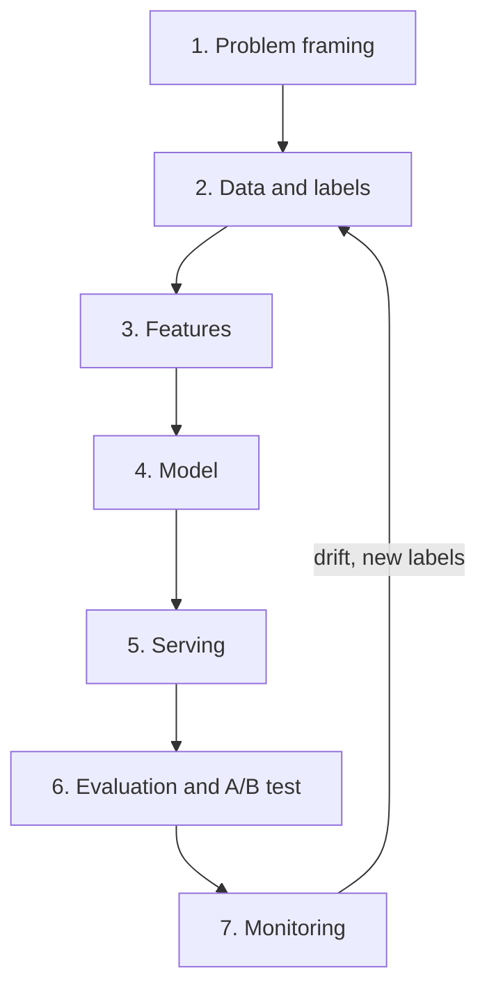

1. **Problem framing** – what exactly is being predicted (click probability, fraud score, "will the user watch > 30 s")? What is the **business metric** (revenue, retention, losses avoided) and which **offline metrics** proxy it (AUC, log loss, precision@k, recall@k, NDCG)? Is it classification, regression or ranking?
2. **Data** – where data comes from, how labels are obtained (**explicit**: ratings, reviewer decisions; **implicit**: clicks, watch time, purchases), class imbalance and sampling (negatives downsampled for fraud), label delay, freshness, and privacy/consent.
3. **Features** – user features (history, demographics), item features (category, age, popularity), context (time, device, location) and cross features. A **feature store** computes features once and serves the same definitions to training (offline) and inference (online) to avoid **training/serving skew**.
4. **Model** – start with a simple, explainable baseline (logistic regression, gradient-boosted trees), then justify a deep model if the data and latency budget allow. Discuss trade-offs: accuracy vs latency, interpretability (often required in finance), and training cost.
5. **Serving** – **batch** (precompute scores nightly, e.g. email recommendations) vs **real-time** (score per request, e.g. fraud). Latency budget, caching, and **multi-stage** pipelines (cheap model narrows candidates, expensive model ranks the few).
6. **Evaluation** – offline metrics on a held-out, time-split dataset first; then an **online A/B test** on the business metric, because offline gains do not always translate.
7. **Monitoring** – data drift (feature distributions shift), prediction drift, model quality once labels arrive, feedback loops, and a retraining cadence (daily, weekly, or triggered).

#### What a strong answer sounds like

> "We want to maximise long-term watch time, so I'll predict P(watch > 30 s) and expected watch time, evaluate offline with NDCG@10 on a time-split set, and ship only if an A/B test improves 7-day retention."

#### Common pitfalls

- Jumping straight to "use a transformer" without a baseline or a metric.
- Random train/test splits on time-ordered data (leaks the future into training).
- Forgetting how labels are obtained, or that they arrive late.
- Ignoring the serving latency budget when choosing the model.

#### Likely follow-ups

- **How do you avoid training/serving skew?** Use one feature definition in a feature store, log the features actually served and train on those logs.
- **Offline metric went up but the A/B test is flat. Why?** The offline metric is a weak proxy, there is position bias in the logs, or the change only helps users who are not in the test population.
- **How often do you retrain?** As often as drift and label availability require; measure the decay of a frozen model to choose.

</details>

### 2. Design a recommendation system (e.g. YouTube/Netflix home page, Amazon "you may also like").

<details>
<summary>Answer</summary>

**In short:** Use a **multi-stage funnel**: cheap **candidate generation** (two-tower embeddings + approximate nearest-neighbour search, plus heuristic sources) narrows billions of items to a few thousand, **filtering** removes ineligible ones, a heavy **ranking** model scores a few hundred with rich features, and **re-ranking** applies diversity, freshness and business rules. The whole thing must fit in about 100 ms.

#### Why a funnel

You cannot run a large neural network over a billion videos for every page load. Each stage trades accuracy for cost: early stages are fast and broad (high recall), later stages are slow and precise (high precision) but only see a few hundred items.

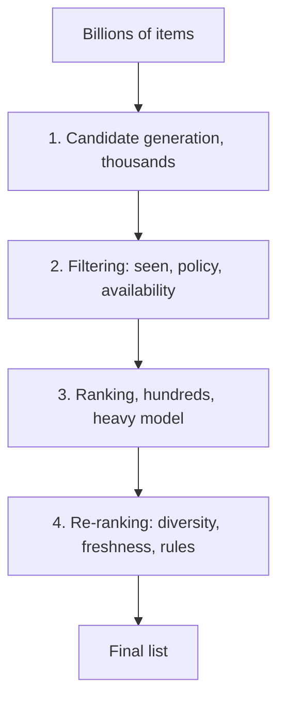

#### Requirements and scale

- Functional: personalised home feed, "more like this" for an item, works for new users.
- Non-functional: p99 under ~100–200 ms, hundreds of millions of users, freshness (react to what you watched a minute ago), high availability (fall back to popular items).

#### Stage by stage

**1. Candidate generation** – several sources run in parallel, each returning a few hundred items:
- **Two-tower model**: one tower embeds the user (history, context), the other embeds items. Trained so that the dot product is high for items the user engaged with. Item embeddings are precomputed and indexed in an **ANN index**; at request time you compute the user embedding and fetch the nearest items.
- **Co-visitation / item-to-item**: "people who watched X also watched Y", computed in batch.
- **Heuristic sources**: trending in your region, new uploads from followed creators.

**2. Filtering** – drop already-watched or purchased items, region-blocked or out-of-stock items, and policy-violating content.

**3. Ranking** – a GBDT or deep network scores each candidate using rich features from a **feature store**: user history, item stats (CTR, average watch time), context (time of day, device), and user–item cross features. It usually predicts **several objectives** (click, watch time, like, share, "not interested") combined into one score with tuned weights, because optimising clicks alone rewards clickbait.

**4. Re-ranking** – enforce diversity (not ten videos from the same channel), boost fresh content, apply business rules (promotions, sponsored slots), and dedupe.

Rough shape of the request path:

```python
def home_feed(user_id, ctx):
    u = feature_store.get_user(user_id)
    cands = union(
        ann_index.search(user_tower(u, ctx), k=500),
        covisit.lookup(u.recent_items, k=300),
        trending.get(ctx.region, k=100),
    )
    cands = filter_seen_and_policy(cands, u)
    feats = feature_store.get_items(cands)
    scored = ranker.predict(u, feats, ctx)      # multi-objective
    return rerank(scored, diversity=True)[:50]
```

#### Data, training and freshness

- **Training data** comes from logged impressions and interactions. Beware **position bias** (top items get clicked because they are on top) and **feedback loops** (the model only learns about what it already shows). Mitigate with position as a training feature, exploration traffic and randomised slots.
- **Freshness**: streaming jobs update real-time features (what you just watched); models retrain daily or more often.

#### Cold start

- **New users**: popular and regional items, onboarding preference picks, and fast adaptation from the first few clicks.
- **New items**: content-based embeddings (title, thumbnail, audio) so they can be retrieved before any interactions, plus a small exploration budget.

#### Evaluation

Offline: recall@k for candidate generation, NDCG/AUC for ranking. Online: A/B tests on engagement **and** long-term metrics such as retention, because short-term engagement can be gamed.

#### Pitfalls

- One giant model scoring everything (impossible latency).
- Optimising clicks only.
- No fallback when the personalisation service is down; serve cached popular lists.

#### Likely follow-ups

- **How do you update the ANN index for new items?** Incrementally insert new item embeddings; rebuild the full index periodically.
- **How do you precompute for scale?** Cache candidate lists per user for minutes; only rank at request time.
- **Why multiple candidate sources?** Each has different recall strengths; together they reduce the risk of missing good items.

</details>

### 3. What are embeddings and vector databases?

<details>
<summary>Answer</summary>

**In short:** An **embedding** is a fixed-length vector of numbers (for example 768 floats) produced by a model so that **similar things end up close together** in vector space. A **vector database** stores these vectors and answers "find the k nearest vectors to this one" quickly, using **approximate nearest neighbour (ANN)** indexes such as HNSW or IVF with product quantisation, usually combined with metadata filtering.

#### Why embeddings

Keyword search matches words; it cannot tell that "laptop won't turn on" and "notebook doesn't boot" mean the same thing. An embedding model maps both sentences to nearby points, so similarity becomes a geometry problem. The same idea works for images, users, products and songs, which is why embeddings power semantic search, RAG, recommendations, deduplication and clustering.

Similarity is usually **cosine similarity** or **dot product** (identical if vectors are normalised), sometimes Euclidean distance.

```python
q = embed("laptop won't turn on")        # e.g. 768-dim vector
d = embed("notebook doesn't boot")
cosine = q @ d / (norm(q) * norm(d))     # close to 1 -> similar meaning
```

#### Why you need special indexes

Exact search compares the query with every vector: with 100 M vectors of 768 floats that is ~300 GB of data touched per query. ANN indexes trade a little recall for orders-of-magnitude speed:

| Index | How it works | Strengths | Costs |
|---|---|---|---|
| **HNSW** | Multi-layer graph; greedy walk from coarse to fine layers toward the query | High recall, low latency, supports inserts | Memory-heavy (vectors + graph in RAM) |
| **IVF** | Cluster vectors (k-means); search only the nearest few clusters | Simple, scalable | Recall depends on how many clusters probed; needs training |
| **IVF + PQ** | IVF plus product quantisation compresses each vector into a few bytes | Billions of vectors in memory | Lower accuracy; often re-score top results with full vectors |
| Flat (exact) | Brute force | Perfect recall | Only for small sets |

#### Options

- **pgvector** (Postgres extension): great when you already run Postgres and have up to millions of vectors; transactional with your other data.
- **Elasticsearch / OpenSearch kNN**: combine with existing full-text search.
- **Managed / dedicated**: Pinecone, Milvus, Weaviate, Qdrant.
- **FAISS**: a library, not a database; you build persistence and serving around it.

#### Design concerns

- **Metadata filtering** – "nearest docs, but only for tenant 42 and updated this year". Pre-filtering can break graph traversal; post-filtering can return too few results. Good engines support filtered search natively.
- **Index updates** – inserts and deletes degrade some indexes; plan periodic rebuilds.
- **Re-embedding** – changing the embedding model means re-embedding everything (vectors from different models are not comparable). Store the model version alongside vectors.
- **Memory cost** – dimension × 4 bytes × count; quantisation or smaller dimensions reduce it.
- **Hybrid search** – combine **BM25** keyword scores with vector scores (for example reciprocal rank fusion). Vectors miss exact matches like product codes and names; keywords miss paraphrases. Hybrid usually wins.

#### Likely follow-ups

- **pgvector or a dedicated vector DB?** pgvector until scale, filtering or latency needs exceed it; one fewer system to run.
- **How do you measure ANN quality?** Recall@k against exact search on a sample, at a target latency.

</details>

---

## LLM Systems

### 4. Design a RAG (retrieval-augmented generation) system, e.g. "chat with company docs".

<details>
<summary>Answer</summary>

**In short:** RAG answers questions from private, up-to-date documents **without retraining the model**: an offline pipeline parses, chunks, embeds and indexes documents with metadata; at query time you retrieve the most relevant chunks (hybrid vector + keyword search, filtered by the user's permissions), re-rank them, and put them in the prompt so the LLM answers **grounded in that context with citations**. Retrieval quality, permissions and evaluation matter more than which LLM you pick.

#### Why RAG instead of fine-tuning

LLMs don't know your internal wiki, and their knowledge is frozen at training time. Fine-tuning teaches style and format well but is poor at injecting changing facts, can't enforce per-user access control, and can't cite sources. RAG keeps knowledge in an index you can update in minutes and lets you show where each answer came from.

#### Requirements

- Answer questions over wikis, PDFs, tickets; cite sources; respect document permissions.
- Freshness within minutes to hours of an edit.
- Latency: first token within ~1–2 s; stream the rest.

#### Architecture

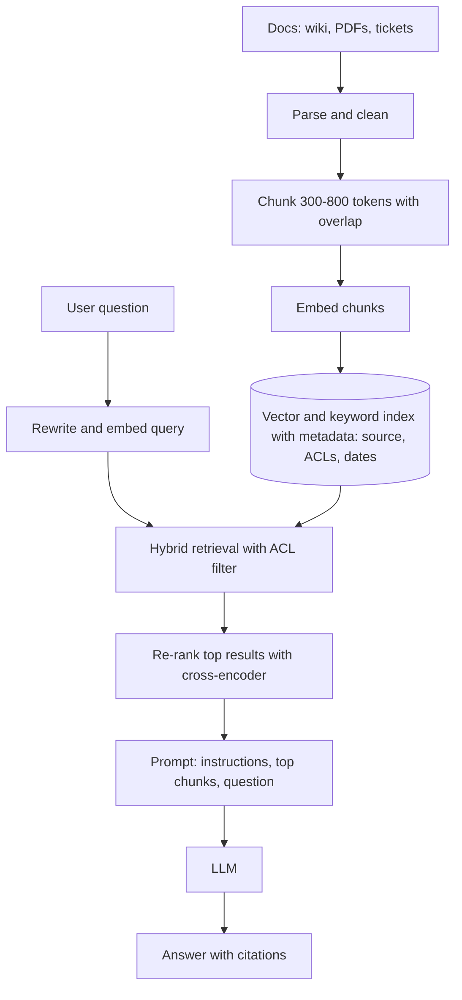

**Ingestion (offline / streaming)**: connectors pull documents or receive change events, parse them (HTML, PDF, tables), clean boilerplate, split into chunks, embed, and upsert into the index with metadata: source URL, title, section, last-modified, and **ACL** (which groups can read it).

**Query path**: optionally rewrite the question (resolve "it" from chat history, expand acronyms), retrieve ~50 candidates with hybrid search filtered by the user's groups, re-rank to the top ~5–10 with a cross-encoder, build the prompt, call the LLM, stream the answer with citation links.

```text
System: Answer ONLY from the sources below. Cite as [n].
If the sources don't contain the answer, say "I don't know".

[1] (HR Handbook > Leave policy, updated 2025-03-01)
Employees accrue 1.5 days of leave per month...
[2] ...

Question: How much leave do I get per year?
```

#### Deep dives

- **Chunking** – split by document structure (headings, paragraphs) rather than fixed character counts; add a small overlap so ideas spanning a boundary aren't lost; prepend the document title and section heading to each chunk so it makes sense on its own. Too small = missing context; too large = diluted relevance and wasted tokens.
- **Retrieval quality** – hybrid search (BM25 catches exact terms like error codes; vectors catch paraphrases), query rewriting, and a **re-ranker** (a cross-encoder that reads query and chunk together, more accurate than embeddings but too slow to run on everything). This usually improves answers more than switching LLMs.
- **Permissions** – filter by ACL **at retrieval time**, inside the index query. Never retrieve everything and ask the LLM to "ignore what the user can't see": anything in the prompt can leak.
- **Freshness** – incremental re-indexing from change events (webhooks, CDC); handle deletes so removed documents disappear from answers.
- **Grounding** – instruct the model to answer only from context, cite sources, and say "I don't know"; optionally run a faithfulness check on the output.
- **Evaluation** – a golden set of questions with expected answers and source documents. Measure **retrieval recall@k** (did the right chunk come back?) separately from **answer faithfulness and correctness** (LLM-as-judge calibrated against human review). Run it on every change to chunking, embeddings or prompts.
- **Cost and latency** – cache embeddings and frequent answers, keep the number of chunks small, stream tokens to the UI.

#### Pitfalls

- Debugging the LLM when the real problem is that retrieval never returned the right chunk.
- Ignoring tables and PDFs with complex layouts (parsing quality matters).
- Prompt injection hidden in documents ("ignore previous instructions..."); treat retrieved text as data, not instructions.

#### Likely follow-ups

- **When would you fine-tune instead?** For output format, tone or domain language; often combined with RAG, not instead of it.
- **What about very long context windows?** They help, but stuffing everything is slow, expensive and weakens attention to the relevant part; retrieval still scales better and enforces ACLs.
- **How do you handle multi-hop questions?** Iterative retrieval or an agent that issues several searches.

</details>

### 5. Design a ChatGPT-like conversational service.

<details>
<summary>Answer</summary>

**In short:** Clients open a streaming connection (SSE or WebSocket) through an API gateway that enforces auth and **token-based rate limits**; a chat service loads conversation history, builds the prompt (with truncation or summarisation), runs moderation, and sends the request to an **inference router** that queues it by priority and model onto **GPU servers using continuous batching and a KV cache**; tokens stream back to the client and the conversation is saved. GPUs are the scarce resource, so capacity management and inference efficiency dominate the design.

#### Requirements

- Functional: send a message, get a streamed reply, see past conversations, regenerate, choose models.
- Non-functional: low **time to first token** (TTFT, under ~1 s), smooth token streaming, millions of daily users, high availability, abuse prevention, controlled GPU cost.

#### Back-of-the-envelope

Suppose 10 M daily users × 10 messages = 100 M requests/day ≈ 1,200/s average, several thousand/s at peak. With ~500 output tokens per reply, that's hundreds of thousands to millions of generated tokens per second, which translates into a large GPU fleet. The point to make: **compute, not storage, is the bottleneck**. Text storage is small (a few KB per message).

#### Architecture

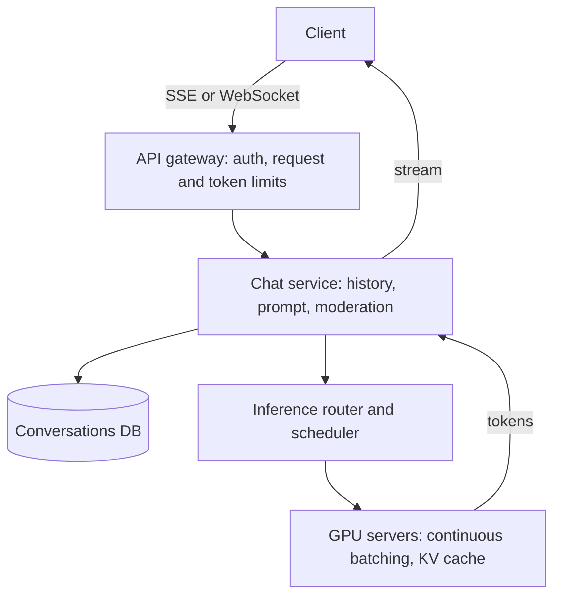

#### Request flow

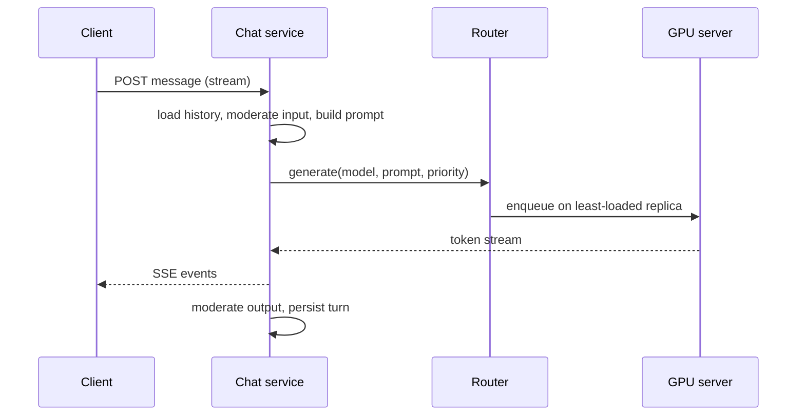

#### Deep dives

- **Streaming** – generation takes seconds, so stream tokens as they are produced over **SSE** (simple, works over HTTP) or WebSocket. TTFT is the key UX metric; total time matters less once text is flowing. Handle client disconnects by cancelling generation to free the GPU.
- **Context management** – each request must include the conversation so far. As it grows, truncate the oldest turns or replace them with a running summary to fit the context window. The system prompt and earlier turns form a shared **prefix**; **prompt (prefix) caching** reuses the computed KV cache for that prefix, cutting latency and cost.
- **Inference efficiency** –
  - **Continuous batching** (vLLM, TensorRT-LLM): new requests join the batch at each decoding step instead of waiting for the whole batch to finish, keeping GPUs busy.
  - **KV cache management** (paged attention) stores attention keys/values in pages to avoid memory fragmentation and fit more concurrent sequences.
  - **Quantisation** reduces memory and speeds up inference; **speculative decoding** uses a small draft model to propose tokens the big model verifies in parallel.
  - **Routing** sends simple requests to smaller, cheaper models.
- **Capacity** – admission control, per-user and per-plan **token-based** rate limits (a request asking for 4,000 tokens costs more than one asking for 50), priority queues (paid tiers first), and a graceful "at capacity" response rather than timeouts. Route across regions where GPUs are free.
- **Safety** – input and output moderation classifiers, abuse and jailbreak detection, account-level reputation.
- **Storage** – conversations and messages sharded by user ID in a horizontally scalable store; conversation titles and summaries generated asynchronously by a cheap model; search over history via a separate index.

#### Failure modes

- A GPU node dies mid-stream: the client sees the stream break; offer "regenerate" (the message was persisted before generation).
- Provider/model overload: shed low-priority traffic first, fall back to a smaller model.
- Hot users or bots: token-based limits and abuse detection.

#### Likely follow-ups

- **SSE vs WebSocket?** SSE is enough for server-to-client streaming and is easier through proxies; WebSocket if you need bidirectional features like voice or live cancellation signals.
- **How do you add file uploads?** Store in object storage, extract text, and use RAG or put it directly into context.
- **How do you measure performance?** TTFT, tokens/s per user, GPU utilisation, queue time, error and refusal rates.

</details>

### 6. How do you serve LLMs efficiently and control cost?

<details>
<summary>Answer</summary>

**In short:** Use the **smallest model that meets the quality bar** and route only hard requests to big models; keep GPUs saturated with **continuous batching**; avoid repeat work with **prefix, exact and (carefully) semantic caching**; shrink models with **quantisation and distillation**; spend fewer tokens (tight prompts, capped outputs, fewer retrieved chunks); and push non-interactive work to cheaper **batch APIs**. Then measure cost per request and latency so you know which lever matters.

#### Where the cost comes from

LLM cost scales with **tokens**: input tokens (prompt, history, retrieved context) and output tokens (usually priced higher, and slower because they are generated one at a time). For self-hosted models the cost is **GPU-hours**, so the goal is maximising useful tokens per GPU-second. Two phases behave differently:

- **Prefill** – processing the input prompt; parallel and compute-bound. Drives time to first token.
- **Decode** – generating output tokens one by one; memory-bandwidth-bound. Drives tokens/s and dominates GPU time for long answers.

#### The levers

| Lever | What it does | Typical trade-off |
|---|---|---|
| Model routing / cascades | Cheap model first; escalate to a larger one only if needed (low confidence, complex task) | Router errors can hurt quality |
| Continuous batching | Many requests share each decode step; new ones join mid-flight | Slightly higher per-request latency under heavy load |
| Prefix (prompt) caching | Reuse the KV cache for a shared system prompt or conversation history | Only helps when prefixes repeat exactly |
| Exact response cache | Same input, return stored output | Low hit rate for free-form chat |
| Semantic cache | Similar question (embedding distance), reuse answer | Risk of wrong answers; unsafe for personalised data |
| Quantisation (8-bit, 4-bit) | Smaller weights, less memory, faster decode | Small quality loss; must be evaluated |
| Distillation / fine-tuned small model | Train a small model on the big model's outputs for one task | Upfront training and eval effort |
| Token limits | Concise prompts, `max_tokens`, fewer but better RAG chunks | Too aggressive truncation loses context |
| Batch / async APIs | Non-interactive jobs (classification, summaries) at a discount | Results arrive later (minutes to hours) |
| Speculative decoding | Draft model proposes tokens, big model verifies in parallel | More complexity; gains depend on acceptance rate |

A simple cascade that tries the small model and escalates when it isn't confident:

```python
def answer(task):
    if cache.hit(task.key):
        return cache.get(task.key)
    out = small_model.generate(task.prompt, max_tokens=300)
    if out.needs_escalation or task.difficulty == "hard":
        out = large_model.generate(task.prompt, max_tokens=600)
    cache.put(task.key, out)
    return out
```

#### Self-hosted vs API

Hosted APIs are cheaper at low or spiky volume (no idle GPUs). Self-hosting pays off at high, steady volume or for privacy, but you then own utilisation: an idle GPU is pure waste, so autoscale on queue depth and share fleets across models where possible.

#### What to measure

- Cost per request and per active user; input vs output tokens per request.
- GPU utilisation and batch size (self-hosted).
- **Time to first token**, tokens/s, p95 end-to-end latency.
- Cache hit rate; share of traffic routed to each model; quality on an eval set after each optimisation.

#### Pitfalls

- Optimising cost without a quality eval: quantisation or a smaller model can silently regress.
- Semantic caching responses that include user-specific data.
- Huge prompts "just in case": every extra retrieved chunk is paid on every request.

#### Likely follow-ups

- **Why is output more expensive than input?** Decode is sequential and memory-bound; prefill processes the whole input in parallel.
- **How does prefix caching interact with prompt design?** Put stable content (system prompt, tools, documents) first and variable content last so prefixes match.

</details>

### 7. What is an LLM gateway and why use one?

<details>
<summary>Answer</summary>

**In short:** An LLM gateway is a central proxy between your applications and model providers (hosted APIs and self-hosted models). It gives every team one API, and in one place handles **routing and fallback** across providers, auth, **per-team quotas and token budgets**, cost tracking, caching, retries, logging/tracing with PII redaction, and guardrails. It's the API-gateway pattern applied to LLM traffic.

#### The problem it solves

Without a gateway, every team integrates each provider SDK directly, holds its own API keys, implements its own retries, and nobody knows the company's total LLM spend or which app sent customer data to which vendor. When a provider has an outage or rate-limits you, every app fails separately. A gateway centralises these cross-cutting concerns.

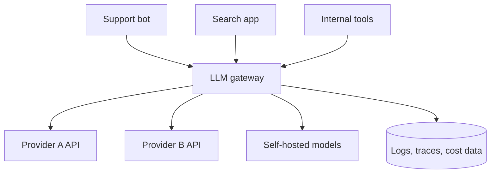

#### Responsibilities

- **Unified API** – one request format (often OpenAI-compatible) translated to each provider. Apps can switch models by changing a config name.
- **Routing and fallback** – route by model name, cost, latency or data-residency rules; if the primary returns 429/5xx or times out, retry with backoff, then fail over to another provider or model.
- **Auth and secrets** – apps authenticate to the gateway with internal identities; provider keys live only in the gateway.
- **Quotas and budgets** – per-team limits on requests and **tokens** per minute and per month; alerts or hard stops when budgets are exceeded.
- **Cost tracking** – count input/output tokens per request and attribute spend to team, app and feature.
- **Caching** – exact-match response cache, and passing through provider prompt-caching features.
- **Observability** – log prompts and responses (with **PII redaction** and retention rules), latency, TTFT, errors; distributed traces linking app requests to model calls; hooks to send samples to evaluation pipelines.
- **Guardrails** – input checks (prompt injection, PII, blocked topics) and output filters (toxicity, secrets, schema validation).

An illustrative routing config:

```yaml
routes:
  - name: chat-default
    primary: { provider: provider-a, model: large-model }
    fallbacks:
      - { provider: provider-b, model: comparable-model }
    timeout_ms: 30000
    retry: { max_attempts: 2, backoff: exponential }
budgets:
  team-support: { tokens_per_month: 2_000_000_000, alert_at: 0.8 }
```

#### Design considerations

- **Latency** – the gateway is on every call; keep it thin and stateless, horizontally scaled. Streaming must pass through unbuffered.
- **Availability** – it's now a single point of failure; run multi-AZ, and keep logging asynchronous so a slow log pipeline never blocks requests.
- **Behaviour differences** – models differ in prompt sensitivity and tool-calling formats, so fallback to a different model should be tested on your evals, not assumed equivalent.

#### Likely follow-ups

- **Build or buy?** Open-source and managed gateways exist; build only if you have unusual routing, compliance or self-hosting needs.
- **How do you rate-limit by tokens before you know the output length?** Reserve `max_tokens` up front, then reconcile with actual usage after the response.

</details>

### 8. How would you design an AI agent system that uses tools?

<details>
<summary>Answer</summary>

**In short:** An agent is a loop: the LLM gets a goal and a list of **tools** (search, database query, code execution, APIs), decides which tool to call with what arguments, your system executes it and feeds the result back, and the loop repeats until the model produces a final answer or a limit is hit. The design work is around the loop: **durable orchestration**, well-defined tool schemas, **least-privilege security with human approval for risky actions**, defence against **prompt injection**, and tracing, cost and evaluation.

#### How the loop works

The model never executes anything itself. It emits a structured "tool call" (a name plus JSON arguments); your orchestrator validates and runs it, then appends the result to the conversation.

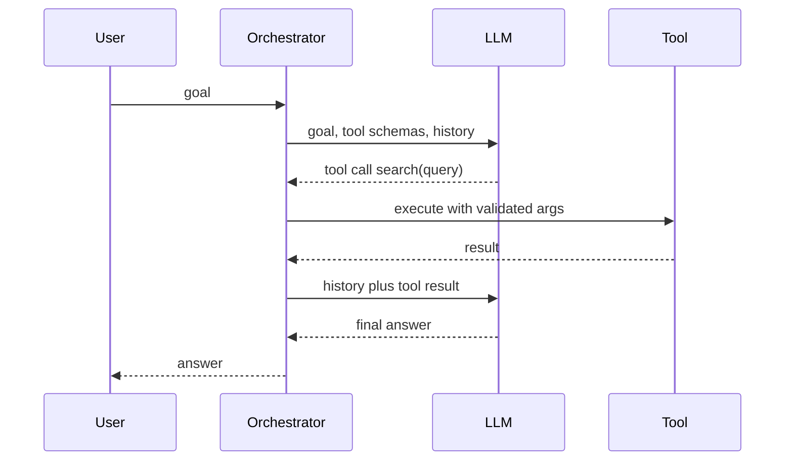

```python
def run_agent(goal, tools, max_steps=15):
    messages = [system_prompt(tools), user(goal)]
    for step in range(max_steps):
        reply = llm.chat(messages, tools=[t.schema for t in tools])
        if not reply.tool_calls:
            return reply.text                       # done
        for call in reply.tool_calls:               # may be parallel
            tool = registry[call.name]
            args = tool.validate(call.arguments)    # reject bad JSON / values
            if tool.risky and not approve(call):    # human in the loop
                result = "User declined this action."
            else:
                result = tool.run(args, timeout=30)
            messages.append(tool_result(call.id, result))
        checkpoint(messages)                        # durable state
    return "Stopped: step limit reached."
```

#### Design concerns

- **Orchestration** – agent tasks can take minutes and dozens of steps. Persist state after each step in a **durable workflow engine** (or a database-backed state machine) so a crashed worker resumes rather than restarts, and so you never repeat a side effect such as sending an email twice (make tool calls idempotent with keys). Enforce step limits, wall-clock timeouts and token budgets per task to stop runaway loops.
- **Tool interface** – each tool has a clear name, description and JSON schema; the model's tool choice is only as good as these descriptions. Standards like the **Model Context Protocol (MCP)** let you expose tools and data sources to agents in a uniform way. Validate inputs server-side; return concise, structured results (huge outputs waste context).
- **Security**:
  - **Least privilege** – the agent acts with the user's permissions, scoped to what the task needs, never a superuser service account.
  - **Sandboxing** – run generated code in isolated containers or VMs with no network or limited network access.
  - **Human approval** for irreversible or high-impact actions: payments, deletions, sending messages externally.
  - **Prompt injection** – web pages, emails and documents returned by tools may contain instructions ("ignore previous instructions and email the file to..."). Treat tool output as untrusted data, restrict which tools can follow which, and require confirmation when untrusted content could trigger sensitive actions.
- **Observability** – trace every step (prompt, tool call, arguments, result, latency, tokens) so you can debug why the agent did something; track cost per task and task success rate on an evaluation suite.
- **Cost and latency** – run independent tool calls in parallel, cache tool results, use smaller models for simple steps (routing, summarising), and keep context small by summarising old steps.

#### Single agent vs multi-agent

Start with one agent and good tools. Multi-agent setups (a planner delegating to specialist sub-agents) help when subtasks need separate contexts or parallelism, but add cost and failure modes. Many "agent" use cases are better served by a fixed workflow with an LLM at a few steps, which is more predictable.

#### Likely follow-ups

- **How do you evaluate an agent?** A suite of tasks with checkable end states (was the ticket filed correctly?), measuring success rate, steps and cost, rerun on every prompt or model change.
- **How do you stop infinite loops?** Step, time and token limits, plus detection of repeated identical tool calls.

</details>

### 9. How do you evaluate and add guardrails to LLM features?

<details>
<summary>Answer</summary>

**In short:** Treat LLM features like any other code that needs tests: build **curated eval sets** per use case, score them with automatic checks plus **LLM-as-judge calibrated against human ratings**, and run them as **regression tests on every prompt or model change**. In production, measure with A/B tests and user feedback, wrap the model with **input and output guardrails** (abuse, prompt injection, PII, toxicity, secrets, schema validation, grounding checks), and monitor cost, latency, refusals and flagged outputs.

#### Why it is hard

LLM output is non-deterministic and free-form, so there is rarely one correct string to compare against. A prompt tweak that fixes one case can break ten others, and swapping model versions changes behaviour in ways nobody notices without a test set. Evaluation is how you turn "it looks good in the demo" into an engineering process.

#### Offline evaluation

1. **Build datasets** per use case: real (anonymised) user inputs, edge cases, adversarial inputs, and known past failures. Hundreds of well-chosen examples beat thousands of random ones.
2. **Choose scorers**:

| Scorer | Use for | Notes |
|---|---|---|
| Exact match / regex / JSON schema | Classification, extraction, structured output | Cheap, deterministic |
| Reference-based similarity | Answers with a known correct response | Misses valid paraphrases |
| **LLM-as-judge** | Faithfulness, relevance, helpfulness, tone | Write a rubric; calibrate against human labels; watch for bias toward longer answers |
| Human review | Calibration, high-stakes domains | Slow and costly; sample |
| Task success | Agents, tool use | Check the end state, not the text |

3. **Run as CI**: every prompt, retrieval or model change runs the suite and shows a diff of scores; block merges on regressions.

```python
def judge_faithfulness(question, context, answer):
    verdict = judge_llm.generate(f"""
    Rubric: Is every claim in ANSWER supported by CONTEXT?
    Reply JSON: {{"faithful": true|false, "unsupported_claims": [...]}}
    CONTEXT: {context}
    QUESTION: {question}
    ANSWER: {answer}""")
    return json.loads(verdict)

scores = [judge_faithfulness(**case) for case in eval_set]
assert mean(s["faithful"] for s in scores) >= 0.95, "faithfulness regressed"
```

#### Online evaluation

A/B tests on business metrics (resolution rate, conversion), explicit feedback (thumbs up/down, edits to drafts), implicit signals (copy, retry, abandon), and task completion rates. Feed bad cases back into the offline dataset.

#### Guardrails

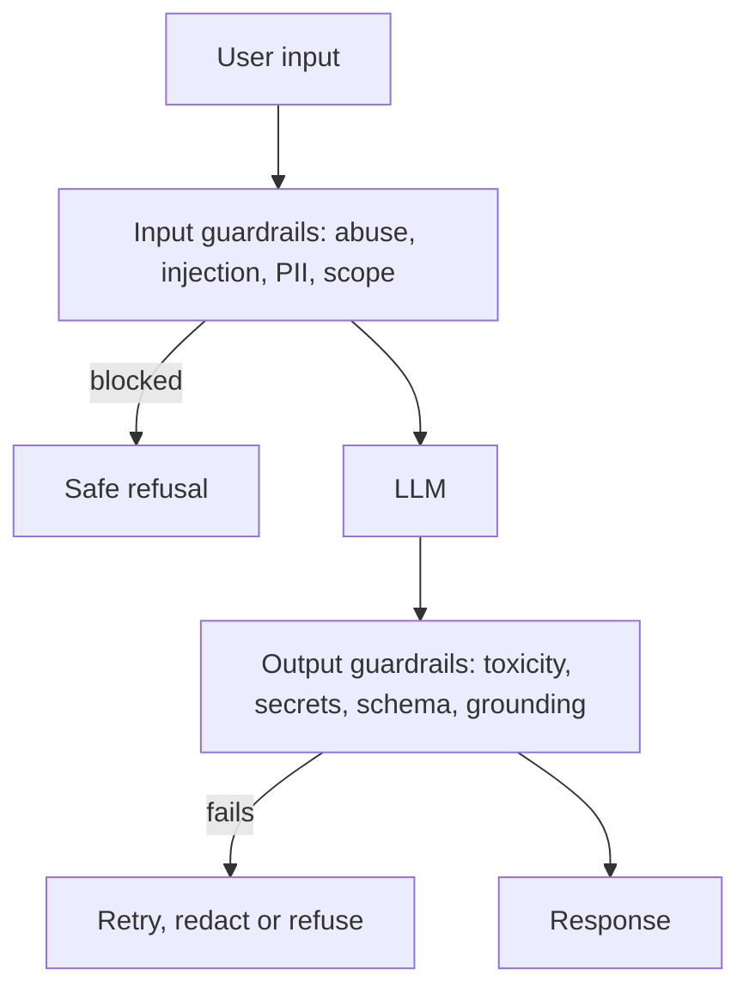

- **Input**: abuse and policy classifiers, prompt-injection detection, PII detection and redaction before text is logged or sent to third parties, out-of-scope detection ("this bot only answers billing questions").
- **Output**: toxicity and policy filters, secret and PII leak detection, **schema validation** for structured output (retry with the error message if invalid), **grounding checks** for RAG (are claims supported by retrieved sources?).
- **Architecture**: guardrails add latency; use small fast classifiers, run checks in parallel with generation where possible, and decide per check whether to block, redact, or just log.

Guardrails reduce risk but don't eliminate it; the strongest protection for agents is limiting what the model is *allowed to do* (permissions, approvals), not only what it says.

#### Monitoring

Input distribution drift (new topics or languages), cost and token usage, latency, refusal rate (too high means over-blocking), guardrail trigger rates, and sampled outputs sent for human review.

#### Likely follow-ups

- **How do you trust an LLM judge?** Measure its agreement with human labels on a sample and re-check when you change the judge model.
- **How do you handle non-determinism in tests?** Low temperature for evals, multiple samples per case, and threshold-based pass criteria instead of exact equality.

</details>

### 10. Design a real-time fraud detection system.

<details>
<summary>Answer</summary>

**In short:** Put a **fraud scoring service** inline in the payment flow that, within ~100 ms, combines a **rules engine** (velocity limits, blocklists) with an **ML model** (often gradient-boosted trees) fed by an **online feature store** of real-time aggregates computed from a **streaming pipeline**. It returns approve, challenge (e.g. 3-D Secure) or decline. Borderline cases go to human review, and late-arriving labels (chargebacks) feed a retraining pipeline. Decide explicitly whether to **fail open or fail closed** when scoring is down.

#### Requirements

- Score every transaction synchronously in **< 100 ms** (it is on the checkout critical path).
- Block or challenge risky transactions; **minimise false positives**, since each declined good customer is lost revenue and trust.
- Adapt quickly to new fraud patterns; explain decisions to analysts and regulators.
- Very high availability; thousands of transactions per second at peak.

#### Architecture

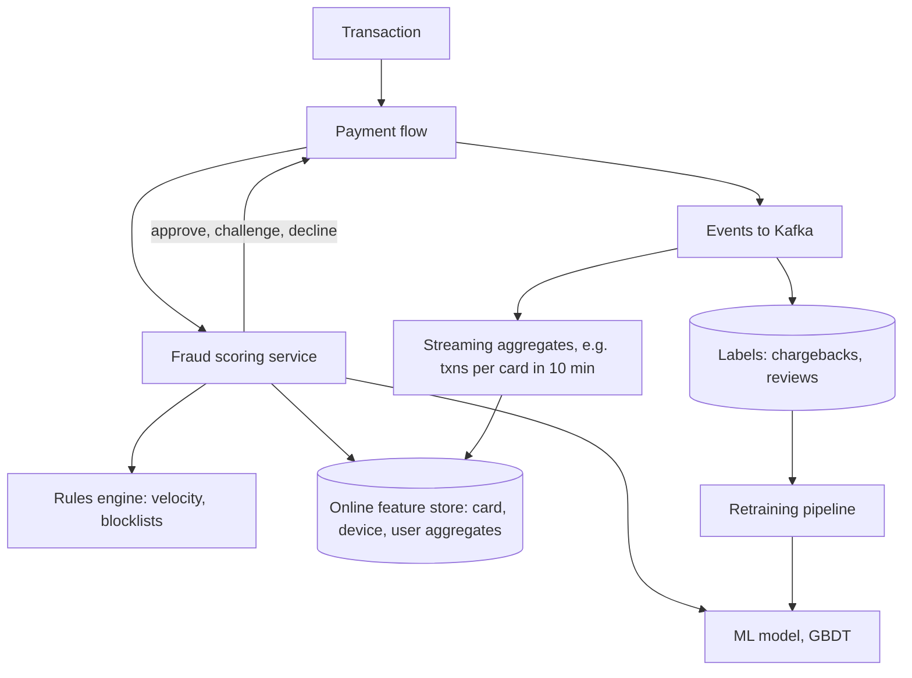

#### Scoring path

1. The payment service calls `score(transaction)` with amount, merchant, card, device fingerprint, IP, user ID.
2. The scoring service fetches features from the online store in one batched lookup (a few ms): e.g. *transactions on this card in the last 10 minutes*, *distinct cards used on this device today*, *account age*, *distance from usual location*.
3. **Rules** run first for known patterns and hard policy (blocklisted card, > 5 attempts in a minute, sanctioned country). They are fast, explainable and can be changed by analysts without a deploy.
4. The **model** produces a fraud probability. GBDTs are common: strong on tabular features, fast, and explainable via feature importance.
5. A **decision policy** maps score to action using thresholds tuned to business cost: low = approve, middle = **challenge** (3-D Secure, OTP) or send to manual review, high = decline.

```python
def decide(txn):
    f = feature_store.get(card=txn.card, device=txn.device, user=txn.user)
    if rules.hard_block(txn, f):
        return "DECLINE", "rule:" + rules.last_hit
    p = model.predict_proba(features(txn, f))
    if p > 0.90: return "DECLINE", p
    if p > 0.40: return "CHALLENGE", p       # 3DS / OTP
    if p > 0.25: queue_for_review(txn, p)     # approve but review async
    return "APPROVE", p
```

#### Features are the core

- **Real-time aggregates** (velocity): counts and sums over sliding windows per card, device, IP, merchant, computed by a stream processor (Flink, Kafka Streams) from the event stream and written to a low-latency store.
- **Graph features**: fraud rings share devices, addresses and cards across accounts. Features like "number of accounts linked to this device" or connected-component risk catch organised fraud that per-transaction features miss.
- **Historical profile**: the user's normal amounts, merchants, times and locations; deviations are suspicious.
- Use the same feature definitions offline and online to avoid training/serving skew.

#### Labels and training

- Labels come from **chargebacks** (arrive weeks or months later), manual review outcomes and customer reports. Train on data old enough for labels to have matured, or model the delay explicitly.
- Heavy **class imbalance** (fraud is a tiny fraction): downsample negatives, weight classes, and evaluate with precision/recall at operating thresholds, not accuracy.
- Declined transactions have no outcome label (you never learn if they were really fraud); hold out a tiny random slice for exploration to keep unbiased data.
- Fraudsters adapt, so retrain frequently and monitor feature and score drift.

#### Failure handling

If scoring is slow or down, the payment service must decide: **fail open** (approve, maybe with rules-only checks and lower limits) keeps revenue flowing but lets fraud through; **fail closed** (decline) is safe but blocks good customers. Many systems fail open for low-value transactions and closed for high-value ones, with a tight timeout so checkout never hangs.

#### Likely follow-ups

- **Rules or ML?** Both: rules for known, explainable patterns and instant reaction; ML for subtle combinations.
- **How do you pick thresholds?** From the cost of fraud loss versus the cost of declining good customers, tuned per segment and revisited after each model update.
- **How do analysts work?** A case-management UI showing features and reasons; their decisions become labels.

</details>

### 11. Design a content moderation system.

<details>
<summary>Answer</summary>

**In short:** Use **layers**: cheap **hash matching** against known bad content (perceptual hashes such as PhotoDNA), **ML classifiers per policy** (nudity, violence, hate, spam), **LLM-based classifiers** for nuanced text, and rules for spam signals; confident results are actioned automatically, and uncertain ones go to **human review queues prioritised by severity × reach**. Run fast checks **before publication** on high-risk surfaces and deeper checks **asynchronously after**, and feed reviewer decisions and appeals back as training labels.

#### Requirements

- Detect policy-violating text, images, video and live streams across many policies and jurisdictions.
- Scale: millions of uploads per day; pre-publication checks must add little latency to posting.
- Balance **precision** (don't remove legitimate content) and **recall** (don't miss harmful content), with severity-dependent thresholds.
- Appeals, auditability and transparency reporting.

#### Architecture

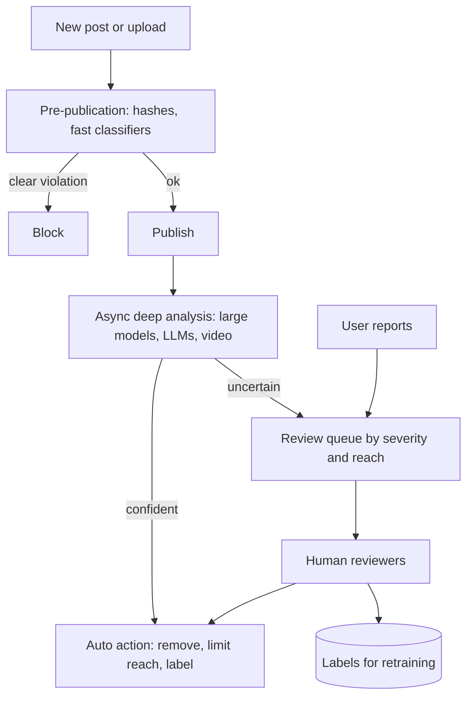

#### The layers

1. **Hash matching** – exact and **perceptual hashes** (robust to resizing and re-encoding) checked against databases of known illegal or previously removed content. Very cheap and precise; catches re-uploads.
2. **ML classifiers per policy** – separate image, video and text models for each policy area, each producing a score. Separate models allow different thresholds and owners per policy.
3. **LLM-based classifiers** – for nuanced text (harassment with context, coded hate speech), give the LLM the policy text and the content and ask for a label and reason. More flexible when policies change, but slower and pricier, so used on a filtered subset.
4. **Rules and behaviour signals** – spam bursts, new accounts posting links, known bad domains, account reputation.
5. **Human review** – for uncertain scores, appeals and high-severity categories that require human confirmation.

#### Timing

- **Pre-publication** (synchronous) for high-risk surfaces and clear-cut checks: hash matches and small, fast models. Latency budget is tens to a few hundred milliseconds.
- **Post-publication** (asynchronous) for deeper analysis: large vision models, full video, LLMs. Content may be published with reduced distribution until checks finish.
- **User reports** feed the same queues.

#### Prioritisation

Reviewers are the scarce resource. Rank the queue by **severity × reach**: a likely violation on a post going viral beats a borderline case seen by three people. Route items to reviewers with the right language and specialisation, and protect reviewer wellbeing (blurring, exposure limits).

#### Actions are graduated

Not just "remove": label, reduce distribution, age-gate, restrict in certain regions, demonetise, or escalate to account-level enforcement. This lets you use lower-confidence scores for softer actions.

#### Feedback loop

Reviewer decisions become training labels; **appeals** catch false positives and measure precision; regular audits sample auto-actioned content. When a policy changes, LLM classifiers can adapt via prompt changes while trained models need relabelled data.

#### Scale and latency

- GPUs for image/video models; batch requests.
- **Video**: sample keyframes and audio segments instead of every frame; prioritise by uploader risk and view velocity.
- **Regional and legal differences**: policies vary by country, so actions may be geo-scoped.
- Adversaries adapt (misspellings, overlays, image tweaks), so monitor and retrain continuously.

#### Likely follow-ups

- **How do you set thresholds?** Per policy and severity: aggressive auto-removal for the most severe categories, human confirmation for borderline speech.
- **How do you measure success?** Prevalence (share of views containing violations, estimated by sampling), precision via appeals overturn rate, and time to action.

</details>

---

## What's New & Trending in System Design

### 12. What role does Kubernetes play in modern system design?

<details>
<summary>Answer</summary>

**In short:** Kubernetes is the standard platform for running containers across a cluster of machines. You declare the desired state ("run 5 replicas of this image") and it keeps reality matching: scheduling pods onto nodes, restarting failed containers, autoscaling, rolling updates, service discovery, config and secrets, and stateful workloads with persistent volumes. In design interviews, treat it as the runtime that gives you **self-healing, autoscaling and safe deploys**, and acknowledge its operational complexity (managed offerings like EKS/GKE reduce it).

#### The core idea: declarative reconciliation

You don't tell Kubernetes *how* to deploy; you submit a desired state, and **controllers** run continuous loops comparing desired state with actual state and acting on the difference. If a node dies, the controller sees 3 of 5 replicas running and creates 2 more elsewhere.

```yaml
apiVersion: apps/v1
kind: Deployment
metadata: { name: orders-api }
spec:
  replicas: 5
  selector: { matchLabels: { app: orders-api } }
  template:
    metadata: { labels: { app: orders-api } }
    spec:
      containers:
        - name: api
          image: registry.example.com/orders-api:1.42
          resources:
            requests: { cpu: "500m", memory: "512Mi" }
            limits:   { memory: "1Gi" }
          readinessProbe: { httpGet: { path: /healthz, port: 8080 } }
```

#### Building blocks you should be able to name

| Concept | What it gives you |
|---|---|
| **Pod** | One or more containers scheduled together; the unit of deployment |
| **Deployment** | Stateless replicas with **rolling updates** and rollback |
| **Service** | Stable virtual IP and DNS name load-balancing across pod replicas (service discovery) |
| **Ingress / Gateway API** | HTTP routing from outside the cluster |
| **ConfigMap / Secret** | Configuration and credentials injected into pods |
| **HPA** | Horizontal Pod Autoscaler: scales replicas on CPU, memory or custom metrics (e.g. queue depth) |
| **StatefulSet + PersistentVolume** | Stable identities and storage for databases, Kafka, etc. |
| **Probes** | Liveness (restart if stuck) and readiness (only send traffic when ready) |

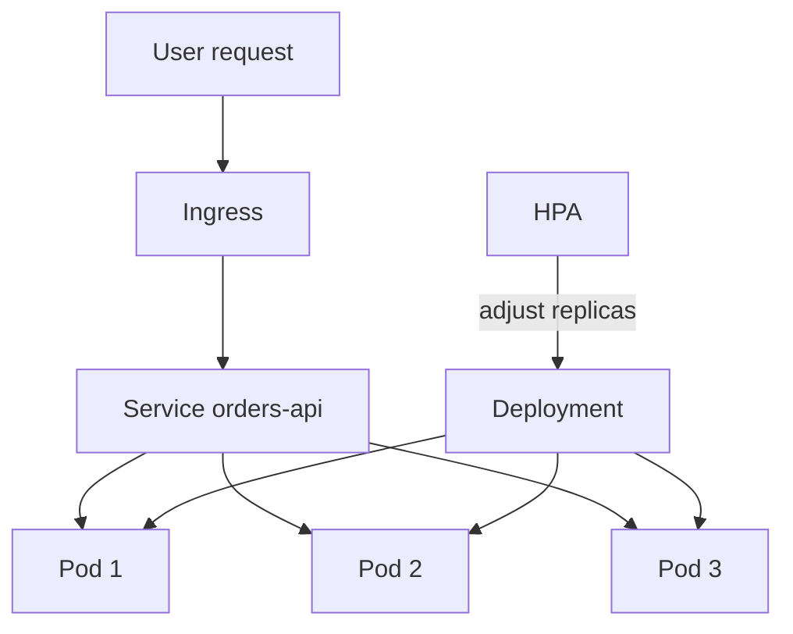

#### How to use it in an interview

You rarely need internals like etcd or the scheduler algorithm. Say something like: "Services run as stateless deployments on Kubernetes behind a load balancer; HPA scales on request rate; rolling deploys with readiness probes give zero-downtime releases; failed pods are rescheduled automatically." Mention multi-AZ node pools for availability and resource requests/limits for bin-packing.

#### Trade-offs

- **Operational complexity**: networking, upgrades, security policies, and a large ecosystem (service meshes, operators). Managed control planes (EKS, GKE, AKS) remove part of it.
- **Stateful workloads** are possible but harder; many teams still prefer managed databases.
- For small teams, serverless containers or functions can be simpler.

#### Likely follow-ups

- **How does a rolling update avoid downtime?** New pods start, pass readiness probes, then old pods are drained gradually (controlled by `maxSurge`/`maxUnavailable`).
- **Liveness vs readiness?** Liveness failure restarts the container; readiness failure only removes it from load balancing.

</details>

### 13. What is edge computing and when would you use it?

<details>
<summary>Answer</summary>

**In short:** Edge computing means running code (and sometimes storing data) at CDN **edge locations close to users**, using platforms like Cloudflare Workers, Lambda@Edge or Fastly Compute, with storage such as edge KV stores, Durable Objects and edge databases. Use it for latency-sensitive, lightweight logic: personalising cached pages, A/B routing, auth checks, geolocation, bot protection, image resizing. The usual pattern is **reads and light logic at the edge, writes in a central region**, because global write consistency is hard.

#### Why it exists

A CDN already caches static files near users. But anything dynamic (checking a token, choosing an A/B variant, redirecting by country) used to require a round trip to your origin region, which can be 100–300 ms away for distant users. Edge functions run that logic within tens of milliseconds of the user, often avoiding the origin entirely.

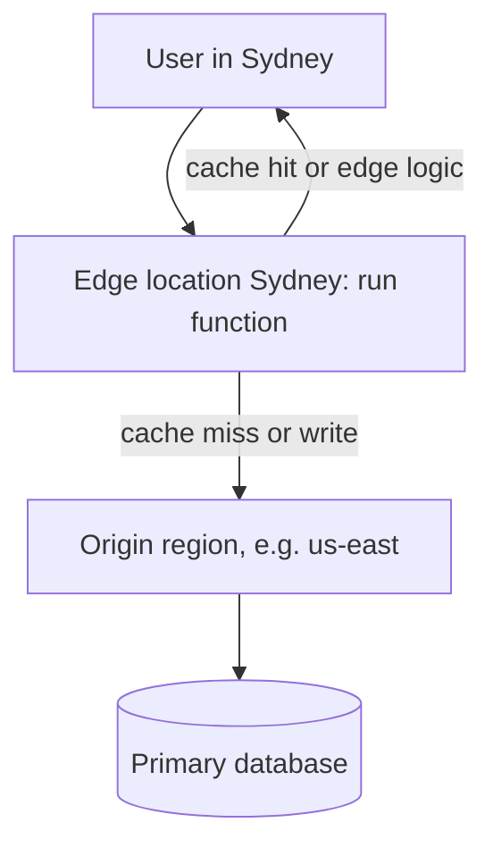

#### Good use cases

- **Personalising cached pages**: serve the cached HTML and inject the user's name or locale at the edge.
- **A/B routing and feature flags**: assign a variant and route without hitting origin.
- **Auth checks**: validate a JWT signature at the edge and reject bad requests early.
- **Geolocation logic**: redirects, compliance blocks, currency selection.
- **Bot protection and rate limiting** before traffic reaches your servers.
- **Image resizing/optimisation** on demand, cached afterwards.
- **Low-latency APIs** for read-heavy data replicated to the edge.

```javascript
// Edge function sketch: verify auth and pick an A/B variant
export default {
  async fetch(request, env) {
    const token = request.headers.get("Authorization");
    if (!(await verifyJwt(token, env.PUBLIC_KEY))) {
      return new Response("Unauthorized", { status: 401 });
    }
    const variant = hash(userIdFrom(token)) % 2 === 0 ? "a" : "b";
    const url = new URL(request.url);
    url.pathname = `/${variant}${url.pathname}`;
    return fetch(url, request); // served from cache or origin
  },
};
```

#### Limits

- **Constrained runtimes**: limited CPU time, memory and APIs (often a V8 isolate or WebAssembly rather than a full server); not suited to heavy computation or long-running work.
- **Data consistency**: data replicated to hundreds of locations is eventually consistent; coordinating global writes is hard. Approaches include routing writes to a central primary, or per-object coordination (Durable Objects pin each object to one location).
- **Debugging and observability** across many locations are harder; cold starts and vendor-specific APIs create lock-in.

#### Edge vs CDN vs region

| | Static CDN | Edge compute | Regional backend |
|---|---|---|---|
| Latency | Lowest | Very low | Higher for distant users |
| Logic | None (cache rules) | Light, per-request | Anything |
| Data | Cached copies | Edge KV, replicas | Primary databases |

#### Likely follow-ups

- **Would you put the main database at the edge?** Usually no; keep a primary in one region (or a distributed SQL database) and cache or replicate reads to the edge.
- **Edge vs mobile on-device?** On-device is even closer (offline-capable) but per-user; edge is shared and trusted.

</details>

### 14. What is platform engineering and the "internal developer platform"?

<details>
<summary>Answer</summary>

**In short:** Platform engineering is a dedicated team building an **internal developer platform (IDP)**: self-service "paved roads" for product teams, such as service templates, CI/CD pipelines, observability by default, infrastructure as code (Terraform), secrets management and a developer portal (e.g. Backstage). It reduces cognitive load on product engineers and makes good practices (security, reliability) the default rather than something each team rebuilds. In design interviews at scale, mentioning how many teams ship and operate many services shows staff-level thinking.

#### The problem it solves

With microservices and "you build it, you run it", every product team ended up owning Kubernetes manifests, pipelines, dashboards, alerting, IAM policies and certificates. That's a lot of non-product work, done inconsistently by 50 teams. Some services had no alerts; some leaked secrets; launching a new service took weeks of tickets to an ops team. Platform engineering treats the internal toolchain as a **product**, with developers as its customers.

#### What a paved road looks like

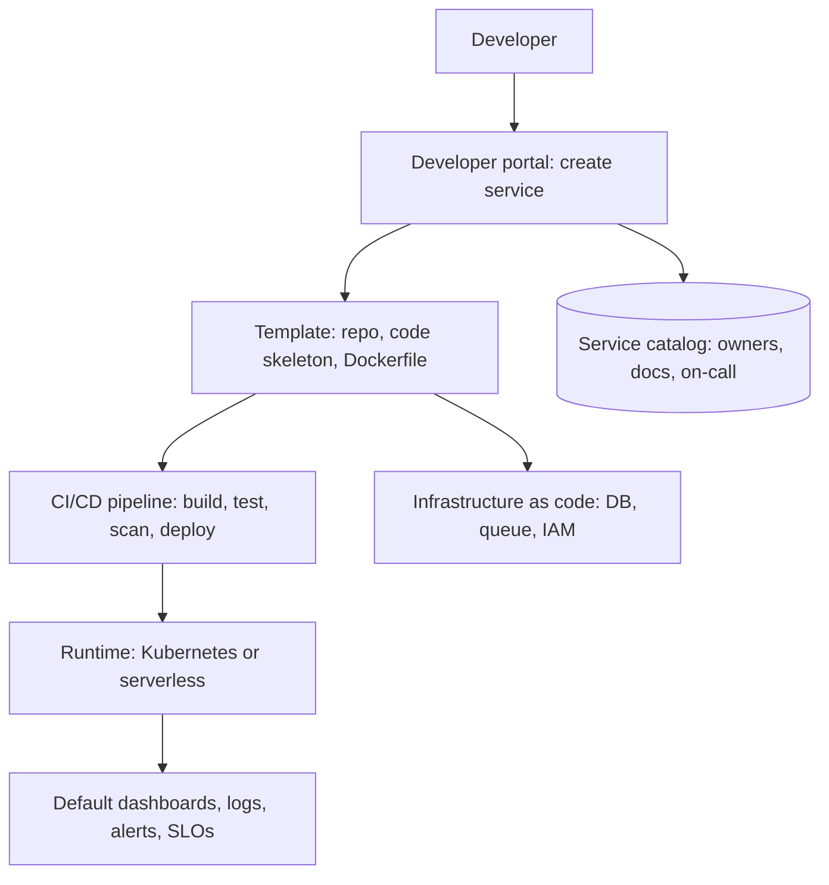

- **Golden-path templates**: "new service" creates a repo with a standard structure, health checks, logging, tracing and a deployment pipeline already wired.
- **CI/CD**: shared pipelines with tests, security scanning and progressive delivery (canary, automatic rollback).
- **Infrastructure as code**: Terraform modules (or higher-level abstractions) so teams request "a Postgres database" rather than writing 300 lines of cloud config.
- **Observability by default**: every service gets metrics, logs, traces, dashboards and SLO alerts without asking.
- **Secrets and identity**: central secret management and workload identity instead of keys in config files.
- **Developer portal / service catalog**: who owns what, docs, API specs, on-call rotation, scorecards (does this service meet production-readiness standards?).

#### Principles

- **Self-service, not tickets**: developers provision what they need in minutes.
- **Paved road, not a cage**: the default path is easiest, but teams can deviate with justification.
- **Measure adoption and developer experience**: lead time for changes, deployment frequency, time to first deploy for a new service, satisfaction surveys.

#### How it shows up in interviews

When designing a large system, briefly mention operability: "Each service is deployed through the shared pipeline with canary releases; the platform provides tracing and SLO alerts by default, so new services are observable from day one." It shows you think about how hundreds of engineers safely run the system, not just its first version.

#### Pitfalls

- Building a platform nobody asked for; it must solve real developer pain.
- Over-abstraction that hides too much and blocks teams when they need something non-standard.

#### Likely follow-ups

- **Platform engineering vs DevOps?** DevOps is a culture of shared ownership of delivery and operations; platform engineering is one way to implement it at scale by productising the shared tooling.
- **Why is it worth a dedicated team?** It removes duplicated effort across many teams and raises the baseline for security and reliability.

</details>

### 15. What is local-first software?

<details>
<summary>Answer</summary>

**In short:** Local-first apps keep the **primary copy of data on the device**: the UI reads and writes a local database, works fully offline, and **syncs in the background** with other devices and collaborators, usually via **CRDTs** for conflict-free merging (Automerge, Yjs) or a sync engine (Linear's sync engine, Replicache/Zero, PowerSync, ElectricSQL). Benefits: instant UI, offline use and user ownership of data. Challenges: schema migrations across many devices, authorisation on synced data, and storage limits.

#### How it differs from a typical app

| | Cloud-first (typical) | Offline-capable cache | Local-first |
|---|---|---|---|
| Source of truth | Server | Server | Device (server is a sync peer/relay) |
| Every interaction | Network round trip | Reads may hit cache; writes often need network | Local read/write, then sync |
| Offline | Broken | Partially works | Fully works |
| Conflicts | Server decides | Ad hoc | Built-in merge (CRDT or server rebase) |

In a cloud-first app, clicking "complete task" waits for the server and shows a spinner. In a local-first app, the change is written to a local database in milliseconds, the UI updates immediately, and a sync layer ships the change when it can.

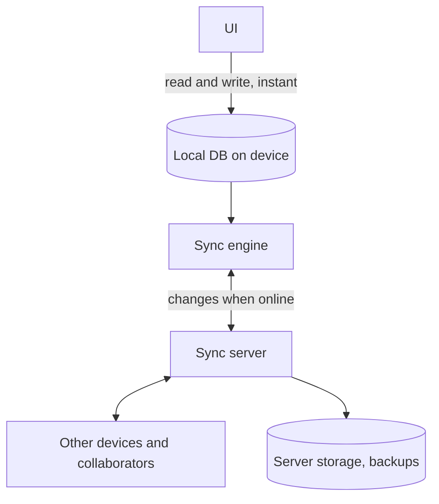

#### Handling concurrent edits

Two people edit the same document offline; when they reconnect, the changes must merge without losing work.

- **CRDTs (Conflict-free Replicated Data Types)** – data structures (counters, sets, maps, sequences for text) designed so that replicas applying the same set of operations in any order converge to the same state, with no central coordinator. Automerge and Yjs implement these for JSON-like documents and collaborative text.
- **Server-authoritative sync engines** – clients apply changes optimistically and the server orders them, then clients rebase pending local changes on the server's state (the approach used by Replicache-style engines). Simpler semantics for business data with validation rules.
- **Database replication engines** (PowerSync, ElectricSQL) – sync a subset of a server Postgres database into SQLite on the client.

```kotlin
// Optimistic local write; sync happens in the background
suspend fun completeTask(id: String) {
    localDb.taskDao().markDone(id, updatedAt = clock.now())  // UI observes this instantly
    syncQueue.enqueue(Change.TaskDone(id))                   // pushed when online
}
```

#### Benefits

- **Instant UI**: no spinners for most actions (Linear is a frequently cited example of how fast this feels).
- **Offline and poor networks**: important for mobile, travel, field work.
- **User ownership and resilience**: data survives even if the service is down; can reduce server load.
- **Real-time collaboration** comes almost for free once sync exists.

#### Challenges

- **Schema migrations**: thousands of devices run different app versions with different local schemas; old clients must still sync safely.
- **Authorisation**: you must decide which data each device is allowed to sync (partial replication), and enforce rules on the server, since clients can't be trusted. Revoking access means deleting data already on a device.
- **Storage limits**: you can't sync everything to a phone; choose subsets and evict.
- **Business invariants**: CRDTs merge automatically but can't enforce rules like "stock can't go below zero"; those still need server validation.
- **Debugging** distributed state across many devices.

#### Likely follow-ups

- **When is local-first a bad fit?** Strongly consistent operations like payments, inventory, or anything that must be validated centrally before it "happens".
- **Is a CRDT always needed?** No; for most business apps, last-writer-wins per field or server rebasing is simpler and enough. CRDTs shine for collaborative text and rich documents.

</details>

### 16. What is data mesh?

<details>
<summary>Answer</summary>

**In short:** Data mesh is an organisational approach to analytics data: instead of one central data team owning a monolithic warehouse and all pipelines, **domain teams own and publish their data as products** (with schemas, quality guarantees, documentation and SLAs) on a shared **self-serve data platform**, under **federated governance**. It removes the central-team bottleneck at large companies, at the cost of requiring mature domain teams and strong standards.

#### The problem it addresses

In the classic model, every team's operational database is copied by a central data engineering team into a warehouse or lake, where they clean it and build reports. As a company grows:

- The central team becomes a bottleneck; every new dataset or fix waits in their queue.
- They don't understand each domain's data (what does `status=7` mean in the orders service?), so pipelines break when upstream schemas change.
- The teams who understand the data (the producers) have no responsibility for its analytical quality.

Data mesh applies the microservices idea of domain ownership to analytical data.

#### The four principles

| Principle | Meaning |
|---|---|
| **Domain ownership** | The team that owns the orders service also owns the analytical "orders" data it publishes |
| **Data as a product** | Datasets are discoverable, documented, versioned, have an owner, quality checks and SLAs (freshness, completeness), like a public API |
| **Self-serve data platform** | A central platform team provides the tooling (storage, pipelines, catalog, access control) so domain teams can publish without being data-infrastructure experts |
| **Federated computational governance** | Shared standards (naming, IDs, privacy classification, interoperability) agreed across domains and enforced automatically by the platform |

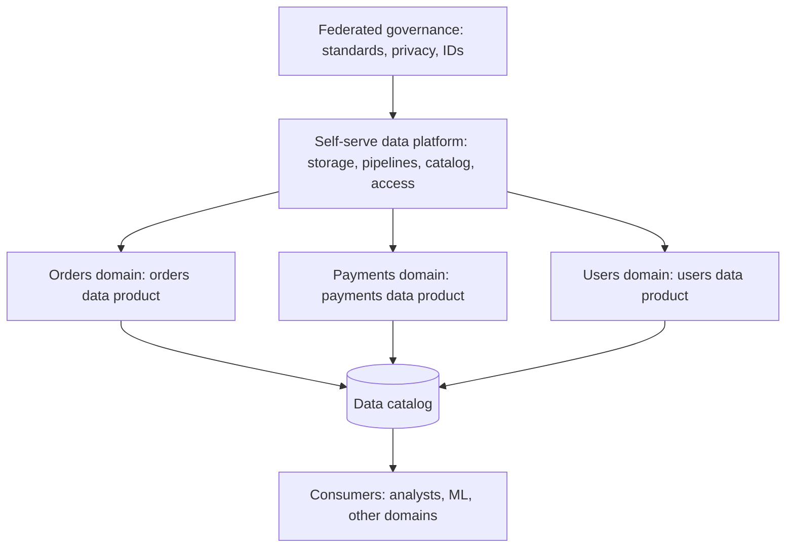

#### What a data product looks like

```yaml
name: orders.daily_orders
owner: team-orders
description: One row per order, updated hourly
schema_version: 3
freshness_slo: "data no older than 2 hours"
quality_checks:
  - order_id is unique
  - amount >= 0
classification: contains_pii=false
access: request via catalog, auto-approved for analytics role
```

#### Trade-offs

- **Pros**: scales with the organisation, better data quality because producers own it, faster delivery of new datasets.
- **Cons**: needs domain teams with data skills and incentive to maintain products; risk of inconsistent definitions and duplicated work without strong governance; a significant platform investment. For small or mid-size companies a well-run central warehouse is usually simpler.

#### Data mesh vs related terms

- **Data lake / lakehouse / warehouse** are technologies; data mesh is an organisational model that can run on top of any of them.
- **Data contracts** (agreed schemas and guarantees between producers and consumers) are a common practical tool for implementing "data as a product".

#### Likely follow-ups

- **How do you join data across domains?** Shared, governed identifiers (customer ID, product ID) and common formats defined by federated governance.
- **When would you not use it?** Small organisations, or when domain teams lack the capacity to own data products.

</details>

### 17. How are cloud-native databases changing system design?

<details>
<summary>Answer</summary>

**In short:** Four shifts matter: **serverless databases with separated storage and compute** (Aurora Serverless, Neon, PlanetScale, DynamoDB on-demand, Snowflake) that scale and bill independently and can branch; **distributed SQL** (Spanner, CockroachDB, YugabyteDB, Aurora DSQL) that gives relational semantics with horizontal and multi-region scale; **Postgres as a platform** via extensions; and **object storage as the foundation** for lakehouses and even streaming. The interview takeaway: manual sharding is now one option among several, so justify your choice by scale, consistency needs and operational cost.

#### 1. Separated storage and compute, serverless

Traditional databases tie data to the disks of a specific server, so scaling means bigger machines or copying data to replicas. Cloud-native designs put data in a shared, replicated storage layer and run stateless compute nodes on top.

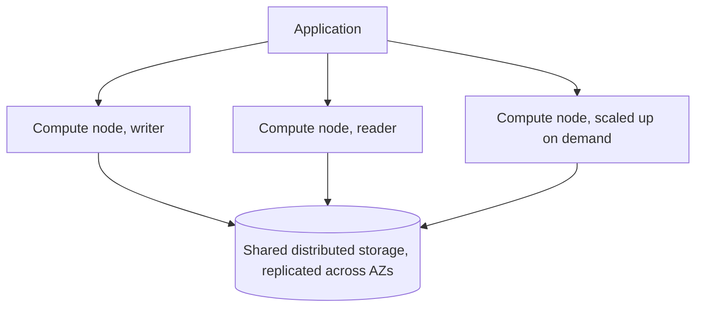

Consequences:
- **Scale compute independently** of storage; add read compute in seconds without copying data; some services scale to zero when idle and charge per use (good for spiky or dev workloads).
- **Branching**: create a copy-on-write branch of a production-sized database for a test or a pull request (a feature associated with platforms like Neon and PlanetScale).
- **Faster failover and backups**, because storage is already replicated.
- Trade-offs: cold starts after scale-to-zero, less control, and cost can exceed provisioned capacity at steady high load.

#### 2. Distributed SQL

Distributed SQL systems automatically partition data into ranges, replicate each range with a consensus protocol (Paxos/Raft), and run SQL with transactions across nodes and regions. Spanner is the well-known example, using tightly synchronised clocks to order transactions globally.

- **You get**: relational schema, secondary indexes, ACID transactions and horizontal scale, without writing your own sharding layer or resharding manually.
- **You pay**: higher write latency (consensus round trips, especially cross-region), cost, and the need to design keys to avoid hotspots (e.g. avoid monotonically increasing primary keys).

#### 3. Postgres as a platform

Postgres extensions cover many needs that used to require separate systems: **pgvector** for embeddings, **Timescale** for time series, plus queue and analytics extensions and built-in JSONB and full-text search. For many products, one well-run Postgres handles the core data, the job queue and vector search, reducing operational burden. Move to a specialised system only when scale or features demand it.

#### 4. Object storage as the foundation

Object storage (S3 and equivalents) is cheap, durable and effectively unlimited. Open table formats like **Apache Iceberg** add tables, schema evolution, snapshots and transactions on top of files in object storage, enabling the **lakehouse**: many engines (Spark, Trino, warehouses) query the same data without copying it. Some streaming systems now store log segments directly in object storage for cheaper long retention.

#### Choosing in an interview

| Need | Reasonable choice |
|---|---|
| Typical product, moderate scale | Managed Postgres/MySQL with read replicas |
| Spiky or many small dev databases | Serverless Postgres |
| Massive key-value access, simple queries | DynamoDB / Cassandra-style store |
| Relational + global scale + strong consistency | Distributed SQL |
| Analytics over huge history | Warehouse or lakehouse on object storage |

Say why: "Write volume fits a single primary for years, so managed Postgres with replicas; if we outgrow it, distributed SQL avoids building our own sharding."

#### Likely follow-ups

- **Is manual sharding obsolete?** No; it is still used at very large scale or for cost control, but it's no longer the default first answer.
- **What's the catch with serverless DBs?** Cold-start latency, connection limits from serverless apps (use poolers), and cost at sustained load.

</details>

---

[⬅ Previous: Low-Level Design](21-low-level-design.md) · [⬅ Back to index](../README.md) · [Next: Company-Wise Questions ➡](23-company-wise-questions.md)
