# Company-Wise Questions (Product Companies)

[⬅ Back to index](../README.md)

Covers: how system design rounds differ at Google, Meta, Amazon, Microsoft, Apple, Netflix, Uber, Airbnb, Stripe, LinkedIn and Indian product companies (Flipkart, Swiggy/Zomato, PhonePe/Paytm/Razorpay, Zerodha, Hotstar), the prompts each is commonly reported to ask, and full designs for the frequently asked prompts not covered elsewhere.

> These lists come from commonly reported interview experiences. Companies change their questions often, so use them to practise the **style** each company expects, not as a guaranteed list. Links point to the full answer in this repo.

---

## What Each Company Asks

### 1. What is Google's system design round like, and what does it commonly ask?

<details>
<summary>Answer</summary>

**In short:** Google's round is open-ended and scale-heavy: a vague prompt ("design YouTube"), billions of users, global distribution, and relentless "why won't this break?" follow-ups on **data partitioning, consistency and back-of-the-envelope numbers**. They reward first-principles reasoning over naming products, though Google's own published systems (Bigtable, Spanner, MapReduce, Chubby) are fair game to discuss.

#### What the round looks like

A typical Google system design interview is 45 minutes with one interviewer. The prompt is deliberately underspecified, and part of the evaluation is whether *you* turn it into a concrete problem: who the users are, which features are in scope, what the read/write ratio is, what latency and availability targets apply. Interviewers then push on whatever you hand-waved. If you say "we shard the data", expect "by what key? what happens to a celebrity's data? how do you reshard?"

Google interviewers are known for caring about **numbers**. Being able to say "100M DAU × 5 uploads/day ≈ 6K writes/s average, ~3× at peak, so a single primary is not enough" is a strong signal, because it shows you size the system before choosing components (see [estimation](02-estimation.md)).

#### What they evaluate

| Signal | What a strong answer shows |
|---|---|
| Problem framing | Clear functional and non-functional requirements, explicit scope cuts |
| Estimation | QPS, storage, bandwidth computed and *used* to make decisions |
| Partitioning | A justified shard key, plan for hot keys and rebalancing |
| Consistency | Which data needs strong consistency and which can be eventual, and why |
| Failure thinking | What happens when a node, a rack or a region fails |
| Trade-offs | Alternatives named and rejected with reasons |

#### Mentioning Google's own systems

You don't need to know Google internals, but knowing the public papers helps you speak their language: **Bigtable** (wide-column store, sorted by row key), **Spanner** (globally distributed SQL with externally consistent transactions using TrueTime), **MapReduce** (batch processing), **Chubby** (lock service built on Paxos). Use them as reference points ("a Bigtable-style wide-column store keyed by `video_id`"), never as a substitute for explaining how your design works.

#### Commonly reported prompts

- Design YouTube / YouTube view counts → [YouTube](17-designs-social-media.md), [counting at scale](15-big-data-streaming.md), [view counter](#14-design-a-youtube-view-counter--a-distributed-counter)
- Design Google Search / web crawler → [search engine](17-designs-social-media.md), [crawler](16-designs-core-infrastructure.md)
- Design search autocomplete → [typeahead](16-designs-core-infrastructure.md)
- Design Google Docs → [collaborative editing](17-designs-social-media.md)
- Design Google Drive → [Dropbox/Drive](17-designs-social-media.md)
- Design Google Maps / ETA → [Maps](18-designs-location-commerce.md)
- Design Gmail → [email service](#16-design-an-email-service-like-gmail)
- Design Google Calendar → [calendar](#15-design-google-calendar)
- Design a distributed key-value store / rate limiter / ID generator → [core infrastructure](16-designs-core-infrastructure.md)

#### Pitfalls

- Jumping to boxes before requirements and numbers.
- Saying "use Spanner" without explaining what problem it solves for you.
- Ignoring skew: real traffic is never uniform (viral videos, popular search terms).

#### Likely follow-ups

- *"Your traffic grows 10×, what breaks first?"* Walk the request path and name the first component to saturate, using your own numbers.
- *"How do you serve users on another continent?"* Multi-region replicas, geo-routing, and a decision on where writes go.
- *"How would you test this?"* Load tests, canary rollouts, and fault injection.

</details>

### 2. What is Meta's system design round like?

<details>
<summary>Answer</summary>

**In short:** Meta offers two variants: **System Design** (backend, distributed systems) and **Product Architecture** (APIs, data models and client–server interaction for a product feature). Both are product-led: start from what the user sees, then handle Meta-scale problems such as **fan-out, caching, hot keys (celebrity accounts), real-time delivery and consistent counts**.

#### The two variants

| | System Design | Product Architecture |
|---|---|---|
| Typical candidate | Backend / infra engineers | Product, full-stack and mobile engineers |
| Focus | Storage, partitioning, queues, caches, scale | API shape, data model, client-server contract, pagination, real-time updates |
| Example prompt | "Design a distributed top-K service" | "Design the API and data model for Instagram Stories" |
| Depth expected | Infrastructure internals, failure handling | Endpoint design, payloads, how the client renders and refreshes |

You are usually told which one you have; ask the recruiter if unsure, because preparing for the wrong one wastes effort.

#### What Product Architecture looks like

Interviewers want concrete APIs and entities, not just boxes. For example, for a feed:

```http
GET /v1/feed?cursor=eyJ0cyI6MTcwMH0&limit=20
200 OK
{
  "items": [
    { "post_id": "p_123", "author": { "id": "u_9", "name": "Asha" },
      "text": "...", "media": [...], "like_count": 1204, "viewer_has_liked": true }
  ],
  "next_cursor": "eyJ0cyI6MTY5OX0"
}
```

Be ready to justify cursor vs offset pagination (cursors stay stable when new posts arrive), what is denormalised into the response, how the client gets new items (polling, push, or a "new posts" pill), and how optimistic UI works for likes.

#### Recurring deep dives

- **Fan-out on write vs read** for feeds, with a hybrid for celebrities.
- **Caching** with thundering-herd protection (Meta has publicly described using leases in its memcache deployment).
- **Hot keys**: a celebrity post read millions of times per second needs replicated cache entries.
- **Real-time delivery** for messages, comments and notifications over persistent connections.
- **Counts** (likes, views) that are approximately right and never go backwards on screen.

Meta's social graph store, **TAO**, is publicly described and is a good reference for a read-heavy graph cache in front of sharded MySQL.

#### Commonly reported prompts

- Design the Facebook News Feed / Instagram feed → [news feed](17-designs-social-media.md)
- Design Facebook Messenger / WhatsApp → [chat](17-designs-social-media.md)
- Design Instagram / Instagram Stories → [Instagram](17-designs-social-media.md)
- Design live comments on Facebook Live → [live streaming + comments](17-designs-social-media.md)
- Design a post search system (search posts by keyword) → [post search](#17-design-facebook-post-search)
- Design top-K / trending (hashtags, most shared articles) → [top-K](15-big-data-streaming.md)
- Design an ad click aggregator → [ad clicks](18-designs-location-commerce.md)
- Design a privacy/visibility system for posts (friends only, public) → [post search](#17-design-facebook-post-search) covers visibility filtering
- Design proximity / nearby friends → [Yelp](18-designs-location-commerce.md), [Uber](18-designs-location-commerce.md)
- Design LeetCode / an online judge → [online judge](18-designs-location-commerce.md)

#### Pitfalls

- In Product Architecture, spending 30 minutes on databases and never writing an API.
- In System Design, ignoring the celebrity / hot-key case at Meta scale.
- Forgetting privacy: almost every Meta product filters content by who may see it.

</details>

### 3. What is Amazon's system design round like?

<details>
<summary>Answer</summary>

**In short:** Amazon's round is practical and customer-focused, and is usually mixed with **Leadership Principles** (LP) questions in the same hour. Expect probing on **availability, operational excellence, failure handling and cost**, comfort with AWS building blocks (DynamoDB, SQS, S3, Lambda), and questions about real trade-offs you made in past projects.

#### How the round is structured

Many Amazon loops spend the first 10–15 minutes on one or two behavioural questions tied to LPs ("Tell me about a time you had to dive deep to find a root cause"), then move to the design. One of the interviewers is often a **Bar Raiser** from another team whose job is to keep the hiring bar consistent; they may ask deeper or less domain-specific questions.

The design discussion leans practical: "How would you operate this? How do you know it's broken? What does it cost?" A design that is elegant but impossible to run on call will score poorly.

#### Tie design decisions to Leadership Principles

| Leadership Principle | How it shows up in a design |
|---|---|
| Customer Obsession | Start from the customer experience: checkout must never double-charge, and latency targets come from what customers notice |
| Dive Deep | Be able to explain how a DynamoDB partition or an SQS visibility timeout actually works |
| Frugality | Mention cost: tiered storage, spot instances for batch jobs, not over-provisioning |
| Bias for Action | Propose an MVP architecture first, then evolve it |
| Insist on the Highest Standards | Monitoring, alarms, runbooks, and safe deployments |

#### AWS building blocks worth knowing

| Need | Typical AWS answer | What to say about it |
|---|---|---|
| Key-value at scale | DynamoDB | Partition key choice, hot partitions, conditional writes for idempotency |
| Queueing | SQS (standard or FIFO) | At-least-once delivery, visibility timeout, dead-letter queues |
| Streams | Kinesis / MSK (Kafka) | Ordered per shard, replayable |
| Blobs | S3 | Very high durability, lifecycle rules to cheaper tiers |
| Compute for events | Lambda | Good for spiky, short tasks; watch cold starts and concurrency limits |

Using generic names ("a key-value store") is fine; mapping to AWS shows familiarity. Amazon's **Dynamo paper** (consistent hashing, sloppy quorums, vector clocks) is a classic reference for the key-value store prompt.

#### Commonly reported prompts

- Design Amazon's e-commerce checkout / shopping cart → [e-commerce](18-designs-location-commerce.md)
- Design a flash sale / Prime Day traffic → [flash sale](18-designs-location-commerce.md)
- Design a top-K best-sellers list per category → [best-sellers](#18-design-amazon-best-sellers-top-k-per-category)
- Design order tracking / notifications → [notification system](16-designs-core-infrastructure.md)
- Design Amazon Locker / package pickup → [Amazon Locker](#19-design-amazon-locker)
- Design a recommendation system ("customers also bought") → [recommendations](22-ai-ml-whats-new.md)
- Design a distributed cache / message queue / job scheduler → [core infrastructure](16-designs-core-infrastructure.md)
- LLD: parking lot, vending machine, locker → [LLD](21-low-level-design.md)

#### Pitfalls

- Preparing only the design and having no LP stories ready.
- Ignoring operations: no metrics, alarms or rollback plan.
- Not mentioning idempotency for orders and payments, which Amazon interviewers expect by default.

</details>

### 4. What do Microsoft and Apple typically ask?

<details>
<summary>Answer</summary>

**In short:** Microsoft is team-dependent and usually mixes HLD with LLD (Teams, Outlook, OneDrive, URL shortener, rate limiter, LRU cache, collaborative editing). Apple is team-specific and practical, with a strong emphasis on **privacy, on-device processing and client–server design** (iMessage with end-to-end encryption, iCloud Photos sync, Find My, App Store, push notifications).

#### Microsoft

Microsoft hiring is largely done per team, so the round reflects the team's product. Loops often include one design round that may be high-level (a service) or low-level (classes and interfaces), and sometimes both in one hour. The bar is usually a clean, well-reasoned design rather than extreme-scale trivia.

| Common prompt | Where to practise |
|---|---|
| Microsoft Teams (chat, presence, meetings) | [chat](17-designs-social-media.md) |
| Outlook (email, calendar) | [email](#16-design-an-email-service-like-gmail) |
| OneDrive (file sync) | [Dropbox](17-designs-social-media.md) |
| Office online (co-editing) | [Google Docs](17-designs-social-media.md) |
| URL shortener, rate limiter, distributed cache, notification system | [core infrastructure](16-designs-core-infrastructure.md) |
| LRU cache and other LLD | [LLD](21-low-level-design.md) |

Azure teams may push deeper on multi-tenancy, quotas and regional failover.

#### Apple

Apple interviews are run by the hiring team and often feel like a conversation about how *you* would build their feature. For iOS and client teams, the design is frequently **mobile-first**: offline behaviour, sync, battery and bandwidth, and what runs on the device versus the server.

Privacy is a product requirement at Apple, so state it explicitly:

- **Data minimisation**: collect only what the feature needs.
- **On-device processing**: e.g. photo classification or suggestions computed locally.
- **End-to-end encryption**: the server routes and stores ciphertext it cannot read (iMessage is publicly documented as end-to-end encrypted).
- **Anonymous identifiers** for features like Find My, so the server cannot track a device's location history.

| Common prompt | Where to practise |
|---|---|
| iMessage with E2E encryption | [chat](17-designs-social-media.md) |
| iCloud Photos sync | [photo backup](#20-design-a-photo-backup-service-like-icloud-photos--google-photos) |
| Push notification service | [notifications](16-designs-core-infrastructure.md) |
| Find My, App Store, offline-first apps | [mobile design](19-mobile-system-design.md) |

#### Pitfalls

- At Apple, designing a server-side ML pipeline over user photos without addressing privacy.
- At Microsoft, preparing only HLD when the team expects class design and code.

</details>

### 5. What do Netflix, Uber, Airbnb and LinkedIn ask?

<details>
<summary>Answer</summary>

**In short:** Each company asks about its own core problems. **Netflix**: streaming at scale, CDN, resilience and A/B testing. **Uber**: geospatial matching, surge pricing, ETA and trip state machines. **Airbnb**: search with availability and **booking without double booking**. **LinkedIn**: feed, "People You May Know" and connection degree.

#### Netflix

- **Topics**: video streaming at scale, its own CDN (**Open Connect**, appliances placed inside ISP networks), **resilience** (chaos engineering, fallbacks, graceful degradation), **A/B testing**, recommendations and personalised artwork.
- **What to show**: everything fails eventually, so how does the product keep playing? Netflix popularised chaos engineering (Chaos Monkey randomly terminates instances in production) and fallbacks such as showing a generic row when personalisation is down.
- **Practise**: [YouTube/streaming](17-designs-social-media.md), [A/B testing platform](#21-design-an-ab-testing--experimentation-platform), [recommendations](22-ai-ml-whats-new.md), [reliability](13-reliability-observability.md).

#### Uber

- **Topics**: ride matching, **surge pricing**, ETA, driver location tracking, payments, trip state machines. Heavy on geospatial indexing and real-time updates.
- **What to show**: how to index millions of moving drivers (geohash, quadtree, or a hexagonal grid; Uber open-sourced its **H3** hexagonal index), how to shard by region, and a trip lifecycle such as `REQUESTED → MATCHED → EN_ROUTE → IN_TRIP → COMPLETED` with safe retries.
- **Practise**: [Uber](18-designs-location-commerce.md), [Maps](18-designs-location-commerce.md), [payments](18-designs-location-commerce.md).

#### Airbnb

- **Topics**: search with availability and pricing filters, **booking without double booking**, reviews, payouts to hosts, guest–host messaging.
- **What to show**: the search index is eventually consistent, but the booking write must be strongly consistent (a conditional insert or row lock per listing-night, or a unique constraint on `(listing_id, date)`), plus a payment flow that holds funds and pays out after check-in.
- **Practise**: [hotel booking](18-designs-location-commerce.md), [chat](17-designs-social-media.md).

#### LinkedIn

- **Topics**: feed, "**People You May Know**", connection degree (1st/2nd/3rd), job recommendations, "who viewed your profile".
- **What to show**: graph queries at scale and offline + online ML pipelines. LinkedIn created Kafka, so event streaming is a natural part of any answer there.
- **Practise**: [news feed](17-designs-social-media.md), [PYMK](#22-design-linkedin-people-you-may-know-and-connection-degree).

#### Summary

| Company | Core theme | Deep dive to prepare |
|---|---|---|
| Netflix | Resilience + delivery | CDN caching, fallbacks, experimentation |
| Uber | Real-time geo | Geo index, matching, surge, state machines |
| Airbnb | Marketplace correctness | Availability search vs booking consistency |
| LinkedIn | Social graph | Graph traversal, recommendations, feed |

</details>

### 6. What do Stripe and fintech companies ask?

<details>
<summary>Answer</summary>

**In short:** Fintech rounds put **correctness first**: idempotency, exactly-once *effects*, double-entry ledgers, reconciliation and auditability, plus API design quality and backward compatibility. Stripe rounds are often practical (API design or integration-style problems) and reward clear, well-designed APIs over scale buzzwords.

#### Why correctness dominates

In a social app, a duplicated like is harmless. In payments, a duplicated charge is a customer complaint, a refund, and possibly a regulatory issue. Networks fail mid-request all the time, so clients retry; the system must make retries safe.

**Idempotency** is the core tool. Stripe's public API accepts an `Idempotency-Key` header: the server stores the key with the result of the first request and replays that result for any retry.

```sql
-- Idempotency table: one row per client-supplied key
CREATE TABLE idempotency_keys (
  merchant_id   BIGINT,
  idem_key      TEXT,
  request_hash  TEXT,          -- reject the same key reused with a different body
  status        TEXT,          -- IN_PROGRESS | DONE
  response_body JSONB,
  created_at    TIMESTAMPTZ,
  PRIMARY KEY (merchant_id, idem_key)
);
-- First request inserts IN_PROGRESS; a retry hits the PK and returns
-- the stored response (or 409 if still IN_PROGRESS).
```

#### Ledgers and reconciliation

- **Double-entry ledger**: every movement of money is recorded as balanced debit and credit entries, and entries are append-only (fix mistakes with new reversing entries, never updates). Balances are derived from entries.
- **Reconciliation**: compare your ledger against bank and card-network settlement files daily; mismatches go to a queue for investigation.
- **Audit trail**: who changed what and when, retained for years.

#### API design quality

Stripe is known for API design. Expect to discuss resource naming, error formats, pagination, webhooks for async results, and **versioning**: Stripe publicly pins each account to a dated API version and lets requests override it with a `Stripe-Version` header, so old integrations keep working while the API evolves.

#### Commonly reported prompts

- Design a payment system / Stripe's charge API → [payments](18-designs-location-commerce.md)
- Design a **webhook delivery system** → [webhooks](#23-design-a-webhook-delivery-system-like-stripe-webhooks)
- Design a rate limiter for an API platform → [rate limiter](16-designs-core-infrastructure.md)
- Design a ledger / wallet / money transfer → [wallet](18-designs-location-commerce.md)
- Design idempotency for an API → [idempotency](09-consistency-transactions-consensus.md)

#### Pitfalls

- Using floating-point numbers for money (use integer minor units such as cents or paise).
- Claiming "exactly-once delivery"; you get at-least-once delivery plus idempotent processing.
- Updating balances in place without a ledger to explain how they got there.

</details>

### 7. What do Indian product companies (Flipkart, Swiggy, Zomato, PhonePe, Paytm, Razorpay, Zerodha, Hotstar, CRED, Meesho) ask?

<details>
<summary>Answer</summary>

**In short:** Most Indian product companies run an **HLD round plus an LLD / machine-coding round** where you write working code in 60–90 minutes. HLD prompts usually come from the company's own domain (flash sales at Flipkart, delivery assignment at Swiggy, UPI at PhonePe, live cricket at Hotstar), so study the company's business before the interview.

#### Prompts by company

| Company | Commonly reported prompts |
|---|---|
| **Flipkart / Meesho / Myntra** | Big Billion Days flash sale, inventory without overselling, product catalog and search, cart and checkout, order tracking → [e-commerce](18-designs-location-commerce.md), [flash sale](18-designs-location-commerce.md) |
| **Swiggy / Zomato / Zepto / Blinkit** | Food or grocery delivery, delivery partner assignment, live order tracking, ETA, quick-commerce inventory per dark store → [food delivery](18-designs-location-commerce.md) |
| **PhonePe / Paytm / Google Pay / Razorpay** | UPI payments, wallet, payment gateway, reconciliation, notification/SMS systems, rate limiter → [UPI](#24-design-a-upi-payment-system-phonepe--google-pay--paytm), [payments](18-designs-location-commerce.md) |
| **Zerodha / Groww** | Stock trading platform, order matching, real-time price ticks to millions, portfolio → [stock exchange](18-designs-location-commerce.md), [price ticker](#25-design-a-real-time-stock-price-ticker-for-millions-of-users) |
| **Hotstar (JioHotstar)** | Live cricket streaming to tens of millions of concurrent viewers, traffic spikes when a wicket falls → [live streaming at massive concurrency](#26-design-live-cricket-streaming-for-25m-concurrent-viewers-hotstar) |
| **CRED / Ola / Rapido / MakeMyTrip / BookMyShow** | Rewards and credit-card bill payment, ride-hailing, flight/hotel search and booking, movie ticket booking → [Uber](18-designs-location-commerce.md), [booking](18-designs-location-commerce.md), [BookMyShow LLD](21-low-level-design.md) |

#### What the machine-coding round evaluates

You get a problem statement (e.g. "build Splitwise") and must produce **running code**, usually in-memory, with a small driver or tests. Interviewers look at:

- **Working functionality first**: a complete, runnable solution beats a beautiful half-solution.
- **Clean object model**: entities, services, and clear responsibilities.
- **Extensibility**: patterns such as Strategy for pluggable rules (split types, pricing, assignment).
- **Concurrency where relevant**: e.g. two users booking the same seat.

A typical extensibility point looks like this:

```kotlin
// Strategy: add new split types without touching ExpenseService
interface SplitStrategy {
    fun split(amountPaise: Long, participants: List<String>, params: Map<String, Long>): Map<String, Long>
}

class EqualSplit : SplitStrategy {
    override fun split(amountPaise: Long, participants: List<String>, params: Map<String, Long>): Map<String, Long> {
        val share = amountPaise / participants.size
        val remainder = amountPaise % participants.size
        // give leftover paise to the first participants so the total matches exactly
        return participants.mapIndexed { i, p -> p to share + if (i < remainder) 1 else 0 }.toMap()
    }
}
```

LLD rounds commonly ask: parking lot, Splitwise, BookMyShow, snake and ladder, elevator, rate limiter, cache, logger, food-ordering system → [Low-Level Design](21-low-level-design.md).

#### Pitfalls

- Over-designing in machine coding (interfaces everywhere) and running out of time before the code runs.
- In HLD, using generic numbers instead of the company's reality (e.g. India-specific peaks like festival sales and IPL matches).

</details>

### 8. How should you adapt your answer to the company you're interviewing at?

<details>
<summary>Answer</summary>

**In short:** Use the company's domain in your examples, match the scale they operate at, match the interview style they use, and read their engineering blog beforehand. The underlying framework stays the same; what changes is which trade-offs you emphasise.

#### Four adjustments

1. **Use their domain in examples**: at Uber, talk about geo-sharding; at Stripe, about idempotency; at Netflix, about resilience and CDNs. When you choose between two designs, explain the choice in terms of their product ("a stale view count is fine, a double-charged rider is not").
2. **Match the scale**: Google and Meta expect billions of users and multi-region designs. A startup or mid-size company expects pragmatic, cost-aware designs; proposing 40 microservices for 10K users is a red flag there.
3. **Match the style**: Meta Product Architecture wants APIs and data models in detail. Amazon wants decisions tied to customers and operations, plus Leadership Principle questions. Indian product companies expect working LLD code.
4. **Read their engineering blog** (Netflix Tech Blog, Uber Engineering, Meta Engineering, Stripe, Flipkart Tech, Swiggy Bytes, Hotstar). Mentioning a real system they built shows genuine interest, as long as you use it to inform your design rather than recite it.

#### Emphasis by company

| Company type | Lead with | Don't forget |
|---|---|---|
| Big tech (Google, Meta) | Numbers, partitioning, hot keys | Multi-region, consistency choices |
| Amazon | Customer impact, operability | Cost, alarms, LP stories |
| Fintech (Stripe, Razorpay, PhonePe) | Idempotency, ledger, reconciliation | Audit, compliance, API versioning |
| Streaming (Netflix, Hotstar) | CDN, spike handling, degradation | Client retry behaviour |
| Marketplaces (Uber, Airbnb, Swiggy) | Geo-indexing, matching, double booking | State machines, payments |
| Startups | Simplicity, managed services | A credible path to scale |

#### Pitfall

Name-dropping their systems ("I'd use your internal X") without understanding them invites deep follow-ups you can't answer. Use public knowledge only, and frame it as "I read that you…".

</details>

### 9. What do FAANG interviewers expect at senior vs staff level in these rounds?

<details>
<summary>Answer</summary>

**In short:** A **senior** candidate drives the round end to end with a correct core design, sensible numbers, two or three strong deep dives, and proactive failure handling. A **staff** candidate does all of that and also compares several viable architectures, covers migration, multi-region, cost and ownership boundaries, and spots subtle problems (hot partitions, consistency anomalies, abuse) before being asked.

#### Level names

| Level | Google | Meta | Amazon |
|---|---|---|---|
| Senior | L5 | E5 | L6 (Senior SDE) |
| Staff | L6 | E6 | L7 (Principal SDE) |

#### What changes between levels

| Dimension | Senior | Staff |
|---|---|---|
| Driving | Leads the conversation with light prompts | Leads fully; sets the agenda and the time budget |
| Architecture | One solid design | Two or three options compared, with a reasoned pick |
| Depth | 2–3 deep dives done well | Deep dives chosen where the real risk is |
| Failures | Covers node and dependency failures | Adds regional failure, disaster recovery, data corruption, bad deploys |
| Evolution | Mentions how it would scale | Migration and rollout plan from the current system, backward compatibility |
| Cost and operations | Mentions them | Quantifies cost drivers, observability, on-call load |
| Organisation | Not expected | Team and ownership boundaries, API contracts between teams |
| Proactivity | Answers follow-ups well | Raises hot partitions, abuse vectors and consistency anomalies unprompted |

#### Why depth matters

At Meta and Google the design round strongly influences your level. Down-levelling (an offer one level below target) is common when the design is broad but shallow. So when you have to choose, go deeper on the hardest part of the problem rather than drawing more boxes.

#### Practical tips for staff loops

- Spend the first minutes agreeing on what "done" looks like and which deep dives matter most.
- Say what you would *not* build and why.
- Mention how you'd validate the design: load tests, shadow traffic, gradual rollout.

</details>

### 10. Which prompts are asked most across all product companies?

<details>
<summary>Answer</summary>

**In short:** About fourteen prompts cover most of what product companies ask: URL shortener, rate limiter, news feed, chat, Uber, YouTube, notifications, typeahead, ticket booking, payments, key-value store, Dropbox, web crawler, and top-K. Practise each until you can finish it in 45 minutes, then drill the scenario follow-ups.

#### Why these fourteen

Each one is a vehicle for a core distributed-systems idea. Once you know the idea, variants (e.g. "design Instagram" vs "design Twitter") become small changes.

| # | Prompt | The core skill it tests |
|---|---|---|
| 1 | [URL shortener](16-designs-core-infrastructure.md) | ID generation, read-heavy caching, KV storage |
| 2 | [Rate limiter](16-designs-core-infrastructure.md) | Token bucket / sliding window, distributed counters |
| 3 | [News feed / Twitter](17-designs-social-media.md) | Fan-out on write vs read, celebrity problem |
| 4 | [Chat / WhatsApp](17-designs-social-media.md) | Persistent connections, ordering, delivery receipts |
| 5 | [Uber / proximity](18-designs-location-commerce.md) | Geospatial indexing, real-time location updates |
| 6 | [YouTube / Netflix](17-designs-social-media.md) | Transcoding pipeline, CDN, adaptive bitrate |
| 7 | [Notification system](16-designs-core-infrastructure.md) | Queues, retries, multi-channel, user preferences |
| 8 | [Typeahead](16-designs-core-infrastructure.md) | Tries / prefix indexes, precomputed top suggestions |
| 9 | [Ticket booking / Ticketmaster](18-designs-location-commerce.md) | Seat locking, contention, no double booking |
| 10 | [Payment system](18-designs-location-commerce.md) | Idempotency, ledgers, reconciliation |
| 11 | [Distributed key-value store / cache](16-designs-core-infrastructure.md) | Consistent hashing, replication, quorums |
| 12 | [Dropbox / Google Drive](17-designs-social-media.md) | Chunking, dedup, sync and conflicts |
| 13 | [Web crawler](16-designs-core-infrastructure.md) | URL frontier, politeness, dedup at scale |
| 14 | [Top-K / ad click aggregator](18-designs-location-commerce.md) | Stream processing, windowing, approximate counting |

Then the [scenario questions](20-scenario-based.md), which are the follow-ups to all of them.

#### How to practise

- Do each prompt **timed and out loud**, ideally with a partner who interrupts.
- After each, write down the two deep dives you were weakest on and read those topics.
- Revisit a prompt a week later; the second attempt is where it sticks.

</details>

### 11. How should you prepare in the last week before a product-company system design round?

<details>
<summary>Answer</summary>

**In short:** Spend the last week on refreshing fundamentals (days 1–2), one timed mock per day on that company's common prompts (days 3–5), drilling scenarios and weak deep dives (day 6), and resting while preparing 2–3 project stories (day 7). The goal that week is fluency, not new material.

#### The plan

| Day | Focus | Concretely |
|---|---|---|
| 1–2 | Fundamentals | Re-read the [framework](01-interview-framework.md) and [estimation numbers](02-estimation.md); revise the one-liners in the README |
| 3–5 | Timed mocks | One mock per day on the company's common prompts (see the questions above), out loud, with a drawing tool |
| 6 | Weak spots | Drill [scenarios](20-scenario-based.md) and the deep-dive topics your mocks exposed |
| 7 | Rest + stories | Skim notes; prepare 2–3 stories about systems you built (decisions, failures, trade-offs) |

Many interviewers open with "tell me about something you built", so the stories on day 7 are not optional.

#### A 45-minute time budget to rehearse

| Minutes | Phase |
|---|---|
| 0–5 | Requirements and scope |
| 5–10 | Estimates and API |
| 10–20 | High-level design and data model |
| 20–38 | Deep dives (2–3) |
| 38–45 | Bottlenecks, failures, wrap-up |

Practise with a timer so you finish the end-to-end design before the deep dives eat the clock.

#### Logistics people forget

- Practise in the actual tool (Excalidraw, a shared whiteboard, or a Google Doc) the company uses.
- For remote interviews, check your camera, microphone and drawing setup the day before.
- Prepare a few clarifying questions you always ask, so the first five minutes run on autopilot.

#### Pitfall

Cramming new topics the night before. A shaky new concept used in the interview is worse than a solid familiar one.

</details>

### 12. How do you answer "Tell me about a system you designed" (the project deep dive)?

<details>
<summary>Answer</summary>

**In short:** Tell it as a structured design story: **context → architecture → key decisions and trade-offs → hard problems → results → hindsight**, in about 5–8 minutes, with a drawing. Be precise about **your** contribution versus the team's, and expect the interviewer to drill into any component you mention.

#### Why interviewers ask it

Common at Amazon, Meta, Uber and most senior loops, this question checks whether you have actually made real design decisions, how deep your understanding goes, and whether you can communicate trade-offs. It is also hard to bluff: follow-ups go two or three levels down.

#### Structure

1. **Context** (about one minute): the problem, users, scale and constraints. "We were processing 2M orders a day and the monolith's nightly batch was taking 7 hours."
2. **Architecture**: draw it; explain the key components and data flow.
3. **Key decisions and trade-offs**: which alternatives you considered and why you chose this one. "We chose Kafka over SQS because we needed replay for backfills."
4. **Hard problems**: a scaling bottleneck, an outage, a data-consistency bug, and how you solved it. This is the most memorable part, so include specifics.
5. **Results**: metrics such as latency, cost, reliability, business impact. "p99 dropped from 900 ms to 120 ms; infra cost fell 30%."
6. **Hindsight**: what you'd do differently now. This shows maturity.

#### Example of the "decision" part done well

> "We needed exactly-once effects for payouts. Options were distributed transactions across the ledger and the bank API, or an outbox with idempotent consumers. We picked the outbox because the bank API couldn't take part in a transaction anyway. The cost was a few seconds of extra latency, which was acceptable for payouts."

#### Pitfalls

- Saying "we" for everything, so the interviewer can't tell what you did.
- Picking a project where you only touched one small piece.
- Not knowing numbers (traffic, data size, latency) for your own system.
- Hiding failures; a well-handled outage is a strong story.

#### Likely follow-ups

- *"Why not X instead?"* Have one rejected alternative ready for each major decision.
- *"How did you know it worked?"* Metrics, dashboards, alerts.
- *"What would you change to handle 10× the load?"* Name the next bottleneck.

</details>

### 13. What red flags make interviewers at product companies reject a design?

<details>
<summary>Answer</summary>

**In short:** The common rejection reasons are skipping requirements, leaving single points of failure, claiming consistency the design can't deliver, missing idempotency on retried writes, ignoring hot keys or unbounded fan-out at the stated scale, buzzword architecture without justification, not adapting to interviewer hints, and running out of time without an end-to-end design.

#### Red flags and what to do instead

| Red flag | Why it hurts | Do instead |
|---|---|---|
| No requirements gathering, or ignoring stated requirements | You may design the wrong system | Spend 3–5 minutes on functional and non-functional requirements; write them down |
| Single points of failure left unaddressed | No answer to "what if this goes down?" | Replicate stateful components; say how failover works |
| Strong consistency claimed where the design can't deliver it (or eventual consistency for money) | Shows you don't understand the guarantees | Match the guarantee to the data: strong for balances and bookings, eventual for counts and feeds |
| No idempotency for retried writes in payments and orders | Double charges, duplicate orders | Idempotency keys, unique constraints, state machines |
| Unbounded fan-out or hot keys ignored at stated scale | The design breaks for the most important users | Hybrid fan-out, key salting, replicated cache entries |
| Buzzword architecture with no justification | Signals memorisation, not understanding | Justify each component by a requirement or a number |
| Refusing to adjust when the interviewer hints at a problem | Interviewers hint because something is wrong | Treat hints as collaboration: "Good point, that breaks because… let me change it" |
| Running out of time without a complete design | No end-to-end system to evaluate | Get a simple full design first, then deepen |

#### Subtler red flags

- Numbers that are off by orders of magnitude and never sanity-checked.
- Choosing a database by brand ("MongoDB because it scales") instead of access patterns.
- Never mentioning monitoring or how you would know the system is unhealthy.
- Talking non-stop without checking in with the interviewer.

#### The green-flag version

Clarify, estimate, draw a simple working design, then improve it under pressure while naming trade-offs. Interviewers forgive imperfect designs; they rarely forgive not reasoning out loud.

</details>

---

## Additional Frequently Asked Designs

### 14. Design a YouTube view counter / a distributed counter.

<details>
<summary>Answer</summary>

**In short:** Never write one database increment per view. Send view events into Kafka partitioned by `video_id`, **aggregate and dedupe in a stream processor**, and write one batched increment per video per time window to a counter store, with a cache for display. Keep two numbers: a fast approximate **display count** and an accurate, fraud-filtered **audited count** computed in batch for monetisation.

#### Requirements

- **Functional**: record a view when a playback qualifies (e.g. watched for N seconds); show the count on the video page; provide accurate counts for creator payouts and analytics.
- **Non-functional**: billions of videos; viral videos at 100K+ views/s; display counts near real time (seconds of lag is fine); monetisation counts must be deduplicated and bot-filtered; never lose events.

#### Estimates

Assume 1B views/day: 1B / 86,400 ≈ **12K views/s** on average, maybe 3–5× at peak, so ~50K/s overall, with a single hot video possibly taking 100K/s on its own. One event is ~200 bytes, so ~200 GB/day of raw events, which is cheap to keep in a data lake for recounts.

#### High-level design

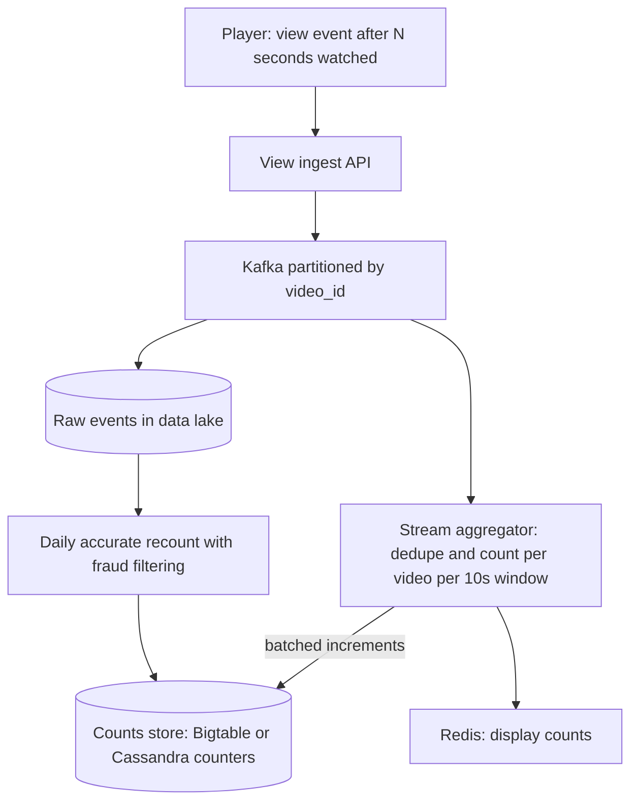

#### API

```http
POST /v1/views
{ "video_id": "v_42", "view_id": "uuid-per-playback", "watched_ms": 31000, "client_ts": 1731000000 }
202 Accepted

GET /v1/videos/v_42/views  ->  { "views": 1203348, "as_of": 1731000005 }
```

The ingest API returns `202` immediately after writing to Kafka; counting is asynchronous.

#### Deep dives

**Batch increments in the stream.** The aggregator (e.g. Flink) keeps an in-memory map `video_id → count` per 10-second window and, when the window closes, issues one `INCREMENT views BY n` per video. A viral video producing 100K events/s becomes **one write every 10 seconds**. Checkpointing the aggregator state together with Kafka offsets gives exactly-once *effects* on the counter.

```text
// per window, per partition
on event(e):
    if seenRecently(e.view_id): return        // dedupe retries and duplicates
    counts[e.video_id] += 1
on windowClose():
    for (video, n) in counts: counterStore.increment(video, n)
    displayCache.incrBy(video, n)
    counts.clear()
```

**Hot videos.** Because Kafka is partitioned by `video_id`, one viral video lands on one partition and one aggregator task. Options: pre-aggregate on the ingest servers (each server sends "v_42: +500" instead of 500 events), or **salt the key** (`v_42#0..v_42#15`) to spread across partitions and sum the shards when reading.

**Deduplication and fraud.**
- A `view_id` per playback session makes client retries idempotent.
- Ignore repeat views from the same user/device on the same video within a time window.
- Bot detection (abnormal rates from one IP or device, headless clients) runs both in-stream (cheap rules) and in batch (ML models over the full day).

**Two counts.** The display count is fast and approximate; the audited count is recomputed in batch from raw events after fraud filtering and is what drives payouts. YouTube famously used to pause public counts at around 300 (the "301 views" freeze) while it verified views; today the same idea shows up as counts that update with some delay.

**Reads.** View counts are read far more often than they change. Serve them from Redis or the page cache; a few seconds of staleness is fine. Make the displayed number **monotonic** on the client so a stale cache never shows a lower count than before.

#### Trade-offs

| Choice | Benefit | Cost |
|---|---|---|
| Window aggregation | Huge write reduction | Seconds of lag |
| Approximate display + exact batch | Fast UI and correct money | Two numbers that can briefly disagree |
| Counter columns (Cassandra) | Simple increments | Counters are not idempotent on retry, so make the aggregator the only writer, with checkpoints |

#### Failure modes

- Aggregator crash: restart from the last checkpoint and replay Kafka; no double counting thanks to transactional checkpoints.
- Counter store down: keep aggregating and retry; Kafka retains events.
- Batch recount disagrees with display: overwrite the stored value with the audited count.

#### Likely follow-ups

- *"Unique viewers instead of views?"* Use HyperLogLog per video per day: about 12 KB per sketch with ~1% error.
- *"Views per country per hour?"* Same pipeline with a composite key `(video_id, country, hour)` written to an analytics store.

</details>

### 15. Design Google Calendar.

<details>
<summary>Answer</summary>

**In short:** Store each event once with UTC start/end plus its IANA time zone, and store **recurring events as a single series with an RRULE** (RFC 5545) plus exception rows, expanding occurrences on the fly for the requested range. Invites write the event once and fan out attendee rows; free/busy is interval merging; reminders come from a time-bucketed scheduler; clients use delta sync with change tokens.

#### Requirements

- **Functional**: create events (one-off and recurring); invite attendees who accept or decline; reminders; day, week and month views; free/busy lookup for scheduling; time zones; shared calendars.
- **Non-functional**: reads (opening the calendar) far exceed writes; views should load in under ~200 ms; invites and reminders must be reliable; data must be correct across time zones and daylight-saving changes.

#### Data model

```sql
CREATE TABLE events (
  event_id    BIGINT PRIMARY KEY,
  calendar_id BIGINT,
  organiser   BIGINT,
  title       TEXT,
  start_utc   TIMESTAMP,
  end_utc     TIMESTAMP,
  timezone    TEXT,          -- e.g. 'America/New_York'
  rrule       TEXT,          -- e.g. 'FREQ=WEEKLY;BYDAY=MO;UNTIL=20271231T000000Z', NULL if one-off
  version     INT            -- optimistic concurrency for edits
);

CREATE TABLE event_exceptions (     -- edits to a single occurrence
  event_id       BIGINT,
  original_start TIMESTAMP,         -- which occurrence
  cancelled      BOOLEAN,
  new_start_utc  TIMESTAMP, new_end_utc TIMESTAMP, new_title TEXT,
  PRIMARY KEY (event_id, original_start)
);

CREATE TABLE attendees (
  event_id BIGINT, user_id BIGINT,
  response_status TEXT,             -- NEEDS_ACTION | ACCEPTED | DECLINED | TENTATIVE
  PRIMARY KEY (event_id, user_id)
);

-- per-user view index, sharded by user_id
CREATE TABLE user_calendar_index (
  user_id BIGINT, start_utc TIMESTAMP, event_id BIGINT,
  PRIMARY KEY (user_id, start_utc, event_id)
);
-- plus a list of each user's recurring series (few per user)
```

**Why not expand recurring events into rows?** A daily stand-up with no end date has infinite occurrences, and editing "all future events" would rewrite thousands of rows. Storing the rule once and expanding per request is cheap: a week view needs only a handful of occurrences.

#### Key flows

**Reading a week.**
1. Range query on `user_calendar_index` for one-off events in `[week_start, week_end)`.
2. Load the user's recurring series and expand each RRULE for that range, then apply exceptions (cancelled or moved occurrences).
3. Merge, sort and return. Cache the rendered range per user and invalidate on change.

**Invites.** The organiser's write creates the event once and inserts one `attendees` row and one index row per invitee. Emails and push notifications are sent asynchronously through a queue so a slow email provider never blocks event creation.

**Free/busy.** For a meeting with N attendees, fetch each attendee's busy intervals in the range, then sort and merge overlapping intervals; the gaps are free slots. Respect privacy: other users see only "busy", not titles.

```text
merge(intervals sorted by start):
    out = []
    for iv in intervals:
        if out not empty and iv.start <= out.last.end: out.last.end = max(out.last.end, iv.end)
        else: out.append(iv)
    return out      // free slots = gaps between merged intervals within working hours
```

**Reminders.** A [job scheduler](16-designs-core-infrastructure.md) keeps due reminders in time buckets (e.g. one bucket per minute). Workers poll the current bucket and send notifications. For recurring events schedule only the **next** occurrence's reminder, then schedule the following one after it fires.

**Time zones.** Store UTC plus the event's IANA zone. For recurring events, expansion must happen in the event's local zone: a 9:00 New York stand-up stays at 9:00 local after daylight saving changes, which means its UTC time shifts by an hour. Computing occurrences purely in UTC is a classic bug.

**Sync.** Mobile apps and CalDAV clients sync with **change tokens**: the server keeps a per-calendar change log, and a client sends its last token to receive only what changed since (delta sync).

#### Pitfalls

- Expanding recurrences in UTC (breaks across DST).
- Editing a series by mutating the original rule, which rewrites past occurrences; instead split the series at the edit date (end the old rule, start a new one).
- Synchronous email sending in the invite path.

#### Likely follow-ups

- *"Conflicting edits from two devices?"* Optimistic concurrency with `version`; the loser re-fetches and retries.
- *"Room booking?"* Rooms are calendars too, but booking needs a strongly consistent check that no overlapping accepted event exists.

</details>

### 16. Design an email service (like Gmail).

<details>
<summary>Answer</summary>

**In short:** Partition everything by `user_id`, because a mailbox is only accessed by its owner. Inbound mail arrives over SMTP, passes authentication (SPF/DKIM/DMARC) and spam filtering, and is written to a per-user metadata store, object storage for bodies and attachments, and a **per-user search index**. Outbound mail goes through a queue with retries and DKIM signing.

#### Requirements

- **Functional**: send and receive email with any other mail server (SMTP interoperability); mailbox storage; labels and threads; fast search; spam filtering; attachments; push to web and mobile clients.
- **Non-functional**: billions of users with GBs each (exabytes in total); very high durability (losing email is unacceptable); search in well under a second; inbound mail visible within seconds.

#### Estimates

1B users × 100 emails/day received ≈ 100B messages/day ≈ **1.2M messages/s** inbound on average. At ~50 KB average (more with attachments), that is several PB of new data per day before dedup and compression, which is why bodies go to cheap, erasure-coded object storage.

#### High-level design

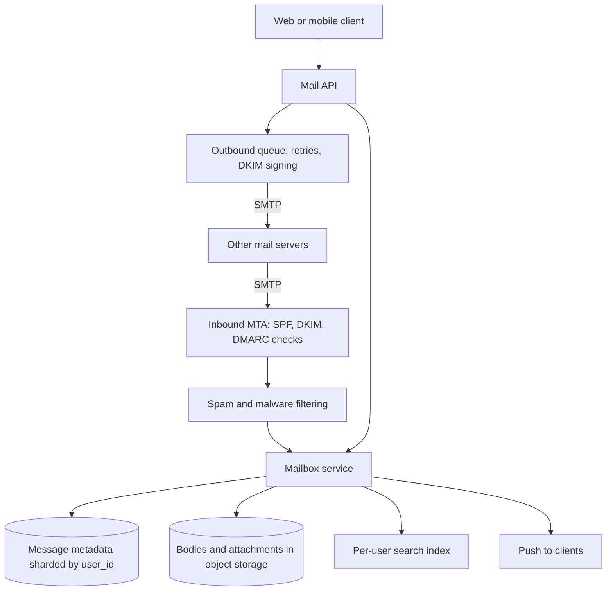

#### Data model

```text
messages:  (user_id, message_id) -> thread_id, from, to, subject, snippet,
                                   received_at, labels[], flags(read, starred),
                                   body_ref, attachment_refs[]
threads:   (user_id, thread_id)  -> last_message_at, message_ids[], labels[]
label_idx: (user_id, label, received_at DESC) -> message_id   // fast "Inbox" listing
blobs:     content_hash -> bytes  (object storage)
```

#### Deep dives

**Sharding by user.** Since mail is only read by its owner, every table and the search index are partitioned by `user_id`. A single request never crosses shards, and a user's data can be moved as a unit. Very large mailboxes are still fine because each user's data is small relative to a shard.

**Storage.** Metadata (headers, labels, thread ID, flags) lives in a wide-column store keyed by user, so listing the inbox is a range scan on `label_idx`. Bodies and attachments live in object storage referenced by content hash, so an attachment sent to 10,000 employees is stored once. Old mail moves to colder storage tiers.

**Search.** A per-user inverted index stored on the user's shard. It is small, so queries are fast, and it avoids the cost and privacy risk of one global index over everyone's mail. New mail is indexed asynchronously within seconds.

**Threads.** Group messages using the `Message-ID`, `In-Reply-To` and `References` headers, falling back to a normalised subject (strip "Re:", "Fwd:") within a time window.

**Outbound.** Sending is accepted into a durable queue immediately. Workers sign with DKIM, deliver over SMTP, and retry with backoff for up to several days because remote servers go down. Protect sender reputation with per-user rate limits and abuse detection; a compromised account sending spam can get the provider's IPs blocklisted.

**Spam.** Combine sender reputation (IP and domain), authentication results (SPF/DKIM/DMARC pass or fail), content ML models, and user feedback ("Report spam" and "Not spam" retrain the model).

**Push.** Clients hold a long-lived connection (or use mobile push) and receive a "mailbox changed" signal with a history ID, then fetch the delta, which is the same delta-sync idea used for calendars.

#### Failure modes

- Accept inbound SMTP only after the message is durably stored (SMTP lets the sender retry if you return a temporary error).
- Spam filter down: queue messages rather than bypass filtering.
- Shard failure: replicas across zones; a mailbox is unavailable only if all replicas fail.

#### Likely follow-ups

- *"How do you handle a 25 MB attachment?"* Upload to object storage first, then send a message referencing it; inline only small parts.
- *"Undo send?"* Hold outbound messages in the queue for a few seconds before delivery.

</details>

### 17. Design Facebook post search.

<details>
<summary>Answer</summary>

**In short:** Index posts in a sharded inverted index (with a fresh in-memory tier for new posts), query with scatter-gather, and solve the hard part, **privacy**, by combining a global index for public posts with an author-partitioned search over the searcher's friends' posts, then **filtering every result against visibility at query time** before ML ranking.

#### Requirements

- **Functional**: search posts by keywords; results include only posts the searcher is **allowed to see** (public, friends, friends-of-friends, custom lists); ranked by relevance, recency and social closeness.
- **Non-functional**: billions of posts; new posts searchable within seconds; deletes and privacy changes respected immediately; latency of a few hundred ms.

#### High-level design

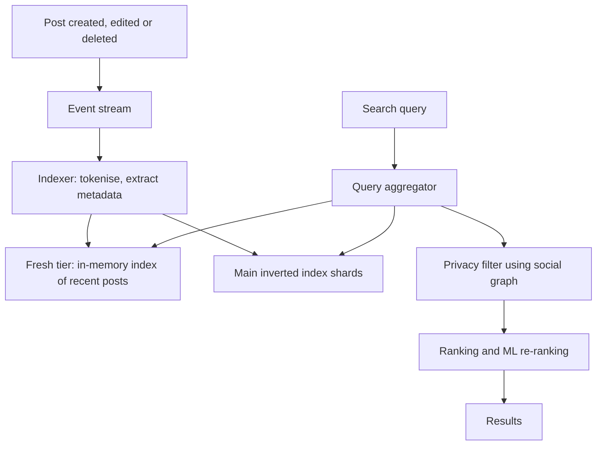

#### Indexing

When a post is created, an event goes to the indexer, which tokenises the text and writes posting lists (`term → [post_id, author_id, visibility, created_at, score features]`). The index is sharded by post ID (spreads load evenly) or by time (recent shards are hot and small, old shards are cold). New posts land first in a **fresh in-memory tier** so they are searchable in seconds; periodically the fresh tier is merged into the main shards.

#### Query

The aggregator sends the query to all relevant shards (**scatter-gather**). Each shard returns its top candidates with author and visibility metadata; the aggregator merges them. Time-sharding lets "recent posts" queries hit only the newest shards.

#### Privacy filtering: the hard part

| Approach | How | Good for | Problem |
|---|---|---|---|
| Post-filter | Retrieve candidates, then check each against the searcher's graph | Public posts (check is trivial) | For friends-only posts most candidates are filtered out, so you need to over-fetch |
| Per-audience index | Index posts under each audience segment | Small, fixed audiences | Explodes for friends-of-friends and custom lists |
| Author-restricted query | Add `author_id IN (searcher's friends)` to the query on an author-partitioned index | Friends-only content | Needs an index partitioned by author; large friend lists mean many shards |

The usual answer is a **combination**: public posts from the global index plus friends' posts from an author-partitioned index, merged, and then a final **visibility check on every result** as a safety net (the post's current privacy setting, blocks between users, deleted authors).

#### Ranking

First stage: text relevance (BM25-style) + recency. Second stage: an ML model using social closeness (how often you interact with the author), engagement on the post, and personal signals. Only the top few hundred candidates go through the expensive model.

#### Deletes and privacy changes

A deleted post or a post switched from public to friends must disappear quickly. Propagate through the same event stream to the index (tombstones in the fresh tier), **and** check current visibility at query time, because index updates can lag.

#### Pitfalls

- Relying only on the index's copy of visibility; it is always a little stale.
- Forgetting blocks: a blocked user must never see the blocker's posts, even public ones.

#### Likely follow-ups

- *"Search in comments too?"* Index comments as separate documents linked to the post, inheriting its visibility.
- *"Typeahead in the search box?"* A separate prefix index over people, pages and popular queries ([typeahead](16-designs-core-infrastructure.md)).

</details>

### 18. Design Amazon best-sellers (top-K per category).

<details>
<summary>Answer</summary>

**In short:** Stream confirmed order events through Kafka into a stream processor that keeps **windowed sales counts per (category, product)**, partitioned by category, and maintains a **top-K min-heap per category**. Every few minutes it publishes the top 100 per category to Redis or a KV store, which is served through caches because the list is the same for everyone.

#### Requirements

- **Functional**: top 100 products per category by sales over a recent window (e.g. last 24 hours); tens of thousands of categories in a hierarchy (Electronics → Phones → Android phones).
- **Non-functional**: updated every few minutes to hourly; very high read volume; resistant to manipulation.

#### Design

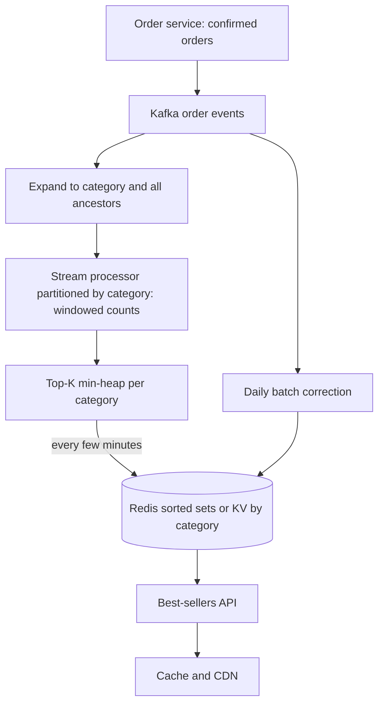

#### How the counting works

1. Each order event `(product_id, qty, ts)` is enriched with the product's categories and **all ancestor categories**, because a phone sale counts for "Android phones", "Phones" and "Electronics".
2. The stream processor keeps a **sliding 24-hour window**, implemented as hourly buckets: count per `(category, product)` per hour, and the window total is the sum of the last 24 buckets. When an hour drops out, subtract it.
3. Per category it keeps a **min-heap of size K**: when a product's count changes, if it beats the heap's minimum, it replaces it.
4. Periodically it writes the top 100 to the serving store.

```text
onCount(category, product, newCount):
    heap = heaps[category]                       // min-heap of size K
    if product in heap: heap.update(product, newCount)
    else if heap.size < K: heap.push(product, newCount)
    else if newCount > heap.min().count: heap.replaceMin(product, newCount)
```

Note: with sliding windows counts also go **down**, so a product can fall out while an outsider rises; in practice keep counts for all products of the category (or a larger candidate set, e.g. top 1,000) and rebuild the top K from that at publish time.

#### Scaling

- **Partition by category** so each category's heap lives on one worker.
- **Huge categories** (e.g. "Books" with millions of products): partition by product within the category, compute a local top-K per partition, then merge the partial lists (top-K of the union of local top-Ks is exact if each local list is large enough).
- **Extreme scale, approximate**: a Count-Min Sketch for counts plus a heap of heavy hitters uses fixed memory at the cost of small overestimates.

#### Serving

Redis sorted set per category (`ZADD bestsellers:phones score product`) or a simple KV `category → [product_ids]`. Because every user sees the same list, it caches extremely well at the CDN and application layers.

#### Manipulation and correctness

Count only **confirmed, non-cancelled** orders, cap counts per buyer, and run a daily batch job over the order database that subtracts returns and fraudulent orders and overwrites the streaming result.

#### Likely follow-ups

- *"Per-country best-sellers?"* Add country to the key: `(country, category)`.
- *"Trending (fastest rising) instead of best-selling?"* Rank by growth rate versus a baseline window instead of raw counts.

</details>

### 19. Design Amazon Locker.

<details>
<summary>Answer</summary>

**In short:** Model locations, compartments (by size) and reservations. At checkout, show lockers with forecast capacity; near delivery, **atomically reserve the smallest compartment that fits** (`AVAILABLE → RESERVED` conditional update). The kiosk is an edge device that must work offline: the courier deposits, the customer gets a hashed, expiring one-time code, pickup opens the door, and a scheduler returns uncollected packages after N days.

#### Requirements

- **Functional**: customer picks a locker location at checkout; the system assigns a compartment of the right size; the courier deposits the package; the customer receives a pickup code; pickup within N days or the package is returned.
- **Non-functional**: never assign one compartment to two packages; kiosks keep working during network outages; codes must be secure.

#### Data model

```text
Location(locker_id, geo, address, opening_hours, status)
Compartment(compartment_id, locker_id, size: S|M|L, status: AVAILABLE|RESERVED|OCCUPIED|OUT_OF_SERVICE)
Reservation(reservation_id, order_id, compartment_id, code_hash, expires_at,
            status: RESERVED|DEPOSITED|PICKED_UP|EXPIRED|RETURNED)
```

#### Lifecycle

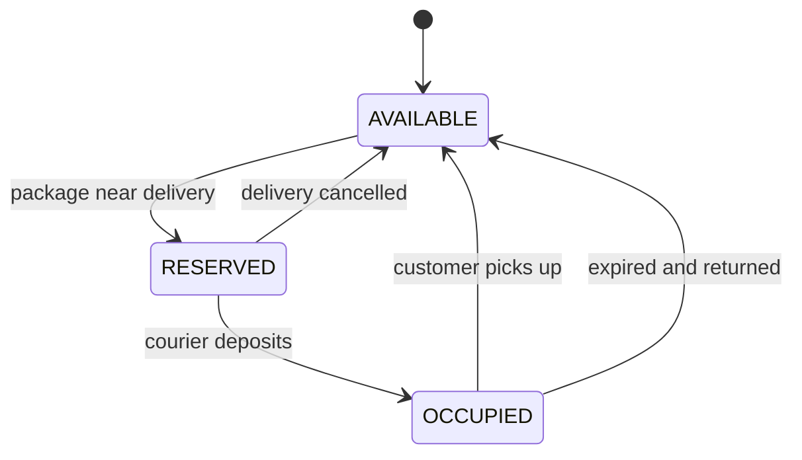

#### Key flows

**Checkout.** A geo query finds lockers near the customer's address. For each, a **capacity forecast** for the expected delivery date (current reservations + expected pickups) decides whether the package size fits. You don't reserve a specific compartment yet because delivery dates shift.

**Assignment.** When the package is out for delivery, reserve the smallest fitting size atomically:

```sql
UPDATE compartment
SET status = 'RESERVED'
WHERE compartment_id = (
    SELECT compartment_id FROM compartment
    WHERE locker_id = :locker AND size >= :needed AND status = 'AVAILABLE'
    ORDER BY size ASC LIMIT 1
    FOR UPDATE SKIP LOCKED
)
RETURNING compartment_id;
```

If no compartment is free (overbooking happens when pickups are late), fall back to a nearby locker and notify the customer.

**Delivery.** The courier scans the package at the kiosk. The kiosk opens the assigned door, a door sensor confirms the deposit, and the status becomes `OCCUPIED`. The system generates a random one-time code, stores only its **hash** with an expiry, and sends the code to the customer.

**Pickup.** The customer enters the code or scans a QR. The kiosk validates it (online, or against a locally cached hash list if offline), opens the door, and records the pickup. Events are buffered on the kiosk and synced when connectivity returns.

**Expiry.** A scheduler checks reservations past `expires_at`, marks them for return, and the next courier visit collects the package; the compartment then becomes `AVAILABLE`.

#### Edge device considerations

The kiosk is a small computer with locks, sensors and a screen. It needs a local copy of today's reservations and code hashes, a durable local event log, and idempotent sync (each event has an ID so replays don't double-apply).

#### LLD version

Often asked as LLD at Amazon: model `Locker`, `Compartment`, `Package`, a `CompartmentAssignmentStrategy` (smallest fit, or balance wear across compartments) and a `CodeGenerator`, with a `LockerService` coordinating them ([LLD](21-low-level-design.md)).

#### Likely follow-ups

- *"Two couriers at the same kiosk?"* The atomic reservation already prevents conflicts; deposits target specific compartments.
- *"A wrong-sized package?"* The courier can request reassignment to a bigger free compartment at the kiosk.

</details>

### 20. Design a photo backup service (like iCloud Photos / Google Photos).

<details>
<summary>Answer</summary>

**In short:** The phone detects new media and uploads it in the background with **resumable, chunked uploads**, skipping duplicates by content hash. The server stores originals in erasure-coded object storage and metadata in a DB sharded by user, runs a processing pipeline (thumbnails, transcoding, ML labels for search), and syncs other devices through a **per-user change log with sync tokens**, sending thumbnails first and originals on demand.

#### Requirements

- **Functional**: automatically back up all photos and videos; sync across devices; browse a timeline; search ("dog on a beach"); shared albums.
- **Non-functional**: exabytes of storage; extreme durability (people's memories); minimal battery and mobile-data use; uploads survive app kills and network drops.

#### Estimates

1B users × 5 photos/day × 3 MB ≈ **15 PB/day** of new originals. Storage cost dominates the design, so dedup, compression and cold tiering matter.

#### High-level design

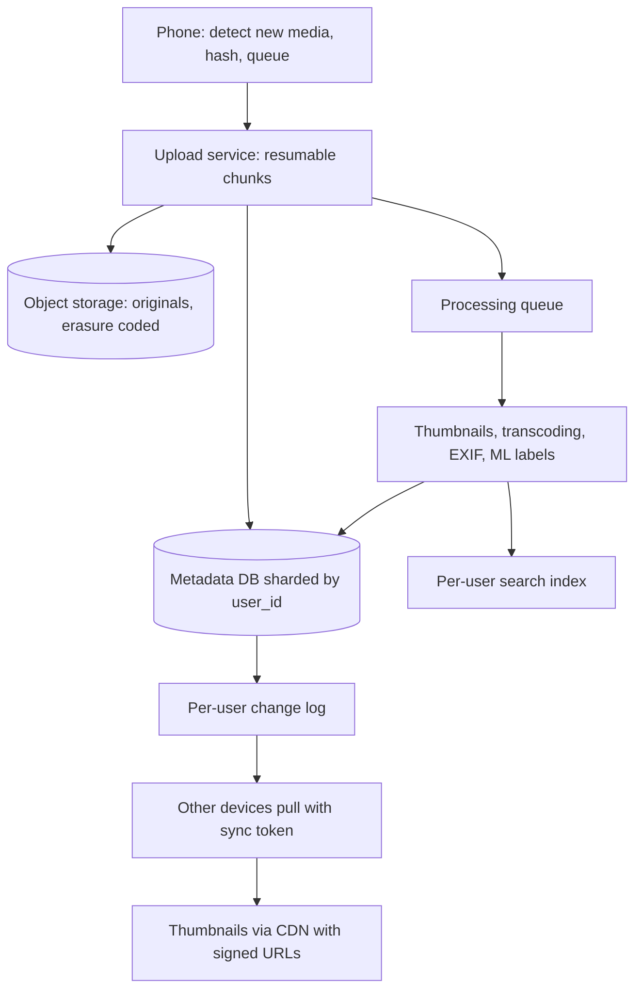

#### Client

- Watch the photo library for new items (Photos framework on iOS, MediaStore on Android).
- Schedule uploads with OS background APIs (background `URLSession` on iOS, `WorkManager` on Android) with constraints such as Wi-Fi only or charging only, set by the user.
- Compute a **content hash**; ask the server whether it already has it (re-installs and duplicates skip the upload).
- **Resumable chunked upload**: start a session, upload 4–8 MB chunks, and resume from the last acknowledged chunk after failure.

#### Server

- **Upload service** writes chunks to object storage, then commits a metadata row once the whole file and its hash are verified.
- **Object storage** uses erasure coding (cheaper than 3× replication for similar durability) and moves rarely accessed originals to colder tiers.
- **Metadata DB**, sharded by `user_id`: `(user_id, media_id) → taken_at, location, hash, size, albums, processing state`.

#### Processing pipeline

Asynchronous workers generate thumbnails and several resolutions, transcode videos, extract EXIF (time, place, camera), and compute ML labels, faces and embeddings for search. Privacy-focused designs such as Apple's run much of this ML **on the device** instead.

#### Sync

Every change (new photo, edit, delete, album change) appends to a per-user change log with a monotonically increasing sequence. A device stores its last sync token and asks "what changed since token T?". It downloads metadata and thumbnails first, and originals only on demand ("optimise storage" mode keeps small versions on the device).

#### Timeline and search

The timeline is a range query on `(user_id, taken_at)`, rendered with thumbnails from a CDN using short-lived signed URLs. Search uses a per-user index over labels, places, dates and people, or vector search over embeddings for natural-language queries.

#### Sharing and privacy

Shared albums have ACLs (member list) and optional link tokens. Data is encrypted at rest; with optional end-to-end encryption (Apple's Advanced Data Protection), the server can no longer read photos, so ML features must move fully on-device.

#### Pitfalls

- Uploading over cellular without user consent (battery and data complaints).
- Deleting the local copy before the server confirms the upload is durable.
- Treating edits as new photos (store edits as a non-destructive adjustment over the original).

#### Likely follow-ups

- *"Same photo from two devices?"* Content hash dedupes it into one media item.
- *"Deleted on one device?"* A delete event in the change log; keep a "recently deleted" grace period before purging.

</details>

### 21. Design an A/B testing / experimentation platform.

<details>
<summary>Answer</summary>

**In short:** Experiment configs are authored centrally and pushed to SDKs, which **assign users deterministically with `hash(user_id + experiment_salt) mod N`** without any lookup. SDKs log **exposure events**; a pipeline joins exposures with product events to compute metrics, and a stats engine produces trustworthy results (sample-ratio checks, CUPED variance reduction, sequential testing) with real-time guardrails that can stop harmful experiments.

#### Requirements

- **Functional**: define experiments with variants and target audiences; assign users consistently; ramp traffic gradually (1% → 50%); collect metrics; show statistically sound results.
- **Non-functional**: thousands of concurrent experiments; assignment adds negligible latency; results trustworthy; harmful experiments stopped quickly.

#### High-level design

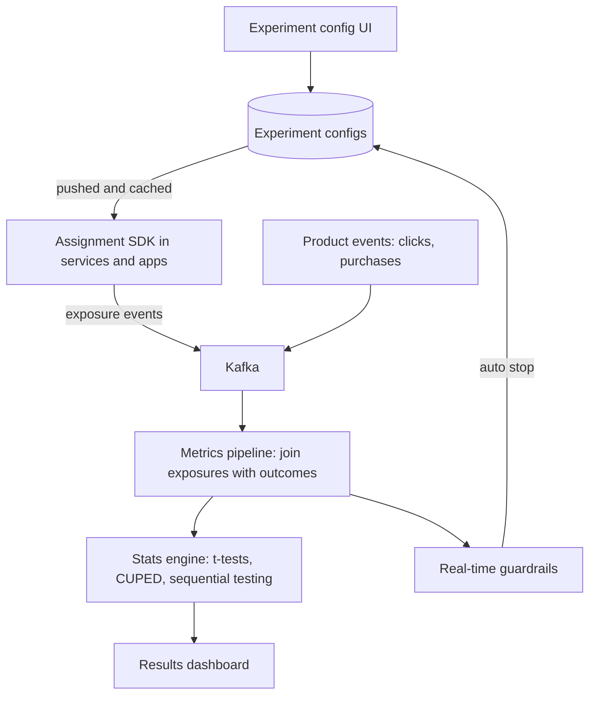

#### Deep dives

**Deterministic assignment.** No database lookup and no stored assignment table:

```kotlin
fun bucket(userId: String, experimentSalt: String, buckets: Int = 1000): Int {
    val h = murmur3_32("$experimentSalt:$userId")      // stable, well-distributed hash
    return Math.floorMod(h, buckets)
}
// variant A = buckets 0..499, variant B = 500..999; ramp by widening the eligible range
```

The same user gets the same variant across sessions, devices (if logged in) and services, because everyone computes the same hash. A different salt per experiment keeps experiments independent.

**Layers and mutual exclusion.** Experiments that touch the same surface (e.g. two checkout-button experiments) go in one **layer**, and each user is in at most one experiment per layer. Different layers use different hash salts, so they overlap independently, which lets thousands of experiments run at once.

**Exposure logging.** Log when a user actually *experiences* the variant (the screen rendered), not when they were assigned. Otherwise users who never saw the change dilute the effect.

**Metrics.** Define each metric once in a semantic layer (e.g. "conversion = purchases / exposed users"). Compute daily with batch jobs; compute **guardrail metrics** (crash rate, latency, errors, revenue) in near real time and automatically stop an experiment that harms them.

**Statistics.**

| Technique | Problem it solves |
|---|---|
| Sample ratio mismatch (SRM) check | 50/50 split shows 52/48: assignment or logging bug, so results are not trustworthy |
| CUPED (variance reduction using pre-experiment data) | Detects smaller effects with the same traffic |
| Sequential testing | Lets people check results early without inflating false positives from "peeking" |
| Multiple-comparison awareness | Testing 20 metrics will show one "significant" by chance |

#### Pitfalls

- Assigning on anonymous IDs and then switching to user IDs after login (users change variant).
- Changing the variant split mid-experiment for already exposed users.
- Declaring a winner after one day (novelty effects and weekly seasonality).

#### Likely follow-ups

- *"Feature flags vs experiments?"* Same assignment engine; a flag has no metrics analysis.
- *"Mobile apps offline?"* The SDK caches configs and computes assignments locally, logging exposures when back online.

</details>

### 22. Design LinkedIn "People You May Know" and connection degree.

<details>
<summary>Answer</summary>

**In short:** **Connection degree**: 1st is an adjacency lookup; 2nd is an intersection of the viewer's and target's connection lists; 3rd is too expensive per request, so precompute and cache **second-degree networks** for active users (LinkedIn has publicly described a dedicated distributed graph service for this). **PYMK** is a recommender: offline candidate generation (friends-of-friends weighted by mutual connections, shared company/school, contacts), an ML ranker predicting invite-and-accept, and online serving with filtering and fresh signals.

#### Connection degree

The graph has hundreds of millions of members and billions of edges, stored as adjacency lists sharded by member ID.

| Degree | How to compute | Cost |
|---|---|---|
| 1st | Is `target` in `connections(viewer)`? Single shard lookup | Cheap |
| 2nd | Do `connections(viewer)` and `connections(target)` intersect? Fetch both lists, put the smaller in a hash set (or Bloom filter), probe with the other | Moderate: lists can have thousands of entries |
| 3rd | Does any 2nd-degree connection of the viewer connect to the target? Equivalent to intersecting the viewer's 2nd-degree network with the target's connections | Very expensive: a 2nd-degree network can contain millions of members |

So for 3rd degree, precompute and cache the viewer's second-degree network (for active users, refreshed as connections change), or answer approximately, since the UI only needs a badge.

A search results page may show degree badges for 20 profiles at once, so these checks must be batched.

#### People You May Know

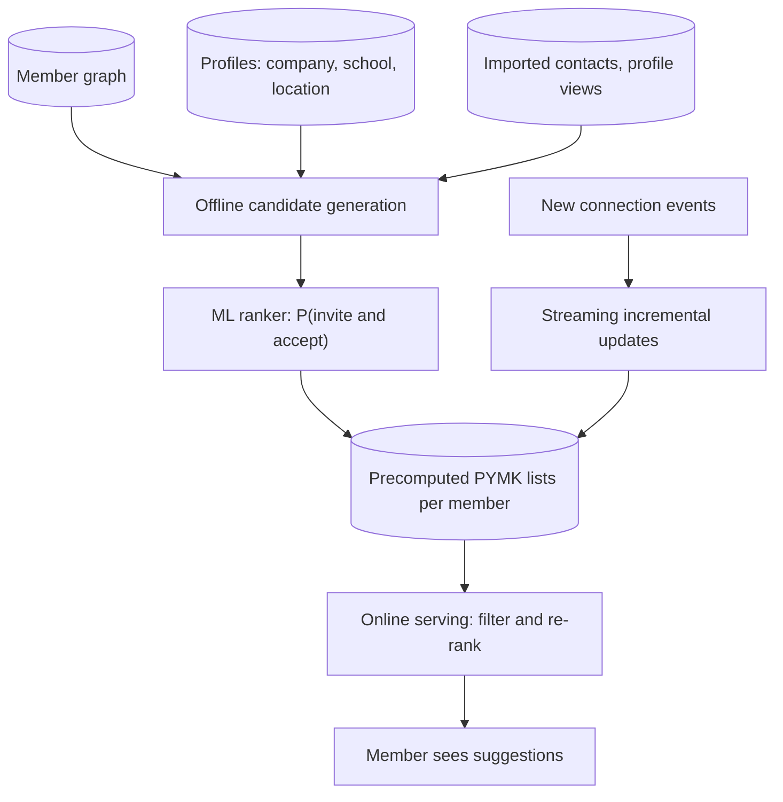

**Candidate generation (offline batch).**
- **Triangle closing**: friends-of-friends, weighted by the number of mutual connections (10 mutuals is a much stronger signal than 1).
- Overlap in company, school *and time* (worked at the same company during the same years).
- Imported address books and phone contacts, profile views in either direction, same groups.

**Ranking.** A model predicts the probability that the member sends an invite **and** the other person accepts, using features such as mutual connection count, profile similarity, seniority, and past interaction. Optimising only for "invite sent" would encourage spammy suggestions.

**Serving.** Precomputed candidate lists per member live in a key-value store. At request time, filter out people already connected, dismissed, blocked or pending, and re-rank with fresh signals (e.g. someone you just viewed).

**Freshness.** When a member makes a new connection, a streaming job adds the new connection's connections as candidates right away, so suggestions react within minutes rather than waiting for the nightly batch.

#### Pitfalls

- Computing friends-of-friends online for high-degree members (some have tens of thousands of connections).
- Showing suggestions that leak private information (e.g. suggesting someone only because they viewed your profile anonymously).

#### Likely follow-ups

- *"Cold-start member with no connections?"* Use company, school, location and contacts import.
- *"Measuring success?"* Invite acceptance rate and network growth, not clicks.

</details>

### 23. Design a webhook delivery system (like Stripe webhooks).

<details>
<summary>Answer</summary>

**In short:** Persist events first (transactional outbox), fan them out to each subscribed endpoint into **per-endpoint queues**, and have workers POST an **HMAC-signed** payload with a timeout. Retry failures with exponential backoff and jitter for up to about three days, isolate slow endpoints with per-endpoint concurrency limits and circuit breakers, and give merchants a delivery log, manual replay and an events API. Delivery is **at-least-once**, so receivers dedupe by event ID.

#### Requirements

- **Functional**: when an event happens (payment succeeded), POST it to each merchant endpoint subscribed to that event type; retries for up to days; delivery logs; manual resend.
- **Non-functional**: at-least-once delivery; ordering is not guaranteed (events carry IDs and timestamps); one slow or broken endpoint must not delay others; secure against spoofing and SSRF.

#### High-level design

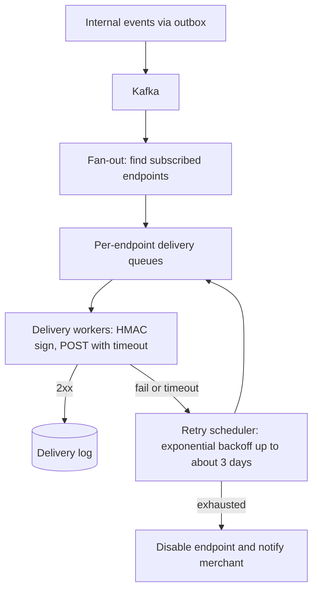

#### Data model

```text
endpoints(endpoint_id, merchant_id, url, secret, event_types[], status, failure_streak)
events(event_id, merchant_id, type, payload, created_at)
deliveries(delivery_id, event_id, endpoint_id, attempt, status, http_code,
           latency_ms, next_attempt_at, response_snippet)
```

#### Deep dives

**Reliability.** The business transaction (e.g. marking a payment succeeded) and the event row are written in the same DB transaction (**outbox**), then relayed to Kafka. This guarantees no event is lost even if the process crashes right after commit. Delivery is at-least-once, so the payload includes a stable `event_id` that receivers use to dedupe.

**Retries.** Exponential backoff with jitter, e.g. 1 min, 5 min, 30 min, 2 h, ... up to about 3 days. Treat `2xx` as success; retry on timeouts, `5xx` and `429`; decide per policy on other `4xx`. A retry scheduler can use a delay queue or a table indexed by `next_attempt_at`.

**Isolation (bulkheads).** If all endpoints shared one queue, a merchant whose server takes 30 s to time out would tie up workers and delay everyone. Use per-endpoint (or per-merchant) queues with **concurrency limits**, short timeouts (e.g. 10–30 s), and a **circuit breaker** that pauses delivery to an endpoint after repeated failures, probing occasionally.

**Security.**

```text
signed_payload = timestamp + "." + raw_body
signature      = HMAC_SHA256(endpoint_secret, signed_payload)
header         = "t=<timestamp>,v1=<hex signature>"
```

The receiver recomputes the HMAC with its secret, compares in constant time, and rejects requests whose timestamp is older than a few minutes (**replay protection**). Stripe publicly documents this pattern. In addition, send from fixed egress IPs so merchants can allowlist them, and resolve and **block private and internal IP ranges** before connecting, so a merchant can't register `http://169.254.169.254/` and make your workers attack internal services (SSRF).

**Observability.** Merchants see every attempt (status, latency, response snippet) in a dashboard, can resend manually, and can call an **events list API** to fetch anything they missed, which is the real safety net for reconciliation.

#### Trade-offs

| Choice | Why |
|---|---|
| No ordering guarantee | Ordering per endpoint would block all later events behind one failing event; receivers can use timestamps or fetch the latest object state |
| Thin vs fat payloads | Fat payloads are convenient; thin ones (just IDs) force a fetch that always returns the current state |

#### Likely follow-ups

- *"Merchant endpoint down for a week?"* Retries are exhausted, the endpoint is disabled and the merchant notified; they backfill via the events API.
- *"Secret rotation?"* Allow two active secrets during rotation and sign with both.

</details>

### 24. Design a UPI payment system (PhonePe / Google Pay / Paytm).

<details>
<summary>Answer</summary>

**In short:** UPI is run by NPCI; the app (a third-party app working through a sponsor PSP bank) **initiates and tracks** transactions but never holds the money. The core design is a **transaction state machine** with a unique transaction ID per payment (idempotency), handling of the very common **unknown/pending status** by polling and callbacks (never re-initiating), daily reconciliation with bank and NPCI files, per-bank circuit breakers, and strong device binding and fraud controls.

#### Context: who does what

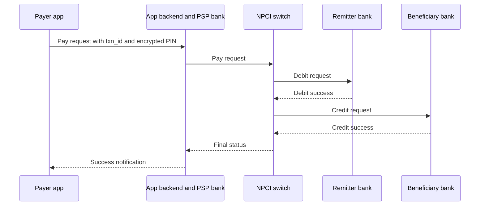

Volumes are very high (hundreds of millions of transactions per day in India), with peaks at festivals and at the start of the month when salaries arrive.

#### App-side design (PSP)

**Onboarding.** Device binding: the app sends an SMS from the phone's SIM to verify the mobile number belongs to this device. The user links bank accounts discovered by mobile number and sets a UPI PIN through the bank. The **PIN is encrypted on the device** with keys from NPCI's common library, so the app's servers never see it.

**Payment flow.**
1. Client creates a payment with a unique `txn_id` (idempotency key).
2. Backend persists it as `INITIATED`, then sends a pay or collect request via the PSP bank to NPCI.
3. Banks debit and credit; NPCI returns the final status.
4. Backend updates the state machine and notifies payer and payee.

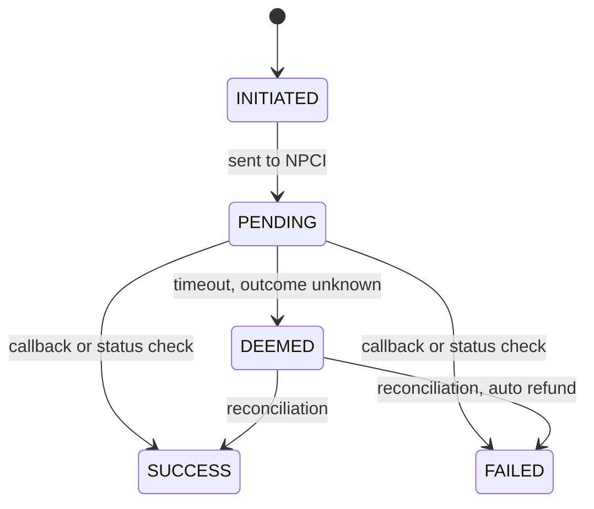

**Unknown status.** Timeouts between banks are common. Mark the transaction `PENDING` (or deemed), poll the status API with backoff, and rely on callbacks. **Never re-initiate with a new ID**; that is how users get debited twice. Daily **reconciliation** against bank and NPCI settlement files resolves anything still unclear, and failed debits are reversed automatically.

**Scale.**
- Stateless transaction services; the transaction DB sharded by `txn_id` (with a secondary index by user for history).
- Per-bank **circuit breakers** and health-based routing, because individual banks' success rates and latency vary a lot; show "Bank X is facing issues" instead of letting requests hang.
- Queues for notifications, SMS and analytics so they don't slow the payment path.

**Risk.** Velocity limits (number and amount per hour), device fingerprinting, fraud ML on payee and pattern, transaction limits as per NPCI rules, and warnings on collect requests (a common scam vector).

**UX.** Show a clear pending state ("we'll update you within X minutes") rather than an error. Merchants get instant confirmation through push to their app and voice sound boxes at the counter.

#### Pitfalls

- Treating a timeout as failure and letting the user retry with a new ID.
- Storing or logging the PIN in any form.
- One slow bank exhausting the shared connection pool (use per-bank bulkheads).

#### Likely follow-ups

- *"How are refunds handled?"* A new reverse transaction linked to the original, never an edit of the original.
- *"Exactly-once?"* At-least-once messaging plus idempotent processing keyed on `txn_id`.

</details>

### 25. Design a real-time stock price ticker for millions of users.

<details>
<summary>Answer</summary>

**In short:** Ingest exchange feeds through feed handlers into an internal pub/sub partitioned by symbol, and fan out through **WebSocket gateway servers** that each subscribe upstream only to symbols their users watch. **Conflate** ticks (send the latest price every 100–500 ms), use a **compact binary protocol**, send a snapshot on connect followed by deltas, and pre-scale before market open to absorb the connection spike.

#### Requirements

- **Functional**: stream live prices for thousands of instruments; each user watches ~10–50 symbols (watchlist, open positions, a chart).
- **Non-functional**: millions of concurrent users; under 1 s end-to-end latency; a huge connection spike at market open (9:15 IST for NSE); bandwidth-efficient on mobile.

#### Estimates

2M concurrent users × 30 symbols, with each symbol updating ~2 times/s after conflation, means ~120M messages/s fanned out. At ~20 bytes per binary tick that's ~2.4 GB/s of egress, which is why conflation and binary encoding matter. With ~100K connections per gateway you need at least 20 gateways, more with headroom.

#### High-level design

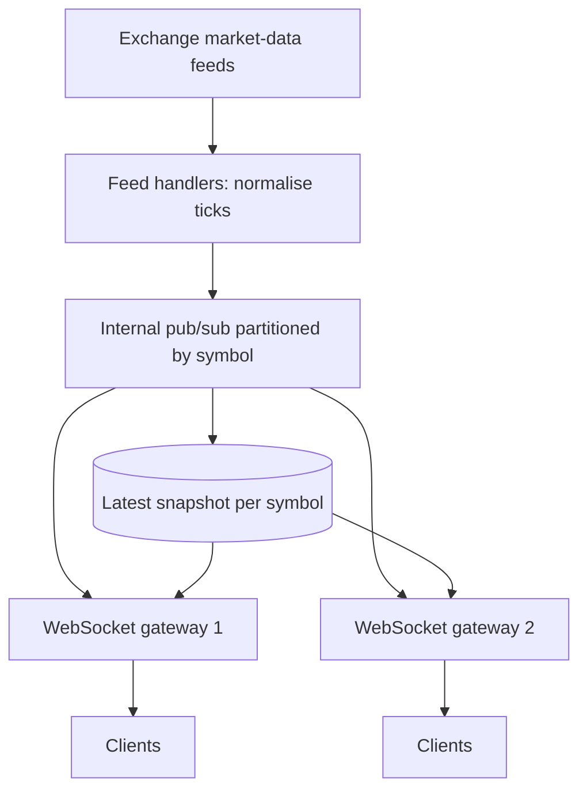

#### Deep dives

**Ingest.** Exchanges publish market data (often over multicast). Feed handlers decode the exchange format, normalise ticks into an internal format, and publish to Kafka or an in-memory bus partitioned by symbol, while updating a **latest-snapshot store**.

**Fan-out tier.** Each gateway keeps a map `symbol → set of local sockets`. It subscribes upstream **only** to symbols that at least one local user watches, so one upstream tick becomes thousands of local socket writes without crossing the network again. When the last watcher of a symbol disconnects, the gateway unsubscribes.

**Conflation.** Users can't read 50 updates per second. Per symbol, per connection (or per gateway), keep only the **latest** price and flush every 100–500 ms, dropping intermediate ticks. This cuts bandwidth and client CPU drastically, and a slow client simply gets fewer, newer updates instead of a growing backlog.

```text
onTick(symbol, tick): latest[symbol] = tick; dirty.add(symbol)
every 250 ms:
    for s in dirty: for socket in watchers[s]: socket.sendBinary(encode(latest[s]))
    dirty.clear()
```

**Binary protocol.** Compact binary messages (fixed-width integers for prices in paise, instrument tokens instead of symbol strings) instead of JSON. Zerodha's Kite ticker WebSocket API is a well-known public example of a binary tick format.

**Snapshots.** On connect or reconnect, the gateway sends the latest snapshot for each subscribed symbol, then live deltas. A client is never stuck with an empty screen until the next tick.

**Spikes and scaling.**
- **Pre-scale** gateways before market open; don't rely on autoscaling reacting to the spike.
- Connection rate limiting at the load balancer, and **reconnect with jittered backoff** in clients so a gateway restart doesn't cause a synchronised storm.
- Sticky routing is not required: a gateway's state is just subscriptions, so a client can reconnect to any gateway and resubscribe.

#### Trade-offs

| Choice | Benefit | Cost |
|---|---|---|
| Conflation | Bandwidth and CPU savings | Not every tick shown (fine for display, not for trading algorithms) |
| WebSocket vs SSE | Bidirectional subscribe/unsubscribe on one connection | Needs stateful connection handling |
| Binary vs JSON | 5–10× smaller | Custom decoding in clients |

#### Likely follow-ups

- *"Order updates for one user?"* A separate per-user channel on the same connection, never conflated, routed by user ID.
- *"Charts with history?"* Served from a time-series store over HTTP; the WebSocket only appends live candles.

</details>

### 26. Design live cricket streaming for 25M+ concurrent viewers (Hotstar).

<details>
<summary>Answer</summary>

**In short:** The video path is the standard [live streaming design](17-designs-social-media.md) (ingest → transcode → segment → CDN → adaptive bitrate). What's special is **extreme, sudden concurrency**: use multi-CDN with traffic steering, **pre-scale** before the match (autoscaling is too slow), make most APIs cacheable, shed non-essential features in a **panic mode** during peaks, cache entitlement checks, and make clients retry with jitter so they don't stampede the backend.

#### Why it's hard

Tens of millions watch the same match, and concurrency jumps by millions within a minute when a star batter walks in or the innings break ends. Every viewer's app also calls backend APIs (home page, scorecard, ads, entitlement). The video bytes are the easy part to cache; the **API surge** is what breaks systems.

#### High-level design

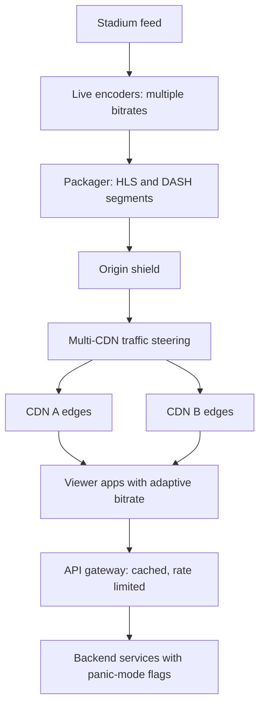

#### Deep dives

**Multi-CDN.** One CDN can't guarantee capacity everywhere, so traffic is split across several CDNs with steering based on real-time health (errors, throughput per region and ISP). Edge capacity is reserved ahead of big matches. Because everyone watches the same few seconds of video, the **cache hit ratio for segments is very high**, and an origin shield ensures each segment is fetched from the origin only once per CDN.

**Pre-scaling.** Autoscaling takes minutes to add capacity; a spike of millions of users can arrive in one minute. So infrastructure is scaled ahead of the match using traffic forecasts (past matches, teams playing, tournament stage) and validated with load tests that simulate tens of millions of synthetic users ("game day" rehearsals).

**Protect the backend.**
- Make most API responses cacheable or static: the home page, match scorecards and ad configuration are identical for large groups of users, so serve them from the CDN with short TTLs.
- **Panic mode**: feature flags that turn off non-essential features (personalised recommendations, some UI elements, non-critical calls) during peaks so the core path, playback, always survives. This graceful-degradation approach has been publicly described by Hotstar's engineering team.
- Rate limit at the gateway and return fast fallbacks rather than letting requests queue.

**Login and entitlement surges.** Millions check "can this user watch?" at match start. Issue signed playback tokens that the CDN edge can validate without calling the backend, and cache subscription status.

**Client behaviour.** Retries with exponential backoff and **jitter** so that after a brief failure, 20M clients don't all retry at the same second. Adaptive bitrate (ABR) lowers quality on poor networks instead of stalling; this matters a lot on mobile networks.

**Ads.** Server-side ad insertion stitches ads into the stream, targeted by audience segment (not per user, so segment playlists stay cacheable), timed to the over and wicket breaks.

**Observability.** Real-time dashboards for concurrency, buffering ratio, start-up time and errors per CDN, region and ISP, with the ability to shift traffic between CDNs within minutes.

#### Failure modes

| Failure | Mitigation |
|---|---|
| A CDN degrades in one region | Steering shifts that region to another CDN |
| Backend API overloaded | Panic mode, cached fallbacks, rate limiting |
| Encoder fails | Redundant encoder pipelines with automatic failover |
| Retry storm after a blip | Client jitter and server-side load shedding |

#### Likely follow-ups

- *"Reduce latency so viewers don't hear neighbours cheer first?"* Shorter segments or low-latency HLS/CMAF chunks, at the cost of lower cache efficiency and more requests.
- *"Live concurrency counter on screen?"* Approximate counts aggregated from heartbeats, updated every few seconds, never computed per request.

</details>

---

[⬅ Previous: AI/ML Systems & What's New](22-ai-ml-whats-new.md) · [⬅ Back to index](../README.md)
